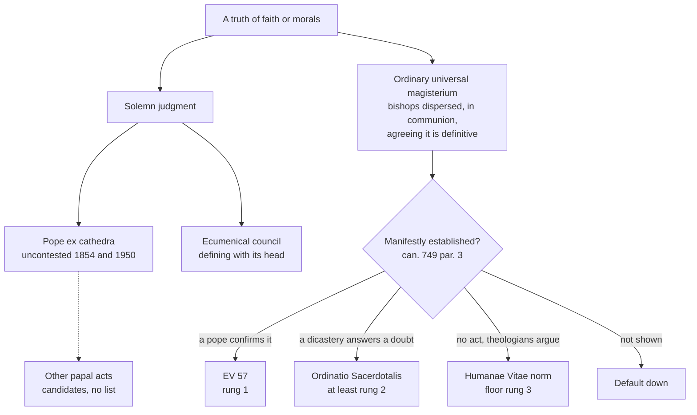

# The Church & Mary · Lesson 4.4: Infallibility in exercise, and the ordinary universal magisterium

> ⏱ ~15 min · Module 4: The Petrine office · Builds on: [4.3 Vatican I and *Pastor Aeternus*](04-03-vatican-i-and-pastor-aeternus.md), [`fundamental-theology` 4.2](../../fundamental-theology/lessons/04-02-infallibility-and-its-conditions.md) · Unlocks: [4.5 Vatican II: primacy, collegiality, synodality](04-05-vatican-ii-primacy-collegiality-synodality.md)

## Why this matters

[4.3](04-03-vatican-i-and-pastor-aeternus.md) read the definition of 1870. This lesson asks how it is used. Two papal acts meet its conditions beyond dispute, one before the council (1854) and one after it (1950). Yet the Church holds a great deal infallibly, mostly by a route few Catholics can name: the bishops of the world teaching one thing as definitive, without meeting or signing anything. Then come the hardest case in the record, a pope anathematized by an ecumenical council, and Newman's account (1875) of what the definition asks of a Catholic.

## The idea

**Reload, don't re-derive.** [`fundamental-theology` 4.2](../../fundamental-theology/lessons/04-02-infallibility-and-its-conditions.md) taught the machinery. Infallibility is the Church's protection from error in a definitive act, exercised by three organs:

- the pope defining [*ex cathedra*](../reference.md#ex-cathedra) under ch. 4's four conditions;
- an ecumenical council defining with its head;
- the [ordinary universal magisterium](../reference.md#ordinary-universal-magisterium): the bishops dispersed through the world, in communion with one another and with Peter's successor, teaching authentically on faith or morals and agreeing on one judgment as definitively to be held (*Lumen Gentium* 25, paraphrased).

Its object is [primary or secondary](../reference.md#primary-and-secondary-object), and the rungs and assents are [`fundamental-theology` 4.4](../../fundamental-theology/lessons/04-04-the-ladder-of-doctrinal-authority.md)'s. [Can. 749 §3](../reference.md#canon-749) sets the default: no doctrine counts as infallibly defined unless that is manifestly evident. All three are offices, not personal gifts: the teaching office as an institution, whose collegial side is [4.5](04-05-vatican-ii-primacy-collegiality-synodality.md)'s.

**Definitions are the exception.** A definition answers a question someone has put in doubt. In Newman's phrase, the Church "only speaks when it is necessary to speak" (*Letter to the Duke of Norfolk*, 1875, §9). Much that Catholics hold as revealed was defined by no pope and no conciliar canon: that Scripture is free from error ([`fundamental-theology` 4.4](../../fundamental-theology/lessons/04-04-the-ladder-of-doctrinal-authority.md)), say, or that directly killing the innocent is gravely wrong. They are held infallibly because the episcopate has always taught them as belonging to the faith. Vatican I put this into the sentence the whole ladder hangs on (*Dei Filius*, 1870, ch. 3; DH 3011; Schaff's translation):

> all those things are to be believed with divine and Catholic faith ... which the Church, either by a solemn judgment, or by her ordinary and universal magisterium, proposes for belief as having been divinely revealed.

*Either ... or*: two routes to one rung.

## The doctrine

1. **The route has a pedigree.** Pius IX's letter *Tuas libenter* (21 December 1863), sent to the archbishop of Munich after a scholars' congress there, said the submission of faith reaches beyond express definitions, to what is handed on as revealed by "the ordinary magisterium of the whole Church dispersed throughout the world" (lesson's translation). *Dei Filius* adopted the idea, LG 25 stated its conditions, can. 749 §2 codified them. *In words:* named in a letter, taught by one council, specified by another.
2. **Two papal acts are uncontested, and every other is a candidate.** *Ineffabilis Deus* (1854) and *Munificentissimus Deus* (1950) are the two that nobody contests, and no magisterial list goes further. Benedict XII's *Benedictus Deus* (1336) is often proposed (Ex 1). Joseph Fessler, the council's secretary-general, held only "the last sentences" of *Unam Sanctam* infallible (Newman, Postscript), which [4.2](04-02-the-development-of-papal-claims-read-honestly.md) grades. The lists differ because the test dates from 1870, and applying it to a medieval bull means judging that bull's address and intention. Can. 749 §3 resolves every such doubt downward. *In words:* say "two, plus candidates", never a number.
3. **The ordinary route is real, and every claim made on it has to be shown.** The bishops must agree in proposing a teaching *as definitive*; that they all hold or teach it is not enough. Built lessons show three outcomes:
   - *A papal act confirms it.* *Evangelium Vitae* 57 (1995) cites LG 25 and confirms that directly killing the innocent is gravely wrong: rung 1, with the verb "confirm", not "define" ([`moral-theology` 5.1](../../moral-theology/lessons/05-01-the-inviolability-of-innocent-life.md)).
   - *A dicastery answers a doubt.* The CDF's 1995 response says the teaching of *Ordinatio Sacerdotalis* was set forth infallibly by this route. It is at least rung 2, and rung 1 against rung 2 is disputed ([`fundamental-theology` 4.4](../../fundamental-theology/lessons/04-04-the-ladder-of-doctrinal-authority.md), Ex 2).
   - *No act settles it.* *Humanae Vitae*'s norm has a rung-3 floor; whether it was already infallibly taught is freely disputed, Ford–Grisez against Sullivan ([`moral-theology` 6.3](../../moral-theology/lessons/06-03-humanae-vitae-its-authority.md)).

   *In words:* the burden of proof stays on whoever invokes the route.
4. **Two objects, taught at two weights.** The CDF's *Mysterium Ecclesiae* (ME, 1973) §3 teaches, as "Catholic doctrine", that infallibility covers the deposit and also what is needed to guard and expound it, and claims revealed status only for the first extension. The CDF's 1998 commentary on the Profession of Faith (§11) gives examples. To be believed: inerrancy, the grave wrong of directly killing the innocent, the pope's primacy and infallibility. To be held: the wrongness of euthanasia and of fornication, and dogmatic facts. The commentary adds that papal infallibility was already held as definitive *before* 1870, when Vatican I defined it as revealed. *In words:* a definition can move a truth from "held" to "believed".

**Said plainly.** An ecumenical council anathematized a pope by name, and a pope confirmed it. At Session XIII of Constantinople III (681), the council judged the letter of [Honorius](../reference.md#honorius) (pope 625–638) to Sergius "foreign to the apostolic dogmas" and decreed, in Percival's translation:

> And with these we define that there shall be expelled from the holy Church of God and anathematized Honorius who was some time Pope of Old Rome, because of what we found written by him to Sergius

At Session XVI the bishops acclaimed the anathema. In the Latin Percival prints, Leo II confirms the council and says Honorius "tried by profane betrayal to subvert the spotless faith" (lesson's translation). A milder variant says he *permitted* the faith to be stained, and which reading is original is disputed ([`christology` 2.5](../../christology/lessons/02-05-monothelitism-and-constantinople-iii.md)). The papal profession preserved in the *Liber Diurnus* repeated it (Percival). At Vatican I, Hefele pressed the case against defining ([`church-history` 8.2](../../church-history/lessons/08-02-pius-ix-vatican-i-and-the-fall-of-rome.md)).

5. **What the definition asks (Newman).** Against Gladstone's charge that after 1870 Catholics had renounced their mental freedom, Newman's §9 reads the definition strictly. He follows Fessler's *True and False Infallibility* (1871), which he says carried papal approbation. With Billuart, he says a pope is not infallible in conversation, consultation, answering letters or private deliberation. With Perrone, a council is not infallible in its reasons or in matters touching persons; nor, Newman adds, in the prefaces to its definitions. *In words:* believe what was defined, in the sense defined, and nothing more.
6. **The deposing power.** *Regnans in Excelsis* (25 February 1570) excommunicated Elizabeth, declared her deposed and released her subjects from allegiance ([`church-history` 6.3](../../church-history/lessons/06-03-the-english-reformations.md)). In §3 Newman cites Pius IX's reply, three years earlier, to a Roman academy: the [deposing power](../reference.md#deposing-power) was a right of the "ages of faith", resting on public law and the common consent of peoples, and to call a pope infallible in exercising it is malicious. Newman's verdict is that it is "not necessary for any Catholic to acknowledge", though he owns that he does, on Pius IX's conditions. *In words:* a sentence on a ruler is jurisdiction, not doctrine defined.

**Mark the levels** ([levels of authority](../reference.md#levels-of-authority)).

- **Rung 1:** that the dispersed bishops can teach infallibly (two councils teach it, and ME 3 calls *Dei Filius*'s sentence a definition); 1854 and 1950, *ex cathedra*; Constantinople III's two wills.
- **Taught, not defined:** that infallibility reaches the secondary object. ME 3 claims revealed status only for the primary object, so marking the extension rung 1 overstates.
- **No rung by mere assertion:** a claim, with no act behind it, that some teaching is infallible by the ordinary route. Can. 749 §3, a rule of interpretation and not a doctrine, governs it.
- **No act settles it:** whether any other papal act is *ex cathedra*.
- **Not a level at all:** Honorius's anathema, which is a historical fact. That his letters were not *ex cathedra* is the common judgment of theologians since 1870, not a magisterial act.
- **Authentic teaching:** *Tuas libenter*, a letter to one archbishop.
- **Never defined:** the deposing power. No act teaches it today, and infallibility is excluded from it, so default down.
- **No magisterial level:** Newman's *Letter*.

## Ways a truth is infallibly taught

The solemn side is rare; the ordinary side carries most of the weight, and each exit from the diamond needs an act or argument you can point to.

## Worked examples

**Ex 1: a dispute about the route is not a dispute about the rung.** *Benedictus Deus* defines that the souls of the just who need no further purification see the divine essence before the general judgment. Its "by apostolic authority we define" (*auctoritate apostolica definimus*) is strong evidence for the supreme-authority and defining conditions. But whether it is *ex cathedra* in Vatican I's sense is a judgment about a text 534 years older than the test; no act has made it, and can. 749 §3 forbids presuming it. The rung of the *content* does not wait on that dispute. Florence's decree for the Greeks (*Laetentur caeli*, 1439) states the core of the doctrine under its own *definimus*: the purified are received into heaven at once and see God clearly. The 1998 commentary lists the immediate recompense after death among first-paragraph truths. So the content is **rung 1** by a conciliar route, whatever is said of 1336. Always name *which* act fixes the rung.

**Ex 2: Honorius, run through the conditions.** Put the letter to Sergius through ch. 4.

- *Pastor and teacher of all Christians?* No. Sergius consulted him, and he answered one patriarch.
- *Supreme apostolic authority?* Newman sets the letters beside the solemn forms of *Pastor Aeternus* and *Quanta cura* and finds them "written almost as private instructions".
- *Defining?* No: on their face, Newman says, part of a discussion toward a later decision.
- *To be held by the whole Church?* No.

It fails every condition. Newman's conclusion (§8):

> At the utmost it only decides that Honorius in his own person was a heretic, which is inconsistent with no Catholic doctrine

Now say as plainly what the case *does* touch. A pope answering a patriarch's doctrinal question wrote what an ecumenical council, confirmed by a pope, judged heretical: papal teaching outside the conditions is unprotected, and not hypothetically. The case presses hardest on a sentence that is not the definition: ch. 4's historical preamble says the see of Peter has remained "ever free from all blemish of error" (Schaff). That sentence is explanation, not definition ([4.3](04-03-vatican-i-and-pastor-aeternus.md)), and how to read it beside Honorius is argued. Honorius refutes a maximal papalism that 1870 did not define, not what it defined.

## Watch out

- **"Never defined, so not infallible."** Papal infallibility itself was held as definitive before 1870 (1998 commentary, §11). No pope ever *defined* that directly killing the innocent is gravely wrong. The ordinary route reaches rung 1.
- **"Every bishop teaches it, so it is infallible."** This overstates twice: the bishops must agree in proposing it *as definitive*, and that agreement must be manifestly evident. A national conference calling something "the constant faith" is a particular act making a claim about the universal route.
- **"Honorius wrote privately, so the case is closed."** That understates: it settles the definitional question, not the hard fact that a council and a pope judged a pope's doctrinal letter heretical.
- **"Pius V deposed Elizabeth, so Catholics must hold that popes can depose rulers."** That overstates: the power was never defined, Pius IX excluded infallibility from it, and Newman says no Catholic need acknowledge it.

## One-liner

> Most infallible teaching is the bishops agreeing on what is definitive, not a pope defining; every claim on either route must be shown, and Honorius marks what the conditions never promised.

## Problems

**P1 (🟢)** *(Exegetical)* Four invented teaching acts. For each, give the **mode** (solemn papal · solemn conciliar · ordinary universal · authentic non-definitive). If the act involves infallible teaching, also give the **object** (primary or secondary) and the **rung**. One line each.

(a) An ecumenical council, its decrees confirmed by the pope, anathematizes a heresy and then declares, binding the whole Church, that a named theologian's book teaches that heresy in its obvious sense.

(b) The CDF answers a formal doubt, with the pope's approval and order to publish. It states that a certain doctrine has been taught constantly by the bishops in communion with the pope as divinely revealed and to be believed, and so has been set forth infallibly by the ordinary and universal magisterium.

(c) A pope addresses the whole Church and invokes the authority of Christ, of Peter and Paul, and his own. He declares and defines as divinely revealed a doctrine concerning the resurrection of the body, to be believed by all the faithful.

(d) Every bishop of one country signs a joint pastoral letter, read in all their parishes, which teaches "as the constant faith of the Church" that a certain practice is gravely wrong.

**P2 (🟡)** *(Exegetical)* Close reading. Newman, *Letter to the Duke of Norfolk*, §9, points 7–8:

> 7. Accordingly, all that a Council, and all that the Pope, is infallible in, is the direct answer to the special question which he happens to be considering …
>
> 8. This rule is so strictly to be observed that, though dogmatic statements are found from time to time in a Pope's Apostolic Letters, &c., yet they are not accounted to be exercises of his infallibility if they are said only obiter—by the way, and without direct intention to define. A striking instance of this sine qua non condition is afforded by Nicholas I., who, in a letter to the Bulgarians, spoke as if baptism were valid, when administered simply in our Lord's Name …; but he is not teaching and speaking ex cathedrâ, because no question on this matter was in any sense the occasion of his writing.

(a) Which condition of *Pastor Aeternus* ch. 4 does Newman read as failing in Nicholas I's letter? Which words of the passage carry that reading? (b) Name one thing in a *genuine* definition that point 7 places outside the protection, giving an example from this lesson. Then give the level of Newman's rule itself. **Two sentences per part.**

**P3 (🔴)** *(Exegetical)* An **invented** transcript from a student debating society. The motion: "This house believes papal infallibility was refuted in 681."

> **Adaeze (proposing):** "In 681 an ecumenical council anathematized Pope Honorius as a heretic, and Pope Leo II confirmed it. So a pope taught heresy, and Vatican I's dogma that the pope cannot err in matters of faith was refuted twelve centuries before it was defined."
>
> **Haruto (opposing):** "The condemnation is a myth. Cardinal Baronius showed that Honorius's name was put into the Acts later. Even Leo II blamed him only for negligence. And since Honorius was answering a question about the faith, his letter was *ex cathedra*. So if the council condemned it, the council erred on a question of fact."

(a) Find **two** errors in each speech, and correct each from the record or from the text of ch. 4. One line per error. (b) In **two sentences**, say what the Honorius case touches and what it does not, and mark the level of each claim you make. Do not argue for or against the definition.

Solutions

**P1** *(Exegetical)*

**Must hit, strict:**

- (a) **Solemn conciliar.** The judgment that the book teaches the heresy is a **dogmatic fact**, so the object is **secondary** and the rung is **2** (firm holding). The anathema on the heresy itself, if the heresy contradicts a revealed truth, protects a primary-object truth at rung 1. Credit for separating the two layers.
- (b) **Ordinary universal.** The CDF's response does not define anything. It certifies that the bishops' agreement exists, and it carries the weight of what it certifies ([`fundamental-theology` 4.5](../../fundamental-theology/lessons/04-05-reading-a-documents-weight.md)). Object: **primary**, since the doctrine is proposed as revealed. **Rung 1.**
- (c) **Solemn papal,** *ex cathedra* on its face: universal address, supreme authority, a defining verb, the whole Church bound. Object: **primary.** **Rung 1.**
- (d) **Authentic non-definitive.** A conference is particular, so its act is at most rung 3 on its own authority. It is not the ordinary universal magisterium, which means the bishops dispersed *through the world* with Peter's successor. "The constant faith of the Church" is a *claim* about the universal route, and it has to be manifestly established (can. 749 §3). Until it is, assign no object.

**Wrong turns:** calling (b) a dicastery's infallible act (the infallibility belongs to the bishops' teaching it reports, not to the response). Calling (d) ordinary universal because every bishop *of the country* agreed. Making (a) primary because a council said it. Requiring the word "define" in (b) (the ordinary route has no defining formula).

**Model answer:** (a) solemn conciliar; secondary (dogmatic fact); rung 2. (b) ordinary universal, certified by the CDF; primary; rung 1. (c) solemn papal, *ex cathedra*; primary; rung 1. (d) authentic non-definitive, particular; at most rung 3; its "constant faith" claim is unproven until manifestly established.

---

**P2** *(Exegetical)*

**Must hit, strict (a):** the condition that fails is **"defines"**, the intention to settle a question definitively. The words that carry it are "without direct intention to define", "said only obiter—by the way", and "no question on this matter was in any sense the occasion of his writing". Credit for noting that a letter to one people would also fail the universal-address condition, but that is not Newman's argument here.

**Must hit, strict (b):** point 7 excludes everything except the direct answer. That leaves out the reasons, the arguments and the historical preamble around a definition (§9 also names prefaces). Example: ch. 4's sentence that the see of Peter has remained "ever free from all blemish of error" (Ex 2), or the scriptural arguments a bull uses. Level: Newman's rule is a **theologian's rule of interpretation with no magisterial level**. Fessler's papal approbation, which Newman reports, does not make Newman's *Letter* magisterial. Credit for noting that can. 749 §3 later wrote a related default into law.

**Wrong turns:** discussing whether baptism in Christ's name alone is valid, which is beside the point and belongs to `sacraments-and-liturgy`. Naming "faith or morals" as the failed condition, when baptism is plainly faith. Treating Newman's rule as defined, or as Vatican I's own text.

**Model answer:** (a) Newman reads the *defining* condition as failing. Nicholas spoke "only obiter … without direct intention to define", since "no question on this matter was in any sense the occasion of his writing" (Newman goes on: the question put to him concerned the minister of baptism, not its form). (b) The reasons and preamble around a definition are not protected, for example ch. 4's narrative claim about the see of Peter. Newman's rule is a theologian's rule of strict interpretation with no magisterial level, consonant with the later can. 749 §3.

---

**P3** *(Exegetical)*

**Must hit, strict (a):**

- Adaeze 1: Vatican I did **not** define that "the pope cannot err in matters of faith". It defined (rung 1) that the pope's *ex cathedra* definitions, under four conditions, are infallible.
- Adaeze 2: the inference fails. Honorius's letter to one patriarch meets **none** of the conditions, so it is no counterexample to what was defined.
- Haruto 1: the condemnation is in the Acts. Session XIII decreed it, Session XVI acclaimed it, Leo II confirmed it, and the papal profession in the *Liber Diurnus* repeated it. Baronius's forgery theory is rejected even by those of his own communion (Percival, citing Hefele).
- Haruto 2: "only negligence" picks **one variant** of Leo II's letter. The Latin Percival prints says Honorius tried to subvert the faith, and which reading is original is disputed.
- Haruto 3 (credit as either of his two): "answering a question about the faith" does not make a letter *ex cathedra*. It was not addressed to all Christians, invoked no supreme authority, and defined nothing for the whole Church.

**Must hit, strict (b):** it **touches** papal teaching outside the conditions. A pope's doctrinal letter was judged heretical by an ecumenical council confirmed by a pope. That is a historical fact, not a rung, and it bears directly on maximal papalism and on ch. 4's narrative sentence, which is explanation, not definition. It does **not touch** the definition, which is rung 1 and limited to acts meeting the conditions. That the letters were not *ex cathedra* is the common judgment of theologians, not a magisterial act.

**Wrong turns:** **volunteering a rebuttal**, such as defending the definition's truth or attacking it; the task is what the case shows. Adopting Haruto's "the council erred", which is Pennacchi's view, reported by Percival as against almost all theologians, and unnecessary once the letters are seen not to be *ex cathedra*. Understating: "Honorius is irrelevant to infallibility."

**Model answer (b):** The case shows, as historical fact, that a pope's doctrinal letter could be judged heretical by an ecumenical council and a confirming pope, so papal teaching outside the conditions has no protection, and ch. 4's narrative about Peter's see (explanation, not definition) is strained. It leaves the rung-1 definition untouched, because on the theologians' common judgment, not a magisterial one, the letters met none of its conditions.

## Flashback

**From Lesson [4.2](04-02-the-development-of-papal-claims-read-honestly.md) (The development of papal claims, read honestly):** *(Exegetical.)* Close reading. The Council of Sardica (343 or 344, under Julius I), canon 3, Greek text in Percival's translation. Hosius of Corduba is proposing what should happen when a bishop condemned in his own province thinks his case a good one:

> … in order that the question may be reopened, let us, if it seem good to your charity, honour the memory of Peter the Apostle, and let those who gave judgment write to Julius, the bishop of Rome, so that, if necessary, the case may be retried by the bishops of the neighbouring provinces and let him appoint arbiters; but if it cannot be shown that his case is of such a sort as to need a new trial, let the judgment once given not be annulled, but stand good as before.

What followed: most Eastern bishops had withdrawn at the outset to meet separately at Philippopolis, and no later authority counted Sardica an ecumenical council. Pope Zosimus (417–418), intervening in an African appeal, sent legates whose written instructions quoted a companion canon of Sardica on bishops' appeals as a decree of "our brethren in the Council of Nice". At Carthage in 419 the African bishops said they had not found those words in their copies of Nicaea, and would observe them only until authentic copies came from the East. The copies sent from Constantinople and Alexandria did not contain them. Hefele, whom Percival prints, explains that old collections ran the two councils' canons together under Nicaea's title, so Zosimus may have erred in good faith.

(a) Put 4.2's three questions to the canon: what does it show Rome **claimed**, what did others **concede**, and what has the Church since **defined**? For the first two, quote the words that decide. **One sentence each.**

(b) A student writes: "Zosimus passed this canon off as Nicene, so it is a forgery like Pseudo-Isidore, and anticipation must throw it out." Correct the student in **two sentences**.

Solution

**Accept:** for "claimed" in (a), "nothing, in this text" with the synod's words, or Rome's later use of the canon, provided the answer keeps the synod's grant apart from a Roman claim.

**Must hit, strict (a):**

- **Claimed:** nothing by Rome in this text. The provision is the synod's own motion, offered "if it seem good to your charity", and Rome is the see written *to*: "let those who gave judgment write to Julius". The Roman claim on its strength appears when Zosimus invoked the companion canon, under Nicaea's name, for his own intervention.
- **Conceded:** by a synod most Eastern bishops had left, a review role. The bishop of Rome decides whether a condemned bishop's case is reopened and names the judges ("let him appoint arbiters"), while "the bishops of the neighbouring provinces" retry it; otherwise the first sentence stands. The stated motive is Petrine: "honour the memory of Peter the Apostle". In 419 the Africans conceded the companion canon only provisionally, pending proof that it was Nicene.
- **Defined:** nothing here. A disciplinary canon of a council never counted ecumenical carries no rung. What the Church has since defined is the pope's full and supreme power of jurisdiction over the whole Church, in discipline and government as well as faith (*Pastor Aeternus* ch. 3, canon: **rung 1**), and the chapter teaches that in all causes belonging to the Church "recourse may be had to his tribunal" (Schaff). 1870 does not certify Sardica's procedure, and Sardica does not show 1870's jurisdiction in 343.
- Credit for noting that Tillemont and de Marca (in Percival's notes) read "if it seem good" as granting a right Rome had not had before: their reading, not a settled fact.

**Must hit, strict (b):**

- **Not a forgery.** The canon is Sardica's own, extant in Greek and Latin. What went wrong under Zosimus was its attribution to Nicaea, which Hefele explains by how the collections were copied: a probable good-faith error, not a fabrication.
- **What anticipation may do with it:** use it as Sardica's, a largely Western synod's grant made in Peter's memory in 343 or 344, never as Nicaea's. The Nicene label inflated it as 4.2 says the forgeries inflated the early evidence, so the evidence is real but thinner than Zosimus's citation made it look.

**Wrong turns:** reading "honour the memory of Peter" as a Roman claim or as a definition of primacy. Having Rome retry the case itself; in this canon it decides whether there is a retrial and appoints the judges. Calling Sardica ecumenical. Reading 1870 back into 343. On (b), the opposite slide: "misattributed, so worthless".

**Model answer:** (a) Rome claims nothing in this text: the synod makes the provision "if it seem good to your charity" and has the judges "write to Julius", and Rome's claim on it appears with Zosimus, under Nicaea's name. The bishops at Sardica, with most Easterners gone, conceded that the bishop of Rome decides whether a case is reopened and names the judges from neighbouring provinces, to "honour the memory of Peter the Apostle". Nothing here is defined; what 1870 defined is full and supreme jurisdiction (*Pastor Aeternus* ch. 3, rung 1), which neither certifies Sardica's procedure nor is shown by it. (b) The canon is genuine Sardican legislation that Zosimus attributed to Nicaea, probably in good faith because the collections ran the two councils together, and a misattribution is not a forgery. Anticipation may use it as a largely Western synod's grant of 343 or 344, not as Nicaea's, and must discount the weight the Nicene label added.

## Connections

- **Backward:** [4.3](04-03-vatican-i-and-pastor-aeternus.md) read the definition this lesson applies. [`fundamental-theology` 4.2](../../fundamental-theology/lessons/04-02-infallibility-and-its-conditions.md) supplied the conditions, the two acts and can. 749 §3, and [4.4](../../fundamental-theology/lessons/04-04-the-ladder-of-doctrinal-authority.md) supplied the rungs. [`christology` 2.5](../../christology/lessons/02-05-monothelitism-and-constantinople-iii.md) tells the monothelite story behind Honorius. [`church-history` 8.2](../../church-history/lessons/08-02-pius-ix-vatican-i-and-the-fall-of-rome.md) gives the minority's historical objections, and [6.3](../../church-history/lessons/06-03-the-english-reformations.md) gives the bull of 1570 whose standing is settled here.
- **Forward:** [4.5](04-05-vatican-ii-primacy-collegiality-synodality.md) takes the college that exercises the ordinary route, and LG 22–23. [6.3](06-03-the-immaculate-conception.md) and [6.4](06-04-the-assumption.md) state the content of the two uncontested acts. `creation-grace-last-things` ([syllabus](../../creation-grace-last-things/syllabus.md)) reads *Benedictus Deus* and the dispute it closed; [`moral-theology` 1.2](../../moral-theology/lessons/01-02-beatitude-the-last-end.md) rightly calls the vision defined (Ex 1).
- **Sideways:** [`moral-theology` 6.3](../../moral-theology/lessons/06-03-humanae-vitae-its-authority.md) reads Newman's "minimism" (§9), and [`moral-theology` 2.5](../../moral-theology/lessons/02-05-the-primacy-of-conscience-rightly-understood.md) his §5 on conscience. `apologetics-catholic-claims` ([syllabus](../../apologetics-catholic-claims/syllabus.md)) 7.1 uses this lesson's line between a definition and a disciplinary act on Galileo and the Inquisition. Weber's separation of office from private activity, which [`social-theory` 4.4](../../social-theory/lessons/04-04-bureaucracy-rationalization-and-disenchantment.md) applies to infallibility "only ex cathedra", is the sociologist's description of The idea's "offices, not personal gifts".
