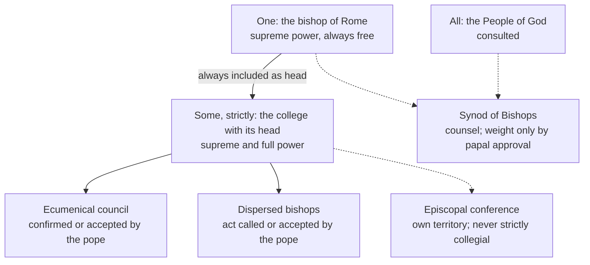

# The Church & Mary · Lesson 4.5: Vatican II: primacy, collegiality, synodality

> ⏱ ~15 min · Module 4: The Petrine office · Builds on: [4.3 Vatican I and Pastor Aeternus](04-03-vatican-i-and-pastor-aeternus.md), [3.1 Bishops and apostolic succession](03-01-bishops-and-apostolic-succession.md), [3.3 The laity, charisms, and the sensus fidei](03-03-the-laity-charisms-and-the-sensus-fidei.md) · Unlocks: [5.1 Outside the Church there is no salvation](05-01-outside-the-church-there-is-no-salvation.md), [5.3 Ecumenism as doctrine](05-03-ecumenism-as-doctrine.md)

## Why this matters

*Pastor Aeternus* calls itself the *First* Dogmatic Constitution on the Church of Christ. There was no second: the council was suspended on 20 October 1870 and never reconvened ([`church-history` 8.2](../../church-history/lessons/08-02-pius-ix-vatican-i-and-the-fall-of-rome.md)). For nearly a century the defined constitution named a pope with ordinary and immediate jurisdiction over every church ([4.3](04-03-vatican-i-and-pastor-aeternus.md)) and said almost nothing about bishops. *Lumen Gentium* ch. 3 named a second holder of supreme power. This lesson reads that claim, the note that fixed its meaning, and what grew from it. The skill: sort what is defined, what is taught, and what is custom that could change.

## The idea

Vatican I: the pope has full and supreme power over the whole Church. *Lumen Gentium* 22: the college of bishops is *also* the subject of supreme and full power over the universal Church. Two supreme powers sounds like a constitutional crisis waiting to happen.

It is not, because the second holder contains the first. The college is never the bishops *minus* the pope; it is the bishops *with* their head, and it cannot act without him. The real distinction, says the note appended to the chapter, is between the pope alone and the pope with the bishops. Picture a set and a superset containing it: every act of the larger subject includes the head's act, and the head can also act alone. No configuration lets the bishops outvote him.

**Collegiality** is the bishops as a body with their head. **Synodality** is the whole People of God walking together, with college and pope inside it. The International Theological Commission's *Synodality in the Life and Mission of the Church* (2018, §64) compresses it to *all, some, one*: the *sensus fidei* of the faithful, the college of bishops, the bishop of Rome's ministry of unity.

## Source

Apostolic Canon 34 (35 in Percival's alternative count, *NPNF* second series, vol. 14), from a fourth-century Antiochene collection received in East and West:

> The bishops of every nation must acknowledge him who is first among them and account him as their head, and do nothing of consequence without his consent; but each may do those things only which concern his own parish, and the country places which belong to it. But neither let him (who is the first) do anything without the consent of all; for so there will be unanimity, and God will be glorified through the Lord in the Holy Spirit.

Read the shape of the act. The canon governs a region ("parish" is the bishop's see, *paroikia*), and its two clauses are **symmetric**: the many do nothing weighty without the first, and the first nothing without the many. At the universal level Vatican II keeps the first clause and does not make the second a juridical condition of the pope's acts.

## The doctrine

1. **The college, with its head and never without him** (*Lumen Gentium* 22). The [college of bishops](../reference.md#college-of-bishops) succeeds the apostolic college; membership needs consecration *and* hierarchical communion ([3.1](03-01-bishops-and-apostolic-succession.md)). With the pope, it holds supreme and full power over the universal Church. The same paragraph keeps the primacy whole: the pope's power remains full, supreme, universal and always free. Each bishop's own power stays his, not the pope's on loan (LG 23, 27). *In words:* the bishops together really govern the whole Church, never apart from the pope.

2. **The college acts in two ways** (LG 22; can. 337 §§1–2): solemnly, in an ecumenical council, which is ecumenical only if the pope confirms or at least accepts it; or dispersed, when he calls the bishops to collegial action or approves or freely accepts their united action. *In words:* whatever else bishops do together is less than an act of the college.

3. **The [Nota explicativa praevia](../reference.md#nota-explicativa-praevia).** On 16 November 1964 the Secretary General gave the Fathers a note from higher authority, by whose meaning and intent ch. 3 was to be understood. (i) "College" is not a juridical body of equals delegating to a president; the Peter–apostles, pope–bishops parallel is a proportion. (ii) Consecration gives the *munera*; power ready to act needs canonical determination (both in [3.1](03-01-bishops-and-apostolic-succession.md)). (iii) The distinction is the pope alone versus the pope with the bishops; whether to act personally or collegially is his judgment. (iv) He can always exercise his power at will; the college acts strictly only from time to time, and only with its head's consent. A closing N.B. leaves the power exercised de facto in the separated Eastern churches to theologians (Ex 2). *In words:* no conciliarist reading, and no pope as the college's chairman.

**Said plainly.** The key to the chapter was not voted by the Council. It was communicated on the pope's authority in the third session's most contentious week ([`church-history` 9.2](../../church-history/lessons/09-02-the-second-vatican-council.md)'s "Black Week"), and *Lumen Gentium* passed five days later, 2,151 to 5. The Nota's third point says what it protects: the pope's fullness of power.

4. **[Collegiality](../reference.md#collegiality), strict and affective.** Only the whole college acting as such is collegial in the strict ("effective") sense. The rest is the collegial spirit ("affective" collegiality): LG 23 commends episcopal bodies for putting that "collegiate feeling" into practice, and *Apostolos Suos* (1998), naming it *affectus collegialis*, adds that a territory's joint action never takes on the collegial character proper to the order of bishops. Two institutions belong here:
   - **The [Synod of Bishops](../reference.md#synod-of-bishops)**, created by Paul VI's *Apostolica Sollicitudo* (15 September 1965), counsels. It decides only if the pope grants deliberative power, and then he ratifies (can. 343). Under *Episcopalis Communio* (2018) art. 18, its final document shares in his ordinary magisterium only if he expressly approves it; [3.3](03-03-the-laity-charisms-and-the-sensus-fidei.md) weighs the 2024 Final Document on that basis.
   - **[Episcopal conferences](../reference.md#episcopal-conferences).** A doctrinal declaration is the conference's authentic magisterium only if the members approve it unanimously, or if at least two-thirds of the bishops belonging to it with a deliberative vote approve it and Rome grants the *recognitio* (*Apostolos Suos*, complementary norms art. 1). It binds only its own territory ([`fundamental-theology` 4.1](../../fundamental-theology/lessons/04-01-the-magisterium.md)).

5. **[Synodality](../reference.md#synodality)** is not a word of *Lumen Gentium*. It entered working vocabulary through Francis's address of 17 October 2015, for the Synod's fiftieth anniversary, and the ITC document above. It adds the consultation of the whole people to collegiality, its "some", and subtracts nothing from 1–4.

6. **[*Ut Unum Sint*](../reference.md#ut-unum-sint) (John Paul II, encyclical, 25 May 1995), §§95–96.** Heeding other Christians' requests, the pope seeks a way of exercising the primacy that renounces nothing essential to its mission yet is open to a new situation, and invites their leaders and theologians into patient, fraternal dialogue. The distinction doing the work is between the office's essentials and the form of its exercise. The Dicastery for Promoting Christian Unity's *The Bishop of Rome* (presented 13 June 2024, published with Francis's agreement) synthesizes the responses and dialogues since. Among its proposals: an official re-reading of Vatican I in the light of Vatican II, and a clearer line between the pope's patriarchal role in the Latin Church and his ministry of unity, a reflection it traces to the 2006 removal of "Patriarch of the West" from the *Annuario Pontificio*.

7. **The [Ravenna document](../reference.md#ravenna-document)** (13 October 2007), of the Catholic–Orthodox Joint International Commission, finds primacy and conciliarity at three levels, local, regional and universal, with a *protos* at each. It takes Canon 34 as the regional pattern (§24) and calls primacy and conciliarity interdependent. At the universal level it records agreement on the *fact* of primacy, disagreement on its exercise and its scriptural and theological foundations (§43). It postpones the role of the first see, and the reading of Vatican I and II in the light of the first millennium (§45). Moscow's delegation had walked out over an intra-Orthodox dispute.

   The Moscow Patriarchate's Holy Synod answered in 2013 with a *Position* disagreeing with Ravenna's last part. Primacy exists at every level of church order, it holds, but its nature differs by level, so a *primus*'s functions cannot be carried from one level to another. The universal primacy of the first millennium was one of honour, not of power, instituted by men and not by God (citing the fourteenth-century Nilus Cabasilas). Within Orthodoxy that primacy of honour now belongs to Constantinople.

**Mark the levels** ([the ladder](../../fundamental-theology/lessons/04-04-the-ladder-of-doctrinal-authority.md); [reading a document's weight](../../fundamental-theology/lessons/04-05-reading-a-documents-weight.md)). *Pastor Aeternus* chs. 3–4 are **rung 1** ([4.3](04-03-vatican-i-and-pastor-aeternus.md)), and LG 22's restatement of the primacy keeps that rung. On the college, LG 22–23 **teach and do not define**. The Theological Commission's declaration, read out on 16 November 1964, said the Council defines as binding only what it openly declares so, and ch. 3 declares nothing so (can. 749 §3). The college as permanent subject of supreme power, and the dispersed collegial act, are **authentic conciliar magisterium, rung 3 at its heaviest**. Whether this is one subject acting in two ways or two subjects not adequately distinct is **freely disputed**. The Nota has no rung of its own: it is ch. 3's authorized key and weighs what ch. 3 weighs. The Synod, conferences, election by the cardinals, curial structures and papal titles are **ecclesiastical law and custom**, changeable by the authority that made them. *Ut Unum Sint* is an encyclical, rung 3 for its doctrine; its invitation is a request, not a teaching. *The Bishop of Rome* (by its preface, no summary of the magisterium) and Ravenna (by its preface, no official declaration of the Church's teaching) sit **below the seam**.

## Who acts, and with what weight

Solid arrows: acts of supreme power. Dotted: counsel and collegial spirit, not acts of the college.

## Worked examples

**Ex 1: the clean case, *Lumen Gentium*'s own promulgation.** Its closing formula: the pope, by his apostolic power, together with the Fathers, approves, decrees and establishes it. *Subject:* the college with its head, in council (claim 2). *A ratification from outside?* No: the Nota (iv) chose "consent" to exclude dependence on an outsider. *Counterfactuals:* without his confirmation, 2,151 votes would be no act of the college; and Paul VI could have taught the same content alone, but chose the collegial form, as the Nota (iii) leaves him free to.

**Ex 2: where it strains. Is an Orthodox bishop a member of the college?** Consecration: the Catholic Church holds that the Orthodox churches have true sacraments and, by apostolic succession, the priesthood (*Unitatis Redintegratio* 15; validity is [`sacraments-and-liturgy`](../../sacraments-and-liturgy/syllabus.md)'s). Hierarchical communion with the pope: absent. So by LG 22 he is not a member. Now the strain. The Nota's N.B. says the *munus* cannot be exercised without hierarchical communion. Yet *Unitatis Redintegratio* 16 solemnly declares that the Churches of the East have the power to govern themselves by their own disciplines. On Catholic premises, where does an Orthodox bishop's governing power come from? The Nota saw the question and left it to theologians. The texts settle membership, which is no, and leave Orthodox jurisdiction **freely disputed**. Ravenna therefore starts from what both sides inherit: a *protos* and a synod at each level.

## Watch out

- **You might think collegiality binds the pope to the bishops' majority.** The college has no authority without its head, and his power stays always free (LG 22; Nota iv); a Synod majority advises (can. 343).
- **You might think *Ut Unum Sint* put the whole primacy up for negotiation.** Only the form of its exercise; nothing essential is renounced.
- **Overstating and understating.** "Ravenna settled primacy", "*The Bishop of Rome* is new teaching" and "LG 22 defined collegiality" all overstate. "Vatican II was pastoral, so collegiality is optional" understates: LG 22–23 is conciliar teaching owed religious submission ([`fundamental-theology` 4.3](../../fundamental-theology/lessons/04-03-religious-submission.md)).

## One-liner

> The college holds supreme power only with its head inside it, and the pope holds it alone too; synods, conferences and dialogues are counsel, communion and custom, each weighed by its genre.

## Problems

**P1 (🟢)** *(Exegetical: apply to hard cases.)* Four **invented** documents. For each, say whether it is (i) an act of the college of bishops, (ii) a papal act, and if so whether teaching or law, (iii) a conference's authentic magisterium, or (iv) none of these. Name the text that decides. One line each.

(a) The final document of a special assembly of the Synod of Bishops for an invented region, voted by the assembly. The pope thanks the members and authorizes the General Secretariat to publish it, without approving it.

(b) A doctrinal declaration of an invented bishops' conference with 48 member bishops holding a deliberative vote. At a plenary with 41 present, 31 vote in favour, and the conference sends it to Rome for the *recognitio*.

(c) An apostolic constitution merging two dicasteries of the Roman Curia, issued by the pope without consulting the bishops.

(d) A decree on a point of liturgical discipline, signed by nearly every diocesan bishop of the Latin Church after a petition circulated among them, claiming to bind the whole Latin Church. The pope has neither called for it nor accepted it.

**P2 (🟡)** *(Exegetical: diagnose.)* An **invented** press release from the invented Diocese of Wrenfield, written for this problem:

> "The Diocese of Wrenfield welcomes the Holy Father's commitment to the synodal path. As the Second Vatican Council defined, synodality is simply another name for collegiality: the Church is now governed by the bishops together, and the Pope is bound to implement whatever the Synod of Bishops decides by majority. In the same spirit, our national bishops' conference acts as an organ of the college, and its declarations carry the college's authority for the whole Church. Since John Paul II asked other Christians to help redesign the papacy, and the Vatican's 2024 study document has now agreed their proposals, every feature of the primacy is open to negotiation."

Find **four** errors. For each, give the correction and the text that fixes it, with its level where a level is involved. 150 words or fewer.

**P3 (🔴)** *(Exegetical: find the crux.)* Ravenna takes Apostolic Canon 34 (this lesson's Source) as the pattern of primacy and conciliarity, and says the universal level has a first too. (a) In two sentences each, state how the Catholic definition (*Pastor Aeternus* ch. 3, read with LG 22 and the Nota) and the Moscow Patriarchate's 2013 *Position* each treat primacy at the universal level. (b) Name the single premise on which they split, and say in one sentence why "whether there is a universal primacy at all" is **not** the crux. State the positions; do not reply to either.

Solutions

**P1** *(Exegetical)*

**Must hit, strict:**

- (a) **(iv).** Publication is not approval. *Episcopalis Communio* art. 18 §1 lets the pope decide on publication, and only a document he expressly approves shares in his ordinary magisterium. The Synod counsels (can. 343) and is not the college, since strict collegiality belongs only to the whole college (*Apostolos Suos*). What remains is the advice of the bishops who voted it.
- (b) **(iv).** Not unanimous, and two-thirds of the 48 member bishops is 32. So 31 falls short, though it is 76% of those present, and the *recognitio* route never opens (*Apostolos Suos*, art. 1).
- (c) **(ii), law.** The pope may act alone because his power is full, supreme and always free (LG 22; can. 331). It binds as law, carries no doctrinal rung, and a successor can change it (the genre table of [`fundamental-theology` 4.5](../../fundamental-theology/lessons/04-05-reading-a-documents-weight.md)).
- (d) **(iv).** The dispersed bishops act as a college only if the head calls them or approves or freely accepts their united action (LG 22; can. 337 §2). Signatures do not substitute for that, and no bishop governs beyond his own church (LG 23).

**Wrong turns:** treating publication in (a) as approval; counting two-thirds of those *present* in (b); thinking (c) needs collegial consent, or that its genre makes it doctrine; counting signatures in (d) as if numbers made a college act.

**Model answer:** (a) None: published, not expressly approved (EC 18 §1); the Synod only counsels (can. 343). (b) None: 31 is short of two-thirds of 48 members (32), so no *recognitio* can make it the conference's magisterium. (c) A papal act of law: valid alone (LG 22; can. 331), no doctrinal rung, changeable. (d) None: no call or acceptance by the head (LG 22; can. 337 §2).

---

**P2** *(Exegetical)*

**Accept:** any four of the five below, each with its correction and source.

**Must hit, strict:**

- **"As the Council defined."** Vatican II defined nothing new; the Council defines as binding only what it openly declares to be so (Theological Commission, read out 16 November 1964). LG 22–23 is authentic teaching, rung 3 at its heaviest.
- **"Synodality is another name for collegiality."** The word is not in *Lumen Gentium*. Synodality is all, some and one (ITC 2018, §64); collegiality is the bishops' part.
- **"The Pope is bound by the Synod's majority."** The college never acts without its head, and his power is always free (LG 22; Nota iv). The Synod is not the college, counsels, and decides only by papal grant, with papal ratification (can. 343).
- **"The conference carries the college's authority for the whole Church."** A conference's joint action is never strictly collegial (*Apostolos Suos*). Its doctrinal declarations bind only its territory, and only under art. 1's conditions.
- **"Every feature is negotiable; the study document agreed."** *Ut Unum Sint* 95 renounces nothing essential and concerns the form of exercise, and *Pastor Aeternus* chs. 3–4 stay rung 1. *The Bishop of Rome* is a study document below the seam that agrees nothing on the Church's behalf.

**Wrong turns:** correcting the first error by saying Vatican II "taught nothing binding", which understates; calling the conference's declarations worthless, when they are authentic magisterium for its own faithful once art. 1 is met; saying the primacy cannot change in any respect, which overshoots *Ut Unum Sint*'s own distinction.

**Model answer:** Vatican II defined nothing new. The Council bound only what it openly declared binding, so LG 22–23 is authentic teaching at rung 3. Synodality is not collegiality: the word is absent from *Lumen Gentium*, and the ITC (2018) describes it as all, some and one, of which collegiality is the bishops' part. The pope is not bound by a Synod majority. The college never acts without its head, his power is always free (LG 22; Nota), and the Synod only counsels unless he grants it deliberative power and ratifies (can. 343). A conference is never strictly collegial (*Apostolos Suos*) and binds only its own territory. *Ut Unum Sint* 95 renounces nothing essential to the primacy, and *The Bishop of Rome* is a study document, not an agreement.

---

**P3** *(Exegetical)*

**Accept:** any formulation of the crux that locates it in the *nature and source* of the universal primacy (a power over the churches by divine institution, against a presidency of honour by human institution that cannot be carried up from the lower levels), not in its existence.

**Must hit, strict (a):**

- **Catholic:** the pope holds, by Christ's institution, ordinary and immediate jurisdiction over every church, pastor and faithful (*Pastor Aeternus* ch. 3, rung 1). He is always free to exercise it, and the college acts only with his consent (LG 22; Nota iv). So Canon 34's first clause holds universally, and its second is a norm of communion, not a juridical condition of his acts.
- **Moscow 2013:** primacy exists at every level, but its nature differs by level, so a *primus*'s functions cannot be transferred from one level to another. The universal primacy is one of honour, not of power, instituted by men and not by God (citing Nilus Cabasilas). This is stated as one Orthodox church's synodal position, not as "the Orthodox view" without qualification.

**Must hit, strict (b):** the split premise is whether the universal first holds, by divine institution, a power of jurisdiction of his own over the other churches. "Whether there is a universal primacy" is not the crux, because Ravenna §43 records that both sides accept the *fact* of primacy at the universal level, and Moscow itself grants a primacy of honour.

**Wrong turns:** volunteering a rebuttal of either side; naming the existence of a universal primacy as the crux; saying Ravenna settled the question, when §45 postpones it; presenting the Catholic position as requiring the bishops' juridical consent for papal acts; presenting Moscow's position as the only Orthodox voice, when Constantinople's delegation signed Ravenna.

**Model answer:** (a) For the Catholic Church, the bishop of Rome holds by Christ's institution an ordinary and immediate jurisdiction over every church, defined at rung 1. He is always free to exercise it, so Canon 34's reciprocity binds him as communion, not as a juridical condition. For the Moscow Synod, primacy differs in nature at each level and cannot be transferred upward. The universal primacy is one of honour, instituted by men and not by God. (b) They split on whether the universal first has, by divine right, a power of his own over the other churches. Both accept that there is a universal primacy (Ravenna §43), so its existence is not where they part.

## Flashback

**From Lesson [4.3](04-03-vatican-i-and-pastor-aeternus.md) (Vatican I and *Pastor Aeternus*):** *(Exegetical.)* Apply to a new case. *Pastor Aeternus* ch. 3 (Schaff), on the Roman pontiff, in the sentence Lesson 4.3 summarized as barring appeal from the pope to a council:

> [...] we further teach and declare that he is the supreme judge of the faithful, [...] and that none may re-open the judgment of the Apostolic See, than whose authority there is no greater, nor can any lawfully review its judgment. Wherefore they err from the right course who assert that it is lawful to appeal from the judgments of the Roman Pontiffs to an oecumenical Council, as to an authority higher than that of the Roman Pontiff.

**Invented** for this problem: after an apostolic visitation, the pope removes the bishop of Carrow Bay by decree. A group of the diocese's priests publish "an appeal from the Holy Father's decree to the next ecumenical council". A columnist in an invented Catholic weekly answers them: "Chapter 3 says no one may review the decree. So it is infallible, and the bishop must have been guilty."

(a) What does the passage say of the priests' appeal, and what exactly does it condemn: councils, or something narrower? Quote the words that decide.

(b) Correct the columnist: say what the passage claims for the decree and what it does not, and name the condition of ch. 4's definition that the decree fails.

**Two sentences per part.**

Solution

**Must hit, strict (a):**

- The appeal is condemned: those who hold it lawful to appeal from the Roman pontiffs' judgments to an ecumenical council "err from the right course".
- What is condemned is narrower than councils as such: appealing to one "as to an authority higher than that of the Roman Pontiff". The passage grounds this in the Apostolic See being that "than whose authority there is no greater". Its target is a council set above the pope, the conciliarist premise.

**Must hit, strict (b):**

- **What it claims:** finality. No one may reopen or review a judgment of the Apostolic See, since no authority is greater. That is ch. 3's subject, jurisdiction, which its canon defines as full and supreme.
- **What it does not claim:** that the decree is infallible or correct. Infallibility is ch. 4's, and only for definitions that meet its conditions. A decree removing a bishop fails "defines a doctrine of faith or morals" (and proposes nothing to be held by the universal Church). So it binds and admits no appeal, but its finality does not show that the judgment behind it was right, or that the bishop was guilty.

**Wrong turns:** (a) reading the clause as denying councils any authority, when it denies them authority *over* the pope; treating it as a verdict on this bishop. (b) running ch. 3's finality and ch. 4's irreformability together, so that "no appeal" means "no error"; the opposite slide, "not infallible, so the bishop was innocent" or "so the decree need not be obeyed"; naming only the lack of a solemn formula, when the decisive failure is that the decree defines no doctrine of faith or morals.

**Model answer:** (a) The passage condemns the appeal: those who say one may appeal from the Roman pontiffs' judgments to an ecumenical council "err from the right course". What it condemns is narrower than councils as such: appealing to one "as to an authority higher than that of the Roman Pontiff", whose see is the one "than whose authority there is no greater". (b) Ch. 3 makes the decree final: no one may reopen or review a judgment of the Apostolic See, and that is a claim about jurisdiction. Infallibility belongs to ch. 4 and covers only definitions, and removing a bishop defines no doctrine of faith or morals, so the decree binds without appeal while its finality proves nothing about whether the bishop was guilty.

## Connections

- **Backward:** [4.3](04-03-vatican-i-and-pastor-aeternus.md) supplies *Pastor Aeternus* ch. 3 and the unfinished council this lesson completes. [3.1](03-01-bishops-and-apostolic-succession.md) has consecration, hierarchical communion and the Nota's *munus*–power distinction. [3.3](03-03-the-laity-charisms-and-the-sensus-fidei.md) reads the 2021–2024 synod as a procedure and weighs its Final Document. The Nota as an event is [`church-history` 9.2](../../church-history/lessons/09-02-the-second-vatican-council.md). Ravenna §41, on Rome's first place among the patriarchs, is [`church-history` 4.2](../../church-history/lessons/04-02-east-and-west-the-long-estrangement.md)'s; this lesson reads the rest of the document.
- **Forward:** [5.2](05-02-subsistit-in-and-the-status-of-other-churches.md) says why the Eastern churches are Churches, which is Ex 2's strain. [5.3](05-03-ecumenism-as-doctrine.md) places *Ut Unum Sint* inside ecumenism as doctrine. [`apologetics-catholic-claims`](../../apologetics-catholic-claims/syllabus.md) argues primacy, including what Ravenna achieved and what it postponed.
- **Sideways:** in [`political-economy` 3.5](../../political-economy/lessons/03-05-agenda-setters-and-veto-players.md)'s terms, Canon 34 makes the first and the many mutual veto players, while LG 22 gives the head a veto over every act of the college and a power that needs no one else's agreement. The analogy stops where the Nota (i) says: the college is not a juridical body of equals. *The Bishop of Rome* borrows subsidiarity from [`catholic-social-teaching`](../../catholic-social-teaching/syllabus.md) and warns that its sociological origin needs care in the Church.
