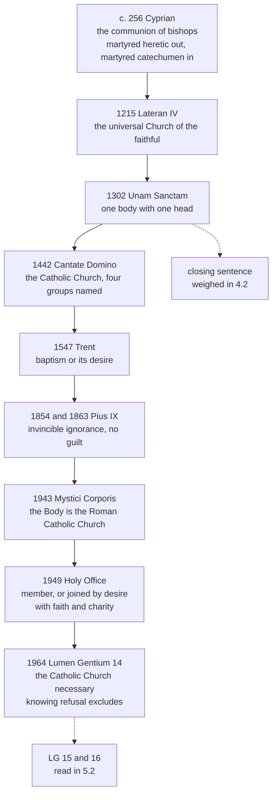

# The Church & Mary · Lesson 5.1: Outside the Church there is no salvation

> ⏱ ~15 min · Module 5: The Church, salvation, and her own sin · Builds on: [2.1 One](02-01-one.md), [1.3 The Body of Christ](01-03-the-body-of-christ.md), [`patristics` 2.4](../../patristics/lessons/02-04-cyprian-of-carthage.md), [`apologetics-foundations` 8.2](../../apologetics-foundations/lessons/08-02-salvation-outside-the-visible-church.md) · Unlocks: [5.2 Subsistit in and the status of other churches](05-02-subsistit-in-and-the-status-of-other-churches.md)

## Why this matters

People quote [*extra ecclesiam nulla salus*](../reference.md#extra-ecclesiam-nulla-salus) to prove that the Church changed her mind. [`apologetics-foundations` 8.2](../../apologetics-foundations/lessons/08-02-salvation-outside-the-visible-church.md) argued the outward question, toward people who never heard the Gospel. This lesson asks the inward one, which comes first. The sentence has a subject, "the Church", and that word did not name the same thing in 256, 1215, 1442, 1949 and 1964. Read each formulation for what it calls the Church and whom it puts outside, and much of the apparent reversal becomes something you can state exactly. Not all of it: the lesson says which part.

## The idea

Start from a sentence nobody reads as a census: there is no other name by which we must be saved (Acts 4:12). It says what salvation comes *through*; it does not list the saved. The Catechism reads the axiom the same way: put positively, all salvation comes from Christ the Head through the Church, which is his Body (CCC 846). So the axiom predicates **necessity** of the Church, as the means Christ joined to himself.

That is the doctrine. The history is harder, because the historic formulas *did* draw lines: each named a social body and said who stood outside it. Track two variables through every text:

1. **What "the Church" names:** a communion of bishops, a Eucharistic community, a body with a visible head, or the Catholic Church with graded ways of belonging.
2. **How a person comes to be "outside":** by leaving, refusing, never coming, or never being able to come.

The necessity holds steady; the second variable moves most. For centuries the formulas presumed that whoever was outside had put himself there, by an act of will of the kind [2.1](02-01-one.md) calls heresy or schism, though Cyprian already counted in the catechumen who died for Christ before baptism. From 1854 the presumption is tested; from 1949 belonging is graded.

## The doctrine

**Said plainly.** In 1442 the Council of Florence, in its bull of union with the Copts, said as the faith of the Roman Church that pagans, Jews, heretics and schismatics who die outside the Catholic Church go into the eternal fire, unless they are joined to her before the end of life. It added that no one outside her unity is saved even if he dies for Christ. The sentence makes no exception for ignorance, and its fathers meant what they wrote.

The formulations, each read for its subject:

1. **Cyprian, Letter to Jubaianus (c. 256; ANF Ep. 72.21–23 = Hartel 73).** In §21 not even martyrdom profits a heretic, because there is no salvation out of the Church. In §22 a catechumen killed for the Name before baptism is not deprived of the sacrament: he is baptized in blood, the greatest baptism, and Cyprian cites the thief on the cross. In §23 the Lord can mercifully pardon those once admitted without the baptism Cyprian required. *In words:* the Church is the one visible communion of the bishops ([`patristics` 2.4](../../patristics/lessons/02-04-cyprian-of-carthage.md)). "Outside" is a rival communion someone has gone into; a catechumen on his way in is already inside.
2. **Lateran IV (1215), constitution 1, [*Firmiter*](../reference.md#firmiter)**, issued against the Albigensians:

   > There is indeed one universal Church of the faithful, outside which no one at all is saved, in which the same Jesus Christ is himself both priest and sacrifice

   (lesson's translation of *Una vero est fidelium universalis Ecclesia, extra quam nullus omnino salvatur…*). The sentence runs straight on to the altar, transubstantiation and the priest rightly ordained. *In words:* the Church is the communion of believers that offers Christ's sacrifice through a real priesthood; the Cathars' rival church is denied the name.
3. **Boniface VIII, [*Unam Sanctam*](../reference.md#unam-sanctam) (18 November 1302), opening sentence:**

   > Urged by faith, we are bound to believe and to hold one holy Church, catholic and also apostolic; and this one we firmly believe and simply confess, outside which there is neither salvation nor remission of sins

   (lesson's translation). "Firmly believe and simply confess" borrows Lateran IV's opening verbs. The bull goes on to call this Church one mystical body with one head: Christ, and Christ's vicar, Peter's successor. *In words:* the Church is a body *with a visible head*. The closing sentence, on subjection to the Roman pontiff, is [4.2](04-02-the-development-of-papal-claims-read-honestly.md)'s.
4. **Florence, [*Cantate Domino*](../reference.md#cantate-domino) (session 11, 4 February 1442).** After naming the four groups, the bull says the sacraments, fasts and alms profit only those who remain in the Church's unity. Then:

   > No one, however much alms he has given, even if he has shed his blood for the name of Christ, can be saved unless he has remained in the bosom and unity of the Catholic Church

   (lesson's translation). This follows, nearly clause for clause, two rules of Fulgentius of Ruspe, Augustine's African disciple (*De fide ad Petrum* 38.79–39.80), where the clause about alms and blood concerns *baptized* heretics and schismatics. *In words:* the Church is the Catholic communion, and "remained" shows the bull has in view those who left it.
5. **Pius IX, *Singulari quadam* (allocution, 9 December 1854), and *Quanto conficiamur moerore* (encyclical, 10 August 1863).** The allocution: it must be held from faith that no one is saved outside the Apostolic Roman Church, the one ark, and equally held as certain that ignorance of the true religion, *if it is invincible*, carries no guilt for this before God; and who could mark the limits of such ignorance? The encyclical ([`apologetics-foundations` 8.2](../../apologetics-foundations/lessons/08-02-salvation-outside-the-visible-church.md)) adds that such people can reach eternal life by divine light and grace. *In words:* the presumption of guilt is now tested, not assumed: [invincible ignorance](../reference.md#invincible-ignorance).
6. **The Holy Office to Archbishop Cushing ([the Feeney case](../reference.md#feeney-case); 8 August 1949).** The Church is necessary twice over: Christ *commands* entry, and she is a *means* of salvation by divine institution, not intrinsic necessity, and, as Trent shows of baptism and penance, such a means can work through desire. So one must be joined to her actually, as a member, or at least by desire. In the invincibly ignorant the desire may be implicit, but it must be animated by perfect charity and supernatural faith. The letter cites *Mystici Corporis* §103 on those related to the Body by an unconscious desire ([1.3](01-03-the-body-of-christ.md)). Then it turns on the rigorists: Catholics who have heard Rome and still refuse cannot plead ignorance, and to them the necessity applies without restriction. *In words:* the Church is *Mystici Corporis*'s Body, the Roman Catholic Church, and belonging is graded.
7. **[*Lumen Gentium* 14](../reference.md#lumen-gentium-14-16) (1964).** The Church is necessary for salvation and is entered through baptism as through a door. Those who *know* that God made the Catholic Church necessary through Christ, and refuse to enter or remain, cannot be saved. Membership without charity saves no one; catechumens are joined by their intention. *In words:* the necessity is kept, the Church is named, and exclusion attaches only to a *knowing* refusal. [5.2](05-02-subsistit-in-and-the-status-of-other-churches.md) reads the clause and LG 15–16.

**What the series did and did not do.** No text in it withdrew the necessity; what moved is how a person comes to be outside. And the qualifications came early. Augustine allows faith and conversion of heart where baptism is prevented by necessity, not contempt (*On Baptism* IV.22.30); his *Retractations* later doubted only whether the thief was unbaptized. Aquinas has three baptisms, of water, blood and Spirit (ST III q.66 a.11), and Trent the laver of regeneration "or the desire thereof" (Session VI ch. 4; Session VII, canon 4 on the sacraments). [Baptism of desire](../reference.md#baptism-of-desire) is old, not a modern loophole.

**Mark the levels** ([the ladder](../../fundamental-theology/lessons/04-04-the-ladder-of-doctrinal-authority.md)). The **necessity of the Church** is **rung 1**: Lateran IV professes it, Florence's core teaches it, and *Lumen Gentium* 14 restates it. *Cantate Domino*'s census reading, that everyone in the named groups who dies outside is lost, is **not manifestly defined**: the bull has no "we define" and no anathema, so can. 749 §3 applies (AF 8.2's grading, kept). *Unam Sanctam*'s opening restates Lateran IV's article. *Singulari quadam*, an allocution, is **rung 3 at its lightest grade**; *Quanto conficiamur* and *Mystici Corporis* ([1.3](01-03-the-body-of-christ.md)) are **rung 3**. The 1949 letter is **rung 3, light**, its weight raised when LG 16 footnoted it. LG 14's account of incorporation and catechumens is **rung 3**. That desire or martyrdom can supply for baptism is taught **at least at rung 3** (LG 14; CCC 1258–1259); whether Trent's clause puts it higher is for [`sacraments-and-liturgy`](../../sacraments-and-liturgy/syllabus.md) [2.2](../../sacraments-and-liturgy/lessons/02-02-necessity-infants-and-baptism-of-desire-and-blood.md) to settle. Cyprian, Augustine, Fulgentius and Aquinas carry no magisterial rung as authors.

## The timeline

Each node names what "the Church" is in that text. Read down the chain: the necessity never moves; the test for standing outside does.

## Worked examples

**Ex 1 (clean): the catechumen killed before baptism.** An invented case: a catechumen is killed for refusing to deny Christ, three days before his baptism. Levels first: catechumens are joined to the Church by their intention (LG 14, **rung 3**); martyrdom supplies for baptism (**at least rung 3**; CCC 1258). Cyprian decides this exact case (§22): baptized in his blood, he is inside. Lateran IV's Church is "of the faithful", and he is one of them. Aquinas ranks baptism of blood first of the three (ST III q.66 a.12). The 1949 letter names catechumens as the case of explicit desire. **Verdict:** inside, on every formulation's own terms. Now set §21 beside §22: the same death gets opposite verdicts, and what divides them is not the blood but where the will stands toward the communion. "Church" names a communion one can belong to by will before the rite.

**Ex 2 (strain): someone who could never have heard.** An invented case: a person raised wholly apart from any society that has heard of Christ. Aquinas (*De veritate* q.14 a.11 ad 1): if such a person follows natural reason in seeking good and fleeing evil, it is most certainly to be held that God will reveal what must be believed by an inner inspiration or send a preacher, as he sent Peter to Cornelius. He keeps explicit faith and moves the solution into providence. The 1949 letter instead allows an implicit desire, contained in the will to conform to God's will, with supernatural faith and perfect charity; LG 16 (**rung 3**) says such people can attain salvation, moved by grace. The strain: what does "Church" name in *joined by an implicit desire* for someone who has never heard the word? Not a communion he chose, but the means God appointed, willed without being known. Whether "desire" still fits when its object is unknown, Catholic theologians dispute; *how* grace reaches him is **rung 5**.

## Watch out

- **You might think the axiom is a census.** LG 14's one exclusion attaches to knowing refusal and names no one; and since membership without charity saves nobody, it never promised insiders anything either.
- **You might think it was aimed first at non-Christians.** Its first targets were baptized Christians in rival communions: Cyprian's heretics, Fulgentius's baptized separatists, Florence's heretics and schismatics.
- **You might think baptism of desire is defined dogma, or a 1949 invention.** That desire can suffice is taught at least at rung 3: "defined" overstates, and "modern loophole" erases fifteen centuries.
- **You might think the 1949 letter loosened the axiom for Catholics.** It tightened it for them (item 6). Feeney was excommunicated on 13 February 1953 for disobedience and reconciled in 1972 ([`apologetics-foundations` 8.2](../../apologetics-foundations/lessons/08-02-salvation-outside-the-visible-church.md)).

## One-liner

> Every formula says salvation comes through the Church; what moved is where her edge runs and whether the one outside is presumed to have put himself there.

## Problems

**P1 (🟢)** *(Exegetical, strict)* Three formulations of the axiom:

> (a) "But if not even the baptism of a public confession and blood can profit a heretic to salvation, because there is no salvation out of the Church, how much less shall it be of advantage to him, if in a hiding-place and a cave of robbers, stained with the contagion of adulterous water, he has not only not put off his old sins …" (Cyprian, Ep. 72.21, ANF)
>
> (b) "There is indeed one universal Church of the faithful, outside which no one at all is saved, in which the same Jesus Christ is himself both priest and sacrifice" (Lateran IV, lesson's translation)
>
> (c) Those who know that God made the Catholic Church necessary through Christ, and still refuse to enter her or to remain in her, cannot be saved (*Lumen Gentium* 14, paraphrased).

For each, say in one line what "the Church" names and quote the words that show it. Then (d), in one line: what does "know" do in (c), and at what level does (c) teach?

**P2 (🟡)** *(Exegetical, both parts)* Close reading. In *Summa Theologiae* II-II q.2 a.7, Objection 3 argues that many gentiles were saved without any revelation, and so without faith in Christ, explicit or implicit. Aquinas's answer (English Dominican Province):

> [From the body of the article:] After grace had been revealed, both learned and simple folk are bound to explicit faith in the mysteries of Christ, chiefly as regards those which are observed throughout the Church, and publicly proclaimed …
>
> [From the reply to Objection 3:] If, however, some were saved without receiving any revelation, they were not saved without faith in a Mediator, for, though they did not believe in Him explicitly, they did, nevertheless, have implicit faith through believing in Divine providence, since they believed that God would deliver mankind in whatever way was pleasing to Him, and according to the revelation of the Spirit to those who knew the truth …

(a) By this passage, what does implicit faith require, and what is it *not*? Two sentences. (b) Does the passage teach that someone living after Christ who has never heard the Gospel can be saved by implicit faith? Give a one-line verdict and quote the words that decide it. Two sentences.

**P3 (🔴)** *(Exegetical, strict)* Diagnose. An **invented** sidebar from a secondary-school religion textbook, written for this problem:

> **Did you know?** For nineteen centuries the Catholic Church taught that only baptized Catholics could be saved. St Cyprian, the popes and the councils said so without a single exception: even a convert martyred for Christ before his baptism was lost. Then in 1964 the Second Vatican Council reversed the teaching. The Church was no longer necessary for salvation, and "baptism of desire", a loophole Rome had invented in 1949, opened heaven to every sincere person.

Find **four** errors, at least one in the "nineteen centuries" half and one in the "1964" half. Correct each, and give the level wherever a level is involved. **150 words or fewer.**

Solutions

**P1** *(Exegetical, strict)*

**Must hit, strict:**

- (a) The **one visible, sacramental communion**, the catholic Church whose baptism alone is true, set against a heretical assembly that is no church at all. Words: "heretic" against "out of the Church", plus "cave of robbers" and "adulterous water" for the rival rite. The man outside is a *baptized* Christian who confessed Christ.
- (b) The **communion of believers everywhere, gathered round Christ's sacrifice**: "universal", "of the faithful", "in which … priest and sacrifice". It is a Eucharistic community with a real priesthood, not an invisible company of the elect.
- (c) **The Catholic Church by name**, entered and stayed in: "Catholic Church", "enter", "remain".
- (d) "Know" confines the loss to a **culpable refusal by someone who knows**. It names no one and says nothing about who in fact knows, so it cannot be read as a census. Level: it **restates the rung-1 necessity**; LG defines nothing new.

**Wrong turns:** reading (a) as about pagans, when it concerns a baptized heretic. Reading (b)'s Church as the invisible company of the saved, which the clause about the altar rules out. Calling (c) a new definition, or a verdict that some named group "knows".

**Model answer:** (a) The visible catholic communion whose baptism alone is true. "Heretic … out of the Church … adulterous water" sets it against a rival rite. (b) The faithful everywhere, gathered at Christ's sacrifice: "universal Church of the faithful … in which … priest and sacrifice". (c) The Catholic Church by name: "Catholic Church … enter … remain". (d) "Know" restricts exclusion to knowing refusal, so the clause names no one and counts no one; it restates a rung-1 teaching.

---

**P2** *(Exegetical, both parts)*

**Accept:** for (b), "no" grounded in either the corpus's "after grace had been revealed … bound to explicit faith" or the reply's pre-Christian scope; both earn full credit.

**Must hit, strict (a):**

- It is still **faith** ("not saved without faith in a Mediator"), and its object is still the **Mediator**.
- "Implicit" means **contained in an explicit belief in providence as deliverer**: "God would deliver mankind in whatever way was pleasing to Him". The person received no revelation himself; his belief defers to what was revealed "to those who knew the truth".
- It is **not** moral goodness, sincerity or natural religion, and not salvation apart from Christ.

**Must hit, strict (b):**

- **No, not by itself.** The reply concerns gentiles *before* Christ (the objection's gentiles), and the corpus says that "after grace had been revealed", all are "bound to explicit faith".
- The passage does not treat someone after Christ who *could not* have heard. "Bound" states an obligation and leaves the impossible case open. Aquinas's own answer to that case is *De veritate* q.14 a.11 ad 1: God would supply explicit faith (Ex 2). Aquinas's view carries no magisterial rung.

**Wrong turns:** reading the reply as Aquinas's licence for salvation by implicit faith today. The opposite misreading, "bound" as a verdict that the unevangelized are lost. Equating "implicit faith" with a good conscience.

**Model answer:** (a) Implicit faith is still faith in the Mediator, held inside an explicit belief that God's providence will deliver mankind in whatever way he pleases and has revealed to those who knew the truth. It is not moral goodness or sincerity standing in for faith. (b) No. The reply is about gentiles before Christ, and the corpus says that "after grace had been revealed" all are "bound to explicit faith", which leaves the case of someone who could not hear to another text.

---

**P3** *(Exegetical, strict)*

**Accept:** any four of the six below, with at least one from each half.

**Must hit, strict:**

- **"Without a single exception"** is false. Cyprian himself (Ep. 72.22–23), Augustine (*On Baptism* IV.22.30), Aquinas (ST III q.66 a.11), Trent's "or the desire thereof" (1547), and Pius IX on invincible ignorance (1854, 1863) all came before 1964.
- **The martyred convert** is the very case Cyprian counts *in*: baptized in blood (§22). The martyr he denied was the heretic (§21).
- **"Only baptized Catholics"**: catechumens were counted in by blood from Cyprian on and by desire from Augustine on, and membership alone never sufficed.
- **"Reversed… no longer necessary"**: LG 14 restates the necessity, **rung 1**. LG 16 (**rung 3**) defines nothing and could not reverse a rung-1 teaching.
- **"Invented in 1949"**: Augustine and Aquinas hold it and Trent names the desire. The 1949 letter (**rung 3, light**) explained *implicit* desire.
- **"Every sincere person"**: LG 16 requires ignorance through no fault of one's own, grace, and a striving to do God's will; the 1949 letter requires supernatural faith and perfect charity.

**Wrong turns:** over-correcting to "the Church always taught almost everyone is saved". Florence named groups and meant it. Calling LG 16 a definition (overstates). Calling *Cantate Domino*'s whole sentence defined (overstates), or calling none of it binding (understates its rung-1 core).

**Model answer:** The tradition never lacked exceptions. Cyprian's own letter says a catechumen martyred before baptism is baptized in his blood and saved. Augustine, Aquinas and Trent (1547) taught that desire can supply for baptism, and Pius IX taught invincible ignorance a century before Vatican II. Vatican II reversed nothing: *Lumen Gentium* 14 restates that the Church is necessary for salvation, a rung-1 teaching, and LG 16 (rung 3) defines nothing. The 1949 Holy Office letter (rung 3) did not invent baptism of desire. It explained that the desire can be implicit in the invincibly ignorant. Even then it requires supernatural faith and perfect charity, not mere sincerity.

## Flashback

**From Lesson [4.4](04-04-infallibility-in-exercise-and-the-ordinary-universal-magisterium.md) (Infallibility in exercise, and the ordinary universal magisterium):** *(Exegetical.)* Diagnose. An **invented** RCIA slide, written for this problem:

> **Infallibility: four things to know**
>
> (1) The idea that the bishops, scattered across the world, can teach infallibly without meeting is new: Vatican II invented it in *Lumen Gentium* 25.
>
> (2) Until a pope or a council defines a doctrine, Catholics owe it respect, but not faith.
>
> (3) Whatever the Church teaches infallibly, she teaches as revealed by God, so all of it is to be believed with divine faith.
>
> (4) The Vatican keeps an official list of the seven *ex cathedra* definitions.

Correct each line in **one line**, naming the act or rule that fixes the correction and, where a level is involved, the level.

Solution

**Must hit, strict:**

- (1) **Not new.** Pius IX's letter *Tuas libenter* (1863) extended the submission of faith to what the ordinary magisterium of the whole Church dispersed through the world hands on as revealed; *Dei Filius* (1870) ch. 3 taught it; LG 25 stated its conditions, and can. 749 §2 codified them. That the dispersed bishops can teach infallibly is **rung 1**.
- (2) **Faith is owed beyond definitions.** *Dei Filius* ch. 3 requires divine and Catholic faith for what the Church proposes as revealed "either by a solemn judgment, or by her ordinary and universal magisterium". No pope and no conciliar canon ever defined that directly killing the innocent is gravely wrong, yet it stands at **rung 1**, and *Evangelium Vitae* 57 *confirms* it rather than defining it. Credit for adding that even non-definitive authentic teaching is owed religious submission (rung 3), which is more than respect.
- (3) **Two objects.** Infallibility also covers what is needed to guard and expound the deposit, and those truths are to be *held* definitively (**rung 2**), not believed as revealed: dogmatic facts, or the wrongness of euthanasia on the CDF's 1998 commentary (§11). *Mysterium Ecclesiae* 3 claims revealed status only for the primary object.
- (4) **No such list, and no number.** Two papal acts are *ex cathedra* that nobody contests, *Ineffabilis Deus* (1854) and *Munificentissimus Deus* (1950). Every other is a candidate, no magisterial list goes further, and can. 749 §3 resolves every doubt downward.

**Wrong turns:** on (1), naming *Pastor Aeternus* as the source; the dispersed route is *Dei Filius*'s and LG 25's. On (2), the overcorrection "whatever every bishop teaches is infallible": the bishops must agree in proposing it *as definitive*, and that must be manifestly evident. On (3), the opposite overstatement, that the extension to the secondary object is itself defined; it is taught, not defined. On (4), swapping in another number (three, with *Benedictus Deus*), or "only two acts were ever *ex cathedra*", which turns open candidates into settled non-definitions.

**Model answer:** (1) Pius IX's *Tuas libenter* (1863) named the dispersed ordinary magisterium, *Dei Filius* (1870) taught it, and LG 25 gave its conditions; the route is rung 1. (2) *Dei Filius* ch. 3 owes divine faith to what the ordinary and universal magisterium proposes as revealed, such as the grave wrong of directly killing the innocent (rung 1, confirmed in EV 57, never defined). (3) Secondary-object truths, such as dogmatic facts and the wrongness of euthanasia, are held definitively (rung 2), not believed as revealed (ME 3; the 1998 commentary). (4) Two acts nobody contests, 1854 and 1950, plus candidates; there is no magisterial list, and can. 749 §3 defaults down.

## Connections

- **Backward:** [2.1](02-01-one.md) gave heresy and schism as acts of a will, which is what "outside" presumed. [1.3](01-03-the-body-of-christ.md) read *Mystici Corporis*'s membership and §103. Cyprian's formula in its setting is [`patristics` 2.4](../../patristics/lessons/02-04-cyprian-of-carthage.md), and Augustine's *On Baptism* is [`patristics` 4.4](../../patristics/lessons/04-04-augustine-against-the-donatists.md). *Unam Sanctam* as an event is [`church-history` 5.1](../../church-history/lessons/05-01-papal-monarchy-innocent-iii-to-boniface-viii.md). Can. 749 §3 and the ladder are [`fundamental-theology` 4.4](../../fundamental-theology/lessons/04-04-the-ladder-of-doctrinal-authority.md).
- **Forward:** [5.2](05-02-subsistit-in-and-the-status-of-other-churches.md) reads LG 14's clause exactly, with *subsistit in* and LG 15–16. [5.3](05-03-ecumenism-as-doctrine.md) takes the baptized in separated communities as not guilty of the separation. [`sacraments-and-liturgy`](../../sacraments-and-liturgy/syllabus.md) [2.2](../../sacraments-and-liturgy/lessons/02-02-necessity-infants-and-baptism-of-desire-and-blood.md) takes the 1949 letter from here and settles Trent's teaching on desire and its level. [`creation-grace-last-things`](../../creation-grace-last-things/syllabus.md) [7.4](../../creation-grace-last-things/lessons/07-04-limbo.md) owns infants who die unbaptized.
- **Sideways:** [`apologetics-foundations` 8.2](../../apologetics-foundations/lessons/08-02-salvation-outside-the-visible-church.md) argues the same axiom outward, toward the unevangelized. [`philosophy-of-religion` 4.5](../../philosophy-of-religion/lessons/04-05-divine-hiddenness.md) cites invincible ignorance against the hiddenness argument; this lesson is where it is taught.
