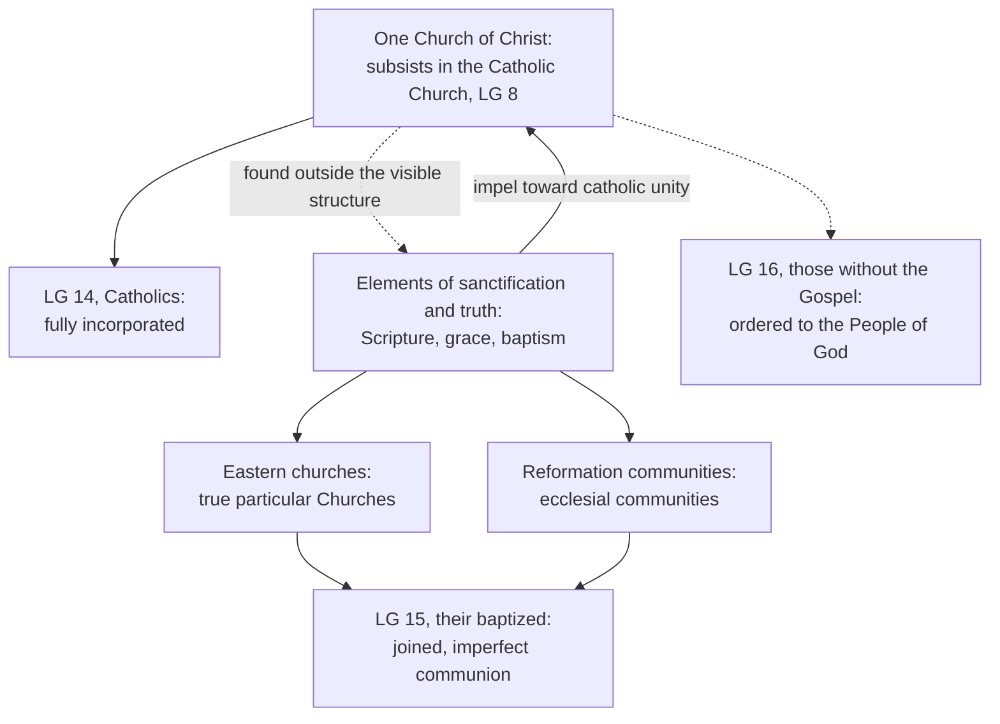

# The Church & Mary · Lesson 5.2: *Subsistit in* and the status of other churches

> ⏱ ~15 min · Module 5: The Church, salvation, and her own sin · Builds on: [5.1 Outside the Church there is no salvation](05-01-outside-the-church-there-is-no-salvation.md), [2.1 One](02-01-one.md), [1.3 The Body of Christ](01-03-the-body-of-christ.md) · Unlocks: [5.3 Ecumenism as doctrine](05-03-ecumenism-as-doctrine.md)

## Why this matters

[5.1](05-01-outside-the-church-there-is-no-salvation.md) settled that the Church is necessary for salvation, and left open where she is. If the Church of Christ simply *is* the Catholic Church, what is an Orthodox diocese with bishops in succession and a Eucharist, and what is a Lutheran's baptism? Vatican II answered with one verb, which Gérard Philips, who drafted the text, predicted would make floods of ink flow. This lesson reads the verb, the three cases of *Lumen Gentium* 14–16, and the criterion that sorts "Churches" from "ecclesial communities".

## The idea

The Council needed two claims to stand together. **(1)** The one Church Christ founded is not an ideal still to be assembled: she exists now, concretely and whole, in one communion. **(2)** Much of what makes the Church the Church is really found outside that communion: Scripture, baptism, grace, faith, hope and charity, and in some bodies bishops and the Eucharist. These gifts "belong by right to the one Church of Christ" (*Unitatis Redintegratio* 3).

Write "the Church of Christ *is* the Catholic Church" and (2) becomes a puzzle: what are the Church's gifts doing outside her? [*Lumen Gentium* 8](../reference.md#subsistit-in) says instead that the Church of Christ *subsists in* the Catholic Church, though many [elements of sanctification and truth](../reference.md#elements-of-sanctification-and-truth) are found outside her visible structure. *Subsistere* means to continue in existence, to remain (lesson's gloss). The same Council uses it of the unity the Church can never lose (UR 4), and of Catholic traditions that continue in the Anglican Communion (UR 13). So the Church continues whole in one place, and her elements are at work beyond its edges, pulling toward it.

Two classifications follow; keep them apart. One sorts **persons**: [*Lumen Gentium* 14–16](../reference.md#lumen-gentium-14-16) says Catholics are *incorporated*, other baptized Christians *joined*, and those without the Gospel *ordered* toward the People of God. The other sorts **bodies** into Churches and ecclesial communities by one criterion. Neither is a census of the saved; that was 5.1's point.

## In their own words

How the communities issuing from the Reformation describe what makes a church, left standing. The Augsburg Confession's article 7, read in [2.1](02-01-one.md): the Church is the congregation of saints in which the Gospel is rightly taught and the sacraments rightly administered, and agreement in these suffices for her unity. Their accounts of succession are [2.4](02-04-apostolic.md)'s.

The Church of England's **Thirty-Nine Articles** (1571), article 19:

> The visible Church of Christ is a congregation of faithful men, in the which the pure Word of God is preached, and the Sacraments be duly ministered according to Christ's ordinance ...

It adds that Rome, like Jerusalem, Alexandria and Antioch, has erred, in matters of faith as well as in living and ceremonies. No see guarantees the Church; the Word and the sacraments mark her.

Answering the 2007 *Responses* on 11 July, Ishmael Noko, general secretary of the Lutheran World Federation, said Lutheran churches do not accept the document's understanding of church, "understanding ourselves to be fully church" where the Gospel is rightly preached and the sacraments rightly administered. On 10 July Setri Nyomi, general secretary of the World Alliance of Reformed Churches, wrote to Cardinal Walter Kasper that their calling to be part of the church of Jesus Christ is God's gift, "not dependent on the interpretation of the Vatican"; they count the Roman Catholic Church part of that one family.

## The doctrine

1. **The sentence.** *Lumen Gentium* 8 (1964), paraphrased: this one Church of Christ, confessed in the Creed and constituted in this world as a society, *subsistit in Ecclesia catholica*, subsists in the Catholic Church governed by Peter's successor and the bishops in communion with him. Many elements of sanctification and truth are found outside her structure (*extra eius compaginem*); as gifts proper to the Church of Christ, they impel toward catholic unity. *In words:* the Church Christ founded continues whole in one communion, and her gifts outside it belong to her and point home.

2. **The drafting.** The 1962 draft followed *Mystici Corporis* ([1.3](01-03-the-body-of-christ.md)). The 1963 draft said the Church of Christ *est*, is, the Catholic Church, and added the clause on elements. At the end of 1963 Philips's subcommission proposed *adest in*, "is present in". Sebastian Tromp, the commission's secretary, proposed *subsistit in* instead and, by Karl Becker's report of the archived recording, insisted it was exclusive: only elements elsewhere. The commission's stated reason, sent to the Council in 1964, was better accord with the statement about ecclesial elements present elsewhere (*Acta Synodalia* III/1, 177, in Francis Sullivan's translation). *In words:* the verb changed on purpose, and the reason given was the elements.

3. **Rome's reading.** The CDF's 1985 Notification on Leonardo Boff's *Church: Charism and Power* rejected the thesis that the one Church of Christ could subsist in other churches too: *subsistit* was chosen to make clear there is one subsistence; outside are elements. [*Dominus Iesus*](../reference.md#dominus-iesus) (2000) repeats this (§16, note 56). The *Responses to some questions regarding certain aspects of the doctrine on the Church* (29 June 2007) explain the term: subsistence is the perduring historical continuity, in the Catholic Church, of all the elements Christ instituted, and the word belongs to her alone because it refers to the mark of unity (Q2). It indicates "full identity" (Q3). Yet the Church of Christ is "present and operative" in the churches and communities not in full communion (Q2). *In words:* one subsistence, many presences.

4. **The open edge.** Becker (*L'Osservatore Romano*, December 2005) argued that the Council never left the drafts' total identity. Sullivan (*Theological Studies*, 2006) agreed that *subsistit* means "continues to exist", but held the identity no longer exclusive: the commission gave the elements as its reason, first wrote "Churches or ecclesiastical communities" (LG 15) in the same revision, and refused thirteen bishops' request to restore *est*. On his reading the Church of Christ continues in her fullness only in the Catholic Church, yet extends, less fully, beyond her. *In words:* they divide on exclusivity; neither says she subsists twice.

5. **Persons: three verbs.** **LG 14:** the *fully incorporated* have the Spirit of Christ, accept the Church's whole ordering and means of salvation, and are joined in her visible structure by faith, sacraments, government and communion. One who does not persevere in charity remains "in body" but not "in heart", and is not saved. Catechumens are joined by desire. **LG 15:** the Church knows herself *joined* (*coniunctam*) to the baptized who lack the whole faith or communion under Peter's successor: they hold Scripture and faith in Christ, are baptized, and receive other sacraments "in their own Churches or ecclesiastical communities", in real but imperfect communion ([full and partial communion](../reference.md#full-and-partial-communion)). **LG 16:** those without the Gospel are *ordered* (*ordinantur*) to the People of God ([`apologetics-foundations` 8.2](../../apologetics-foundations/lessons/08-02-salvation-outside-the-visible-church.md)). *In words:* three relations, not one line with insiders and outsiders.

6. **LG 14's clause, exactly.** Those could not be saved who refuse to enter or to remain in the Catholic Church while *non ignorantes*, "not unaware" (lesson's translation), that God founded her through Christ as necessary. *In words:* knowledge and refusal are both required, and the clause names no one.

7. **Bodies: one criterion** ([churches and ecclesial communities](../reference.md#churches-and-ecclesial-communities)). The separated Eastern churches keep apostolic succession and a valid Eucharist: they are "true particular Churches" (DI 17). But communion with Peter's successor is internal to a particular church, so their condition lacks something (*Responses* Q4): it is "wounded" (*Communionis Notio* 17, 1992). The communities born of the Reformation, in Catholic doctrine, lack apostolic succession in the sacrament of Orders, a constitutive element. So they have not kept "the genuine and integral substance" of the Eucharist (*Responses* Q5; UR 22, *propter sacramenti Ordinis defectum*), and are not Churches "in the proper sense". Their baptized are in imperfect communion (DI 17), and the Spirit uses the communities as means of salvation (UR 3). *In words:* the test is succession in Orders, because it carries the Eucharist; it grades structure, not faith or holiness.

**Said plainly.** The Council's own drafts said "is", and the text it promulgated does not. The man who proposed *subsistit* meant it exclusively, the commission gave an ecumenical reason, and Rome has read the change since 1985 as taking nothing from the identity. The CDF's own 2007 commentary concedes that the classification caused no little distress in those communities and among some Catholics.

**Mark the levels** ([`fundamental-theology` 4.4](../../fundamental-theology/lessons/04-04-the-ladder-of-doctrinal-authority.md), [4.5](../../fundamental-theology/lessons/04-05-reading-a-documents-weight.md); [levels of authority](../reference.md#levels-of-authority)). That Christ founded one Church, which will never lack her unity, is **rung 1**: the Creed, which DI 16 restates without adding weight. Rung 1 also stands under two clauses: LG 14's knowing-and-refusing sentence restates the necessity of the Church (AF 8.2), and LG 15's "consecrated by baptism" rests on Trent's canon that baptism given by heretics in the Trinity's name, intending what the Church does, is true baptism (Session VII, Canons on Baptism, can. 4). LG 8 as an act is **rung 3** at least: a dogmatic constitution that defined nothing and carries what it restates; no act defines *subsistit* or any theory of it. LG 14's account of incorporation, LG 15, LG 16 and the Churches/ecclesial communities classification are **rung 3**. So is Rome's reading, carried by three papally approved CDF acts: holding that the Church subsists in other churches too contradicts authentic teaching owed religious submission, but is not heresy. The 2007 commentary carries no approval of its own. What the commission meant beyond one subsistence is **freely disputed**, inside that bound.

## Who stands where

Dashed edges reach past full incorporation; the upward arrow is LG 8's own last clause.

## Worked examples

**Ex 1: a clean case.** A Greek Orthodox parish and a Lutheran congregation share a street. *Persons:* members of both are baptized, so they are LG 15's *joined*, in imperfect communion: not "fully incorporated", and not outside the Church in 5.1's sense. *Bodies:* the Orthodox parish belongs to a true particular Church, wounded by its lack of communion with Peter's successor; the Lutheran congregation, in Catholic doctrine, to an ecclesial community, because the test fails at succession in Orders.

**Ex 2: where it strains, a church that kept its bishops.** The Church of England kept bishops, the Creed and an ordination rite, and UR 13 gives the Anglican Communion a special place. But the test asks whether succession in the *sacrament* of Orders survived. Leo XIII's *Apostolicae Curae* (1896) judged Anglican ordinations invalid, and the CDF's 1998 commentary on the Profession of Faith lists that judgment among truths to be held definitively (rung 2). So the sorting inherits a sacramental verdict it does not itself argue. Validity is `sacraments-and-liturgy`'s, and the Anglican reply is [`apologetics-catholic-claims`](../../apologetics-catholic-claims/syllabus.md) 4.3's. UR 19 names "Churches and ecclesial Communities" in the West without sorting them. The criterion is fixed; applying it body by body runs through judgments made elsewhere.

## Watch out

- **You might think "subsists in" means "is one of several places the Church exists",** but Rome has rejected that reading three times. The Church of Christ is *present and operative* elsewhere; she *subsists* only in the Catholic Church.
- **You might think *subsistit* is a mere synonym for *est*,** but the verb changed on purpose, with a stated reason. Rome denies that the change weakened the identity, not that the words differ.
- **You might think the many-subsistences reading is heresy, or Rome's reading one opinion among others.** Both misgrade it: Rome's reading is rung 3, owed religious submission, and not a definition.
- **You might think "ecclesial community" means "outside the Church",** but it is a structural verdict on a body. Its baptized are in imperfect communion (DI 17).

## One-liner

> The Church of Christ subsists in one communion and is present beyond it: persons are incorporated, joined or ordered, and bodies are Churches or ecclesial communities by the test of succession in Orders.

## Problems

**P1 (🟢)** *(Exegetical)* Two **invented** texts, written for this problem. A parish website's FAQ, answering "Why are we hosting a Week of Prayer for Christian Unity service?":

> "Since Vatican II the Catholic Church no longer claims to be the one Church of Christ. The Council replaced 'is' with 'subsists in' to teach that the Church of Christ subsists equally in every Christian church, Catholic, Orthodox and Protestant alike."

A Catholic podcast's reply, from the transcript:

> "That FAQ is wrong. The 2007 *Responses* say Protestant bodies are not Churches at all, which means Protestants are outside the Church entirely and the Holy Spirit does nothing in their communities."

Find **two** errors in each text. For each, give the correction and the level of the teaching that corrects it. 150 words or fewer.

**P2 (🟡)** *(Exegetical)* Apply LG 14's knowing-and-refusing clause to three **invented** cases. For each, say whether the clause, as written, reaches a verdict, and what it does or does not license. Two sentences each.

(a) Kwame was raised Methodist. For ten years he has gone to Mass with his Catholic wife; he admires much in the Church, judges her claims about herself mistaken, and remains a Methodist.

(b) A catechist, Teodora, tells her class about a famous novelist who left the Church and died last year: "He knew the truth and walked away, and *Lumen Gentium* 14 says he cannot be saved."

(c) A seminary exam asks: "Suppose someone is convinced that God founded the Catholic Church through Christ as necessary for salvation, and leaves her anyway to escape her moral demands. What does LG 14 say?"

**P3 (🔴)** *(Exegetical)* Find the crux between Becker and Sullivan on *subsistit in*. (a) State what they agree on, and the single point on which they divide. (b) Name two pieces of evidence from the drafting that bear on it, and say which side each favours. (c) Say at what level the dispute stands, and name the bound within which it has to be conducted. Two sentences per part.

Solutions

**P1** *(Exegetical)*

**Accept:** any two errors per text, each with its correction and level.

**Must hit, strict:**

- **FAQ.** (1) "No longer claims to be the one Church": the *Responses* (Q3, and the commentary) say the change of verb does not mean the Catholic Church ceased to regard herself as the one Church of Christ. LG 8 says that Church subsists in her: rung 3 as an act, restating the rung-1 unicity. (2) "Subsists equally in every Christian church" is the many-subsistences thesis the CDF rejected in 1985, 2000 and 2007. "Subsists" is said of the Catholic Church alone: **rung 3**. (3) "Equally … alike" erases the line between true particular Churches and ecclesial communities (DI 17, rung 3).
- **Podcast.** (1) "Not Churches at all": the text says not Churches "in the proper sense" (Q5, **rung 3**), and the commentary, which carries no approval of its own, grants these communities ecclesial character. (2) "Outside the Church entirely": their baptized are incorporated in Christ and in imperfect communion (LG 15, UR 3, DI 17, **rung 3**). This rests on the rung-1 truth that their baptism is true baptism (Trent, Session VII, Canons on Baptism, can. 4). (3) "The Spirit does nothing": UR 3 says the Spirit uses these communities as means of salvation (rung 3).

**Wrong turns:** calling the many-subsistences thesis heresy, which overstates rung 3; calling the CDF reading one opinion among others, which understates it; "correcting" the podcast by saying Protestant bodies *are* Churches in the Catholic sense.

**Model answer:** The FAQ is wrong that the Church dropped her claim. The *Responses* say the change from "is" did not mean she ceased to regard herself as the one Church of Christ (rung 3, restating the rung-1 unicity). It is wrong that the Church "subsists equally" everywhere: the CDF has three times rejected the thesis that the one Church subsists in other churches (rung 3). The podcast overstates the *Responses*, which deny these bodies the title of Churches "in the proper sense" (rung 3), not all ecclesial character. And it is wrong that their members are outside the Church. Their baptism is true baptism (Trent, rung 1), and the baptized are in real though imperfect communion (LG 15, UR 3, DI 17; rung 3).

---

**P2** *(Exegetical)*

**Must hit, strict:**

- (a) **No verdict.** The clause's first condition is knowledge (*non ignorantes*), and Kwame, as described, does not hold the Church's claim about herself to be true, so the clause is silent on him. He is one of LG 15's baptized, joined to the Church in imperfect communion. Credit for adding that whether his not-knowing is culpable is a further question the clause does not decide.
- (b) **Not licensed.** The clause is a conditional that names no one. Whether a particular man met both conditions is a fact about his conscience that the text does not decide and the catechist cannot see.
- (c) **It applies as written.** By hypothesis both conditions hold: he is not unaware that God founded the Church through Christ as necessary, and he refuses to remain. LG 14 says such a person could not be saved. This restates the necessity of the Church, rung 1 at its core (AF 8.2). His motive does not enter the clause.

**Wrong turns:** applying the clause to (a) because Kwame "has heard the case", when hearing is not the knowledge the clause names; treating (c) as rung-3 opinion, or as softened away by Vatican II, which understates it; reading the clause as a sentence on all non-Catholics, or on the novelist in (b).

**Model answer:** (a) No. The clause needs someone who knows the Church was founded as necessary, and Kwame thinks the claim mistaken; he is one of LG 15's baptized, joined in imperfect communion. (b) No. LG 14 states a conditional and names no one, and whether this man knew and refused is hidden in his conscience; the catechist has turned a rule into a verdict. (c) Yes. Both conditions hold by hypothesis, so LG 14 says he could not be saved. That restates the rung-1 necessity of the Church.

---

**P3** *(Exegetical)*

**Accept (b):** any two pieces of evidence, each assigned to the right side.

**Must hit, strict (a):** they agree that *subsistere* means to continue to exist, to remain. They also agree that the Church of Christ continues with all her means of salvation in the Catholic Church. They divide on whether that identity is still **exclusive**. Becker holds that the commission took the word in Tromp's sense, with only elements elsewhere. Sullivan holds that it no longer claimed exclusivity, so the Church of Christ extends, less fully, beyond the Catholic Church.

**Must hit, strict (b):** *for Becker:* Tromp proposed the word and called it exclusive; the 1963 debate never challenged *est*; the Secretariat for Unity's replies to amendments on UR identify the Church of Christ with the Catholic Church (cited in the *Responses*, note 4). *For Sullivan:* the commission's stated reason was better accord with ecclesial elements present elsewhere; the same revision first wrote "Churches or ecclesiastical communities"; the commission refused thirteen bishops' request to restore *est*.

**Must hit, strict (c):** what the commission meant is **freely disputed**. The dispute sits inside a **rung-3 bound**: Rome's reading that there is one subsistence, in the Catholic Church alone. A view on which the Church of Christ subsists in other churches as well falls outside that bound, and neither Becker nor Sullivan holds it.

**Wrong turns:** putting the crux in the meaning of the verb, on which they agree; treating the *Responses* as having settled the dispute, when they fix its bound (their "full identity" in Q3 sounds like Becker, while their "present and operative" in Q2 concedes something to Sullivan); turning Sullivan's view into Boff's.

**Model answer:** (a) Both read *subsistit* as "continues to exist" and hold that the Church of Christ continues whole in the Catholic Church. They split on exclusivity: Becker keeps Tromp's "only elements elsewhere", and Sullivan says the Church extends, less fully, beyond. (b) Tromp's taped insistence that the word was exclusive favours Becker. The commission's stated reason, the elements present elsewhere, together with its first use of "Churches" in the same draft, favours Sullivan. (c) The meaning of the 1964 change is freely disputed among Catholic theologians. It must be argued inside the rung-3 reading of 1985–2007, which allows one subsistence only; neither man denies that.

## Flashback

**From Lesson [4.5](04-05-vatican-ii-primacy-collegiality-synodality.md) (Vatican II: primacy, collegiality, synodality):** *(Exegetical.)* Mark the levels. Give the weight of each statement: a rung of the ladder (1, 2 or 3), **freely disputed**, **ecclesiastical law or custom** (changeable by the authority that made it), or **no magisterial weight**. A text may carry another text's weight rather than its own; if so, say whose. Name the act or text that fixes each. **One line each.**

(a) The Roman pontiff has full, supreme, ordinary and immediate jurisdiction over every church, pastor and faithful.

(b) The college of bishops, with its head and never without him, is a permanent subject of supreme and full power over the universal Church.

(c) That supreme power has one subject, acting either through the pope alone or through the pope with the college, rather than two subjects that are not adequately distinct.

(d) The point of the *Nota explicativa praevia* (communicated to the Fathers on 16 November 1964, never voted) that "college" does not mean a juridical body of equals who delegate their power to a president.

(e) The pope is elected by the cardinals.

Solution

**Must hit, strict:**

- (a) **Rung 1.** *Pastor Aeternus* ch. 3, defined with its canon (Lesson 4.3). LG 22 restates the primacy and keeps that rung.
- (b) **Rung 3, at its heaviest.** LG 22 teaches it and defines nothing. By the Theological Commission's declaration read out on 16 November 1964, the Council defines as binding only what it openly declares so, and ch. 3 declares nothing so (can. 749 §3).
- (c) **Freely disputed.** LG 22 calls the college also a subject of the supreme power the pope holds, and no act settles whether the two are one subject or two that are not adequately distinct.
- (d) **No rung of its own; it carries ch. 3's weight, here rung 3.** The Nota is the authorized key by which ch. 3 is to be understood, communicated on higher authority: neither a private gloss nor a definition.
- (e) **Ecclesiastical law and custom**, changeable by the authority that made it, like the Synod, conferences, curial structures and papal titles.

**Wrong turns:** (a) lowering it to rung 3 because Vatican II restated it, when a restatement keeps the rung of what it restates. (b) "defined, because it is in a dogmatic constitution" (overstates) or "pastoral, so optional" (understates: it is owed religious submission). (c) treating the Nota's distinction, the pope alone versus the pope with the bishops, as having settled the question. (d) "no weight, since never voted" (understates) or "rung 1, since it came from the pope" (overstates). (e) calling it divine law.

**Model answer:** (a) Rung 1: *Pastor Aeternus* ch. 3, kept by LG 22. (b) Rung 3: LG 22 teaches and does not define (declaration of 16 November 1964; can. 749 §3). (c) Freely disputed: no act decides between one subject and two. (d) No rung of its own: ch. 3's authorized key, so rung 3 here. (e) Ecclesiastical law: a pope can change it.

## Connections

- **Backward:** [5.1](05-01-outside-the-church-there-is-no-salvation.md) fixed the necessity of the Church, which LG 14's clause restates. [2.1](02-01-one.md) built full and imperfect communion and read the Augsburg Confession. [1.3](01-03-the-body-of-christ.md) read *Mystici Corporis*'s identification and its membership categories. [3.2](03-02-the-local-and-the-universal-church.md) owns *Communionis Notio* and the particular church. The "elements" idea descends from Augustine's split between having baptism and having it usefully ([`patristics` 4.4](../../patristics/lessons/04-04-augustine-against-the-donatists.md)).
- **Forward:** [5.3](05-03-ecumenism-as-doctrine.md) takes up the rest of *Unitatis Redintegratio*: shared blame, baptism as the bond, and the goal. `sacraments-and-liturgy` ([syllabus](../../sacraments-and-liturgy/syllabus.md)) takes the validity of orders, and takes from here who belongs to the Church. [`apologetics-catholic-claims`](../../apologetics-catholic-claims/syllabus.md) argues the criterion that this lesson only states.
- **Sideways:** [`christology` 6.4](../../christology/lessons/06-04-christology-today.md) read *Dominus Iesus* on Christ; this lesson takes its second half, on the Church. [`apologetics-foundations` 8.2](../../apologetics-foundations/lessons/08-02-salvation-outside-the-visible-church.md) argues the axiom outward, with *Dominus Iesus* §§20–22; this lesson teaches the inward question that course leaves to this one: *subsistit in*, LG 15, and the baptized outside full communion.
