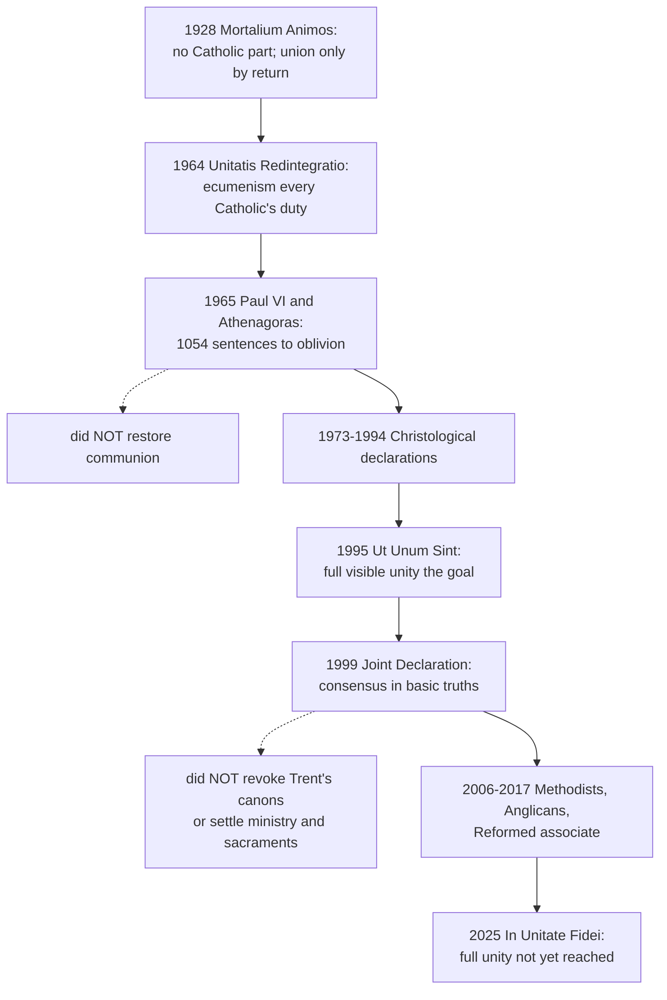

# The Church & Mary · Lesson 5.3: Ecumenism as doctrine

> ⏱ ~15 min · Module 5: The Church, salvation, and her own sin · Builds on: [5.2 Subsistit in and the status of other churches](05-02-subsistit-in-and-the-status-of-other-churches.md), [2.1 One](02-01-one.md), [`fundamental-theology` 4.5](../../fundamental-theology/lessons/04-05-reading-a-documents-weight.md) · Unlocks: [5.4 A Church of sinners](05-04-a-church-of-sinners.md)

## Why this matters

[5.2](05-02-subsistit-in-and-the-status-of-other-churches.md) sorted the Christians not in full communion. This lesson asks what the Church holds she must *do* about them, and the answer is doctrine, not diplomacy. In 1928 a pope forbade Catholics to join the movement for Christian unity; in 1964 a council made restoring that unity one of its principal concerns. Say what moved, what stayed, and each text's weight. Then the record: what the famous acts did and did not do.

## The idea

Ecumenism has two cheap imitations, and the doctrine is easiest to see as the refusal of both.

The first is **federation**: the churches are already one Church underneath, divided only in administration, so unity means mutual recognition. The second is **absorption**: the others come over one by one and drop everything that is theirs. Each holds a real truth. Much is already shared: one baptism, the Scriptures, the creed. And the Catholic Church does not think of herself as one denomination among many.

The council keeps both truths and refuses both conclusions. Unity is Christ's gift, and the Church has never lost it. What is broken is *communion*, and communion has degrees ([full and partial communion](../reference.md#full-and-partial-communion), [2.1](02-01-one.md)). Ecumenism turns real but imperfect communion into full communion: one faith, one sacramental life, one governance, shown at one altar. It does not require one rite, one law code or one theological idiom. So the doctrine is demanding and generous at once. Its named failure is **false irenicism**, peace bought by blurring the truth.

## The doctrine

The founding text is [*Unitatis Redintegratio*](../reference.md#unitatis-redintegratio) (UR), Vatican II's decree on ecumenism (21 November 1964), paraphrased throughout.

1. **The goal is one visible communion.** UR 1 calls restoring unity among all Christians one of the council's principal concerns. UR 4 names the end: all Christians gathered, at one celebration of the Eucharist, into the unity Christ gave his Church from the beginning, a unity that subsists in the Catholic Church and cannot be lost. *Ut Unum Sint* (John Paul II, 25 May 1995) calls the goal full visible unity among all the baptized (§77), and says the Church committed herself "irrevocably" to this path (§3). *In words:* one communion in faith, sacraments and governance, not a Church still to be invented.

   "Not a federation, not absorption" summarizes fairly, but the words are not the council's. Against federation: *Mysterium Ecclesiae* (CDF, 1973) §1 forbids picturing Christ's Church as a mere collection of churches and communities, or as a goal that exists nowhere today (compare the [branch theory](../reference.md#branch-theory) of [2.3](02-03-catholic.md)). Against absorption: UR 4 makes the reconciliation of individuals a work distinct from ecumenism, though not opposed to it. UR 4 and 16–17 protect variety in rite, discipline and theological expression, and UR 18 repeats Acts 15:28: no burden beyond what is essential. "Neither absorption nor fusion" is John Paul II's phrase, quoted by the Catholic–Orthodox commission's Balamand document (1993, §14).

2. **Blame on both sides, and no inherited guilt.** [2.1](02-01-one.md) read UR 3: those born into the separated communities are not guilty of the separation. The same paragraph says the separations came about *non sine hominum utriusque partis culpa*, "not without fault of people on both sides", qualified by *quandoque*, "at times" (lesson's gloss). UR 7 begs pardon of God and of the separated brethren. *In words:* the others are estranged family, not culprits, and the Church confesses her share without dividing up the blame.

3. **Baptism is the bond already there, and only a beginning.** UR 22: baptism makes a sacramental bond of unity among all reborn by it, wholly directed toward a complete profession of faith, complete incorporation and Eucharistic communion. *In words:* communion with other Christians is real because of baptism, and incomplete until faith, sacraments and governance are shared.

4. **Two activities, not one.** First, [spiritual ecumenism](../reference.md#spiritual-ecumenism): change of heart, holiness of life and prayer for unity, which UR 8 calls the soul of the whole movement. Second, dialogue: competent experts, approved by their bishops, each side dealing with the other on an equal footing (UR 9). UR 12 adds cooperation in service. And Catholics' first duty is to appraise what needs renewal in their own household (UR 4, 6). *In words:* prayer and conversion are not the soft half of ecumenism; they are its soul.

5. **The hierarchy of truths, and its fence.** [UR 11](../reference.md#hierarchy-of-truths): in comparing doctrines, remember that Catholic truths differ in their relation to the foundation of the faith. [`fundamental-theology` 4.5](../../fundamental-theology/lessons/04-05-reading-a-documents-weight.md) taught that this is an axis of *centrality*, not authority. The fence is in the same paragraph: doctrine must be presented whole, and nothing is more foreign to ecumenism than a [false irenicism](../reference.md#false-irenicism) that clouds its meaning. *Mysterium Ecclesiae* §4: some dogmas rest on others, but all, being revealed, are believed with the same divine faith. *Ut Unum Sint* §18: in matters of faith, compromise contradicts God, who is Truth. *In words:* the hierarchy changes the *order* of explanation, never the firmness of assent.

**Said plainly.** On 6 January 1928 Pius XI's encyclical [*Mortalium Animos*](../reference.md#mortalium-animos) (MA) forbade Catholics to join or support the "pan-Christian" assemblies of his day (§8), and named the only road (§10, vatican.va numbering; lesson's translation from the Latin):

> the union of Christians may be fostered in no other way than by fostering the return of the dissidents to the one true Church of Christ, since they once unhappily departed from it.

Among the hopes he declined was dealing with Rome *pares cum pari*, as equals with an equal (§7). In 1964 the council told every Catholic to take an active part in ecumenism (UR 4), permitted common prayer in set circumstances (UR 8), and commended meetings where each side deals *par cum pari* (UR 9, in the Latin). Posture and discipline changed. Return as the *only* road was set aside; UR 4 keeps individual reconciliation as a distinct work. (Balamand §30 calls the ecclesiology of return "outdated", but that is a commission's judgment, not magisterium.) What did not change: Christ's Church exists now and is one, and federation is excluded (MA §6; *Mysterium Ecclesiae* §1). No revealed truth is negotiable (MA §8; *Ut Unum Sint* §18). MA §9's rejection of "fundamental articles", some truths binding all and the rest left to free assent, is restated by *Mysterium Ecclesiae* §4. Whether 1928 to 1964 is development or reversal is argued among Catholics.

**The record: what each act did, and did not do.**

- **7 December 1965.** Paul VI and Patriarch Athenagoras committed the excommunications of 1054 to oblivion: a joint act read at the council, not a conciliar decree, and it **did not restore communion** ([`church-history` 4.2](../../church-history/lessons/04-02-east-and-west-the-long-estrangement.md), [9.2](../../church-history/lessons/09-02-the-second-vatican-council.md)).
- **1973–1994.** Christological declarations with the Oriental Orthodox and the Assyrian Church of the East professed one faith in Christ without ending the separations ([`christology` 6.3](../../christology/lessons/06-03-the-churches-that-did-not-receive-chalcedon.md)).
- **The dialogues.** The Catholic–Orthodox Joint International Commission (since 1980) has issued texts from Munich (1982) to Ravenna (2007) and Chieti (2016). ARCIC has worked with the Anglicans since the 1970s. With the Lutherans came *From Conflict to Communion* (2013) and the joint commemoration of the Reformation at Lund, 31 October 2016.
- **The [Joint Declaration on the Doctrine of Justification](../reference.md#joint-declaration-on-justification).** On 31 October 1999 at Augsburg, the Lutheran World Federation and the Catholic Church signed an Official Common Statement, with an Annex, confirming the Declaration. It claims a consensus in *basic truths* of justification, with the remaining differences acceptable (§§5, 40), and says the sixteenth-century condemnations do not apply to the partner's teaching *as presented in the Declaration* (§41). It **did not** revoke a canon: the condemnations remain "salutary warnings" (§42). It **did not** settle ecclesiology, authority, ministry or the sacraments (§43). The 1998 Catholic Response had judged some differences substantive, above all *simul iustus et peccator* as §29 explained it. Methodists (Seoul, 23 July 2006), the Anglican Consultative Council (2016) and the World Communion of Reformed Churches (2017) later associated with it. Its doctrine is [`creation-grace-last-things`](../../creation-grace-last-things/syllabus.md) [5.2](../../creation-grace-last-things/lessons/05-02-the-1999-joint-declaration.md)'s; the argument is [`apologetics-catholic-claims`](../../apologetics-catholic-claims/syllabus.md) [3.4](../../apologetics-catholic-claims/lessons/03-04-the-joint-declaration-merit-and-reward.md)'s.
- **2025.** Leo XIV's *In Unitate Fidei* (23 November 2025, for Nicaea's 1,700th anniversary) says full visible unity has not been reached, and that the ecumenism meant is neither a return to the state before the divisions nor acceptance of the status quo (§12).

**Mark the levels** ([levels of authority](../reference.md#levels-of-authority)). UR is a conciliar decree that defines nothing and carries the weight of what it restates. Baptism's incorporation into Christ is defined dogma (rung 1). The Church's oneness is the creed's (rung 1); its subsistence in the Catholic Church is LG 8's ([5.2](05-02-subsistit-in-and-the-status-of-other-churches.md)). The decree's own teaching (shared blame, the separated communities as means the Spirit uses, ecumenism as every Catholic's duty) is **rung 3**, as [2.1](02-01-one.md) graded it, restated in *Ut Unum Sint*, *Mysterium Ecclesiae* and CCC 817–822. Its rules on common prayer and worship are discipline, with no rung; UR 11's hierarchy is no rung at all. MA teaches at rung 3, restating rung-1 doctrine where it does (faith rests on God revealing: [`fundamental-theology` 2.1](../../fundamental-theology/lessons/02-01-the-act-of-faith.md)); its ban was **discipline**, replaced by a council. The 1965 act and the 1999 Declaration are acts of reconciliation and agreement, not definitions; the Declaration's Catholic content keeps Trent's weight, bounded by "as presented". Commission texts carry **no magisterial weight**. Development or reversal from 1928 to 1964 is **freely disputed** (rung 5).

## The timeline

## Worked examples

**Ex 1: the hierarchy of truths on a clean case, papal infallibility in dialogue.** *Level:* rung 1. *Pastor Aeternus* ch. 4 defines that the pope, speaking *ex cathedra* under its stated conditions, possesses

> that infallibility with which the divine Redeemer willed that his Church should be endowed for defining doctrine regarding faith or morals (Schaff)

It does not make every papal statement infallible ([4.3](04-03-vatican-i-and-pastor-aeternus.md)). *Relation to the foundation:* well out; the definition grounds the gift in Christ's will for his Church. *What UR 11 licenses:* explaining it from the foundation outward (Christ, the Church's unfailing faith, the office that serves it) rather than as a free-standing claim. The proposal appended to the Dicastery's study document *The Bishop of Rome* (2024) asks for exactly this. *What UR 11 forbids:* offering the definition as negotiable, or as less certain than the Trinity; assent to both rests on the same motive.

**Ex 2: where it strains. Is "differentiated consensus" false irenicism?** That is commentators' name for the Joint Declaration's method. The Declaration sets its differences out (§§18–39) and names what is left (§43), the opposite of clouding doctrine. But false irenicism can also hide in calling a difference "emphasis" when it is substance, and the Catholic Church's own 1998 Response made that charge against parts of the text. One principle says to look for the same faith under different words (*Ut Unum Sint* §38); the other forbids calling different faiths the same. The doctrine supplies the test, whole doctrine with its meaning kept, but not the verdict. Whether 1999 passes is argued downstream.

## Watch out

- **You might think ecumenism gave up the claim that the one Church subsists in the Catholic Church.** The decree that launched it says that unity subsists there and cannot be lost (UR 4).
- **You might think "both sides to blame" means equal blame.** UR 3 says *at times*, with fault on both sides; it divides nothing up and judges no living person.
- **You might think 1965 restored communion, or 1999 revoked Trent.** Neither did. Turning an agreement into a definition is a level error.
- **You might think *Mortalium Animos*'s ban still binds, or that the whole encyclical was withdrawn.** The first overstates a disciplinary rule a council replaced; the second understates doctrine that *Mysterium Ecclesiae* restates.

## One-liner

> Ecumenism is the Church's taught duty to turn real but partial communion into full visible unity: not by federation, not by absorption, and never by blurring the faith.

## Problems

**P1 (🟢)** *(Exegetical)* Mark each statement about the 1999 Joint Declaration **true** or **false**, and cite the paragraph (of the Declaration, the 1998 Catholic Response or the Official Common Statement) that decides it. One line each.

(a) It declares that Trent's canons on justification were mistaken when they were issued.

(b) It claims a consensus in basic truths of the doctrine of justification, not agreement on everything about it.

(c) It resolved the disagreements over ministry and the sacraments.

(d) The Catholic Church's official Response of 1998 accepted the Declaration's account of *simul iustus et peccator* as written.

(e) Its signing was a solemn definition by the Catholic Church.

**P2 (🟡)** *(Exegetical)* Two **invented** texts, written for this problem. First, a press release from the fictional Diocese of Port Harlan:

> "Tonight our diocese and the local Lutheran synod sign a common confession for use in both our school systems. Vatican II taught that doctrine must never stand in the way of unity, so the text leaves out everything still disputed, from the sacrifice of the Mass to the papacy, and describes ordained ministry as a matter of local custom. As our ecumenical officer put it, 'Since 1999 the Reformation quarrels are over. What remains is paperwork.'"

Second, a letter to the editor in reply:

> "The diocese has it backwards. Ecumenism means one thing: separated Christians coming back to Rome one by one, giving up their own liturgies, laws and theology, and becoming Catholics exactly like us. Anything else is betrayal. Pius XI forbade all this in 1928, and that ruling still binds."

(a) Name the failure mode each text commits, and give two corrections to each, citing the text that corrects it and that text's level. (b) Name one thing the letter gets right. **150 words or fewer.**

**P3 (🔴)** *(Exegetical (a) · Evaluative (b))* An **invented** handout from a confirmation-class catechist:

> "In 1928 Pius XI condemned the Protestant theory of 'fundamental' and 'non-fundamental' articles of faith. In 1964 Vatican II adopted the same theory under a new name, the 'hierarchy of truths'. So the two contradict each other, and since a council outranks an encyclical, Pius XI's whole teaching on Christian unity has lapsed."

(a) Say what *Mortalium Animos* §9 rejected and on what ground, what UR 11 asserts, and which document joins the two. Then name the handout's conflation and its level error. **Three sentences.**

(b) Leave the hierarchy of truths aside. On Catholic participation in the movement for unity, and on the "return" model, was 1964 a development of 1928 or a reversal of it? **120 words or fewer, any verdict.**

Solutions

**P1** *(Exegetical)*

**Must hit, strict:**

- (a) **False.** §42 says nothing is taken away from the seriousness of the condemnations, which remain "salutary warnings". §41 (repeated in the Official Common Statement §§1–2) says only that they do not apply to the partner's teaching *as presented in the Declaration*. That is a claim about present teaching, not a verdict on 1547.
- (b) **True.** §5 (it does not cover all that either church teaches) and §40 (a consensus in basic truths, with the remaining differences acceptable).
- (c) **False.** §43 lists ecclesiology, ecclesial authority, church unity, ministry and the sacraments among the questions still needing clarification. Official Common Statement §3 repeats this.
- (d) **False.** The Response (clarification 1) calls the formula, as §29 explains it, not acceptable for Catholics. Clarification 5 says some differences concern substance. The 1999 Annex later stated a limited sense both sides can share.
- (e) **False.** The act was the signing of the Official Common Statement on 31 October 1999, done for the Catholic side by the president of the Pontifical Council for Promoting Christian Unity. It defines nothing. Trent's canons keep rung 1, and the agreement's own judgment is bounded by "as presented".

**Wrong turns:** marking (a) true because "the anathemas no longer apply", which drops the qualifier that carries the claim. Citing the 1999 Annex as the 1998 Response in (d). In (e), the opposite error: calling the Declaration an unofficial theologians' paper, when both partners confirmed it by an official act.

**Model answer:** (a) False, §42. (b) True, §§5, 40. (c) False, §43. (d) False, Response clarification 1. (e) False: an agreement confirmed by signing the Official Common Statement; it defines nothing.

---

**P2** *(Exegetical)*

**Must hit, strict (a):**

- **Press release: false irenicism.** Any two of these. (1) UR 11 says the *way of expressing* the faith must not obstruct dialogue. The same paragraph requires the doctrine to be presented whole and calls false irenicism the thing most foreign to ecumenism (rung 3). *Ut Unum Sint* §18 adds that compromise in matters of faith contradicts God who is Truth (rung 3). (2) Omitting the doctrines does not lower them: the sacrifice of the Mass and the sacrament of Orders are defined at Trent (rung 1; the sacraments belong to `sacraments-and-liturgy`). UR 22 puts ministry and the Lord's Supper *into* the dialogue, and *Ut Unum Sint* §79 lists the Eucharist, Ordination and the magisterium among the areas still needing study. (3) The 1999 Declaration concerns justification only and leaves ministry and sacraments open (§43). It is an agreement, not a definition.
- **Letter: absorption, or "return" ecumenism.** Any two of these. (1) UR 4 keeps the reconciliation of individuals as legitimate but distinct from ecumenical action, and the letter collapses the second into the first. (2) UR 4 and 16–18 protect variety in rite, discipline and theological expression and forbid any burden beyond what is essential, so "exactly like us" demands what the council forbids (rung 3; also *Ut Unum Sint* §§57, 78). (3) MA's ban was discipline, with no rung, and the council replaced it (UR 4, 8), so "still binds" overstates.

**Must hit, strict (b):** the goal really is full visible unity in one faith, sacraments and governance, and that unity subsists in the Catholic Church (UR 4, *Ut Unum Sint* §77). Ecumenism is not federation.

**Wrong turns:** calling the press release's fault "too much charity". UR 11's issue is truth, not tone. Answering the letter by calling the Catholic Church one church among many, which overcorrects into federation and understates UR 4. Treating MA as a definition, or as wholly withdrawn. Citing Balamand's "neither absorption nor fusion" as magisterial teaching; it is a commission text quoting John Paul II.

**Model answer:** The release commits false irenicism. UR 11 forbids letting the *manner* of expression block dialogue, but requires the doctrine whole and calls false irenicism most foreign to ecumenism (rung 3). The omitted doctrines, the Mass as sacrifice and Orders, are Trent's (rung 1). UR 22 puts them into dialogue, not out of it. And 1999 settled basic truths of justification only, leaving ministry and sacraments open (§43). The letter reduces ecumenism to absorption. UR 4 treats individual reconciliation as a distinct work, and UR 4 and 16–18 protect legitimate variety in rite, law and theology, imposing nothing beyond the essential (rung 3). Pius XI's ban was discipline, which the council replaced. The letter is right that the goal is full visible unity, which subsists in the Catholic Church (UR 4), not a federation.

---

**P3** *(Exegetical (a) · Evaluative (b))*

**Must hit, strict (a):**

- MA §9 rejected a distinction of **assent**: "fundamental" articles to be accepted by all, the rest left to free assent. Its ground was that faith's motive is the authority of God revealing, which admits no such distinction. That is rung-1 doctrine (*Dei Filius* ch. 3; [`fundamental-theology` 2.1](../../fundamental-theology/lessons/02-01-the-act-of-faith.md)).
- UR 11 asserts an **order** among truths by their relation to the foundation of the faith, for use when comparing doctrines. The same paragraph forbids false irenicism. *Mysterium Ecclesiae* §4 (1973) joins them: some dogmas rest on others, but all are believed with the same divine faith.
- **Conflation:** centrality is read as assent, the two axes of [`fundamental-theology` 4.5](../../fundamental-theology/lessons/04-05-reading-a-documents-weight.md). **Level error:** "a council outranks an encyclical" is beside the point where there is no contradiction. MA §9's point restates rung-1 doctrine that nothing revised. What lapsed was MA's disciplinary ban, which had no rung. MA §6's rejection of federation is repeated in *Mysterium Ecclesiae* §1.

**Must hit, any verdict (b):**

- Fix the levels first. MA's ban is discipline with no rung, and its doctrinal claims stand at rung 3, restating rung 1 where they do. UR's new teaching is rung 3. The question itself is freely disputed.
- Separate what changed (participation, common prayer, dialogue *par cum pari*, return as the *only* road) from what did not (one Church existing now, unity subsisting in the Catholic Church, no compromise on revealed truth).
- Apply one criterion: discipline versus doctrine, or one of Newman's notes ([`fundamental-theology` 5.2](../../fundamental-theology/lessons/05-02-newmans-theory-of-development.md)).
- Concede the strongest point against your verdict.

**Wrong turns:** in (a), accepting the handout's premise that UR 11 concerns how firmly a truth is held. In (a), "understating" by calling MA §9 a mere opinion. In (b), treating MA's ban as dogma, so that the council "contradicted dogma". In (b), citing Balamand's "outdated" as if it settled the question. In (b), announcing a verdict without separating discipline from doctrine.

**Model answer (a):** *Mortalium Animos* §9 rejected dividing revealed truths into those everyone must accept and those left to free assent, because faith rests on God revealing, a rung-1 doctrine. UR 11 orders truths by their relation to the foundation, for dialogue, and *Mysterium Ecclesiae* §4 joins the two: some dogmas rest on others, yet all are believed with the same divine faith. The handout confuses centrality with assent, and its ranking argument fails because nothing contradicts §9; only Pius XI's disciplinary ban, which had no rung, was replaced.

**Model answer (b), one of several:** Development, with a real break in discipline. The ban was discipline, with no rung, and the council could replace it. What MA taught as doctrine survives in UR 4 and *Mysterium Ecclesiae* §1: one Church existing now, unity that cannot be lost, no federation. What went was a strategy, return as the only road, together with the refusal to meet *par cum pari*. The test is whether the doctrine kept its type, and it did. The strongest point against: Pius XI tied the ban to doctrine, arguing that taking part would countenance a false Christianity (§8). If that reasoning was sound, the council reversed a doctrinal judgment, not merely a rule. My reply is that UR 11's fence answers the danger §8 feared.

## Flashback

**From Lesson [5.1](05-01-outside-the-church-there-is-no-salvation.md) (Outside the Church there is no salvation):** *(Exegetical.)* Close reading. Aquinas, *Summa Theologiae* III q.68 a.2 (English Dominican Province), asks whether a man can be saved without Baptism, and answers that Baptism may be wanting to someone in two ways:

> First, both in reality and in desire; as is the case with those who neither are baptized, nor wished to be baptized: which clearly indicates contempt of the sacrament [...]. Consequently those to whom Baptism is wanting thus, cannot obtain salvation: since neither sacramentally nor mentally are they incorporated in Christ [...]. Secondly, [...] in reality but not in desire: for instance, when a man wishes to be baptized, but by some ill-chance he is forestalled by death [...]. And such a man can obtain salvation [...] on account of his desire for Baptism, which desire is the outcome of "faith that worketh by charity" [...].

In the reply to the third objection he adds that Baptism is called necessary for salvation because no one can be saved without at least Baptism of desire.

(a) Lesson 5.1 tracked how a person comes to be "outside": by leaving, refusing, never coming, or never being able to come. Which of these does each of Aquinas's two cases fit, and which words decide between them?

(b) The Holy Office's 1949 letter argued that the Church, a means of salvation by divine institution, can like baptism be joined at least by desire. Name two moves of that argument already present in this passage, and one thing the letter adds that the passage lacks.

(c) In one line: what magisterial rung does the article carry, and at what level does the Church teach that desire can supply for baptism?

**Two sentences each for (a) and (b).**

Solution

**Accept:** in (a), for the second case, "never able to come" or "not outside at all, joined by desire", provided the deciding words are the wish and the death that forestalls it; in (b), any two of the three moves below.

**Must hit, strict:**

- (a) The first case is **refusing**: lacking baptism "both in reality and in desire" is read as "contempt of the sacrament", a will turned against it. The second is **never being able to come**: the man "wishes to be baptized" but "is forestalled by death". The deciding variable is the will toward the sacrament, not the rite alone. Credit noting that Aquinas *presumes* the lack of the wish shows contempt, the presumption 5.1 says the older formulas made.
- (b) Already here: (1) **two ways of being joined**, in fact or by desire ("neither sacramentally nor mentally are they incorporated in Christ"), which the letter carries over to the Church: a member actually, or at least by desire. (2) **The desire must be formed by faith and charity** ("the outcome of 'faith that worketh by charity'"), as the letter requires supernatural faith and perfect charity. (3) **The necessity is kept, not dropped** (the reply to the third objection), as the letter keeps the Church necessary as a means. **Added by the letter:** the desire may be **implicit**, contained in the will to conform to God's will, in the invincibly ignorant. Aquinas's case is the explicit wish of a man who "wishes to be baptized". Credit also: the letter applies the reasoning to the Church, not only to a sacrament.
- (c) Aquinas, as an author, carries **no magisterial rung**. That desire can supply for baptism is taught **at least at rung 3** (LG 14; CCC 1258–1259); whether Trent's "or the desire thereof" puts it higher is left to `sacraments-and-liturgy`.

**Wrong turns:** making the rite itself the deciding variable. Equating Aquinas's desire with sincerity or good works, when he roots it in "faith that worketh by charity". Reading the passage as already teaching implicit desire for those who never heard; his answer to that case is elsewhere (*De veritate* q.14 a.11 ad 1). "Baptism of desire is defined dogma" (overstates) or "a 1949 invention" (understates fifteen centuries of teaching).

**Model answer:** (a) The first case is refusal: lacking baptism "in reality and in desire" shows "contempt of the sacrament", so the man is incorporated in Christ "neither sacramentally nor mentally". The second is someone never able to come, who "wishes to be baptized" but "is forestalled by death", so the will, not the rite alone, decides. (b) The letter's two ways of belonging, actually or by desire, and its demand that the desire be formed by faith and charity are both here ("neither sacramentally nor mentally"; "faith that worketh by charity"). What it adds is implicit desire in the invincibly ignorant, where Aquinas has only the explicit wish of someone seeking baptism. (c) No rung for Aquinas; that desire can supply for baptism is taught at least at rung 3 (LG 14; CCC 1258–1259).

## Connections

- **Backward:** [5.1](05-01-outside-the-church-there-is-no-salvation.md) stated the necessity of the Church. [5.2](05-02-subsistit-in-and-the-status-of-other-churches.md) sorted those outside full communion. [2.1](02-01-one.md) gave full and imperfect communion and UR 3's no-inherited-guilt, and [2.2](02-02-holy.md) gave UR 6's continual reformation. The hierarchy of truths is [`fundamental-theology` 4.5](../../fundamental-theology/lessons/04-05-reading-a-documents-weight.md)'s; 1964–1965 is told in [`church-history` 4.2](../../church-history/lessons/04-02-east-and-west-the-long-estrangement.md) and [9.2](../../church-history/lessons/09-02-the-second-vatican-council.md). The Christological declarations of [`christology` 6.3](../../christology/lessons/06-03-the-churches-that-did-not-receive-chalcedon.md) are read here as ecclesial acts.
- **Forward:** [5.4](05-04-a-church-of-sinners.md) takes up the Church's own sin, which UR 7 already confesses. [4.5](04-05-vatican-ii-primacy-collegiality-synodality.md) holds *Ut Unum Sint*'s invitation on the primacy and the 2024 study document. Module 6's Mary is the fifth of the areas *Ut Unum Sint* §79 says still need study.
- **Sideways:** shared worship and the sacramental side of UR 8, 15 and 22 belong to `sacraments-and-liturgy` ([syllabus](../../sacraments-and-liturgy/syllabus.md)). The Joint Declaration's substance belongs to [`creation-grace-last-things`](../../creation-grace-last-things/syllabus.md) [5.2](../../creation-grace-last-things/lessons/05-02-the-1999-joint-declaration.md). Every dispute named here is argued in [`apologetics-catholic-claims`](../../apologetics-catholic-claims/syllabus.md).
