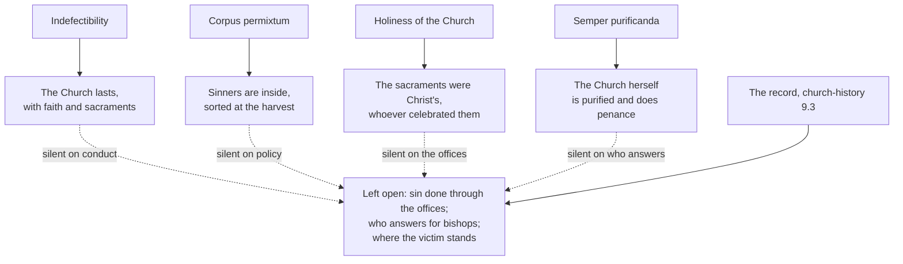

# The Church & Mary · Lesson 5.4: A Church of sinners

> ⏱ ~15 min · Module 5: The Church, salvation, and her own sin · Builds on: [2.2 Holy](02-02-holy.md), [5.3 Ecumenism as doctrine](05-03-ecumenism-as-doctrine.md), [`church-history` 9.3](../../church-history/lessons/09-03-after-the-council.md) · Unlocks: [6.1 Theotokos, and Mary in Scripture and the Fathers](06-01-theotokos-and-mary-in-scripture-and-the-fathers.md)

## Why this matters

[2.2](02-02-holy.md) taught that the Church is holy from her source, holds real sinners, and is always being purified. It left two questions here. Can the Church herself be called a sinner? And what must ecclesiology say about a Church whose bishops, acting as bishops, protected priests who abused children? This lesson exists to prevent one failure: an answer that is theologically tidy and pastorally false.

## The idea

**Two words to keep apart.** *Indefectible* means "cannot fail": the Church will last until Christ returns, and she will not lose the faith and the sacraments through which he saves. *Impeccable* means "cannot sin". The first is promised to the Church as such. The second is promised to nobody: no Catholic text claims it of a member, a priest, a bishop or a pope, and infallibility is not impeccability either ([`fundamental-theology` 4.2](../../fundamental-theology/lessons/04-02-infallibility-and-its-conditions.md)). A promise that a river will reach the sea is not a promise that its water will be clean.

**Four standard answers.** The tradition has four true replies to grave sin in the Church: [indefectibility](../reference.md#indefectibility); the [*corpus permixtum*](../reference.md#corpus-permixtum), wheat and cockle together until the harvest ([2.2](02-02-holy.md)); the holiness *of* the Church, which comes from Christ and not from her members; and LG 8's [*semper purificanda*](../reference.md#semper-purificanda). The test is whether each answers the question the record asks.

## The doctrine

**Said plainly.** A Church confessed holy concealed the sexual abuse of children for decades. The record is [`church-history` 9.3](../../church-history/lessons/09-03-after-the-council.md)'s, unsoftened. Priests abused children. Bishops who knew moved them, sent them for treatment and returned them to ministry, kept settlements confidential and did not tell the police: a failure of choice, not of ignorance. The John Jay study (2004) found allegations against 4,392 US priests who served in 1950–2002, about 4 percent. The Murphy Report (2009) found that the Archdiocese of Dublin had put secrecy, the avoidance of scandal and its own reputation ahead of children's welfare. A Pennsylvania grand jury (2018) named 301 priests and more than 1,000 identifiable victims. Journalists, commissions and grand juries brought these facts out, not the Church's own processes.

1. **The Church is indefectible.** "The gates of hell shall not prevail against it" (Matt 16:18, DR); Christ promises to be with the apostles to the end of the world (Matt 28:20). Vatican I makes the Church's permanence the ground of Peter's perpetual succession (*Pastor Aeternus* ch. 2, Schaff's translation):

   > That which the Prince of Shepherds … established in the person of the blessed Apostle Peter … must … necessarily remain unceasingly in the Church; which, being founded upon the Rock, will stand firm to the end of the world.

   LG 39 calls her indefectibly holy. *In words:* the Church will last, holding faith and sacraments, and the whole body cannot fail in believing ([`fundamental-theology` 5.3](../../fundamental-theology/lessons/05-03-the-sensus-fidei.md)).

2. **No one in her is impeccable.** Trent defined that no justified person avoids all sins, even venial ones, through a whole life without a special privilege, as the Church holds of Mary (Session VI, can. 23). CCC 827: all members, her ministers included, must acknowledge that they are sinners. *Gaudium et Spes* 43 holds both: the Church stays her Lord's faithful spouse, though members, clerical and lay, have long been unfaithful. *In words:* the guarantee covers what Christ gives through the Church, never anyone's conduct in office.

3. **Her holiness is not her members'.** Paul VI's *Credo of the People of God* (30 June 1968, §19) says the Church is holy though she holds sinners, because "she herself has no other life but that of grace". She suffers and does penance for her members' offences. The ITC's [*Memory and Reconciliation*](../reference.md#memory-and-reconciliation) (December 1999) calls this the holiness *of* the Church, as against holiness *in* the Church (§3.2). *In words:* the sacraments an abuser celebrated were Christ's acts, not his.

4. **The Church herself repents.** LG 8 makes the Church herself the one purified, discipline included (UR 6; [2.2](02-02-holy.md)). For the ITC the Church is "in a certain sense" a sinner, because she takes on the sin of those she bore in baptism (§3). She confesses herself a sinner "not as a subject who sins", but by bearing her children's faults in maternal solidarity (§3.4). Nothing may be confessed until the historical facts are established (§4). Ambrose's *casta meretrix* is no warrant for calling the Church a sinner outright: his chaste harlot is a Church gathered from sinners and made chaste ([2.2](02-02-holy.md)). *In words:* repentance is the Church's act. Whether sin is ever the Church's act is left open.

**Where each answer stops.**

- **Indefectibility** is true, and it answers a question no victim asked. It promises survival, not that a bishop will protect a child.
- ***Corpus permixtum*** explains why abusers were inside. It stops at policy. Transfers, confidential settlements and closed files were not cockle among the wheat; they were acts of governance, done with authority the Church confers. And "suffer both to grow until the harvest" (Matt 13:30, DR) concerns the final sorting: Augustine never used it against discipline (2.2, Ex 1). Used to keep an abuser in ministry, it is inverted.
- **The holiness of the Church** protects the sacraments from the minister's sin. It stops at the offices. *Mystici Corporis* §66 lays weakness in the Church to individuals' inclination to evil, even in her highest members, and not to her juridical constitution. That covers each bishop's sin, not a pattern repeated across countries and decades through the instruments of office.
- ***Semper purificanda*** goes furthest, because the Church herself is purified. It stops where it stays a phrase: purified of what, by whom, answerable to whom? LG 8 does not say.

**The questions the record forces.** *Clericalism.* Francis's Letter to the People of God (20 August 2018), written after the Pennsylvania report, opens with Paul's line that when one member suffers, all suffer with it (1 Cor 12:26). Speaking as an ecclesial community, it admits "we were not where we should have been". It names [clericalism](../reference.md#clericalism), fostered by priests or by laity, as a distorted understanding of authority that helps perpetuate abuse. In 3.3's terms, it misreads [essence, not degree](03-03-the-laity-charisms-and-the-sensus-fidei.md) as rank in holiness: ordination as caste, not service to the common priesthood.

*Who answers for a bishop?* He governs with proper, ordinary and immediate power (LG 27; can. 381 §1; [3.1](03-01-bishops-and-apostolic-succession.md)), and in penal cases only the pope judges him (can. 1405 §1, 3°). In practice a concealing bishop long answered to no one below the pope. [*Vos estis lux mundi*](../reference.md#vos-estis-lux-mundi) (7 May 2019; definitive text 25 March 2023) obliges clerics and religious to report. It covers a bishop's acts or omissions meant to interfere with or avoid investigations (art. 1 §1 b), and has the metropolitan investigate (art. 8). A rescript published on 17 December 2019 took these cases out of the pontifical secret.

*Where is the victim?* Office and jurisdiction relate a superior to his subjects and to the Church's good; a victim entered them as a witness. The 1983 Code treated a cleric's sexual offence with a minor under can. 1395, among offences against special obligations: a breach of his duties. *Pascite gregem Dei* (2021) moved it to offences against human life, dignity and freedom (can. 1398). *Vos estis* forbids imposing silence on anyone who reports (art. 4 §3), and commits the authorities to welcome, listen to and support those who say they were harmed (art. 5). Whether ecclesiology, not only law, has a place for the victim is open; the Letter starts from 1 Cor 12:26.

**Acts of repentance are acts.** Vatican II begged pardon for sins against unity (UR 7; [5.3](05-03-ecumenism-as-doctrine.md)). The [Day of Pardon](../reference.md#day-of-pardon) (12 March 2000) confessed the sins of the Church's members two years before the Boston revelations, and prayed for abused minors only in general terms. Benedict XVI's letter to the Catholics of Ireland (2010) and Francis's admission of "grave errors" over Chile (2018) followed (`church-history` 9.3). None is an argument that the Church is holy after all; each is measured by the historical truth it admits and by what changed afterwards.

**Mark the levels** ([`fundamental-theology` 4.4](../../fundamental-theology/lessons/04-04-the-ladder-of-doctrinal-authority.md); [levels of authority](../reference.md#levels-of-authority)). That the Church is holy is **rung 1** (the Creed; 2.2). That she lasts to the end with faith and sacraments rests on Christ's promises (PA ch. 2; LG 39): **at least rung 3**, presupposed by rung-1 acts (the Creed's article; ch. 2's canon on Peter's perpetual successors), but defined by no act as a thesis of its own (can. 749 §3). That no justified person avoids all sin is **rung 1** (Trent VI, can. 23). LG 8, UR 6 and GS 43 are **at least rung 3**; *Mystici Corporis* §66 is **rung 3**. The *Credo* is by its own §3 not strictly a dogmatic definition; §19's formulation is rung 3. ***Memory and Reconciliation* has no magisterial level.** Its *in forma specifica* approval was the commission's own vote on the text, not the papal approval of [`fundamental-theology` 4.5](../../fundamental-theology/lessons/04-05-reading-a-documents-weight.md); Cardinal Ratzinger only approved publication. That clericalism helps perpetuate abuse is the Letter's pastoral judgment; the causes are disputed (CH 9.3). *Vos estis*, the rescript and *Pascite gregem Dei* are **law**: binding, changeable, no doctrinal rung. The Day of Pardon is a liturgical act. **Whether the Church herself sins is freely disputed.** Jacques Maritain (*On the Church of Christ*, 1970; English 1973) set the Church's person, holy and without sin, against her personnel, who sin. Karl Rahner ("The Sinful Church in the Decrees of Vatican II", *Theological Investigations* 6) read LG 8 as making the Church, still holy, in some sense a subject of sin.

## Where each answer stops

## Worked examples

**Ex 1 (clean): the embezzling pastor.** Invented: Fr. Gareth Mullins, a pastor in the Diocese of Wexley, takes parish funds. The bishop suspends him, reports him to the police and repays the parish. *Corpus permixtum* covers it entirely: a member sinned, and the office acted against the sin. His Masses were Christ's acts. The standard answers are honest here because the office did its job.

**Ex 2 (strain): the bishop who knew.** Invented, on the recorded pattern: in 1987 the bishop of Wexley receives complaints that a priest has abused boys. He sends the priest for treatment, reassigns him to a parish with a school, and settles confidentially with one family. *Corpus permixtum* covers the priest's sin, and the bishop's as his own. But the transfer was signed as bishop, the settlement paid from diocesan funds and the file kept in the chancery: these were the diocese's acts. Maritain: the personnel sinned, not the person of the Church. Rahner: such sin marks the Church herself. The ITC: the bishop sinned, and the Church bears and confesses his fault. All three agree that the bishop sinned, that the Church must repent, and that the abused child is a member whose suffering is the body's. They disagree about whether the Church's own act can be a sin. The pastorally false answer settles that dispute first and speaks to the victim second.

## Watch out

- **You might think indefectibility means the Church cannot do great wrong.** It promises the whole Church endurance in faith and sacraments ([2.4](02-04-apostolic.md)). Impeccability is claimed of no one.
- **"The Church teaches that she is a sinner" overstates:** no act teaches it, and the ITC, which has no magisterial level, says "not as a subject who sins". **"A Catholic may not say the Church sinned" understates:** the question is freely disputed, and the ITC itself says "in a certain sense".
- ***Vos estis* is law, and the Day of Pardon was no response to the abuse crisis.** The first was amended in 2023.

## One-liner

> The Church is promised that she will last, not that her bishops will be good: every standard answer is true, and each stops where the sin ran through the office.

## Problems

**P1 (🟢)** *(Exegetical)* An **invented** RCIA slide, written for this problem, makes four claims. Mark each **consistent** or **inconsistent** with Catholic teaching, name what decides it, and give the level where one is involved. One or two lines each.

(a) "Christ promised that the gates of hell would not prevail, so no pope has ever been able to commit a mortal sin."

(b) "Until Christ returns there will be a Church that hands on the apostolic faith and celebrates true sacraments."

(c) "When a diocese's bishops concealed crimes for decades, that diocese defected from the Church, and its sacraments became void."

(d) "Indefectibility guarantees that the Church's authorities will, in the end, deal justly with those they harmed."

**P2 (🟡)** *(Exegetical)* An **invented** statement on the website of the invented Diocese of Corran Point, replying to a state commission's report that named abusive priests and found that a former bishop had reassigned them:

> "The Church has always been what St Augustine called a mixed body: wheat and weeds grow together until the harvest. The priests named in the report were weeds, and their sins are their own, not the Church's. Our Lord told his servants not to pull up the weeds before the harvest, and in that spirit the bishops of the time chose treatment and a second chance over public condemnation. Nothing in the report touches the Church's holiness: the gates of hell have not prevailed. We pray for all who were hurt."

Find **four** errors or evasions. For each, name the resource or claim at work, say where it fails or stops, and give the level where a level is involved. 150 words or fewer.

**P3 (🔴)** *(Exegetical (a) · Evaluative (b))* (a) State the answer of the ITC's *Memory and Reconciliation* to whether the Church can be called a sinner, and give its level. Two sentences. (b) Any verdict, 150 words or fewer: of a bishop's concealment carried out through his office, should a Catholic theologian say "the Church sinned", or only "members of the Church sinned, and the Church repents"?

Solutions

**P1** *(Exegetical)*

**Must hit, strict:**

- **(a) Inconsistent.** Matt 16:18 grounds indefectibility, the Church's endurance, not any person's impeccability. Trent defined that no justified person avoids all sin through life without a special privilege, which the Church holds of Mary (Session VI, can. 23, **rung 1**). Infallibility is not impeccability either.
- **(b) Consistent.** This is indefectibility: Matt 28:20, *Pastor Aeternus* ch. 2, LG 39. **At least rung 3**, presupposed by rung-1 acts, with no separate definition.
- **(c) Inconsistent.** Concealment is grave sin by office-holders, not loss of faith or communion. A minister's sin does not void the sacraments he confers (Trent, Session VII, can. 12, **rung 1**; the Donatist principle, 2.2). Credit noting that the promise is made to the whole Church, not to each diocese (2.4).
- **(d) Inconsistent.** Indefectibility covers the faith and the sacraments, not governance or justice to victims. GS 43 assumes the gap between message and conduct and says it must be fought.

**Wrong turns:** marking (b) "rung 1, defined", which cites a definition no act makes; marking (c) "consistent" because "the diocese failed", which confuses sin with defection; answering (d) by denying that the Church must repair harm, when the point is only that indefectibility does not promise it.

**Model answer:** (a) Inconsistent: Matt 16:18 promises the Church's endurance, not anyone's sinlessness, and Trent VI can. 23 (rung 1) excludes lifelong sinlessness except by special privilege. (b) Consistent: that is indefectibility (Matt 28:20; PA ch. 2; LG 39), at least rung 3. (c) Inconsistent: concealment is grave sin, not defection, and sacraments do not depend on the minister's holiness (Trent VII can. 12, rung 1). (d) Inconsistent: indefectibility promises nothing about how authorities act; GS 43 expects failures that must be fought.

---

**P2** *(Exegetical)*

**Accept:** any four of the five below.

**Must hit, strict:**

- **"Mixed body".** *Corpus permixtum* is a real resource (Augustine; no magisterial level; that sinners are inside is at least rung 3). It explains the abusers' presence. It stops at the bishops' reassignments, which were acts of governance done with the Church's authority, and the statement never names them as anyone's sin.
- **"Not to pull up the weeds".** Matt 13:29–30 concerns the final sorting. Augustine never used it against discipline (2.2, Ex 1), so citing it to keep abusers in ministry inverts it.
- **"Treatment and a second chance".** This misdescribes the record: known abusers were returned to ministry and the police were not told, a failure of choice (church-history 9.3).
- **"Not the Church's".** LG 8 and UR 6 make the Church herself the one purified, discipline included (at least rung 3), and the *Credo* §19 has her doing penance. Saying the matter does not concern her understates the teaching.
- **"Gates of hell".** Indefectibility (at least rung 3) is true and irrelevant: it promises survival, not conduct. That is the tidy, pastorally false answer. "We pray for all who were hurt" puts prayer in place of acknowledgement and the care *Vos estis* art. 5 requires.

**Wrong turns:** "correcting" the statement by saying the Church as such sinned, which is a disputed question and not teaching; calling *corpus permixtum* or indefectibility false, when the fault is where they are applied.

**Model answer:** The mixed body is Augustine's, and it explains why abusers were inside. It does not cover the bishop's reassignments, which were acts of office, and the statement passes over them. The parable concerns the harvest, and Augustine never used it against discipline, so citing it for leniency inverts it. "Treatment and a second chance" misdescribes the record of known abusers returned to ministry. "Not the Church's" contradicts LG 8 and UR 6 (at least rung 3), where the Church herself is purified. "The gates of hell" is true and beside the point, because indefectibility promises endurance, not good governance.

---

**P3** *(Exegetical (a) · Evaluative (b))*

**Must hit, strict (a):** the Church is "in a certain sense" a sinner because she takes on the sin of those she bore in baptism. She confesses herself a sinner not as a subject who sins, but by bearing her children's faults in maternal solidarity (§§3, 3.4). Level: **no magisterial level**. It is a commission's theology. Its *in forma specifica* approval was the commission's own vote, and the CDF prefect authorized publication.

**Model answer (a):** The Church is in a certain sense a sinner, not as a subject who sins but because, as mother, she takes on and confesses the faults of the children she bore in baptism. This is a theological commission's view with no magisterial level: "in forma specifica" records the commission's vote, and Cardinal Ratzinger approved only its publication.

**Must hit, any verdict (b):**

- State the question's level first: freely disputed. No act settles it, and the ITC's answer has no magisterial weight.
- Account for *Mystici Corporis* §66 (weakness laid to individuals, not to the constitution; rung 3) and for LG 8 (the Church herself purified).
- Distinguish the subject who sins from the body that bears and repents.
- Face the hard case, an act done through office in the Church's name. The members-only side must say whose act the signed transfer was. The "Church sinned" side must say how the Church's holiness (rung 1) stays intact.
- Concede the strongest point against your verdict.

**Wrong turns:** treating either verdict as Catholic teaching; citing the ITC as magisterium, or reading its *in forma specifica* as papal approval; arguing from the scale of the crimes alone without the distinction between sinning and bearing.

**Model answer (b), one of several:** I would say "members sinned, and the Church repents", but not "only members". The question is freely disputed, and the ITC's middle formula carries no magisterial weight. I keep the subject of sin personal. A transfer signed in the Church's name was the bishop's act, done with an authority he misused, and *Mystici Corporis* §66 lays such weakness to persons, not to the constitution. But the word "only" fails the case: LG 8 makes the Church the one purified, and the act ran through her offices, so she must own it, repent of it and change her structures. The strongest point against me is Rahner's. If the Church can be the subject of her own purification, a purely personal account of sin makes that repentance theatre.

## Flashback

**From Lesson [5.2](05-02-subsistit-in-and-the-status-of-other-churches.md) (*Subsistit in* and the status of other churches):** *(Exegetical.)* Apply to a new case. Four people, **invented** for this problem, pray together in a hospital chapel. Declan is a Catholic who professes the whole faith, receives the sacraments and is in communion with his bishop, but has for years lived in mortal sin that he does not mean to repent of. Wanjiru is a catechumen who has asked to be baptized at Easter. Ruth was baptized with water in the name of the Trinity in a Presbyterian congregation, governed by elders and with no bishops in apostolic succession; she prays daily and works with the poor. Dmitri belongs to an Eastern church that is not in communion with the Bishop of Rome and that, in Catholic judgment, has kept bishops in apostolic succession and a valid Eucharist.

(a) Give *Lumen Gentium* 14's account of Declan's relation to the Church, and of Wanjiru's. **One sentence each.**

(b) A visitor says: "Ruth's congregation is only an 'ecclesial community', so she is further from Christ than Declan, who belongs to the true Church." Say what the classification of bodies grades, and why neither classification licenses his comparison. **Two sentences.**

(c) The chaplain says: "Dmitri's church lacks only communion with the pope, so the Church of Christ subsists there too." Correct him from the 2007 *Responses*, and give the level of the correction. **Two sentences.**

Solution

**Must hit, strict (a):**

- **Declan** has every visible bond LG 14 lists (profession of faith, the sacraments, ecclesiastical government and communion), so he belongs to the Church's visible structure. But LG 14 counts as fully incorporated only those who also possess the Spirit of Christ, and one who does not persevere in charity remains in her bosom only "bodily", not "in his heart".
- **Wanjiru** seeks incorporation with explicit intention, so by that very intention she is *joined* with the Church (LG 14), and the Church already embraces her as her own. She is not yet incorporated: baptism is the door.

**Must hit, strict (b):**

- The classification of bodies grades **structure**: whether a community has kept apostolic succession in the sacrament of Orders, on which, in Catholic doctrine, the genuine and integral substance of the Eucharist depends (*Responses* Q5; UR 22). It says nothing about the faith or holiness of anyone in that community, and a person's relation to the Church is not inherited from the label on her congregation.
- The classification of persons sorts relations to the Church's visible communion and is no census of the saved. LG 14 itself says that a member who does not persevere in charity is not saved. Ruth, truly baptized, is joined to the Church in real though imperfect communion and is a member of Christ's body (LG 15; UR 3). Neither classification measures nearness to Christ in grace.

**Must hit, strict (c):**

- "Subsists" can be said of the Catholic Church alone, because it refers to the mark of unity confessed in the Creed (*Responses* Q2): there is one subsistence. Dmitri's church is a true particular Church, in which the Church of Christ is present and operative (DI 17; *Responses* Q2).
- "Only" is the error. Communion with Peter's successor is not an external complement to a particular church but one of its internal constitutive principles, so these churches lack something in their condition as particular churches (*Responses* Q4), a wound (*Communionis Notio* 17).
- Level: **rung 3**, Rome's reading of LG 8 in papally approved CDF acts. Holding that the Church of Christ subsists in other churches as well contradicts authentic teaching owed religious submission, but it is not heresy. Credit noting that the unity this reading protects is the Creed's article, rung 1.

**Wrong turns:** calling Declan "fully incorporated" because he has the visible bonds, or "outside the Church" because of his sin; putting Wanjiru under LG 16, which concerns those who have not received the Gospel. In (b), reversing the visitor ("so Ruth is closer to Christ"), which treats the classifications as a ranking in holiness exactly as he did; calling Ruth or her congregation outside the Church. In (c), calling the chaplain's view heresy, which overstates rung 3; calling Rome's reading one opinion among others, which understates it; "correcting" him by denying that Dmitri's church is a true particular Church, or that the Church of Christ is present in it.

**Model answer:** (a) Declan keeps every visible bond and so belongs to the Church's visible structure, but LG 14 requires the Spirit of Christ for full incorporation, and without charity he remains in her bosom "bodily", not "in his heart". Wanjiru, seeking baptism with explicit intention, is by that intention already joined with the Church, though not yet incorporated. (b) The classification of bodies grades a community's structure, succession in Orders and with it the Eucharist, not the faith or holiness of anyone in it. The classification of persons is no census of the saved: LG 14 warns the member without charity, while Ruth, truly baptized, is a member of Christ's body in real though imperfect communion (LG 15; UR 3). (c) The Church of Christ is present and operative in Dmitri's church, a true particular Church, but "subsists" is said of the Catholic Church alone, because it names the unity confessed in the Creed (*Responses* Q2). Nor is communion with Peter's successor an extra: it is internal to a particular church, so his church is wounded as a particular church (Q4), and this is rung 3 teaching, owed religious submission, which the chaplain contradicts without falling into heresy.

## Connections

- **Backward:** [2.2](02-02-holy.md) taught the holiness of the Church, the mixed body, *semper purificanda* and *casta meretrix*, which licenses no patristic verdict that the Church is a sinner. [2.4](02-04-apostolic.md) said succession guarantees no successor's holiness. [3.1](03-01-bishops-and-apostolic-succession.md) gave the bishop's proper power, and [3.3](03-03-the-laity-charisms-and-the-sensus-fidei.md) the essence-not-degree formula. The record is [`church-history` 9.3](../../church-history/lessons/09-03-after-the-council.md)'s; indefectibility *in credendo* is [`fundamental-theology` 5.3](../../fundamental-theology/lessons/05-03-the-sensus-fidei.md)'s.
- **Forward:** [`apologetics-catholic-claims`](../../apologetics-catholic-claims/syllabus.md) [7.3](../../apologetics-catholic-claims/lessons/07-03-the-abuse-crisis-and-the-argument-from-scandal.md) argues the case from scandal, taking this lesson's resources and their limits as given. The validity of a sinful minister's sacraments is [`sacraments-and-liturgy`](../../sacraments-and-liturgy/syllabus.md)'s. The harvest, and the pilgrim Church of LG ch. 7, belong to [`creation-grace-last-things`](../../creation-grace-last-things/syllabus.md). [6.5](06-05-mary-in-the-economy-in-the-church-and-in-devotion.md) takes up Mary, in whom the Church already has the holiness she lacks here.
- **Sideways:** whether an official's act in a body's name is the body's act is the authorization ground of [`philosophy-of-debt` 6.3](../../philosophy-of-debt/lessons/06-03-whose-debt-is-it.md), asked there of states and debts.
