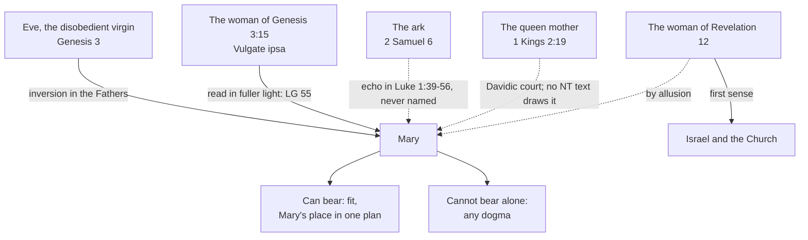

# The Church & Mary · Lesson 6.1: Theotokos, and Mary in Scripture and the Fathers

> ⏱ ~15 min · Module 6: Mary · Builds on: [`christology` 2.2](../../christology/lessons/02-02-nestorius-cyril-and-ephesus.md), [`patristics` 2.2](../../patristics/lessons/02-02-irenaeus-recapitulation.md), [`old-testament` 1.2](../../old-testament/lessons/01-02-the-senses-of-scripture.md) · Unlocks: [6.2 Ever-virgin](06-02-ever-virgin.md), [6.3 The Immaculate Conception](06-03-the-immaculate-conception.md)

## Why this matters

[`christology` 2.2](../../christology/lessons/02-02-nestorius-cyril-and-ephesus.md) ended by declining a question. *Theotokos* says that the one Mary bore is the Word himself; what that makes of *her* was handed here. This lesson lays the floor: the one Marian dogma that is really about Christ, and the earliest evidence the other three draw on (a few Gospel scenes, a typology the Fathers built, a prayer on a scrap of papyrus). Each bears some weight; the skill is saying how much.

## The idea

Start with the root: what the Church believes about Mary rests on what she believes about Christ (CCC 487). *Lumen Gentium* 53 makes the [divine maternity](../reference.md#divine-maternity) the centre: Mary is truly Mother of God and of the Redeemer, and *by that office* the Father's beloved daughter and the Spirit's temple, above every creature. Yet as a child of Adam she is redeemed by her Son and stands with all who are to be saved. LG 61: she was predestined to it with the Incarnation itself. So every later Marian claim is argued *from* who her son is, and [6.5](06-05-mary-in-the-economy-in-the-church-and-in-devotion.md) ends the module on the rule: nothing may be said of Mary that this root would not license.

The evidence comes in three kinds that weigh differently: **what a text says**, **what a figure signifies**, and **what Christians prayed**. [Typology](../reference.md#marian-typology) reads a real person or thing as prefiguring another. [`old-testament` 1.2](../../old-testament/lessons/01-02-the-senses-of-scripture.md) gave its rules: the spiritual sense rests on the literal, and no doctrine rests on a figure alone. A type the New Testament itself draws belongs to an inspired text's literal sense; a Father's carries that Father's weight. A typological argument is an argument from **correspondence**, point-for-point fit between two moments of one plan. It cannot establish a fact. It can show that a fact known otherwise belongs to a pattern.

## Source

Irenaeus, *Against Heresies* III.22.4 (ANF vol. 1), c. 180. Just before, Adam is "the figure of Him that was to come":

> In accordance with this design, Mary the Virgin is found obedient, saying, "Behold the handmaid of the Lord; be it unto me according to thy word." But Eve was disobedient; for she did not obey when as yet she was a virgin. [...] having become disobedient, was made the cause of death, both to herself and to the entire human race; so also did Mary, having a man betrothed [to her], and being nevertheless a virgin, by yielding obedience, become the cause of salvation, both to herself and the whole human race. [...] And thus also it was that the knot of Eve's disobedience was loosed by the obedience of Mary. For what the virgin Eve had bound fast through unbelief, this did the virgin Mary set free through faith.

Read the shape. "In accordance with this design" sets the Eve–Mary pair *inside* the Adam–Christ one, as one matched move in [recapitulation](../../patristics/lessons/02-02-irenaeus-recapitulation.md), on three axes: virgin and virgin, betrothed and betrothed, disobedience and obedience. "Cause of salvation" is said of Mary's *obedience*, her consent to the Incarnation, and "to herself" counts her among the saved. The knot says the undoing runs back through the strands that tied it.

## The doctrine and the evidence

1. ***Theotokos*, reloaded.** Ephesus (431) judged Cyril's Second Letter consonant with Nicaea and deposed Nestorius: the one born of Mary is the Word in his own flesh, so she is [*Theotokos*](../reference.md#theotokos), God-bearer. Chalcedon's Definition (451) is the first definition text to name her Mother of God (both acts: [`christology` 2.2](../../christology/lessons/02-02-nestorius-cyril-and-ephesus.md)). *In words:* the title says who her son is; what it makes of her is LG 53 and 61.

2. **The scenes.** The New Testament's Mary is sparse, and every scene shows her in relation to him.
   - *Infancy* ([`new-testament` 2.3](../../new-testament/lessons/02-03-luke.md) compares Luke's and Matthew's). Luke gives her consent ("Behold the handmaid of the Lord", 1:38), Elizabeth's "the mother of my Lord" (1:43) and "blessed art thou that hast believed" (1:45), the words kept and pondered (2:19, 51), and Simeon's sword (2:35). The greeting of 1:28 is [6.3](06-03-the-immaculate-conception.md)'s, the virginal conception [6.2](06-02-ever-virgin.md)'s.
   - *Cana* (John 2:1–11). John never names her; she is "the mother of Jesus". She says, "They have no wine." He answers, "Woman, what is that to me and to thee? My hour is not yet come", an idiom of distance (Judges 11:12; 1 Kings 17:18 [DR 3 Kings 17:18]; on demons' lips, Mark 1:24). She tells the servants, "Whatsoever he shall say to you, do ye," and he acts. In John the "hour" is the cross (12:23; 13:1; 17:1).
   - *The cross* (John 19:25–27). Her second and last scene in John, again "Woman": "behold thy son"; to the beloved disciple, "Behold thy mother"; "from that hour, the disciple took her to his own."
   - *The upper room* (Acts 1:14). She perseveres in prayer with the Eleven, the women and "his brethren" before Pentecost: her last appearance by name.
   - *The harder texts.* Mark 3:31–35 and Luke 11:27–28 put doing God's will and keeping his word above kinship. LG 58 cites both and says Mary was doing exactly that (Luke 2:19, 51).

   LG 58 reads Cana as her intercession obtaining the first sign, and Calvary as Christ giving her as mother to his disciple; *Redemptoris Mater* 24 (1987) links the double "Woman" to Genesis 3:15. *In words:* John's symbolism (unnamed mother, unnamed disciple, "Woman", "hour") *invites* these readings; the text does not *state* them.

3. **The [new Eve](../reference.md#new-eve).** Justin's *Dialogue* 100 (mid-second century) is its first surviving form ([`patristics` 1.4](../../patristics/lessons/01-04-justin-martyr.md)). Irenaeus makes it structural (the Source; V.19.1 is P1). Tertullian, *On the Flesh of Christ* 17 (c. 206), gives the Latin West its formula:

   > As Eve had believed the serpent, so Mary believed the angel. The delinquency which the one occasioned by believing, the other by believing effaced.

   LG 56 quotes Irenaeus; LG 63 calls Mary "the new Eve". *In words:* inside Christ's undoing of Adam, Mary's believing obedience undoes Eve's unbelieving disobedience.

4. **Old Testament types.**
   - *The woman of Genesis 3:15.* [`old-testament` 2.3](../../old-testament/lessons/02-03-the-primeval-history.md) settled the philology: Hebrew *hu'* ("he" or "it": the offspring), Septuagint *autos*, Vulgate *ipsa*, "she", which the Douay follows ("she shall crush thy head"). The Douay's own note says the sense is the same either way, since the woman crushes the serpent "by her seed". So the Marian reading rests not on the pronoun but on the enmity with *the woman*, read with John's "Woman" and Revelation's. LG 55: these earliest texts, read in the Church in the light of fuller revelation, bring the Redeemer's mother gradually into view.
   - *The ark.* Set 2 Samuel 6 [DR 2 Kings 6] beside Luke 1:39–56: David "arose and went" for the ark (6:2), Mary "rising up" went to the hill country (1:39); "How shall the ark of the Lord come to me?" (6:9), "whence is this to me that the mother of my Lord should come to me?" (1:43); the ark "abode" three months with Obededom (6:11), Mary "abode" about three months (1:56); David "leaping" (6:16), the infant "leaped" (1:41, 44). Revelation shows the ark (11:19) one verse before the woman (12:1); the chapter break is medieval. The Litany of Loreto calls Mary *Foederis arca*, Ark of the Covenant.
   - *The queen mother* (1 Kings 2:19 [DR 3 Kings 2:19]) is Ex 2.

5. **The [woman of Revelation 12](../reference.md#woman-of-revelation-12).** [`new-testament` 6.5](../../new-testament/lessons/06-05-revelation.md) gave three readings (Israel, the Church, Mary); the Douay note puts the Church first and Mary "by allusion". She bears the child "who was to rule all nations with an iron rod" (12:5; Psalm 2:9), so the Messiah's mother is in view; but her birth pangs (12:2), 1,260 days in the wilderness (12:6) and "the rest of her seed" (12:17) are a people's features. *In words:* the woman is first Israel and the Church; the Marian reading names the one woman in whom that people bore its Messiah, on the logic of Mary as type of the Church (LG 63).

6. ***[Sub tuum praesidium](../reference.md#sub-tuum-praesidium)*.** The lesson's translation of the Greek, as Byzantine Vespers prays it:

   > Beneath your compassion we take refuge, Theotokos. Do not overlook our petitions in distress, but deliver us from dangers, you alone pure, you alone blessed.

   The vocative *Theotoke* is read on a papyrus, P.Ryl. III 470. Its editor, C. H. Roberts (1938), dated the hand to the fourth century with a query, reporting that Edgar Lobel would not place it after the third; Hans Förster (1995; 2005) argued for a date centuries later. There is no consensus. LG 66 alludes to it, and its footnote names it. Early, it is the first direct invocation of Mary we have; late, a witness to a prayer already old. Either way it shows prayer under the title, nothing more.

**Mark the levels** ([levels of authority](../reference.md#levels-of-authority); [`fundamental-theology` 4.4](../../fundamental-theology/lessons/04-04-the-ladder-of-doctrinal-authority.md)). *Theotokos* is **defined dogma** (rung 1): Ephesus's received judgment, restated in Chalcedon's Definition. That the divine maternity is the root of Mary's dignity is **authentic magisterium** (rung 3, LG 53, 61). Chapter 8 defines nothing, and LG 54 leaves open questions open. The Marian readings of Cana and Calvary (LG 58; *Redemptoris Mater* 24) are **rung 3** as readings those documents propose, not definitions of what John meant. The new Eve is patristic consensus taken up at **rung 3** (LG 56, 63), defined nowhere. The Marian senses of Genesis 3:15 and Revelation 12 are **spiritual-sense readings**, taught, not defined, and not the literal sense. The ark and the queen mother are **theological typology**, with no magisterial act behind them. The papyrus's date is a **historical question**, argued freely.

## The typology map

Solid arrows: drawn by Fathers or magisterial texts. Dashed: proposed by readers.

## Worked examples

**Ex 1: a clean case, "the mother of my Lord" (Luke 1:43).** *Literal sense:* Elizabeth, "filled with the Holy Ghost" (1:41), calls the unborn child "my Lord". Luke uses "Lord" for God all through the chapter, and again two verses later ("spoken to thee by the Lord", 1:45). *Bears:* Mary is mother of the one Luke calls by God's name; CCC 495 cites the verse as the Gospels' ground for *Theotokos*. *Does not bear alone:* Ephesus's precision. "My Lord" could be heard as messianic courtesy; that her son is the same subject as the eternal Word took Nicaea and Cyril.

**Ex 2: where it strains, the queen mother.** Kings and Jeremiah call the king's mother *gebirah*, "great lady" (lesson's gloss; 1 Kings 15:13; Jeremiah 13:18). At 1 Kings 2:19 Solomon rises to meet Bathsheba, bows, and sets a throne at his right hand for "the king's mother". Mary's son is promised "the throne of David his father" (Luke 1:32), so the type is available. Now read on. Adonias asked her to speak for him because the king "cannot deny thee any thing" (2:17); Solomon refuses and has Adonias killed (2:22–25). *Bears:* dignity, nearness to the throne, a mother's standing to ask. *Cannot bear:* that her requests are always granted, which the very scene refutes; nor any proof, since no New Testament text draws the type.

## Watch out

- **You might think Ephesus defined everything LG 53 says.** Only *Theotokos* is defined (rung 1). That the maternity grounds her other graces is conciliar teaching (rung 3). Calling it "dogma" overstates it; "pious opinion" understates it.
- **You might think a typology is either proof or decoration.** It shows fit within one plan and carries the weight of whoever draws it. No Marian dogma rests on a type alone; "she shall crush" is the Vulgate's pronoun, not a proof text.
- **You might think the papyrus is third-century because a 2025 Vatican doctrinal note says so in a footnote.** Dating a hand is palaeography, and no rung applies to it.

## One-liner

> Every Marian claim grows from *Theotokos*, a claim about Christ; the Gospels give Mary's consent, faith and presence, the Fathers make her Eve reversed, and the types show fit, not proof.

## Problems

**P1 (🟢)** *(Exegetical)* Close reading. Irenaeus, *Against Heresies* V.19.1 (ANF vol. 1):

> For just as the former was led astray by the word of an angel, so that she fled from God when she had transgressed His word; so did the latter, by an angelic communication, receive the glad tidings that she should sustain (portaret) God, being obedient to His word. And if the former did disobey God, yet the latter was persuaded to be obedient to God, in order that the Virgin Mary might become the patroness (advocata) of the virgin Eve. And thus, as the human race fell into bondage to death by means of a virgin, so is it rescued by a virgin; virginal disobedience having been balanced in the opposite scale by virginal obedience. For in the same way the sin of the first created man (protoplasti) receives amendment by the correction of the First-begotten …

(a) List four correspondences the passage draws between Eve and Mary. (b) The ANF editor calls "patroness" ambiguous. Give two senses *advocata* could carry, and say which one the passage's own image supports. (c) What does the last sentence do to "rescued by a virgin"? **Two sentences per part.**

**P2 (🟡)** *(Exegetical)* Two **invented** answers from a seminary exam, written for this problem, to the question "What does the Ark typology contribute to Mariology?"

> Saoirse: "Luke deliberately modelled the Visitation on 2 Samuel 6, so the Ark typology is the literal sense of Luke 1. And since the Ark was all-holy, Scripture itself teaches that Mary was conceived without sin."
>
> Farid: "Luke never mentions the Ark, and people stay places for three months all the time. The parallels are coincidence, so the typology is worthless."

(a) Name two errors in Saoirse's answer and one in Farid's, with the correction. (b) Say in two sentences what the typology can bear, and at what level. **120 words or fewer.**

**P3 (🔴)** *(Exegetical)* An **invented** RCIA slide from the fictional Holy Cross parish, Fenwick, written for this problem:

> **Mary in John's Gospel**
>
> - At Cana Jesus calls her "Woman" to show that she is the new Eve. John says so explicitly.
> - He worked the miracle though his hour had not come, because a son cannot refuse his mother. So every prayer to Mary is granted.
> - At the cross Jesus made Mary Mediatrix of all graces, which Vatican II defined.
> - Acts 1:14 shows Mary presiding over the apostles at Pentecost.

Find **four** errors. For each, say what the text says and what the tradition actually holds, with its level where a level is involved. **150 words or fewer.**

Solutions

**P1** *(Exegetical)*

**Accept:** any four correct correspondences in (a); in (b), any two defensible senses provided the scale image decides between them.

**Must hit, strict (a):** angel and angel (Eve misled by an angel's word, Mary told by an angel); a word received (Eve's transgression of God's word, Mary's obedience to it); disobedience and obedience; virgin and virgin; fleeing from God and bearing God (*portaret*); the race brought into bondage and the race rescued. (The betrothal pairing is in the sentence before this excerpt, so it does not count here.)

**Must hit, strict (b):** two senses: (i) a **counterpart or helper**, one who takes the other end of the load (the ANF note suggests Greek *antilēpsis*), and (ii) an **advocate** who pleads Eve's cause. The passage's image is a **balance**, "balanced in the opposite scale", which supports (i). Mary is Eve's counterweight; the passage shows no one pleading.

**Must hit, strict (c):** it nests the virgin-for-virgin pair "in the same way" inside the **First-begotten's** correction of the first-created man. So the rescue is Christ's, and "by a virgin" names the consent through which the rescuer came, not a second saviour.

**Wrong turns:** claiming the passage itself shows Mary pleading for Eve, and so citing it as second-century proof of the title Advocate (LG 62): the text gives a balance, not a plea. Reading "rescued by a virgin" as making Mary a second rescuer beside Christ; whether to define Co-redemptrix is [6.5](06-05-mary-in-the-economy-in-the-church-and-in-devotion.md)'s question, and the title is not defined.

**Model answer:** (a) An angel's word misleads Eve and an angel's word comes to Mary. Eve transgresses God's word and flees him; Mary obeys it and bears God; one virgin brings the race into bondage and the other rescues it. (b) *Advocata* could mean a counterpart who takes up the other end of the burden, or an advocate who pleads Eve's cause. The image of the opposite scale supports the first: Mary is Eve's counterweight. (c) It sets the virgin pair inside the First-begotten's correction of Adam. So the rescue is Christ's work, received through Mary's obedience.

---

**P2** *(Exegetical)*

**Must hit, strict (a):** Saoirse: (1) **intention asserted as fact.** Luke never says "ark"; whether he meant the echo is argued among exegetes, and a typology is part of Luke's literal sense only if Luke draws it. (2) **A dogma rested on a figure.** No doctrine rests on a type alone ([`old-testament` 1.2](../../old-testament/lessons/01-02-the-senses-of-scripture.md)). The Immaculate Conception is defined by *Ineffabilis Deus* (1854; [6.3](06-03-the-immaculate-conception.md)), not proved from this passage. Farid: the correspondences are **textual and several**, not one: arising and going (6:2/1:39), "come to me" (6:9/1:43), three months (6:11/1:56), leaping (6:16/1:41, 44). Revelation sets the ark (11:19) beside the woman (12:1), and the Church prays the title. A type is God's signifying by things ([`old-testament` 1.2](../../old-testament/lessons/01-02-the-senses-of-scripture.md)), so its legitimacy does not hang on proving Luke's intention.

**Must hit, strict (b):** it can bear **fit**: Mary as the place of God's presence among his people, coherent with what is held on other grounds. Its level is **theological typology** with devotional use, and **no magisterial act**.

**Wrong turns:** answering whether Luke intended it, which is not asked; calling the typology "defined" or "Church teaching"; dismissing it as allegory.

**Model answer:** Saoirse asserts Luke's intention, which is disputed; Luke never names the ark. She also rests a defined dogma on a figure, but the Immaculate Conception's warrant is the 1854 definition, and no doctrine rests on a type alone. Farid ignores four verbal parallels and Revelation's placing of the ark beside the woman, and a type does not hang on proving Luke's intention. The typology bears fit: Mary as the place of God's presence. It is theological typology used in devotion, with no magisterial weight.

---

**P3** *(Exegetical)*

**Must hit, strict (any four):**

- **"John says so explicitly"**: false. John says "Woman" (2:4; 19:26). Linking it to Genesis 3:15 is a reading proposed in *Redemptoris Mater* 24 (rung 3 as a reading); "new Eve" is the Fathers' title, taken up in LG 63, not John's words.
- **"A son cannot refuse his mother" and "every prayer is granted"**: not in the text. Jesus's reply is an idiom of distance, and the miracle follows her instruction to the servants. LG 58 reads Cana as her intercession obtaining the first sign; nothing promises that every request is granted. (Even the queen-mother type, 1 Kings 2, ends in refusal.)
- **"Mediatrix of all graces, defined at Vatican II"**: **not defined**. LG 62 lists "Mediatrix" among titles of invocation, says it neither takes from nor adds to Christ's one mediation, and defines nothing. John 19:26–27 says "Behold thy mother"; the Church reads it as spiritual motherhood (LG 58; 6.5).
- **"Presiding over the apostles"**: Acts 1:14 says she persevered in prayer *with* them. It says nothing of presiding, and Pentecost itself is Acts 2.

**Wrong turns:** "correcting" the slide by calling Mediatrix a forbidden title, which **understates**. LG 62 uses "Mediatrix", and the 2025 doctrinal note *Mater Populi Fidelis* marks the limits of "of all graces" without forbidding it (6.5); denying any Marian reading of the double "Woman", which ignores a proposed magisterial reading; treating the Cana idiom as rudeness.

**Model answer:** John never says "new Eve"; he says "Woman", and the link to Genesis 3:15 is a reading *Redemptoris Mater* 24 proposes. At Cana Jesus answers with an idiom of distance, and the sign follows Mary's word to the servants. LG 58 reads her intercession there, but no text promises that every request is granted. At the cross he says "Behold thy mother". The Church reads that as spiritual motherhood, and "Mediatrix of all graces" is not defined: LG 62 lists "Mediatrix" with a caveat and defines nothing. Acts 1:14 has Mary praying with the apostles, not presiding over them.

## Flashback

**From Lesson [5.3](05-03-ecumenism-as-doctrine.md) (Ecumenism as doctrine):** *(Exegetical.)* Apply to a new case. A seminar thought experiment, **invented** for this problem: the Church of Velloria, an Eastern church (also invented) with its own bishops, its own ancient liturgy and its own canon law, asks for full communion with the Catholic Church. A participant drafts five conditions:

> (1) Velloria professes every truth the Catholic Church holds as revealed.
>
> (2) It adopts the Latin liturgy and the Latin Church's code of canon law.
>
> (3) Its theologians teach in the theological idiom of the Latin West.
>
> (4) It first apologizes for its part in the original schism.
>
> (5) It enters communion in governance with the Catholic bishops and the bishop of Rome.

(a) For each condition, say whether the doctrine of 5.3 makes it **required** for full communion or **not to be demanded**, and cite the text that settles it. **One line each.**

(b) Which of the two cheap imitations of ecumenism does someone commit who demands all five conditions, and which does someone commit who demands none? Then: UR 16 says the council "solemnly declares" the Eastern churches' power to govern themselves by their own disciplines. Does that make it defined dogma? **Two sentences.**

Solution

**Accept:** in (a), any apt citation for each verdict. The verdicts themselves are strict.

**Must hit, strict (a):**

- (1) **Required.** Full communion is one faith (5.3): UR 4 asks unity in essentials, and UR 11 requires the doctrine to be presented whole. The hierarchy of truths orders doctrines and exempts none, since all dogmas are believed with the same divine faith (*Mysterium Ecclesiae* §4).
- (2) **Not to be demanded.** UR 4 protects freedom in discipline and in liturgical rite. UR 16 declares the Eastern churches' power to govern themselves by their own disciplines, and calls keeping that principle one of the essential prerequisites for any restoration of unity. UR 18 forbids any burden beyond what is essential.
- (3) **Not to be demanded.** UR 4 extends the same freedom to theological elaborations of revealed truth, and UR 17 calls differing theological expressions often complementary rather than conflicting. The limit is (1): the same faith, differently expressed.
- (4) **Not to be demanded.** UR 3 puts fault for the separations, at times, on people of both sides, and says those born into separated communities cannot be charged with the sin of separation. In UR 7 the Catholic side itself begs pardon of God and of the separated brethren.
- (5) **Required.** Full communion includes one governance (5.3). Ecclesiastical government and communion is one of LG 14's visible bonds, beside faith and sacraments, and LG 14 says Christ rules the Church through the Supreme Pontiff and the bishops (also can. 205). UR 3 counts differences over the Church's structure among the obstacles to full communion.

**Must hit, strict (b):**

- Demanding all five is **absorption**: Velloria would drop everything that is its own, which UR 4 and 16–18 refuse. Demanding none is **federation**: the churches treated as already one, with unity reduced to mutual recognition, which *Mysterium Ecclesiae* §1 excludes.
- **Not defined.** UR is a conciliar decree that defines nothing, and no doctrine counts as infallibly defined unless that is manifestly evident (can. 749 §3); "solemnly" does not make a definition. The principle of legitimate variety is the decree's own teaching, **rung 3**. The disciplines it protects are themselves discipline, with no rung.

**Wrong turns:** filing (5) under legitimate variety because "governance is discipline". That confuses the law a church governs itself by with the communion of its bishops with Peter's successor, and it slides into federation. Filing (3) as required because the faith must be one, which confuses the faith with its theological expression (UR 17). Exempting part of (1) by the hierarchy of truths, which orders doctrines without grading assent. Making (4) a condition, or reading UR 3 as dividing the blame equally. Calling UR 16 defined because of "solemnly" (overstated), or calling its principle a pastoral preference with no authority (understated).

**Model answer:** (a) (1) Required: one faith, the doctrine whole (UR 4, 11), every dogma believed with the same faith (*Mysterium Ecclesiae* §4). (2) Not to be demanded: freedom of rite and discipline (UR 4), the Eastern churches' own law (UR 16), no burden beyond the essential (UR 18). (3) Not to be demanded: theological expression may differ (UR 4, 17), provided the faith is the same. (4) Not to be demanded: fault lay at times on both sides, today's members bear no guilt for the separation (UR 3), and the Catholic side itself asks pardon (UR 7). (5) Required: one governance, since ecclesiastical government and communion is a bond of full communion (LG 14; can. 205). (b) Demanding all five is absorption; demanding none is federation, which treats the churches as already one and unity as mutual recognition (*Mysterium Ecclesiae* §1). "Solemnly declares" defines nothing, since UR defines nothing and nothing counts as defined unless that is manifest (can. 749 §3), so the principle stands at rung 3, the decree's own teaching.

## Connections

- **Backward:** *Theotokos* as an act and a level is [`christology` 2.2](../../christology/lessons/02-02-nestorius-cyril-and-ephesus.md), restated in Chalcedon's Definition in [2.3](../../christology/lessons/02-03-eutyches-leo-and-chalcedon.md); [`fundamental-theology` 5.1](../../fundamental-theology/lessons/05-01-vincent-of-lerins.md) runs Vincent's canon on the title. Justin's new Eve is [`patristics` 1.4](../../patristics/lessons/01-04-justin-martyr.md), Irenaeus's recapitulation table [2.2](../../patristics/lessons/02-02-irenaeus-recapitulation.md), and Ephrem's "Eve's daughter" [3.4](../../patristics/lessons/03-04-ephrem-and-syriac-christianity.md). The rules for types are [`old-testament` 1.2](../../old-testament/lessons/01-02-the-senses-of-scripture.md), and Genesis 3:15's philology is [2.3](../../old-testament/lessons/02-03-the-primeval-history.md). The infancy narratives are [`new-testament` 2.3](../../new-testament/lessons/02-03-luke.md), Cana as John's first sign [2.4](../../new-testament/lessons/02-04-john-and-the-synoptics.md), and Revelation 12's three readings [6.5](../../new-testament/lessons/06-05-revelation.md).
- **Forward:** [6.2](06-02-ever-virgin.md) takes the virginal conception and "his brethren"; [6.3](06-03-the-immaculate-conception.md) the angel's greeting and the dogma of 1854; [6.4](06-04-the-assumption.md) the Assumption and its non-scriptural arguments; [6.5](06-05-mary-in-the-economy-in-the-church-and-in-devotion.md) LG chapter 8, the spiritual motherhood read from John 19, the titles and devotion.
- **Sideways:** the typologies here are stated, not argued. Whether they warrant anything against Reformation readings is [`apologetics-catholic-claims`](../../apologetics-catholic-claims/syllabus.md)'s question. Mary as type of the Church, virgin and mother (LG 63–64), sits beside the Bride image of [1.2](01-02-the-church-in-the-new-testament.md).
