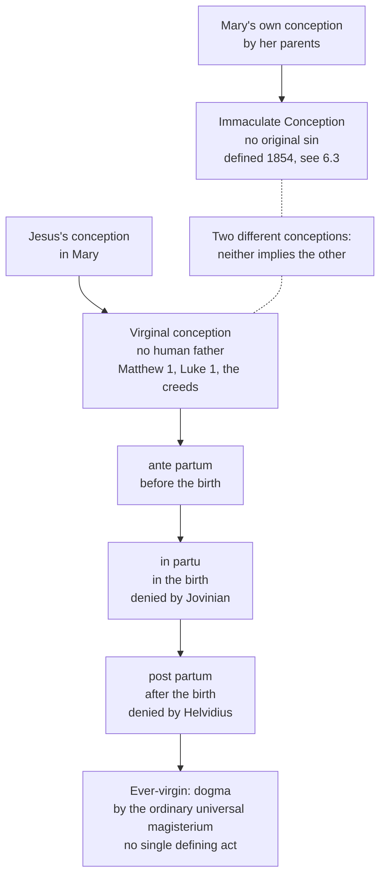

# The Church & Mary · Lesson 6.2: Ever-virgin

> ⏱ ~15 min · Module 6: Mary · Builds on: [6.1 Theotokos, and Mary in Scripture and the Fathers](06-01-theotokos-and-mary-in-scripture-and-the-fathers.md), [`new-testament` 2.1](../../new-testament/lessons/02-01-mark.md), [`patristics` 4.2](../../patristics/lessons/04-02-jerome.md) · Unlocks: [6.3 The Immaculate Conception](06-03-the-immaculate-conception.md)

## Why this matters

Ask what the Immaculate Conception is, and a common answer describes Jesus conceived by the Holy Spirit, with no human father. That is a different doctrine, about a different conception, held on a different basis. This lesson keeps them apart and pays a debt three courses left here. [`new-testament` 2.1](../../new-testament/lessons/02-01-mark.md) named the readings of Jesus's "brothers" and sent the level here. [`patristics` 4.2](../../patristics/lessons/04-02-jerome.md) read Jerome against Helvidius and sent the acts here. [`christology` 3.1](../../christology/lessons/03-01-person-and-nature-the-hypostatic-union.md) met "always a virgin" inside an anathema of 553 and sent its weight here. The answer is unusual: a dogma with no single defining act.

## The idea

**Two conceptions, two people.** The [virginal conception](../reference.md#virginal-conception) is about Jesus. He was conceived in Mary by the Holy Spirit, without a human father (Matthew 1:18–25; Luke 1:26–38). The [Immaculate Conception](../reference.md#immaculate-conception) is about Mary. She was conceived by her parents in the ordinary way and preserved from original sin from the first instant ([6.3](06-03-the-immaculate-conception.md)). The first denies a human father; the second denies original sin. The first is confessed in the creeds; the second was defined in 1854. Neither implies the other.

**Three moments.** *Aeiparthenos*, "ever-virgin" (lesson's gloss: *aei*, always; *parthenos*, virgin), stretches the first claim across Mary's life. Theology splits it into three clauses:

- ***ante partum***, before the birth: Jesus was conceived without a human father. This is the virginal conception itself.
- ***in partu***, in the birth: giving birth did not take away her virginal integrity.
- ***post partum***, after the birth: she remained a virgin for life, with no marital union and no other children.

The clauses are separable, and history separated them. Helvidius (c. 383) kept the first and denied the third. Jovinian, a few years later, kept the first and denied the second. Each clause was defended when it was denied.

## Source

The Lateran Synod of 649, canon 3. The synod met at Rome under Pope Martin I to condemn monothelitism. The Latin is in Denzinger (11th ed., 1911); the translation is the lesson's own:

> If anyone does not, in accord with the holy Fathers, confess properly and truly that the holy and ever-virgin and immaculate Mary is Mother of God, inasmuch as in the last of the ages she conceived of the Holy Spirit, without seed, God the Word himself, specifically and truly, who was born of God the Father before all ages, and gave birth to him incorruptibly, her virginity remaining indissoluble even after the birth: let him be condemned.

Read the shape of the act. **The main verb is "confess ... Mother of God".** This is a Christological canon, and [6.1](06-01-theotokos-and-mary-in-scripture-and-the-fathers.md)'s *Theotokos* is its object. **The three moments sit in the "inasmuch as" clause:** "without seed", "incorruptibly", "indissoluble even after the birth". They are inside what must be confessed, as grounds of the claim that the one she bore is God the Word. **"In accord with the holy Fathers"** claims to hand on, not to add. **"Immaculate"** is an epithet of holiness. The canon ties it to no doctrine about her own conception, a separate question defined only in 1854.

## The doctrine

1. **The virginal conception (*ante partum*).** Matthew tells it from Joseph's side: Mary "was found with child, of the Holy Ghost" (1:18). Luke tells it from Mary's: "How shall this be done, because I know not man?" (1:34), answered by the Spirit's overshadowing (1:35). The two narratives share no scene yet agree on this core ([`new-testament` 2.3](../../new-testament/lessons/02-03-luke.md)). The creeds confess it, and CCC 496 insists on the bodily fact: conceived without human seed. Isaiah 7:14, *almah* and *parthenos*, is [`old-testament` 4.2](../../old-testament/lessons/04-02-isaiah-and-immanuel.md)'s, and the doctrine does not hang on it. *In words:* Jesus had no human father, and the Church means it literally.
2. **Virginity in giving birth (*in partu*).** Lateran 649 says she bore him "incorruptibly". *Lumen Gentium* 57 says the birth did not lessen her virginal integrity but hallowed it, footnoting Lateran 649's canon; CCC 499 restates it. These texts assert a fact, not a mechanism. Aquinas explained it bodily, as a miracle of divine power (ST III q.28 a.2 ad 3); twentieth-century Catholic theologians argued over whether "integrity" must be read in bodily terms. Jovinian denied the clause. Augustine reports that he "destroyed the virginity of Mary, saying that she had been corrupted in giving birth" (*On Heresies* 82, lesson's translation). Jovinian was condemned at Rome under Pope Siricius and at Milan by Ambrose in the early 390s. *In words:* the birth, not only the conception, is confessed as virginal; how is left undescribed.
3. **Virginity after the birth (*post partum*).** Mary bore no other children and remained a virgin for life; CCC 501 says Jesus is her only son. Helvidius argued the contrary from Matthew 1:25 ("he knew her not till she brought forth her first born son"), from Luke 2:7, and from the Lord's "brethren". The lexical questions are whether *heōs hou*, "until" (lesson's gloss), implies a change afterwards, and whether *prōtotokos*, "firstborn", implies later children. Jerome's word-by-word answer is [`patristics` 4.2](../../patristics/lessons/04-02-jerome.md)'s. The [brothers of Jesus](../reference.md#brothers-of-jesus) texts (Mark 6:3; Matthew 13:55–56; Galatians 1:19; Mark 15:40) and the three readings are [`new-testament` 2.1](../../new-testament/lessons/02-01-mark.md)'s. The dogma excludes the Helvidian reading, uterine siblings, and leaves two open. The Epiphanian, Joseph's sons by an earlier marriage, is in the second-century *Protevangelium of James*, where Joseph protests "I have children, and I am an old man" (ch. 9); Origen already knew it from "the Book of James" (*Commentary on Matthew* X.17). The Hieronymian makes them cousins. CCC 500 calls them Jesus's close relations. *In words:* she bore one son, and the dogma does not say whose sons the "brothers" were.
4. **The title [*aeiparthenos*](../reference.md#aeiparthenos).** Constantinople II (553) uses it in three capitula, as "always a virgin" in 2 and "ever-virgin" in 6 and 14 (Percival's translation); Denzinger prints capitulum 2's Greek, *aeiparthenou*. The Roman Canon names her ever-Virgin (quoted in *Lumen Gentium* 52), and LG 69 notes the Eastern Christians' honour for the Mother of God, ever-virgin. *In words:* "ever-virgin" was a name in the liturgy and the councils before it was a thesis.
5. **The three-moment formula in a papal act.** Paul IV's constitution *Cum quorundam* (7 August 1555), against anti-Trinitarian errors, lists among them the denial that Mary remained always in the integrity of virginity "before the birth, in the birth, and perpetually after the birth" (lesson's translation). By apostolic authority it admonishes those who had taught these errors. *In words:* the formula reached a papal act as an error to be abandoned, not as a new definition.
6. **The Reformers kept it.** The Smalcald Articles (1537), drafted by Luther, call Mary "ever-virgin" in their Latin text, in Part I, whose articles they say both sides confess without dispute. Calvin, on Matthew 1:25 (*Harmony of the Evangelists*; Pringle's translation, 1845), refuses Helvidius's inference, says the evangelist reports nothing of what followed, and calls pressing the question curiosity. The Helvidian reading is now widely held among Protestant exegetes. *In words:* a fact about the sixteenth century, not an argument for the doctrine.

**Said plainly.** No New Testament text says that Mary remained a virgin in giving birth or afterwards, and the New Testament names Jesus's brothers and sisters without comment. The first major Latin theologian denied both later clauses. Tertullian, defending a real birth against those who made Christ's flesh a phantom, wrote (*On the Flesh of Christ* 23, c. 206, ANF vol. 3):

> She who bare (really) bare; and although she was a virgin when she conceived, she was a wife when she brought forth her son.

In *On Monogamy* 8, from his New Prophecy years, he pictures her marrying, once only, after the birth. Helvidius cited him. Jerome's only answer was that Tertullian did not belong to the Church (*Against Helvidius* 19).

**Mark the levels** ([levels of authority](../reference.md#levels-of-authority); the ladder of [`fundamental-theology` 4.4](../../fundamental-theology/lessons/04-04-the-ladder-of-doctrinal-authority.md)).

- **Rung 1, from Scripture and the creeds:** the virginal conception, as [`old-testament` 4.2](../../old-testament/lessons/04-02-isaiah-and-immanuel.md) marks it.
- **Rung 1, by the [ordinary universal magisterium](../reference.md#ordinary-universal-magisterium):** [perpetual virginity](../reference.md#perpetual-virginity) in all three moments. It is dogma held without a single defining act, as [`new-testament` 2.1](../../new-testament/lessons/02-01-mark.md) says. Its witnesses are the conciliar title, the [Lateran Synod of 649](../reference.md#lateran-synod-of-649) (a Roman synod, not ecumenical, carrying papal authority, as [`christology` 2.5](../../christology/lessons/02-05-monothelitism-and-constantinople-iii.md) grades it), *Cum quorundam*, and the liturgy of East and West. LG 57 and CCC 499–501 restate it. The assent owed is theological faith. "Only a pious opinion" understates; "defined at Lateran 649" overstates the route, and can. 749 §3 forbids presuming a definition.
- **Rung 1 as to the fact, its bodily content argued:** the acts say "incorruptibly" and "integrity" without describing; Aquinas's miracle account and the fittingness arguments of ST III q.28 are theology.
- **Freely disputed:** Epiphanian against Hieronymian.
- **Rung 1 by a different act:** the Immaculate Conception, *ex cathedra* in 1854 ([6.3](06-03-the-immaculate-conception.md)).
- **No magisterial weight:** the *Protevangelium*, an apocryphon and a witness to belief; the Reformers' texts.

## Two conceptions, three moments

The left branch is 6.3's. The right is one claim about Jesus's origin, extended through the birth and across Mary's life.

## Worked examples

**Ex 1: the clauses come apart under denial.** Run the three historic denials through the clauses.

- **Helvidius** (Rome, c. 383) keeps *ante partum*; his case starts from Matthew 1. He denies *post partum*. The answer is a scholar's: Jerome's.
- **Jovinian** (early 390s) keeps *ante partum* and denies *in partu*, on Augustine's report. The answer is two episcopal condemnations, Rome's and Milan's. His main thesis was that virginity is no higher than marriage (Fremantle's introduction, NPNF² 6).
- **Tertullian** (Carthage, c. 206 and later) keeps *ante partum*, denies *in partu* to defend a real birth, and speaks of a marriage after it.

All three keep the virginal conception. So when you read that "Mary's virginity was disputed" in the early Church, ask **which clause**. None of these disputes concerns the first.

**Ex 2: where it strains. Tertullian and "always".** The ordinary route requires the bishops, dispersed but in communion with one another and with Peter's successor, to agree in proposing a teaching as definitively held (*Lumen Gentium* 25; [4.4](04-04-infallibility-in-exercise-and-the-ordinary-universal-magisterium.md)). That is a condition on the episcopate's teaching, not a requirement that every earlier writer agreed. This lesson's witnesses cluster from the late fourth century on: Rome and Milan against Jovinian, Jerome received in the West, an ecumenical council's usage by 553, the liturgy East and West. Tertullian was one writer, not a bishop. What the case strains is a different claim, Vincent's *semper*, "always" ([`fundamental-theology` 5.1](../../fundamental-theology/lessons/05-01-vincent-of-lerins.md)). The later clauses are attested from the second century (the *Protevangelium*, then Origen), contested by some writers into the late fourth, and universal after. Whether that history is development or something else is [`fundamental-theology` 5.2](../../fundamental-theology/lessons/05-02-newmans-theory-of-development.md)'s question. What it refutes outright is the sentence "every early Christian held all three".

## Watch out

- **You might think the Immaculate Conception means Jesus was conceived without a father.** That is the virginal conception. The Immaculate Conception is Mary's own conception, free of original sin, defined in 1854. Lateran 649's "immaculate" does not define it either.
- **You might think "never defined" means "optional".** That understates: it is rung 1 by the ordinary universal magisterium, owed faith. The mirror error, "defined at the Lateran Council of 649", is wrong twice: a Roman synod, not an ecumenical Lateran council, and no single act defines the doctrine.
- **You might think "ever-virgin" settles who the brothers were.** It excludes one reading only. The Epiphanian and Hieronymian readings both remain open ([`new-testament` 2.1](../../new-testament/lessons/02-01-mark.md)).

## One-liner

> "Ever-virgin" is Jesus's virginal conception stretched through the birth and across Mary's life, not her own conception: three clauses, each defended when denied, held as dogma by the Church's constant teaching rather than by any one definition.

## Problems

**P1 (🟢)** *(Exegetical)* An **invented** answer key from a parish confirmation-class worksheet, written for this problem:

> **Q1. What is the Immaculate Conception?** That Jesus was conceived in Mary's womb by the power of the Holy Spirit, without a human father. Pope Pius IX defined it in 1854.
>
> **Q2. What does "ever-virgin" add?** Only that Mary had no more children after Jesus. It was defined at the Lateran Council of 649, so it is the one Marian dogma defined by a council rather than a pope.

Find **four** errors. Correct each in one sentence, naming the act or route that fixes the level where one is involved. **120 words or fewer.**

**P2 (🟡)** *(Exegetical)* Close reading. Calvin, *Commentary on a Harmony of the Evangelists*, on Matthew 1:25 (Pringle's translation, 1845):

> The inference he [Helvidius] drew from it was, that Mary remained a virgin no longer than till her first birth, and that afterwards she had other children by her husband. Jerome, on the other hand, earnestly and copiously defended Mary's perpetual virginity. Let us rest satisfied with this, that no just and well-grounded inference can be drawn from these words of the Evangelist, as to what took place after the birth of Christ. He is called first-born; but it is for the sole purpose of informing us that he was born of a virgin. It is said that Joseph knew her not till she had brought forth her first-born son: but this is limited to that very time. What took place afterwards, the historian does not inform us. … Certainly, no man will ever raise a question on this subject, except from curiosity.

(a) What does Calvin say "till" and "first-born" do in the verse? Name the words that carry each. (b) Does the passage affirm Mary's perpetual virginity, deny it, or neither? Say what Calvin holds the text settles. **Two sentences per part.**

**P3 (🔴)** *(Exegetical)* An **invented** podcast transcript, written for this problem:

> **A:** Perpetual virginity is a pious opinion. No pope ever defined it *ex cathedra*, and the Lateran synod of 649 was only a local Roman meeting.
>
> **B:** Wrong. An ecumenical council defined it: Constantinople II anathematizes anyone who won't call Mary "always a virgin".

Capitulum 2 of Constantinople II (Percival, *NPNF* second series, vol. 14):

> If anyone shall not confess that the Word of God has two nativities, the one from all eternity of the Father, without time and without body; the other in these last days, coming down from heaven and being made flesh of the holy and glorious Mary, Mother of God and always a virgin, and born of her: let him be anathema.

(a) Name the premise A and B share, and say why it is false. (b) Say what the capitulum's anathema targets and what work "always a virgin" does in it. Then give the level of perpetual virginity and the route that carries it. **Two sentences per part.**

Solutions

**P1** *(Exegetical)*

**Must hit, strict:**

- **Q1 describes the virginal conception**, Jesus conceived without a human father, rung 1 from Scripture and the creeds. The Immaculate Conception is Mary's own conception, preserved from original sin, and it is what the 1854 act defined.
- **"Only no more children" is too little.** "Ever-virgin" asserts three moments: before the birth (the virginal conception), in the birth, and after it, a lifelong virginity and not merely no further children.
- **"Defined at the Lateran Council of 649" is wrong.** It was a Roman synod under Martin I, carrying papal authority, not one of the ecumenical Lateran councils. No single act defines perpetual virginity; it is rung 1 by the ordinary universal magisterium.
- **"The one Marian dogma defined by a council" is false.** *Theotokos* was fixed conciliarly (Ephesus as received, Chalcedon's Definition), and no council defined perpetual virginity.

**Accept:** splitting the first error in two (wrong content; the virginal conception made to depend on 1854) in place of one of the others.

**Wrong turns:** correcting Q2 by calling perpetual virginity "not dogma, since never defined", which **understates**; substituting Constantinople II as the defining act, which **overstates** the route; fixing Q1's content while leaving the virginal conception dated to 1854.

**Model answer:** Q1 describes the virginal conception, which is rung 1 from Scripture and the creeds; the Immaculate Conception, defined in 1854, is Mary's own conception without original sin. "Ever-virgin" adds virginity in the birth and for life, not only no further children. Lateran 649 was a Roman synod with papal authority, not an ecumenical council, and no single act defines the doctrine: it is rung 1 by the ordinary universal magisterium. So it is not the "conciliar" Marian dogma; *Theotokos* was the one fixed by councils, at Ephesus and Chalcedon.

---

**P2** *(Exegetical)*

**Must hit, strict (a):** "till" is **limited to that very time**: it says Joseph did not know her up to the birth and says nothing of afterwards ("no just and well-grounded inference ... as to what took place after"; "this is limited to that very time"). "First-born" serves **"for the sole purpose of informing us that he was born of a virgin"**: it marks the virgin birth, not a series of siblings.

**Must hit, strict (b):** **neither.** Calvin reports Jerome's defence without adopting it in his own voice, refuses Helvidius's inference, and holds that the text is **silent** on what followed ("the historian does not inform us"). Pressing the question further he puts down to curiosity.

**Accept:** noting Calvin's evident sympathy with Jerome, provided the answer does not say this passage affirms the doctrine.

**Wrong turns:** "Calvin affirms perpetual virginity here", which overreads a report and a refusal. "Calvin sides with Helvidius", which inverts it. Using the passage as evidence for the Catholic doctrine, or adding that Calvin was wrong to leave it open: both volunteer an argument the question did not ask for, and this course states the Reformers' positions as facts.

**Model answer:** (a) Calvin says "till" is limited to the time before the birth and implies nothing about after, and "first-born" is there "for the sole purpose of informing us that he was born of a virgin". The key words are "this is limited to that very time" and "no just and well-grounded inference can be drawn". (b) Neither: he refuses Helvidius's inference and reports Jerome's defence, but does not assert the doctrine in his own voice. He holds that Scripture is silent on what followed and that pressing the question is curiosity.

---

**P3** *(Exegetical)*

**Must hit, strict (a):** the shared premise is that **a doctrine is dogma only if some single act defines it**. It is false: *Dei Filius* ch. 3 makes anything the Church proposes as revealed, by solemn judgment **or by the ordinary universal magisterium**, an object of divine and Catholic faith ([4.4](04-04-infallibility-in-exercise-and-the-ordinary-universal-magisterium.md)). So A understates and B hunts for a definition that is not needed. Credit also noting that A's "only a local meeting" understates Lateran 649's papal authority.

**Must hit, strict (b):** the anathema targets **refusing to confess the Word's two nativities**, eternal from the Father and in time from Mary, against the two-subject Christology ([`christology` 3.1](../../christology/lessons/03-01-person-and-nature-the-hypostatic-union.md)). "Always a virgin" is a **title within the description of Mary**: the council presupposes it as common faith, which makes it a witness and not the proposition put under anathema. Perpetual virginity is **rung 1, dogma held by the ordinary universal magisterium**, witnessed by this title, Lateran 649 can. 3, *Cum quorundam* and the liturgy, and restated by LG 57 and CCC 499. The assent owed is theological faith.

**Accept** for (b): calling the title's own status argued rather than settled, provided the answer says what the anathema targets and gives rung 1 by the ordinary route.

**Wrong turns:** reading the anathema as covering every epithet in the sentence, which is B's move. Grading the doctrine rung 2 or rung 3 because nothing defines it, which **understates**. Calling Lateran 649 an ecumenical council. Saying the anathema targets the denial of Mary's virginity.

**Model answer:** (a) Both assume a doctrine is dogma only if one act defines it, A to deny it is dogma and B to find the act. That is false: *Dei Filius* puts what the ordinary universal magisterium proposes as revealed on the same footing as what is solemnly defined. (b) The anathema falls on anyone who will not confess two births of the one Word; "always a virgin" names Mary in passing, as the council's shared faith, and so witnesses to the doctrine without defining it. Perpetual virginity is rung 1, held by the ordinary universal magisterium and witnessed by this title, Lateran 649 and the liturgy, and it is owed theological faith.

## Flashback

**From Lesson [5.4](05-04-a-church-of-sinners.md) (A Church of sinners):** *(Exegetical.)* Apply to a new case. An **invented** case, written for this problem. In 1998 the invented Diocese of Lowmere receives a credible report that one of its priests sexually abused a minor, and the report is true. On the bishop's written instruction the chancellor files it in the chancery archive and moves the priest to a hospital chaplaincy; the police are not told. Until a newspaper prints the story in 2006, the priest celebrates Mass and anoints the sick, and the diocese's parishes go on professing the Creed and celebrating the sacraments. In 2007 a new bishop leads a public liturgy of repentance and sets up an independent safeguarding office.

(a) Of 5.4's two words, *indefectible* and *impeccable*, which does Catholic teaching say of the Church as such, and which does it claim of none of her members? Give the level of the teaching behind each, and say whether anything in the case falsifies either. **Two sentences.**

(b) For each of the four standard answers (indefectibility, the *corpus permixtum*, the holiness of the Church, *semper purificanda*), name the element of the case it genuinely covers and the point where it stops. **One line each.**

Solution

**Must hit, strict (a):**

- ***Indefectible*** is said of the Church as such: she lasts to the end of the world, holding the faith and the sacraments (Matt 16:18; Matt 28:20; *Pastor Aeternus* ch. 2; LG 39). **At least rung 3**: presupposed by rung-1 acts, but defined by no act as a thesis of its own.
- ***Impeccable*** is claimed of no one, priest, bishop or pope. Trent defined that no justified person avoids all sins, even venial ones, through a whole life without a special privilege (Session VI, can. 23, **rung 1**), and CCC 827 has all members, ministers included, acknowledge that they are sinners.
- **Neither is falsified.** Indefectibility promises endurance in faith and sacraments, not that a bishop will protect a child, and nobody's sinlessness was ever promised.

**Accept:** noting that the same canon also condemns saying that the justified can sin no more, or that its one exception, by special privilege, is Mary. Credit noting that indefectibility is promised to the whole Church, not to each diocese (Lesson 2.4).

**Must hit, strict (b):**

- **Indefectibility** covers the faith and sacraments that went on being handed on through those years. It stops at the bishop's instruction: it promises survival, not conduct.
- **The *corpus permixtum*** covers the priest's presence inside the Church, a sinner among the wheat until the harvest. It stops at the filing and the transfer, which were acts of governance done with authority the Church confers, not cockle among the wheat. Cited to keep him in ministry, Matt 13:30 would be inverted.
- **The holiness of the Church** covers the Masses and anointings, which were Christ's acts and not the priest's. It stops at the offices: it protects the sacraments from the minister's sin, not the diocese's governance from the bishop's.
- ***Semper purificanda*** covers the 2007 repentance and the new office, since the Church herself is purified, discipline included (LG 8; UR 6). It stops where it stays a phrase: purified of what, by whom, answerable to whom, which LG 8 does not say.

**Wrong turns:** saying the case falsifies indefectibility, or that indefectibility shows the instruction was no concern of the Church's: both read a promise of endurance as a promise about conduct. Calling indefectibility a defined dogma, which cites a definition no act makes. Calling any of the four answers false, when each is true and stops short. Settling whether the Church herself sinned through the bishop's instruction, which is freely disputed and not asked here.

**Model answer:** (a) The Church as such is indefectible: she will last to the end with the faith and the sacraments (Matt 16:18; *Pastor Aeternus* ch. 2; LG 39; at least rung 3), while no member is impeccable, since Trent defined that no justified person avoids all sin through life without a special privilege (Session VI, can. 23; rung 1). The case falsifies neither, because indefectibility never promised that a bishop would protect a child, and no one's sinlessness was promised at all. (b) Indefectibility covers the faith and sacraments that went on; it stops at the bishop's conduct. The *corpus permixtum* covers the priest's presence in the Church; it stops at the filing and the transfer, which were acts of office, not cockle. The holiness of the Church covers his Masses and anointings, which were Christ's acts; it stops at the bishop's instruction, a use of the office. *Semper purificanda* covers the 2007 repentance; it stops at who is answerable, and for what, which LG 8 leaves unsaid.

## Connections

- **Backward:** [6.1](06-01-theotokos-and-mary-in-scripture-and-the-fathers.md) gave *Theotokos*, the confession Lateran 649 builds the three moments into. The readings of the brothers are [`new-testament` 2.1](../../new-testament/lessons/02-01-mark.md); the two infancy narratives are [`new-testament` 2.3](../../new-testament/lessons/02-03-luke.md); *almah* is [`old-testament` 4.2](../../old-testament/lessons/04-02-isaiah-and-immanuel.md). Jerome's lexical reply is [`patristics` 4.2](../../patristics/lessons/04-02-jerome.md). The ordinary route and can. 749 §3 are [4.4](04-04-infallibility-in-exercise-and-the-ordinary-universal-magisterium.md).
- **Forward:** [6.3](06-03-the-immaculate-conception.md) takes the other conception. [6.5](06-05-mary-in-the-economy-in-the-church-and-in-devotion.md) takes Mary as virgin and mother, the type of the Church. Arguing the dogma against Protestant objections belongs to `apologetics-catholic-claims` ([syllabus](../../apologetics-catholic-claims/syllabus.md)).
- **Sideways:** Ambrose argues the Eucharistic change from the virgin birth, where nature's order was already set aside ([`patristics` 4.1](../../patristics/lessons/04-01-ambrose-of-milan.md)). The Monothelite crisis that called the Lateran Synod is [`christology` 2.5](../../christology/lessons/02-05-monothelitism-and-constantinople-iii.md).
