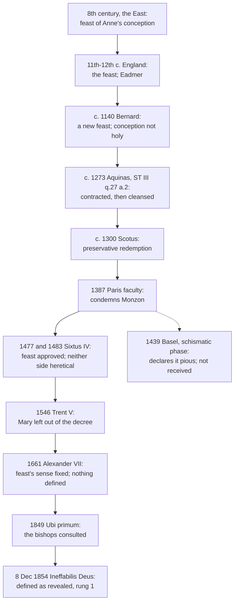

# The Church & Mary · Lesson 6.3: The Immaculate Conception

> ⏱ ~15 min · Module 6: Mary · Builds on: [6.1 Theotokos, and Mary in Scripture and the Fathers](06-01-theotokos-and-mary-in-scripture-and-the-fathers.md), [6.2 Ever-virgin](06-02-ever-virgin.md), [4.4 Infallibility in exercise](04-04-infallibility-in-exercise-and-the-ordinary-universal-magisterium.md) · Unlocks: [6.4 The Assumption](06-04-the-assumption.md)

## Why this matters

Of the four Marian dogmas, this one has a paper trail of denial. Saints and doctors argued against it for centuries, and the Church's most cited theologian held the opposite in his *Summa*. Then a pope defined it as revealed, in one of the two papal acts nobody contests is *ex cathedra* ([4.4](04-04-infallibility-in-exercise-and-the-ordinary-universal-magisterium.md)). Exactness lets you hold both facts.

## The idea

The claim is about **Mary's own beginning**, not her Son's. On the Church's teaching, every child of Adam begins life without the grace Adam lost; that privation is original sin. The [Immaculate Conception](../reference.md#immaculate-conception) says one person never lacked it. From her first instant Mary had sanctifying grace, given in view of what her Son would do. She was **preserved**, not cleansed.

That contrast is the whole history. Nearly everyone agreed Mary was holy before birth, sanctified in the womb like Jeremiah and John the Baptist. The fight was over the **first instant**. If grace came after she began, she contracted original sin and was cleansed; that was Bernard's view and Aquinas's. What held them back was Christ: if Mary never had sin, how is he her Saviour, and so the Saviour of *all*? Duns Scotus answered that preserving someone from a debt is a more perfect redemption than freeing her once she has incurred it. The 1854 definition writes that answer into one clause: *in view of the merits of Christ*.

Keep one confusion out. The [virginal conception](../reference.md#virginal-conception) is Jesus conceived without a human father ([6.2](06-02-ever-virgin.md)); the Immaculate Conception is Mary's own conception, by her parents, without original sin.

## Source

The definition in [*Ineffabilis Deus*](../reference.md#ineffabilis-deus) (Pius IX, 8 December 1854), in Schaff's translation, *Creeds of Christendom* vol. 2:

> ... WE PRONOUNCE, DECLARE, AND DEFINE, [...] by the authority of our Lord Jesus Christ and the blessed Apostles Peter and Paul, and in our own authority, that the doctrine which holds the Blessed Virgin Mary to have been, from the first instant of her conception, by a singular grace and privilege of Almighty God, in view of the merits of Christ Jesus the Saviour of mankind, preserved free from all stain of original sin, was revealed by God, and is, therefore, to be firmly and constantly believed by all the faithful.

Read the shape of the act. What is defined is that **the doctrine** holding Mary preserved **was revealed by God**, binding all the faithful: authority invoked, a matter of faith, the whole Church addressed. Those are the marks *Pastor Aeternus* ch. 4 set out in 1870 as **conditions**, not a promise that every papal word is infallible ([4.3](04-03-vatican-i-and-pastor-aeternus.md); [`fundamental-theology` 4.2](../../fundamental-theology/lessons/04-02-infallibility-and-its-conditions.md)). A penal clause follows: dissent held in the heart is shipwreck in the faith, and voiced, it incurs the law's penalties.

## The doctrine

1. **What it asserts.** *Subject:* Mary, a person. *Time:* "the first instant of her conception" (*in primo instanti suae conceptionis*), so no moment without grace. *Means:* "a singular grace and privilege", given to her alone. *Cause:* "the merits of Christ" (*intuitu meritorum*), the Cross applied in advance. *Content:* "preserved free from all stain of original sin" (*praeservatam immunem*): not contracted, as against contracted and washed. *In words:* from her first instant, by Christ's merits, Mary had the grace everyone else lacks at theirs.

2. **What it does not assert.** That Mary needed no redemption: the merits clause says the opposite, and *Lumen Gentium* 53 calls her redeemed. That her conception was virginal. When the soul is infused: "her conception" means the first instant of *her*. Exemption from death ([6.4](06-04-the-assumption.md)). Lifelong freedom from personal sin (item 5). *In words:* one instant, one cause.

3. **What it presupposes.** Trent, Session V (17 June 1546): Adam's sin passes to all "by propagation, not by imitation" and is in each as his own. As Adam's daughter she would have contracted it (her *debt*, in theologians' terms) and was kept from it. Original sin itself belongs to `creation-grace-last-things` ([syllabus](../../creation-grace-last-things/syllabus.md)), whose Session V lesson cedes the Marian doctrine here. *In words:* the dogma is an exception, intelligible only against the rule.

4. **The two doctors.** Aquinas (ST III q.27 a.2) gives two reasons against sanctification before animation. Grace inheres only in a rational creature, so before the soul there is no one to sanctify. And had she been sanctified before she could incur sin, she would never have incurred it, and would not have needed redemption by Christ, "Saviour of all men" (1 Tim 4:10). Scotus (*Sentences* commentary, book III, distinction 3) denied that redemption must be a cleansing: this is [preservative redemption](../reference.md#preservative-redemption). Keeping someone from a sin she would otherwise contract is the more perfect act of mediation, and the most perfect Mediator does it for someone. Weighing three possibilities open to God, he concluded: "if it does not conflict with the authority of the Church or the authority of Scripture, it seems probable that what is more excellent should be attributed to Mary" (lesson's translation). The definition keeps Aquinas's *first* reason: the first instant of her conception is the first instant of her.

5. **Fullness of grace, and Trent VI can. 23.** The angel greets her *kecharitōmenē* (Luke 1:28; Douay–Rheims "full of grace"), a perfect passive participle: "you who have been graced", the grace given and lasting (lesson's gloss). The word does not say when the grace began. Aquinas separates two fullnesses (ST III q.7 a.10, reloaded from [`christology` 3.4](../../christology/lessons/03-04-the-grace-of-the-head.md)). Christ's is fullness of grace itself, overflowing to all. Mary's [fullness of grace](../reference.md#fullness-of-grace) is measured by her office: she is nearest the source of grace, having given him his humanity (III q.27 a.5). [Trent VI can. 23](../reference.md#trent-vi-canon-23) (13 January 1547) anathematizes the claim that anyone can avoid all sins, even venial ones, through a whole life, except by special privilege, "as the Church holds in regard of the Blessed Virgin" (Schaff). The anathema strikes the general claim; Mary is the exception the Church already holds. This privilege is distinct from 1854's: Bernard (Letter 174 §4) and Aquinas (III q.27 a.4) held her life free of all sin while denying her immaculate conception. *In words:* hers is the fullest grace a mere creature has, received rather than a source, and the Church holds that it kept her from every personal sin.

6. **The development.** The feast came first: the East kept Anne's conception of Mary by the eighth century, England by the eleventh, and Eadmer of Canterbury wrote in its defence. Bernard wrote to the canons of Lyons (Letter 174, about 1140) that it was new, unfounded, and set up without consulting Rome, to whose judgment he submitted. Dominicans followed Aquinas, Franciscans Scotus. In 1387 the Paris faculty, backed by its bishop, condemned the Dominican Juan de Monzón for calling the doctrine heretical. Basel's 1439 decree calling it pious, passed after the council broke with Eugene IV, was never received. Sixtus IV approved a Mass and Office of the Conception (*Cum praeexcelsa*, dated February 1476, that is 1477 by the modern year). Then [*Grave nimis*](../reference.md#grave-nimis) (4 September 1483) forbade preachers on either side to call the other heretical, "since it has not yet been decided by the Roman Church and the Apostolic See" (lesson's translation). Trent left Mary out of its decree and renewed Sixtus. Alexander VII's *Sollicitudo omnium ecclesiarum* (8 December 1661) gave the feast's sense as her soul preserved "in the first instant of its creation and infusion into the body" (lesson's translation), nearly the words of 1854, and defined nothing. Pius IX consulted the bishops by *Ubi primum* (2 February 1849; [`fundamental-theology` 5.3](../../fundamental-theology/lessons/05-03-the-sensus-fidei.md) reads it) and defined in 1854. Lourdes (1858) came after and, as private revelation, adds no weight ([`fundamental-theology` 1.4](../../fundamental-theology/lessons/01-04-public-and-private-revelation.md)).

**Said plainly.** Thomas Aquinas, Doctor of the Church, wrote that "the Blessed Virgin did indeed contract original sin, but was cleansed therefrom before her birth from the womb" (ST III q.27 a.2 ad 2). He noted that the Roman church did not keep the feast and only tolerated churches that did (ad 3). Bernard called it a presumptuous novelty. Since 1854 the Church holds as revealed by God what both denied. Neither was a heretic: no act had proposed the doctrine, and Rome said in 1483 that it was undecided.

**Mark the levels** ([`fundamental-theology` 4.4](../../fundamental-theology/lessons/04-04-the-ladder-of-doctrinal-authority.md); [levels of authority](../reference.md#levels-of-authority)). The definition, every clause including the merits clause, is **rung 1**: solemnly defined *ex cathedra* by *Ineffabilis Deus* (1854), one of the two papal acts nobody contests. Obstinate denial by the baptized is heresy (can. 751). Before 1854 it was **freely disputed** (rung 5), by Rome's own word in 1483, under a ban on charges of heresy. The papal acts approving the feast and protecting the opinion defined nothing; Trent's exception states an intention (the decree it qualifies is rung 1); Basel's decree has no authority. Can. 23's general rule is **rung 1** ([`moral-theology` 3.4](../../moral-theology/lessons/03-04-sin-mortal-and-venial.md)); its Marian clause is presupposed, not itself defined. Mary's lifelong freedom from personal sin is firmly taught (LG 56; CCC 493), **at least rung 3**, never separately defined. Her fullness of grace is taught at the same rung (LG 56; CCC 490–492). Aquinas's two fullnesses and Scotus's argument as such are theology, at no magisterial level.

## The timeline

## Worked examples

**Ex 1: a clean case, "my spirit hath rejoiced in God my Saviour" (Luke 1:47).** The objection: if Mary never had original sin, her Saviour saved her from nothing. Its merits clause makes "Christ Jesus the Saviour of mankind" the cause of her preservation, so he saves her by the same Cross as us. Only the mode differs: he saved her from contracting the sin, not from a sin contracted. *Lumen Gentium* 53, as CCC 492 renders it, calls her redeemed "in a more exalted fashion". So the verse is true of her in the strongest sense, and Aquinas's worry from 1 Tim 4:10 is met by the clause itself. This shows consistency, not proof.

**Ex 2: where it strains. One proposition, four dates.** P: *Mary was preserved from original sin from the first instant of her conception.* In 1273 no act proposed P, and Aquinas denied it. In 1483 *Grave nimis* says Rome has not decided. In 1661 P is favoured and protected, but not proposed as revealed. In 1855 P is rung 1. The strain: the 1854 act says P "was revealed by God", so it was revealed in 1273. Is Aquinas a heretic after the fact? No. Heresy is obstinate denial of what is *proposed* as revealed (can. 751), and the ladder grades proposals. The act does leave the historian a debt: to show how the truth was present, unformulated, while doctors denied it. [`fundamental-theology` 5.1](../../fundamental-theology/lessons/05-01-vincent-of-lerins.md) and [5.2](../../fundamental-theology/lessons/05-02-newmans-theory-of-development.md) weighed that with Vincent and Newman.

## Watch out

- **"The Immaculate Conception is the virgin birth."** You might think the feast celebrates Jesus conceived without a father. It celebrates Mary conceived by her parents, without original sin.
- **Overstating and understating the level.** "Trent defined it" and "the Church always held it" overstate: Trent stated an intention, and Rome called the question undecided in 1483. "A pious belief to take or leave" understates: since 1854 it is rung 1, to be believed "firmly and constantly".
- **"Preserved means unredeemed."** The merits clause is part of what is defined; denying she was redeemed contradicts the dogma it means to honour.
- **The tag and the scope.** *Potuit, decuit, ergo fecit* is a tag often pinned on Scotus; it is not his wording, and his text carries a proviso. And 1854 concerns original sin, not personal sin (item 5).

## One-liner

> Mary was not exempted from redemption but redeemed first and best, preserved at her first instant by her Son's merits: that is defined dogma, and Aquinas denied it.

## Problems

**P1 (🟢)** *(Exegetical)* **Close reading.** Trent, Session V (17 June 1546), the paragraph closing the decree on original sin, in Schaff's translation:

> This same holy Synod doth nevertheless declare, that it is not its intention to include in this decree, where original sin is treated of, the blessed and immaculate Virgin Mary, the mother of God; but that the constitutions of Pope Sixtus IV., of happy memory, are to be observed, under the pains contained in the said constitutions, which it renews.

(a) What does the paragraph decide about Mary, and what does it decline to decide? (b) What does renewing Sixtus IV's constitutions add, and at what level does the paragraph leave the Immaculate Conception? (c) One reader says the word "immaculate" shows that Trent defined the doctrine. Another says the paragraph is pure neutrality and tells us nothing. Correct both. **Two sentences per part.**

**P2 (🟡)** *(Exegetical)* **Diagnose.** A handout for a confirmation class, **invented** for this problem:

> "**December 8: the Immaculate Conception.** Today we celebrate Mary, conceived without stain of sin. Because she was immaculate, Mary is the one human being who never needed a Saviour. The Church has always taught this: the Fathers, the great medieval doctors and every saint believed it, and the Council of Trent confirmed it. In 1854 Pius IX simply put on record what everyone already held, so it is an honour paid to Mary rather than something Catholics are required to believe."

Find **four** errors. For each, give the correction, and where a level is involved name the act that fixes it. **150 words or fewer.**

**P3 (🔴)** *(Exegetical)* **Find the crux.** Bernard of Clairvaux, Letter 174, to the canons of Lyons (about 1140; trans. Eales):

> Whence, then, was the holiness of that conception? [...] But in order to be holy it is necessary to exist, and a person does not exist before being conceived. Or perhaps, when her parents were united, holiness was mingled with the conception itself, so that she was at once conceived and sanctified. But this is not tenable in reason. For how can there be sanctity without the sanctifying Spirit, or the co-operation of the Holy Spirit with sin? Or how could there not be sin where concupiscence was not wanting? [...] If, therefore, before her conception she could not possibly be sanctified, since she did not exist, nor in the conception itself, because of the sin which inhered in it, it remains to be believed that she received sanctification when existing in the womb after conception, which, by excluding sin, made her birth holy, but not her conception.

(a) Name the premise about sanctification that Bernard needs and that the feast's defenders denied. Then name one premise of his that the 1854 definition itself accepts. (b) What does Bernard take the word "conception" to name? How does Alexander VII's description of the feast's object (1661) change the question without settling it? **Two sentences per part.**

Solutions

**P1** *(Exegetical)*

**Must hit, strict:**

- (a) It **decides** that the decree's universal statements about original sin are not meant to include Mary. This is a declaration of the council's intention about the decree's scope. It **declines** to say whether she was in fact conceived without original sin, so it defines nothing positive about her conception.
- (b) Sixtus IV's constitutions are *Cum praeexcelsa*, approving the feast's Mass and Office, and *Grave nimis* (1483). The second forbids either side to call the other heretical or guilty of mortal sin, because Rome had not decided. Renewing them, with their penalties, keeps the feast and keeps the question **open and protected**. The Immaculate Conception stays a permitted, freely disputed opinion (**rung 5**, under a ban on charges of heresy) until 1854. The decree on original sin itself is rung 1.
- (c) "Immaculate" is an old epithet for Mary's holiness; the Lateran Synod of 649 already calls her *immaculatam*. A title word defines nothing, and the paragraph's operative verb is "declare ... not its intention to include". Yet "nothing" understates the act. By exempting her from the decree's "all" and renewing the protection, Trent left the doctrine standing and unrefuted. Pius IX in 1854 read this as an intimation of the doctrine, which is a later reading, not the paragraph's statement.

**Wrong turns:** "Trent defined the Immaculate Conception" (an overstatement). "Trent taught that Mary had original sin" (the paragraph excludes her from the decree). Reading *Grave nimis* as condemning only the Dominicans, when it bound both sides.

**Model answer:** (a) Trent decides that its decree on original sin is not meant to include Mary. It declines to say whether she was conceived without that sin, and defines nothing about her conception. (b) Renewing Sixtus IV's constitutions keeps the approved feast and the ban on calling either side heretical, so the question stays open and protected. The doctrine remains a freely disputed opinion until 1854, while the decree it qualifies is rung 1. (c) "Immaculate" is an old epithet (Lateran 649) and defines nothing; the operative verb only declines to include her. But exempting her from the universal decree and renewing the protection is not nothing: it left the doctrine standing, and Pius IX later read it as a hint.

---

**P2** *(Exegetical)*

**Accept:** all four below, each corrected.

**Must hit, strict:**

- **"Never needed a Saviour."** The definition itself says "in view of the merits of Christ". She was redeemed by preservation (LG 53).
- **"Always taught; every doctor believed it."** Bernard opposed the feast (about 1140). Aquinas held that she contracted original sin (ST III q.27 a.2), and the Dominican school followed him. *Grave nimis* (1483) says Rome had not decided.
- **"Trent confirmed it."** Trent declined to include Mary in its decree on original sin and defined nothing about her.
- **"An honour, not required."** This understates. *Ineffabilis Deus* (1854) is an *ex cathedra* definition, **rung 1**. It binds all the faithful to believe the doctrine firmly and constantly, and obstinate denial is heresy. "Simply put on record" also misses that the act moved the doctrine from protected opinion to dogma.

**Wrong turns:** fixing the level but saying it was dogma "since Trent". Treating the history as a reason to doubt the dogma, when the problem asks only for corrections.

**Model answer:** Mary was not outside redemption: the definition says "in view of the merits of Christ". It was not always taught. Bernard opposed the feast, Aquinas held that she contracted original sin, and Sixtus IV said in 1483 that Rome had not decided. Trent defined nothing about her; it only excluded her from its decree. And 1854 was no formality. *Ineffabilis Deus* defined the doctrine *ex cathedra* as revealed (rung 1), binding every Catholic to believe it.

---

**P3** *(Exegetical)*

**Must hit, strict (a):** the premise is that the sin attached to the act of conception, the parents' concupiscence, **necessarily passes to the one conceived**. Then holiness cannot coincide with the first instant and must come later ("how could there not be sin where concupiscence was not wanting?"). The defenders deny that this binds God's grace to come afterward. The premise the 1854 definition **accepts** is "in order to be holy it is necessary to exist": nothing is sanctified before the person exists. The definition speaks of the first instant *of her* conception, not of any moment before it.

**Must hit, strict (b):** Bernard takes "conception" to name the **parents' act** ("when her parents were united"), and asks whether that act could be holy. Alexander VII describes the feast's object as her **soul preserved in the first instant of its creation and infusion into the body**: the beginning of the person, not a holy act of generation. That meets Bernard's existence premise and relocates his concupiscence premise. It now has to say that a soul infused into flesh so generated *must* contract sin at that instant, which is exactly what preservation denies. It settles nothing, because *Sollicitudo* describes and protects a pious belief, and it was defined only in 1854.

**Wrong turns:** importing Aquinas's redemption argument, which this passage does not use; the crux here is the instant, not the Redeemer. Saying Bernard denied that Mary was holy before birth, when he affirms her sanctification in the womb. Saying 1661 defined the doctrine (an overstatement).

**Model answer:** (a) Bernard needs the premise that the sin attending the parents' act necessarily passes to the child at conception, so sanctification must come afterward; the defenders deny that grace is bound to wait. He also holds that only an existing person can be holy, and the definition agrees: it puts her preservation at the first instant of her own existence, not before. (b) For Bernard, "conception" is the parents' union, and he denies that the union could be holy. Alexander VII made the feast's object the soul's preservation at the instant of its creation and infusion. That moves the question from the act to the person, but it defined nothing.

## Flashback

**From Lesson [6.1](06-01-theotokos-and-mary-in-scripture-and-the-fathers.md) (Theotokos, and Mary in Scripture and the Fathers):** *(Exegetical.)* Close reading. Augustine, *Tractates on the Gospel of John* 8.9 (NPNF1 vol. 7), explaining Cana's "Woman, what have I to do with thee? mine hour is not yet come" (John 2:4, in his translator's wording). The sentence in inner quotation marks is Augustine's paraphrase of what Jesus meant:

> According as He was God, He had not a mother; according as He was man, He had. [...] "That in me which works a miracle was not born of thee, thou gavest not birth to my divine nature; but because my weakness was born of thee, I will recognize thee at the time when that same weakness shall hang upon the cross." This, indeed, is the meaning of "Mine hour is not yet come." [...] The same both the Lord of Mary and the son of Mary; the same both the Creator of Mary and created from Mary.

(a) What exactly does "He had not a mother" deny? Which sentence shows that the passage does not deny what *Theotokos* asserts, and why? **Two sentences.**

(b) Augustine ties Cana to the cross. Name one feature of that link that John's own text supplies and one that Augustine's theology supplies. What weight does his reading carry? **Two sentences.**

Solution

**Accept:** in (b), any one textual feature and any one theological feature from the lists below.

**Must hit, strict (a):**

- "He had not a mother" *according as He was God*: it denies that Mary is the **source of his divine nature** ("thou gavest not birth to my divine nature"). What came from her is his flesh, his "weakness".
- The decisive sentence is the last: "the same" is both Mary's Creator and created from her. That is **one subject**, so the one born of her is God, which is what *Theotokos* asserts: the one born of Mary is the Word in his own flesh (Ephesus, restated in Chalcedon's Definition; rung 1). The title never made her mother of the Godhead. The passage distinguishes natures, not sons. (Augustine died in 430, a year before Ephesus.)

**Must hit, strict (b):**

- **Supplied by John:** in John the "hour" is the cross (12:23; 13:1; 17:1), and the mother returns at the cross, addressed again as "Woman" (19:25–27).
- **Supplied by Augustine:** the reason for the distance at Cana, that the miracle is the work of the divine nature she did not bear; and the claim that at the cross he acknowledges her because the flesh she gave is dying. John states neither; this is a two-natures key brought to the text.
- **Weight:** a Father's exegesis, carrying that Father's weight and no rung. The council proposes a different reading of Cana, Mary's intercession obtaining the first sign (LG 58), which is rung 3 as a reading and likewise defines nothing about John's meaning.

**Wrong turns:** in (a), calling the first sentence Nestorian, or "correcting" it with "Mary is mother of the divine nature", which moves the predicate from the person to the nature. In (b), treating Augustine's reading as binding because he is a Doctor of the Church, or as what John says (overstated). Dismissing the Cana–Calvary link as Augustine's invention (understated: John's "hour" and second "Woman" supply it). Crediting this excerpt with the reading of John 19:26–27 as Mary given as mother to the disciple (LG 58), which it does not give.

**Model answer:** (a) It denies that Mary gave birth to his divine nature; she is mother of his flesh, his "weakness". "The same both the Creator of Mary and created from Mary" keeps one subject, so the one born of her is God, which is exactly what *Theotokos* (rung 1) asserts, and the title never made her the source of the Godhead. (b) John supplies the link, since his "hour" is the cross and the mother returns there, again called "Woman" (19:25–27), while the two-natures key, that the miracle belongs to the Godhead she did not bear and the cross is where he acknowledges the flesh she gave, is Augustine's. It carries a Father's weight and no rung, and the reading the council proposes for Cana is a different one, her intercession (LG 58, rung 3 as a reading).

## Connections

- **Backward:** [6.1](06-01-theotokos-and-mary-in-scripture-and-the-fathers.md) supplied *Theotokos* and the Fathers' Mary, the ground this privilege is argued from. [6.2](06-02-ever-virgin.md) keeps the virginal conception apart from this one. [4.4](04-04-infallibility-in-exercise-and-the-ordinary-universal-magisterium.md) counted 1854 among the two uncontested acts. [`church-history` 8.2](../../church-history/lessons/08-02-pius-ix-vatican-i-and-the-fall-of-rome.md) gave the event; [`fundamental-theology` 5.1](../../fundamental-theology/lessons/05-01-vincent-of-lerins.md) and [5.2](../../fundamental-theology/lessons/05-02-newmans-theory-of-development.md) weighed its development; [`christology` 3.4](../../christology/lessons/03-04-the-grace-of-the-head.md) gave Christ's fullness of grace, against which Mary's is measured.
- **Forward:** [6.4](06-04-the-assumption.md) takes the second uncontested act, which argues partly from this one. [6.5](06-05-mary-in-the-economy-in-the-church-and-in-devotion.md) places Mary in the economy of the one Mediator. `creation-grace-last-things` ([syllabus](../../creation-grace-last-things/syllabus.md)) owns original sin itself, and `apologetics-catholic-claims` ([syllabus](../../apologetics-catholic-claims/syllabus.md)) argues the dogma with the Orthodox, who keep the feast and do not receive the definition, and with the Reformation traditions.
- **Sideways:** Trent VI can. 23 is the Marian exception inside [`moral-theology` 3.4](../../moral-theology/lessons/03-04-sin-mortal-and-venial.md)'s doctrine of venial sin. Scotus's conclusion is an argument from [fittingness](../../christology/lessons/01-03-why-the-incarnation.md), and `christology` 1.3's rule that such arguments run from a revealed fact to its reasons, never the reverse, is why his proviso matters: before 1854 the argument could make the doctrine probable, not certain.
