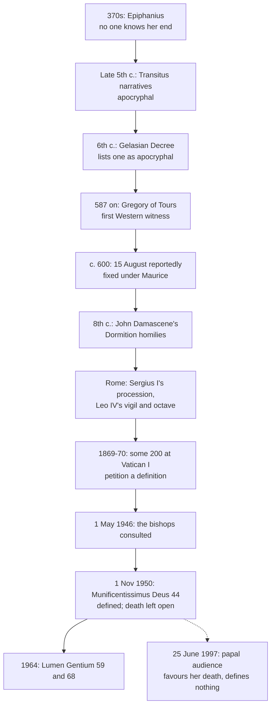

# The Church & Mary · Lesson 6.4: The Assumption

> ⏱ ~15 min · Module 6: Mary · Builds on: [6.3 The Immaculate Conception](06-03-the-immaculate-conception.md), [4.4 Infallibility in exercise, and the ordinary universal magisterium](04-04-infallibility-in-exercise-and-the-ordinary-universal-magisterium.md), [`fundamental-theology` 4.2](../../fundamental-theology/lessons/04-02-infallibility-and-its-conditions.md) · Unlocks: [6.5 Mary in the economy, in the Church, and in devotion](06-05-mary-in-the-economy-in-the-church-and-in-devotion.md)

## Why this matters

You have met this dogma as a specimen. [`fundamental-theology`](../../fundamental-theology/syllabus.md) ran *Munificentissimus Deus* through the four conditions ([4.2](../../fundamental-theology/lessons/04-02-infallibility-and-its-conditions.md), Ex 1), used it for material sufficiency ([3.4](../../fundamental-theology/lessons/03-04-tradition.md), Ex 2) and the hierarchy of truths ([4.5](../../fundamental-theology/lessons/04-05-reading-a-documents-weight.md)), and read the 1946 consultation as the *sensus fidei* at work ([5.3](../../fundamental-theology/lessons/05-03-the-sensus-fidei.md), Ex 1). None of that is repeated. This lesson reads the doctrine itself: what the 1950 sentence says, what it leaves unsaid, and where the belief came from.

## The idea

The 1950 definition says that Mary, "having completed the course of her earthly life", was taken up body and soul into heavenly glory (*Munificentissimus Deus* 44, Vatican translation). The Latin, *expleto terrestris vitae cursu*, names an endpoint and not the way it was reached. It does not say she died, or that she did not. It says nothing of a tomb, a third day, a place or a year.

The silence was chosen. The East keeps 15 August as the [Dormition](../reference.md#dormition), the *Koimēsis* ("falling asleep", lesson's gloss): the feast of a real death, a burial and a glorification. The West came to call it the [Assumption](../reference.md#assumption). Some Catholic theologians, from the seventeenth century on by John Paul II's account, held that Mary never died. The sentence had to be true on every reading the Church had not excluded. So what is defined is the endpoint: the whole Mary, body and soul, is where her risen Son is.

**Said plainly.** Nothing in the New Testament, and no surviving writer of the first three centuries, tells how Mary's life ended. The first to ask, Epiphanius of Salamis in the 370s (*Panarion* 78), says Scripture is silent and no one knows her end. She may have died and been buried, been martyred (Luke 2:35), or remained alive; he will not choose. The *Transitus Mariae* narratives of her death and assumption, extant in many languages, are apocryphal. They first appear in the late fifth century, though their sources may be older (Stephen Shoemaker, *Ancient Traditions of the Virgin Mary's Dormition and Assumption*, 2002). The sixth-century Gelasian Decree lists a book called the Assumption of holy Mary among the apocrypha. In the West the story first appears in Gregory of Tours (*Glory of the Martyrs*, begun 587).

## Source

John Damascene, second homily on the Dormition, eighth century, in Mary H. Allies's translation (*St John Damascene on Holy Images, followed by Three Sermons on the Assumption*, 1898), public domain; her Greek glosses omitted. The apostles have carried the body to Gethsemane:

> And thus the immaculate body was laid in the tomb. Then it was assumed after three days to the heavenly mansions. [...] And just as the all holy body of God's Son, which was taken from her, rose from the dead on the third day, it followed that she should be snatched from the tomb, that the mother should be united to her Son [...] It was fitting that the body of her, who preserved her virginity unsullied in her motherhood, should be kept from corruption even after death. She who nursed her Creator as an infant at her breast, had a right to be in the divine tabernacles.

Read the shape of the act. There is **narrative**: a death, a burial at Gethsemane, an empty tomb after three days. And there is an **argument from fittingness**: "it was fitting", "had a right". *Munificentissimus Deus* 21 quotes the fittingness and leaves the narrative alone. That is the 1950 act in miniature: the Fathers' faith and reasons, without their circumstances. Greek editions add an excerpt from a lost *Euthymiac History*, in which Juvenal of Jerusalem tells the emperor Marcian, around 451, that the tomb was found empty. It is generally treated as an early interpolation, and Allies omits it.

## In their own words

The Orthodox account, from Thomas Hopko's *The Orthodox Faith* (vol. 2, *Worship*, Orthodox Church in America), with no reply attached. The feast commemorates "the death, resurrection and glorification of Christ's mother", taken into his kingdom in the fullness of her spiritual and bodily existence. It has no biblical or historical sources; it rests on Tradition. Mary died as all people die: not voluntarily, as her Son did, but by the necessity of a mortal nature bound up with the world's corruption. Without personal sin, she still truly needed to be saved by Christ. Having truly died, she was raised by her Son, and she already shares the life promised to all who hear the word of God and keep it (Luke 11:28). What is praised in her is offered to every believer, so Orthodox tradition calls her the image of the Church. No Orthodox council has defined this. It lives in the feast's hymns and icon.

## The doctrine

The defining act and the bull around it. (Modern papal texts are paraphrased.)

1. **The definition** ([*Munificentissimus Deus*](../reference.md#munificentissimus-deus) 44, 1 November 1950). By the authority of Christ, of Peter and Paul, and his own, Pius XII defines as divinely revealed that the Immaculate Mother of God, Mary ever virgin, having completed the course of her earthly life, was assumed body and soul into heavenly glory. Whoever wilfully denies or doubts it has fallen from the divine and Catholic faith (§45). *In words:* the whole Mary is now in glory, and this is revealed.
2. **The subject phrase defines nothing new.** "Immaculate", "Mother of God" and "ever virgin" are [6.3](06-03-the-immaculate-conception.md), [6.1](06-01-theotokos-and-mary-in-scripture-and-the-fathers.md) and [6.2](06-02-ever-virgin.md) used as titles. The defined content is the predicate, and its verb is passive. Christ ascended by his own power (ST III q.57 a.3; [`christology` 6.2](../../christology/lessons/06-02-resurrection-and-ascension-as-doctrine.md)); Mary was taken up. *In words:* the Assumption is something done to her.
3. **What the bull argues from.** First, the consultation. On 1 May 1946 *Deiparae Virginis Mariae* asked every bishop two questions: could the bodily Assumption be proposed and defined as a dogma of faith, and did they, with their clergy and people, desire it (§11)? The first asks the bishops as teachers; the second asks them to report their people's faith. The reply was almost unanimous; the bull gives no figures (§12). §12 reads it as the [ordinary universal magisterium](../reference.md#ordinary-universal-magisterium) in agreement with the faith of the people it guides, an agreement that of itself shows the doctrine revealed. On the bull's own account, then, the doctrine was infallibly taught before it was defined ([4.4](04-04-infallibility-in-exercise-and-the-ordinary-universal-magisterium.md)), and the faithful's sense of the faith entered as testimony gathered and judged by the pastors ([3.3](03-03-the-laity-charisms-and-the-sensus-fidei.md)). Then the liturgy (§§16–19), the Fathers (§§20–23), and theologians down to Suárez, Aquinas among them (§§24–37). Then the ground (§§38–40). Mary is the [New Eve](../reference.md#new-eve), joined to the new Adam in the struggle of Genesis 3:15, which ends in victory over sin and death (1 Cor 15:21–26, 54–57). His resurrection was that victory's final sign, so her share in it closes with her body's glorification (§39). *In words:* the argument runs from her association with Christ, with Scripture as its ultimate foundation (§38), not from a proof text. The [woman of Revelation 12](../reference.md#woman-of-revelation-12) appears only in §27, as what the scholastics saw signified there.
4. **The link to the Immaculate Conception** (§§4–5). The bodies of the just decay and wait for the last day. Mary overcame sin by her Immaculate Conception, so she was not subject to remaining in the corruption of the grave. *In words:* the exemption is from waiting in the grave, not from dying.
5. **What it did not do.** It did not define that Mary died, or that she did not. Its exposition assumes her death (§§14, 17, 20); the operative sentence avoids it. John Paul II read this in 1997: Pius XII did not deny her death, but did not judge it opportune to define it. None of the bull's arguments was defined either. What a glorified body is belongs to [`creation-grace-last-things`](../../creation-grace-last-things/syllabus.md).
6. **Vatican II.** *Lumen Gentium* 59 restates the dogma in the bull's terms. In LG 68, glorified in body and soul, Mary is the image and beginning of the Church as it will be perfected in the age to come, and a sign of sure hope to the pilgrim People of God ([1.4](01-04-people-of-god-communion-sacrament.md)). *In words:* what has happened to her is what the Church awaits.

**Mark the levels** ([levels of authority](../reference.md#levels-of-authority)). The bodily Assumption is **rung 1**: defined *ex cathedra* as divinely revealed, one of the two papal definitions nobody contests ([4.4](04-04-infallibility-in-exercise-and-the-ordinary-universal-magisterium.md)). It is owed theological faith; obstinate denial is heresy (can. 751). It binds because the act meets the conditions of *Pastor Aeternus* ch. 4, which defines conditions and makes no other papal sentence infallible, including the rest of this bull. **Whether she died is not defined** ([mortalists and immortalists](../reference.md#mortalists-and-immortalists)). Most of the tradition says she did, and John Paul II's general audience of 25 June 1997 favoured that answer. An audience catechesis defines nothing and carries at most the lightest grade of authentic ordinary magisterium ([`fundamental-theology` 4.5](../../fundamental-theology/lessons/04-05-reading-a-documents-weight.md)). The immortalist view has never been condemned, so the question is open. The circumstances (tomb, third day, Gethsemane, Juvenal) have **no doctrinal weight**, and the bull's arguments are theology, not dogma. LG 59 carries the weight of the dogma it restates; LG 68's reading of Mary as the Church's beginning is conciliar teaching, rung 3.

## The timeline

## Worked examples

**Ex 1: clean case.** A catechumen (invented) asks whether Catholics must believe this: *Mary died in Jerusalem, was buried at Gethsemane, and on the third day was taken up body and soul.* "Taken up body and soul" into glory: rung 1, *Munificentissimus Deus* 44. "Died": not defined, the common view, which a Catholic may decline. "Jerusalem", "Gethsemane", "the third day": the Dormition narrative, no doctrinal weight. The dogma is one clause. The rest may be held, but not taught as the dogma.

**Ex 2: where it strains. The Assumption without the Immaculate Conception.** The bull binds the two privileges closely (§§4–5). Yet the belief long stood without the second. Aquinas, who denied the Immaculate Conception as later defined ([6.3](06-03-the-immaculate-conception.md)), used the Assumption as a given premise:

> since her body was assumed into heaven, and yet Scripture does not relate this; so it may be reasonably argued that she was sanctified in the womb.

(ST III q.27 a.1.) In a.3 ad 1 he adds that she "was not freed from death and other such penalties". So the link cannot be a premise the Assumption needs: the feast and the belief were common for centuries while the Immaculate Conception was still disputed in the West. The bull itself frames it as a strand in the "perfect harmony" of her privileges (§3): an argument of convergence, which the definition does not make binding. No one can say the Church believed the Assumption because it believed the Immaculate Conception.

## Watch out

- **You might think 1950 defined that Mary never died.** It left the question open on purpose, and most of the tradition holds that she died. "The Church teaches she did not die" overstates; "a Catholic must hold that she died" overstates the other way.
- **You might think the dogma rests on the *Transitus* stories, or falls with them.** The bull does not cite them. Their weakness as history does not touch the definition, and their details are not defined.
- **You might think the open question makes the doctrine optional.** Only the manner and circumstances are open. The bodily Assumption is rung 1, and calling it a pious opinion understates it (the catechist in [`moral-theology` 3.2](../../moral-theology/lessons/03-02-faith-hope-and-charity.md)'s flashback).

## One-liner

> In 1950 the Church defined where Mary is, body and soul in glory, and deliberately left to the tradition how her earthly life ended.

## Problems

**P1 (🟢)** *(Exegetical)* An **invented** homily excerpt, preached on 15 August at a parish in the invented town of Carrow:

> "In 1950 Pope Pius XII defined that Our Lady never died. Like her Son, she rose and ascended into heaven by her own power. He proved it from Revelation 12, the woman clothed with the sun. The apostles saw it happen, and the first Christians always knew it. Sadly, our Orthodox brothers and sisters do not believe in the Assumption at all."

Find **four** errors. For each, give the correction and, where a level or a document is involved, name it. 150 words or fewer.

**P2 (🟡)** *(Exegetical)* John Damascene, first homily on the Dormition (Allies, 1898; Greek gloss omitted):

> O how does the source of life pass through death to life? O how can she obey the law of nature, who, in conceiving, surpasses the boundaries of nature? How is her spotless body made subject to death? In order to be clothed with immortality she must first put off mortality, since the Lord of nature did not reject the penalty of death. She dies according to the flesh, destroys death by death, and through corruption gains incorruption, and makes her death the source of resurrection. [...] Thy blessed soul is naturally parted from thy blissful and undefiled body, and the body is delivered to the grave, yet it does not endure in death, nor is it the prey of corruption. [...] Therefore I will not call thy sacred transformation death, but rest or going home.

(a) Does Damascene hold that Mary died? Name the words that decide it, and say why the last sentence does not reverse the answer. (b) Give the weight, for a Catholic today, of three claims in the passage: (i) her soul was parted from her body; (ii) her body was delivered to the grave; (iii) her body does not endure in death. **Two sentences for (a); one line each for (b).**

**P3 (🔴)** *(Exegetical)* Two Catholic theologians, both **invented**, read "having completed the course of her earthly life":

> I: "Death is the penalty of sin (Rom 5:12). Mary was preserved from all stain of original sin, so she was not subject to death. The phrase names the moment of her assumption."
>
> M: "She died as her Son died, and was raised and taken up. The phrase names her death."

(a) Name the single premise I needs that M denies, and give the strongest consideration M can bring against it from this lesson. (b) Say why I is not contradicting the dogma, even though §§14–20 of the bull speak of Mary's death. **Three sentences per part.**

Solutions

**P1** *(Exegetical)*

**Accept:** any four of the five errors below, each with its correction.

**Must hit, strict:**

- (1) **"Defined that she never died."** *Munificentissimus Deus* 44 says "having completed the course of her earthly life" and leaves death open. Most of the tradition holds that she died, and John Paul II's 1997 audience favoured that answer. Only the bodily Assumption is defined (rung 1).
- (2) **"Rose and ascended by her own power."** She was *assumed*: the verb is passive. Christ ascended by his own power (ST III q.57 a.3).
- (3) **"Proved it from Revelation 12."** The bull mentions Revelation 12 only as something the scholastics saw signified there (§27). It argues from the Church's faith (§12), the liturgy and the Fathers, and above all from the New Eve's share in the victory over death (Gen 3:15; 1 Cor 15; §39).
- (4) **"The apostles saw it; the first Christians always knew."** No surviving writer of the first three centuries tells her end. Epiphanius says no one knows it, and the narratives are apocryphal and late fifth-century. The dogma is defined as revealed, not as an eyewitness report.
- (5) **"The Orthodox do not believe in it."** They celebrate the Dormition as her death, resurrection and glorification, body and soul. What they lack is a dogmatic definition, and they do not receive 1950.

**Wrong turns:** "correcting" (1) by saying the Church teaches she *did* die, which overstates the other way. Treating (4) as if it made the dogma doubtful. Answering (5) with an argument against the Orthodox position instead of stating it.

**Model answer:** The 1950 definition did not say she never died; "having completed the course of her earthly life" leaves that open, and most of the tradition holds she died. She did not rise by her own power; she was assumed, unlike Christ's ascension (ST III q.57 a.3). The bull does not prove it from Revelation 12, which it mentions only as a scholastic reading (§27); its ground is the Church's faith and the New Eve's share in Christ's victory over death (§39). No early witness saw it: Epiphanius says no one knows her end. The Orthodox celebrate her death and bodily glorification at the Dormition; they have no definition and do not receive 1950.

---

**P2** *(Exegetical)*

**Must hit, strict (a):** **Yes, she died.** The deciding words are "She dies according to the flesh" and "Thy blessed soul is naturally parted from thy ... body", which is what death is, and the body "is delivered to the grave". The last sentence refuses the *name* "death", because hers did not end in corruption or under death's dominion. It does not deny the *fact* the same sentences state; it renames it "rest or going home".

**Must hit, strict (b):** (i) **Not defined**: the common, mortalist view, open to Catholics. (ii) **No doctrinal weight**: the Dormition narrative. (iii) **Rung 1** as to the body now being in glory, by *Munificentissimus Deus* 44.

**Wrong turns:** reading the last sentence as an immortalist claim. Marking (i) as defined because the bull's exposition speaks of her death; exposition is not the operative sentence. Marking (iii) as merely Damascene's opinion, which understates it.

**Model answer:** (a) Damascene holds that she died: "She dies according to the flesh", her soul "is naturally parted" from her body, and the body "is delivered to the grave". "I will not call thy sacred transformation death" refuses the word because her death led to incorruption, not because it did not happen. (b) (i) Not defined; the common view, open to Catholics. (ii) Pious narrative, no doctrinal weight. (iii) Rung 1: her body is in glory (MD 44).

---

**P3** *(Exegetical)*

**Must hit, strict (a):** the premise is **that freedom from original sin entails freedom from death**, so that in Mary death could only be a penalty she did not owe. M's strongest consideration is Christ: wholly sinless, he died, so sinlessness does not entail exemption from death, and the Mother can be conformed to the Son in dying. This is Damascene's reasoning in P2: she must put off mortality "since the Lord of nature did not reject the penalty of death". Credit also noting that the bull draws from the Immaculate Conception only an exemption from remaining in the grave (§5), not from dying.

**Must hit, strict (b):** what is defined is the **operative sentence** of §44, and its phrase names the end of her earthly life without naming the manner, so both readings satisfy it. The exposition's talk of her death is part of the bull's reasoning, not of what is defined. Nothing is understood as infallibly defined unless that is manifestly established (can. 749 §3), and the immortalist view has never been condemned. So I holds a minority opinion, not a heresy.

**Wrong turns:** naming "whether Mary was immaculate" as the crux, when both affirm it. Citing Aquinas's "she was not freed from death" against I: Aquinas denied the Immaculate Conception, so his view does not test I's premise. Saying I contradicts the dogma because the bull mentions her death. Saying the 1997 audience settled the question. Treating M's view as defined.

**Model answer:** (a) I needs the premise that whoever is free of original sin is free of death, so that death in Mary could only be an unowed penalty. M denies it: Christ was wholly sinless and died, and Damascene reasons that Mary, conformed to him, put off mortality because "the Lord of nature did not reject the penalty of death". Even the bull draws from the Immaculate Conception only her exemption from remaining in the grave (§5), not from dying. (b) Only §44's operative sentence is defined, and "having completed the course of her earthly life" fixes the endpoint without the manner, which both readings satisfy. Sections 14–20 belong to the bull's exposition, and what is not manifestly defined is not defined (can. 749 §3). So I holds an uncondemned minority view, not a denial of dogma.

## Flashback

**From Lesson [6.2](06-02-ever-virgin.md) (Ever-virgin):** *(Exegetical.)* Close reading. Thomas Aquinas, ST III q.28 a.3, from the body of the article (English Dominican Province, 1920):

> Without any hesitation we must abhor the error of Helvidius, who dared to assert that Christ's Mother, after His Birth, [...] bore other children. For, in the first place, this is derogatory to Christ's perfection: for as He is in His Godhead the Only-Begotten of the Father, [...] so it was becoming that He should be the Only-begotten son of His Mother, as being her perfect offspring. [...] We must therefore simply assert that the Mother of God, as she was a virgin in conceiving Him and a virgin in giving Him birth, did she remain a virgin ever afterwards.

In the lines omitted before the last sentence he adds three more reasons of the same kind: from the Holy Ghost, from Mary's own dignity and holiness, and from what the error would imply about Joseph.

(a) What kind of argument carries the conclusion: a text of Scripture, an act of the Church, or something else? Name the words that show it, and say which of the three moments the last sentence asserts. **Two sentences.**

(b) A student writes: "So perpetual virginity is a conclusion of theology, and Catholics hold it exactly as firmly as these reasons are strong." Correct both halves, giving the doctrine's level, the route that carries it, and the weight of Aquinas's reasons. **Two sentences.**

Solution

**Must hit, strict (a):**

- **An argument from fittingness**, not from Scripture or any act of the Church; the passage cites neither. The deciding words are "it was becoming" and "derogatory to Christ's perfection": the denial is shown to be unworthy of Christ, not contradicted by a text.
- **All three moments:** "a virgin in conceiving Him" (*ante partum*), "a virgin in giving Him birth" (*in partu*) and "ever afterwards" (*post partum*). The reasons are aimed at the third, the clause Helvidius denied while keeping the first.

**Must hit, strict (b):**

- **Not a conclusion of theology.** Perpetual virginity is **rung 1**, dogma held by the **ordinary universal magisterium** with no single defining act. Its witnesses are the conciliar title *aeiparthenos*, the Lateran Synod of 649, *Cum quorundam* and the liturgy, restated in LG 57 and CCC 499–501. The assent owed is theological faith.
- **Not as firm as the reasons.** Aquinas's reasons are theology with **no magisterial weight**, weighed by their arguments. The doctrine's level comes from the route that teaches it, so weak reasons would not lower it and strong ones would not raise it.

**Accept:** noting that "abhor the error" shows Aquinas defending a belief already held, so the reasons illuminate it rather than establish it.

**Wrong turns:** answering (a) with Matthew 1:25 or the "brethren", which this passage does not cite. Reading the last sentence as asserting *post partum* only. In (b), swinging to "defined at Lateran 649" or "defined by Constantinople II", which overstates the route, or to "theologically certain", which understates the level. Treating the fittingness reasons as doctrine because the Church holds their conclusion.

**Model answer:** (a) It is an argument from fittingness, not from Scripture or any act of the Church: the error is "derogatory to Christ's perfection", and "it was becoming" that the Only-Begotten of the Father be his Mother's only son. The last sentence asserts all three moments, "a virgin in conceiving Him", "in giving Him birth" and "ever afterwards", though the reasons target the third, which Helvidius denied. (b) Perpetual virginity is not a conclusion of theology but rung 1, dogma taught by the ordinary universal magisterium without a single defining act and owed theological faith. Aquinas's reasons are theology with no magisterial weight, so the doctrine's firmness comes from the route that teaches it, not from the strength of his reasons.

## Connections

- **Backward:** [`fundamental-theology`](../../fundamental-theology/syllabus.md) used this dogma as its specimen: the conditions in [4.2](../../fundamental-theology/lessons/04-02-infallibility-and-its-conditions.md), material sufficiency in [3.4](../../fundamental-theology/lessons/03-04-tradition.md), the consultation in [5.3](../../fundamental-theology/lessons/05-03-the-sensus-fidei.md), the hierarchy of truths in [4.5](../../fundamental-theology/lessons/04-05-reading-a-documents-weight.md). [4.4](04-04-infallibility-in-exercise-and-the-ordinary-universal-magisterium.md) named it one of the two uncontested acts, and [3.3](03-03-the-laity-charisms-and-the-sensus-fidei.md) handed the consultation here. The subject phrase of §44 presupposes [6.1](06-01-theotokos-and-mary-in-scripture-and-the-fathers.md), [6.2](06-02-ever-virgin.md) and [6.3](06-03-the-immaculate-conception.md).
- **Forward:** [6.5](06-05-mary-in-the-economy-in-the-church-and-in-devotion.md) reads *Lumen Gentium* ch. 8, where LG 59 and 68 stand. [`creation-grace-last-things`](../../creation-grace-last-things/syllabus.md) 7.1 takes the resurrection of the body and what a glorified body is. [`apologetics-catholic-claims`](../../apologetics-catholic-claims/syllabus.md) 6.1 argues the Orthodox and Protestant objections this lesson only states.
- **Sideways:** Damascene's homilies come from the same 1898 volume as his defence of images, read in [`patristics` 5.4](../../patristics/lessons/05-04-maximus-and-john-of-damascus.md). Christ's ascension by the power of his Godhead is [`christology` 6.2](../../christology/lessons/06-02-resurrection-and-ascension-as-doctrine.md)'s; §44's passive verb is the contrast.
