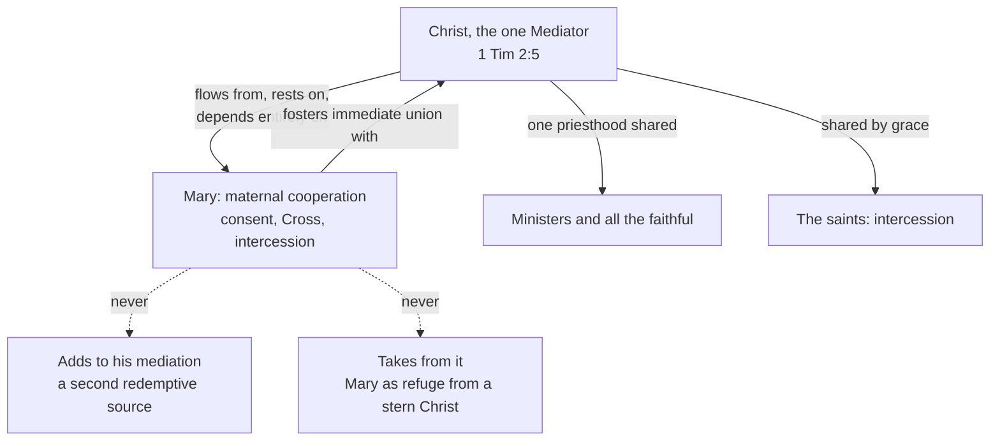

# The Church & Mary · Lesson 6.5: Mary in the economy, in the Church, and in devotion

> ⏱ ~15 min · Module 6: Mary · Builds on: [6.1 Theotokos, and Mary in Scripture and the Fathers](06-01-theotokos-and-mary-in-scripture-and-the-fathers.md), [6.4 The Assumption](06-04-the-assumption.md), [`fundamental-theology` 1.4](../../fundamental-theology/lessons/01-04-public-and-private-revelation.md) · Unlocks: [`apologetics-catholic-claims`](../../apologetics-catholic-claims/syllabus.md)

## Why this matters

The four dogmas ([6.1](06-01-theotokos-and-mary-in-scripture-and-the-fathers.md)–[6.4](06-04-the-assumption.md)) say what is true of Mary. This lesson asks what she *does*, and how the Church may speak to her. The commonest misunderstanding ("Catholics worship Mary") and the commonest overstatement ("Co-redemptrix is Catholic doctrine") both live here. Chapter 8 of *Lumen Gentium* governs the answer, and a doctrinal note of November 2025 now applies it to the disputed titles.

## The idea

On 29 October 1963 the bishops at Vatican II voted, 1,114 to 1,074, to put Mary inside the constitution on the Church rather than in a document of her own. (Figures: Sara Butler's paper for the Anglican–Roman Catholic International Commission, citing the *Acta Synodalia*; the council is [`church-history` 9.2](../../church-history/lessons/09-02-the-second-vatican-council.md).) One instinct sees Mary chiefly *beside* Christ, sharing uniquely in his work; commentators call it "Christotypical". The other sees her as the first of the redeemed, the Church's member and model: "ecclesiotypical". The chapter keeps both; its placement says how. Mary stands *with* the Church before Christ, not *between* the Church and Christ.

LG 53 names three relations. Redeemed by her Son's merits, she is a pre-eminent and singular **member** of the Church, its **type** and exemplar, and honoured as **mother**.

So the rule this module ends with: **no Marian claim may say anything that the Christological root of [6.1](06-01-theotokos-and-mary-in-scripture-and-the-fathers.md) would not license.** Whatever is said of her must come from who her Son is and lead back to him.

## The doctrine

[*Lumen Gentium*](../reference.md#mary-in-lumen-gentium) ch. 8 (LG 52–69, 21 November 1964), paraphrased. LG 54 limits itself: no complete doctrine on Mary, and no settling of open questions.

1. **She cooperated, freely.** God willed the Incarnation to wait on her consent, so that as a woman contributed to death a woman should contribute to life (LG 56, citing Irenaeus's knot of Eve loosed by Mary; [6.1](06-01-theotokos-and-mary-in-scripture-and-the-fathers.md)). At Cana her intercession brought about the first sign; at the Cross she consented to his sacrifice (LG 58). LG 61: in a singular way she cooperated, by obedience, faith, hope and charity, in restoring supernatural life to souls. *In words:* her yes was a real act, done by grace.

2. **So she is our mother in the order of grace.** This [spiritual motherhood](../reference.md#spiritual-motherhood) began at the Annunciation, held beneath the Cross, and continues in heaven as intercession (LG 61–62). Hence she is invoked as Advocate, Helper, Benefactress and Mediatrix (CCC 969's rendering of LG 62). The council did not use the title **Mother of the Church**. Paul VI proclaimed it in his closing address on the day of promulgation (*Redemptoris Mater* 47). Since a decree of the Congregation for Divine Worship (11 February 2018) its memorial falls on the Monday after Pentecost. *In words:* "Behold thy mother" (John 19:27, DR) is read as said to every disciple, pastors included.

3. **One Mediator, on whom her role depends.** LG 60 opens with 1 Timothy 2:5, "one mediator of God and men, the man Christ Jesus" (DR). Her saving influence comes from God's free choice, not from necessity. It *flows from* Christ's superabundant merits, *rests on* his mediation, *depends entirely* on it, and fosters the faithful's immediate union with him. LG 62 gives the test for every title: it must **neither take away from nor add to** the dignity and efficacy of Christ the [one Mediator](../reference.md#one-mediator). As his priesthood is shared by ministers and faithful, so his mediation gives rise to a cooperation that only shares in it. *In words:* Mary mediates as every Christian who prays for another does, uniquely and maternally, never alongside Christ.

4. **Type of the Church.** LG 63–65, after Ambrose: she models the Church, also virgin and mother, in faith, charity and union with Christ, and already has the spotless perfection the Church strives for ([2.2](02-02-holy.md)). *In words:* look at Mary to see what the Church will be.

5. **A singular cult, different in kind from adoration.** LG 66: her honour is altogether singular, yet differs essentially from the adoration given to the Trinity, and fosters it. LG 67 commends liturgical and approved devotion, and warns theologians and preachers against gross exaggeration and petty narrowness alike. The schools named the distinction: [latria, dulia, hyperdulia](../reference.md#latria-dulia-hyperdulia). *Latria* (Greek *latreia*) is worship due to God alone. *Dulia* (Greek *douleia*, servitude) is honour paid to a creature for gifts God gave. *Hyperdulia* is Latinized Greek for "beyond dulia" (lesson's gloss). Aquinas:

   > the worship of "latria" is not due to her, but only that of "dulia": but in a higher degree than to other creatures, inasmuch as she is the Mother of God. (ST III q.25 a.5)

   It is the highest species of *dulia*, not a grade of *latria* (II-II q.103 a.4 ad 2). Nicaea II (787) reserved *latreia* to the divine nature ([`patristics` 5.4](../../patristics/lessons/05-04-maximus-and-john-of-damascus.md)), and Trent (Session XXV, 1563) taught that invoking the saints does not offend the one Mediator, "our alone Redeemer and Saviour" (Schaff). *In words:* honouring a creature for God's gifts is not worshipping her.

6. **Renewal.** Paul VI's apostolic exhortation *Marialis Cultus* (2 February 1974) asks every devotion to show its Trinitarian, Christological, pneumatological and ecclesial character (MC 25–28). It sets biblical, liturgical, ecumenical and anthropological guidelines for devotions old and new (MC 29–37), and rejects vain credulity, sentimentality and legend posing as history (MC 38). John Paul II's encyclical *Redemptoris Mater* (25 March 1987) names LG 60–62's teaching "maternal mediation" (RM 38–41): a mediation *in Christ*, shared and subordinate, marked out by its maternal character. *In words:* renewal makes devotion more biblical and Christ-centred, not smaller.

7. **The disputed titles.** "Co-redemptrix" and "Mediatrix of all graces" have never been defined. Their Catholic advocates' case, at its strongest: Mary's cooperation is real and taught (LG 56, 61); *co-* means "with", not "equal to", and they affirm her total dependence on Christ; popes used the first title, John Paul II at least seven times. Cardinal Mercier asked for a definition of her universal mediation in 1921, and in the 1990s the movement *Vox Populi Mariae Mediatrici* asked for a dogma of both titles (as the 2025 note reports, ¶¶17–23). Neither request was granted: Benedict XV granted a feast, not a definition, and Cardinal Ratzinger's personal *votum* at the CDF on 21 February 1996 was negative, the doctrine not mature (¶19). Then came the Dicastery for the Doctrine of the Faith's doctrinal note *Mater Populi Fidelis* (dated 4 November 2025; approved by Leo XIV on 7 October). It judges it "always inappropriate" to use [Co-redemptrix](../reference.md#co-redemptrix) for Mary's cooperation, because the title risks obscuring Christ's unique mediation and needs constant explanation (¶22). "Mediatrix" is acceptable in a clearly subordinate sense (¶¶25–27). [Mediatrix of all graces](../reference.md#mediatrix-of-all-graces) "has limits": the first of the redeemed could not mediate the grace she herself received, and she is no reservoir through whose hands all grace must pass (¶¶45, 67). "Graces" may name the helps her intercession obtains (¶¶68–69). *In words:* the cooperation is taught; one title is judged unusable, the other usable narrowly.

8. **Apparitions apply doctrine; they never add to it.** [`fundamental-theology` 1.4](../../fundamental-theology/lessons/01-04-public-and-private-revelation.md) parsed approval: a permission, human faith at most, never a source of doctrine. The Dicastery's *Norms* of 17 May 2024 allow six conclusions, from *Nihil obstat* to a declaration of non-supernaturality, and as a rule none declares a phenomenon supernatural. As institutional history, the [Marian apparitions](../reference.md#marian-apparitions) built shrines, pilgrimages and feasts; Lourdes (1858) is the sturdiest recognition. Approval language also drifted upward: the *Norms* recall a Grenoble decree (19 September 1851) telling the faithful they could hold an apparition "indubitable and certain" (lesson's translation), and judge such wording at odds with the Church's conviction. *Mater Populi Fidelis* ¶2 ties the disputed titles to such phenomena. *In words:* a title gains no weight from a vision.

**Said plainly.** A title that popes used, John Paul II at least seven times, is now judged always inappropriate by the Dicastery, with papal approval. And Catholic devotion has at times said of Mary what no doctrine licenses: that her mercy is infinite, that it is safer to seek her than her Son. Newman, answering Pusey's collection of such sayings, disowned them and drew this lesson's line (*Letter to Pusey*, dated 7 December 1865):

> I fully grant that devotion towards the blessed Virgin has increased among Catholics with the progress of centuries; I do not allow that the doctrine concerning her has undergone a growth

**Mark the levels** ([`fundamental-theology` 4.4](../../fundamental-theology/lessons/04-04-the-ladder-of-doctrinal-authority.md); genres, [4.5](../../fundamental-theology/lessons/04-05-reading-a-documents-weight.md)). The four dogmas LG 52–59 restates keep **rung 1** (6.1–6.4), as do Christ the one Mediator (Trent, Session V, can. 3) and *latreia* for God alone (Nicaea II). Invoking the saints is Trent's Session XXV teaching (the manuals' *de fide* is testimony); *dulia* and *hyperdulia* are school words, no rung. LG ch. 8's own teaching (cooperation, spiritual motherhood, subordinate mediation, Mary as type) is authentic conciliar teaching, **at least rung 3**, defining nothing new ([1.4](01-04-people-of-god-communion-sacrament.md)'s notification). "Mother of the Church" was proclaimed in an address, not defined; the 2018 memorial is liturgical law. *Marialis Cultus* and *Redemptoris Mater* are **rung 3**, much of MC pastoral direction. Co-redemptrix and Mediatrix of all graces are **not defined**: calling them dogma is an error, and so is calling Mary's cooperation a forbidden opinion. *Mater Populi Fidelis* is a Dicastery doctrinal note with ordinary papal approval (its formula lacks *in forma specifica*): authentic magisterium, **rung 3**, owed religious submission. Its ¶22 judges the *use* of a title; it defines nothing and condemns no doctrine. So using "Co-redemptrix" is no longer simply "freely disputed", though a rung-3 judgment is in principle reformable. Apparition approval has no doctrinal rung; Newman and the advocates are testimony.

## The one Mediator map

## Worked examples

**Ex 1: a clean case, the *Salve Regina*.** The medieval antiphon greets Mary as *vita, dulcedo et spes nostra*, "our life, our sweetness and our hope", and calls her *advocata nostra* (lesson's translation). Is this *latria*? The object is a creature honoured as Mother of God: hyperdulia. "Our life" is said by derivation: she gave the world the one who is Life itself (LG 56). "Our hope" is intercessory: she is a sign of sure hope (LG 68). Now LG 62's test. Does it take from Christ? It ends by asking her to show us Jesus, the blessed fruit of her womb. Does anything add? Nothing claims a power he lacks. It passes, read as the Church prays it.

**Ex 2: where it strains. "Every grace comes to us through Mary's hands."** Reading A: sanctifying grace passes through her as a channel, so union with her precedes union with Christ. That fails LG 60's "immediate union"; and she received grace herself (*Mater Populi Fidelis* ¶67). Reading B: every help we receive is one her motherly intercession asked for. That passes (¶¶68–69). The strain: LG 62's test sorts senses, not sentences. The 2025 note adds what the test does not: a title that needs constant explanation to stay orthodox does not serve the faith (¶22). The first verdict concerns truth; the second, prudence in speech.

## Watch out

- **You might think "Mediatrix" is now banned.** LG 62 records it, and the 2025 note accepts it in a subordinate sense. "Co-redemptrix" is the title judged always inappropriate; "of all graces" is limited.
- **You might think *Mater Populi Fidelis* is a definition, or one cardinal's opinion.** It is a Dicastery doctrinal note with ordinary papal approval: rung 3, owed religious submission, defining nothing.
- **You might think hyperdulia is "worship, only less".** It is the highest *dulia*, different in kind (LG 66, "essentially"), because *latria* is fixed by its object, God.
- **You might think an approved apparition lends its titles authority.** Approval binds no one to believe and cannot lift a title above a doctrinal note.

## One-liner

> Mary cooperates, mothers and intercedes from inside the Church and wholly from her Son: honoured with hyperdulia, never latria, under titles that neither add to nor take from the one Mediator.

## Problems

**P1 (🟢)** *(Exegetical)* An **invented** podcast transcript, written for this problem:

> "Let's be honest: Catholics worship Mary. Their own council called her Co-redemptrix, and in 1950 Pius XII defined that title, along with 'Mediatrix of all graces'. Now Rome has backtracked. The 2025 Vatican note says Mary had no part in our salvation, so *Lumen Gentium*'s chapter on her is a dead letter."

Find **four** errors. For each, give the correction and, where a level is involved, the act that fixes it. 150 words or fewer.

**P2 (🟡)** *(Exegetical)* Four sentences from an **invented** shrine's novena booklet. Run LG 62's test on each and mark it **passes**, **fails** (say whether it *takes away from* or *adds to* Christ's mediation), or **passes only with a stated distinction**. One or two sentences each; where a level bears on the verdict, give it.

(a) "Mother, as you spoke for the couple at Cana, speak to your Son for us, and teach us to do whatever he tells us."

(b) "Jesus is a judge who must punish, but Mary's mercy alone can save sinners: run to her."

(c) "On Calvary Mary's sorrows paid what was still owing after her Son's sacrifice."

(d) "Mary, Co-redemptrix, you stood beside your Son as he redeemed the world."

**P3 (🔴)** *(Exegetical)* **Invented case.** In the invented diocese of Kerrow, the bishop, with the Dicastery's approval, concludes his inquiry into alleged apparitions at a hillside chapel with *Prae oculis habeatur*. The messages call Mary "Co-redemptrix" and ask the faithful to petition for a fifth Marian dogma. The bishop asks for doctrinal clarification with the visionaries and orders the title removed from the chapel's prayer cards. A pilgrim association's press release replies: "The Church has recognized our apparitions. Since Our Lady herself uses the title, the bishop's order is a personal preference no Catholic is bound by, and the call for a dogma now carries the Church's authority."

(a) What has the determination established, and what has it not? Two sentences.

(b) What does the release get wrong about the weight of (i) the messages' title and their call for a dogma, and (ii) the bishop's order? Three sentences in all.

Solutions

**P1** *(Exegetical)*

**Accept:** any four of the five errors below, each with its correction; strict on every level named.

**Must hit, strict:**

- **"Worship."** The Church gives Mary *hyperdulia*, which LG 66 says differs essentially from the adoration owed to God (ST III q.25 a.5). That *latreia* belongs to God alone is defined at Nicaea II (787), **rung 1**.
- **"Their own council called her Co-redemptrix."** Vatican II refrained from the title (as *Mater Populi Fidelis* ¶18 reports). LG 62 invokes her as Advocate, Helper, Benefactress and Mediatrix, in a sense that neither adds to nor takes from Christ.
- **"Defined in 1950."** *Munificentissimus Deus* (1950) defined the Assumption, **rung 1**. Neither title has ever been defined; the 1921 and 1990s requests were not granted.
- **"Mary had no part in our salvation."** The 2025 note affirms her real cooperation and maternal intercession. It judges the *title* Co-redemptrix always inappropriate (¶22) and limits "Mediatrix of all graces" (¶¶67–68).
- **"Dead letter."** The note applies LG 60–62 and quotes LG 62's test (¶65). LG ch. 8 is authentic conciliar teaching, **at least rung 3**, restating rung-1 dogmas; the note is a Dicastery doctrinal note with ordinary papal approval, **rung 3**, and repeals nothing.

**Wrong turns:** correcting "worship" with "a lesser worship", which makes hyperdulia a grade of *latria*. Saying the note condemns the doctrine of Mary's cooperation, or bans "Mediatrix". Calling the note infallible, or a private opinion. Volunteering an apologetic defence of Marian devotion: the task is to report what the Church teaches, at its weight.

**Model answer:** First, the Church does not worship Mary. Her cult is hyperdulia, which LG 66 says differs essentially from adoration; that *latreia* belongs to God alone is defined at Nicaea II (rung 1). Second, Vatican II never called her Co-redemptrix; it refrained, and LG 62 invokes her as Advocate, Helper, Benefactress and Mediatrix. Third, 1950 defined the Assumption (rung 1); neither title has ever been defined. Fourth, *Mater Populi Fidelis* (2025) affirms Mary's real cooperation and intercession. It judges the title Co-redemptrix always inappropriate and limits "Mediatrix of all graces". It is a Dicastery doctrinal note with ordinary papal approval, rung 3, and it applies LG 60–62 instead of retiring them.

---

**P2** *(Exegetical)*

**Must hit, strict:**

- **(a) Passes.** It is intercession, the role LG 58 gives her at Cana, and it ends by sending the hearer to Christ's word. It fosters the immediate union with Christ that LG 60 requires.
- **(b) Fails: it takes away.** It makes Mary the source of a mercy Christ withholds, where LG 60 says her influence flows from his merits and depends entirely on them. It is the kind of saying Newman disowned ("safer to seek her than her Son").
- **(c) Fails: it adds.** It treats Christ's sacrifice as insufficient, and the 2025 note says his work needs no addition (¶21). The distinction to keep: LG 58 teaches that she *united herself* to his sacrifice and consented to it; "paid what was still owing" is supplementation, not association.
- **(d) The content passes only with a distinction; the title is a separate verdict.** Read as "with and under him", her standing at the Cross is the teaching of LG 56, 58 and 61. But *Mater Populi Fidelis* ¶22 judges the title itself always inappropriate to use: a **rung-3** judgment about usage. It is not a definition, and using the title is not heresy.

**Wrong turns:** failing (a) because any intercession "adds a mediator"; that denies LG 62's shared cooperation, which Trent's Session XXV decree also teaches. Passing (c) because LG 58 says she joined the sacrifice. Marking (d) simply false as doctrine (understatement), or treating the note as having made the title heretical (overstatement).

**Model answer:** (a) Passes: Cana intercession that sends us to Christ's word. (b) Fails by taking away: it sets her mercy against his, though her influence depends entirely on his. (c) Fails by adding: his sacrifice owes nothing; she was associated with it, not completing it. (d) The content passes read as "with and under him" (LG 58, 61); the title, though, is judged always inappropriate by *Mater Populi Fidelis* ¶22, rung 3, so the booklet should not use it.

---

**P3** *(Exegetical)*

**Must hit, strict (a):**

- *Prae oculis habeatur*, the second of the 2024 *Norms*' six conclusions: important positive signs are recognized, but confusion or risks require the bishop's discernment and dialogue with the recipients, and doctrinal clarification may be needed.
- It is **not** a recognition. It is not even a *Nihil obstat*; as a rule no conclusion declares a phenomenon supernatural, and no one is bound to believe it ([`fundamental-theology` 1.4](../../fundamental-theology/lessons/01-04-public-and-private-revelation.md)).

**Must hit, strict (b):**

- (i) A private message can never be a source of doctrine. A dogma must be contained in revelation, which no apparition can establish, and approval could not supply the deficit even if it had been given. The title's use is governed by *Mater Populi Fidelis* ¶22, an authentic doctrinal note (**rung 3**), not by the message.
- (ii) The order is the diocesan bishop's pastoral act under the *Norms*, applying that note. It binds as a pastoral directive, not a preference; but having used the title was not heresy.

**Wrong turns:** reading *Prae oculis habeatur* as a condemnation (overstatement the other way). Saying the title is now heretical, or the order binds as dogma. Giving the apparition any weight against the note.

**Model answer:** (a) The determination recognizes real positive signs alongside confusion that needs discernment and doctrinal clarification. It declares nothing supernatural, is not even a *Nihil obstat*, and binds no one to believe. (b) A private message cannot found a dogma, since a dogma must be in revelation, and the title's use is governed by *Mater Populi Fidelis* ¶22, rung 3, which no apparition outranks. The bishop's order applies that note as a pastoral act under the *Norms* and is owed obedience. Using the title is no heresy, but it is no longer a free choice either.

## Flashback

**From Lesson [6.3](06-03-the-immaculate-conception.md) (The Immaculate Conception):** *(Exegetical.)* Close reading. Aquinas, ST III q.27 a.4, which asks "whether by being sanctified in the womb the Blessed Virgin was preserved from all actual sin", from the *respondeo* (English Dominican Province translation):

> God so prepares and endows those, whom He chooses for some particular office, that they are rendered capable of fulfilling it [...]. Now the Blessed Virgin was chosen by God to be His Mother. [...] But she would not have been worthy to be the Mother of God, if she had ever sinned. [...] We must therefore confess simply that the Blessed Virgin committed no actual sin, neither mortal nor venial.

(a) A reader concludes that Aquinas held Mary never sinned, and so held in substance what 1854 defined. Which words of the article decide what "ever sinned" covers, and what did Aquinas hold about her first instant? **Two sentences.**

(b) Does the Church still teach what this article affirms? Give its level and the texts that carry it, and say whether *Ineffabilis Deus* defined it. **Two sentences.**

Solution

**Accept (b):** "rung 3" or "at least rung 3", provided the answer says it has never been separately defined.

**Must hit, strict (a):**

- The deciding words are the conclusion's "committed no **actual** sin, neither mortal nor venial" and the question's "**by being sanctified in the womb**". "Ever sinned" ranges over her own acts, every personal sin down to the slightest, and the preservation follows a sanctification that for Aquinas is a cleansing (a.2).
- On her first instant he held the reverse of 1854: she contracted original sin and was cleansed before her birth (a.2 ad 2), sanctified after she began rather than preserved at her first instant. Lifelong freedom from personal sin is not the Immaculate Conception, and Aquinas affirmed the first while denying the second.

**Must hit, strict (b):**

- Yes. That Mary remained free of every personal sin her whole life is firmly taught (LG 56; CCC 493), and Trent's Session VI can. 23 (1547) presupposes it as what the Church holds of the Blessed Virgin. Level: **at least rung 3**, never separately defined. Can. 23 defines the general rule (rung 1) and presupposes its Marian exception without defining it.
- *Ineffabilis Deus* did not define it: 1854 concerns original sin at the first instant of her conception, not personal sin through her life.

**Wrong turns:** reading "ever sinned" as covering original sin, which makes Aquinas affirm what a.2 denies; taking "sanctified in the womb" for the Immaculate Conception, when for Aquinas it is a cleansing after she began; "Trent defined it" (an overstatement, since the Marian clause is presupposed); "a pious opinion, freely disputed" (an understatement); folding it into the 1854 dogma; debating whether Aquinas was a heretic, which is not asked.

**Model answer:** (a) The article's conclusion, that she "committed no actual sin, neither mortal nor venial", and its question, asked of a Mary "sanctified in the womb", confine "ever sinned" to personal sin after a sanctification that, for Aquinas, cleansed her. On her first instant he held the opposite of 1854: she contracted original sin and was cleansed before birth (a.2 ad 2). (b) The Church still teaches that Mary remained free of every personal sin her whole life (LG 56; CCC 493), which Trent VI can. 23 presupposes; it is at least rung 3 and has never been separately defined. *Ineffabilis Deus* did not define it, since 1854 concerns original sin at her first instant, not her personal sins.

## Connections

- **Backward:** [6.1](06-01-theotokos-and-mary-in-scripture-and-the-fathers.md) gave the Christological root this lesson's rule protects, and the Eve–Mary typology LG 56 cites. [6.2](06-02-ever-virgin.md)–[6.4](06-04-the-assumption.md) are the dogmas LG 52–59 restates. [1.4](01-04-people-of-god-communion-sacrament.md) placed Mary inside the constitution and gave the notification on what Vatican II defines; [2.2](02-02-holy.md) named her the one member already without spot. [`fundamental-theology` 1.4](../../fundamental-theology/lessons/01-04-public-and-private-revelation.md) parsed apparition approval, and [4.4](../../fundamental-theology/lessons/04-04-the-ladder-of-doctrinal-authority.md)–[4.5](../../fundamental-theology/lessons/04-05-reading-a-documents-weight.md) gave the rungs and genres. [`patristics` 5.4](../../patristics/lessons/05-04-maximus-and-john-of-damascus.md) gave *latreia* and *proskynesis* and Nicaea II.
- **Forward:** [`apologetics-catholic-claims`](../../apologetics-catholic-claims/syllabus.md) argues the Marian dogmas, the invocation of saints and the veneration of images against the confessions that reject them. [`sacraments-and-liturgy`](../../sacraments-and-liturgy/syllabus.md) [7.3](../../sacraments-and-liturgy/lessons/07-03-sacramentals-and-popular-devotion.md) treats popular piety and sacramentals and takes Marian devotion's criteria from here. [`creation-grace-last-things`](../../creation-grace-last-things/syllabus.md) [4.1](../../creation-grace-last-things/lessons/04-01-what-grace-is.md) sorts the kinds of grace the 2025 note distinguishes, and its 6.2 owns the communion of saints and their intercession.
- **Sideways:** [`christology` 2.2](../../christology/lessons/02-02-nestorius-cyril-and-ephesus.md) is *Theotokos* as a claim about Christ, the ground of everything here. [`apologetics-foundations` 7.2](../../apologetics-foundations/lessons/07-02-tawhid-and-the-trinity.md) reports Epiphanius's charge that the Collyridians offered cakes to Mary: the old precedent for devotion that tips into worship. Newman's line between devotion and doctrine sits beside his theory of development in [`fundamental-theology` 5.2](../../fundamental-theology/lessons/05-02-newmans-theory-of-development.md).

## Closing the course

The course opened with the creed's clause, *one, holy, catholic and apostolic Church* ([1.1](01-01-what-ecclesiology-asks.md)), and ends with the one member in whom the Church already is what she will be (LG 65, 68). The rule Module 6 ends with is the course's rule too. The Church is what she is from Christ, as his body and the sacrament of his salvation; Mary is who she is from Christ, as his mother. Every claim about either is measured by whether it adds to him or takes from him. Along the way the levels were marked: rung 1 where an act fixed it (the marks, the primacy and infallibility under their stated conditions, the four Marian dogmas); rung 3 where councils and popes taught without defining; and open questions left open.

**To `apologetics-catholic-claims`.** Every dispute this course stated and left standing goes there to be argued: Orthodox readings of primacy and the Petrine texts, the Reformation's ecclesiologies and *sola scriptura*, and the objections to the Marian dogmas, to invoking the saints and to venerating images.

**To `sacraments-and-liturgy`.** The Eucharist as the act that makes the Church, Holy Orders as a sacrament, the validity questions [2.2](02-02-holy.md) and [3.1](03-01-bishops-and-apostolic-succession.md) handed over, and popular piety in general.

**To `creation-grace-last-things`.** Grace itself, original sin and the exception [6.3](06-03-the-immaculate-conception.md) states, the communion of saints, and the last things that Mary's Assumption ([6.4](06-04-the-assumption.md)) anticipates.
