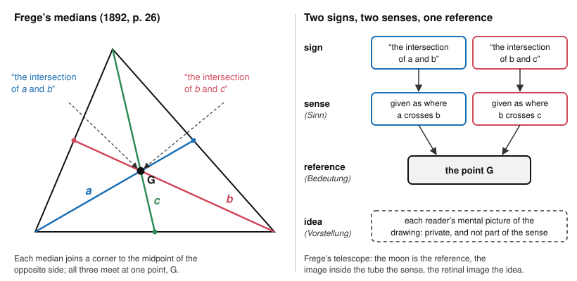

# Philosophy of Language and Logic · Lesson 1.1: Frege's puzzle: sense and reference

> ⏱ ~15 min · Module 1: Sense, reference, and descriptions · Builds on: [`mathematical-logic` 2.2](../../mathematical-logic/lessons/02-02-structures-satisfaction.md), [`philosophical-method` 1.4](../../philosophical-method/lessons/01-04-argument-forms-and-formal-fallacies.md) · Unlocks: [1.2](01-02-belief-reports-and-empty-names.md), [1.3](01-03-russells-theory-of-descriptions.md)

## Why this matters

In [`mathematical-logic` 2.2](../../mathematical-logic/lessons/02-02-structures-satisfaction.md) the clause for identity took one line: $t_1 = t_2$ is true in a structure when the two terms denote the same element. So a true $c = d$ is made true by exactly the fact that makes $c = c$ true, yet only one of them can be a discovery: Gottlob Frege's example is astronomy's finding that the sun rising each morning is always the same sun. A semantics that gives each word only its object cannot tell that discovery from "the sun is the sun". Frege's repair in 1892, sense and reference, founded the philosophy of language.

## The idea

Draw a triangle and the three lines $a$, $b$, $c$ joining each corner to the midpoint of the opposite side. "The point where $a$ crosses $b$" and "the point where $b$ crosses $c$" pick out one point: that is a theorem. You can understand both phrases without knowing it, and learning it is learning geometry, not a fact about labels. For Frege, each phrase has a [reference](../reference.md#reference) (*Bedeutung*), the point, and a [sense](../reference.md#sense) (*Sinn*), the way it presents the point: his [mode of presentation](../reference.md#mode-of-presentation) (*Art des Gegebenseins*, "manner of being given"). Same reference, two senses: that is why the identity tells you something. Why a true "$a = b$" can be informative when "$a = a$" is not is [Frege's puzzle](../reference.md#freges-puzzle).

A sense is not a picture in anyone's head. Frege separates it from the [idea](../reference.md#idea-sense-and-reference) (*Vorstellung*), the private image a word calls up. Someone watches the moon through a telescope. The moon is the reference. The real image that the lens forms inside the tube is the sense: one-sided, dependent on where you stand, yet objective, since several observers could use it. Each observer's retinal image is the idea.

The library already uses the split: Place and Smart's reply that "lightning" and "electric discharge" differ in meaning yet pick out one thing ([`philosophy-of-mind` 2.1](../../philosophy-of-mind/lessons/02-01-behaviourism-and-the-identity-theory.md), Example 2) is sense and reference at work, and [`philosophy-of-mind` 1.3](../../philosophy-of-mind/lessons/01-03-the-knowledge-argument.md)'s "old fact, new mode" stretches "mode of presentation" to ways of thinking. This lesson owns the original.

## Source

Frege, "Über Sinn und Bedeutung", *Zeitschrift für Philosophie und philosophische Kritik* 100 (1892), pp. 25–26 (lesson's translation, from the 1892 text in modernised spelling):

> Equality challenges reflection with questions that are not altogether easy to answer. Is it a relation? A relation between objects? Or between names or signs for objects? The last is what I assumed in my *Begriffsschrift*. […] $a = a$ and $a = b$ are evidently sentences of different cognitive value: $a = a$ holds a priori and, following Kant, is to be called analytic, while sentences of the form $a = b$ often contain very valuable extensions of our knowledge and cannot always be justified a priori. […] It is natural, then, to think of there being connected with a sign (name, combination of words, written mark), besides what it designates, which may be called the reference [*Bedeutung*] of the sign, also what I should like to call the sense [*Sinn*] of the sign, wherein the mode of presentation [*Art des Gegebenseins*] is contained.

Three moves: a trilemma, a datum, a proposal. The datum's hedges decide a lot: "often" and "cannot always" mean cognitive value is not the line between a priori and empirical, and the medians identity, a theorem, comes in the same paragraph as an example of real knowledge. "May be called" marks a stipulation: in everyday German *Bedeutung* means "meaning". (A footnote says *Gleichheit*, "equality", means identity.)

## The argument

Frege argues by elimination. Let $a$ and $b$ be names and suppose "$a = b$" is true.

**P1. The datum.** A true "$a = a$" and a true "$a = b$" can differ in [cognitive value](../reference.md#cognitive-value) (*Erkenntniswert*, in modern spelling). *In words:* one is trivial, the other can be a discovery.

**P2. Not the objects.** If an identity sentence related only the objects its names designate, a true "$a = b$" would say what "$a = a$" says: that a thing is itself. *In words:* if only the referents counted, the two sentences would say the same.

**P3. Not the signs.** If "$a = b$" said that the signs "$a$" and "$b$" designate the same thing (Frege's own view in *Begriffsschrift*, 1879, §8), it would hold only through each sign's link to its bearer, which is arbitrary. It would then concern our way of designating, not the thing, and express no proper knowledge. *In words:* a fact about our labels is not what astronomers discover.

**P4. Exhaustion.** A difference in cognitive value must come from what the sentences' parts contribute: their referents, the signs as marks (but signs differing only in shape leave the two alike), or the way each sign presents its referent. *In words:* three places to look, two of them empty.

**∴ C.** A sign contributes, besides its referent, a mode of presentation, its sense; "$a = b$" is informative because "$a$" and "$b$" share a reference and differ in sense. *In words:* two routes, one destination, and the identity says the routes meet.

The form is modus tollens twice, then disjunctive syllogism ([`philosophical-method` 1.4](../../philosophical-method/lessons/01-04-argument-forms-and-formal-fallacies.md)). *Begriffsschrift* §8 already had one content fixed in two "ways of determining" (*Bestimmungsweisen*), each with its own name; 1892 moves that difference from a fact about names into what each name expresses.

**Compositionality, twice.** [Compositionality](../reference.md#compositionality) now holds at each level. *Of sense:* the sense of a complex is fixed by its parts' senses and their arrangement. *Of reference:* the reference of a complex is fixed by its parts' references, so swapping a part for a co-referring one leaves the whole's reference unchanged. *In words:* a co-referring swap preserves reference and may change sense. Frege names neither principle but uses both (pp. 33, 35), citing Leibniz's formula, interchange [*salva veritate*](../reference.md#substitutivity-salva-veritate), for the second. It is the semantic twin of [Leibniz's law](../../metaphysics/lessons/05-03-coincidence-and-the-ship-of-theseus.md), which is why it cannot capture what "$a = b$" teaches.

**Sentences.** A declarative sentence's sense is a [thought](../reference.md#thought-fregean) (*Gedanke*): not the act of thinking but its objective content, which many can share. The thought is not the sentence's reference. In "the morning star is a body illuminated by the sun", put "the evening star" for "the morning star" (*Morgenstern*, *Abendstern*: Frege's pair, which [`metaphysics` 3.1](../../metaphysics/lessons/03-01-kinds-of-necessity.md) met as Hesperus and Phosphorus): someone who did not know they are one planet could take one thought for true and the other for false. What stays fixed under such swaps is the truth value. And we ask whether a part has a reference exactly when we care whether the whole is true: "Odysseus was set ashore at Ithaca while sound asleep" has a sense whether or not "Odysseus" names anyone ([1.2](01-02-belief-reports-and-empty-names.md) takes this up). So the [reference of a sentence](../reference.md#reference-of-a-sentence) is its truth value, the True or the False (*das Wahre*, *das Falsche*), which Frege counts as objects: [`mathematical-logic` 1.2](../../mathematical-logic/lessons/01-02-semantics-truth-tables.md)'s $T$ and $F$. The cost he accepts: all true sentences co-refer, and in the reference "everything particular is blurred" (lesson's translation).

**Predicates.** A predicate refers too, to a [concept](../reference.md#concept-and-object), which Frege calls predicative and "unsaturated" (*ungesättigt*), unlike an object. Hence his jarring "the concept *horse* is not a concept" ("Über Begriff und Gegenstand", 1892, p. 196; lesson's translation): "the concept *horse*" is a name, so it designates an object. Whether this commits him to universals is [`metaphysics` 1.3](../../metaphysics/lessons/01-03-universals-the-realists-case.md)'s question.

**Where the argument is weakest.** P4, which turns P1's datum into a fact about what the words contribute. [Millians](../reference.md#millianism) such as Nathan Salmon (*Frege's Puzzle*, 1986) and Scott Soames deny that step: a name contributes only its bearer, so the two sentences express one proposition, and the difference lies in how a speaker takes it in (Salmon's "guises") or in what an utterance conveys pragmatically ([3.4](03-04-indexicals-and-the-return-of-freges-puzzle.md)). The Fregean replies that someone who understands "$a = b$" and accepts it on good authority learns what "$a = a$" cannot teach, and explaining what understanding delivers is a theory of meaning's job. The Millian answers that guises are how speakers think, not what sentences mean. The Millian concedes that cognitive value needs explaining somewhere; the Fregean concedes, in Frege's own footnote (Example 2), that ordinary names have no single sense across speakers. In the 2020 PhilPapers Survey's target faculty, of 1,269 who answered, about 36% accepted or leaned Fregean on proper names and about 39% Millian (Bourget and Chalmers, 2023).

## The picture

Two signs, two senses, one point $G$; a reader's mental picture of the drawing belongs to the reader, not to the sense.

## Worked examples

**Example 1 (clean case: "Deep Throat was Mark Felt").** During Watergate, Bob Woodward of the *Washington Post* relied on a secret source the paper called "Deep Throat". On 31 May 2005 a *Vanity Fair* article by the lawyer John D. O'Connor revealed that the source was W. Mark Felt, associate director of the FBI in 1972–73, and Woodward confirmed it.

- *Senses.* "Deep Throat" presented the man as Woodward's anonymous Watergate source; "Mark Felt" presented him as the FBI's second-ranking official. Two modes of presentation, one reference.

- *Cognitive value.* "Deep Throat was Deep Throat" taught nobody anything; "Deep Throat was Mark Felt" answered a question open for 33 years.

- *The rejected readings.* As a relation between the man and himself (P2), the news is a triviality. As a fact about names (P3), it concerns a nickname that could have been any word. What readers learned was about the FBI in 1972: its number two had been the leak.

**Example 2 (hard case: Frege's "Aristotle" footnote).** Frege concedes (p. 27, note) that for a genuine proper name such as "Aristotle" opinions about the sense may differ. One speaker takes it to be "the pupil of Plato and teacher of Alexander the Great"; another, "the teacher of Alexander the Great who was born in Stagira" (lesson's translations). They then attach different thoughts to "Aristotle was born in Stagira": for the second it follows from the name's sense, for the first it is news. Frege tolerates such wavering while the reference stays the same, but not in a demonstrative science or a perfect language.

- *Where it strains.* The same paper says a name's sense is grasped by everyone who knows the language well enough. Here speaker and hearer communicate while grasping different thoughts, so what they reliably share is the reference. The account gives no verdict on which sense "Aristotle" has in German or English.

- *What each side says.* A Fregean can let each speaker grasp a different but still objective sense, and say communication needs only senses that fix the same reference; the cost is that sense no longer says what a public sentence conveys. John McDowell (1977) and Gareth Evans defended senses for names that are not descriptions. Kripke turns the variation into an argument against descriptive senses ([3.1](03-01-against-descriptivism.md)); the Millian takes the footnote's concession to be the whole truth.

## Watch out

- **You might think** a sense is an idea, a speaker's way of picturing the thing, **but actually** it is objective and shareable: the image in the telescope, not on the retina. The noema read as a Fregean sense is Dagfinn Føllesdal's reading of Husserl ([`phenomenology-and-personalism` 1.2](../../phenomenology-and-personalism/lessons/01-02-the-anatomy-of-an-experience.md)), not Frege's doctrine.

- **You might think** the puzzle is that "$a = b$" is a posteriori, **but actually** the medians identity is a theorem that still extends knowledge. Informative is not a posteriori, a point [3.3](03-03-the-necessary-a-posteriori-and-natural-kinds.md) needs.

- **You might think** Frege separates names from descriptions, **but actually** his "proper name" (*Eigenname*) covers any expression for one object, "the intersection of $a$ and $b$" included. Russell's theory ([1.3](01-03-russells-theory-of-descriptions.md)) pulls them apart.

- **You might think** "reference" is something a speaker does, or that *Bedeutung* has one English rendering, **but actually** Frege's reference relates an expression to its object (a speaker's reference is [1.4](01-04-strawson-donnellan-and-speaker-reference.md)'s), and the renderings vary: Max Black's "reference" (1948), Herbert Feigl's "nominatum" (1949), "meaning" in the *Collected Papers* (1984), and "denotation" in Russell's "On Denoting" (1905).

## One-liner

> A true "$a = b$" can teach what "$a = a$" cannot because a sign has a sense, a public mode of presenting its referent, besides its reference; for a sentence, these are a thought and a truth value.

## Problems

**P1 (🟢)** *(Exegetical.)* Invented, written for this problem: an astronomer turns her telescope on Saturn's largest moon and says, "The largest moon of Saturn has a thick atmosphere." On Frege's 1892 view, classify each item as a sense, a reference or an idea, and say of which expression. For (vi), say which of the three it stands for in Frege's analogy. One line each.

(i) Titan itself.

(ii) Titan's being given as the largest of Saturn's moons.

(iii) The astronomer's memory image of a hazy orange disc.

(iv) The thought that the largest moon of Saturn has a thick atmosphere.

(v) The True.

(vi) The image that the telescope's objective lens forms inside the tube.

**P2 (🟡)** *(Reconstruct: Exegetical (a) · Evaluative (b).)*

(a) Reconstruct Frege's argument that the reference of a declarative sentence is its truth value, in numbered premises (at most six) and a conclusion, paraphrased. Then name, in one line each, the substitution principle it relies on and the work the Odysseus sentence does in it.

(b) The argument's conclusion makes every true sentence refer to the same thing. Name the premise a critic who finds that unacceptable should deny, and say what denying it costs. Two sentences, any verdict.

**P3 (🔴)** *(Counterexample: Exegetical (a) · Evaluative (b).)* In 1892 (p. 32) Frege runs a difference test: if someone who understands two sentences could take one to be true and the other false, they express different thoughts. Gareth Evans later called a version of it the "intuitive criterion of difference" (*The Varieties of Reference*, 1982). Invented, written for this problem: a home cook has bought eggplants for years and has met "aubergine" only in British recipes, where she gathers it names a vegetable used in moussaka. She is not sure that aubergines are eggplants. (They are: the words are the British and American names of one vegetable.)

(a) Apply the test to "Aubergines are eggplants" and "Eggplants are eggplants". What does it say about the two thoughts, and so about the senses of "aubergine" and "eggplant"? Two sentences.

(b) Does the test, run this way, make every pair of synonyms differ in sense? Give a reading of "understands" on which it does and one on which it does not, and say what each reading costs Frege. 150 words or fewer.

Solutions

**P1** *(Exegetical.)*

**Must hit, strict:**

- (i) Reference of "the largest moon of Saturn" (a proper name in Frege's broad sense: any expression for one object).

- (ii) Sense of "the largest moon of Saturn": its mode of presentation of Titan.

- (iii) An idea: hers alone, attached to the name, and no part of its sense.

- (iv) Sense of the whole sentence: a thought.

- (v) Reference of the whole sentence: its truth value. Titan does have a thick atmosphere, so the sentence is true.

- (vi) The sense: the image in the tube is objective but one-sided, as the moon is the reference and the retinal image the idea.

**Wrong turns:** calling (iv) the sentence's reference (the substitution argument rules that out); calling (vi) an idea because it is an image (Frege's point is that it serves several observers); calling (ii) an idea because it is "how she thinks of it" (the mode of presentation belongs to the expression and is grasped by anyone who understands it).

**Model answer:** (i) reference of "the largest moon of Saturn"; (ii) sense of that phrase; (iii) her idea; (iv) sense of the sentence, a thought; (v) reference of the sentence, its truth value (true); (vi) stands for the sense.

---

**P2** *(Exegetical (a) · Evaluative (b).)*

**Must hit, strict (a):**

- The supposition that the sentence has a reference at all.

- The substitution principle: replacing a part by an expression with the same reference leaves the reference of the whole unchanged (compositionality of reference; Leibniz's *salva veritate*, which Frege cites).

- The morning star / evening star swap, which changes the thought because someone could hold one true and the other false; so the thought is not the reference (it is the sense).

- The link between the reference of parts and truth: we look for a part's reference only when we ask whether the whole is true.

- The truth value as what survives every co-referring swap, so the reference is the truth value.

**Must hit, strict (a), the two lines:** the principle is compositionality of reference (substitution of co-referring parts); the Odysseus sentence shows that a sentence can have a sense whose truth value is in doubt exactly because a part's reference is, which ties a sentence's reference to its truth value.

**Accept:** a final premise worded as Frege's rhetorical "what else?", if the reconstruction marks it as a claim that nothing else general is invariant, not a proof.

**Must hit, any verdict (b):** name one premise (the supposition that sentences have a reference, read as treating them as names of objects; or the "nothing else is invariant" premise); say what replaces it; say what that costs.

**Wrong turns:** running the argument through "believes that", where on Frege's account the swap fails because the words shift reference ([1.2](01-02-belief-reports-and-empty-names.md)); making a fact or state of affairs the conclusion; treating Odysseus as proving that the sentence is false.

**Model answer (a):**

1. Suppose a declarative sentence has a reference.

2. Replacing a part by an expression with the same reference cannot change the reference of the whole.

3. Replacing "the morning star" by "the evening star" in "the morning star is a body illuminated by the sun" changes the thought, since someone could take one for true and the other for false.

4. So the thought is not the sentence's reference; it is the sense.

5. A sentence's reference is in question exactly when the reference of its parts is, and that is exactly when we ask about its truth: "Odysseus was set ashore at Ithaca" has a sense, and its truth value is in doubt because "Odysseus" may name no one.

6. The truth value is unchanged by every co-referring swap, and nothing else that every such sentence has is.

∴ The reference of a sentence is its truth value.

Principle: compositionality of reference (premise 2). Odysseus: premise 5.

**Model answer (b), one of several:** Deny premise 6 and say that a true sentence refers to a fact, which a co-referring swap also leaves fixed. That keeps true sentences distinct, but the critic then owes an account of when two facts are the same, and loses Frege's uniform picture of predicates as functions from objects to truth values.

---

**P3** *(Exegetical (a) · Evaluative (b).)*

**Must hit, strict (a):** if she counts as understanding both sentences, she can rationally accept "Eggplants are eggplants" and doubt "Aubergines are eggplants", so the test says the thoughts differ. The sentences differ only in one word, so by compositionality of sense the senses of "aubergine" and "eggplant" differ, although the words apply to the same vegetables.

**Must hit, any verdict (b):**

- A weak reading (competent use, the standard by which we ordinarily say she means aubergines by "aubergine") on which the test applies to her, with the result that any synonym pair someone can doubt differs in sense.

- Its cost: synonymy nearly vanishes, against Frege's own remark (p. 27) that the same sense has different expressions in different languages and even in one language.

- A strong reading (full grasp of both senses) on which whoever grasps both would see they coincide, so she does not understand "aubergine" and the test is silent.

- Its cost: the test can be applied only by someone who already knows when senses match, so it no longer independently individuates senses, and ordinary partial understanding falls outside it.

**Wrong turns:** saying the words differ in what they apply to; calling her doubt irrational; recasting the case as a belief report and appealing to indirect reference (the test concerns her attitudes to the sentences, not a report of them); treating either reading as obviously correct.

**Model answer (b), one of several:** It depends on "understands". On a weak reading, understanding is competent use: she uses "aubergine" well enough for us to report her beliefs with it. Then she meets the test's condition, and since for almost any synonym pair someone so placed can doubt the identity, almost no two expressions share a sense. That contradicts Frege's own remark that one sense can have several expressions within one language. On a strong reading, understanding is full grasp of each sense; whoever grasped both would see they coincide, so she fails the condition and synonyms survive. But then applying the test presupposes knowing whether the senses match, so it cannot independently show when they differ, and it leaves out the partial understanding that ordinary speakers actually have.

## Connections

- **Backward:** [`mathematical-logic` 2.2](../../mathematical-logic/lessons/02-02-structures-satisfaction.md)'s clause for "=" is a semantics with reference alone, which is why it cannot see the puzzle, and the truth values of [`mathematical-logic` 1.2](../../mathematical-logic/lessons/01-02-semantics-truth-tables.md) are Frege's sentence references. The argument's forms are [`philosophical-method` 1.4](../../philosophical-method/lessons/01-04-argument-forms-and-formal-fallacies.md)'s.

- **Forward:** [1.2](01-02-belief-reports-and-empty-names.md) applies sense to "believes that", where substitution fails, and to names like "Odysseus" with no bearer. [1.3](01-03-russells-theory-of-descriptions.md) gives Russell's rival, which he introduced in 1905 by disputing Frege's distinction, rendered there as "meaning" and "denotation". [3.1](03-01-against-descriptivism.md) turns Kripke against descriptive senses, and [3.4](03-04-indexicals-and-the-return-of-freges-puzzle.md) shows the puzzle returning for Millians and for "I" and "now".

- **Sideways:** Husserl's equilateral and equiangular triangle in [`phenomenology-and-personalism` 1.2](../../phenomenology-and-personalism/lessons/01-02-the-anatomy-of-an-experience.md) is a cousin of the medians: two general terms true of the same figures, not two names for one point. Compositionality as a property of a semantics is [`programming-languages` 2.3](../../programming-languages/lessons/02-03-denotational-semantics-and-fixed-points.md)'s, where a construct's denotation is built from its parts' denotations, Frege's reference level. Stump and Kretzmann apply the morning and evening star to divine simplicity ([`philosophy-of-religion` 1.4](../../philosophy-of-religion/lessons/01-04-eternity-immutability-and-simplicity.md)). Twin Earth asks whether what a thinker grasps fixes what she refers to, and narrow content ([`philosophy-of-mind` 4.3](../../philosophy-of-mind/lessons/04-03-externalism-narrow-content-and-the-extended-mind.md)) is one way to keep a grasped content without that guarantee.
