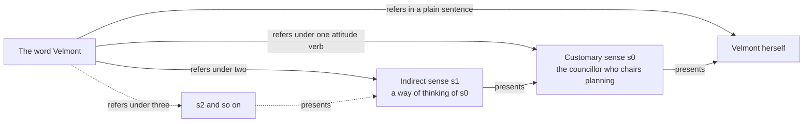

# Philosophy of Language and Logic · Lesson 1.2: Belief reports and empty names

> ⏱ ~15 min · Module 1: Sense, reference, and descriptions · Builds on: [1.1](01-01-freges-puzzle-sense-and-reference.md), [`mathematical-logic` 2.2](../../mathematical-logic/lessons/02-02-structures-satisfaction.md) · Unlocks: [1.3](01-03-russells-theory-of-descriptions.md), [3.4](03-04-indexicals-and-the-return-of-freges-puzzle.md)

## Why this matters

The *Eskerby Courier*'s restaurant column is signed "Crumb", and the town has just learned that Crumb is Councillor Velmont (an invented case, used throughout). Yesterday Bettany Lisle believed that Crumb had panned the Mill Lane café, and not that Velmont had. In [`mathematical-logic` 2.2](../../mathematical-logic/lessons/02-02-structures-satisfaction.md), swapping terms that denote one element never changed a truth value; inside "believes that" it does. And the paper's April hoax, letters from a lighthouse keeper who never lived, left readers believing things about no one.

## The idea

[1.1](01-01-freges-puzzle-sense-and-reference.md) gave every name a [sense](../reference.md#sense), a [mode of presentation](../reference.md#mode-of-presentation) of its [reference](../reference.md#reference), and argued that a sentence's reference is its truth value because the truth value survives swapping parts that co-refer.

Quote someone directly and your words name *words*: "Bettany said, 'Crumb is cruel'" is about a phrase. Report her belief indirectly, "Bettany believes that Crumb is cruel", and Frege says your words name *senses*, the ways of thinking her thought is built from. That is [indirect reference](../reference.md#indirect-reference). In a programmer's terms, "believes that" receives its clause unevaluated, as a thought, not a truth value. Swapping "Crumb" for "Velmont" there swaps one sense for another, so the report's truth value can change while identity stays intact.

The same tool handles [empty names](../reference.md#empty-name). "Odysseus" has a sense, so a sentence about him expresses a thought; if the name refers to nothing, the sentence has no truth value. Yet "Bettany believes that Odysseus reached Ithaca" can be true, because there "Odysseus" refers to its sense, which exists. The price: a word that refers to a sense needs a further sense to present it, and each added "believes that" another: a threatened [hierarchy of senses](../reference.md#hierarchy-of-senses).

Frege's [indirect context](../reference.md#indirect-context) (*ungerade*, often "oblique"), Quine's [referential opacity](../reference.md#referential-opacity) ([2.5](02-05-de-re-modality-and-quines-challenge.md)) and the "opaque context" of [`metaphysics` 5.3](../../metaphysics/lessons/05-03-coincidence-and-the-ship-of-theseus.md) name one phenomenon; indirect reference is one explanation of it.

## Source

Frege, "Über Sinn und Bedeutung", *Zeitschrift für Philosophie und philosophische Kritik* 100 (1892), p. 28 (lesson's translation, from the 1892 text in modernised spelling):

> If words are used in the customary way, what one wants to speak of is their reference (*Bedeutung*). But it can also happen that one wants to speak of the words themselves or of their sense (*Sinn*). The first happens, for example, when one cites another's words in direct speech. One's own words then refer in the first place to the other's words, and only these have the customary reference. We then have signs of signs. [...] In indirect (*ungerade*) speech one speaks of the sense of, for example, another's speech. It is clear from this that in this way of speaking too the words do not have their customary reference but refer to what is customarily their sense. [...] We therefore distinguish the customary reference of a word from its indirect reference, and its customary sense from its indirect sense. The indirect reference of a word is accordingly its customary sense.

Three phrases decide it. "Refer to what is customarily their sense" is the thesis. "The sense of ... another's speech" says whose sense: the original speaker's. "Its customary sense from its indirect sense" grants an indirectly used word a further sense of its own, where the hierarchy enters. Example 2 pulls the first two apart.

## The argument

Frege takes the test from Leibniz, whom he quotes (*Grundlagen* §65, 1884; differently worded in 1892, p. 35): "Eadem sunt, quorum unum potest substitui alteri salva veritate", things are the same when one can replace the other with truth preserved.

**F1. [Substitutivity *salva veritate*](../reference.md#substitutivity-salva-veritate).** If $a$ and $b$ have the same reference, replacing $a$ by $b$ in a sentence leaves its truth value unchanged. *In words:* co-referring parts swap freely. In first-order logic it is a theorem: if $\mathcal M \models a = b$, then $\mathcal M \models \varphi[x := a]$ iff $\mathcal M \models \varphi[x := b]$, with $\varphi[x := t]$ the substitution of [`mathematical-logic` 2.1](../../mathematical-logic/lessons/02-01-quantifiers-syntax.md).

**P1. [Compositionality](../reference.md#compositionality) of reference.** A sentence's truth value is fixed by the references of its parts ([1.1](01-01-freges-puzzle-sense-and-reference.md)). *In words:* F1 is what this principle says about swapping.

**P2. The data.** Some [belief report](../reference.md#belief-report) "$A$ believes that $\ldots a \ldots$" is true while "$A$ believes that $\ldots b \ldots$" is false, though $a = b$ is true. Frege's case: someone unaware that the evening star is the morning star could take a thought about one as true and the matching thought about the other as false (p. 32). *In words:* a believer can accept a thought under one name and not another.

**P3. Indirect reference.** In indirect speech, and in the clauses after "believes", "says" and their kin, a word refers to its customary sense, and the clause refers to its customary sense, a [thought](../reference.md#thought-fregean). *In words:* a belief report relates a believer to a thought built from senses.

**∴ C1.** In P2, "$a$" and "$b$" do not co-refer inside the clause, since their senses differ, so P2 is no counterexample to F1. *In words:* the failed swap exchanged two different things.

**P4. Sense without reference.** A name can have a sense and no reference. "The least convergent series" provably has none (p. 28); whether "Odysseus" has one is doubtful (p. 32). *In words:* grasping a sense does not guarantee an object.

**P5. The gap rule.** Sentences containing names without reference have a sense but no reference (p. 32): a part in customary position with no reference leaves the whole without a truth value. *In words:* no referent, no truth value. This infectious scheme has the tables of Bochvar (1938), later called [Weak Kleene](../reference.md#weak-kleene).

**∴ C2.** "Odysseus was set ashore at Ithaca while sound asleep" expresses a thought and, if "Odysseus" refers to nothing, has no truth value: a [truth-value gap](../reference.md#truth-value-gap), not falsity. *In words:* a story sentence is understood but neither true nor false.

**∴ C3.** (P3, P4) In "$A$ believes that Odysseus was set ashore at Ithaca", "Odysseus" refers to its sense, which exists, so the report can be true. *In words:* a belief about nothing is still a relation to a thought.

Why want reference? For an epic heard as art, sense suffices; "the striving for truth" (lesson's translation) drives us on to reference (p. 33).

**P6.** Whatever refers does so through a sense that presents its referent ([1.1](01-01-freges-puzzle-sense-and-reference.md)). Write $r_n(\alpha)$ and $s_n(\alpha)$ for what expression $\alpha$ refers to and expresses under $n$ attitude verbs. P3 and P6 give

$$r_0(\alpha) = \text{the customary referent}, \qquad r_{n+1}(\alpha) = s_n(\alpha), \qquad s_n(\alpha) \text{ presents } r_n(\alpha).$$

**∴ C4.** In "Ingrith doubts that Bettany believes that Crumb is cruel", "Crumb" refers to $s_1$, its indirect sense, which presents $s_0$; one more verb needs $s_2$, and nothing stops the climb. *In words:* each layer of reporting needs a new way of thinking of the last. The objection: every word then carries infinitely many senses, none intelligible beyond the first two (IEP, "Opacity, Referential"). Alonzo Church (1951) formalized the full hierarchy; Michael Dummett (1973) tried to make do with customary senses alone, Terence Parsons (1981) to stop at the second level. Carnap (*Meaning and Necessity*, 1947, §30) objected to the shifting itself.

Two rivals, previewed. Russell (1905) denies P4 for names of non-entities: "Apollo" means "what the classical dictionary tells us is meant by" it (p. 491), so the Odysseus sentence is false ([1.3](01-03-russells-theory-of-descriptions.md)); Quine's "nothing pegasizes" is that move ([`metaphysics` 1.1](../../metaphysics/lessons/01-01-existence-and-ontological-commitment.md)). Quine ("Quantifiers and Propositional Attitudes", 1956) split reports into [notional and relational](../reference.md#relational-and-notional-belief): "Ralph believes that someone is a spy" against "someone is such that Ralph believes he is a spy" (Ralph's suspect is, unknown to him, the respectable Bernard J. Ortcutt). The relational form binds from outside a place P3 says refers to a sense: [quantifying in](../reference.md#quantifying-in), [2.5](02-05-de-re-modality-and-quines-challenge.md)'s problem.

**Where the argument is weakest.** P3. Donald Davidson ("On Saying That", 1969) objected that, free of Frege's theory, no one would think words in a that-clause refer to anything but what they always refer to: [semantic innocence](../reference.md#semantic-innocence). In "Bettany believes that Crumb is cruel, and she is", "she" picks up Velmont herself from an antecedent P3 says refers to a sense. The strongest reply: sameness of reference across the clause boundary is too theoretical for intuition to detect, and whether such pronouns support it is open (SEP, "Propositional Attitude Reports"); Graeme Forbes keeps innocence by making the verb, not the name, sensitive to sense. The Fregean concedes that the classic theory relativizes reference and owes an answer on the hierarchy; the innocent theorist, that she owes another account of why the swap fails, which Millians give with guises and pragmatics ([3.4](03-04-indexicals-and-the-return-of-freges-puzzle.md)).

## Reference by depth

Each attitude verb above the word moves its reference one step up an unfinished chain of senses.

## Worked examples

**Example 1 (clean case: the columnist).** Take three sentences.

> (1) Bettany believes that Crumb panned the café. (true)
>
> (2) Crumb is Councillor Velmont. (true)
>
> (3) Bettany believes that Councillor Velmont panned the café. (false)

- In (2) both names stand in customary position and refer to Velmont: true.

- In (1) and (3) each refers to its customary sense: roughly, the writer of the *Courier*'s restaurant column, and the councillor who chairs the planning committee.

- The senses differ, so the clauses refer to different thoughts, and P1 lets (1) and (3) differ. Bettany holds only the first.

- The account licenses swapping same-sense expressions: a German report of her belief is true for the same reason (1) is.

Were the report a relation between Bettany and the object, (1) and (3) would agree in every model where the names co-refer (F1). Something must be added: senses, or a richer report (3.4).

**Example 2 (hard case: whose sense?).** Ingrith Lowther knows Velmont only as the councillor who chairs planning, and believes that she will block the bypass. Wynne Merriwether, a reporter who knows Velmont only as Crumb, writes: "Ingrith believes that Crumb will block the bypass." Readers, and Ingrith once told who Crumb is, take the report as accurate.

- On P3, "Crumb" refers to its customary sense, in Wynne's mouth the column-writer sense. The report then relates Ingrith to a thought she has never entertained: false.

- If the indirect referent is Ingrith's sense, the word refers to something Wynne's words do not express, and the senses of the report's words no longer fix its truth value.

Frege's footnote on "Aristotle" ([1.1](01-01-freges-puzzle-sense-and-reference.md)) tolerated different senses for one name "so long as the reference stays the same" (lesson's translation). Here the tolerance runs out: under "believes that" the reference *is* the sense. This is the [variability in sense](../reference.md#variability-in-sense) problem (Mark Richard, 1988), and Frege's account gives no verdict. A [neo-Fregean](../reference.md#neo-fregeanism) relaxes P3: Ingrith's sense need only be suitably similar to the reporter's, by a standard the context sets (Forbes; SEP). A [Millian](../reference.md#millianism) ([3.4](03-04-indexicals-and-the-return-of-freges-puzzle.md)) counts only the referent, so the report is true, but so is (3) of Example 1, whose apparent falsity then needs a pragmatic explanation.

## Watch out

- **You might think** a failed swap inside "believes that" refutes [Leibniz's law](../reference.md#leibnizs-law), **but actually** that law is about objects ([`metaphysics` 5.3](../../metaphysics/lessons/05-03-coincidence-and-the-ship-of-theseus.md)) and substitutivity is about expressions. Frege keeps both: the names do not co-refer there.

- **You might think** indirect reference is quotation, **but actually** quoted words refer to words, indirect ones to senses, which is why translation preserves an indirect report and destroys a quotation.

- **You might think** Frege calls the Odysseus sentence false, meaningless or third-valued, **but actually** it expresses a thought and, if "Odysseus" names no one, lacks a truth value: an absence, not a third value.

- **You might think** "believes that" always blocks substitution, **but actually** Quine's relational reading lets it through: "Velmont is someone Bettany believes panned the café" is true.

## One-liner

> Under "believes that" a word refers to its customary sense, so co-referring names cannot be swapped there and a belief about Odysseus can be true when no sentence about him is, at the price of a new sense for every level of embedding.

## Problems

**P1 (🟢)** *(Exegetical.)* Four occurrences of "Velmont" are numbered in three invented sentences.

> (i) Velmont¹ believes that Velmont² will win the vote.
>
> (ii) Bettany told the *Courier*, "Velmont³ will lose."
>
> (iii) Ingrith doubts that Bettany believes that Velmont⁴ will lose.

For each numbered occurrence, say whether it stands in customary position, in indirect position (and how deep), or inside quotation marks, and what it refers to there on Frege's 1892 account. One line each.

**P2 (🟡)** *(Apply to a hard case: Exegetical (a) · Evaluative (b).)* Invented, written for this problem: in April the *Courier* printed letters signed "Captain Hask", supposedly a retired keeper of the Skerry Light. The staff invented him; no such person ever existed. Sabeline Corvo believes that Captain Hask kept the Skerry Light for thirty years.

(a) On Frege's 1892 account, is each sentence true, false, or without a truth value? One line each, with the reason.

> (1) Captain Hask kept the Skerry Light for thirty years.
>
> (2) Sabeline believes that Captain Hask kept the Skerry Light for thirty years.
>
> (3) Sabeline believes that Captain Hask kept the Skerry Light for thirty years, and Captain Hask did not keep it.
>
> (4) The *Courier* printed letters signed "Captain Hask".

(b) Sabeline takes the bus to the lighthouse to find him. Does Frege's account, as stated for indirect speech and that-clauses, give "Sabeline is looking for Captain Hask" a truth value? Say where it stops, and what each way of extending it costs. 150 words or fewer.

**P3 (🔴)** *(Find the crux: Exegetical (a) · Evaluative (b).)* Frege holds that "Odysseus was set ashore at Ithaca while sound asleep" expresses a thought and, if "Odysseus" refers to nothing, has no truth value. Russell ("On Denoting", *Mind* 14, 1905) holds that it is false: such a name abbreviates a description, so the sentence says that exactly one thing fits the description and that thing was set ashore asleep, and nothing fits.

(a) Name the single claim about what "Odysseus" contributes to the sentence that Frege affirms and Russell denies, stated as a sentence one would sign and the other refuse. Two sentences.

(b) Against views like Frege's, Russell (p. 484) imagines the King in *The Tempest* saying "If Ferdinand is not drowned, Ferdinand is my only son." The statement, he says, "would nevertheless have remained true if Ferdinand had been in fact drowned", when (he assumes) "my only son" would denote nothing. Does the case tell against Frege's verdict on the Odysseus sentence? Say what a Fregean can reply and what the reply costs. Any verdict; 150 words or fewer.

Solutions

**P1** *(Exegetical.)*

**Accept:** for ⁴, "its indirect sense", "the sense it expresses in 'Bettany believes that Velmont will lose'", or $s_1$; for ³, "the word" or "the name 'Velmont'".

**Must hit, strict:**

- ¹: customary position; Velmont herself.

- ²: indirect, one verb deep; its customary sense $s_0$, a part of the thought Velmont believes.

- ³: inside direct speech; the word "Velmont", a sign of a sign (p. 28), neither the councillor nor a sense.

- ⁴: indirect, two verbs deep ("doubts", "believes"); its indirect sense $s_1$, a way of thinking of $s_0$.

**Wrong turns:** calling ³ indirect because Bettany "told" the paper something: the quotation marks make it direct speech. Giving ⁴ the customary sense, which ignores the second verb, the very step the hierarchy is about. Giving ¹ and ² one referent because they are one word.

**Model answer:** ¹ customary: Velmont. ² indirect, depth 1: its customary sense. ³ quoted: the word "Velmont". ⁴ indirect, depth 2: its indirect sense, which presents the customary sense.

---

**P2** *(Exegetical (a) · Evaluative (b).)*

**Must hit, strict (a):**

- (1) no truth value: "Captain Hask" stands in customary position and refers to nothing (P5).

- (2) true: under "believes that" the name refers to its customary sense, which exists, and that thought is among Sabeline's beliefs (C3).

- (3) no truth value: the first conjunct is true, but the second, the negation of (1), has none, since a sentence and its negation alike take the name's reference for granted (Frege on "Kepler", SEP "Assertion"), and the gap rule passes the gap to the conjunction. Strong Kleene ([5.3](05-03-the-liar-and-theories-of-truth.md)) agrees here: true and valueless gives no value.

- (4) true: inside quotation marks the name refers to words, and the *Courier* printed them.

**Must hit, any verdict (b):**

- Say why the account is silent: indirect reference is stated for indirect speech and its clauses, and "looking for" takes the name with no clause, so nothing says which position "Captain Hask" occupies.

- Treat it as customary: no truth value. Cost: an evident description of what she is doing lacks a truth value, and "looking for Crumb" would license "looking for Velmont", though someone can search for the columnist while avoiding the councillor.

- Treat it as indirect (the verb shifts reference, like "believes that"): true. Cost: the shift now applies with no clause in sight, and success needs extra machinery, since she is related to a sense even when what she seeks exists.

**Accept (b):** paraphrasing into a clause ("is trying to bring it about that she finds Captain Hask"), which puts the name in indirect position; say that the cost is defending the paraphrase.

**Wrong turns:** (2) with no truth value "because Hask does not exist", which ignores the shift; (3) true because an editor would print it, which is the verdict a reader expects, not Frege's; (4) with no truth value, which forgets that quoted words refer to words.

**Model answer (b), one of several:** Frege's indirect reference is defined for indirect speech: a word refers to its customary sense when it stands in a reported clause. "Looking for Captain Hask" has no clause, so the account does not say. Read the name as customary, and the sentence has no truth value, though it plainly describes her trip; worse, looking for Crumb would then be looking for Velmont. Read it as indirect, and the sentence is true, but the reference shift has been extended to a verb that takes a name directly, and her search is a relation to a sense, so a further story must say when finding someone fulfils it. Paraphrasing as "trying to bring it about that she finds Captain Hask" restores a clause and the indirect reading, at the price of defending the paraphrase.

---

**P3** *(Exegetical (a) · Evaluative (b).)*

**Must hit, strict (a):**

- The claim: "'Odysseus' is a part of the sentence whose reference the sentence's truth value depends on, so the sentence is about its bearer, if it has one." Frege affirms it (P1, P5), so no bearer means no truth value.

- Russell denies it: the name contributes a description, the sentence is a general claim, and its truth value depends on whether anything fits. In his words, he will "abandon the view that the denotation is what is concerned in propositions which contain denoting phrases" (p. 484).

**Accept (a):** the crux stated as compositionality of reference applied to the name ("a part with no reference leaves the whole with none"), if it says the name is a referring part for Frege and not for Russell.

**Must hit, any verdict (b):**

- On the gap rule the conditional, with "my only son" empty, has no truth value, against Russell's datum.

- The Odysseus sentence is atomic. The case attacks the rule for compounds, not the verdict on atomic sentences: under Strong Kleene, where a false antecedent settles a conditional, the King's conditional is true and the Odysseus sentence still has no value.

- One reply and its cost: adopt such a rule for connectives (the whole's reference then no longer needs every part's reference, so P5 is weakened); or Frege's own remedy for a logically perfect language, a stipulated reference for every name, which Russell calls "plainly artificial" and which leaves natural language untouched; or deny the datum.

**Accept (b):** noting that Russell's datum holds only with the description inside the consequent; with the description taking the whole conditional in its scope, the conditional is false when Ferdinand has drowned ([1.3](01-03-russells-theory-of-descriptions.md) on scope).

**Wrong turns:** "Frege says the sentence is meaningless" (it has a sense). "Russell gives names a sense and a reference" (his 1905 theory drops the split). "The crux is whether Odysseus existed" (both grant the case where he did not). Framing the crux as asserted against presupposed existence, which is Strawson's quarrel with Russell ([1.4](01-04-strawson-donnellan-and-speaker-reference.md)) and leaves out what Russell denies here.

**Model answer (b), one of several:** Less than it seems. Frege's rule passes a gap to any compound, so the King's conditional, with "my only son" empty, would have no truth value, and Russell is right that it would remain true. But that faults the rule for compounds. A Fregean can let a false antecedent settle a conditional, as Strong Kleene does, and the conditional comes out true while the atomic Odysseus sentence still lacks a value. The cost is that a whole's reference no longer depends on every part's reference, so Frege's argument that a sentence's reference is its truth value, and with it the gap rule, needs restating. Russell still owes what description "Odysseus" abbreviates, the demand [3.1](03-01-against-descriptivism.md) presses.

## Connections

- **Backward:** [1.1](01-01-freges-puzzle-sense-and-reference.md) supplied sense, reference and the compositionality of reference; this lesson shows where compositionality only seems to fail. Substitution of co-referring terms is a theorem of first-order logic ([`mathematical-logic` 2.1](../../mathematical-logic/lessons/02-01-quantifiers-syntax.md) for $\varphi[x := t]$, [2.2](../../mathematical-logic/lessons/02-02-structures-satisfaction.md) for the structures), and Leibniz's law with its warning about opaque contexts is [`metaphysics` 5.3](../../metaphysics/lessons/05-03-coincidence-and-the-ship-of-theseus.md)'s.

- **Forward:** [1.3](01-03-russells-theory-of-descriptions.md) treats empty names the other way, making the Odysseus sentence false. [1.4](01-04-strawson-donnellan-and-speaker-reference.md) takes up gaps and presupposition, which Frege seeds when he says a speaker asserting "Kepler died in misery" takes for granted, and does not assert, that "Kepler" refers (SEP, "Assertion"). [2.5](02-05-de-re-modality-and-quines-challenge.md) takes Quine's opacity and quantifying in, and [3.4](03-04-indexicals-and-the-return-of-freges-puzzle.md) reopens belief reports when direct reference leaves no sense to shift to.

- **Sideways:** [`philosophy-of-mind` 4.1](../../philosophy-of-mind/lessons/04-01-intentionality-and-folk-psychology.md) treats propositional attitudes as attitudes to the content a that-clause gives, the reports analysed here, and every analysis of knowledge in [`epistemology` 1.1](../../epistemology/lessons/01-01-repairing-jtb.md) contains one ("$S$ believes that $p$"). Meinong's objects and Quine's paraphrase are [`metaphysics` 1.1](../../metaphysics/lessons/01-01-existence-and-ontological-commitment.md)'s rivals for empty names, and Twardowski's content and object ([`phenomenology-and-personalism` 1.3](../../phenomenology-and-personalism/lessons/01-03-the-epoche-and-the-reductions.md), Flashback) is a psychologist's cousin of sense without reference. The programmer's "referential transparency" ([`programming-languages` 6.2](../../programming-languages/lessons/06-02-state-references-and-the-store.md)) is Quine's name for the property belief contexts lack.
