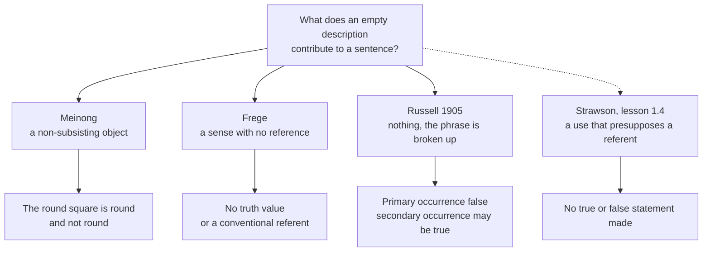

# Philosophy of Language and Logic · Lesson 1.3: Russell's theory of descriptions

> ⏱ ~15 min · Module 1: Sense, reference, and descriptions · Builds on: [1.2](01-02-belief-reports-and-empty-names.md), [`mathematical-logic` 2.3](../../mathematical-logic/lessons/02-03-translation-quantifier-order.md) · Unlocks: [1.4](01-04-strawson-donnellan-and-speaker-reference.md), [2.5](02-05-de-re-modality-and-quines-challenge.md)

## Why this matters

Lean's mathematics library, Mathlib, defines division so that $1/0 = 0$. No number was discovered: division had to be total, so a phrase that describes nothing, "the number which, multiplied by 0, gives 1", was handed a conventional value. In 1905 Russell read Frege as making the same move, a "purely conventional denotation" for phrases that denote nothing, and called it "plainly artificial". His alternative, that "the" never names anything, is the tool this course turns against Quine in [2.5](02-05-de-re-modality-and-quines-challenge.md).

## The idea

[`mathematical-logic` 2.3](../../mathematical-logic/lessons/02-03-translation-quantifier-order.md) never translated a sentence with "the", and [`mathematical-logic` 3.2](../../mathematical-logic/lessons/03-02-extensionality-to-power-set.md) left $\exists!$, "there is exactly one", unexpanded. Russell's [theory of descriptions](../reference.md#theory-of-descriptions) says that a [definite description](../reference.md#definite-description), a phrase "the so-and-so", is that $\exists!$ plus a predicate. On it, "the winner was local" makes three claims: something won, nothing else won, and it was local.

A programmer's picture: `[x] = [c for c in crews if won(c)]` succeeds only if the list has exactly one member, and "the winner was local" asserts that the unpacking succeeds and that `local(x)`. When the list is empty or long, the sentence is false, not meaningless. Being compound, it lets a "not" attach to the whole or to "was local" alone, giving two readings.

Frege ([1.1](01-01-freges-puzzle-sense-and-reference.md), [1.2](01-02-belief-reports-and-empty-names.md)) gives "the so-and-so" a [sense](../reference.md#sense) and, at best, a [reference](../reference.md#reference); an [empty name](../reference.md#empty-name) leaves its thought without a truth value. Russell gives the phrase neither: there is no constituent to refer, so nothing can fail to refer.

## Source

Russell, "On Denoting", *Mind* n.s. 14 (1905), pp. 481–482, checked against the journal's printed page:

> Now *the*, when it is strictly used, involves uniqueness; we do, it is true, speak of "*the* son of So-and-so" even when So-and-so has several sons, but it would be more correct to say "*a* son of So-and-so". Thus for our purposes we take *the* as involving uniqueness. … Thus "the father of Charles II. was executed" becomes:— "It is not always false of *x* that *x* begat Charles II. and that *x* was executed and that 'if *y* begat Charles II., *y* is identical with *x*' is always true of *y*".

Russell's idiom hides two quantifiers: "not always false of $x$" is "for some $x$" (as he defines it on p. 480), and "always true of $y$" is "for every $y$". So: something begat Charles II and was executed, and whatever begat Charles II is identical with it. The phrase "the father of Charles II" has vanished. The deciding words are "strictly used" and "for our purposes": Russell knows ordinary usage and legislates. The founding text raises the problem of [incomplete descriptions](../reference.md#incomplete-description) and sets it aside (Example 2).

## The argument

**D1. The analysis.** "The $F$ is $G$" is true if and only if

$$\exists x\,\big(F(x) \land \forall y\,(F(y) \to y = x) \land G(x)\big).$$

*In words:* something is $F$, anything that is $F$ is that very thing, and it is $G$. The first two conjuncts are `mathematical-logic`'s $\exists! x\,F(x)$ written out: uniqueness is an identity clause. Russell's 1919 form, $\exists x\,\big(\forall y\,(F(y) \leftrightarrow y = x) \land G(x)\big)$, is equivalent.

**D2. No meaning in isolation.** Denoting phrases "never have any meaning in themselves" (p. 480); in the analysed proposition the phrase "has been broken up" (p. 488). *In words:* "the" is a quantifier word, like "every", not a name.

**D3. [Primary and secondary occurrence](../reference.md#primary-and-secondary-occurrence).** Inside an operator that makes a sentence from a sentence ("not", "believes that"), a description's analysis can be unpacked outside the operator or inside it. Russell: "A *secondary* occurrence of a denoting phrase may be defined as one in which the phrase occurs in a proposition *p* which is a mere constituent of the proposition we are considering" (p. 489). With negation:

$$\text{primary (wide scope):}\quad \exists x\,\big(F(x) \land \forall y\,(F(y) \to y = x) \land \neg G(x)\big)$$

$$\text{secondary (narrow scope):}\quad \neg\exists x\,\big(F(x) \land \forall y\,(F(y) \to y = x) \land G(x)\big)$$

*In words:* "exactly one thing is $F$, and it is not $G$" against "it is not the case that exactly one thing is $F$ and it is $G$". With an attitude verb, write $\mathrm{Bel}_s[\varphi]$ for "$s$ believes that $\varphi$": the primary reading puts $\mathrm{Bel}_s[G(x)]$ inside the quantifiers, the secondary puts the whole analysis inside $\mathrm{Bel}_s$. *In words:* a belief about the thing that is in fact $F$, against a belief that whatever is uniquely $F$ is $G$. A variable bound from outside the attitude is [quantifying in](../reference.md#quantifying-in), 2.5's topic. Russell's illustration: a guest says "I thought your yacht was larger than it is", meaning the size he thought it was exceeds its actual size; the touchy owner hears a thought that its size exceeds its size. This [scope](../reference.md#scope) ambiguity is structural, unlike the lexical ambiguity behind equivocation ([`philosophical-method` 2.3](../../philosophical-method/lessons/02-03-informal-fallacies-and-when-they-arent.md)).

**T1. When scope matters.** The primary reading of "the $F$ is not $G$" entails the secondary; the converse fails; and the two are equivalent whenever $\exists! x\,F(x)$. *In words:* with "not", the readings come apart only when nothing is $F$ or more than one thing is. With "believes" they can differ even when exactly one thing is $F$, since the believer need not know which thing it is (P1). (Checked on all 340 structures with up to four objects.)

**D4. [Existence as a quantifier](../reference.md#existence-as-quantifier).** "The $F$ exists" is $\exists x\,\big(F(x) \land \forall y\,(F(y) \to y = x)\big)$, so "the $F$ does not exist" is true when nothing is $F$ or several things are. "It is only of descriptions … that existence can be significantly asserted" (*Introduction to Mathematical Philosophy*, 1919, ch. XVI). *In words:* "exists" is not a predicate of things; it says that a description is satisfied exactly once. This is Frege's view, that existence belongs to concepts, recast as a quantifier; whether existence is also a property of individuals is [`metaphysics` 2.5](../../metaphysics/lessons/02-05-essence-and-existence.md)'s dispute. The analysis also assumes, with Quine, one unrestricted quantifier, so "exists" means the same everywhere; ontological pluralists such as Kris McDaniel (*The Fragmentation of Being*, 2017) posit one quantifier per mode of being, a dispute that belongs to [`metaphysics` 1.1](../../metaphysics/lessons/01-01-existence-and-ontological-commitment.md), whose "nothing pegasizes" is this analysis applied to a name.

**D5. [Names as disguised descriptions](../reference.md#names-as-disguised-descriptions).** In 1905 "Scott" is a genuine name and "Apollo" is not: "A proposition about Apollo means what we get by substituting what the classical dictionary tells us is meant by Apollo, say 'the sun-god'" (p. 491). By "The Philosophy of Logical Atomism" (1918) names like "Socrates" are "really abbreviations for descriptions". A [logically proper name](../reference.md#logically-proper-name) (the commentators' label) means its bearer alone, so it must name an object of the speaker's acquaintance (read in [`philosophy-of-mind` 2.1](../../philosophy-of-mind/lessons/02-01-behaviourism-and-the-identity-theory.md)'s Flashback): "The only words one does use as names in the logical sense are words like 'this' or 'that.'" Russell's reason is P3's.

**The three puzzles** (p. 485). (1) George IV wished to know whether Scott was the author of *Waverley*; Scott was; substituting, George wished to know whether Scott was Scott. Solution: the proposition has no constituent "the author of *Waverley*" to substitute for, and the verbal substitution is safe only for a primary occurrence, while George's wish, as normally meant, gives a secondary one. (2) Excluded middle seems to put the present King of France among the bald or the not-bald; the solution is scope. (3) "The difference between A and B does not subsist" seems to make a non-entity a subject; the phrase denotes something only if A and B differ, so the denial needs no non-entity.

**Where the argument is weakest.** D1 as an account of what English speakers say with "the", not as a regimentation for logic. P. F. Strawson's objection ("On Referring", *Mind*, 1950; [1.4](01-04-strawson-donnellan-and-speaker-reference.md)): saying "the table is covered with books" asserts nothing about there being one table in the world, so existence and uniqueness are not part of what is asserted. The strongest reply (Stephen Neale, *Descriptions*, 1990): incompleteness afflicts every quantifier ("everyone came to the party"), so it shows that context restricts quantifier domains, not that "the" refers; Russellians add that descriptions take scope, as the yacht shows, and a term that simply refers has none. The Russellian concedes that the sentence alone does not fix truth conditions; the critic concedes that "the" interacts with "not" and "believes" as quantifiers do.

## Map of positions

Each answer has a price: the law of contradiction (Meinong, as Russell reads him), truth values (Frege), surface grammar (Russell), the tie between meaning and truth (Strawson).

## Worked examples

**Example 1 (clean case: a newspaper correction).** The *Eskerby Courier* (invented) reports: "The winner of Saturday's regatta was not an Eskerby crew." Domain: the crews entered. $W(x)$: "$x$ won Saturday's regatta"; $E(x)$: "$x$ is an Eskerby crew".

- Primary: $\exists x\,\big(W(x) \land \forall y\,(W(y) \to y = x) \land \neg E(x)\big)$.

- Secondary: $\neg\exists x\,\big(W(x) \land \forall y\,(W(y) \to y = x) \land E(x)\big)$.

| Situation | Primary | Secondary |
|---|---|---|
| Fog, race abandoned (no winner) | F | T |
| Dead heat, Eskerby and a visitor | F | T |
| One winner, a visiting crew | T | T |
| One winner, the Eskerby crew | F | F |

Fog breaks the existence clause, the dead heat the uniqueness clause (so scope matters without emptiness), and either failure falsifies the primary reading and verifies the secondary (T1). With exactly one winner the readings agree. In fog, a reader who heard "a visitor won" was misled; one who heard "no Eskerby crew won" was told the truth.

**Example 2 (hard case: an incomplete description).** At a council meeting (invented) Councillor Velmont says "The mayor arrived late", and Eskerby's mayor did. Read literally over everyone, uniqueness fails (there are thousands of mayors) and the sentence is false. Two Russellian repairs:

- *Completion:* the sentence abbreviates "the mayor of Eskerby arrived late", which is true. But which completion: "of Eskerby", "of this council", "elected in May"? Velmont need have none in mind, and no "principled basis" picks one (Devitt and Sterelny's term).

- *Domain restriction:* the quantifiers range over a domain the context supplies, as in "everyone came" (Jason Stanley and Zoltán Szabó, "On Quantifier Domain Restriction", 2000). Over the meeting's domain there is one mayor: true.

Where it strains: at a twinning ceremony the *Courier* writes, truly, "The mayor welcomed the mayor at the station". One domain holding both mayors makes both descriptions fail uniqueness: false. One holding only Eskerby's mayor says she welcomed herself: false. Only a different domain for each occurrence gets it right. Stanley and Szabó let context shift mid-sentence; Szabó (2000) and Ludlow and Segal (2004) let "the" literally mean "a", with pragmatics supplying uniqueness; Strawson's heirs say the speaker referred to two people (1.4). Without a theory of how context fixes domains, the analysis gives no verdict.

## Watch out

- **You might think** Russell calls every sentence with an empty description false, **but actually** only a primary occurrence makes it false; with a secondary occurrence under "not" the sentence is true (Example 1, fog). His 1919 warning: "Confusion of primary and secondary occurrences is a ready source of fallacies where descriptions are concerned."

- **You might think** "the $F$ is $G$" presupposes that there is exactly one $F$, **but actually** on Russell's view it entails it, so a failure of existence or uniqueness makes the sentence false. [Presupposition](../reference.md#presupposition) is Strawson's alternative ([1.4](01-04-strawson-donnellan-and-speaker-reference.md)).

- **You might think** a name and a description are one kind of expression, **but actually** in 1905 "Scott" contributes its bearer and "the author of *Waverley*" a quantified claim, which is why "Scott was the author of *Waverley*" informs and "Scott was Scott" does not (D5).

## One-liner

> "The $F$ is $G$" says that exactly one thing is $F$ and that it is $G$, so "the" names nothing; the analysis can be unpacked inside or outside "not" and "believes", and the readings differ under "not" only when nothing or several things are $F$, under "believes" even when one thing is.

## Problems

**P1 (🟢)** *(Formal (a)–(b) · Exegetical (c).)* Sabeline Corvo finds her bag slashed beside a red bicycle chained to the bakery railings and concludes that whoever owns that bicycle is a thief. She has no idea who owns it. Its one owner is Wynne Merriwether, whom Sabeline knows and believes to be honest. (Invented, written for this problem.) Take the sentence "Sabeline believes that the owner of the red bicycle is a thief", with $O(x)$ for "$x$ owns the red bicycle", $\mathrm{Thief}(x)$ for "$x$ is a thief", and $\mathrm{Bel}_s[\varphi]$ for "Sabeline believes that $\varphi$".

(a) Translate the sentence with the description at primary and at secondary occurrence relative to "believes". Show both formulas.

(b) Give each reading's truth value in the situation described. One line each.

(c) Exactly one person owns the bicycle, yet the readings differ. Why could that not happen with "it is not the case that" in place of "Sabeline believes that"? One sentence.

**P2 (🟡)** *(Formal (a)–(b) · Exegetical (c).)* A reader's letter to the *Eskerby Courier* (invented, written for this problem) argues:

> 1. The founder of the *Courier* was not born in Eskerby.
>
> 2. Bettany Lisle founded the *Courier*.
>
> 3. So Bettany Lisle was not born in Eskerby.

Write $\mathrm{Fo}(x)$ for "$x$ founded the *Courier*", $B(x)$ for "$x$ was born in Eskerby" and $b$ for Bettany Lisle; premise 2 is $\mathrm{Fo}(b)$.

(a) Translate premise 1 with the description at primary and at secondary occurrence relative to "not".

(b) Show that the argument is valid on one reading (give the derivation and name the step that uses the uniqueness clause) and invalid on the other (show a countermodel: domain, extensions, referent of $b$).

(c) Which reading does the argument need, and which clause of Russell's analysis fails in every countermodel? One sentence each.

**P3 (🔴)** *(Counterexample: Exegetical (a) · Evaluative (b).)* Russell, *Introduction to Mathematical Philosophy* (1919), ch. XVI: "We may inquire significantly whether Homer existed, which we could not do if 'Homer' were a name." In "The Philosophy of Logical Atomism" (1918) he concludes that the only words used as names in the strict logical sense are words like "this" and "that", used for a present object of sense.

(a) Reconstruct the argument from the Homer sentence to that conclusion in four or five numbered premises and a conclusion.

(b) After a camera flash in a dark room, Ingrith Lowther sees a green after-image on the wall and says "This is fading". (Invented, written for this problem.) Run Russell's test on her "this", and on "Ingrith" as her friends use it. Is the pair of verdicts a counterexample to the test or the result Russell intended? Say which premise of (a) you would deny to keep "Ingrith" a genuine name, and what you must then say about "Homer did not exist". 150 words or fewer.

Solutions

**P1** *(Formal (a)–(b) · Exegetical (c).)*

(a) Primary (description outside the belief):

$$\exists x\,\big(O(x) \land \forall y\,(O(y) \to y = x) \land \mathrm{Bel}_s[\mathrm{Thief}(x)]\big)$$

Secondary (description inside):

$$\mathrm{Bel}_s\big[\exists x\,\big(O(x) \land \forall y\,(O(y) \to y = x) \land \mathrm{Thief}(x)\big)\big]$$

(b) Secondary: true, since what Sabeline believes is the general proposition that exactly one person owns the bicycle and that person is a thief. Primary: false, since the one owner is Wynne, and Sabeline does not believe of Wynne that she is a thief; Sabeline believes Wynne honest and does not know that Wynne owns it.

(c) Negation is truth-functional, so once exactly one thing is $O$ both readings say only that this thing is not a thief (T1); whether a belief holds depends on how the believer thinks of the thing, not just on which thing it is.

**Must hit, strict:**

- Both formulas, each with the existence, uniqueness and predication clauses, and $\mathrm{Bel}_s$ placed around $\mathrm{Thief}(x)$ alone (primary) or around the whole analysis (secondary).

- Secondary T, primary F.

- (c): negation is truth-functional (extensional); "believes" is not.

**Wrong turns:** writing $\mathrm{Bel}_s[\mathrm{Thief}(w)]$ with a name for Wynne, which translates a different sentence and imports Frege's problem from 1.2; judging the primary reading true because "the owner" is Wynne and Sabeline believes "the owner" is a thief, which slides from the secondary to the primary reading (George IV's slide); saying the readings differ because the description is empty, when it has exactly one satisfier.

**Model answer:** (a) as above. (b) Secondary T: she believes that exactly one person owns the bicycle and is a thief. Primary F: the owner is Wynne, and Sabeline does not believe of Wynne that she is a thief. (c) "Not" is truth-functional, so with exactly one owner both readings reduce to "that person is not a thief"; "believes" is sensitive to how the believer picks the thing out.

---

**P2** *(Formal (a)–(b) · Exegetical (c).)*

(a) Primary: $\exists x\,\big(\mathrm{Fo}(x) \land \forall y\,(\mathrm{Fo}(y) \to y = x) \land \neg B(x)\big)$. Secondary: $\neg\exists x\,\big(\mathrm{Fo}(x) \land \forall y\,(\mathrm{Fo}(y) \to y = x) \land B(x)\big)$.

(b) **Valid on the primary reading.**

1. $\mathrm{Fo}(a) \land \forall y\,(\mathrm{Fo}(y) \to y = a) \land \neg B(a)$, for a witness $a$ (existential elimination on premise 1).

2. $\mathrm{Fo}(b) \to b = a$ (universal instantiation of the uniqueness clause at $b$).

3. $b = a$ (from 2 and premise 2). This is the step that uses uniqueness.

4. $\neg B(b)$ (from $\neg B(a)$ and 3, by substitution of identicals).

$a$ does not occur in the conclusion, so existential elimination discharges it.

**Invalid on the secondary reading.** Domain $\{\text{lisle}, \text{velmont}\}$; $\mathrm{Fo} = \{\text{lisle}, \text{velmont}\}$; $B = \{\text{lisle}\}$; $b$ denotes lisle. Premise 1 (secondary) is true, since no single thing is the founder; premise 2 is true; the conclusion $\neg B(b)$ is false. (Premise 1 on the primary reading is false here, as T1 requires.)

**Accept:** any model in which $b$ is a founder born in Eskerby and at least one other thing is a founder. Every countermodel has this shape: checked over all 1,252 models with up to four objects.

(c) The argument needs the primary reading. In every countermodel the uniqueness clause fails: premise 2 already guarantees that a founder exists, so the secondary premise can be true only because there are two or more founders.

**Must hit, strict:**

- Both translations of premise 1.

- A derivation whose step from $\mathrm{Fo}(b)$ to $b = a$ cites the uniqueness clause, followed by substitution of identicals.

- A countermodel with two founders, $b$ one of them and born in Eskerby.

- (c): primary; the uniqueness clause.

**Wrong turns:** a countermodel with no founder, which premise 2 rules out; concluding that scope matters only for empty descriptions; getting $b = a$ without citing uniqueness, as if "the founder" were a name.

**Model answer:** (a) as above. (b) On the primary reading, the witness is a founder, every founder is identical with it, and it was not born in Eskerby; Bettany is a founder, so by uniqueness she is the witness, and by substitution she was not born in Eskerby. On the secondary reading, let the *Courier* have two founders, Bettany (born in Eskerby) and Velmont: no single founder exists, so premise 1 is true, premise 2 is true, and the conclusion is false. (c) The primary reading; uniqueness fails in every countermodel.

---

**P3** *(Exegetical (a) · Evaluative (b).)*

**Must hit, strict (a):**

- P1. A name in the strict sense is a simple symbol whose meaning is its bearer.

- P2. So a would-be name that names nothing is "a symbol devoid of meaning" (Russell, 1919), and sentences built on it are meaningless, not merely false.

- P3. "Homer existed" and "Homer did not exist" are significant whether or not Homer existed.

- C1. So "Homer" is not a name but a disguised description.

- P4. For every ordinary name, whether its bearer exists can be significantly questioned; only for an object of present acquaintance can it not.

- C2. So only words like "this", used for an object of present acquaintance, are names in the strict sense.

**Must hit, any verdict (b):**

- Run the test: Ingrith's "this" passes on Russell's view, because the after-image is a sense-datum she is acquainted with and its existence cannot be doubted while she has it (a "this" meant for a physical spot on the wall would fail). "Ingrith" fails: her friends can significantly ask whether there is such a person.

- State the verdict, and name the premise denied to keep "Ingrith" a name: usually P2 (an empty name makes its sentences meaningless), or the step in P4 from "can be doubted" to "is a description".

- Say what then makes "Homer did not exist" meaningful and true: a sense without reference (Frege, 1.2), a claim about the name ("'Homer' refers to no one"), or another account; and name Russell's cost for comparison: his genuine names cannot be shared, since he grants that a "this" does not mean the same to speaker and hearer.

**Wrong turns:** (a) reading "significantly" as "truly"; dropping P2, the bridge from naming to meaninglessness; making the conclusion epistemic ("we cannot be sure Homer existed") rather than semantic. (b) Failing Ingrith's "this" because an after-image is not real: for Russell a sense-datum exists while it is sensed. Running Kripke's modal or epistemic arguments, which are 3.1's and do not address this test.

**Model answer (b), one of several:** Her "this" passes: the after-image is a sense-datum she is acquainted with, so asking whether it exists makes no sense while she sees it. "Ingrith" fails, since a friend could sensibly wonder whether there is such a person. That is the result Russell intended, and it is also a reductio of P2: a test that denies namehood to every name of a person has mistaken a fact about doubt for a fact about meaning. I would deny P2. A sentence with an empty name can be meaningful, because "Homer did not exist" can be read as a claim about the name, that "Homer" refers to no one, or, with Frege, as a thought with no object answering to its sense. The cost is that the semantics of names now needs a second story for the empty case, which Russell avoided at the price of names nobody can share.

## Flashback

**From Lesson [1.1](01-01-freges-puzzle-sense-and-reference.md) (Frege's puzzle: sense and reference):** *(Exegetical (a)–(c).)* A puzzle book (invented, written for this problem) prints the answer "The sum of the first ten cubes is the square of fifty-five." A reader who checks it by hand learns something; "the square of fifty-five is the square of fifty-five" would have taught her nothing. Answer on Frege's 1892 view.

(a) What do the two descriptions share, what differs, and is the discovery a posteriori? Two sentences.

(b) In "The sum of the first ten cubes is odd", put "the square of fifty-five" for the subject. Which principle says what the swap must preserve, what does it preserve here, and what may it change? Two sentences.

(c) What does "is odd" refer to, and what does "the concept *odd number*" refer to? One sentence.

Solution

**Must hit, strict (a):** one reference, 3025 ($1^3 + 2^3 + \dots + 10^3 = 3025 = 55^2$), under two senses, a sum of cubes and a square, which gives the identity its [cognitive value](../reference.md#cognitive-value). Calculation settles it, so it is a priori and still extends knowledge, like the medians theorem: informative is not a posteriori.

**Must hit, strict (b):**

- [Compositionality](../reference.md#compositionality) of reference (*salva veritate*): a co-referring swap keeps the whole's reference, its truth value, here the True, since 3025 is odd.

- The thought may change: someone who understands both sentences could accept "the square of fifty-five is odd" (odd squares are odd) and doubt the other until she has done the sum.

**Must hit, strict (c):** "is odd" refers to a [concept](../reference.md#concept-and-object), which is unsaturated; "the concept *odd number*" is a proper name, so it refers to an object, as in Frege's claim that the concept *horse* is not a concept.

**Wrong turns:** calling the discovery a posteriori because it informs; saying the swap keeps the thought, or keeps the truth value because the descriptions mean the same; making the set of odd numbers the predicate's reference (in "Function und Begriff", 1891, a concept's extension is an object and the concept is not); giving "the concept *odd number*" a concept as its reference.

**Model answer:** (a) Both refer to 3025 but present it differently, as a sum of cubes and as a square, so the identity informs; calculation settles it, so it is a priori. (b) Compositionality of reference: the swap keeps the truth value, true in both, and may change the thought. (c) A concept; an object.

## Connections

- **Backward:** the translation skills are [`mathematical-logic` 2.3](../../mathematical-logic/lessons/02-03-translation-quantifier-order.md)'s, and D1 expands the $\exists!$ of [`mathematical-logic` 3.2](../../mathematical-logic/lessons/03-02-extensionality-to-power-set.md). Russell's p. 483 summary of Frege, that "Scott is the author of *Waverley*" asserts an identity of denotation with a difference of meaning, is [1.1](01-01-freges-puzzle-sense-and-reference.md)'s answer, and [1.2](01-02-belief-reports-and-empty-names.md)'s truth-value gap for empty names is what Russell replaces with falsity.

- **Forward:** [1.4](01-04-strawson-donnellan-and-speaker-reference.md) gives Strawson's presupposition and Donnellan's referential use. [2.5](02-05-de-re-modality-and-quines-challenge.md) uses primary and secondary occurrence as Smullyan's reply to Quine; [`metaphysics` 3.1](../../metaphysics/lessons/03-01-kinds-of-necessity.md) wrote "the number of planets" as a term $n$, and its de re formula is the primary reading once $n$ is unpacked. [3.1](03-01-against-descriptivism.md) attacks names as disguised descriptions.

- **Sideways:** existence as a predicate is [`metaphysics` 2.5](../../metaphysics/lessons/02-05-essence-and-existence.md), and Quine's criterion with "nothing pegasizes", plus whether "exists" is univocal, is [`metaphysics` 1.1](../../metaphysics/lessons/01-01-existence-and-ontological-commitment.md). Acquaintance, the ground of logically proper names, is read in [`philosophy-of-mind` 2.1](../../philosophy-of-mind/lessons/02-01-behaviourism-and-the-identity-theory.md). Scope ambiguity is the structural cousin of equivocation ([`philosophical-method` 2.3](../../philosophical-method/lessons/02-03-informal-fallacies-and-when-they-arent.md)), and Mathlib's $1/0 = 0$ is a modern case of the conventional denotation Russell rejected.
