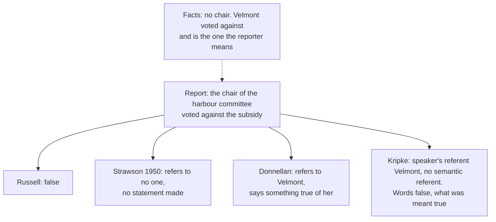

# Philosophy of Language and Logic · Lesson 1.4: Strawson, Donnellan, and speaker reference

> ⏱ ~15 min · Module 1: Sense, reference, and descriptions · Builds on: [1.3](01-03-russells-theory-of-descriptions.md), [1.2](01-02-belief-reports-and-empty-names.md) · Unlocks: [3.1](03-01-against-descriptivism.md), [4.4](04-04-speaker-meaning-and-implicature.md)

## Why this matters

Take an invented case. A town paper reports that "the chair of the harbour committee voted against the ferry subsidy." The committee has had no chair since March. The reporter meant Councillor Velmont, who runs its meetings and did vote against. Was the report false, did it say nothing, or did it only get her title wrong? Russell's theory ([1.3](01-03-russells-theory-of-descriptions.md)) answers only the first question. P. F. Strawson and Keith Donnellan forced the others, and Saul Kripke's reply separated what words refer to from what speakers refer to.

## The idea

[1.3](01-03-russells-theory-of-descriptions.md) gave Russell's [theory of descriptions](../reference.md#theory-of-descriptions): "the $F$ is $G$" says that exactly one thing is $F$ and that it is $G$, so if nothing is $F$ the sentence is false.

**Nothing fits.** Strawson says Russell runs together a sentence, which has a meaning, and a [use of a sentence](../reference.md#sentence-and-use-of-a-sentence) on an occasion, which may be about something and may be true or false. Think of a sentence as a function definition and a use as a call. Russell's analysis is total: called when there is no $F$, it returns False. Strawson's is partial: the call takes an $F$ for granted, and without one it returns no value, the way a call on an empty list raises an error. What is taken for granted is a [presupposition](../reference.md#presupposition), and the missing value is a [truth-value gap](../reference.md#truth-value-gap).

**The wrong thing fits.** Donnellan saw two uses: one is about whoever is the $F$; the other is a pointer that can work even when the person meant is not $F$. That is the [referential and attributive](../reference.md#referential-and-attributive-use) distinction. Kripke replied that speakers, with names too, can refer to something other than what their words refer to: [speaker's reference and semantic reference](../reference.md#speakers-reference-and-semantic-reference).

## Source

Russell, "On Denoting", *Mind* 14 (1905), pp. 483–484 (public domain):

> If we say "the King of England is bald," that is, it would seem, not a statement about the complex *meaning* "the King of England," but about the actual man denoted by the meaning. But now consider "the King of France is bald". By parity of form, this also ought to be about the denotation of the phrase "the King of France". But this phrase, though it has a *meaning* provided "the King of England" has a meaning, has certainly no denotation, at least in any obvious sense. Hence one would suppose that "the King of France is bald" ought to be nonsense; but it is not nonsense, since it is plainly false.

The deciding word is "since": falsity is offered as proof of sense, so having sense and being true or false go together. Strawson kept "not nonsense" and rejected "since": sense belongs to the sentence, truth to a use, and a use can fail to be about anything.

## The argument

**Strawson** ("On Referring", *Mind* 59, 1950).

**S1.** A sentence, a use of it and an utterance of it are distinct. "The king of France is wise" said under Louis XIV and under Louis XV is one sentence put to two uses, about two men. *In words:* the words stay fixed, and what they are about changes.

**S2.** A sentence's meaning is the rules for using it to refer and to say something true or false. Referring, and being true or false, belong to uses. *In words:* knowing the meaning is knowing how the sentence could be used.

**S3.** Said seriously today, it draws "There is no king of France", not "That's untrue": a reason why the question of truth does not arise, not a contradiction. *In words:* the use misfires rather than being false.

**S4.** So the use implies that there is a king of France, in what Strawson called a special and odd sense of "imply", not entailment. *In words:* existence is taken for granted, not asserted.

**∴ C.** Russell's analysis puts existence and uniqueness into what is asserted, so it misdescribes uses whose description refers to nothing: they make no true or false statement. *In words:* Russell turned a precondition into a claim.

Strawson developed this as presupposition in *Introduction to Logical Theory* (1952). Made exact, with "situation" meaning a model ([`mathematical-logic` 2.2](../../mathematical-logic/lessons/02-02-structures-satisfaction.md)):

- $S$ [entails](../reference.md#entailment) $P$ when $P$ is true in every situation in which $S$ is true.

- $S$ presupposes $P$ when $P$ is true in every situation in which $S$ is true *or false*. *In words:* if $P$ fails, $S$ has no value. If "not" leaves a gap a gap, this is equivalent to $P$ following from $S$ and from not-$S$, which is why the [negation test](../reference.md#presupposition-tests) works.

On Russell's semantics "the $F$ is $G$", $\exists x\,(Fx \land \forall y\,(Fy \to y = x) \land Gx)$, entails $\exists x\,(Fx \land \forall y\,(Fy \to y = x))$. So does its negation with the description at wide [scope](../reference.md#scope), but not with it at narrow scope. Being true or false in every situation, it presupposes only logical truths. On Strawson's semantics, with a gap unless exactly one thing is $F$, the sentence and its negation both presuppose that exactly one thing is $F$.

**Russell's reply** ("Mr. Strawson on Referring", *Mind* 66, 1957). Strawson confused descriptions with occasion-relative words like "present" (write "in 1905"), and calling the sentence "false" is verbal convenience.

**Donnellan** ("Reference and Definite Descriptions", *Philosophical Review*, 1966).

**D1.** Used attributively, a description serves to state something about whoever is the $F$. Used referentially, it is a tool that lets the audience pick out whom the speaker means, and she states something about that person. "Smith's murderer is insane" is attributive when said over Smith's body with the killer unknown, and referential when said of Jones raving at his trial. *In words:* in one use the description is essential; in the other a name would do.

**D2.** Which use is made depends on the speaker's intentions; the sentence is not semantically ambiguous. *In words:* the occasion decides, not the words.

**D3.** A referential use can pick out someone who does not fit. "Who is the man drinking a martini?" asks about the man in view even if his glass holds water. A speaker who thinks the king a usurper can still refer to him as "the king". *In words:* aiming does not need a fit.

**∴ C.** Neither Russell nor Strawson fits referential uses. A speaker whose description fits no one may still have referred to the person she meant, and said something true of her.

**Kripke** ("Speaker's Reference and Semantic Reference", *Midwest Studies in Philosophy*, 1977).

**K1.** The conventions of the language fix a designator's semantic referent (for a description, its unique satisfier). The speaker's referent is what she wishes to talk about and believes to be the semantic referent. *In words:* what the words pick out versus what she meant.

**K2.** Names show the gap too. Two people see Smith in the distance and take him for Jones: "What is Jones doing?" "Raking the leaves." "Jones" names Jones, yet they referred to Smith, and no one calls "Jones" ambiguous. *In words:* misreference needs no second meaning.

**K3.** In a language stipulated to obey Russell's theory, a [Russell language](../reference.md#russell-language), speakers would still use "the man drinking a martini" to point out a man holding water. *In words:* uses that would arise where Russell is right by fiat are no evidence against him.

**∴ C.** Donnellan's cases are speaker's reference and consistent with Russell's semantics. Kripke claimed only that they do not refute Russell.

**Where the argument is weakest.** S3, and every premise resting on judgments of what is "false", which are unstable. Stephen Neale (*Descriptions*, 1990) cites empty descriptions that sound plainly false: "My mother is dating the present king of France". Strawson himself (1964) granted that "The exhibition was visited yesterday by the king of France" is naturally called false. The strongest reply: failure leaves a gap only when the description is what the sentence is about (Strawson 1964), or the presupposition is always there and only the verdicts shift (Kai von Fintel, 2004). The Russellian concedes that "That's false" is often not what we say, and owes an account of the hesitation. The Strawsonian concedes that failure does not always leave a gap.

## Map of positions

One sentence, one set of facts, and four verdicts on what was said.

## Worked examples

**Example 1 (clean case: "stopped").** Take "Dr Hartigan has stopped prescribing the old tonic", with $U$ for "she used to prescribe it" and $N$ for "she prescribes it now". Run the [presupposition tests](../reference.md#presupposition-tests). The negation, "Dr Hartigan hasn't stopped prescribing the tonic", still conveys $U$, and now conveys $N$. The question, "Has she stopped?", still conveys $U$ and leaves $N$ open. So $U$ survives embedding and is presupposed; not-$N$ does not and is entailed. On a presuppositional analysis the sentence has a value only if $U$, and is then true just when $N$ is false.

| $U$ | $N$ | sentence | its negation |
|---|---|---|---|
| T | T | F | T |
| T | F | T | F |
| F | T | gap | gap |
| F | F | gap | gap |

$U$ is true wherever the sentence has a value; not-$N$ only wherever it is true. A conjunctive analysis ("$U$ and not $N$") makes "she hasn't stopped" true of a doctor who never prescribed it, so it must explain why the negation still conveys $U$. For descriptions the Russellian has one ready: the negation read with the description at wide scope.

**Example 2 (hard case: a referential use that fits no one).** The harbour report, with $Cx$ for "$x$ chairs the harbour committee" and $Vx$ for "$x$ voted against the subsidy".

- **Russell:** $\exists x\,(Cx \land \forall y\,(Cy \to y = x) \land Vx)$ is false, because nothing satisfies $Cx$.

- **Strawson:** in 1950, no statement. His "A Reply to Mr. Sellars" (1954) adds that where the intended reference is clear, we assess the statement amended to the speaker's guessed intention, "Velmont voted against" (true), and give the original no value.

- **Donnellan:** the use is referential, so the reporter referred to Velmont and said something true of her. Against Strawson: amending needs a referential use.

- **Kripke:** no semantic referent; speaker's referent Velmont. On Russell's semantics the words say something false; the reporter meant something true.

**Where it stops.** All four agree on every fact about the town. They disagree only over which item is "what the report said". Donnellan himself found "the statement" hard to pin down in such cases. A correction column must still choose: "the report was false", "it made no claim", or "we misdescribed Councillor Velmont". No fact about the town decides; the choice turns on what a semantic theory is a theory of.

## Watch out

- **You might think** a presupposition is whatever a speaker assumes, **but actually** this lesson's sense is semantic, a condition on a use's having a truth value. Robert Stalnaker's [pragmatic presupposition](../reference.md#pragmatic-presupposition) is a third notion, what a speaker treats as common ground, and it can fail without any gap. [4.4](04-04-speaker-meaning-and-implicature.md) uses this definition.

- **You might think** Strawson called "The king of France is wise" meaningless, **but actually** he insisted it is significant. What lacks a truth value is a use of it.

- **You might think** a referential use gives "the" a second meaning, **but actually** Donnellan denied that the sentence is semantically ambiguous. The dispute is whether the person meant is the description's semantic referent or only the speaker's.

- **You might think** a truth-value gap is a third truth value, **but actually** it is the absence of a value. Writing it as $\tfrac12$ is bookkeeping, and how a gap spreads through "not", "and" and "if" is a further choice ([5.3](05-03-the-liar-and-theories-of-truth.md) uses [Strong Kleene](../reference.md#strong-kleene) for the liar).

## One-liner

> Strawson moved truth from sentences to their uses and made a description's object a presupposition; Donnellan showed that speakers refer with descriptions that fit no one; Kripke called that speaker's reference, which leaves Russell's semantics standing.

## Problems

**P1 (🟢)** *(Apply: Exegetical.)* For each utterance (invented, written for this problem), say whether the description is used referentially or attributively on Donnellan's criterion, and what Donnellan says it refers to. One line each.

(a) A fire officer finds that a warehouse fire on the Eskerby quay was set with care at three separate points. No one is suspected yet. She says: "The person who set this fire knew the building well."

(b) At the hearing a month later, Sabeline Corvo watches the defendant, Caddick, contradict himself again and whispers to her neighbour: "The person who set this fire can't keep his story straight."

(c) Wynne Merriwether believes that the man wearing the sailing club's commodore badge lost the club election and kept the badge by fraud. Wanting a word with him, she asks the steward, who knows nothing of this: "Has the commodore arrived?"

**P2 (🟡)** *(Diagnose: Exegetical.)* Three sentences from an *Eskerby Courier* harbour column (invented, written for this problem):

> (i) Bettany Lisle regrets selling the boatyard to the council.
>
> (ii) Some of Tuesday's ferries left late.
>
> (iii) The storm sank the dredger moored off the north quay.

For each, say whether the inference below is entailed, presupposed or conversationally implicated, and name the test that shows it. One line each.

(i) Lisle sold the boatyard to the council.

(ii) Not all of Tuesday's ferries left late.

(iii) The dredger sank.

**P3 (🔴)** *(Steelman and reply: Exegetical (a) · Evaluative (b).)* At dusk two dock workers see Ingrith Lowther on the slipway and take her for Quenby, the boatwright. One asks, "What's Quenby doing?" The other answers, "Mending the nets." Lowther is mending the nets, and Quenby is at home asleep. (Invented, written for this problem.)

(a) Name the semantic referent and the speaker's referent of "Quenby" in this exchange. Give the truth value of "Quenby is mending the nets", as the words say it, and of what the second worker meant by his answer, on Kripke's account. One line each.

(b) Kripke argues from cases like this: no one thinks "Quenby" is ambiguous, so the same apparatus explains Donnellan's referential uses without making "the" ambiguous. Steelman the best reply on behalf of someone who holds that referential uses of descriptions are semantic, showing that the two cases differ in a way that matters. Then give the Kripkean's best response. 150 words or fewer.

Solutions

**P1** *(Exegetical.)*

**Must hit, strict:**

- (a) Attributive. It refers to no one: the officer states something about whoever set the fire, and if nobody set it, nothing has been said to know the building.

- (b) Referential. It refers to Caddick, whether or not he set the fire.

- (c) Referential. It refers to the man wearing the badge, though Merriwether does not believe he is the commodore. On Donnellan's criterion the speaker's belief that the description fits is not decisive (his usurper case). What makes the use referential is that she uses the description to get her hearer to pick out the man she has in mind.

**Accept (a):** "it denotes the arsonist, if there is one, but the officer refers to no one". Donnellan grants that Russell's denotation applies to both uses and reserves referring for the referential one.

**Wrong turns:** classing (b) as attributive because it is the same sentence as (a), when Donnellan's point is that one sentence admits both uses. Classing (c) as attributive, or as a failure to refer, because the speaker thinks the description false of the man. Saying (a) refers to the actual arsonist.

**Model answer:** (a) Attributive; it refers to no one and states something of whoever set the fire. (b) Referential; it refers to Caddick, guilty or not. (c) Referential; it refers to the badge-wearer, since a speaker can refer with a description she believes does not fit him.

---

**P2** *(Exegetical.)*

**Must hit, strict:**

- (i) Presupposed. It survives negation ("Lisle doesn't regret selling the boatyard") and questioning ("Does Lisle regret selling it?"). "Regrets" is a factive trigger.

- (ii) Conversationally implicated. It is cancellable without contradiction ("Some of Tuesday's ferries left late; in fact all of them did"). It is not entailed, since if every ferry left late, "some left late" is still true. [4.4](04-04-speaker-meaning-and-implicature.md) derives it as a scalar implicature.

- (iii) Entailed. It is lost under negation ("The storm didn't sink the dredger" leaves open whether it sank). It cannot be cancelled, since "the storm sank the dredger, but the dredger didn't sink" contradicts itself.

**Wrong turns:** calling (ii) an entailment because "some" seems to mean "not all". Calling (i) an entailment because it follows from the plain sentence: an unembedded presupposition follows too, and what marks it out is that it survives negation and questioning. Calling (iii) a presupposition because "the dredger" carries one: the existence of a unique dredger is presupposed, but the inference asked about, that it sank, is entailed.

**Model answer:** (i) Presupposed: it survives "Lisle doesn't regret selling the boatyard" and "Does she regret it?". (ii) Implicated: "in fact all of them did" cancels it without contradiction. (iii) Entailed: the negation drops it, and denying it alongside the sentence is a contradiction.

---

**P3** *(Exegetical (a) · Evaluative (b).)*

**Must hit, strict (a):**

- Semantic referent of "Quenby": Quenby. Speaker's referent: Lowther, whom both workers wish to talk about and believe to be Quenby.

- "Quenby is mending the nets", as the words say it: false. What the second worker meant, that the person they see (Lowther) is mending the nets: true.

**Must hit, any verdict (b):**

- State the parity argument: the names case needs the speaker's/semantic distinction anyway, and nobody posits an ambiguity in "Quenby", so by parity nothing forces one in "the".

- Steelman one real disanalogy. Either: Kripke defines the speaker's referent through a false belief that it is the semantic referent, while Donnellan's usurper speaker has no such belief, and Kripke set such cases aside for simplicity. Or: referential uses of descriptions are regular and expected rather than slips, so they look like a convention (Devitt and Reimer).

- Give the Kripkean response to the disanalogy chosen. Either a refined definition admits the usurper cases, as Kripke said it could. Or the regularity has a general pragmatic explanation that would hold in a Russell language, and the same argument would make other quantifiers referential too (Schoubye's reply).

- Say what each side concedes.

**Wrong turns:** answering with the Russell-language test alone, which supports Kripke's conclusion but is not his parity argument. Treating (b) as settled by (a). Saying "Quenby" refers to Lowther, which runs speaker's reference into semantic reference.

**Model answer (a):** Semantic referent Quenby, speaker's referent Lowther. The words say something false, and the second worker meant something true.

**Model answer (b), one of several:** Kripke's parity holds only if the description case is the names case: a speaker who misidentifies someone. Many referential uses are not like that. Donnellan's speaker calls the usurper "the king" knowing he is not, and people use descriptions to talk about particular things so regularly that, as Devitt and Reimer argue, the practice looks like a convention of the language, not a mistake about a referent. The Kripkean replies that regularity alone does not make a convention. The same Gricean pressures would produce the same regularities in a language where Russell is true by stipulation, and the argument would make "every" and "no" referential too. Kripke conceded that his definition, which requires a mistaken belief, needs refining for usurper cases. The referentialist concedes that the names case shows misreference needs no ambiguity.

## Flashback

**From Lesson [1.2](01-02-belief-reports-and-empty-names.md) (Belief reports and empty names):** *(Exegetical (a), (b).)* Invented, written for this problem: the trawler *Kittiwake* is the *Sanderling*, renamed on sale. Petherick has never heard the old name and believes that the *Kittiwake* is seaworthy. The harbour froze, and the market shut.

(a) On Frege's 1892 account, do these facts guarantee each conclusion true if its premise is? Yes or no, one line each, saying what the swapped expressions refer to there.

> (i) Petherick believes that the *Kittiwake* is seaworthy. ∴ Petherick believes that the *Sanderling* is seaworthy.
>
> (ii) The harbour froze, and the *Kittiwake* stayed in. ∴ The market shut, and the *Kittiwake* stayed in.
>
> (iii) Petherick believes that the harbour froze. ∴ Petherick believes that the market shut.

(b) "Still, the *Sanderling* is a boat Petherick believes is seaworthy." Which of Quine's [notional and relational](../reference.md#relational-and-notional-belief) readings is this, and why is its truth consistent with your answer to (i)? Two sentences.

Solution

**Must hit, strict (a):**

- (i) No. Under "believes that" each name refers to its customary sense ([indirect reference](../reference.md#indirect-reference), 1.2's P3). Petherick grasps one sense and not the other, so the names do not co-refer there and 1.2's F1 is untouched.

- (ii) Yes. The conjuncts stand in customary position, where both swapped sentences refer to the True, and the whole's truth value is fixed by its parts' references (1.2's P1).

- (iii) No. Each clause refers to its customary sense, a [thought](../reference.md#thought-fregean), and the two thoughts differ though both are true.

**Must hit, strict (b):**

- Relational: "the *Sanderling*" stands outside the that-clause, in customary position, and refers to the boat, of which Petherick believes, as the *Kittiwake*, that she is seaworthy.

- (i)'s conclusion is notional: there the name refers to a sense Petherick has never grasped, so it can be false while the reader's sentence is true.

**Wrong turns:** (i) "yes" because there is one boat, which runs [Leibniz's law](../reference.md#leibnizs-law), about objects, into substitutivity, about expressions. (ii) "no" because the sentences say different things: in customary position only their truth values count. (iii) "yes" because both clauses are true. In (b), saying Frege's account already explains the reader's sentence: it binds from outside a place 1.2's P3 says refers to a sense, the problem of [quantifying in](../reference.md#quantifying-in) that [2.5](02-05-de-re-modality-and-quines-challenge.md) takes up.

**Model answer (b):** Relational: "the *Sanderling*" stands outside the clause and refers to the boat, of which Petherick believes, under the name *Kittiwake*, that she is seaworthy. The conclusion of (i) is notional, its name referring inside the clause to a sense he has never grasped, so it can be false while the reader is right.

## Connections

- **Backward:** [1.3](01-03-russells-theory-of-descriptions.md) supplied the analysis under attack and the scope distinction the Russellian uses to explain away the negation test. Its [incomplete descriptions](../reference.md#incomplete-description) are Strawson's own "the table is covered with books". [1.2](01-02-belief-reports-and-empty-names.md) gave Frege's sentence about Odysseus a sense and no truth value. The SEP's entry on presupposition traces Strawson's gap back to Frege's 1892 paper, applied there to sentences with an [empty name](../reference.md#empty-name).

- **Forward:** [3.1](03-01-against-descriptivism.md) and [3.2](03-02-rigid-designation-and-the-causal-picture.md) argue that a name can refer to someone its user's descriptions do not fit, which is semantic reference without satisfaction, and 3.2's Madagascar case is a name whose semantic referent changed. [4.4](04-04-speaker-meaning-and-implicature.md) builds the general apparatus Kripke borrowed, Grice's [speaker meaning](../reference.md#speaker-meaning) and [conversational implicature](../reference.md#conversational-implicature), and inherits this lesson's tests. [5.3](05-03-the-liar-and-theories-of-truth.md) returns to gaps, for the liar.

- **Sideways:** [`philosophical-method` 2.3](../../philosophical-method/lessons/02-03-informal-fallacies-and-when-they-arent.md) treats equivocation as an argument that needs one word in two senses. Kripke's rule, posit no ambiguity unless forced, is the same discipline turned on a theory. Strawson's "amended statement" chooses what a speaker meant, as charity in [`philosophical-method` 1.3](../../philosophical-method/lessons/01-03-reconstruction-and-charity.md) chooses what an author meant. Whether a statute's content is what its framers meant or what its words say is the same split one level up ([`constitutional-law`](../../constitutional-law/syllabus.md) 8.1, via [4.4](04-04-speaker-meaning-and-implicature.md)).
