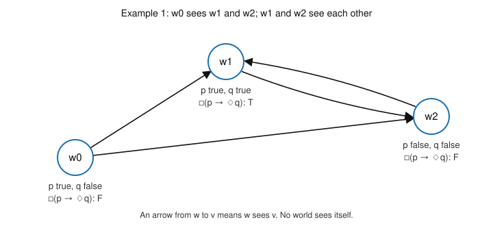

# Philosophy of Language and Logic · Lesson 2.1: Kripke semantics and the system K

> ⏱ ~15 min · Module 2: Modal logic · Builds on: [`mathematical-logic` 1.2](../../mathematical-logic/lessons/01-02-semantics-truth-tables.md), [`mathematical-logic` 2.2](../../mathematical-logic/lessons/02-02-structures-satisfaction.md), [`metaphysics` 3.2](../../metaphysics/lessons/03-02-what-possible-worlds-are.md) · Unlocks: [2.2](02-02-axioms-and-frames-t-s4-s5.md)

## Why this matters

There is no truth table for "necessarily". "Paris is in France" and "$7 + 5 = 12$" are both true, yet only the second is usually counted necessary, so the truth value of $p$ does not fix that of $\Box p$. Three lessons in this library already use the standard repair, "necessarily" as "true at every possible world" ([`metaphysics` 3.1](../../metaphysics/lessons/03-01-kinds-of-necessity.md), [`philosophy-of-religion` 1.3](../../philosophy-of-religion/lessons/01-03-omniscience-and-human-freedom.md) and [2.2](../../philosophy-of-religion/lessons/02-02-the-modal-ontological-argument.md)), always with every world in view of every other. This lesson builds that machine, adds the part they left implicit, which worlds count from where, and isolates the logic that holds whatever the answer: the system K.

## The idea

Draw a directed graph. Each node is a [possible world](../reference.md#possible-world), labelled with the atomic sentences true there: one row of a truth table from [`mathematical-logic` 1.2](../../mathematical-logic/lessons/01-02-semantics-truth-tables.md) at each node. An arrow from $w$ to $v$ means $v$ is possible relative to $w$; say "$w$ sees $v$", as [`philosophy-of-religion` 2.2](../../philosophy-of-religion/lessons/02-02-the-modal-ontological-argument.md) does. Then:

- $\Box\varphi$ is true at $w$ when $\varphi$ is true at every world $w$ sees.

- $\Diamond\varphi$ is true at $w$ when $\varphi$ is true at some world $w$ sees.

The box is a universal quantifier over the worlds a node sees and the diamond an existential one, which is why they trade places under negation exactly as $\forall$ and $\exists$ do in [`mathematical-logic` 2.3](../../mathematical-logic/lessons/02-03-translation-quantifier-order.md).

Change what the arrows mean and the same clauses read the box differently: in every world compatible with what an agent knows; in every world where all obligations are met; at every later moment (the $\Diamond$ in [`distributed-systems` 3.2](../../distributed-systems/lessons/03-02-failure-detectors-and-escaping-flp.md)'s failure detector $\Diamond P$ reads "eventually"). Some formulas hold by the clauses alone, whatever the arrows; others only if the arrows have a shape, say every world sees itself. The first set is the system K; the second is [2.2](02-02-axioms-and-frames-t-s4-s5.md)'s. What worlds *are* is [`metaphysics` 3.2](../../metaphysics/lessons/03-02-what-possible-worlds-are.md)'s question; here they are points in a graph.

## The argument

**Where it came from.** The slogan that a necessary truth is true in all possible worlds is credited to Leibniz, but the *Monadology* (tr. Latta, 1898) says that "Truths of reasoning are necessary and their opposite is impossible: truths of fact are contingent and their opposite is possible" (§33), and separately that God's ideas contain infinitely many possible universes (§53); joining the two is the later gloss [`modern-philosophy` 2.3](../../modern-philosophy/lessons/02-03-leibniz-sufficient-reason-and-monads.md) flags. Modal logic as a formal system began with C. I. Lewis, who found in the algebra of logic "two somewhat startling theorems: (1) a false proposition implies any proposition, and (2) a true proposition is implied by any proposition" (*Mind*, 1912, p. 522). His remedy, [strict implication](../reference.md#strict-implication), defined "$p$ strictly implies $q$" as the impossibility of $p$ together with not-$q$ (*A Survey of Symbolic Logic*, 1918, ch. V): in our notation $\neg\Diamond(p \wedge \neg q)$, that is, $\Box(p \to q)$. Lewis had axioms but no semantics. Stig Kanger (1957), Richard Montague (1960), Jaakko Hintikka (1961) and Arthur Prior all used a relation between worlds; Saul Kripke ("A Completeness Theorem in Modal Logic", 1959; "Semantical Analysis of Modal Logic I", 1963) made worlds bare points of evaluation and proved completeness system by system.

**D1. Frame and model.** A [Kripke frame](../reference.md#kripke-frame) $\langle W, R\rangle$ is a nonempty set $W$ of worlds with an [accessibility relation](../reference.md#accessibility-relation) $R \subseteq W \times W$; write $wRv$, "$w$ sees $v$". A [Kripke model](../reference.md#kripke-model) $\mathcal{M} = \langle W, R, V\rangle$ adds a valuation $V$ giving each atom the set of worlds where it is true. *In words:* a graph of worlds with a truth-table row at each node. $R$ is any set of pairs, as in [`discrete-mathematics` 2.2](../../discrete-mathematics/lessons/02-02-relations-equivalence-and-order.md); nothing is assumed about it.

**D2. [Truth at a world](../reference.md#truth-at-a-world).** $\mathcal{M}, w \models p$ iff $w \in V(p)$; the connectives follow the truth tables at $w$; and

$$\mathcal{M}, w \models \Box\varphi \iff \mathcal{M}, v \models \varphi \text{ for every } v \text{ with } wRv,$$

$$\mathcal{M}, w \models \Diamond\varphi \iff \mathcal{M}, v \models \varphi \text{ for some } v \text{ with } wRv.$$

This is [`mathematical-logic` 2.2](../../mathematical-logic/lessons/02-02-structures-satisfaction.md)'s satisfaction with a world index; $\Gamma \models \varphi$ stays reserved for entailment. Values are written $T$ and $F$, and $w_0$ marks the world of evaluation. *In words:* the box checks every world you can see; the diamond looks for one.

**D3. Three levels.** $\varphi$ is *true in* $\mathcal{M}$ if it is true at every world of $\mathcal{M}$; [valid on a frame](../reference.md#validity-on-a-frame) if it is true in every model on that frame, whatever the valuation; *valid on a class* of frames if valid on each member. *In words:* one labelled graph; one graph under every labelling; a family of graphs. Logic lives at the last two.

**D4. [The system K](../reference.md#system-k).** Axioms: every instance of a tautology, and every instance of the [K axiom](../reference.md#k-axiom) $\Box(\varphi \to \psi) \to (\Box\varphi \to \Box\psi)$. Rules: modus ponens, and the [necessitation rule](../reference.md#necessitation-rule): if $\varphi$ is a theorem, so is $\Box\varphi$. *In words:* classical logic, plus "necessity is closed under modus ponens", plus "what logic proves is necessary".

**T1. The K axiom is valid on every frame.** Take any model and world $w$ with $w \models \Box(p \to q)$ and $w \models \Box p$. Let $wRv$. Then $v \models p \to q$ and $v \models p$, so $v \models q$. As $v$ was any world $w$ sees, $w \models \Box q$. *In words:* K is modus ponens run at each accessible world, and the proof never asks what $R$ is like.

**T2. Necessitation preserves validity.** If $\varphi$ is true at every world of every model on a frame, then every world $w$ sees satisfies $\varphi$, so $w \models \Box\varphi$. *In words:* a law holds everywhere, so everywhere you can see. It preserves truth in a model too, but not truth at a world: $p \to \Box p$ is no theorem (it fails at $w_1$ of the model in [`philosophy-of-religion` 2.4](../../philosophy-of-religion/lessons/02-04-cosmological-arguments-sufficient-reason.md)'s Flashback).

**T3. [Duality](../reference.md#modal-duality).** $\Diamond\varphi \leftrightarrow \neg\Box\neg\varphi$ is valid on every frame: "not every seen world fails $\varphi$" says "some seen world satisfies $\varphi$". *In words:* possibly is not-necessarily-not. With T1, it makes the rule [`philosophy-of-religion` 2.2](../../philosophy-of-religion/lessons/02-02-the-modal-ontological-argument.md) labels "K" (from $\Box(A \to B)$ and $\Diamond A$, infer $\Diamond B$) a derived rule of the system K.

**Completeness, cited.** The theorems of K are exactly the formulas valid on every frame. Soundness is T1 and T2 run through [`mathematical-logic` 1.4](../../mathematical-logic/lessons/01-04-proof-system-completeness.md)'s induction on proofs; completeness is a standard result (SEP "Modal Logic", §6), stated here and not proved.

**[Countermodel](../reference.md#countermodel) construction.** By soundness, to show $\varphi$ is no theorem of K, exhibit one model and world where it is false. Work backwards and build only what the clauses demand: a false $\Box\psi$ at $w$ needs one seen world where $\psi$ fails, a true $\Diamond\psi$ one where it holds; a true $\Box\psi$ or false $\Diamond\psi$ constrains every seen world, so add few. Try T, $\Box p \to p$. We need $u$ with $\Box p$ true and $p$ false. Make $p$ false at $u$ and give $u$ no arrows: $\Box p$ is true there vacuously, since no seen world can fail $p$. One world, empty $R$, and T is false. What $u$ lacks is an arrow to itself; [2.2](02-02-axioms-and-frames-t-s4-s5.md) proves that reflexivity is exactly what T needs.

**Where the argument is weakest.** T1 and T2 make any box read through these clauses closed under logical consequence, whatever $R$ is. For knowledge that is [logical omniscience](../reference.md#logical-omniscience): necessitation has the knower know every tautology, and K has her know whatever follows from what she knows (SEP "Epistemic Logic", §5). Yet no one who knows a theory's axioms thereby knows all its theorems. The strongest reply keeps the clauses and changes what they model: the box describes implicit knowledge, the information a state carries, and explicit knowledge is implicit knowledge plus awareness (Fagin and Halpern, 1987); or the worlds are widened to include impossible ones (Rantala 1975; Hintikka 1978), where K can fail. The critic concedes that K is right for information content; the defender concedes that K is not the logic of what finite agents explicitly believe. Lewis's own S2 and S3 lack full necessitation; Kripke (1965) modelled them with "non-normal" worlds.

## The model

Example 1's model, with each world's atoms and its value for $\Box(p \to \Diamond q)$.

## Worked examples

**Example 1 (clean case: two modal depths).** $W = \{w_0, w_1, w_2\}$; $R = \{\langle w_0,w_1\rangle, \langle w_0,w_2\rangle, \langle w_1,w_2\rangle, \langle w_2,w_1\rangle\}$; $V(p) = \{w_0, w_1\}$, $V(q) = \{w_1\}$. The frame is serial, but not reflexive, symmetric or transitive. Evaluate $\Box(p \to \Diamond q)$, "$p$ strictly implies that $q$ is possible", inside out:

| world | sees | $p$ | $q$ | $\Diamond q$ | $p \to \Diamond q$ | $\Box(p \to \Diamond q)$ |
|---|---|---|---|---|---|---|
| $w_0$ | $w_1, w_2$ | T | F | T | T | F |
| $w_1$ | $w_2$ | T | T | F | F | T |
| $w_2$ | $w_1$ | F | F | T | T | F |

$\Diamond q$ is false at $w_1$ because its only seen world, $w_2$, lacks $q$; by duality $\Box\neg q$ is true there. First, the box looks away: $\Box(p \to \Diamond q)$ is true at $w_1$ though $p \to \Diamond q$ is false at $w_1$ itself, which does not see itself, so this instance of T fails at $w_1$. Second, Lewis's strict implication has become world-relative: at $w_1$, $p$ strictly implies $\Diamond q$; at $w_0$, which sees $w_1$, it does not. On a universal frame, the siblings' tacit setting, a boxed formula takes one value at every world, so the question never arose.

**Example 2 (hard case: a dead end).** Let $u$ be a [dead-end world](../reference.md#dead-end-world), one that sees nothing, like the T countermodel's. At $u$ every $\Box$-formula is vacuously true: $\Box p$, $\Box\neg p$, even $\Box(p \wedge \neg p)$. Every $\Diamond$-formula is false, even $\Diamond(p \vee \neg p)$. Read as metaphysical necessity, that is absurd, and alethic systems exclude dead ends by making $R$ reflexive ([2.2](02-02-axioms-and-frames-t-s4-s5.md)). Read temporally, $u$ is the last moment of a finite timeline, where "at every later moment, $p$" is harmlessly vacuous. The same vacuity makes [`programming-languages` 2.4](../../programming-languages/lessons/02-04-hoare-logic-and-loop-invariants.md)'s triple $\{\mathsf{true}\}\ \mathsf{while\ true\ do\ skip}\ \{\mathsf{false}\}$ valid: partial correctness is a box over a program's final states, and a loop that never halts has none.

**Where it strains.** Read deontically, $\Box p$ says $p$ holds in every world where all obligations are met, and a dead end is a situation with no such world: everything is obligatory there, $p$ and $\neg p$ included. Standard deontic logic adds D, $\Box p \to \Diamond p$, which fails exactly at dead ends ([2.3](02-03-which-logic-for-which-modality.md)), and with it no two obligations conflict. Someone who thinks moral dilemmas are real wants $\Box p \wedge \Box\neg p$ true without everything being obligatory, and the clauses cannot give it: the conjunction is true only at dead ends, and in K it entails $\Box q$ for every $q$, since it gives $\Box(p \wedge \neg p)$ and necessitation with K carries that to anything ("deontic explosion", SEP "Deontic Logic", §6.4). The defender of standard deontic logic holds that all-things-considered obligations never conflict; the dilemma theorist trades aggregation or inheritance for a conflict-tolerant logic. The semantics records the dispute without settling it.

## Watch out

- **You might think** a formula true at every world of your model is a law of K, **but actually** that is only truth in a model. In Example 1, $\Box(q \to p)$ is true at all three worlds only because $q$ sits where $p$ does; move $q$ to $w_2$ and it fails at $w_0$.

- **You might think** the K axiom says that what is necessary is true, **but actually** that is T, $\Box p \to p$, which fails at a world that does not see itself. K says only that necessity is closed under modus ponens, and it holds even at dead ends.

- **You might think** necessitation licenses $p \to \Box p$, **but actually** it applies only to theorems: it takes "valid" to "valid", never "true here" to "necessary here".

## One-liner

> A Kripke model is a graph of worlds with a truth-table row at each node; the box quantifies over the worlds a node sees, and the system K is exactly what holds whatever the arrows look like.

## Problems

**P1 (🟢)** *(Formal model: Formal (a) · Exegetical (b).)* $W = \{w_0, w_1, w_2\}$; $R = \{\langle w_0,w_1\rangle, \langle w_0,w_2\rangle, \langle w_1,w_1\rangle\}$; $V(p) = \{w_1\}$, $V(q) = \{w_1, w_2\}$.

(a) Compute $\Diamond p$, $\Diamond p \to q$ and $\Box(\Diamond p \to q)$ at each world. Show the table.

(b) Is $\Box(\Diamond p \to q)$ true in this model? Is it valid on this frame? If not, give a valuation on the same frame that falsifies it, and a world where it fails. One line each.

**P2 (🟡)** *(Counterexample: Formal (a)–(b) · Exegetical (c).)* The converse of the K axiom is $(\Box p \to \Box q) \to \Box(p \to q)$.

(a) Refute it with a countermodel on a frame where every world sees every world, the frame [`metaphysics` 3.1](../../metaphysics/lessons/03-01-kinds-of-necessity.md) and [`philosophy-of-religion` 1.3](../../philosophy-of-religion/lessons/01-03-omniscience-and-human-freedom.md) use tacitly. Check the frame condition pair by pair and compute the formula at every world. Show the model.

(b) Explain why no model with a single world can refute it. Two sentences.

(c) Someone reasons: "If $p$'s being necessary would bring $q$'s being necessary with it, then $p$ strictly implies $q$." Using your model and Lewis's distinction between material and strict implication, say what goes wrong. Two sentences.

**P3 (🔴)** *(Formal model: Formal (a)–(b) · Exegetical (c).)*

(a) Prove that $\Box(p \wedge q) \leftrightarrow (\Box p \wedge \Box q)$ is valid on every frame. Show the derivation, both directions.

(b) Refute $\Box(p \vee q) \to (\Box p \vee \Box q)$ with a countermodel checked world by world, and say which of reflexivity, seriality, symmetry and transitivity your frame has. Show the model.

(c) What does the contrast between (a) and (b) show about reading $\Box$ as "in every accessible world"? Two sentences.

Solutions

**P1** *(Formal (a) · Exegetical (b).)*

(a) $w_0$ sees $w_1$ and $w_2$; $w_1$ sees itself; $w_2$ sees nothing.

| world | sees | $p$ | $q$ | $\Diamond p$ | $\Diamond p \to q$ | $\Box(\Diamond p \to q)$ |
|---|---|---|---|---|---|---|
| $w_0$ | $w_1, w_2$ | F | F | T | F | T |
| $w_1$ | $w_1$ | T | T | T | T | T |
| $w_2$ | none | F | T | F | T | T |

$\Diamond p$ is true at $w_0$ and $w_1$ through $w_1$, and false at the dead end $w_2$. $\Diamond p \to q$ fails only at $w_0$. The box at $w_0$ checks $w_1$ and $w_2$, both T; at $w_1$ it checks $w_1$; at $w_2$ it is vacuously true. At $w_0$ the box is true though its body is false, because $w_0$ does not see itself.

(b) True in the model: T at every world. Not valid on the frame: with $q$ true nowhere and $p$ at $w_1$, $\Diamond p \to q$ fails at $w_1$, so $\Box(\Diamond p \to q)$ fails at $w_0$ and at $w_1$.

**Accept (b):** any valuation that makes $p$ true and $q$ false at $w_1$. These are exactly the falsifying valuations on this frame (checked over all 64): $w_1$ and $w_2$ are the only seen worlds, and $\Diamond p$ is always false at the dead end $w_2$.

**Must hit, strict:** (a) the three columns as tabled, with $w_2$'s box vacuously true and $w_0$'s box true although its body fails at $w_0$; (b) true in the model, not valid on the frame, with a falsifying valuation and a world.

**Wrong turns:** marking the box false at $w_0$ because the body fails there (the box never looks at $w_0$); marking $\Diamond p$ true at $w_2$ (a dead end sees nothing); answering "valid, since it is true at every world", which confuses truth in a model with validity on a frame.

---

**P2** *(Formal (a)–(b) · Exegetical (c).)*

(a) $W = \{w_0, w_1\}$; $R = \{\langle w_0,w_0\rangle, \langle w_0,w_1\rangle, \langle w_1,w_0\rangle, \langle w_1,w_1\rangle\}$; $V(p) = \{w_1\}$, $V(q) = \varnothing$. All four pairs are in $R$, so the frame is universal: reflexive, symmetric and transitive, an S5 frame. Each world sees both, so each boxed formula has one value throughout.

| world | $p$ | $q$ | $p \to q$ | $\Box p$ | $\Box q$ | $\Box p \to \Box q$ | $\Box(p \to q)$ | formula |
|---|---|---|---|---|---|---|---|---|
| $w_0$ | F | F | T | F | F | T | F | F |
| $w_1$ | T | F | F | F | F | T | F | F |

$\Box p$ is false because $p$ fails at $w_0$; $\Box(p \to q)$ is false because $p \to q$ fails at $w_1$. The formula is false at both worlds.

**Accept (a):** any model in which the evaluation world sees a world where $p$ is true and $q$ false, and a different world where $p$ is false. Every falsification on frames of one to three worlds has this shape (checked exhaustively).

(b) A world that sees itself makes $\Box p$, $\Box q$ and $\Box(p \to q)$ take the values of $p$, $q$ and $p \to q$, so the formula becomes the tautology $(p \to q) \to (p \to q)$; a world that sees nothing makes $\Box(p \to q)$ vacuously true. A countermodel needs a seen world with $p$ and not $q$, and a second seen world where $p$ fails, to make $\Box p$ false.

(c) $\Box p \to \Box q$ is a material conditional between two modal claims, true at $w_0$ only because its antecedent $\Box p$ is false there: Lewis's first "startling theorem", one level up. $\Box(p \to q)$ is his strict implication, which asks whether some possible world has $p$ without $q$, and $w_1$ does.

**Must hit, strict:** (a) a universal frame with every pair checked, and $\Box p \to \Box q$ T but $\Box(p \to q)$ F at the evaluation world; (b) a one-world model gives either a tautology or a vacuous box; (c) the antecedent of the converse is a material conditional true by a false antecedent, while strict implication fails at a $p$-and-not-$q$ world.

**Wrong turns:** offering a single reflexive world; thinking the failure depends on accessibility (it survives on an S5 frame, so no axiom of [2.2](02-02-axioms-and-frames-t-s4-s5.md) rescues it); concluding that K itself is invalid.

---

**P3** *(Formal (a)–(b) · Exegetical (c).)*

(a) Fix any frame, model and world $w$.

- Left to right. Suppose $w \models \Box(p \wedge q)$. Every $v$ with $wRv$ has $v \models p \wedge q$, hence $v \models p$, so $w \models \Box p$; likewise $w \models \Box q$. So $w \models \Box p \wedge \Box q$.

- Right to left. Suppose $w \models \Box p$ and $w \models \Box q$, and let $wRv$. Then $v \models p$ and $v \models q$, so $v \models p \wedge q$. As $v$ was arbitrary, $w \models \Box(p \wedge q)$.

No property of $R$ was used, so the biconditional is valid on every frame, and by completeness a theorem of K.

(b) $W = \{w_0, w_1, w_2\}$; $R = \{\langle w_0,w_1\rangle, \langle w_0,w_2\rangle\}$; $V(p) = \{w_1\}$, $V(q) = \{w_2\}$.

| world | sees | $p$ | $q$ | $\Box(p \vee q)$ | $\Box p$ | $\Box q$ | formula |
|---|---|---|---|---|---|---|---|
| $w_0$ | $w_1, w_2$ | F | F | T | F | F | F |
| $w_1$ | none | T | F | T | T | T | T |
| $w_2$ | none | F | T | T | T | T | T |

At $w_0$, $p \vee q$ holds at both seen worlds, but $\Box p$ fails at $w_2$ and $\Box q$ at $w_1$. At the dead ends every box is vacuously true. The frame is not reflexive, not serial and not symmetric; it is transitive, vacuously, since no two arrows chain.

**Accept (b):** any model whose evaluation world sees a world with $p$ and not $q$ and another with $q$ and not $p$. A universal frame works as well: two worlds each seeing both, $p$ at $w_0$ only and $q$ at $w_1$ only, falsifies it at both worlds, so the formula fails even in S5.

(c) The box quantifies over every accessible world, and "every seen world has $p$ and $q$" splits into two universal claims, while "every seen world has $p$ or $q$" lets different worlds supply different disjuncts. So $\Box$ distributes over $\wedge$ but not over $\vee$, exactly as $\forall x$ does; only where a world sees at most one world does "every accessible world" collapse into "the accessible world".

**Accept (c):** that the formula is valid on exactly the frames where no world sees two worlds (checked for every frame up to three worlds); the instance with $\neg p$ for $q$, the fatalist's slide from "necessarily, $p$ or not $p$" to "necessarily $p$, or necessarily not $p$"; noting that the converse, $(\Box p \vee \Box q) \to \Box(p \vee q)$, is valid.

**Must hit, strict:** (a) both directions, each through an arbitrary seen world, with no frame property used; (b) a model checked at every world, its frame properties stated, and an evaluation world that sees a $p$-not-$q$ world and a $q$-not-$p$ world; (c) the box as a quantifier over accessible worlds, with different worlds verifying different disjuncts.

**Wrong turns:** proving (a) in one direction only; offering a one-world countermodel (a reflexive world makes the formula a tautology, a dead end makes both disjuncts vacuously true); blaming the failure in (c) on the shape of $R$.

## Flashback

**From Lesson [1.3](01-03-russells-theory-of-descriptions.md) (Russell's theory of descriptions):** *(Formal (a)–(b) · Exegetical (c).)* A notice on a team's wiki (invented, written for this problem): "If the on-call engineer is offline, alerts go unanswered." Domain: the team's engineers. $C(x)$: "$x$ is on call"; $O(x)$: "$x$ is offline"; $U$: the atomic sentence "alerts go unanswered".

(a) Translate the notice with the description at [primary and at secondary occurrence](../reference.md#primary-and-secondary-occurrence) relative to "if … then". Show both formulas.

(b) Alerts are being answered, so $U$ is false. Give both readings' truth values when (i) a rota gap leaves nobody on call; (ii) a clash puts two engineers on call, both offline; (iii) exactly one is on call, and she is offline. Show a table.

(c) State the counterpart for "if … then" of 1.3's T1: which reading entails the other, and when do they agree? Two sentences.

Solution

(a) Primary:

$$\exists x\,\big(C(x) \land \forall y\,(C(y) \to y = x) \land (O(x) \to U)\big)$$

Secondary (the analysis inside the antecedent):

$$\exists x\,\big(C(x) \land \forall y\,(C(y) \to y = x) \land O(x)\big) \to U$$

(b)

| Situation | On call | Primary | Secondary |
|---|---|---|---|
| (i) rota gap | nobody: existence fails | F | T |
| (ii) rota clash | two: uniqueness fails | F | T |
| (iii) one, offline | exactly one | F | F |

In (i) and (ii) a clause of the analysis fails, so the primary is false and the secondary's antecedent is false, which makes the conditional true whatever $U$ is (Lewis's first "startling theorem", above). In (iii) both say that if she is offline, alerts go unanswered: false. Checked on all 680 structures with up to four engineers and both values of $U$.

**Must hit, strict:**

- Both formulas with all three clauses: the arrow inside the quantifier's scope (primary), or the whole analysis as antecedent (secondary).

- F/T, F/T, F/F, naming the failed clause in (i) and (ii).

- (c): primary entails secondary; equivalent whenever exactly one thing is $C$, since "if … then" is truth-functional.

**Wrong turns:** writing the secondary as $\exists x\,\big((C(x) \land \forall y\,(C(y) \to y = x) \land O(x)) \to U\big)$, which any engineer not on call satisfies, so it is true in (iii) if the team has two engineers; thinking scope matters only when nobody is on call ((ii) shows failed uniqueness suffices).

**Model answer (c):** The primary reading entails the secondary but not conversely, as (i) and (ii) show. They agree whenever exactly one engineer is on call, because "if … then" is truth-functional, so all that matters is whether she is offline.

## Connections

- **Backward:** Truth at a world is [`mathematical-logic` 1.2](../../mathematical-logic/lessons/01-02-semantics-truth-tables.md)'s valuation indexed by worlds, and the box and diamond are [`mathematical-logic` 2.2](../../mathematical-logic/lessons/02-02-structures-satisfaction.md)'s quantifier clauses restricted to the worlds a world sees. Relations and their properties come from [`discrete-mathematics` 2.2](../../discrete-mathematics/lessons/02-02-relations-equivalence-and-order.md) and [`mathematical-logic` 4.1](../../mathematical-logic/lessons/04-01-relations-orderings-well-ordering.md), and refutation by one countermodel from [`mathematical-logic` 1.4](../../mathematical-logic/lessons/01-04-proof-system-completeness.md). The two-world countermodel of [`philosophy-of-religion` 1.3](../../philosophy-of-religion/lessons/01-03-omniscience-and-human-freedom.md) is this lesson's method with $R$ left universal.

- **Forward:** [2.2](02-02-axioms-and-frames-t-s4-s5.md) matches T, 4, B and 5 to reflexive, transitive, symmetric and Euclidean frames; [2.3](02-03-which-logic-for-which-modality.md) chooses a system for each reading of the box, with seriality for obligation; [2.4](02-04-quantified-modal-logic-and-the-barcan-formula.md) adds quantifiers and a domain for each world.

- **Sideways:** What the worlds are is [`metaphysics` 3.2](../../metaphysics/lessons/03-02-what-possible-worlds-are.md)'s question, and the semantics is neutral on it. The temporal reading is [`distributed-systems` 3.2](../../distributed-systems/lessons/03-02-failure-detectors-and-escaping-flp.md)'s "eventually". The dead end is [`programming-languages` 2.4](../../programming-languages/lessons/02-04-hoare-logic-and-loop-invariants.md)'s vacuous partial correctness: dynamic logic gives each program $c$ its own box, true when a claim holds in every state $c$ can halt in, and the Hoare triple $\{P\}\,c\,\{Q\}$ becomes $P \to [c]Q$.
