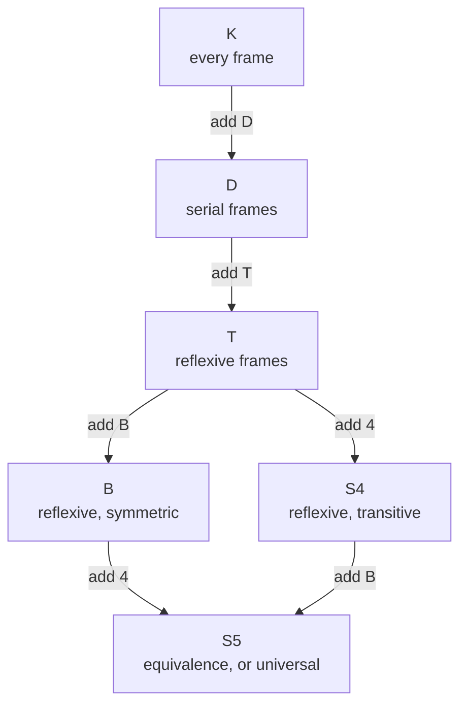
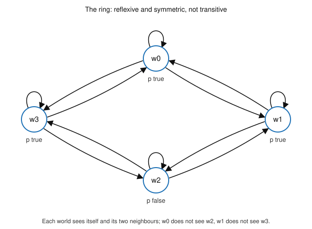

# Philosophy of Language and Logic · Lesson 2.2: Axioms and frames: T, S4, S5

> ⏱ ~15 min · Module 2: Modal logic · Builds on: [2.1](02-01-kripke-semantics-and-the-system-k.md), [`discrete-mathematics` 2.2](../../discrete-mathematics/lessons/02-02-relations-equivalence-and-order.md) · Unlocks: [2.3](02-03-which-logic-for-which-modality.md)

## Why this matters

[`philosophy-of-religion` 2.2](../../philosophy-of-religion/lessons/02-02-the-modal-ontological-argument.md) ran the modal ontological argument on axiom 5, "what is possible is necessarily possible", added that a weaker system called B would do, and left the letters unexplained. Whether that axiom is a law of logic or a substantive claim decides whether the argument's key step comes free. This lesson shows that each standard axiom says exactly one thing about how worlds see one another, which turns a quarrel about an axiom into a quarrel about a relation.

## The idea

[2.1](02-01-kripke-semantics-and-the-system-k.md) built the machinery, and this lesson uses it: a [frame](../reference.md#kripke-frame) is a set of worlds with an [accessibility relation](../reference.md#accessibility-relation), $\Box\varphi$ is true at a world when $\varphi$ is true at every world it sees, and a formula is [valid on a frame](../reference.md#validity-on-a-frame) when no valuation makes it false at any world. [K's axiom](../reference.md#k-axiom) is valid on every frame. Anything stronger costs an assumption about who sees whom.

Picture the worlds as rooms and accessibility as one-way windows. "Necessarily $p$" in a room means $p$ in every room you can look into. Now ask what the windows must be like for familiar principles to hold however the facts are spread:

- "What is necessary is true": every room has a window onto itself.
- "What is necessary is necessarily necessary": whatever you can see through two windows, you can see through one.
- "What is true is necessarily possible": every window works both ways.
- "What is possible is necessarily possible": any two rooms visible from one room can see each other.

The surprise is the converse. If a principle holds in a building however $p$ is distributed, the windows must have that shape. So choosing an axiom is choosing a shape for "possible from here".

## The argument

**Setting.** A model $\mathcal M = \langle W, R, V\rangle$ as in [2.1](02-01-kripke-semantics-and-the-system-k.md); $wRv$ is read "$w$ sees $v$"; $\mathcal M, w \models \varphi$ is truth at $w$. Worlds are $w_0, w_1, \dots$ in models and $w, v, u$ in proofs.

**D1. [Frame conditions](../reference.md#frame-conditions).** For all $w, v, u \in W$, the relation $R$ is

- *reflexive* if $wRw$;
- *serial* if $wRv$ for some $v$;
- *symmetric* if $wRv$ implies $vRw$;
- *transitive* if $wRv$ and $vRu$ imply $wRu$;
- *Euclidean* if $wRv$ and $wRu$ imply $vRu$.

*In words:* the first three are [`discrete-mathematics` 2.2](../../discrete-mathematics/lessons/02-02-relations-equivalence-and-order.md)'s; seriality says no world is a dead end, and Euclideanness says that any two worlds seen from a common world see each other.

**T1. [Frame correspondence](../reference.md#frame-correspondence).** For every frame:

| Axiom | Formula | Valid on the frame iff $R$ is |
|---|---|---|
| [T](../reference.md#axiom-t) | $\Box p \to p$ | reflexive |
| [D](../reference.md#axiom-d) | $\Box p \to \Diamond p$ | serial |
| [4](../reference.md#axiom-4) | $\Box p \to \Box\Box p$ | transitive |
| [B](../reference.md#axiom-b) | $p \to \Box\Diamond p$ | symmetric |
| [5](../reference.md#axiom-5) | $\Diamond p \to \Box\Diamond p$ | Euclidean |

*In words:* each axiom holds on a frame under every valuation exactly when accessibility has its property. Kripke's "Semantical Analysis of Modal Logic I" (1963) matched 4 with transitivity, B with symmetry and T plus 5 with equivalence relations; D belongs to [2.3](02-03-which-logic-for-which-modality.md).

**Proof that T valid implies reflexive.** Suppose some $w$ lacks $wRw$. Let $V(p) = \{v : wRv\}$, the worlds $w$ sees. Then $\Box p$ is true at $w$, since every world $w$ sees is in $V(p)$, and $p$ is false at $w$, since $w \notin V(p)$. So T fails at $w$. *Assumption used:* $p$ may be true at any set of worlds whatever. Validity on a frame quantifies over every valuation, and the proof picks a gerrymandered one. The converse halves for T and 4 are Example 1. B's is one line: if $p$ is true at $w$ and $wRv$, symmetry gives $vRw$, so $\Diamond p$ is true at $v$. Putting $\neg p$ for $p$ in B and contraposing gives $\Diamond\Box p \to p$, the form in which `philosophy-of-religion` 2.2 says B proves its step.

**L1. Two relation facts.** (i) A reflexive Euclidean relation is symmetric and transitive. If $wRv$, Euclideanness applied to $wRv$ and $wRw$ gives $vRw$. If $wRv$ and $vRu$, symmetry gives $vRw$, and Euclideanness at $v$ applied to $vRw$ and $vRu$ gives $wRu$. (ii) On a symmetric relation, transitive and Euclidean coincide: the step just given used only symmetry and Euclideanness, and conversely from $wRv$ and $wRu$, symmetry gives $vRw$ and transitivity $vRu$. *In words:* with reflexivity, 5 already forces two-way windows and lets two steps be taken in one; with two-way windows, 4 and 5 demand the same thing.

**The systems.** Each is propositional logic plus K's axiom, the [necessitation rule](../reference.md#necessitation-rule) and modus ponens ([2.1](02-01-kripke-semantics-and-the-system-k.md)), plus: [T](../reference.md#system-t), axiom T; [B](../reference.md#system-b), T and B; [S4](../reference.md#system-s4), T and 4; [S5](../reference.md#system-s5), T and 5, equivalently (by L1) T, B and 4. S4 and S5 go back to Lewis and Langford's *Symbolic Logic* (1932); T is Feys's (1937), which some texts call M after von Wright (1951); B is named for Brouwer.

**T2. [Soundness and completeness](../reference.md#soundness-and-completeness)** (cited; [`mathematical-logic` 1.4](../../mathematical-logic/lessons/01-04-proof-system-completeness.md) explains the terms). A formula is a theorem of [K](../reference.md#system-k) iff it is valid on every frame; of T iff valid on every reflexive frame; of B, on every reflexive symmetric frame; of S4, on every reflexive transitive frame (a preorder, as in [`mathematical-logic` 4.1](../../mathematical-logic/lessons/04-01-relations-orderings-well-ordering.md) P1); of S5, on every equivalence frame. *In words:* soundness says the axioms never outrun their frames, completeness that the frames never outrun the axioms. Soundness follows from the proofs here plus 2.1's result that modus ponens and necessitation preserve validity. Kripke's 1963 paper proved completeness for T, S4, B and S5; this lesson does not.

**S5: equivalence or universal.** Truth at $w$ depends only on worlds reachable from $w$ by chains of $R$. In an equivalence frame those are exactly $w$'s class $[w]$ (`discrete-mathematics` 2.2's partition theorem), and within $[w]$ every world sees every world. So a formula fails somewhere on an equivalence frame iff it fails on a universal one, and the two classes validate the same formulas. `philosophy-of-religion` 2.2's "every world can see every world" is the universal reading.

**Where the argument is weakest.** The theorems are settled. The weight rests on a premise every application adds: that the accessibility relation for a given kind of necessity has a shape we can argue for independently. For [metaphysical necessity](../reference.md#metaphysical-necessity) the S5 premise is that what is possible does not depend on which world is actual. The strongest objection is Chandler's (1976), taken up by Salmon: an artefact could have come from slightly different matter, and had it done so, from slightly more different matter, but it could not have come from wholly different matter; so possibility is relative to a starting world and accessibility is not transitive ([2.3](02-03-which-logic-for-which-modality.md) sets the argument out). The strongest reply denies the relativity: metaphysical possibility is possibility simpliciter, and the tolerance data are handled otherwise, for instance by Dorr, Hawthorne and Yli-Vakkuri's *The Bounds of Possibility* (2021), which keeps accessibility transitive. The S5 defender concedes that S5 is a thesis about $R$, not a gift of logic; the critic concedes that the correspondence cannot show $R$ is non-transitive and that, keeping B, 4 and 5 fall together.

## Map of systems

Each arrow adds one axiom and shrinks the class of frames the system is complete for; B and S4 are incomparable, and S5 is where they meet.

## Worked examples

**Example 1 (clean case: the soundness halves for T and 4).**

- *Reflexive implies T valid.* Take any model on a reflexive frame and any world $w$ where $\Box p$ is true. Since $wRw$, $w$ is among the worlds $w$ sees, so $p$ is true at $w$. *Used:* reflexivity at $w$, and nothing about other worlds.

- *Transitive implies 4 valid.* Suppose $\Box p$ is true at $w$. Take any $v$ with $wRv$ and any $u$ with $vRu$. Transitivity gives $wRu$, so $p$ is true at $u$. Hence $\Box p$ is true at every $v$ that $w$ sees, and $\Box\Box p$ is true at $w$. *Used:* transitivity along every two-step path from $w$.

The proofs show what each axiom costs. T is a claim about each world's view of itself; 4 is a claim about chains of views. That is why one can accept T and doubt 4: [2.3](02-03-which-logic-for-which-modality.md)'s tolerance argument grants that every world sees itself and denies that views chain.

**Example 2 (hard case: a ring of four worlds).**

Each world sees itself and its two neighbours. *Reflexive:* all four loops are present. *Symmetric:* every neighbour pair runs both ways. *Not transitive:* $w_0Rw_1$ and $w_1Rw_2$, but not $w_0Rw_2$. *Not Euclidean:* $w_0Rw_1$ and $w_0Rw_3$, but not $w_1Rw_3$. So this is a frame for B, not for S4 or S5. Let $p$ be false at $w_2$ only.

- *4 fails at $w_0$.* $\Box p$ is true at $w_0$, which sees $w_3$, $w_0$ and $w_1$; it is false at $w_1$, which sees $w_2$. So $\Box\Box p$ is false at $w_0$.

- *5 fails at $w_1$, for $\neg p$.* $\Diamond\neg p$ is true at $w_1$ (via $w_2$) and false at $w_0$, which sees no $\neg p$ world; $w_1$ sees $w_0$, so $\Box\Diamond\neg p$ is false at $w_1$.

T and B hold at every world under every valuation, since the frame is reflexive and symmetric.

**Where it strains.** Which S5 theorem fails here, and which condition does the failure track? T1 answers axiom by axiom: 4's failure tracks transitivity, 5's tracks Euclideanness. But the ring is symmetric, and by L1(ii) those are one condition on symmetric frames. For anyone who keeps B there is no separate fact about whether 4 or 5 is at fault: B plus 4 and B plus 5 have the same frames, and each is S5. Close the ring under transitivity and it becomes universal, restoring both at once. The correspondence locates the failure in $R$; it does not say what $R$ should be. An S5 defender reads the ring as misdescribing metaphysical possibility, since on that view no world is possible from one world and impossible from another. Someone who models accessibility as similarity within a threshold, which is reflexive and symmetric but not transitive, reads the ring as the honest shape and pays for it with 4 and 5 together. Logic fixes the price, not who pays.

## Watch out

- **You might think** a model where 4 is true at every world shows that its frame is transitive, **but actually** correspondence concerns validity on a frame, under every valuation at once. On the ring, with $p$ true at all four worlds, 4 is true everywhere though the frame is not transitive. Truth in a model, validity on a frame and validity on a class of frames are three different claims.

- **You might think** the correspondence table proves T, S4 and S5 complete, **but actually** completeness is a separate theorem. Some systems are incomplete for the frames their axioms define; the Stanford Encyclopedia's "Modal Logic" (§14) gives an example from provability logic.

- **You might think** a Euclidean relation is just an equivalence relation, **but actually** without reflexivity it need not be symmetric: if $w_0$ sees $w_1$ and $w_2$, and those two see each other and themselves, the relation is Euclidean and $w_1$ does not see $w_0$. That is why S5 is T plus 5, not K plus 5.

- **You might think** S5 needs every world to see every world, **but actually** equivalence frames validate exactly the same formulas, because a world sees only its own class.

## One-liner

> T, 4, B and 5 are each valid on a frame exactly when accessibility is reflexive, transitive, symmetric or Euclidean, so choosing a modal system is choosing a shape for "possible from here", and the logic alone does not choose it.

## Problems

**P1 (🟢)** *(Exegetical.)* For each formula, name the frame condition it corresponds to, and list every system among K, T, B, S4 and S5 that has it as a theorem, with a reason of one phrase. One line each.

(a) $\Box p \to \Diamond p$

(b) $\Box p \to \Box\Box p$

(c) $p \to \Box\Diamond p$

(d) $\Diamond p \to \Box\Diamond p$

**P2 (🟡)** *(Formal (a)–(b) · Exegetical (c).)*

(a) Prove that axiom 5 is valid on every Euclidean frame. Show the derivation.

(b) Prove the converse: if 5 is valid on a frame, the frame is Euclidean. Name the valuation you use and the world at which 5 fails.

(c) What does (b) assume about which sets of worlds $p$ may be true at that (a) does not need? One sentence.

**P3 (🔴)** *(Formal (a)–(b) · Exegetical (c).)* Consider $\Box(\Box p \to p)$: "necessarily, whatever is necessary is true".

(a) Give two serial frames with at most three worlds each: $\mathcal F_1$, on which $\Box(\Box p \to p)$ is valid though T is not, and $\mathcal F_2$, on which $\Box(\Box p \to p)$ is not valid. For each, list $R$ and check reflexivity world by world. For each failure, give the valuation and the world. Show the models.

(b) Name the condition on $R$ that makes the difference between your two frames, and prove that it suffices for validity.

(c) Is $\Box(\Box p \to p)$ a theorem of K? Of T? Answer from (a), (b) and the soundness and completeness of K and T. Two sentences.

Solutions

**P1** *(Exegetical.)*

(a) Serial; T, B, S4, S5, because every reflexive frame is serial (or: T gives $\Box p \to p$, and $p \to \Diamond p$ is T's dual). Not K: at a world that sees nothing, $\Box p$ is vacuously true and $\Diamond p$ false.

(b) Transitive; S4 and S5, because equivalence relations are transitive. Not B: the ring of Example 2 is reflexive and symmetric and refutes it.

(c) Symmetric; B and S5. Not S4: a preorder need not be symmetric.

(d) Euclidean; S5 only. Not B (the ring is not Euclidean) and not S4 (a preorder need not be Euclidean).

**Must hit, strict:** the four conditions (serial, transitive, symmetric, Euclidean); the four lists exactly as above; the reason for (a) that reflexivity implies seriality.

**Wrong turns:** listing (a) under K or omitting it from T (D is not one of T's axioms, but T proves it); listing (d) under B or S4 because both are "between T and S5"; calling (d)'s condition "equivalence relation", which is the condition for T plus 5 together.

---

**P2** *(Formal (a)–(b) · Exegetical (c).)*

(a) Let the frame be Euclidean, fix any valuation, and suppose $\Diamond p$ is true at $w$: some $u$ has $wRu$ and $p$ true at $u$. Take any $v$ with $wRv$. Euclideanness applied to $wRv$ and $wRu$ gives $vRu$, so $\Diamond p$ is true at $v$. Since $v$ was any world $w$ sees, $\Box\Diamond p$ is true at $w$. So $\Diamond p \to \Box\Diamond p$ is true at every world under every valuation.

(b) Suppose the frame is not Euclidean: some $w, v, u$ have $wRv$ and $wRu$ but not $vRu$. Let $V(p) = \{u\}$. At $w$, $\Diamond p$ is true, since $wRu$. At $v$, $\Diamond p$ is false, since $p$ holds only at $u$ and $v$ does not see $u$. As $wRv$, $\Box\Diamond p$ is false at $w$, so 5 fails at $w$. Contrapositive: if 5 is valid, the frame is Euclidean.

(c) (b) assumes that $p$ may be true at exactly the one world $u$, that is, that any set of worlds is an admissible valuation; (a) holds under each valuation separately and needs no such assumption.

**Must hit, strict:** (a) the Euclidean step from $wRv$ and $wRu$ to $vRu$, applied to an arbitrary $v$ seen from $w$; (b) the failing triple, the valuation $V(p) = \{u\}$ (or any set containing $u$ and no world $v$ sees), and the world $w$ at which 5 is false, with the contrapositive drawn; (c) that frame validity quantifies over all valuations, so the converse direction needs a tailored one.

**Wrong turns:** in (a), proving 5 from reflexivity and Euclideanness together (it needs Euclideanness only); in (b), reusing T's valuation $V(p) = \{x : wRx\}$, which need not refute 5: if $v$ sees itself, $\Diamond p$ is true at $v$ (on the ring of Example 2 it makes 5 true at $w_0$).

---

**P3** *(Formal (a)–(b) · Exegetical (c).)*

(a) $\mathcal F_1$: $W = \{w_0, w_1\}$, $R = \{(w_0, w_1), (w_1, w_1)\}$. Serial: each world sees $w_1$. Reflexive: $(w_1, w_1)$ is in, $(w_0, w_0)$ is missing, so not reflexive. With $V(p) = \{w_1\}$, $\Box p$ is true at $w_0$ (it sees only $w_1$) and $p$ is false there, so T fails at $w_0$. $\Box(\Box p \to p)$ is valid on $\mathcal F_1$: every world sees only $w_1$, and $w_1$ sees itself, so whenever $\Box p$ is true at $w_1$, $p$ is true at $w_1$, under any valuation.

$\mathcal F_2$: $W = \{w_0, w_1\}$, $R = \{(w_0, w_1), (w_1, w_0)\}$. Serial: each world sees the other. Reflexive: $(w_0, w_0)$ and $(w_1, w_1)$ are both missing. With $V(p) = \{w_0\}$, $\Box p$ is true at $w_1$ (it sees only $w_0$) and $p$ is false there, so $\Box p \to p$ fails at $w_1$; $w_0$ sees $w_1$, so $\Box(\Box p \to p)$ is false at $w_0$.

**Accept:** for $\mathcal F_1$, any serial frame in which every world that is seen sees itself, and some world does not see itself; for $\mathcal F_2$, any serial frame in which some world seen from another does not see itself, with a valuation making $\Box p$ true and $p$ false at that world.

(b) The condition is that every world that is seen sees itself: $wRv$ implies $vRv$ (sometimes called *shift reflexivity*). Proof: suppose it holds, and let $wRv$. If $\Box p$ is true at $v$, then since $vRv$, $p$ is true at $v$. So $\Box p \to p$ is true at every $v$ that $w$ sees, under every valuation, and $\Box(\Box p \to p)$ is true at $w$.

(c) It is not a theorem of K, because it fails on $\mathcal F_2$ and K is sound for every frame. It is a theorem of T, by necessitation applied to axiom T (equivalently, every reflexive frame satisfies the condition of (b), and T is complete for reflexive frames), though its frames form a larger class than T's, as $\mathcal F_1$ shows.

**Must hit, strict:** (a) both frames listed, serial, with reflexivity checked world by world, the T-failure on $\mathcal F_1$ and the $\Box(\Box p \to p)$-failure on $\mathcal F_2$ each with valuation and world, and an argument that $\Box(\Box p \to p)$ holds under every valuation on $\mathcal F_1$; (b) the condition stated as $wRv \Rightarrow vRv$ and the validity proof; (c) not K, by soundness and $\mathcal F_2$; T, by necessitation or completeness.

**Wrong turns:** naming reflexivity in (b) ($\mathcal F_1$ is not reflexive); naming transitivity, which $\mathcal F_1$ has and $\mathcal F_2$ lacks, but which does not suffice (if $w_0$ sees $w_1$ and $w_2$, $w_1$ sees $w_2$, and $w_2$ sees only itself, the frame is serial and transitive, and $V(p) = \{w_2\}$ makes $\Box(\Box p \to p)$ false at $w_0$); giving the one-world frame with no arrows for $\mathcal F_1$, which is not serial; concluding in (c) that since T proves the formula, its frames are T's frames.

**Model answer (c):** Not a theorem of K: $\mathcal F_2$ is a frame on which it fails, and whatever K proves is valid on every frame. A theorem of T: necessitation turns the axiom $\Box p \to p$ into $\Box(\Box p \to p)$, even though $\mathcal F_1$ validates the theorem without validating the axiom.

## Flashback

**From Lesson [1.4](01-04-strawson-donnellan-and-speaker-reference.md) (Strawson, Donnellan, and speaker reference):** *(Formal (a) · Exegetical (b).)* Invented, written for this problem: a college has no night porter, and a timer locks its gate at ten. A visitor reads from an old guidebook, "The night porter locks the gate at ten" ($S$). The bursar replies, "The night porter doesn't lock the gate at ten: there is no night porter." On Strawson's semantics, $S$ has a gap unless there is exactly one night porter ($P$).

(a) Read "doesn't" as a "not" that leaves a gap a gap, then as one that makes a gap true. On each reading, does not-$S$ [entail](../reference.md#entailment) $P$, and does $S$ [presuppose](../reference.md#presupposition) $P$? Show the situations; what follows for the [negation test](../reference.md#presupposition-tests)?

(b) How does a Russellian read the bursar's first clause, and what does she then say the negation test shows for descriptions? Two sentences.

Solution

(a) Every situation is of one of four kinds, which fix every value (checked on all models with up to four individuals):

| situation | $P$ | $S$ | not-$S$, gap kept | not-$S$, gap made true |
|---|---|---|---|---|
| one porter, locks it | T | T | F | F |
| one porter, does not | T | F | T | T |
| no porter | F | gap | gap | T |
| several porters | F | gap | gap | T |

$S$ presupposes $P$ on both readings, since $P$ is true wherever $S$ has a value. With the gap kept, not-$S$ is true only in row 2, so it entails $P$ and the test finds the presupposition. With the gap made true, not-$S$ is true in row 3, where $P$ is false, so the test misses it; and as $S$ or not-$S$ is then true everywhere, whatever both entail is true everywhere. The test needs 1.4's proviso that "not" leaves a gap a gap.

**Must hit, strict (a):** a situation where $P$ fails, with both values of not-$S$; entailment on the first reading only; presupposition on both; the test works only when a gap stays a gap.

**Must hit, strict (b):**

- The bursar's clause is the narrow-[scope](../reference.md#scope) reading, the description inside the negation: true with no porter, with no gap and no second "not".

- A negation that conveys a porter is the wide-scope reading, which entails $P$. So, on her view, surviving negation is a scope effect for descriptions, not a presupposition.

**Wrong turns:** in (a), saying $S$ stops presupposing $P$ on the second reading; swapping the scopes in (b); treating the datum as decisive, when the presupposition theorist posits a second "not" and the Russellian a scope ambiguity.

**Model answer (b):** The Russellian puts the description inside the negation, which is plainly true with no porter. The reading that conveys a porter puts it outside and entails that there is one, so, she says, the negation test shows a scope ambiguity, not a presupposition.

## Connections

- **Backward:** [2.1](02-01-kripke-semantics-and-the-system-k.md) supplied frames, models, validity on a frame, K and necessitation; the relation properties and the partition theorem are [`discrete-mathematics` 2.2](../../discrete-mathematics/lessons/02-02-relations-equivalence-and-order.md)'s, the preorder is [`mathematical-logic` 4.1](../../mathematical-logic/lessons/04-01-relations-orderings-well-ordering.md)'s, and what soundness and completeness mean is [`mathematical-logic` 1.4](../../mathematical-logic/lessons/01-04-proof-system-completeness.md)'s.

- **Forward:** [2.3](02-03-which-logic-for-which-modality.md) asks which frame conditions suit which reading of the box: seriality for "ought", 4 and 5 for knowledge, and whether metaphysical accessibility is transitive (Chandler and Salmon). [2.4](02-04-quantified-modal-logic-and-the-barcan-formula.md) adds quantifiers to these frames and finds that S5 with a constant domain proves the Barcan formula.

- **Sideways:** [`philosophy-of-religion` 2.2](../../philosophy-of-religion/lessons/02-02-the-modal-ontological-argument.md) uses axiom 5 and asserts that B suffices; this lesson says which frames those claims are about. What the worlds and their accessibility are is [`metaphysics` 3.2](../../metaphysics/lessons/03-02-what-possible-worlds-are.md)'s question, and the KK principle of [`epistemology` 1.3](../../epistemology/lessons/01-03-why-knowledge.md) is axiom 4 read as knowledge, which [2.3](02-03-which-logic-for-which-modality.md) makes exact.
