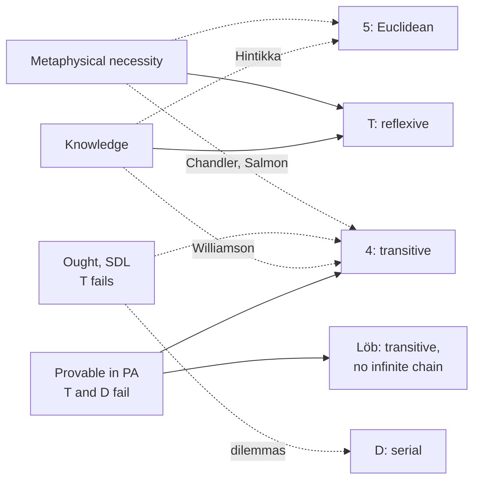
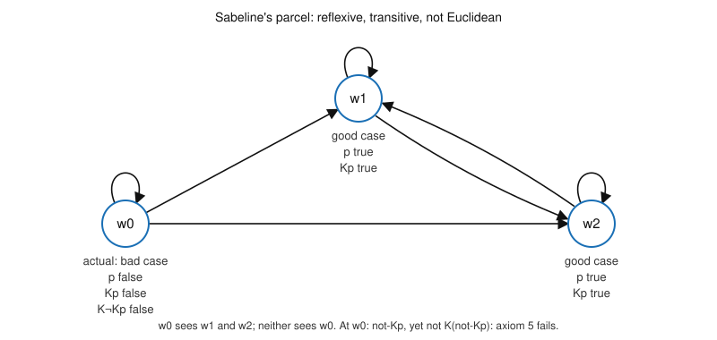

# Philosophy of Language and Logic · Lesson 2.3: Which logic for which modality

> ⏱ ~15 min · Module 2: Modal logic · Builds on: [2.2](02-02-axioms-and-frames-t-s4-s5.md), [`epistemology` 1.3](../../epistemology/lessons/01-03-why-knowledge.md), [`mathematical-logic` 5.2](../../mathematical-logic/lessons/05-02-second-theorem-undecidability.md) · Unlocks: [2.4](02-04-quantified-modal-logic-and-the-barcan-formula.md), [5.5](05-05-supervaluationism-and-epistemicism.md)

## Why this matters

A lease says the tenant must repaint the hallway before she leaves; she leaves it green. A geometry text says the angles of a Euclidean triangle must sum to 180 degrees. "It must be so, but it isn't" is a breach of contract about the hallway and a contradiction about the triangle. [2.2](02-02-axioms-and-frames-t-s4-s5.md) matched each axiom to a frame condition; this lesson asks which conditions each meaning of "must" earns, and so which logic it gets.

## The idea

A box is a quantifier over a range of worlds: $\Box p$ is true when $p$ holds throughout the range the [accessibility relation](../reference.md#accessibility-relation) picks out. For "ought", the range is the worlds where every obligation in force is met; for "knows", the worlds the agent cannot rule out; for metaphysical necessity, every way things could have been. Provability in arithmetic has no worlds at all, yet it too obeys a modal logic.

Choosing a logic means answering one question per axiom. Is the actual world inside its own range? Yes for knowledge (you cannot rule out the truth), no for obligation (the actual world is seldom ideal): axiom T. Can the range be empty? Not if obligations can be met together: axiom D. Does the range seen from inside the range stay inside it? For knowledge, that is introspection: axiom 4. By [frame correspondence](../reference.md#frame-correspondence), each answer is a property of $R$, and so a choice of axioms.

## The argument

Notation as in [2.1](02-01-kripke-semantics-and-the-system-k.md): $\mathcal M = \langle W, R, V\rangle$, $wRv$ read "$w$ sees $v$". The axioms: [T](../reference.md#axiom-t) $\Box p \to p$ (reflexive frames), [D](../reference.md#axiom-d) $\Box p \to \Diamond p$ (serial: every world sees some world), [4](../reference.md#axiom-4) $\Box p \to \Box\Box p$ (transitive), [5](../reference.md#axiom-5) $\Diamond p \to \Box\Diamond p$ (Euclidean).

**T1. The [modal reduction laws](../reference.md#modal-reduction-laws) of S4.** In [S4](../reference.md#system-s4), $\Box\Box p \leftrightarrow \Box p$ and $\Diamond\Diamond p \leftrightarrow \Diamond p$ (from T and 4), and $\Box\Diamond\Box\Diamond p \leftrightarrow \Box\Diamond p$ and $\Diamond\Box\Diamond\Box p \leftrightarrow \Diamond\Box p$, which need only 4 (P2). So every string of boxes, diamonds and negations in front of $p$ reduces to one of fourteen: $p$, $\Box p$, $\Diamond p$, $\Box\Diamond p$, $\Diamond\Box p$, $\Box\Diamond\Box p$, $\Diamond\Box\Diamond p$ and their negations (William Parry, *Journal of Symbolic Logic*, 1939). *In words:* T and B leave an endless tower of distinct modalities; adding 4 to T cuts it to fourteen.

**T2. The S5 laws.** On every [S5](../reference.md#system-s5) frame, $\Diamond\Box p \leftrightarrow \Box p$ and $\Box\Diamond p \leftrightarrow \Diamond p$.

*Proof.* Lemma: if $wRv$, then $w$ and $v$ see the same worlds. If $vRu$, then $wRu$ by transitivity; if $wRu$, then $vRu$ by Euclideanness, which S5 frames have ([2.2](02-02-axioms-and-frames-t-s4-s5.md)'s L1). So $\Box\varphi$ and $\Diamond\varphi$ have the same value at $w$ as at every world $w$ sees. Now $\Diamond\Box p$ is true at $w$ iff some world $w$ sees has $\Box p$, iff (lemma) $\Box p$ is true at $w$; the second law is the same with "every" for "some". In each law one direction needs $w$ to see some world, which reflexivity supplies. ∎

The proof used transitivity, Euclideanness and seriality (reflexivity only to supply it), so the laws also hold on serial, transitive, Euclidean frames: KD45, the usual logic of belief. *In words:* in S5 only the last operator counts, leaving six modalities, $p$, $\Box p$, $\Diamond p$ and their negations. [`philosophy-of-religion` 2.2](../../philosophy-of-religion/lessons/02-02-the-modal-ontological-argument.md) derived half of the first law from axiom 5; its [2.4](../../philosophy-of-religion/lessons/02-04-cosmological-arguments-sufficient-reason.md) Flashback refutes $\Diamond p \to \Diamond\Box p$.

**The readings.**

- **[Deontic logic](../reference.md#deontic-logic).** Read $\Box$ as $O$, "it ought to be that", and $\Diamond$ as $P$, "it may be that" (Georg Henrik von Wright, "Deontic Logic", *Mind*, 1951). Standard deontic logic (SDL) is K plus D. T fails: hallways stay green. D is valid exactly on serial frames: if $w$ sees some $v$, $Op$ at $w$ puts $p$ at $v$, so $Pp$; if $w$ sees nothing, $Op$ is vacuously true and $Pp$ false. Kant's [ought implies can](../reference.md#ought-implies-can), $Op \to \Diamond p$, needs a second, alethic operator ([`philosophy-of-religion` 3.3](../../philosophy-of-religion/lessons/03-03-moral-arguments.md) uses it). Every [normal](../reference.md#normal-modal-logic) box also inherits [Ross's paradox](../reference.md#rosss-paradox) (Alf Ross, 1941): from the tautology $m \to (m \vee b)$, necessitation and K give $Om \to O(m \vee b)$. If you ought to post the letter, you ought to post it or burn it.

- **[Epistemic logic](../reference.md#epistemic-logic).** Read $\Box$ as $K$, "the agent knows that": [`epistemology` 1.3](../../epistemology/lessons/01-03-why-knowledge.md)'s $K$ is a box. T holds: knowledge is factive. 4 is [positive introspection](../reference.md#positive-introspection), the KK principle, which Jaakko Hintikka accepted (*Knowledge and Belief*, 1962) and Timothy Williamson's margin-for-error argument rejects (*Knowledge and Its Limits*, 2000, ch. 5). "Within margin $m$ of", $|x - x'| \le m$, is reflexive and symmetric but not transitive: a frame on which 4 fails. 5 is [negative introspection](../reference.md#negative-introspection), $\neg Kp \to K\neg Kp$. Hintikka rejected it: a state in which you know more is an alternative to your present one, but not conversely, so $R$ is not symmetric, and with T not Euclidean. Read $R$ as indistinguishability (same evidence in both worlds) and it is an equivalence relation, so knowledge is S5, the standard in computer science (Fagin, Halpern, Moses and Vardi, *Reasoning About Knowledge*, 1995) and the logic behind [`distributed-systems` 1.1](../../distributed-systems/lessons/01-01-why-distributed-systems-are-hard.md)'s indistinguishability principle.

- **[Provability logic](../reference.md#provability-logic).** Read $\Box\varphi$ as $\operatorname{Prov}_{\mathsf{PA}}(\ulcorner\varphi\urcorner)$. The derivability conditions that [`mathematical-logic` 5.2](../../mathematical-logic/lessons/05-02-second-theorem-undecidability.md) names, in Martin Löb's 1955 form, are necessitation (if $\mathsf{PA} \vdash \varphi$ then $\mathsf{PA} \vdash \operatorname{Prov}_{\mathsf{PA}}(\ulcorner\varphi\urcorner)$), K and 4. The system GL adds [Löb's theorem](../reference.md#lobs-theorem) as the axiom $\Box(\Box p \to p) \to \Box p$: if $\mathsf{PA}$ proves "if $\varphi$ is provable then $\varphi$", it already proves $\varphi$ ([`mathematical-logic` 5.1](../../mathematical-logic/lessons/05-01-incompleteness-first-theorem.md), Example 1). T cannot be added:

  1. $\Box\bot \to \bot$. *T, with $\bot$ for $p$.*
  2. $\Box(\Box\bot \to \bot)$. *Necessitation on 1.*
  3. $\Box(\Box\bot \to \bot) \to \Box\bot$. *Löb's axiom, with $\bot$ for $p$.*
  4. $\Box\bot$. *2, 3, modus ponens.*
  5. $\bot$. *1, 4, modus ponens.*

  Line 1 says that $\mathsf{PA}$ is consistent, line 2 that $\mathsf{PA}$ proves it: the step the second incompleteness theorem forbids. GL is complete for transitive frames with no infinite forward chain, hence no world that sees itself (Krister Segerberg, 1971), and, by Robert Solovay's theorem (1976), for what $\mathsf{PA}$ proves about its own provability.

- **[Metaphysical necessity](../reference.md#metaphysical-necessity)**, the rung of [`metaphysics` 3.1](../../metaphysics/lessons/03-01-kinds-of-necessity.md). The usual logic is S5: what is possible at all is possible from every world, and Alvin Plantinga (*The Nature of Necessity*, 1974) holds that no state of affairs is only contingently possible. Hugh Chandler's [tolerance argument](../reference.md#tolerance-argument) ("Plantinga and the Contingently Possible", *Analysis*, 1976) denies it. **P1** A bicycle could have originated with one part different. **P2** Had it done so, that bicycle could have originated with one more part different, and so on. **P3** It could not have originated from wholly different parts. **∴ C** Some origin is possibly possible but not possible, so 4 fails, and with it S5. Nathan Salmon ("The Logic of What Might Have Been", 1989) argues that the logic of metaphysical modality is not S4. A counterpart theorist lets the counterpart relation, which need not be transitive ([`metaphysics` 3.2](../../metaphysics/lessons/03-02-what-possible-worlds-are.md)), absorb the chain; Dorr, Hawthorne and Yli-Vakkuri (*The Bounds of Possibility*, 2021) keep transitivity by other means. Boss 2 asks whether the case also reaches B.

- **Tense.** "It is and always will be" is a box over now and later moments.

**Where the argument is weakest.** The premise every reading shares: that its box is [normal](../reference.md#normal-modal-logic), closed under K and necessitation, which lets a frame condition settle the logic. Ross's paradox follows from normality alone, as does [logical omniscience](../reference.md#logical-omniscience): a normal $K$ knows every theorem and every consequence of what it knows. And [`metaphysics` 6.1](../../metaphysics/lessons/06-01-determinism-and-the-consequence-argument.md)'s transfer operator $N$ fails agglomeration, $Np \wedge Nq \to N(p \wedge q)$, so it is not normal at all. The strongest reply: normality idealizes what a code or a body of information settles, and the oddities are pragmatic, since no one who knew the letter must be posted would say "post it or burn it" (Héctor-Neri Castañeda, 1981). The critic concedes that the alternatives, such as neighbourhood semantics, lose the frame correspondence this lesson runs on; the defender concedes that the logic describes ideal codes and knowers.

## Map of readings

Solid arrows run from a reading to an axiom every major treatment accepts, dashed arrows to one that some accept and others deny; D follows wherever T holds.

## Worked examples

**Example 1 (clean case: Ingrith's lease).** Ingrith Lowther's lease obliges her to repaint the hallway before leaving ($r$), in any colour; she leaves without repainting. The lease is kept at $w_1$ and $w_2$, and only at $w_1$ is the hallway cream ($c$): $W = \{w_0, w_1, w_2\}$; $w_0$ sees $w_1$ and $w_2$, each of which sees both. Serial, not reflexive.

| formula | $w_0$ | $w_1$ | $w_2$ |
|---|---|---|---|
| $r$ | F | T | T |
| $Or$ | T | T | T |
| $Or \to r$ | F | T | T |
| $Pc$ | T | T | T |
| $Oc$ | F | F | F |

At $w_0$ the obligation stands while broken: T fails; D, valid on every serial frame, holds. Cream is permitted, not obligatory. The frame is transitive and Euclidean, so it also validates 4 and 5, a fact about the frame, not about SDL.

**Example 2 (hard case: Sabeline's parcel).** Sabeline Corvo's phone shows a photo of a parcel on her step ($p$: the parcel is on her step). At the actual world $w_0$ the photo is stale and no parcel came; at $w_1$ and $w_2$ it is today's, the parcel in two different spots. The externalist's model: in the good cases she knows $p$ but cannot tell $w_1$ from $w_2$; in the bad case she can rule out nothing.

The frame is reflexive and transitive, so T and 4 hold, but not Euclidean: $w_0$ sees $w_1$ and $w_0$, yet $w_1$ does not see $w_0$. At $w_0$, $Kp$ is false ($w_0$ sees itself, where $p$ fails), but $K\neg Kp$ is false too, since $w_0$ sees $w_1$, where $Kp$ is true. She does not know, and does not know that she does not know: 5 fails.

**Where it strains.** The indistinguishability theorist says her evidence, the screen, is the same at all three worlds, so $R$ is universal: $Kp$ is false everywhere, even in the good cases, and 5 holds. The externalist ([`epistemology` 1.4](../../epistemology/lessons/01-04-internalism-and-externalism.md)) says the good case gives her more than the screen. The model computes $Kp$ once $R$ is fixed; whether good and bad cases share her evidence, the whole dispute, it cannot say.

## Watch out

- **You might think** D is "ought implies can", **but actually** it is "ought implies may", relating $O$ to its own dual $P$; "can" needs a second, alethic operator.

- **You might think** the S5 laws make "possibly $p$" equivalent to $p$ or to "necessarily $p$", **but actually** only strings ending in the same operator collapse; $\Diamond p$, $p$ and $\Box p$ stay distinct. A common gloss makes the modal ontological argument's premise equivalent to its conclusion in S5; that needs the argument's own $\Box(G \to \Box G)$ ([`philosophy-of-religion` 2.2](../../philosophy-of-religion/lessons/02-02-the-modal-ontological-argument.md)).

- **You might think** T fails for provability because $\mathsf{PA}$ might prove falsehoods, **but actually** every instance of $\operatorname{Prov}_{\mathsf{PA}}(\ulcorner\varphi\urcorner) \to \varphi$ is true if $\mathsf{PA}$ is sound. What fails is that $\mathsf{PA}$ proves them: the logic of what $\mathsf{PA}$ proves about provability is not the logic of what is true about it.

- **You might think** a frame that validates an axiom puts it into the system, **but actually** a system's theorems are what is valid on every frame of its class. Example 1's frame validates 4 and 5; SDL contains neither.

## One-liner

> A box quantifies over a range of worlds; T, D, 4 and 5 each ask one question about that range, and "ought", "knows", "provable" and "necessarily" answer them differently.

## Problems

**P1 (🟢)** *(Exegetical.)* For each reading of $\Box$, say which of T, D, 4 and 5 it validates. One line per reading, naming the fact or frame condition that decides each axiom.

(a) "It ought to be that", in standard deontic logic.

(b) "It is provable in $\mathsf{PA}$ that", in GL.

(c) "It is and always will be that", with time a single line of moments that has no last moment.

(d) "The agent believes that", in KD45.

**P2 (🟡)** *(Formal model: Formal (a)–(b).)*

(a) Prove that $\Box\Diamond p \to \Box\Diamond\Box\Diamond p$ is valid on every transitive frame, reflexive or not. Name the frame condition or hypothesis behind each step. Show the derivation.

(b) Prove that Löb's axiom $\Box(\Box p \to p) \to \Box p$ is false at some world of every frame in which some world sees itself. Give the valuation and evaluate both sides. Show the derivation.

**P3 (🔴)** *(Apply to a hard case: Formal (a) · Evaluative (b).)* Invented, written for this problem. Dr Hartigan promised the Eskerby clinic that she would work its Saturday night shift. Later her sister, who marries that Saturday evening, asked her to promise not to work that night, and she promised. Let $s$ be "Dr Hartigan works on Saturday night".

(a) Write the two obligations with $O$. Which axiom of SDL do they jointly contradict? At which worlds of a Kripke model can both be true, and what else is obligatory there? Three lines or fewer.

(b) What does a defender of SDL say about the case, and what must someone who accepts it as a genuine dilemma give up besides D? 150 words or fewer.

Solutions

**P1** *(Exegetical.)*

**Must hit, strict:**

- (a) SDL validates D only. T fails (obligations get broken: the actual world need not be among the ideal ones); D holds (serial frames: obligations can be met together); 4 and 5 are not theorems (each fails on some serial frame; adding them is a further, disputed choice about iterated "ought").

- (b) GL validates 4 only. T fails (adding it is inconsistent, as the five-line derivation shows); D fails (its instance $\Box\bot \to \Diamond\bot$ amounts to $\neg\Box\bot$, which says $\mathsf{PA}$ is consistent, and GL does not prove it; semantically, every finite GL frame has a dead end); 4 holds (a derivability condition and a theorem of GL); 5 fails (a world that sees a dead-end $p$-world makes $\Diamond p$ true and $\Box\Diamond p$ false).

- (c) T, D and 4 hold; 5 fails. T: "now and later" includes now (reflexive). D: reflexive frames are serial. 4: later than later is later (transitive). 5: if $p$ is true now and never again, $\Diamond p$ ("$p$ now or later") is true now but false at the next moment, so $\Box\Diamond p$ is false now.

- (d) KD45 validates D, 4 and 5, not T. T fails (beliefs can be false); D holds (beliefs are consistent: serial); 4 is positive and 5 negative introspection of one's own beliefs (transitive, Euclidean).

**Wrong turns:** giving GL axiom T because $\mathsf{PA}$ is sound (each instance is true, not provable); giving SDL 4 or 5 because some deontic logicians add them; reading (c) as the strict future "it will always be", for which T fails; denying D in (c) by forgetting that reflexive frames are serial.

**Model answer:** (a) D only: broken obligations refute T, joint satisfiability gives D, SDL takes no stand on iterated "ought". (b) 4 only: T would make $\mathsf{PA}$ prove its own consistency, D says the same, 4 is a derivability condition, 5 fails at a world seeing a dead end. (c) T, D, 4, not 5: the present counts, later-than-later is later, but something true only now is not possible from tomorrow. (d) D, 4, 5, not T: consistent, fully introspective, fallible.

---

**P2** *(Formal (a)–(b).)*

(a) Suppose $\Box\Diamond p$ is true at $w$, and let $wRv$. It suffices to show $\Diamond\Box\Diamond p$ at $v$.

1. $\Diamond p$ is true at $v$. *Hypothesis at $w$, since $wRv$.*
2. So $v$ sees some world $u$. *Clause for $\Diamond$: 1 has a witness.*
3. Let $uRt$. Then $wRu$ (from $wRv$, $vRu$) and $wRt$ (from $wRu$, $uRt$). *Transitivity, twice.*
4. $\Diamond p$ is true at $t$. *Hypothesis at $w$, since $wRt$.*
5. $\Box\Diamond p$ is true at $u$. *3–4, for every $t$ that $u$ sees.*
6. $\Diamond\Box\Diamond p$ is true at $v$. *$vRu$ and 5.*
7. $\Box\Diamond\Box\Diamond p$ is true at $w$. *$v$ was any world $w$ sees.* ∎

The world $u$ comes from the hypothesis (step 2), not from reflexivity, so the law holds in K4 and in GL. Transitivity cannot be dropped: on the reflexive frame $W = \{w_0, w_1, w_2\}$ with $w_1Rw_2$, $w_2Rw_0$ and every loop, and $p$ true at $w_2$ only, the formula fails at $w_1$ (at $w_2$, $\Diamond\Box\Diamond p$ is false: $w_2$ sees $w_0$, where $\Diamond p$ fails, so $\Box\Diamond p$ fails at both worlds $w_2$ sees).

(b) Let $wRw$, and put $V(p) = W \setminus \{w\}$: $p$ is false at $w$ only.

- $\Box p$ is false at $w$: $w$ sees $w$, where $p$ is false.

- $\Box p \to p$ is true at every world $w$ sees: at $w$ because $\Box p$ is false there, at any other world because $p$ is true there.

- So $\Box(\Box p \to p)$ is true at $w$ and $\Box p$ is false: Löb's axiom is false at $w$. ∎

So no world of a GL frame sees itself; T's frames are exactly where Löb's axiom breaks, the semantic face of the five-line derivation.

**Must hit, strict:** (a) the witness $u$ obtained from $\Diamond p$ at $v$; transitivity used twice to put every successor of $u$ in $w$'s range; no appeal to reflexivity. (b) a valuation false at the reflexive world and true at every other world it sees; $\Box p$ false there via $wRw$; $\Box p \to p$ true at every successor.

**Accept:** in (b), any valuation with $p$ false at $w$ and true at every other world $w$ sees.

**Wrong turns:** in (a), taking $u = v$, which uses reflexivity and proves the claim only for S4 frames; using transitivity once, as if $vRu$ and $uRt$ gave $wRt$ directly. In (b), making $p$ false everywhere, which fails when $w$ also sees a dead end (there $\Box p \to p$ is false); checking only the one-world reflexive frame.

---

**P3** *(Formal (a) · Evaluative (b).)*

(a) $Os$ and $O\neg s$. Together they contradict D in its equivalent form $Op \to \neg O\neg p$. $Os$ puts $s$ and $O\neg s$ puts $\neg s$ at every world $w$ sees, so both are true only at a world that sees nothing, and there every $Oq$ is vacuously true. (Syntactically: K gives $Os \wedge O\neg s \to O(s \wedge \neg s)$, and $s \wedge \neg s$ implies any $q$, so $Oq$.)

**Must hit, strict (a):** $Os$ and $O\neg s$; D (or $Op \to \neg O\neg p$); only at a world with no successors; there everything is obligatory.

**Must hit, any verdict (b):**

- The defender's move: SDL's $O$ is the all-things-considered ought. The two promises ground prima facie duties in W. D. Ross's sense ([`ethics` 5.3](../../ethics/lessons/05-03-pluralism-and-particularism.md)), and at most one is her actual duty, so only one of $Os$, $O\neg s$ is true and D stands. Its cost: the broken promise still calls for apology or repair, which a single $O$ cannot record.

- The dilemma theorist's move: keep both obligations and drop D, and also agglomeration ($Op \wedge Oq \to O(p \wedge q)$, given by K), or else every proposition becomes obligatory at the dilemma world. Its cost: $O$ is no longer a normal box on Kripke frames, so a weaker semantics is needed.

**Wrong turns:** saying the case refutes T (SDL never had T); dropping D but keeping K, which leaves everything obligatory; treating it as a failure of "ought implies can" (the conflict is $s$ against $\neg s$, so no alethic premise enters); crediting Ross's paradox to W. D. Ross (it is Alf Ross's).

**Model answer (b), one of several:** The SDL defender reads $O$ as what Dr Hartigan ought to do all things considered. Her promises create two prima facie duties, and one outweighs the other, so exactly one of $Os$ and $O\neg s$ is true and D survives; the losing promise leaves a residue (she owes the clinic or her sister an apology), which the logic does not represent. The dilemma theorist insists that both obligations stand and that whichever she does, she does wrong. Dropping D is not enough: K turns $Os \wedge O\neg s$ into $O(s \wedge \neg s)$ and then into an obligation to do anything at all. So she must also reject agglomeration, and with it the normal-box semantics, for a conflict-tolerant logic. Which cost is worse turns on whether moral residue is evidence of two real obligations.

## Flashback

**From Lesson [2.1](02-01-kripke-semantics-and-the-system-k.md) (Kripke semantics and the system K):** *(Formal (a)–(b) · Exegetical (c).)* C. I. Lewis built [strict implication](../reference.md#strict-implication), $\Box(p \to q)$, to escape the material theorem $\neg p \to (p \to q)$: a false proposition implies any proposition. Take $W = \{w_0, w_1, w_2\}$; $R = \{\langle w_0,w_0\rangle, \langle w_0,w_1\rangle, \langle w_1,w_0\rangle, \langle w_1,w_1\rangle, \langle w_2,w_2\rangle\}$; $V(p) = \{w_1\}$, $V(q) = \{w_0\}$.

(a) Check reflexivity, symmetry and transitivity pair by pair. Then compute $\neg p$, $\Box\neg p$, $\Box(p \to q)$ and $\neg p \to \Box(p \to q)$ at each world. Show the table.

(b) Prove that $\Box\neg p \to \Box(p \to q)$ is valid on every frame. Show the derivation.

(c) What do (a) and (b) show about how far strict implication escapes the material theorem? Two sentences.

Solution

(a) Reflexive: all three loops are in $R$. Symmetric: $\langle w_0,w_1\rangle$ and $\langle w_1,w_0\rangle$, the only arrows between different worlds, come as a pair. Transitive: the chains $w_0Rw_1Rw_0$ and $w_1Rw_0Rw_1$ close by the loops, and any other chain passes through a loop. So $R$ is an equivalence relation, an S5 frame, though $w_0$ does not see $w_2$.

| world | sees | $p$ | $q$ | $\neg p$ | $\Box\neg p$ | $\Box(p \to q)$ | $\neg p \to \Box(p \to q)$ |
|---|---|---|---|---|---|---|---|
| $w_0$ | $w_0, w_1$ | F | T | T | F | F | F |
| $w_1$ | $w_0, w_1$ | T | F | F | F | F | T |
| $w_2$ | $w_2$ | F | F | T | T | T | T |

At $w_0$, $p$ is false, but $w_0$ sees $w_1$, where $p \to q$ fails. At $w_2$, $p$ fails at every world seen, so $\Box(p \to q)$ holds though $q$ is false.

(b) Take any model and world $w$ with $w \models \Box\neg p$, and let $wRv$. Then $v \models \neg p$, so $v \models p \to q$. As $v$ was any world $w$ sees, $w \models \Box(p \to q)$. No property of $R$ was used, so the formula is valid on every frame and, by completeness, a theorem of K; so is its companion $\Box q \to \Box(p \to q)$.

**Must hit, strict:**

- (a) the three properties checked; the formula false at $w_0$ alone, through $w_1$; $\Box(p \to q)$ true at $w_2$.

- (b) an arbitrary seen world; no frame property used.

- (c) a possible falsehood need not strictly imply everything, even on an S5 frame; an impossibility does, on every frame.

**Wrong turns:** marking $\Box(p \to q)$ false at $w_2$ because $q$ is false there (the box asks only about $p \to q$); expecting a stronger frame to restore the material theorem (this one is already S5).

**Model answer (c):** Strict implication escapes the theorem for mere falsehoods: at $w_0$, $p$ is false but possible and does not strictly imply $q$, on an S5 frame at that. It does not escape it for impossibilities, which by (b) strictly imply every proposition, and Lewis listed that analogue and its companion as theorems, "themselves somewhat peculiar" (*A Survey of Symbolic Logic*, 1918, ch. V, p. 335).

## Connections

- **Backward:** [2.2](02-02-axioms-and-frames-t-s4-s5.md) gave the frame conditions this lesson assigns to readings, and [2.1](02-01-kripke-semantics-and-the-system-k.md) the clauses the proofs use. [`mathematical-logic` 5.1](../../mathematical-logic/lessons/05-01-incompleteness-first-theorem.md) and [5.2](../../mathematical-logic/lessons/05-02-second-theorem-undecidability.md) gave Löb's theorem, consistency and the derivability conditions, read here as GL's necessitation, K and 4. [`epistemology` 1.3](../../epistemology/lessons/01-03-why-knowledge.md) ran Williamson's argument against KK, read here as a failure of 4.

- **Forward:** [2.4](02-04-quantified-modal-logic-and-the-barcan-formula.md) adds quantifiers to S5, where, with one domain shared by all worlds, the Barcan formula becomes a theorem; [5.5](05-05-supervaluationism-and-epistemicism.md) returns to margin-for-error principles for vague predicates; [3.2](03-02-rigid-designation-and-the-causal-picture.md) and [3.3](03-03-the-necessary-a-posteriori-and-natural-kinds.md) use metaphysical necessity whatever its logic turns out to be.

- **Sideways:** [`philosophy-of-religion` 1.3](../../philosophy-of-religion/lessons/01-03-omniscience-and-human-freedom.md) and [1.4](../../philosophy-of-religion/lessons/01-04-eternity-immutability-and-simplicity.md) need only K and T; the S5 laws are what [`philosophy-of-religion` 2.2](../../philosophy-of-religion/lessons/02-02-the-modal-ontological-argument.md) needs and what [`apologetics-foundations` 2.1](../../apologetics-foundations/lessons/02-01-assembling-the-case.md) leans on; "ought implies can" is a premise of Kant's moral argument in [`philosophy-of-religion` 3.3](../../philosophy-of-religion/lessons/03-03-moral-arguments.md), and prima facie duties are [`ethics` 5.3](../../ethics/lessons/05-03-pluralism-and-particularism.md)'s. Indistinguishability as S5 knowledge is the engine of [`distributed-systems` 1.1](../../distributed-systems/lessons/01-01-why-distributed-systems-are-hard.md) and [4.5](../../distributed-systems/lessons/04-05-byzantine-fault-tolerance.md), and Two Generals ([1.3](../../distributed-systems/lessons/01-03-rpc-and-delivery-semantics.md)) is the impossibility of common knowledge. [`metaphysics` 6.1](../../metaphysics/lessons/06-01-determinism-and-the-consequence-argument.md)'s $N$ is a modal operator that is not normal.
