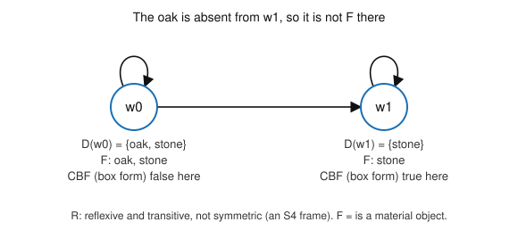

# Philosophy of Language and Logic · Lesson 2.4: Quantified modal logic and the Barcan formula

> ⏱ ~15 min · Module 2: Modal logic · Builds on: [2.2](02-02-axioms-and-frames-t-s4-s5.md), [`metaphysics` 3.3](../../metaphysics/lessons/03-03-brute-facts-and-necessary-existence.md) · Unlocks: [2.5](02-05-de-re-modality-and-quines-challenge.md)

## Why this matters

[`metaphysics` 3.3](../../metaphysics/lessons/03-03-brute-facts-and-necessary-existence.md) asked whether anything exists necessarily, taking for granted that most things do not. A few lines of the simplest logic for "necessarily" and "everything" say that everything does. The same logic turns "there could have been a person who does not exist" into "some existing thing could have been that person". This lesson finds where that happens and prices each way of blocking it.

## The idea

[2.1](02-01-kripke-semantics-and-the-system-k.md) evaluated sentences at worlds; [`mathematical-logic` 2.2](../../mathematical-logic/lessons/02-02-structures-satisfaction.md) evaluated quantifiers over one domain. Combine them and a design choice appears. Picture a simulator of possible histories. You can keep one global table of individuals that every history draws on, or one table per history, so that the oak that grew in one history has no row at all in the history where its acorn was eaten.

With a table per history, "there is", said at a world, means "there is in that world's table", and two harmless-looking swaps can fail. The Barcan formula says: if there could have been an F, something could have been F. Its converse: if necessarily everything is F, each thing is necessarily F. The first fails when a world gains something (a possible daughter who is no actual thing); the second fails when a world loses something (the oak). With one shared table both hold, and then whatever could exist is already something here. Necessitists and contingentists disagree about which picture is right, and about whether the simpler logic's virtues help decide.

## The argument

**Models.** A [quantified Kripke model](../reference.md#quantified-modal-logic) is $\mathcal{M} = \langle W, R, D, V\rangle$: worlds $W$ and accessibility $R$ as in [2.1](02-01-kripke-semantics-and-the-system-k.md); a domain $D(w)$ for each world, generalizing `mathematical-logic` 2.2's $|\mathcal M|$; and an extension $V(F, w)$ for each predicate $F$ at each world $w$. Let $U$ be the union of all the domains; an assignment $s$ sends variables into $U$. With [actualist quantifiers](../reference.md#actualist-quantifier),

$$\mathcal M, w \models \forall x\,\varphi\,[s] \iff \text{for every } d \in D(w),\ \mathcal M, w \models \varphi\,[s[x\mapsto d]],$$

and dually for $\exists$; $\Box$ and $\Diamond$ are as in 2.1. *In words:* "everything", said at a world, means everything there.

Three conventions. (i) $V(F, w) \subseteq D(w)$: nothing has a property at a world where it does not exist. Plantinga called this ["serious actualism"](../reference.md#serious-actualism); Kripke ("Semantical Considerations on Modal Logic", 1963b) called it natural but did not impose it; T1 and T2 hold either way. (ii) The [existence predicate](../reference.md#existence-predicate) is $Ex := \exists y\,(y = x)$, written $Ex$ as in `metaphysics` 3.3. (iii) A domain may be empty, which `mathematical-logic` 2.2 forbids. [Domains](../reference.md#constant-and-varying-domains) are *constant* if every world has the same one, *increasing* if $wRv$ implies $D(w) \subseteq D(v)$, and *decreasing* if $wRv$ implies $D(v) \subseteq D(w)$.

**The formulas.** The [Barcan formula](../reference.md#barcan-formula) and its [converse](../reference.md#converse-barcan-formula), each in two forms that are equivalent as schemas (put $\neg\varphi$ for $\varphi$ and contrapose):

$$\textbf{BF:}\quad \Diamond\exists x\,\varphi \to \exists x\,\Diamond\varphi \qquad\text{or}\qquad \forall x\,\Box\varphi \to \Box\forall x\,\varphi$$

$$\textbf{CBF:}\quad \exists x\,\Diamond\varphi \to \Diamond\exists x\,\varphi \qquad\text{or}\qquad \Box\forall x\,\varphi \to \forall x\,\Box\varphi$$

*In words:* BF says that whatever could be $\varphi$ is something that could be $\varphi$; CBF says that if necessarily everything is $\varphi$, each thing is necessarily $\varphi$. Ruth C. Barcan (later Barcan Marcus) took BF as an axiom of the first published quantified modal system ("A Functional Calculus of First Order Based on Strict Implication", *Journal of Symbolic Logic*, 1946), built on C. I. Lewis's S2, which could not prove it; she proved the converse there. Arthur Prior named it "the Barcan formula" in 1956. Each formula swaps a quantifier with the modal operator of its own kind, $\exists$ with $\Diamond$ and $\forall$ with $\Box$, which is why one shared domain validates both, as $\exists x\,\exists y\,\varphi \leftrightarrow \exists y\,\exists x\,\varphi$ always holds ([`mathematical-logic` 2.3](../../mathematical-logic/lessons/02-03-translation-quantifier-order.md)).

**T1 (correspondence).** BF, as a schema, is valid on a frame with domains iff the domains are decreasing; CBF iff they are increasing; constant domains validate both. *Proof of one direction each.* Domains decreasing, $\Diamond\exists x\,\varphi$ true at $w$: some $v$ with $wRv$ has a $d \in D(v)$ satisfying $\varphi$ there; $d \in D(w)$, so $d$ witnesses $\exists x\,\Diamond\varphi$ at $w$. Domains increasing, $\Box\forall x\,\varphi$ true at $w$: each $d \in D(w)$ is in every $D(v)$ with $wRv$, so satisfies $\varphi$ there. *In words:* BF forbids newcomers and CBF forbids departures. The converses come from a countermodel with a newcomer or a departure. On a symmetric frame "never grows" and "never shrinks" coincide, so in S5 the two stand or fall together. Possibilist quantifiers, ranging over $U$ everywhere, validate both.

**T2 (Prior, "Modality and Quantification in S5", 1956).** In quantified S5 with the classical quantifier rules, BF is a theorem. Of S5 the derivation uses only K, necessitation and [B](../reference.md#axiom-b) ([2.2](02-02-axioms-and-frames-t-s4-s5.md)):

1. $\forall x\,\Box Fx \to \Box Fx$ (universal instantiation, UI, with $x$ free)
2. $\Diamond\forall x\,\Box Fx \to \Diamond\Box Fx$ (1, necessitation, K, duality)
3. $\Diamond\Box Fx \to Fx$ (B, dual form)
4. $\Diamond\forall x\,\Box Fx \to Fx$ (2, 3)
5. $\Diamond\forall x\,\Box Fx \to \forall x\,Fx$ (generalization; $x$ not free in the antecedent)
6. $\Box\Diamond\forall x\,\Box Fx \to \Box\forall x\,Fx$ (5, necessitation, K)
7. $\forall x\,\Box Fx \to \Box\Diamond\forall x\,\Box Fx$ (B)
8. $\forall x\,\Box Fx \to \Box\forall x\,Fx$ (6, 7)

CBF needs no B: UI gives $\forall x\,Fx \to Fx$, necessitation and K give $\Box\forall x\,Fx \to \Box Fx$, and generalization gives $\Box\forall x\,Fx \to \forall x\,\Box Fx$. Put $\exists y\,(y=x)$ for $Fx$: the antecedent $\Box\forall x\,\exists y\,(y=x)$ is a theorem, so $\forall x\,\Box\exists y\,(y=x)$ follows, and necessitation gives $\Box\forall x\,\Box\exists y\,(y=x)$. *In words:* the simplest quantified modal logic proves that nothing could have failed to be something.

**Necessitism.** Timothy Williamson calls that last formula [necessitism](../reference.md#necessitism-and-contingentism) (necessarily, everything is necessarily something) and its denial contingentism (*Modal Logic as Metaphysics*, 2013). The necessitist keeps the simplest, strongest logic (one domain, classical rules, S5) and argues abductively that its simplicity and strength are evidence. The price: a merely possible daughter *is* something now, not concrete but able to have been; Williamson describes such things as contingently non-concrete. The contingentist keeps the datum that you might not have been anything, and pays in logic. Kripke's 1963b logic admits only closed formulas as theorems, so UI enters as $\forall y\,(\forall x\,\Box Fx \to \Box Fy)$; necessitating that gives $\Box\forall y\,(\ldots)$, which cannot be moved inside $\forall y$ without box-form CBF. Prior's own system Q (*Time and Modality*, 1957) restricts necessitation instead. Marcus herself read BF as actualism: one domain, and it is the actual things.

**The subtraction step located.** `metaphysics` 3.3's subtraction argument moves from $\forall x\,\Diamond\neg Ex$ to $\Diamond\forall x\,\neg Ex$. That is neither BF nor CBF: it swaps $\forall$ with $\Diamond$, operators of unlike kinds, the modal twin of `mathematical-logic` 2.3's invalid move from $\forall\exists$ to $\exists\forall$. It fails even with one shared domain $\{a, b\}$ and $E$ an ordinary predicate: three mutually accessible worlds, with $E$ true of both, of $a$ only, of $b$ only. The Barcan pair bites elsewhere. With $Ex$ read as $\exists y\,(y=x)$, the premise that each thing might not have existed contradicts CBF outright, so a necessitist must read $E$ as concreteness. And with actualist quantifiers, $\Diamond\forall x\,\neg Ex$ is true just when some accessible world is empty, which is why this lesson allows $D(w) = \varnothing$.

**Where the argument is weakest.** Line 1: classical UI for a free variable inside a modal context. The contingentist's objection (Kripke's, model-theoretically): when things come and go, a free $x$ can denote something absent from the world of evaluation, so $\forall x\,\Box Fx \to \Box Fx$ is invalid; the derivation assumes that whatever a variable can denote is there to be quantified over, which is necessitism, so it cannot support necessitism. The necessitist's reply: the repaired logics are weaker and more complicated, which on an abductive view counts against them; and Kripke's model theory quantifies over $U$, every world's things, so read at face value it already talks about merely possible objects (surveyed in the Stanford Encyclopedia's "The Possibilism-Actualism Debate", §4.1.4). The contingentist concedes a more complicated logic and owes a reading of its semantics; the necessitist concedes that "I might not have existed" must be reread as "I might not have been concrete", and that there are things that are not concrete but could have been people.

## The model

The countermodel of Example 1, drawn from the model the verification script checks: the oak is in $D(w_0)$ and missing from $D(w_1)$, which $w_0$ sees.

## Worked examples

**Example 1 (clean case: the oak).** $W = \{w_0, w_1\}$ and $R = \{(w_0,w_0), (w_0,w_1), (w_1,w_1)\}$: reflexive and transitive, not symmetric since $(w_1, w_0)$ is missing, so an S4 frame. At $w_1$ the acorn was eaten: $D(w_0) = \{\text{oak}, \text{stone}\}$, $D(w_1) = \{\text{stone}\}$. $F$ is "is a material object": $V(F, w_0) = \{\text{oak}, \text{stone}\}$, $V(F, w_1) = \{\text{stone}\}$.

- $\Box\forall x\,Fx$ at $w_0$: at $w_0$ both things are $F$; at $w_1$ the stone is. True.

- $\forall x\,\Box Fx$ at $w_0$: the oak is not $F$ at $w_1$, where it is nothing at all. False.

So CBF, in its box form under convention (i), is false at $w_0$ and true at $w_1$, which sees only itself. BF holds at both worlds for every valuation, since the domains never grow (T1); $\forall x\,\Box\exists y\,(y=x)$ fails at $w_0$ as CBF does. What survives is the weak necessity $\forall x\,\Box(Ex \to Fx)$, "each thing is material wherever it exists", true at both worlds. With varying domains a de re "necessarily" splits into strong (at every accessible world) and weak (at every accessible world where the thing exists); CBF fails for the strong reading, while its weak version, $\Box\forall x\,Fx \to \forall x\,\Box(Ex \to Fx)$, is valid on every frame.

**Example 2 (hard case: the sister who never was).** An only child, call her $q$, could have had a sister: $\Diamond\exists x\,Sx$, with $Sx$ for "$x$ is $q$'s sister". BF gives $\exists x\,\Diamond Sx$. Add two premises: nobody could have had other parents (origin essentialism, disputed: [`metaphysics` 2.4](../../metaphysics/lessons/02-04-essence-and-grounding.md)), and nothing non-human could have been human. Then no person, stone or star could have been $q$'s sister.

- *Necessitist.* Keep BF. The two premises hold of every concrete thing, so the witness to $\exists x\,\Diamond Sx$ is non-concrete: there is, right now, something that is not concrete and could have been a girl, $q$'s sister.

- *Contingentist.* Read the premises unrestrictedly: nothing there is could have been her sister. So BF is false here: the world where she has a sister contains someone who is nothing at the actual world, a newcomer.

Where the account stops: the sides agree on every fact about what is concrete where and disagree only over whether "there is" ranges over the possible sister.

## Watch out

- **You might think** the converse is the harmless half, since $\exists x\,\Diamond Fx \to \Diamond\exists x\,Fx$ looks trivially true, **but actually** that diamond form, with atomic $F$, is true on every model only because convention (i) lets atomic predicates hold only of existents; without (i), which Fine and Pollock reject, it can fail wherever domains shrink. The box form fails even under (i) (Example 1), as do instances such as $\varphi := \neg\exists y\,(y=x)$, where CBF says that nothing that exists could have failed to exist.

- **You might think** BF is a theorem of S5, **but actually** it is a theorem of S5 combined with classical quantifier rules, which presuppose one shared domain. S5's frames say nothing about domains, and an S5 frame with varying domains refutes BF.

- **You might think** a [rigid designator](../reference.md#rigid-designator) for $a$ makes $a$ a necessary existent, **but actually** rigidity is sameness of referent at every world where the referent exists ([3.2](03-02-rigid-designation-and-the-causal-picture.md)); whether $a$ exists at every world is a fact about domains, and only necessitism says yes for everything.

- **You might think** choosing actualist quantifiers makes you a metaphysical actualist, **but actually** Marcus defended BF and a single domain *as* actualism, and Williamson uses the same one-domain logic with the domain read as including contingently non-concrete things. The formal choice leaves the metaphysics open.

## One-liner

> Let each world's quantifiers range over its own domain and the Barcan formula fails when worlds gain things, its converse when they lose them; keep one domain and both hold, at the price of necessitism.

## Problems

**P1 (🟢)** *(Exegetical (a)–(b).)*

(a) For each schema, $\forall x\,\Box\varphi \to \Box\forall x\,\varphi$ and $\Box\forall x\,\varphi \to \forall x\,\Box\varphi$, say whether it is BF or CBF, what it claims in one plain sentence, and the condition on domains along $R$ under which every instance is valid.

(b) Which of the two schemas is incompatible with each claim? One line each.

(i) "Something that exists could have failed to exist."

(ii) "There could have been more things than there actually are", which [`metaphysics` 3.2](../../metaphysics/lessons/03-02-what-possible-worlds-are.md) says is awkward to state with modal operators alone.

**P2 (🟡)** *(Formal model: Formal (a)–(b) · Exegetical (c).)* A contingentist's model $\mathcal M$: worlds $w_0, w_1, w_2$; $R$ is reflexive and adds $w_0 R w_1$ and $w_0 R w_2$; $D(w_0) = \{a, b\}$, $D(w_1) = \{a\}$, $D(w_2) = \{a, b, c\}$; quantifiers actualist.

(a) Compute $\forall x\,\Box\exists y\,(y=x)$ at each world, and the box-form CBF instance $\Box\forall x\,\exists y\,(y=x) \to \forall x\,\Box\exists y\,(y=x)$ at $w_0$. Say which frame class $\mathcal M$ belongs to. Show the model.

(b) A necessitist redescribes $\mathcal M$ as $\mathcal M'$: the same worlds and $R$, the constant domain $\{a, b, c\}$, and a predicate $C$ ("is concrete") true at each world of exactly the things in that world's domain in $\mathcal M$. At $w_0$ in $\mathcal M'$, compute $\forall x\,\Box\exists y\,(y=x)$, $\exists x\,(Cx \wedge \Diamond\neg Cx)$ and $\exists x\,(\neg Cx \wedge \Diamond Cx)$, naming the witnesses.

(c) What did the redescription keep, what did it change, and what does that show about whether a model can settle the dispute between necessitist and contingentist? Two sentences.

**P3 (🔴)** *(Find the crux: Exegetical (a) · Evaluative (b).)* A contingentist says that "There could have been something that is not actually anything" is plainly true: an only child could have had a sister. A necessitist says that it is false, and that what is true is "There could have been something concrete that is not actually concrete".

(a) Name the single premise one side affirms and the other denies. Then say which side must give up a line of the derivation of BF, which line, and how Kripke's 1963b logic blocks it. Three sentences.

(b) What argument or finding would move each side? Any verdict; 150 words or fewer.

Solutions

**P1** *(Exegetical (a)–(b).)*

**Must hit, strict (a):**

- $\forall x\,\Box\varphi \to \Box\forall x\,\varphi$ is BF (box form): if each thing is necessarily $\varphi$, then necessarily everything is $\varphi$. Valid iff domains never grow along $R$: $wRv$ implies $D(v) \subseteq D(w)$.

- $\Box\forall x\,\varphi \to \forall x\,\Box\varphi$ is CBF (box form): if necessarily everything is $\varphi$, each thing is necessarily $\varphi$. Valid iff domains never shrink along $R$: $wRv$ implies $D(w) \subseteq D(v)$. (Both conditions hold with or without convention (i), by T1.)

**Must hit, strict (b):**

- (i) CBF. With $\varphi := \exists y\,(y=x)$ the antecedent $\Box\forall x\,\exists y\,(y=x)$ is true at every world, so CBF yields $\forall x\,\Box\exists y\,(y=x)$, which (i) denies. (i) needs a departure, which CBF's condition forbids.

- (ii) BF. A world with more things than the actual world contains something the actual world lacks (if $D(v) \subseteq D(w_0)$, then $D(v)$ is no larger), a newcomer, which BF's condition forbids. As an instance: put "$x$ does not actually exist" for $\varphi$; BF then yields an actual thing that could have failed to actually exist, but whether a thing actually exists does not vary from world to world.

**Wrong turns:** pairing (ii) with CBF because CBF is valid on "increasing" domains (CBF permits newcomers; it does not require them, and (ii) is consistent with it); pairing (i) with BF because "fewer things" sounds like "decreasing" (BF permits departures); testing with the diamond form's atomic instance of CBF, which is true on every model under convention (i).

**Model answer:** (a) The first is BF: what each thing necessarily is, everything necessarily is; valid iff no accessible world contains anything new. The second is CBF: what necessarily holds of everything holds necessarily of each thing; valid iff no accessible world lacks anything. (b) (i) contradicts CBF, which proves that everything necessarily exists. (ii) contradicts BF, since a world with more things has a newcomer.

---

**P2** *(Formal (a)–(b) · Exegetical (c).)*

(a) $R = \{(w_0,w_0), (w_1,w_1), (w_2,w_2), (w_0,w_1), (w_0,w_2)\}$. Reflexive: all three loops are in. Transitive: every composable pair runs through a loop ($(w_0,w_0)(w_0,w_1)$, $(w_0,w_1)(w_1,w_1)$, and likewise for $w_2$), and each composite is in $R$. Not symmetric: $(w_1,w_0)$ and $(w_2,w_0)$ are missing. An S4 frame, not S5.

- $\forall x\,\Box\exists y\,(y=x)$ at $w_0$: $x$ ranges over $\{a, b\}$, and $w_0$ sees $w_0, w_1, w_2$. $a$ is in all three domains; $b \notin D(w_1)$, so $\exists y\,(y=b)$ is false at $w_1$. **False.**

- At $w_1$, which sees only $w_1$: $a \in D(w_1)$. **True.** At $w_2$, which sees only $w_2$: $a, b, c \in D(w_2)$. **True.**

- The CBF instance at $w_0$: the antecedent $\Box\forall x\,\exists y\,(y=x)$ is true, since at any world whatever is in its domain is identical to something in it; the consequent is false (above). **False.**

(b) In $\mathcal M'$ every object is in every domain, so $\forall x\,\Box\exists y\,(y=x)$ is **true** at $w_0$. $\exists x\,(Cx \wedge \Diamond\neg Cx)$ is **true**, witness $b$ (concrete at $w_0$, not at $w_1$); $a$ is no witness, being concrete at every world $w_0$ sees. $\exists x\,(\neg Cx \wedge \Diamond Cx)$ is **true**, witness $c$ (not concrete at $w_0$, concrete at $w_2$).

(c) Every sentence of $\mathcal M$ keeps its truth value in $\mathcal M'$ once its quantifiers are restricted to $C$, $\exists x\,(Cx \wedge \ldots)$ and $\forall x\,(Cx \to \ldots)$: "$b$ might not have existed" becomes "$b$ might not have been concrete", true in both (by induction on formulas). What changed is only the range of the unrestricted quantifier, which now takes in $b$ at $w_1$ and $c$ at $w_0$; so the models agree on every fact about what is concrete where, and no model settles which quantifier is the unrestricted one.

**Must hit, strict:** (a) the frame class with the failing pair for symmetry; $\forall x\,\Box\exists y\,(y=x)$ false at $w_0$ because of $b$ at $w_1$, true at $w_1$ and $w_2$; antecedent true, so the instance false. (b) true, true (witness $b$), true (witness $c$). (c) truth values kept under the $C$-restriction; the dispute is over the range of the quantifier, not over any concrete fact.

**Wrong turns:** counting $c$ against $\forall x\,\Box\exists y\,(y=x)$ at $w_0$ ($c \notin D(w_0)$, so the actualist $\forall x$ there never reaches it); calling the CBF instance true because its antecedent "says everything exists" (it says so world by world, which is why the instance fails); giving $a$ as a witness in (b); concluding in (c) that the redescription proves or refutes necessitism.

---

**P3** *(Exegetical (a) · Evaluative (b).)*

**Accept (a):** the crux stated from either side, if it is one premise about what the quantifier ranges over, not the bare thesis of necessitism.

**Must hit, strict (a):**

- The premise: whatever there is, is concrete or could not have been concrete (there are no contingently non-concrete things); equivalently, the contingency reported by "I might not have existed" is the possibility of not being anything, not of not being concrete. The contingentist affirms it; the necessitist denies it.

- The contingentist must give up BF and so a line of its derivation: line 1, universal instantiation for a free variable inside $\Box$ (the derivation of CBF uses the same step).

- Kripke admits only closed formulas as theorems, so UI enters as $\forall y\,(\forall x\,\Box Fx \to \Box Fy)$, and necessitation gives only $\Box\forall y\,(\ldots)$, which cannot be moved inside $\forall y$ without box-form CBF. (Accept Prior's Q, which restricts necessitation instead, if it is named as the alternative.)

**Must hit, any verdict (b):**

- Name the necessitist's main support: the abductive case that the simplest, strongest quantified modal logic (one domain, classical rules, unrestricted necessitation, S5) is the best theory, and it proves necessitism.

- Name the contingentist's: the datum of contingent existence, and the oddity of things that are not concrete but could have been people, at the cost of rereading ordinary "exist" as "be concrete".

- Say what would move each: the necessitist, a contingentist logic as simple and strong, or a case that a logic's simplicity is no evidence about what there is; the contingentist, evidence that the repaired logic fails at tasks it needs, such as saying that there could have been more things, or reading its own model theory, which quantifies over every world's things, without merely possible objects.

**Wrong turns:** naming necessitism itself as the crux (that is the conclusion in dispute); saying the necessitist believes in merely possible people who are concrete somewhere now; saying S5 decides the matter (an S5 frame with varying domains refutes BF); saying the contingentist rejects S5 (Kripke's 1963b logic keeps the S5 axioms).

**Model answer (b), one of several:** The necessitist's case is abductive: classical quantifier rules, unrestricted necessitation and S5 give the simplest and strongest logic, and every repair that blocks BF costs simplicity or strength. She would be moved by a contingentist logic as elegant and as strong, or by an argument that elegance in a logic is no guide to what exists, since then its theorems would record only how we like to reason. The contingentist's case is the datum: I might not have been anything, and a non-concrete thing that could have been a girl is something we have no other reason to believe in. He would be moved if contingentism could not state its own commitments, for instance that there could have been more things, or could not read its own semantics, which quantifies over the things of every world, without the possibilia it denies.

## Flashback

**From Lesson [2.2](02-02-axioms-and-frames-t-s4-s5.md) (Axioms and frames: T, S4, S5):** *(Formal (a)–(b) · Exegetical (c).)* The frame $\mathcal G$ has $W = \{w_0, w_1, w_2\}$ and $R = \{(w_0,w_0), (w_0,w_1), (w_1,w_0), (w_1,w_1)\}$, so $w_2$ sees nothing.

(a) Check reflexivity and seriality world by world, symmetry and transitivity pair by pair. Which of T, D, B, 4 and 5 are valid on $\mathcal G$? Give a valuation and a world for each failure.

(b) By [`discrete-mathematics` 2.2](../../discrete-mathematics/lessons/02-02-relations-equivalence-and-order.md), symmetry and transitivity yield reflexivity only at elements related to something. So on which symmetric, transitive frames is T valid, and why is D valid on just those? Two sentences.

(c) 2.2's map reaches S5 by adding 4 to B. Is T a theorem of K plus axioms B and 4? Answer from (a) and soundness; what must the map's "B" include? Two sentences.

Solution

(a) *Reflexive:* no, $(w_2,w_2)$ is missing. *Serial:* no, $w_2$ sees nothing. *Symmetric:* yes, $(w_0,w_1)$ has its converse. *Transitive:* yes, every composable pair lies inside $\{w_0, w_1\}$, where all four pairs are in $R$. By L1(ii) the frame is also Euclidean.

So by T1, B, 4 and 5 are valid and T and D are not. With $V(p) = \varnothing$, $\Box p$ is vacuously true at $w_2$ while $p$ and $\Diamond p$ are false, so both fail at $w_2$ (D under every valuation).

(b) If $wRv$, symmetry gives $vRw$ and transitivity $wRw$, so on such a frame only dead ends fail to see themselves. T is valid on exactly those with no dead end, which are exactly the serial ones, where D is valid.

**Must hit, strict:**

- (a) the missing loop $(w_2,w_2)$ and the dead end $w_2$; symmetry and transitivity confirmed; B, 4 and 5 valid; T and D failing at $w_2$, with a valuation.

- (b) $wRv$, then $vRw$, then $wRw$; T and D valid on the same such frames, those with no dead end.

- (c) not a theorem, by soundness and $\mathcal G$; the map's B is the system, T plus axiom B.

**Wrong turns:** calling $\mathcal G$ an S5 frame because B, 4 and 5 hold; counting $w_2$ against symmetry or transitivity (a world with no arrows breaks neither); refuting T at $w_2$ with $p$ true there.

**Model answer (c):** No: K, B and 4 are valid on every symmetric, transitive frame and modus ponens and necessitation preserve validity, so every theorem of K plus B and 4 is valid on $\mathcal G$, where T fails. So the map's B is the system, T plus axiom B; 4 added to the axiom alone still allows dead ends.

## Connections

- **Backward:** [2.1](02-01-kripke-semantics-and-the-system-k.md) supplied truth at a world and [2.2](02-02-axioms-and-frames-t-s4-s5.md) axiom B, the only part of S5 the derivation of BF uses. [`mathematical-logic` 2.2](../../mathematical-logic/lessons/02-02-structures-satisfaction.md) supplied domains and assignments, and [`mathematical-logic` 2.3](../../mathematical-logic/lessons/02-03-translation-quantifier-order.md) the quantifier-order pattern the subtraction step repeats. [`metaphysics` 3.3](../../metaphysics/lessons/03-03-brute-facts-and-necessary-existence.md) stated necessary existence and the subtraction argument located here, and [`metaphysics` 3.2](../../metaphysics/lessons/03-02-what-possible-worlds-are.md) asked for "more things than there actually are" (P1).

- **Forward:** [2.5](02-05-de-re-modality-and-quines-challenge.md) quantifies into modal contexts and derives the necessity of identity with the same classical instantiation and necessitation. Example 1's split between weak and strong necessity returns when [3.2](03-02-rigid-designation-and-the-causal-picture.md) and [3.3](03-03-the-necessary-a-posteriori-and-natural-kinds.md) ask what a rigid name guarantees at a world where its bearer does not exist.

- **Sideways:** In [`philosophy-of-religion` 2.1](../../philosophy-of-religion/lessons/02-01-anselms-ontological-argument.md) and [2.2](../../philosophy-of-religion/lessons/02-02-the-modal-ontological-argument.md), necessary existence marks God off from everything else; under necessitism every thing is necessarily something, so to do that work the theist's claim must be read as necessary concreteness or existence in some stronger sense. [`metaphysics` 2.5](../../metaphysics/lessons/02-05-essence-and-existence.md)'s Fregean holds that being an object just is being in the domain, which leaves open whose domain: the contingentist's table per world or the necessitist's one table. Avicenna's necessary existent is not the modal "exists at every world" ([`ancient-medieval-philosophy` 6.2](../../ancient-medieval-philosophy/lessons/06-02-avicenna-essence-existence-and-the-necessary-existent.md)).
