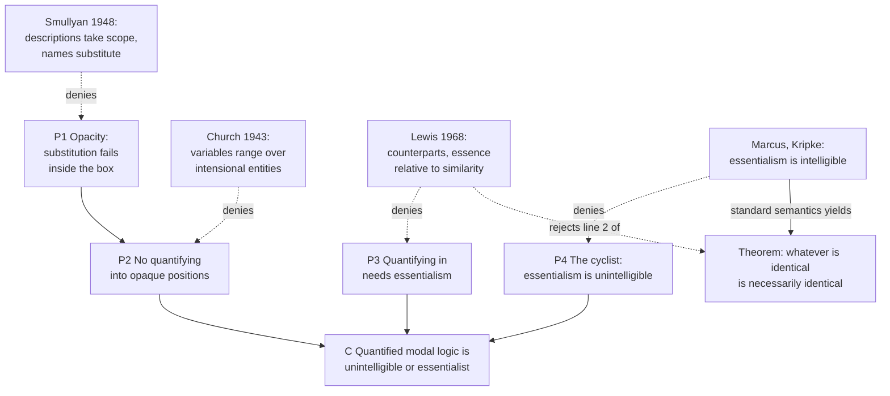

# Philosophy of Language and Logic · Lesson 2.5: De re modality and Quine's challenge

> ⏱ ~15 min · Module 2: Modal logic · Builds on: [1.3](01-03-russells-theory-of-descriptions.md), [2.4](02-04-quantified-modal-logic-and-the-barcan-formula.md), [`metaphysics` 3.1](../../metaphysics/lessons/03-01-kinds-of-necessity.md) · Unlocks: [3.2](03-02-rigid-designation-and-the-causal-picture.md), [3.3](03-03-the-necessary-a-posteriori-and-natural-kinds.md)

## Why this matters

In [`metaphysics` 3.1](../../metaphysics/lessons/03-01-kinds-of-necessity.md), "the number of planets is necessarily greater than 7" came out false read one way and true read the other, and the diagnosis was scope. W. V. Quine used the same sentence in 1943 for a harsher verdict: a variable bound from outside "necessarily" has no clear sense, so every formula in [2.4](02-04-quantified-modal-logic-and-the-barcan-formula.md) with a quantifier outside a box rests on a confusion. This lesson states his objections as objections, gives the scope reply, derives the theorem he found most suspicious, and shows the one semantics that rejects it.

## The idea

A box can govern a sentence or an object. "Necessarily, the winner won" says that in every outcome, whoever wins wins: trivially true. Read the other way, it picks out the person who in fact won and says *she* could not have lost: false. The second reading, a quantifier outside the box binding a variable inside it, is [quantifying in](../reference.md#quantifying-in), and it is what makes a claim [de re](../reference.md#de-re-and-de-dicto), about a thing however it is named, rather than de dicto, about a proposition. `metaphysics` 3.1 already wrote both readings with a box and a quantifier and refuted the planets inference with a two-world model; this lesson takes that as done and asks whether the de re reading makes sense at all.

Quine's worry in plain words: whether a thing has a trait should not depend on what you call it. "Greater than 7" is true of nine under any name. "Necessarily greater than 7" seems to come and go with the name: true of nine called "9", false of nine called "the number of planets". A trait that comes and goes with the name is not a trait of the thing, so asking of a thing, bare, whether it is necessarily so is asking a question with no answer. Quine called a position where co-referring terms cannot be swapped [referentially opaque](../reference.md#referential-opacity): the substitution failure behind Frege's [indirect contexts](../reference.md#indirect-context) of [1.2](01-02-belief-reports-and-empty-names.md), found here inside "necessarily".

## The argument

**Conventions.** Worlds $w_0$ (actual), $w_1, \dots$; every world sees every world (an [S5](../reference.md#system-s5) frame); the domain is the same at every world ([constant domains](../reference.md#constant-and-varying-domains)); $x = y$ is true at a world iff $x$ and $y$ are assigned the same object. A formula is **de dicto** if every box in it governs a closed sentence, **de re** if some variable inside a box is bound from outside it.

**Quine's argument** ("Notes on Existence and Necessity", 1943; "Reference and Modality", in *From a Logical Point of View*, 1953; *Word and Object*, 1960):

**P1. Opacity.** "9 = the number of planets" and "necessarily, 9 > 7" are true, yet "necessarily, the number of planets > 7" is false, so [substitutivity](../reference.md#substitutivity-salva-veritate) fails inside the box. (Nine in 1943; the IAU's 2006 definition of "planet" made it eight.) *In words:* what follows "necessarily" is not just about the objects its terms pick out.

**P2. No quantifying into opaque positions.** A variable reaches a position only through the object assigned to it. *In words:* in $\exists x\,\Box(x > 7)$, which number is it, nine or the number of planets? They are the same number, and the box treats them differently.

**P3. Essentialism.** Quantifying in is intelligible only if an object, independently of how it is specified, has some traits necessarily and others contingently: [Aristotelian essentialism](../reference.md#aristotelian-essentialism), $\exists x\,(\Box Fx \land Gx \land \neg\Box Gx)$ ("Three Grades of Modal Involvement", 1953). *In words:* de re modality needs real essences.

**P4. Essentialism is unintelligible.** The [mathematical cyclist](../reference.md#mathematical-cyclist) (*Word and Object*): mathematicians are necessarily rational and not necessarily two-legged; cyclists are necessarily two-legged and not necessarily rational. Of a man who is both, is he necessarily rational? *In words:* Quine says no answer exists apart from a way of picking him out.

**∴ C.** Quantified modal logic, with variables ranging over objects, is unintelligible or committed to an indefensible essentialism.

**[Smullyan's reply](../reference.md#smullyans-reply)** (Arthur Smullyan, "Modality and Description", 1948) denies P1 as a claim about positions. "The number of planets" is a [definite description](../reference.md#definite-description), so on Russell's [theory of descriptions](../reference.md#theory-of-descriptions) ([1.3](01-03-russells-theory-of-descriptions.md)) it is no term at all and takes [scope](../reference.md#scope). "The $F$ is necessarily $G$" has two readings:

$$\text{narrow: }\Box\,\exists x\,\big(Fx \land \forall y\,(Fy \to y = x) \land Gx\big) \qquad \text{wide: }\exists x\,\big(Fx \land \forall y\,(Fy \to y = x) \land \Box\,Gx\big)$$

For Quine's sentence the narrow reading is false and the wide one true. A genuine name substitutes for a co-referring name inside the box; a description substitutes only into the wide reading. `metaphysics` 3.1 wrote the description as a world-relative term $n$; unpacked by Russell, its two formulas are these two readings, with the same values. Ruth Barcan Marcus endorsed the reply in her 1948 review. Notice that the true, wide reading quantifies in.

**The [necessity of identity](../reference.md#necessity-of-identity).** [Leibniz's law](../reference.md#leibnizs-law), as a schema: for any formula $\varphi(z)$, $\forall x\,\forall y\,\big(x = y \to (\varphi(x) \to \varphi(y))\big)$. ([`metaphysics` 5.3](../../metaphysics/lessons/05-03-coincidence-and-the-ship-of-theseus.md) states it for properties.)

1. $\forall x\,\Box(x = x)$. *Justification:* $x = x$ is a theorem; the [necessitation rule](../reference.md#necessitation-rule) gives $\Box(x = x)$; generalize. *Assumption:* the identity atom is true of each object at every world.

2. $\forall x\,\forall y\,\big(x = y \to (\Box(x = x) \to \Box(x = y))\big)$. *Justification:* Leibniz's law with $\varphi(z) := \Box(x = z)$, so $\varphi(x)$ is $\Box(x = x)$ and $\varphi(y)$ is $\Box(x = y)$. *Assumption:* the schema holds for formulas containing a box, the step `metaphysics` 5.3 marks as disputed.

3. $\forall x\,\forall y\,(x = y \to \Box\,x = y)$. *Justification:* lines 1 and 2, propositional logic under the quantifiers.

*In words:* whatever is identical is necessarily identical. No frame condition is used: the theorem holds on every frame. Barcan proved a version in 1947, in a second-order system; this three-line proof opens Kripke's "Identity and Necessity" (1971). Quine read Barcan's theorem as essentialism showing through. If domains vary and an identity counts as false where its object is absent, line 1 fails and only $\forall x\,\forall y\,\big(x = y \to \Box(\exists z\,(z = x) \to x = y)\big)$ survives; [3.2](03-02-rigid-designation-and-the-causal-picture.md) meets that difference with names.

**[Counterpart theory](../reference.md#counterpart-theory)'s translation** (David Lewis, "Counterpart Theory and Quantified Modal Logic", 1968; the ontology is [`metaphysics` 3.2](../../metaphysics/lessons/03-02-what-possible-worlds-are.md)'s T4). Primitives: $Wu$ ($u$ is a world), $Ixu$ ($x$ is in $u$), $Cxy$ ($x$ is a counterpart of $y$); each thing is in one world and is its own counterpart.

$$\Box\varphi(x) \;\mapsto\; \forall u\,\forall x'\,\big((Wu \land Ix'u \land Cx'x) \to \varphi^{u}(x')\big)$$

and dually for $\Diamond$, with $\varphi^u$ restricting quantifiers to things in $u$ and each free variable of $\varphi$ sent to its own counterpart. *In words:* $a$ is necessarily $F$ iff every counterpart of $a$, in every world, is $F$.

So $\Box(x = x)$ says every counterpart of $x$ is itself: true. $\Box(x = y)$ says any counterpart of $x$ and any counterpart of $y$ in one world coincide, which fails, even with $x = y$, once $x$ has two counterparts in a world (Lewis held he might have been twins, had the fetus he grew from split). Then line 2 fails, line 3 fails, and $a = b \land \Diamond(a \neq b)$ comes out true.

**Where the argument is weakest.** Line 2, where Quine's argument and the derivation meet. The objection: line 2 assumes that $\Box(x = z)$ expresses a property of whatever $z$ is assigned, however it is picked out, which is what P1 and P2 deny, so the derivation begs the question against Quine. Lewis's version, in his 1983 postscripts: the box binds every variable in its scope, so line 2 is no proper instance of Leibniz's law, which stays valid for every non-modal formula. The defender's reply: if variables range over objects, being necessarily identical to $x$ is a property like any other; refusing the law for it makes modal predicates stand for different properties depending on the term they attach to, which concedes Quine's point that de re modality is relative to description. The defender concedes that the theorem is only as strong as the claim that de re predicates express properties of objects; the critic concedes either no quantifying in (Quine) or inconstant modal predicates and a substitution rule with a new proviso (Lewis).

## Argument map

Solid arrows are Quine's argument, dashed arrows the replies, each leaving at a different premise, and the bottom node is what the two semantic replies do to the necessity of identity.

## Worked examples

**Example 1 (clean case: the justices).** Congress fixes the number of US Supreme Court justices by statute; it is nine, and it was six in 1789. "Nine is necessarily odd; the number of justices is nine; so the number of justices is necessarily odd." Let $Jx$ be "$x$ numbers the justices", $Ox$ "$x$ is odd", the domain the numbers at both worlds:

| | $w_0$ (actual) | $w_1$ |
|---|---|---|
| number of justices | 9 | 6 |
| 9 odd? | yes | yes |

- Premises: $\Box O(\text{nine})$ is true (the numeral is rigid); $\exists x\,(Jx \land \forall y\,(Jy \to y = x) \land x = \text{nine})$ is true at $w_0$.

- Narrow conclusion $\Box\,\exists x\,(Jx \land \forall y\,(Jy \to y = x) \land Ox)$: false at $w_0$, because the unique $J$-thing at $w_1$ is 6.

- Wide conclusion $\exists x\,(Jx \land \forall y\,(Jy \to y = x) \land \Box\,Ox)$: true at $w_0$, because 9 is odd at both worlds.

Swapping "nine" for "$3^2$" inside the box is harmless; the description goes in only on the wide reading. No position is opaque: Smullyan's diagnosis. But the wide reading needed 9 itself, however named, to be odd at every world: an essentialist claim, if a mild one, and one Quine still refused.

**Example 2 (hard case: Lumpl and Goliath).** Allan Gibbard ("Contingent Identity", 1975) imagines a clay statue, Goliath, and its clay, Lumpl, which begin and end together. Goliath could have been squashed into a ball while Lumpl survived. Gibbard says they are one thing, identical only contingently. The derivation says there is no such thing: if Lumpl is Goliath, necessarily so. Three ways out, and the logic picks none. The constitution theorist keeps the theorem and counts two objects ([`metaphysics` 5.3](../../metaphysics/lessons/05-03-coincidence-and-the-ship-of-theseus.md), which owns that debate). Gibbard keeps one object, so the derivation must fail for these names; Lewis's 1971 version lets "statue" and "clay" call up different counterpart relations (`metaphysics` 5.3 runs that analysis). A third option denies the modal difference itself. The account stops at a disjunction: identity, the modal difference and line 2 cannot all stand, and the derivation alone does not say which goes. That is [contingent identity](../reference.md#contingent-identity)'s whole dispute.

## Watch out

- **You might think** the necessity of identity makes every true identity *sentence* necessary, **but actually** it concerns objects: "the number of justices = 9" is true and contingent, because the description is not rigid. Only terms that pick out the same object at every world inherit the necessity: with this lesson's constant domains, the [rigid designators](../reference.md#rigid-designator) of [3.2](03-02-rigid-designation-and-the-causal-picture.md). Nor does it say anything exists necessarily.

- **You might think** de re versus de dicto is just the scholastic [necessity of the consequent versus of the consequence](../reference.md#necessity-of-the-consequence), as [`philosophical-method` 3.2](../../philosophical-method/lessons/03-02-distinctions-and-verbal-disputes.md) and `metaphysics` 3.1 file it. They share the scope point, **but** $\Box(p \to q)$ versus $p \to \Box q$ can be drawn in propositional modal logic, while de re in Quine's sense needs a variable bound from outside the box.

- **You might think** counterpart theory gives up Leibniz's law, **but actually** it keeps the law for every non-modal formula; what fails is substitution inside a box that gives each variable its own counterpart.

## One-liner

> Quine charged that a box cannot reach an object past its name; scope answers the substitution puzzle, the necessity of identity shows what quantifying in commits you to, and counterpart theory shows the price of escaping it.

## Problems

**P1 (🟢)** *(Formal model: Formal (a)–(b).)* In a two-player final exactly one of the finalists $a$ and $b$ wins: at $w_0$ $a$ wins, at $w_1$ $b$ wins. Each world sees both worlds, the domain is $\{a, b\}$ at both, and $Wx$ is "$x$ wins". The sentence: "One of the two finalists is bound to win."

(a) Write its de dicto and de re readings and give each reading's truth value at $w_0$, checking world by world.

(b) With constant domains, which reading entails the other? One line, with the reason.

**P2 (🟡)** *(Reconstruct: Formal (a)–(b) · Exegetical (c).)* A student derives the necessity of identity but writes the Leibniz's law step with $\varphi(z) := \Box(z = z)$.

(a) Write the student's instance and the correct one, say in one line why only the correct one reaches $\Box(x = y)$, and give the three-line derivation with each line's justification.

(b) A counterpart model (Lewis 1968, box over all worlds): $w_0$ contains $a$; $w_1$ contains $b_1$ and $b_2$; each thing is its own counterpart, and $b_1$ and $b_2$ are both counterparts of $a$, with no other counterpart pairs. With $x$ and $y$ both assigned $a$, compute at $w_0$ the translations of $\Box(x = x)$, $\Box(y = y)$ and $\Box(x = y)$, and the truth value of each instance from (a). Show the model.

(c) Which line of the derivation does the counterpart theorist reject, and what in the translation makes the two instances come apart? Two sentences.

**P3 (🔴)** *(Steelman and reply: Formal (a) · Evaluative (b).)* Take Quine's cyclist as a description: "The mathematician who cycles is necessarily rational", with $Mx$ ($x$ is a mathematician), $Cx$ ($x$ cycles) and $Rx$ ($x$ is rational).

(a) Write the wide-scope reading in Russell's notation. One line.

(b) Does Smullyan's scope reply answer Quine's essentialism objection, or only his substitution objection? Give the strongest case for "only substitution", then the strongest reply. Any verdict; 150 words or fewer.

Solutions

**P1** *(Formal (a)–(b).)*

(a) De dicto: $\Box\,\exists x\,Wx$, "in every outcome somebody wins". At $w_0$, $Wa$; at $w_1$, $Wb$; so $\exists x\,Wx$ is true at both worlds $w_0$ sees, and the de dicto reading is **true** at $w_0$. De re: $\exists x\,\Box\,Wx$, "some finalist wins in every outcome". For $a$: $Wa$ is false at $w_1$, which $w_0$ sees, so $\Box Wa$ is false. For $b$: $Wb$ is false at $w_0$, which $w_0$ sees (it sees itself), so $\Box Wb$ is false. No witness: the de re reading is **false** at $w_0$ (and likewise at $w_1$).

(b) De re entails de dicto: if some $d$ wins at every world $w$ sees, then at each such world something wins, namely $d$, which is in that world's domain because domains are constant. The converse fails: this model.

**Must hit, strict:** both formulas with the box and quantifier in the right order; the check of each finalist at both worlds, including $w_0$ seeing itself; de dicto T, de re F; the direction of entailment with the domain reason.

**Accept:** writing the de re reading as $\Box Wa \lor \Box Wb$ if you say it unpacks $\exists x$ over the domain $\{a, b\}$; adding that with varying domains the entailment survives growing domains, and fails when they shrink only if predicates may hold of things absent from a world; under [2.4](02-04-quantified-modal-logic-and-the-barcan-formula.md)'s convention (i) it survives shrinking too.

**Wrong turns:** reading "bound to" as an obligation; checking $\Box Wb$ only at $w_1$; saying the de dicto reading entails the de re, which this very model refutes.

---

**P2** *(Formal (a)–(b) · Exegetical (c).)*

(a) Student: $x = y \to (\Box(x = x) \to \Box(y = y))$. It replaces both occurrences of $x$, so its consequent $\Box(y = y)$ is only line 1 again. Correct: $\varphi(z) := \Box(x = z)$ gives $x = y \to (\Box(x = x) \to \Box(x = y))$, which replaces the second occurrence only. Derivation:

1. $\forall x\,\Box(x = x)$: the theorem $x = x$, necessitation, generalization (constant domains).

2. $\forall x\,\forall y\,\big(x = y \to (\Box(x = x) \to \Box(x = y))\big)$: Leibniz's law, $\varphi(z) := \Box(x = z)$.

3. $\forall x\,\forall y\,(x = y \to \Box\,x = y)$: 1, 2, propositional logic under the quantifiers.

(b) The model: $w_0 = \{a\}$, $w_1 = \{b_1, b_2\}$; counterpart pairs $Caa$, $Cb_1b_1$, $Cb_2b_2$, $Cb_1a$, $Cb_2a$. The counterparts of $a$ are $a$ (in $w_0$) and $b_1$, $b_2$ (in $w_1$).

- $\Box(x = x) \mapsto \forall u\,\forall x'\,\big((Wu \land Ix'u \land Cx'x) \to x' = x'\big)$: each counterpart equals itself. **T.**

- $\Box(y = y)$: the same with $y$. **T.**

- $\Box(x = y) \mapsto \forall u\,\forall x'\,\forall y'\,\big((Wu \land Ix'u \land Cx'x \land Iy'u \land Cy'y) \to x' = y'\big)$: at $w_1$ take $x' = b_1$, $y' = b_2$; both are counterparts of $a$ and $b_1 \neq b_2$. **F.**

So the student's instance is T (T → (T → T)) and the correct instance is F (T → (T → F)). Line 1 is true at $w_0$ and line 3 is false there.

(c) Line 2, and with it line 3; line 1 holds in every counterpart model. The translation gives each free variable inside the box its own counterpart, so $\Box(x = x)$, with one variable, asks each counterpart to equal itself, while $\Box(x = y)$, with two, asks every pair of counterparts in a world to coincide, and with two counterparts of $a$ in $w_1$ those come apart although $x$ and $y$ have the same value.

**Must hit, strict:** both instances, with the second-occurrence point; three lines with justifications; the three values T, T, F with the witnessing pair $(b_1, b_2)$; line 2 as the rejected step, with the one-variable versus two-variable reason.

**Accept:** Lewis's own description of (c): the box binds every variable in its scope, so line 2 is not a proper instance of the law.

**Wrong turns:** saying counterpart theory rejects line 1; saying it rejects Leibniz's law wholesale; building the countermodel in standard Kripke semantics, where $x = y \land \Diamond(x \neq y)$ is never true.

---

**P3** *(Formal (a) · Evaluative (b).)*

(a) $\exists x\,\big(Mx \land Cx \land \forall y\,((My \land Cy) \to y = x) \land \Box\,Rx\big)$.

**Must hit, strict (a):** the uniqueness clause over the conjunction $My \land Cy$, and the box on $Rx$ alone, inside the scope of $\exists x$.

**Must hit, any verdict (b):**

- State what the reply does: descriptions are not names, they take scope, and the substitution failure is a scope ambiguity, not an opaque position.

- Point out that the reading the reply calls true quantifies in: (a)'s truth turns on whether that man, however specified, is rational at every world, and scope does not settle that.

- Give the strongest reply on the other side, with its source: Marcus ("Essentialism in Modal Logic", 1967; "Essential Attribution", 1971) argued that quantified modal logic proves only trivial essentialist sentences, such as $\Box(a = a) \land \neg\Box(b = a)$ for distinct $a$ and $b$, so its commitment is benign; or the essentialist's line that the question about the man himself is intelligible and has answers.

- Say what each side concedes.

**Wrong turns:** "Smullyan refuted Quine" with no mention that the wide reading quantifies in; treating the cyclist as another de re/de dicto countermodel, when Quine's point is that the de re question has no answer; claiming the cyclist's de dicto readings are false (necessarily, mathematicians are rational).

**Model answer (b), one of several:** Only substitution, on the strongest reading of Quine. Smullyan shows that "the number of planets" takes scope, so no position is opaque and names substitute freely. But the reading he calls true is $\exists x\,(\ldots \land \Box\,x > 7)$: a box inside a quantifier, true only if the number itself, under no description, exceeds seven at every world. That is the essentialism Quine targeted, and the cyclist asks the same question of a man, where scope gives no answer. The best reply is Marcus's: what quantified modal logic itself proves is only trivial essentialism, such as being necessarily identical to oneself, and anything stronger, like the cyclist's rationality, is a further claim the logic merely lets one state. On that view Smullyan answers the logical charge and leaves the metaphysical one where it belongs. Quine must then show that even trivial de re truths are unintelligible; Marcus must grant that Smullyan alone did not show essentialism respectable.

## Flashback

**From Lesson [2.3](02-03-which-logic-for-which-modality.md) (Which logic for which modality):** *(Formal (a)–(b) · Evaluative (c).)* A hostel notice (invented, written for this problem): "Guests may use the kitchen or the roof terrace after ten." A guest infers that she may use the terrace. In SDL ([deontic logic](../reference.md#deontic-logic)) the notice is $P(k \vee t)$, with $k$ and $t$ for her using the kitchen and the terrace after ten.

(a) Show that SDL does not validate $P(k \vee t) \to Pt$ with a model on a serial frame: check seriality at each world, and evaluate $P(k \vee t)$, $Pt$ and $O\neg t$ at every world. Show the model.

(b) Add the guest's step as a schema, $P(\varphi \vee \psi) \to P\psi$, and derive $Pk \to P\psi$ for any $\psi$, naming the rule behind each line.

(c) Which line does a defender of SDL reject, which does a defender of the guest's step reject, and what does each cost? 100 words or fewer.

Solution

(a) $W = \{w_0, w_1, w_2\}$; every world sees $w_1$ and $w_2$, where the house rules are kept: $R = \{(w_0,w_1), (w_0,w_2), (w_1,w_1), (w_1,w_2), (w_2,w_1), (w_2,w_2)\}$; $V(k) = \{w_1\}$, $V(t) = \varnothing$. Serial: each world sees $w_1$. Not reflexive: $w_0$ lacks its loop.

| world | $k \vee t$ | $P(k \vee t)$ | $Pt$ | $O\neg t$ | $P(k \vee t) \to Pt$ |
|---|---|---|---|---|---|
| $w_0$ | F | T | F | T | F |
| $w_1$ | T | T | F | T | F |
| $w_2$ | F | T | F | T | F |

Every world sees the same two worlds, so each $P$- and $O$-formula has one value throughout. In SDL the notice is consistent even with a ban on the terrace.

**Accept (a):** any serial model whose evaluation world sees a $k$-world and no $t$-world.

(b)

1. $k \to (k \vee \psi)$. *Tautology.*

2. $O(k \to (k \vee \psi))$. *Necessitation, 1.*

3. $Pk \to P(k \vee \psi)$. *2, by K and duality ([2.1](02-01-kripke-semantics-and-the-system-k.md)'s derived rule): Ross's step, for permission.*

4. $P(k \vee \psi) \to P\psi$. *The schema.*

5. $Pk \to P\psi$. *3, 4, propositional logic.*

If the kitchen is permitted, so is anything. Worse, D makes $P(k \vee \neg k)$ a theorem, and the same steps run on it with $\psi := \bot$ give $P\bot$, which K refutes: SDL plus the schema is inconsistent.

**Must hit, strict (a)–(b):** a serial model checked at every world, with $P(k \vee t)$ true and $Pt$ false at the evaluation world; line 3 from necessitation and K; line 4 from the schema.

**Must hit, any verdict (c):**

- The SDL defender rejects line 4 and must explain the notice's apparent permission: conveyed, not said ([4.4](04-04-speaker-meaning-and-implicature.md)), or really $Pk \wedge Pt$.

- The guest's defender rejects line 3 (or line 2's necessitation): $P$ is no longer the dual of a normal box, and 2.3's frame semantics goes with it.

**Wrong turns:** blaming D, when lines 1–5 hold in K (D only turns the collapse into inconsistency); using a dead end, which no SDL model has.

**Model answer (c), one of several:** The SDL defender rejects line 4: the notice says only $Pk \vee Pt$, and the rest is conveyed, not said; the cost is explaining why her step feels valid. Her defender rejects line 3, so permission is not closed under consequence; the cost is normality, and with it the frame correspondence that lets a frame condition settle a logic.

## Connections

- **Backward:** [1.3](01-03-russells-theory-of-descriptions.md) supplied the scope distinction Smullyan used, and [1.2](01-02-belief-reports-and-empty-names.md) the indirect contexts whose substitution failure Quine called opacity. [2.4](02-04-quantified-modal-logic-and-the-barcan-formula.md) supplied quantified models; Lewis's translation validates its converse Barcan formula, in both the box and the diamond form and for every formula, however the worlds' populations differ: each counterpart is evaluated in its own world, where it exists, so 2.4's predicate convention never comes into play. [`metaphysics` 3.1](../../metaphysics/lessons/03-01-kinds-of-necessity.md) set the planets case and stated the necessity of identity informally; [`metaphysics` 5.3](../../metaphysics/lessons/05-03-coincidence-and-the-ship-of-theseus.md) owns Leibniz's law and the statue.

- **Forward:** [3.2](03-02-rigid-designation-and-the-causal-picture.md) asks which names behave like the variables of the derivation, and [3.3](03-03-the-necessary-a-posteriori-and-natural-kinds.md) combines the necessity of identity with rigidity to get necessary truths known a posteriori. [3.4](03-04-indexicals-and-the-return-of-freges-puzzle.md) returns to substitution failure, in belief rather than necessity.

- **Sideways:** counterpart theory as ontology is [`metaphysics` 3.2](../../metaphysics/lessons/03-02-what-possible-worlds-are.md); Fine's claim that essence is not modal at all, a different answer to Quine's essentialism, is [`metaphysics` 2.4](../../metaphysics/lessons/02-04-essence-and-grounding.md). [`philosophy-of-religion` 1.4](../../philosophy-of-religion/lessons/01-04-eternity-immutability-and-simplicity.md) uses the necessity of identity in the modal-collapse argument. Quine's term survives in [`programming-languages` 6.2](../../programming-languages/lessons/06-02-state-references-and-the-store.md), where "referential transparency" is lost once equals cannot be substituted for equals.
