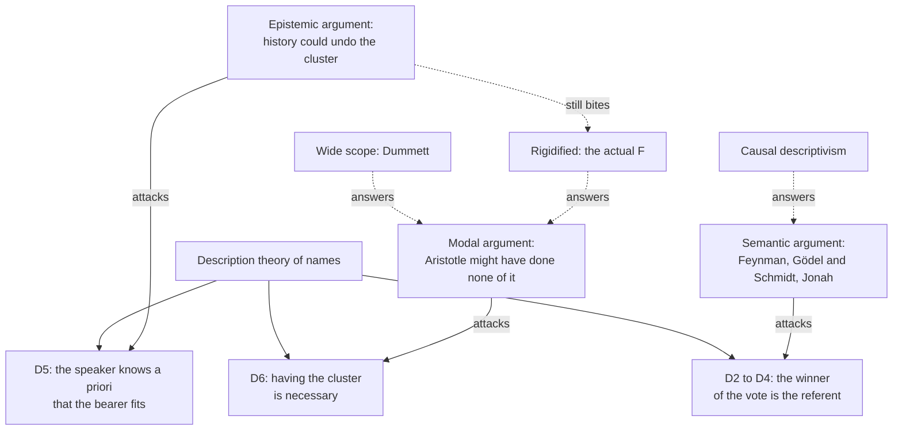

# Philosophy of Language and Logic · Lesson 3.1: Against descriptivism

> ⏱ ~15 min · Module 3: Names and necessity · Builds on: [1.3](01-03-russells-theory-of-descriptions.md), [2.5](02-05-de-re-modality-and-quines-challenge.md) · Unlocks: [3.2](03-02-rigid-designation-and-the-causal-picture.md)

## Why this matters

In [`mathematical-logic` 5.1](../../mathematical-logic/lessons/05-01-incompleteness-first-theorem.md) you proved the first incompleteness theorem, and most people who use the name "Gödel" know one thing about him: he proved it. Suppose, with Saul Kripke, that a historian showed tomorrow that Gödel took the proof from his friend Schmidt. Has the "Gödel" in your notes named Schmidt all along? If a name means the description its users attach to it, it has. Kripke's answer, which many readers share, is no: the name kept its bearer, and the description turned out false of him.

## The idea

[Descriptivism](../reference.md#descriptivism) says a proper name is a description in disguise: "Gödel" means something like "the man who proved incompleteness" and refers to whoever fits. You have met its classical forms: Frege's [sense](../reference.md#sense), which his footnote on "Aristotle" gives by descriptions that vary from speaker to speaker ([1.1](01-01-freges-puzzle-sense-and-reference.md)), and Russell's [names as disguised descriptions](../reference.md#names-as-disguised-descriptions) ([1.3](01-03-russells-theory-of-descriptions.md)). The [cluster theory](../reference.md#cluster-theory) of John Searle ("Proper Names", 1958) and P. F. Strawson (*Individuals*, 1959) loosens it: a name refers to whatever satisfies most of a bundle of descriptions, so no single one is required.

Think of a description as a search query, run afresh wherever you ask it, and a name as a saved link that keeps pointing at what it pointed at. Kripke's *Naming and Necessity* (lectures at Princeton, January 1970; published 1972; a book with a new preface, 1980) argues that names are links, by three routes the literature calls the [modal](../reference.md#modal-argument), [epistemic](../reference.md#epistemic-argument) and [semantic](../reference.md#semantic-argument) arguments. They ask what could have been, what a speaker knows without looking, and whom the name picks out.

His positive moral is a distinction: a description can [fix a name's reference without giving its meaning](../reference.md#fixing-reference-and-giving-meaning). "Jack the Ripper" was introduced for whoever committed certain murders, yet on Kripke's view "Jack the Ripper might never have harmed anyone" is true. [`philosophy-of-mind` 1.4](../../philosophy-of-mind/lessons/01-04-zombies-conceivability-and-kripke.md) used the distinction for "heat", [`epistemology` 4.1](../../epistemology/lessons/04-01-a-priori-knowledge.md) for Evans's "Julius"; this lesson asks whether it holds for names in general.

## Source

Russell, *The Problems of Philosophy* (Home University Library, 1912), ch. V:

> Common words, even proper names, are usually really descriptions. That is to say, the thought in the mind of a person using a proper name correctly can generally only be expressed explicitly if we replace the proper name by a description. Moreover, the description required to express the thought will vary for different people, or for the same person at different times. The only thing constant (so long as the name is rightly used) is the object to which the name applies.

The passage holds the classical theory and the seed of its trouble. "The thought in the mind" makes the description what the user has; "will vary" concedes that none is shared. Then the parenthesis: what keeps the object constant? "Rightly used" must mean "used of that object", presupposing the reference the descriptions were to supply. A page later Russell reaches for "an object B, called Bismarck", a description mentioning the name itself. Kripke's semantic argument presses here.

## The argument

Kripke states the theory he attacks as theses about a speaker $A$ and a name "$X$" (1980: 64–65, 71), here compressed.

**D1.** A cluster of properties $\varphi_1, \ldots, \varphi_n$ corresponds to "$X$": those $A$ believes $X$ has. *In words:* the name comes with a bundle of beliefs.

**D2.** $A$ believes that one of them, or some jointly, pick out one individual uniquely. *In words:* the bundle singles someone out.

**D3.** If most, or a weighted most, of the $\varphi$s are satisfied by exactly one object, that object is the referent. *In words:* the bundle votes, and the winner is the bearer.

**D4.** If the vote yields no unique object, "$X$" does not refer. *In words:* no winner, no bearer.

**D5.** $A$ knows a priori that if $X$ exists, $X$ has most of the $\varphi$s. *In words:* the speaker can know without looking that the bearer fits.

**D6.** That statement is necessary. *In words:* the bearer could not have failed to fit.

**(C)** The properties may not themselves presuppose the name's reference. *In words:* no "the man called $X$".

The classical theory is a one-member cluster.

**Modal argument (against D6).** Let $Tx$ say "$x$ taught Alexander" and $a$ name Aristotle. **P1.** "Aristotle might not have taught Alexander", $\Diamond\neg Ta$, is true: he might have died in infancy. *In words:* the name sentence is contingent. **P2.** If "Aristotle" meant "the teacher of Alexander", P1 would say what "the teacher of Alexander might not have taught Alexander" says with the description inside "might" (narrow scope, by [Russell's analysis](../reference.md#theory-of-descriptions)):

$$\Diamond\exists x\,\bigl(Tx \land \forall y\,(Ty \to y = x) \land \neg Tx\bigr),$$

which is false at every world, since nothing can uniquely teach Alexander and not teach him. *In words:* the description version cannot fail where the name version can. **∴ C.** "Aristotle" does not mean the description; over the whole cluster, D6 fails, since Aristotle might have done none of it. P1 is a modal intuition, so [`metaphysics` 3.1](../../metaphysics/lessons/03-01-kinds-of-necessity.md)'s conceivability checklist applies.

**Epistemic argument (against D5).** **P1.** If "Gödel" meant its cluster, "if Gödel existed, he proved incompleteness" would be knowable a priori by anyone who understands the name. *In words:* meaning would guarantee it. **P2.** It is not: we learned it from history, and history could undo it. **∴ C.** D5 fails.

**Semantic argument (against D2–D4 and C).** Someone who knows of Richard Feynman only that he was a physicist still refers to Feynman (against D2). In the theft story the vote goes to Schmidt, yet "Gödel" names Gödel (against D3). If scholars found a real prophet behind the Jonah story who did none of its deeds, "Jonah" would name him (against D4). Asked who Einstein was, many say "the man who discovered relativity", and asked what relativity is, "Einstein's theory" (against C). **∴ C.** What the speaker believes does not settle reference. Keith Donnellan argued in parallel ("Proper Names and Identifying Descriptions", 1970).

**Replies,** each with what it concedes:

- **[Wide scope](../reference.md#wide-scope-descriptivism)** (Michael Dummett, *Frege: Philosophy of Language*, 1973; David Sosa, 2001). Names are descriptions that always take wide scope: $\exists x\,(Tx \land \forall y\,(Ty \to y = x) \land \Diamond\neg Tx)$, true when the man who actually taught Alexander could have failed to. It concedes that names never behave non-rigidly, so their scope must be stipulated.

- **[Rigidified descriptions](../reference.md#rigidified-description)**: "the *actual* teacher of Alexander", where "actually" evaluates its clause at the actual world $w_0$ wherever it is embedded, or Alvin Plantinga's world-indexed properties (*The Nature of Necessity*, 1974); defended by Michael Nelson ("Descriptivism Defended", 2002). It agrees with the name at every world where the bearer exists, so the modal argument has nothing to bite. It concedes rigidity.

- **[Causal descriptivism](../reference.md#causal-descriptivism)** (so named by David Lewis, "Putnam's Paradox", 1984; Frederick Kroon, 1987; Frank Jackson, 1998). The description is "whoever stands at the origin of my chain of uses of this name". It concedes Kripke's account of what fixes reference ([3.2](03-02-rigid-designation-and-the-causal-picture.md)).

**Where the argument is weakest.** The modal argument's hidden premise: a name and the description giving its meaning must contribute the same thing under "might". Dummett's objection, developed by Jason Stanley ("Names and Rigid Designation", 1997), separates what a sentence asserts from what it contributes when embedded: "Aristotle taught Alexander" and its descriptive twin could assert the same thing yet embed differently. The strongest reply is Kripke's 1980 preface: no embedding is needed, since we evaluate the plain sentence at a counterfactual situation and the name keeps its bearer; Scott Soames (*Beyond Rigidity*, 2002) adds that a name in a belief report inside "might" would need its description outside "might" and inside "believes" at once. The descriptivist concedes that names are rigid. The Kripkean concedes that rigidity is compatible with descriptive content, so against the sophisticated replies the epistemic and semantic arguments carry the load.

## Argument map

Each argument attacks a different claim; dashed edges are the replies, and the epistemic argument still bites the rigidified one.

## Worked examples

**Example 1 (clean case: "Fibonacci").** The usual cluster: an Italian mathematician, and, with most of the weight, the man who discovered 1, 1, 2, 3, 5, 8, … Leonardo of Pisa used the sequence in *Liber Abaci* (1202) to model a rabbit population. Indian scholars of Sanskrit verse had already counted rhythms of short and long syllables with these numbers (the rhythms filling $n = 1, \ldots, 5$ beats from one-beat and two-beat syllables number 1, 2, 3, 5, 8): Virahanka's account, from about 700, is the clearest, and Hemachandra had it around 1150. Édouard Lucas named the sequence after Leonardo in the nineteenth century.

- *Modal.* Leonardo could have spent his life keeping accounts, so "Fibonacci might never have studied the sequence" is true, while "the discoverer of the sequence might not have discovered it", read narrow, is false.

- *Epistemic.* "If Fibonacci existed, he discovered the sequence" was never a priori; historians refuted it.

- *Semantic.* With weights 1 and 2, the vote goes to an Indian prosodist, the only candidate past half the total, yet speakers saying "Fibonacci" were talking, wrongly, about Leonardo.

The descriptivist's escape, "the man the sequence is named after", borrows its referent from Lucas's naming and so breaches (C).

**Example 2 (hard case: causal descriptivism against Gödel and Schmidt).** Give "Gödel", in my mouth, the description "the person at the origin of the chain of uses from which I got 'Gödel'". In the theft story that is Gödel, so the error case is absorbed; Feynman too, since the bystander's chain ends at Feynman. Unlike the descriptions Strawson allowed that lean on other speakers' use, it mentions causes, not reference, so (C) is respected. Rigidified, it answers the modal argument; and if a speaker knows a priori that a name refers to whatever its chain started from, it answers the epistemic one.

Two objections remain. The description makes my "Gödel proved incompleteness" partly about my own use of a word, so two speakers who say it assert different things. And ordinary speakers hold no such description, yet refer. Jackson answers that speakers' verdicts on cases ("it would still be Gödel") show an implicit grasp of a description they cannot state. Soames (*Reference and Description*, 2005) replies that this makes descriptivism unfalsifiable: any verdict can be read back as a hidden description.

**Where it stops.** Can a description only a philosopher can state, read off from verdicts on cases, be what ordinary speakers mean? The causal descriptivist says meaning is whatever guides the verdicts; the Kripkean says that concedes the theory of reference and keeps only the word "description".

## Watch out

- **You might think** "Gödel might not have proved it" and "Gödel might turn out not to have proved it" make one point, **but actually** the first concerns a counterfactual world (D6) and the second what we could learn about this one (D5). Rigidification answers only the first.

- **You might think** a name introduced by a description means it, **but actually** on Kripke's view "Jack the Ripper" or "Julius" only has its reference fixed by the description and is still rigid. Such names produce the contingent a priori of [3.3](03-03-the-necessary-a-posteriori-and-natural-kinds.md).

- **You might think** Kripke showed that names have no sense, **but actually** the arguments target senses given by descriptions a speaker associates, and a Fregean may posit senses that are not descriptions at all. The profession is split: in the PhilPapers 2020 survey, 36.1 percent accepted or leaned towards Fregean and 38.7 percent towards Millian views of proper names (target faculty, N = 1,269).

## One-liner

> Kripke's three arguments attack three different claims of descriptivism, that a name means its descriptions, that its user knows a priori the bearer fits them, and that whatever fits them is the bearer, and each descriptivist repair survives by conceding part of his picture.

## Problems

**P1 (🟢)** *(Diagnose: Exegetical.)* Three letters to the *Eskerby Courier* about the town's founder, known to all as Old Caddick (invented, written for this problem):

> (a) "Caddick could have sailed for Canada as a boy and never set eyes on Eskerby, and he would still have been Caddick."
>
> (b) "For all the parish records yet show, Caddick may turn out not to have built the first mill, so 'if Caddick existed, he built the first mill' is no truth of the dictionary."
>
> (c) "Half the town says 'Old Caddick' and can tell you only that he was an early settler, and there were forty of those; every one of them still means Caddick."

For each letter, say whether it runs the modal, the epistemic or the semantic argument, and which of the theses D1–D6 it attacks. One line each.

**P2 (🟡)** *(Counterexample: Formal (a) · Evaluative (b).)* In Eskerby the name "Sabeline Corvo" comes with a weighted cluster (invented, written for this problem): founded the *Eskerby Courier* (weight 3), wrote its first editorial (2), led the campaign to save the lighthouse (2), was born in Eskerby (1). Read D3 as: the referent is the unique person whose satisfied descriptions carry more than half the total weight, and nobody if no one, or more than one person, clears that bar.

(a) Build a Gödel/Schmidt-style case: say who did what, so that the vote picks someone other than the woman the town has always called "Sabeline Corvo", and show the vote.

(b) Your case is aimed at a descriptivist reply. Which one, and what objection to the classical theory was it built to answer? Then name a reply that could absorb your case and say what it concedes. 150 words or fewer.

**P3 (🔴)** *(Steelman and reply: Formal (a) · Evaluative (b).)* Most of Eskerby knows Bettany Lisle only as the engineer who designed the harbour bridge (invented, written for this problem). A descriptivist proposes that "Bettany Lisle" means "the actual designer of the harbour bridge". Let $Dx$ say "$x$ designed the harbour bridge", $l$ name Lisle, and $\mathsf{A}\varphi$ ("actually $\varphi$") be true at any world just when $\varphi$ is true at the actual world $w_0$.

(a) Write the narrow-scope reading of "the actual designer of the harbour bridge might not have designed it" with $\mathsf{A}$, and say why it is true at $w_0$ when Lisle designed the bridge at $w_0$ and some world $w_0$ sees contains Lisle but has someone else design it, while the same reading without $\mathsf{A}$ is false at every world. Show the formula; two sentences.

(b) Give the strongest Kripkean response to the proposal, run on this case, and say what each side must concede. 150 words or fewer.

Solutions

**P1** *(Exegetical.)*

**Must hit, strict:**

- (a) Modal; D6. A counterfactual ("could have"): Caddick might have lacked every property in the cluster.

- (b) Epistemic; D5. "May turn out" concerns what we could learn about the actual world: the conditional is not known a priori.

- (c) Semantic, the ignorance case; D2. The speakers believe nothing that singles Caddick out, yet refer to him.

**Accept (c):** D4 as well as D2, if the reason given is that with only "an early settler" the vote yields no unique object, so the theory predicts no reference.

**Wrong turns:** calling (b) modal because of "may"; calling (c) an error case against D3 (nobody else wins the vote: the speakers believe too little, not something false); calling (a) epistemic because the writer is "imagining".

**Model answer:** (a) modal, against D6; (b) epistemic, against D5; (c) semantic (ignorance), against D2.

---

**P2** *(Formal (a) · Evaluative (b).)*

(a) The total weight is $3 + 2 + 2 + 1 = 8$, so a winner needs more than 4, that is at least 5. One case: Corvo's cousin, Mr Thistlewood, founded the *Courier* and wrote its first editorial, then left Eskerby and let Corvo, his co-editor, take the credit; Corvo led the lighthouse campaign and was born in Eskerby. The vote:

$$\text{Thistlewood: } 3 + 2 = 5 > 4, \qquad \text{Corvo: } 2 + 1 = 3 \le 4,$$

so D3 picks Thistlewood. Yet every use of "Sabeline Corvo" in the town traces back to Corvo, and the name names her: the townsfolk believed false things about her.

**Accept (a):** any case in which someone other than the town's Corvo satisfies descriptions worth at least 5 (the smallest such sets are founding plus the editorial, founding plus the lighthouse, or the editorial, the lighthouse and birth together), no second person also clears 4, and the name's uses still trace to Corvo.

**Must hit, strict (a):** the threshold (more than 4 of 8); the vote shown with the impostor at 5 or more and Corvo at 4 or less; the verdict that the theory names the impostor while the name names Corvo.

**Must hit, any verdict (b):**

- The case targets the cluster theory (Searle, Strawson), built to answer the classical theory's problem that any single description can be false of the bearer, or not known by every user.

- A reply that absorbs it, stated: causal descriptivism ("whoever stands at the origin of the town's chain of uses of the name"), or a deferential description, with what it concedes: the causal chain, not the cluster, fixes reference; a description like "the woman the town calls 'Sabeline Corvo'" also breaches (C).

**Wrong turns:** a case where Corvo loses but nobody wins (a Jonah-style case, against D4, not Gödel-style); giving Thistlewood only the founding (3): then Corvo scores 5 and still wins; saying the case refutes the classical theory, which already falls to a single misattribution.

**Model answer (b), one of several:** The case is aimed at the cluster theory, the reply Searle and Strawson gave when the classical theory stumbled on single descriptions that turn out false: let a weighted majority decide, so one error is harmless. Here the error is systematic: Thistlewood wins the vote, and the theory says the town has always been talking about him. Causal descriptivism can absorb this. If "Sabeline Corvo" means "whoever stands at the origin of the chain of uses through which the town got this name", the chain runs back to Corvo, whatever the town wrongly believed. The cost is that the description no longer records what speakers know about her: it records how the name reached them, which is Kripke's picture written inside a description.

---

**P3** *(Formal (a) · Evaluative (b).)*

(a) The narrow-scope reading is

$$\Diamond\exists x\,\bigl(\mathsf{A}Dx \land \forall y\,(\mathsf{A}Dy \to y = x) \land \neg Dx\bigr).$$

Because $\mathsf{A}$ sends its clause back to $w_0$, the first two conjuncts are satisfied at every world by Lisle alone, the unique actual designer, so at a world that contains her and has someone else design the bridge the body is true, and the formula is true at $w_0$, just as $\Diamond\neg Dl$ is. Without $\mathsf{A}$ the body asks for something that uniquely designed the bridge and did not design it at one and the same world, which no world supplies.

**Must hit, strict (a):** the formula with $\mathsf{A}$ on both occurrences of $D$ inside the description and not on $\neg Dx$; the reason it is true (the description picks out Lisle at every world, and she exists and fails to design at a seen world); the reason the plain version is false everywhere (a contradiction inside the diamond).

**Must hit, any verdict (b):**

- A Kripkean response run on Lisle. The epistemic one: "if exactly one person designed the bridge, the actual designer did" is knowable a priori, however the world turns out, but "if exactly one person designed the bridge, Lisle did" is not, since the records could show her partner designed it. Or the semantic one: rigidifying changes nothing at the actual world, so if her partner actually designed the bridge, "the actual designer" names the partner while "Bettany Lisle" names Lisle. (Accept Soames's attitude-report point if it is run on the case.)

- What the descriptivist concedes: names are rigid, and the epistemic and semantic arguments must be met by another description (causal or deferential).

- What the Kripkean concedes: the modal argument alone does not refute this proposal.

**Wrong turns:** saying the modal argument still refutes the rigidified description (it agrees with the name at every world where Lisle exists); treating "actually" as emphasis, so the description shifts with the world; running the epistemic argument as "she might not have designed it", which is the modal argument again.

**Model answer (b), one of several:** Grant that "the actual designer" keeps Lisle at every counterfactual world, so the modal argument fails. The strongest response is that rigidity was never the whole charge. Rigidifying changes how a description behaves at other worlds, not what it picks out at this one. If the town's records showed that Lisle's partner drew the bridge and Lisle took the credit, "the actual designer" would denote the partner while "Bettany Lisle" would still name Lisle, so the semantic argument is untouched. And "if anyone uniquely designed the bridge, the actual designer did" is a priori in a way the Lisle sentence is not, so the epistemic argument is untouched too. The descriptivist must concede rigidity and look for another description, such as a causal one. The Kripkean must concede that the modal argument, his most famous, cannot do this work alone.

## Flashback

**From Lesson [2.4](02-04-quantified-modal-logic-and-the-barcan-formula.md) (Quantified modal logic and the Barcan formula):** *(Formal (a) · Exegetical (b).)* Line 1 of 2.4's derivation of the [Barcan formula](../reference.md#barcan-formula) (T2) is $\forall x\,\Box Fx \to \Box Fx$, with $x$ free. Take 2.4's semantics ([actualist quantifiers](../reference.md#actualist-quantifier), assignments into $U$, the union of the domains, and convention (i), $V(F, w) \subseteq D(w)$) and the model $W = \{w_0, w_1\}$, $R = \{(w_0,w_0), (w_1,w_1)\}$, $D(w_0) = V(F, w_0) = \{a\}$, $D(w_1) = V(F, w_1) = \{b\}$.

(a) With $x$ assigned $b$, compute line 1 at $w_0$. Is BF, as a schema, valid on this frame with these domains? Compute its instance $\forall x\,\Box Fx \to \Box\forall x\,Fx$ at both worlds.

(b) What does (a) show about what line 1 assumes, compared with what BF's validity requires? Two sentences.

Solution

(a) $R$ holds only the two loops, so each world sees only itself. $U = \{a, b\}$, and $b \notin D(w_0)$.

- *Line 1 at $w_0$, $x \mapsto b$.* Antecedent: $\forall x$ at $w_0$ reaches only $a$, which is $F$ at $w_0$, the one world $w_0$ sees: **true**. Consequent: $\Box Fx$ needs $b \in V(F, w_0)$, which convention (i) rules out: **false**. So line 1 is **false**.

- *BF is valid*, by T1: domains never grow along $R$, since $wRv$ only when $v = w$.

- *The instance* is **true** at $w_0$ (both sides hold, with $a$) and at $w_1$ (with $b$), as under all four extensions of $F$ that convention (i) allows.

The value $b$ enters $U$ from $w_1$, a world $w_0$ does not see.

**Must hit, strict:**

- (a) line 1 false at $w_0$: antecedent true (only $a$ is quantified over), consequent false ($b \notin D(w_0)$); BF valid by T1; the instance true at both worlds.

- (b) line 1 assumes that whatever a free variable can denote is in the domain of the world of evaluation; BF needs only no newcomers along $R$; so a model can refute line 1 and still validate BF.

**Wrong turns:** letting $x$ range only over $D(w_0)$, which makes line 1 true (2.4 assigns into $U$); calling BF invalid because the domains differ (T1 looks only along $R$); concluding that refusing line 1 refutes BF.

**Model answer (b):** Line 1 assumes that whatever a variable can denote is there to be quantified over at the world of evaluation; $b$ can be denoted at $w_0$ but is not in its domain. BF needs only that no world sees a world with something new, which this frame meets, so line 1 asks more than BF does: refusing it, as the contingentist does, blocks T2's route to BF, but BF itself fails only where some world sees a newcomer.

## Connections

- **Backward:** Frege's footnote on "Aristotle" in [1.1](01-01-freges-puzzle-sense-and-reference.md) is the classical theory's first statement, and Russell's disguised descriptions in [1.3](01-03-russells-theory-of-descriptions.md) its strongest; the wide-scope reply is [1.3](01-03-russells-theory-of-descriptions.md)'s [scope](../reference.md#scope) distinction put to modal work, and its wide reading is the [de re](../reference.md#de-re-and-de-dicto) reading of [2.5](02-05-de-re-modality-and-quines-challenge.md).
- **Forward:** [3.2](03-02-rigid-designation-and-the-causal-picture.md) defines the [rigid designator](../reference.md#rigid-designator) in a model and gives the [causal-historical](../reference.md#causal-historical-theory) picture that causal descriptivism tries to absorb, with Evans's Madagascar as its hard case; [3.3](03-03-the-necessary-a-posteriori-and-natural-kinds.md) turns reference-fixing descriptions into the necessary a posteriori and the contingent a priori; [3.4](03-04-indexicals-and-the-return-of-freges-puzzle.md) shows the price of giving up descriptive senses, as Frege's puzzle returns in belief reports.
- **Sideways:** [`philosophy-of-mind` 1.4](../../philosophy-of-mind/lessons/01-04-zombies-conceivability-and-kripke.md) borrows rigidity and the fixing-versus-meaning distinction for "heat" and "pain", and [`epistemology` 4.1](../../epistemology/lessons/04-01-a-priori-knowledge.md) the reference-fixing description behind "Julius". [`thomistic-synthesis` 4.3](../../thomistic-synthesis/lessons/04-03-the-names-of-god.md) asks whether a name of God still refers when every description attached to it falls short, which is the descriptivism question run on theology. [`philosophy-of-science` 2.4](../../philosophy-of-science/lessons/02-04-kuhn-incommensurability-and-theory-choice.md) uses Scheffler's point that sense can shift while reference holds, the same separation applied to theoretical terms. And [`philosophy-of-mind` 6.3](../../philosophy-of-mind/lessons/06-03-do-language-models-understand.md) reports Mandelkern and Linzen's argument that a language model's words can borrow reference through the history of its text: the semantic argument asked of a new kind of speaker.
