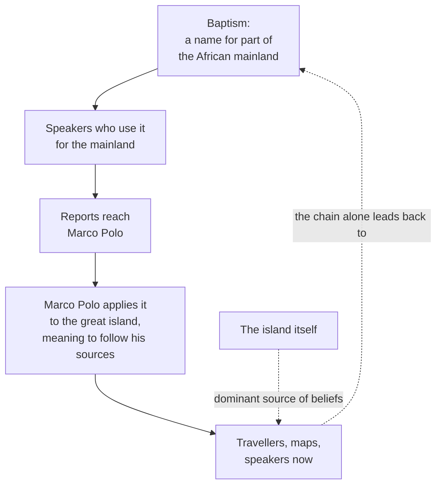

# Philosophy of Language and Logic · Lesson 3.2: Rigid designation and the causal picture

> ⏱ ~15 min · Module 3: Names and necessity · Builds on: [2.4](02-04-quantified-modal-logic-and-the-barcan-formula.md), [2.5](02-05-de-re-modality-and-quines-challenge.md), [3.1](03-01-against-descriptivism.md) · Unlocks: [3.3](03-03-the-necessary-a-posteriori-and-natural-kinds.md)

## Why this matters

In [`philosophy-of-mind` 6.3](../../philosophy-of-mind/lessons/06-03-do-language-models-understand.md) you met the claim that a language model's words can refer: Matthew Mandelkern and Tal Linzen (*Computational Linguistics*, 2024) argue that the text a model learns from has a natural history, so its "Gödel" may inherit the reference of ours. That claim borrows the picture built here. [3.1](03-01-against-descriptivism.md) showed that a name is not shorthand for a description; this lesson says what a name does instead, in two claims: what it designates across possible worlds, and what links it to its bearer.

## The idea

Compare "Neil Armstrong" with "the first person to walk on the Moon". They pick out the same man. Had the Apollo 11 crew climbed down in the other order, "the first person to walk on the Moon" would pick out Buzz Aldrin, and "Neil Armstrong" would still pick out Armstrong. A description is a job title that goes to whoever fills the role at the world you describe; a name is a tag tied to the man and carried into every scenario you describe. That is [rigid designation](../reference.md#rigid-designator). It concerns how *we* use the name to describe other worlds, not what anyone there calls him.

Rigidity says what a name does once it has a bearer. It does not say how "Armstrong" got attached to Armstrong. Speakers may know nothing that singles him out (3.1's semantic argument). Kripke's answer is a chain: someone named him, and the name passed from speaker to speaker, each meaning to use it as the speaker they learned it from did. That is the [causal-historical theory](../reference.md#causal-historical-theory). The two claims are independent.

[`metaphysics` 3.1](../../metaphysics/lessons/03-01-kinds-of-necessity.md) showed informally why a rigid term, unlike a description, can move inside the box, and [`philosophy-of-mind` 1.4](../../philosophy-of-mind/lessons/01-04-zombies-conceivability-and-kripke.md) used rigidity against the identity theory; this lesson owns the definition and the theory behind it.

## Source

> Thus, I call a certain man by the name Sophroniscus: I call him by another name, The father of Socrates. Both these are names of the same individual, but their meaning is altogether different; they are applied to that individual for two different purposes: the one, merely to distinguish him from other persons who are spoken of; the other to indicate a fact relating to him, the fact that Socrates was his son.

J. S. Mill, *A System of Logic*, Book I, ch. II, §5 (8th edition, 1872; Harper reprint, New York, 1882).

Mill's proper name is [non-connotative](../reference.md#connotative-and-non-connotative-names): it denotes its bearer and connotes no attribute, a "mark" (his word). "The father of Socrates" is a connotative individual name: it applies because of a fact about him. The deciding words are "their meaning is altogether different" for two names of one man: a name's whole job is its bearer, the ancestor of today's Millian semantics. The passage says nothing about other possible worlds: it makes Mill a forerunner of direct reference, and whether he also anticipates rigidity is a further question it does not settle.

## The argument

**Setting.** Quantified models as in [2.4](02-04-quantified-modal-logic-and-the-barcan-formula.md), with domains $D(w)$ and actualist quantifiers. $d_w(t)$ is the object a term $t$ designates when we use it to describe $w$ (possibly none); "the $F$" designates at $w$ the unique $F$-thing in $D(w)$, if there is one.

**D1. [Rigid designator](../reference.md#rigid-designator)** (Saul Kripke, *Naming and Necessity*, Princeton lectures of 1970, printed 1972, book 1980). Kripke calls a designator rigid if it designates the same object in every possible world, adding that the object need not exist in every world. In "Identity and Necessity" (1971) he spells it out: wherever the object exists, the designator designates it; where it does not, the designator has no referent. Formally, $t$ is rigid for $o$ iff, for every $w$, if $o \in D(w)$ then $d_w(t) = o$, and $d_w(t)$ is never an object other than $o$. *In words:* the term follows its object into every scenario that contains it, and never picks out a stand-in.

**D2. [Persistent and obstinate rigidity](../reference.md#persistent-and-obstinate-rigidity)** (Nathan Salmon, *Reference and Essence*, 1981). A designator is *persistently* rigid if it designates $o$ at every world where $o$ exists and nothing at any other world; *obstinately* rigid if it designates $o$ at every world, whether or not $o$ exists there. Kripke wrote both ways (his 1971 spelling-out is persistent; "Hitler", he says, still refers to Hitler at a world where he was never born) and declined to choose. His *strongly rigid* is narrower: a rigid designator of a necessary existent, for which the two readings coincide. *In words:* the readings agree where the bearer exists and differ elsewhere; glosses in this library take one side without saying so.

**D3. [De jure and de facto rigidity](../reference.md#de-jure-and-de-facto-rigidity)** (Kripke). A term is rigid *de jure* when its semantics stipulates rigidity: a name, or (on the usual view) a description rigidified by "actual", which at every world picks out whoever meets the condition *here*. It is rigid *de facto* when a description's condition is met by the same object at every world: "the smallest prime" designates 2 everywhere because arithmetic does not vary. *In words:* a name is rigid by its rules of use; a description can be rigid by the facts.

**T1. What rigidity adds to identity.** [2.5](02-05-de-re-modality-and-quines-challenge.md) derived $\forall x\,\forall y\,(x = y \to \Box\,x = y)$. If $a$ and $b$ are rigid for one object $o$, then $a = b$ is true at every world where $o$ exists. On persistent rigidity both names designate nothing where $o$ is absent, so the identity holds exactly there; "true at every world" needs obstinate rigidity with identity holding of objects a world lacks, or constant domains. *In words:* "everywhere" is a further choice. Its use on "Hesperus is Phosphorus" is [3.3](03-03-the-necessary-a-posteriori-and-natural-kinds.md)'s.

**The causal picture** (*Naming and Necessity*, Lecture II).

**P1. [Initial baptism](../reference.md#initial-baptism).** A name is introduced by fixing its bearer, by pointing or by a description that fixes the reference without giving a synonym. *In words:* someone attaches the name to a thing.

**P2. [Reference-borrowing](../reference.md#reference-borrowing).** A later speaker who picks up the name in communication refers with it if she intends to use it with the same reference as the speaker she learned it from. *In words:* each link inherits the referent of the link before.

**P3.** A speaker needs no description that identifies the bearer, and what she believes about him may be false. *In words:* the chain, not the speaker's head, does the work.

**∴ C.** A use of a name refers to whatever was baptized at the origin of the chain that leads to it. *In words:* reference runs back through history, not out through descriptions.

Kripke disclaimed necessary and sufficient conditions: this is a picture, not a theory that predicts every case.

**[Madagascar](../reference.md#madagascar-case)** (Gareth Evans, "The Causal Theory of Names", *Proceedings of the Aristotelian Society*, Supplementary Volume 47, 1973). "Madagascar" named part of the African mainland; Marco Polo, misunderstanding his sources, applied it to the great island. Each link meant to use the name as before, so P1–C give the mainland. Evans moves the causal link to run from the object to the body of information speakers associate with the name: a name refers to the dominant causal source of that information, here the island (while "Gödel" must not shift to Schmidt). In the addenda to *Naming and Necessity* Kripke grants the case: a present intention to refer to a given thing can override the intention to preserve reference along the chain. Applied to theoretical terms, the picture let Hilary Putnam argue that "electron" kept its reference as theories of the electron changed ("Explanation and Reference", 1973), the realist answer to meaning variance; Scheffler and Field's partial denotation are [`philosophy-of-science` 2.4](../../philosophy-of-science/lessons/02-04-kuhn-incommensurability-and-theory-choice.md)'s.

**[The qua problem](../reference.md#qua-problem)** (discussed under that name by Michael Devitt and Kim Sterelny, *Language and Reality*, 1987). Point at a cat and say "Biscuit": the causal facts are the same whether you named the cat, its fur, or its species. Selecting the target takes the sort of thing the baptizer means to name, which makes the view a causal-descriptive hybrid, as Evans's is from the other side.

**Where the argument is weakest.** P2. The strongest objection is Madagascar: the intention to co-refer held at every link, yet reference shifted, so it cannot suffice. The strongest replies: Kripke's override (a present intention to refer to the island beats the inherited one), and the new-name reply (Marco Polo started a second name spelled like the first). The Kripkean concedes that P2 needs an override clause whose conditions the picture does not state; Evans concedes that a body of information, close kin to the descriptivist's cluster, re-enters, and that "dominant" names no threshold.

## The picture

Kripke's chain leads back to a mainland baptism; Evans's dominant source runs from the island to what speakers now believe.

## Worked examples

**Example 1 (clean case: a name and a co-designating description in a model).** Worlds $w_0$ (actual) and $w_1$ (the crew climbed down in the other order), universal accessibility, domain $\{\text{Armstrong}, \text{Aldrin}\}$ at both; $Fx$ is "$x$ first walked on the Moon", $a$ is "Armstrong". In the house format of [`metaphysics` 3.1](../../metaphysics/lessons/03-01-kinds-of-necessity.md):

| | $w_0$ | $w_1$ |
|---|---|---|
| Who walked on the Moon first | Armstrong | Aldrin |
| "Armstrong" designates | Armstrong | Armstrong |
| "the first person to walk on the Moon" designates | Armstrong | Aldrin |
| "the actual first person to walk on the Moon" designates | Armstrong | Armstrong |
| "the smallest prime" designates | 2 | 2 |
| $\exists x\,(\forall y\,(Fy \leftrightarrow y = x) \wedge a = x)$ | T | F |

The name and the "actual" description are rigid de jure, "the smallest prime" de facto, the plain description not at all. The identity is true at $w_0$ and false at $w_1$, so with the description inside the box, $\Box\,\exists x\,(\forall y\,(Fy \leftrightarrow y = x) \wedge a = x)$ is false at $w_0$. With the description outside, $\exists x\,(\forall y\,(Fy \leftrightarrow y = x) \wedge \Box\,a = x)$ is true at $w_0$: the man who in fact walked first is necessarily Armstrong. A rigid name behaves as if it always took wide scope.

**Example 2 (hard case: Madagascar).** Three accounts of a present-day use:

- *The picture as stated (P1–C).* The chain runs back through Marco Polo to the mainland. Verdict: the mainland, which no one accepts.

- *Kripke's override.* Today's intention to refer to the island wins. Verdict: the island. But the account needs a rule for when an override wins, and Gödel and Schmidt show it cannot be "whenever the speaker's beliefs fit something else better".

- *Evans.* The island is the dominant source of what we believe about "Madagascar": its coastline, its people, its lemurs. Verdict: the island.

**Where it stops.** No account dates the shift: nothing says at which link, or at what share of island-sourced belief, reference changed. Kripkeans say a picture may leave that open; Evans, that "dominant" is real but vague; the new-name theorist dates the shift to Marco Polo's first use, at the price of a baptism no one intended.

## Watch out

- **You might think** a rigid name commits you to its bearer existing necessarily, **but actually** "Armstrong" is rigid, and Armstrong might never have been born. Kripke's *strongly rigid* designators are just the rigid ones whose bearers exist necessarily.

- **You might think** a true identity between two rigid names is true at every world, **but actually** on persistent rigidity it is true only where its object exists (T1).

- **You might think** rigidity and the causal picture are one doctrine, **but actually** "the actual winner of this year's Eskerby regatta" is rigid with no baptism, while a term introduced by pointing at the trophy to stand, at each world, for whoever wins it there is causally grounded and not rigid.

## One-liner

> A rigid designator follows its object into every world where it exists, a chain of borrowers attaches a name to its object, the two claims are independent, and Madagascar shows the chain alone cannot say when reference shifts.

## Problems

**P1 (🟢)** *(Exegetical.)* Invented, written for this problem: Ingrith Lowther is the president of Eskerby's chess club. Classify each designator as rigid de jure, rigid de facto, or non-rigid, and give the reason. Treat numbers as existing at every world. One line each.

(a) "Ingrith Lowther".

(b) "the positive square root of 81".

(c) "the actual president of Eskerby's chess club".

(d) "the mother of Ingrith Lowther" (answer on either view about whether a person could have had different parents).

**P2 (🟡)** *(Formal model: Formal (a)–(b) · Exegetical (c).)* Invented: Eskerby's town hall is called "Quenby Hall". Take three worlds with universal accessibility and actualist quantifiers. At $w_0$ (actual) the hall and the old mill both stand and the hall is the tallest building in Eskerby; at $w_1$ the mill was never built and the hall is the tallest; at $w_2$ the hall was never built and the mill is the tallest. So $D(w_0) = \{h, m\}$, $D(w_1) = \{h\}$, $D(w_2) = \{m\}$, and $T$ ("is the tallest building in Eskerby") has extension $\{h\}$ at $w_0$, $\{h\}$ at $w_1$, $\{m\}$ at $w_2$. The name $q$ ("Quenby Hall") designates $h$ at $w_0$ and $w_1$ and nothing at $w_2$.

(a) Tabulate what $q$ and "the tallest building in Eskerby" designate at each world. Is $q$ persistently rigid? Obstinately rigid? Is the description rigid on either reading? Show the check.

(b) Write "Quenby Hall is the tallest building in Eskerby" by Russell's analysis and give its truth value at $w_0$ and at $w_1$. Is it true at every world where the hall exists? Show the computation.

(c) The description designates the hall at every world where the hall exists. Which clause of the definition of rigidity does it fail, and what does (b) show about using "true wherever the object exists" as a test for rigidity? Two sentences.

**P3 (🔴)** *(Apply to a hard case: Exegetical (a)–(b) · Evaluative (c).)* Invented, written for this problem. The brig *Sabeline* was wrecked off Eskerby in 1854; the parish register records the wreck and its crew. In 1903 a fisherman hauled up a carved figurehead and, believing it came from the *Sabeline*, gave it to the town, where it stands on the quay. For a century every guidebook, school project and harbour festival has told the story of the *Sabeline* from the figurehead: its carvings, where it was found, the fisherman's account. In 2026 divers show that the figurehead came from an unnamed schooner wrecked in 1871.

(a) On Kripke's picture as stated in P1–C, what does "the *Sabeline*" refer to when a present-day Eskerby guide uses it? One sentence.

(b) What does Evans's dominant-source account say, and which fact about the guide's information decides it? Two sentences.

(c) Does the causal picture, with Kripke's concession that a present intention can override the chain, say the name now refers to the schooner? Say where it stops giving a verdict. 150 words or fewer.

Solutions

**P1** *(Exegetical.)*

**Must hit, strict:**

- (a) Rigid de jure: a proper name designates Lowther at every world where she exists, by its rules of use, whatever she does there.

- (b) Rigid de facto: the description designates 9 at every world because arithmetic is the same at every world, not by stipulation; since 9 exists at every world, it is also strongly rigid in Kripke's sense.

- (c) Rigid de jure: "actual" ties the condition to the actual world, so the description picks out Lowther at every world where she exists, including worlds where someone else presides.

- (d) Non-rigid: Lowther's mother exists at worlds where she has no children, and there the description designates nothing although she exists; if Lowther could have had other parents, it also designates someone else at some worlds. Either way it fails D1.

**Wrong turns:** calling (d) rigid because of the necessity of origin: origin essentialism makes the description track the mother at every world where *Lowther* exists, not at every world where the *mother* exists. Calling (b) de jure because arithmetic holds "by definition": the description's condition is evaluated world by world, and the facts make its value constant. Calling (c) non-rigid because "president" names a role.

**Model answer:** (a) Rigid de jure: a name designates Lowther wherever she exists. (b) Rigid de facto: 9 at every world, because arithmetic does not vary. (c) Rigid de jure: "actual" keeps it on Lowther at every world where she exists. (d) Non-rigid: her mother exists at worlds where she has no child, and there the description designates nothing.

---

**P2** *(Formal (a)–(b) · Exegetical (c).)*

(a)

| | $w_0$ | $w_1$ | $w_2$ |
|---|---|---|---|
| $D(w)$ | $\{h, m\}$ | $\{h\}$ | $\{m\}$ |
| $q$ designates | $h$ | $h$ | nothing |
| "the tallest building in Eskerby" designates | $h$ | $h$ | $m$ |

- $q$: $h$ exists at $w_0$ and $w_1$, and $q$ designates $h$ at both; $h$ is absent at $w_2$, and $q$ designates nothing there. Persistently rigid. Not obstinately rigid: at $w_2$ it does not designate $h$.

- The description: $h$ at $w_0$ and $w_1$, but $m$ at $w_2$, an object other than $h$. Not rigid on either reading. (Nor is it rigid for $m$: $m$ exists at $w_0$, where the description designates $h$.)

(b) $\exists x\,(\forall y\,(Ty \leftrightarrow y = x) \wedge q = x)$.

- At $w_0$, $x$ ranges over $\{h, m\}$. Take $x = h$: $Th$ holds and $Tm$ fails, so $\forall y\,(Ty \leftrightarrow y = h)$ holds, and $q = h$ holds. True.

- At $w_1$, $x$ ranges over $\{h\}$: $Th$ holds and $q = h$. True.

The hall exists only at $w_0$ and $w_1$, so the sentence is true at every world where the hall exists: $\Box(\exists z\,(z = q) \to \exists x\,(\forall y\,(Ty \leftrightarrow y = x) \wedge q = x))$ is true at $w_0$. (At $w_2$ the sentence is false, since $q$ designates nothing, so the unrestricted $\Box$ of the sentence is false at $w_0$.)

(c) It fails the clause "never designates an object other than $o$": at $w_2$ it designates the mill. So an identity's being true wherever the object exists does not show that its terms are rigid: a description can track its object wherever the object exists and still hand the role to a stand-in where the object is missing.

**Must hit, strict:** (a) the three-column table; $q$ persistently but not obstinately rigid; the description non-rigid because of $w_2$. (b) the Russellian formula with the uniqueness clause checked at $w_0$; T at $w_0$ and $w_1$; yes, true wherever the hall exists. (c) the "never anything else" clause, and that truth wherever the object exists does not certify rigidity.

**Accept:** in (b), the description treated as a term $t$ with $q = t$, which gives the same values; noting the value F at $w_2$.

**Wrong turns:** calling the description rigid because it designates the hall wherever the hall exists; calling $q$ non-rigid because it designates nothing at $w_2$ (persistent rigidity allows exactly that); dropping the uniqueness clause at $w_0$, where the mill exists too.

---

**P3** *(Exegetical (a)–(b) · Evaluative (c).)*

**Must hit, strict (a):** the 1854 brig: the guide's use is borrowed along a chain (guidebooks, townspeople, the fisherman) whose every link meant to use the name as before, and the fisherman meant the brig named and wrecked in 1854.

**Must hit, strict (b):**

- Evans: a name refers to the dominant causal source of the body of information its users associate with it.

- The deciding fact is where the guide's information mostly comes from: the figurehead's carvings, the find site and the fisherman's story come from the schooner; the date and the crew list come from the brig. On the stem's facts the figurehead dominates, so the schooner.

**Must hit, any verdict (c):**

- State the override clause and apply it: the guide has two present intentions, to refer to the ship whose figurehead stands on the quay (the schooner) and to the ship the register records (the brig).

- Note that the clause gives no verdict without a rule for which intention wins, and that the Gödel and Schmidt verdict forbids letting the better fit of current beliefs decide.

- Say where it stops (no condition for when an override wins, and no date for any shift: 1903, gradually, or never) and what each rival adds (Evans's dominance; a new-name theorist's second baptism).

**Wrong turns:** saying the 2026 discovery changes the reference by itself (finding a mistake re-baptizes nothing); treating the case as Gödel and Schmidt, where a description is misattributed while the name keeps its bearer; saying Evans counts the speakers' beliefs by fit rather than by causal source.

**Model answer (c), one of several:** Not by itself. The override clause says a present intention to refer to a given thing can beat the intention to preserve reference. The guide has two present intentions: to talk about the ship whose figurehead stands on the quay, and about the ship the register says sank in 1854. Before 2026 they seemed to be one ship; now they are two, and the picture does not say which wins. Nor can the clause defer to whichever ship her beliefs fit better, since in Kripke's Gödel case fit loses. So the picture stops exactly where a rule for overriding is needed: it cannot say whether reference shifted in 1903, gradually, or not at all. Evans supplies a rule, the dominant source, and on these facts it gives the schooner; a new-name theorist says the fisherman's use began a second name.

## Flashback

**From Lesson [2.5](02-05-de-re-modality-and-quines-challenge.md) (De re modality and Quine's challenge):** *(Formal (a) · Exegetical (b).)* Invented, written for this problem: at $w_0$ there are identical twins $a$ and $b$; at $w_1$ the embryo they grew from never split, and its one child $c$ is, by similarity, a counterpart of each. So $w_0$ contains $a$ and $b$, $w_1$ contains $c$, and the counterpart pairs are $Caa$, $Cbb$, $Ccc$, $Cca$ and $Ccb$, with no others. Use [counterpart theory](../reference.md#counterpart-theory)'s translation from 2.5, box over all worlds.

(a) At $w_0$, compute the [necessity of identity](../reference.md#necessity-of-identity), $\forall x\,\forall y\,(x = y \to \Box\,x = y)$, and the necessity of distinctness, $\forall x\,\forall y\,(x \neq y \to \Box\,x \neq y)$. Show the counterpart pairs each box checks.

(b) Which line of 2.5's derivation must a counterpart model falsify to refute the necessity of identity, what must the model contain for that, and why does this one not? Two sentences.

Solution

(a) The counterparts, world by world:

| | $w_0$ | $w_1$ |
|---|---|---|
| counterparts of $a$ | $a$ | $c$ |
| counterparts of $b$ | $b$ | $c$ |

Each variable inside the box goes to its own counterpart:

$$\Box(x = y) \;\mapsto\; \forall u\,\forall x'\,\forall y'\,\big((Wu \land Ix'u \land Cx'x \land Iy'u \land Cy'y) \to x' = y'\big),$$

and $\Box(x \neq y)$ is the same with $x' \neq y'$.

- Identity. In $w_0$, $x = y$ holds only for $(a, a)$ and $(b, b)$. For $(a, a)$ the box checks $(a, a)$ in $w_0$ and $(c, c)$ in $w_1$; for $(b, b)$, $(b, b)$ and $(c, c)$. Each pair coincides: **true** at $w_0$.

- Distinctness. For $(a, b)$ the box checks $(a, b)$ in $w_0$, which passes, and $(c, c)$ in $w_1$, where $c \neq c$ is false: **false** at $w_0$, and $a \neq b \land \Diamond(a = b)$ is true.

In standard Kripke semantics (2.5's conventions), $x = y$ under an assignment has one value at every world, so both formulas hold everywhere: the failure is the translation's.

**Must hit, strict (a):** the pairs each box checks; identity true; distinctness false at the pair $(c, c)$ in $w_1$.

**Must hit, strict (b):**

- Line 2, and with it line 3.

- Failure needs one thing with two counterparts in a world, since each variable in the box gets its own counterpart.

- This model has the reverse: two things share one counterpart.

**Wrong turns:** reading "the twins might have been one" as a counterexample to the necessity of identity; saying line 1 fails; checking $\Box(x \neq y)$ at $w_0$ alone.

**Model answer (b):** Line 2, and so line 3, fails only where one thing has two counterparts in a world, because the translation sends $x$ and $y$ inside the box to separately chosen counterparts. Each twin here has one counterpart per world, so lines 1–3 hold and the fusion breaks only the necessity of distinctness, which the derivation never asserts.

## Connections

- **Backward:** [2.4](02-04-quantified-modal-logic-and-the-barcan-formula.md) supplied varying domains, which is where persistent and obstinate rigidity come apart; [2.5](02-05-de-re-modality-and-quines-challenge.md) derived the necessity of identity that rigidity makes bite on names; [3.1](03-01-against-descriptivism.md)'s semantic argument left the gap the causal picture fills, and its reference-fixing descriptions are P1's second route.

- **Forward:** [3.3](03-03-the-necessary-a-posteriori-and-natural-kinds.md) applies rigidity and T1 to "Hesperus is Phosphorus" and to kind terms, where the qua problem returns as the question of which kind a sample grounds; [3.4](03-04-indexicals-and-the-return-of-freges-puzzle.md) asks what a rigid name contributes inside a belief report.

- **Sideways:** content externalism about thought is [`philosophy-of-mind` 4.3](../../philosophy-of-mind/lessons/04-03-externalism-narrow-content-and-the-extended-mind.md), and Kripke's argument against the identity theory runs on rigidity in [`philosophy-of-mind` 1.4](../../philosophy-of-mind/lessons/01-04-zombies-conceivability-and-kripke.md); meaning variance and partial denotation are [`philosophy-of-science` 2.4](../../philosophy-of-science/lessons/02-04-kuhn-incommensurability-and-theory-choice.md); whether a model's words borrow reference is [`philosophy-of-mind` 6.3](../../philosophy-of-mind/lessons/06-03-do-language-models-understand.md). In [`databases` 2.1](../../databases/lessons/02-01-entity-relationship-modeling.md), a surrogate key identifies a row apart from its attributes, like a Millian name, while a natural key identifies it by them, like a description; and a baptism is a binding occurrence that later uses resolve back to, as in [`programming-languages` 1.6](../../programming-languages/lessons/01-06-name-resolution-and-the-semantic-phase.md).
