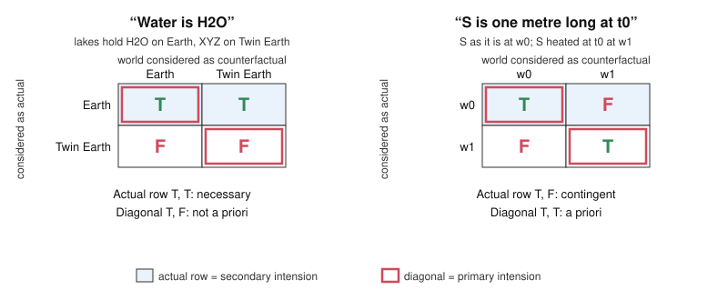

# Philosophy of Language and Logic · Lesson 3.3: The necessary a posteriori and natural kinds

> ⏱ ~15 min · Module 3: Names and necessity · Builds on: [2.5](02-05-de-re-modality-and-quines-challenge.md), [3.2](03-02-rigid-designation-and-the-causal-picture.md), [`metaphysics` 3.1](../../metaphysics/lessons/03-01-kinds-of-necessity.md), [`epistemology` 4.1](../../epistemology/lessons/04-01-a-priori-knowledge.md) · Unlocks: [3.4](03-04-indexicals-and-the-return-of-freges-puzzle.md)

## Why this matters

Ask a chemistry class two questions. Could water have turned out not to be H2O? Most say yes: the experiments might have come out otherwise. Could water have been something other than H2O? Many say no. [`metaphysics` 3.1](../../metaphysics/lessons/03-01-kinds-of-necessity.md) and [`epistemology` 4.1](../../epistemology/lessons/04-01-a-priori-knowledge.md) showed that both answers can be right, one about the route to a truth and one about the truth. Neither said what in the *words* pulls them apart. This lesson does: a four-line derivation, a theory of kind terms, and a table some read as Frege's senses returning.

## The idea

Metaphysics 3.1 gave Kripke's two steps (if water is H2O, necessarily so; water is H2O) and the misdescription move; epistemology 4.1 gave the two crossings with the stick S, Evans's "Julius" and Carroll and Dodgson; [`philosophy-of-mind` 1.4](../../philosophy-of-mind/lessons/01-04-zombies-conceivability-and-kripke.md) defined primary and secondary intension. This lesson supplies the semantics under all three.

Think of a [rigid designator](../reference.md#rigid-designator) as a pin and a description as a job title. Which object a pin went into you may learn by looking; once in, it stays in that object at every world where the object is. A job title can be held by different people at different worlds. Two pins that turn out to share an object share it everywhere, though it took a survey to find out: the [necessary a posteriori](../reference.md#necessary-a-posteriori). Push a pin in *by* a job title ("call whoever holds this job 'Julius'") and you know without looking that the pin's object holds the job, though it might not have: the [contingent a priori](../reference.md#contingent-a-priori). Hilary Putnam argued that "water" is a pin too, pushed in by pointing at samples. Two-dimensional semantics asks two questions of a sentence at a world: had this world turned out actual, would it be true? And, holding fixed what the words actually pick out, would it have been true had this world obtained?

## The argument

**1. The mechanism.** Use 2.5's quantified modal language: [actualist quantifiers](../reference.md#actualist-quantifier) range over the domain $D(w)$ of the world $w$ of evaluation, every world sees every world ([metaphysical necessity](../reference.md#metaphysical-necessity)), and $a$, $b$ are names.

**D1.** $\forall x\,\forall y\,(x = y \to \Box\, x = y)$: the [necessity of identity](../reference.md#necessity-of-identity), derived in [2.5](02-05-de-re-modality-and-quines-challenge.md) from $\forall x\,\Box(x = x)$ by [Leibniz's law](../reference.md#leibnizs-law) applied inside the box. *In words:* whatever is identical to a thing is necessarily identical to it.

**D2.** $a = b \to \Box\, a = b$, from D1 by instantiating $x$ to $a$ and $y$ to $b$. Two assumptions are used here. *Rigidity:* each name denotes the same object at every world (obstinately, in 3.2's term); otherwise the object instantiated outside the box need not be what the name picks out inside it (a non-rigid $a$ co-designating with $b$ only at $w_0$ falsifies D2 there while D1 holds everywhere). *Existence:* the names' actual referent is in $D(w_0)$, since an actualist universal instantiates only to what exists. *In words:* if two rigid names co-refer, they co-refer necessarily.

**D3.** $a = b$, by observation. *In words:* they do co-refer.

**∴ D4.** $\Box\, a = b$, by modus ponens. *In words:* the identity is necessary, and known a posteriori because D3 was.

D2 is metaphysics 3.1's a priori conditional made precise: everything above it is logic plus semantics. With [varying domains](../reference.md#constant-and-varying-domains), if an identity is false at a world lacking its object, D4 and D1 fail at $w_0$ as soon as some world lacks it. What survives is [weak necessity](../reference.md#strong-and-weak-necessity-of-identity), $\Box(\exists x\,(x = a) \to a = b)$: true at every world where the object exists. Persistent rigidity leaves only weak necessity, its names designating nothing where the object is absent ([3.2](03-02-rigid-designation-and-the-causal-picture.md)'s T1).

**2. Kind terms.** In "The Meaning of 'Meaning'" (1975) Putnam says the traditional theory assumes (I) that knowing a term's meaning is being in a certain psychological state and (II) that meaning, as intension, determines extension. On [Twin Earth](../reference.md#twin-earth) in 1750, Oscar and his duplicate share a psychological state, yet "water" picks out H2O for one and XYZ for the other, so nothing satisfies both. Putnam keeps (II) and drops (I): "'meanings' just ain't in the head". [`philosophy-of-mind` 4.3](../../philosophy-of-mind/lessons/04-03-externalism-narrow-content-and-the-extended-mind.md) runs the case on belief; here it is a claim about words. His positive account makes a [natural-kind term](../reference.md#natural-kind-term) indexical: "water" applies to whatever is the same liquid as *this* sample, so it picks out one kind at every world. It is a modern version of Leibniz's side against Locke on "gold" ([`modern-philosophy` 3.2](../../modern-philosophy/lessons/03-02-locke-qualities-substance-and-essence.md), Example 2).

A second argument needs no twin planet. Putnam cannot tell an elm from a beech, and his concept of each is the same, yet his "elm" and "beech" differ in extension: the [division of linguistic labor](../reference.md#division-of-linguistic-labor) lets experts settle what lay speakers' words apply to. Twin Earth shows the environment fixing reference; elm and beech, the community. Putnam later turned the causal constraint on reference against [`epistemology` 3.1](../../epistemology/lessons/03-01-the-closure-argument.md)'s brain in a vat (*Reason, Truth and History*, 1981, ch. 1): a lifelong vat-brain's "vat" refers to vat-images or electronic impulses, not to vats, so in its mouth "I am a brain in a vat" is false ([Putnam's brain-in-a-vat argument](../reference.md#putnams-brain-in-a-vat-argument)). Wright's transmission-failure verdict is [`epistemology` 3.3](../../epistemology/lessons/03-03-moore-and-the-dogmatist.md)'s; McKinsey's argument from externalism and self-knowledge (1991) belongs to `philosophy-of-mind` 4.3.

**3. The contingent a priori, semantically.** In epistemology 4.1's case, "one metre" is rigid and "the length of S at $t_0$" is not: the description [fixes the reference without giving the meaning](../reference.md#fixing-reference-and-giving-meaning) ([3.1](03-01-against-descriptivism.md)). So the stipulator knows without measuring that S is one metre long at $t_0$, yet at a world where S was heated it was longer. (The prototype bar stopped defining the metre in 1960; since 1983 the speed of light has.)

**4. Two dimensions.** [Two-dimensional semantics](../reference.md#two-dimensional-semantics), with `philosophy-of-mind` 1.4's glosses: an expression's [primary intension](../reference.md#primary-and-secondary-intension) is what it would pick out at a world if that world turned out to be actual; its secondary intension is what, given its actual referent, it picks out at a world considered as counterfactual. In a matrix, rows are worlds considered as actual, columns worlds considered as counterfactual, and a cell gives the truth value at the column world of what the sentence says if the row world is actual. The diagonal is the primary intension (Frank Jackson's A-intension, *From Metaphysics to Ethics*, 1998); the actual world's row is the secondary intension (his C-intension). David Chalmers's Core Thesis ("Epistemic Two-Dimensional Semantics", 2004): a sentence is a priori iff its primary intension is true at every scenario. The picture below shows both crossings. On Chalmers's and Jackson's reading a sentence carries two semantic values, and the primary one does the work of a Fregean sense: the neo-Fregean reply to Kripke.

Robert Stalnaker, who drew the first such matrices ("Assertion", 1978), reads them as metasemantic ("Assertion Revisited", 2004). Each row is the proposition the sentence *would* have expressed had its context been that world; its one semantic content is the actual row; the [diagonal proposition](../reference.md#diagonal-proposition) is what an assertion conveys when hearers do not know which row they are in, a reinterpretation forced by conversational norms, not a meaning. Millians such as Nathan Salmon (*Frege's Puzzle*, 1986) and Scott Soames (*Beyond Rigidity*, 2002) go further: "Hesperus is Phosphorus" expresses the proposition "Hesperus is Hesperus" does, knowable a priori, and what is learned a posteriori is that the sentence expresses it.

**Where the argument is weakest.** D2, for kind terms. A name rigidly designates an object; what does "water" designate? If "the same kind at every world", then "livestock" is rigid too, since every meaningful general term designates its own property everywhere (Stephen Schwartz, 2002), so rigidity cannot be what makes "water is H2O" special. Salmon ("How Not to Derive Essentialism from the Theory of Reference", 1979) adds that the necessity needs an essentialist premise, that being the same liquid is having the same microstructure, which no theory of reference supplies. The reply: Kripke and Putnam never claimed semantics alone yields the necessity; it explains why a necessity grounded in the kind's nature is hidden from the armchair, since reference was fixed by samples and appearances. The semanticist concedes that the source is metaphysical (metaphysics 3.1's) and that chemistry must supply the premise, which Hasok Chang (*Is Water H2O?*, 2012; [`philosophy-of-science` 5.2](../../philosophy-of-science/lessons/05-02-the-pessimistic-induction-and-selective-realism.md)) doubts it does simply. The critic concedes that, given the premise, rigidity explains the epistemic gap.

## The picture

Mirror images: a constant actual row with a broken diagonal is necessary a posteriori; a constant diagonal with a broken actual row is contingent a priori.

## Worked examples

**Example 1 (clean case: two valleys, one peak).** (Invented.) The north valley calls the summit above it "Tarrock"; the south valley calls the summit above it "Ulvane". A survey from both sides finds one peak. Take three worlds that all see one another: $w_0$ (actual), $w_1$ (no survey), $w_2$ (the mountain never formed). Let $m$ be the mountain and $r$ a river; $a$ is "Tarrock" and $b$ is "Ulvane".

| | $w_0$ | $w_1$ | $w_2$ |
|---|---|---|---|
| $D(w)$ | $\{m, r\}$ | $\{m, r\}$ | $\{r\}$ |
| $a$, $b$ denote | $m$, $m$ | $m$, $m$ | $m$, $m$ |
| $a = b$, outer-domain | T | T | T |
| $a = b$, existence-entailing | T | T | F |

Both names are rigid and $m \in D(w_0)$, so D2 applies, and the survey supplies D3. If identities are evaluated whether or not their objects exist (outer-domain), $\Box\, a = b$ is true at $w_0$. If identities about absent objects are false (existence-entailing), $\Box\, a = b$ is false at $w_0$ because of $w_2$, and so is D1; $\Box(\exists x\,(x = a) \to a = b)$ is true at $w_0$ on both. Before the survey the valleys could coherently imagine two mountains: a world where the north valley's name went to a different peak, a real possibility misdescribed as one where Tarrock is not Ulvane (metaphysics 3.1's misdescription move).

**Example 2 (hard case: does a stipulation give knowledge?).** The stipulator who fixes "one metre" by S at $t_0$ can say, without measuring, "S is one metre long at $t_0$". Kripke counts this a priori knowledge of a contingent truth. Keith Donnellan ("The Contingent A Priori and Rigid Designators", 1977) objects that the stipulation yields a priori knowledge only that the sentence expresses a truth; knowing the contingent truth it expresses, about that very length, needs a relation to the referent that a stipulation does not supply. The two-dimensionalist splits the case: what is known a priori is the necessary primary intension (the diagonal); the contingent secondary intension is not known a priori. No single content is both.

**Where it strains.** All three accept every cell of the figure. They disagree about what knowing a singular proposition requires: for Kripke reference fixed by a description is enough, for Donnellan it is not, and the two-dimensionalist denies there is one proposition to know. The case cannot decide the premise in dispute.

## Watch out

- **You might think** rigidity makes a true identity necessary, full stop, **but actually** rigidity plus truth gives necessity at every world only with outer-domain semantics or constant domains; otherwise it gives truth at every world where the object exists. Rigidity is not necessary existence. And the necessity of identity (D1, about objects) is not the necessity of a true identity *sentence* (D2), which needs rigid names.

- **You might think** the necessary a posteriori is an agreed class of propositions, **but actually** Kripke has one proposition, necessary and knowable only a posteriori; Chalmers and Jackson two semantic values; Stalnaker one necessary content plus a diagonal conveyed in context; Salmon and Soames one a priori proposition plus an a posteriori fact about a sentence.

- **You might think** Twin Earth and elm and beech make one point, **but actually** one turns on the environment, the other on the community. Neither says meanings are *located* outside the head, only that the head does not fix them.

## One-liner

> Rigidity makes a true identity necessary however it was discovered, and a reference-fixer a priori however contingent; the dispute is whether the matrix's diagonal is a meaning or a record of what the words might have meant.

## Problems

**P1 (🟢)** *(Diagnose: Exegetical (a)–(b).)* From a local paper's science column (invented, written for this problem):

> "A handwriting expert has shown that the crossword setter who signs as 'Vossler' is Morwenna Penrice, the retired harbourmaster. Since it took an expert to find this out, it is a contingent fact: Vossler and Penrice might have been two different people. The police, meanwhile, have named whoever set last month's boathouse fire 'the Tinderman', so they can be certain that the Tinderman set it. That makes it a necessary truth: the Tinderman could not have failed to set that fire."

(a) Each of the columnist's two inferences moves from an epistemic status to a modal one. For each, name the epistemic status, the modal conclusion drawn, and the modal status the claim has on Kripke's view. One line each.

(b) For each claim, name the designator whose rigidity, or the description whose non-rigidity, decides its modal status, and say how. One line each.

**P2 (🟡)** *(Formal model: Formal (a)–(b) · Exegetical (c).)* (Invented, written for this problem.) Miners on a sea cliff introduced "skerrow" as a name for the kind of stuff that forms the bitter white crust on the cliff face; an assay later showed the crust is compound M. Take two scenarios: $w_0$ (actual), where the crust is M, and $w_1$, where the crust is a compound N that looks and tastes the same. Read "skerrow is M" as true at a world iff the kind "skerrow" picks out is M, and "skerrow is what the crust is made of" as true at a world iff the kind "skerrow" picks out is the kind the crust is made of at that world.

(a) Fill in the two-dimensional matrix (rows: world considered as actual; columns: world considered as counterfactual) for S1, "skerrow is M", and for S2, "skerrow is what the crust is made of". Show both matrices.

(b) Read off each sentence's primary and secondary intensions, and classify each sentence as necessary or contingent, and as a priori or a posteriori by Chalmers's Core Thesis. Show the readings.

(c) Donnellan would dispute one of your four classifications. Which, and on what ground? Two sentences.

**P3 (🔴)** *(Find the crux: Exegetical (a)–(b) · Evaluative (c).)* A two-dimensionalist in Chalmers's line and Stalnaker both accept your matrix for S1 in P2, and still disagree about what S1 means.

(a) State what each says S1 semantically expresses and what status each gives the matrix's diagonal. One sentence each.

(b) Name the single premise one affirms and the other denies, and state it as a conditional both would sign. Two sentences.

(c) Say what argument or finding would move each side. Any verdict; 150 words or fewer.

Solutions

**P1** *(Exegetical (a)–(b).)*

**Must hit, strict (a):**

- Claim 1: a posteriori (an expert was needed), so the columnist concludes contingent; on Kripke's view the identity is necessary, a case of the necessary a posteriori.

- Claim 2: a priori (certain by the police's own stipulation), so the columnist concludes necessary; on Kripke's view it is contingent, a case of the contingent a priori.

**Must hit, strict (b):**

- Claim 1: "Vossler" and "Morwenna Penrice" are names, so both are rigid; a true identity between rigid names holds at every world where she exists (D2 to D4).

- Claim 2: "the Tinderman" is a rigid name whose reference is fixed by the non-rigid description "whoever set the boathouse fire". At a world where that person never set it, "the Tinderman set the fire" is false, so the claim is contingent. It is a priori because, whichever world is actual, the name picks out whoever set the fire there.

**Accept:** noting that what the police know a priori is strictly the conditional "if exactly one person set the fire, the Tinderman did" (at a world considered as actual where the fire was an accident, the plain sentence fails); reading claim 1's necessity as weak necessity.

**Wrong turns:** calling "the Tinderman" a description and so non-rigid (it is a descriptive name, like Evans's "Julius"); arguing that claim 1 is contingent because "Vossler" could have been someone else's pen name (that is a world where the name went to another person, not one where she is not herself); treating the police's certainty as a modal property.

**Model answer:** (a) Claim 1 infers contingency from a posteriority; it is necessary. Claim 2 infers necessity from apriority; it is contingent. (b) Claim 1: both names are rigid, so their true identity holds at every world where Penrice exists. Claim 2: "the Tinderman" rigidly names whoever actually set the fire, and that person might not have set it, so the sentence is contingent; the reference-fixing description makes it a priori for the police.

---

**P2** *(Formal (a)–(b) · Exegetical (c).)*

(a) If $w_0$ is actual, "skerrow" picks out M; if $w_1$ is actual, it picks out N. Each row then holds that kind fixed across the columns.

| S1 "skerrow is M" | $w_0$ | $w_1$ |
|---|---|---|
| $w_0$ as actual | T | T |
| $w_1$ as actual | F | F |

| S2 "skerrow is what the crust is made of" | $w_0$ | $w_1$ |
|---|---|---|
| $w_0$ as actual | T | F |
| $w_1$ as actual | F | T |

(b) S1: primary intension (diagonal) T at $w_0$, F at $w_1$, so not a priori; secondary intension ($w_0$ row) T, T, so necessary. S1 is necessary a posteriori. S2: primary intension T, T, so a priori; secondary intension T, F, so contingent. S2 is contingent a priori.

(c) Donnellan would dispute that S2 is known a priori as a contingent truth. The miners know a priori only that the sentence S2 expresses a truth; the contingent truth it expresses, that M itself is what the crust is made of, took the assay.

**Must hit, strict:** all eight cells, with the S2 row at $w_0$ reading T, F; the four readings (S1: diagonal T, F and row T, T; S2: diagonal T, T and row T, F); the classifications necessary a posteriori and contingent a priori; in (c), S2's apriority, and the distinction between knowing that a sentence expresses a truth and knowing the truth it expresses.

**Wrong turns:** filling a row by asking what the crust is made of at the column world for S1 (that turns S1 into S2); taking the diagonal as the secondary intension; saying S1 is contingent because chemists might have found N (that is the diagonal, an epistemic matter); in (c), saying Donnellan disputes S1's necessity.

---

**P3** *(Exegetical (a)–(b) · Evaluative (c).)*

**Must hit, strict (a):**

- Chalmers: S1 has two semantic values, a primary intension (the diagonal: true at a scenario considered as actual iff the crust there is M, so contingent) and a secondary intension (the $w_0$ row: necessary); the diagonal is a meaning, fixed by the speaker's understanding and knowable a priori, doing the work of a Fregean sense.

- Stalnaker: S1 semantically expresses one proposition, the necessary one in the actual row; the diagonal is a metasemantic construction, the proposition that S1 expresses a truth, which an assertion conveys when hearers do not know which proposition S1 expresses. It is not a meaning.

**Accept (b):** the crux put as whether the diagonal is fixed by the term's meaning, stable across conversations, or fixed by what a particular conversation presupposes.

**Must hit, strict (b):**

- The premise: competence with "skerrow" puts a speaker in a position to tell a priori, of any scenario considered as actual, what the term picks out there. Chalmers affirms it; Stalnaker denies it, holding that external facts, which the theorist settles and the speaker may not know, fix what a term refers to.

- A conditional both would sign: "If competence with a term gives a priori access to what it picks out in every scenario considered as actual, the diagonal is a semantic value of the sentence; if not, it is at most what a particular assertion conveys."

**Must hit, any verdict (c):**

- Name a mover for the two-dimensionalist: speakers whose competence does not settle reference across scenarios (a miner who defers to the assayers, as in the division of linguistic labor), or a failure to give primary intensions a working compositional semantics.

- Name a mover for Stalnaker: a systematic two-dimensional semantics that predicts attitude reports better than his case-by-case diagonalization, which he called not yet satisfactory, or cases where the shared presuppositions fix which proposition is expressed, so no diagonal is triggered, yet the sentence is still learned a posteriori (Soames's objection).

- Say which mover, if found, you think more likely; any verdict passes.

**Wrong turns:** saying they disagree about a cell of the matrix; saying Stalnaker denies that S1 is necessary; saying Chalmers thinks S1 is contingent (its secondary intension is necessary); running Stalnaker together with the Millian, who gives S1 one a priori proposition.

**Model answer (c), one of several:** The two-dimensionalist would be moved if competent users of "skerrow" turned out unable, even on ideal reflection, to say what the term would pick out in some scenario considered as actual, for example because they defer to assayers whose criteria they do not know; the diagonal would then be fixed by the community, not by understanding. A demonstration that primary intensions cannot be combined compositionally would move him too. Stalnaker would be moved by a compositional two-dimensional semantics that handles attitude reports systematically, since he concedes his diagonalization proceeds case by case, or by Soames's cases, where the conversation already fixes which proposition is expressed, so no reinterpretation is triggered, yet the sentence is still learned a posteriori. The deference worry seems the sharper of the two, since 2D theorists reply by building deference into the primary intension, and whether that is a priori is exactly the premise in dispute.

## Flashback

**From Lesson [3.1](03-01-against-descriptivism.md) (Against descriptivism):** *(Formal (a)–(b) · Exegetical (c).)* (Invented, written for this problem.) A harbour town's name "Captain Kittow" carries a weighted cluster: charted the Merrin Reef (4), built the harbour wall (3), founded the lifeboat crew (2), drowned in the great storm (1). In fact a surveyor charted the reef, a contractor built the wall and the curate founded the crew; Kittow, the harbourmaster at the source of every use of the name, only drowned. Read D3 as 3.1's P2 does: the referent is whoever alone has more than half the total weight.

(a) Show the vote and what D3 and D4 predict. Two lines.

(b) A descriptivist adds "the man the town called 'Captain Kittow'". What least whole-number weight makes the vote pick Kittow? Show the inequality.

(c) Which argument does the case run, against which thesis, and why is it not a Gödel/Schmidt case? Which condition does (b) breach? Two sentences.

Solution

(a) The total is $4 + 3 + 2 + 1 = 10$, so a referent needs more than 5:

$$\text{surveyor } 4, \qquad \text{contractor } 3, \qquad \text{curate } 2, \qquad \text{Kittow } 1.$$

Nobody clears the bar: D3 names no one, and D4 says "Captain Kittow" does not refer. Yet the name names Kittow.

(b) With weight $w$ the total is $10 + w$ and Kittow scores $1 + w$:

$$1 + w > \frac{10 + w}{2} \iff w > 8,$$

so $w = 9$, giving him 10 of 19. At $w = 8$ he has 9 of 18, exactly half, which is not more than half.

**Must hit, strict:**

- (a) The bar, the four scores, and no referent by D3 or D4.

- (b) $w = 9$, with 8 excluded.

- (c) The semantic argument, Jonah-style, against D4; not Gödel/Schmidt, which hands the vote to a rival and attacks D3; (b) breaches (C).

**Also credit:** noting that the circular clause must outweigh the genuine cluster less twice Kittow's share ($w > 10 - 2$): the cluster names Kittow only once it is mostly "the man called Kittow".

**Wrong turns:** answering 8 ("at least half"); saying the case attacks D2, when the town does believe its cluster singles out one man; taking (b)'s description for causal descriptivism, which mentions the chain of uses, not the name's reference, and so respects (C).

**Model answer (c):** The case runs the semantic argument in its Jonah form against D4: no one wins the vote, so the theory calls the name empty, yet it names Kittow, whereas a Gödel/Schmidt case hands the vote to a rival and attacks D3. The added description breaches (C), since it presupposes the very reference the cluster was meant to fix.

## Connections

- **Backward:** [2.5](02-05-de-re-modality-and-quines-challenge.md) derived the necessity of identity, [3.2](03-02-rigid-designation-and-the-causal-picture.md) supplied rigidity and its persistent and obstinate readings, and [3.1](03-01-against-descriptivism.md) separated fixing reference from giving meaning. The cases are [`metaphysics` 3.1](../../metaphysics/lessons/03-01-kinds-of-necessity.md)'s and [`epistemology` 4.1](../../epistemology/lessons/04-01-a-priori-knowledge.md)'s, and the two-row table is [`philosophy-of-mind` 1.4](../../philosophy-of-mind/lessons/01-04-zombies-conceivability-and-kripke.md)'s.

- **Forward:** [3.4](03-04-indexicals-and-the-return-of-freges-puzzle.md) gives Kaplan's [character and content](../reference.md#character-and-content), the two-dimensional framework restricted to indexicals, and returns to the [Millian](../reference.md#millianism)'s problem with belief reports. [4.5](04-05-analyticity-and-two-dogmas.md) asks what analyticity is, given that "water is H2O" is necessary but not true by meaning.

- **Sideways:** [`philosophy-of-mind` 1.4](../../philosophy-of-mind/lessons/01-04-zombies-conceivability-and-kripke.md) uses the two intensions in the zombie argument and runs Kripke's argument against the identity theory, which is not run here; [`philosophy-of-mind` 4.3](../../philosophy-of-mind/lessons/04-03-externalism-narrow-content-and-the-extended-mind.md) runs Twin Earth on belief and offers the primary intension as narrow content. Horgan and Timmons's moral twin earth in [`ethics` 6.1](../../ethics/lessons/06-01-moral-realism.md) runs the same test on "wrong". The vat is [`epistemology` 3.1](../../epistemology/lessons/03-01-the-closure-argument.md)'s, Locke and Leibniz on "gold" are [`modern-philosophy` 3.2](../../modern-philosophy/lessons/03-02-locke-qualities-substance-and-essence.md)'s, and whether chemistry delivers "water is H2O" is [`philosophy-of-science` 5.2](../../philosophy-of-science/lessons/05-02-the-pessimistic-induction-and-selective-realism.md)'s question about Chang.
