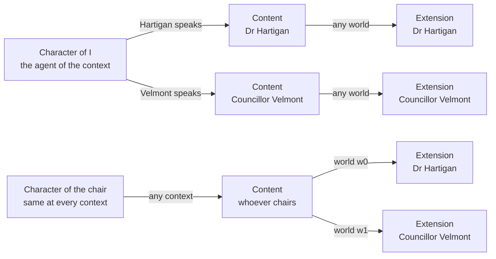

# Philosophy of Language and Logic · Lesson 3.4: Indexicals and the return of Frege's puzzle

> ⏱ ~15 min · Module 3: Names and necessity · Builds on: [1.2](01-02-belief-reports-and-empty-names.md), [3.2](03-02-rigid-designation-and-the-causal-picture.md), [3.3](03-03-the-necessary-a-posteriori-and-natural-kinds.md) · Unlocks: [4.1](04-01-truth-conditional-semantics-and-davidson.md)

## Why this matters

John Perry once pushed his cart around a supermarket counter, following a trail of sugar to warn the shopper with the torn sack that he was making a mess. The trail thickened on every lap until he realized the sack was in his own cart ("The Problem of the Essential Indexical", *Noûs*, 1979). What he came to believe needs the word "I": believing that *John Perry* is making a mess would have stopped him only if he also believed he was John Perry. On the Millian view Module 3 developed, a name contributes only its bearer, and "I" is the most Millian word there is. That is where [Frege's puzzle](../reference.md#freges-puzzle) comes back.

## The idea

At a noon council meeting Dr Hartigan and Councillor Velmont each say "I am hungry". The sentence means the same in both mouths, yet they say different things: one can be true, the other false. David Kaplan's "Demonstratives" (a manuscript dated 1977, published 1989) splits meaning in two. The [character](../reference.md#character-and-content) of "I" is the rule every speaker learns: it refers to whoever is speaking. Its content on an occasion is what the rule delivers there: the speaker herself, not a description of her. In code: character is a function body with free variables for speaker, place and time; a context binds them; content is the resulting closure, which a world turns into an extension ([`programming-languages` 6.1](../../programming-languages/lessons/06-01-names-scope-and-closures.md)).

An [indexical](../reference.md#indexical)'s content is its referent, so "I" hands a proposition its speaker as [3.2](03-02-rigid-designation-and-the-causal-picture.md)'s Millian name hands it its bearer. Then Perry's "I am making a mess" and "John Perry is making a mess" have one content, though only the first explains why he stopped; and swapping co-referring names inside "believes that" cannot change a truth value, against the [substitution failures](../reference.md#substitutivity-salva-veritate) of [1.2](01-02-belief-reports-and-empty-names.md). Siblings used Perry's distinction unnamed: someone lost in a wood who realizes "the road is *here*" ([`metaphysics` 5.1](../../metaphysics/lessons/05-01-the-a-theory-and-the-b-theory.md)), the flight director's "now" ([`philosophy-of-religion` 1.4](../../philosophy-of-religion/lessons/01-04-eternity-immutability-and-simplicity.md)), the train leaving at 15:04 ([`philosophy-of-mind` 1.3](../../philosophy-of-mind/lessons/01-03-the-knowledge-argument.md)).

## The argument

**Kaplan's framework.**

**D1. Context and circumstance.** A context is $c = \langle a_c, t_c, l_c, w_c \rangle$: its agent, time, location and world. A circumstance of evaluation is a world $w$ (Kaplan's are time–world pairs; this lesson holds the time fixed). *In words:* a sentence is used at a context and what it says is checked at a circumstance.

**D2. Character and content.** The content of an expression $e$ at $c$, written $\chi_e(c)$, maps each world to an extension: a truth value for a sentence, an object for a term. The character $\chi_e$ maps each context to that content. For "I", $\chi_{\text{I}}(c)(w) = a_c$ at every $w$; "here" gives $l_c$ and "now" gives $t_c$. A sentence $S$ is *true at* $c$ iff $\chi_S(c)(w_c) = T$. *In words:* character takes a use to what is said; content takes a world to whether it is so.

**D3. [Direct reference](../reference.md#direct-reference).** An indexical's content at $c$ is its referent, not a condition the referent meets, so within a context it designates one object at every world: it is a [rigid designator](../reference.md#rigid-designator). Pure indexicals ("I", "here", "now", "today") get their referent from the rule alone; true demonstratives ("that", "he") also need a pointing or an intention. *In words:* the rule finds the object, and only the object goes into what is said.

**T1. [Logic of demonstratives](../reference.md#logic-of-demonstratives).** Call a context proper if $a_c$ is at $l_c$ at $t_c$ in $w_c$; a sentence is valid iff it is true at every proper context. "I am here now" is valid, but "Necessarily, I am here now" is not. *Proof.* Properness makes $\chi(c)(w_c) = T$ for every $c$. But $\chi(c)$ is the singular proposition that $a_c$ is at $l_c$ at $t_c$, false at any world where $a_c$ is elsewhere then. *In words:* it cannot be said falsely, yet what it says could have been false. Kaplan took such sentences to yield contingent truths knowable a priori (his own case is "I exist"), the indexical cousin of 3.3's [contingent a priori](../reference.md#contingent-a-priori).

Character reaches past the pure indexicals: a [gradable adjective](../reference.md#gradable-adjective) such as "tall" or "flat" takes its standard from the conversation, the model contextualists borrow for "knows" ([`epistemology` 3.4](../../epistemology/lessons/03-04-contextualism-and-its-rivals.md)). It also differs from the token-reflexive analysis in [`metaphysics` 5.1](../../metaphysics/lessons/05-01-the-a-theory-and-the-b-theory.md): Kaplan rejected Hans Reichenbach's (1947) reading of "I" as "the speaker of this token", a description neither rigid nor directly referential; his sentences are true at contexts, tokens or none.

**The Millian's problem.**

**P1. [Millianism](../reference.md#millianism).** The content of a proper name, in any context, is its bearer; an indexical's is its referent (D3). *In words:* a name contributes only the thing it names.

**P2. Compositionality of content.** A sentence's content, a that-clause's included, is fixed by the contents of its parts. *In words:* swap a part for one with the same content and the whole says the same.

**P3. Relational reports.** "A believes that S" is true at $c$ iff A stands in the belief relation to $\chi_S(c)$. *In words:* a [belief report](../reference.md#belief-report) relates a person to what its clause says.

**∴ C1.** Swapping co-referring names, or a name for a co-referring indexical, inside a belief report preserves its truth value. *In words:* if Lois believes Superman flies, she believes Clark Kent flies ([`metaphysics` 5.3](../../metaphysics/lessons/05-03-coincidence-and-the-ship-of-theseus.md)'s pair); if Perry believes he himself is making a mess, he believes John Perry is.

**P4. The data.** Competent speakers judge such swaps to change truth value, and the beliefs explain different actions.

**∴ C2.** Either the judgments in P4 mislead about truth, or P1, P2 or P3 is false.

**Who denies what.**

- **Perry (1979)** separates the belief state from what is believed. Everyone in the state "I am making a mess" expresses checks his own cart, though each believes something different; anyone can believe of Perry that he is making a mess, but only Perry by being in that state. States explain action; contents are what is true. That is the [essential indexical](../reference.md#essential-indexical).

- **Millians with [guises](../reference.md#guises)** deny that P4 tracks truth. Nathan Salmon (*Frege's Puzzle*, 1986) makes belief three-place: $A$ believes $p$ iff $\exists g\,(A \text{ grasps } p \text{ by } g \wedge \mathrm{BEL}(A, p, g))$, where $g$ is a guise, a way of taking a proposition. Both Lois reports are true; the second misleads by pragmatically conveying how she takes it. Scott Soames (*Beyond Rigidity*, 2002) keeps the singular proposition as what a sentence semantically expresses, but has speakers assert descriptively enriched propositions, which can differ between the reports.

- **The [hidden-indexical theory](../reference.md#hidden-indexical-theory)** (Mark Crimmins and Perry, "The Prince and the Phone Booth", 1989) keeps P1 and denies P3: a report also concerns a way of thinking that the context supplies though no word names it, so swapping names can change it, and the truth value.

- **[Neo-Fregeans](../reference.md#neo-fregeanism)** deny P1: a name contributes a [mode of presentation](../reference.md#mode-of-presentation), so the clauses say different things, as with 1.2's [indirect reference](../reference.md#indirect-reference); 3.3's [two-dimensional](../reference.md#two-dimensional-semantics) intensions are one modern version.

[Kripke's puzzle about belief](../reference.md#kripkes-puzzle-about-belief) ("A Puzzle about Belief", 1979) reaches the same contradiction from [disquotation and translation principles](../reference.md#disquotation-and-translation-principles) alone, with no premise about names (Example 2), so, Kripke argued, substitution failures alone cannot refute Millianism.

**Where the argument is weakest.** P4, the claim that substitution judgments are about truth. The strongest objection to the Millian: a [conversational implicature](../reference.md#conversational-implicature) must be [calculable](../reference.md#calculability) from what is said, but ordinary speakers do not think the two Lois reports say the same, so they cannot calculate the difference (after Stephen Schiffer, 1987). The strongest reply: ordinary practice runs belief states together with contents, so the information is conveyed uncalculated; or, with David Braun (1998), hearers take the reports' one content in two ways. The Millian concedes that ordinary judgments about reports are systematically wrong; the Fregean concedes, after Kripke, that the same judgments arise without the Millian premise. Specialists are split (PhilPapers 2020, target faculty: 38.69 percent Millian, 36.09 percent Fregean on proper names, N = 1,269).

## Kaplan's two stages

"I" gets a new content at each context, each fixed on one person at every world; the description has one content, whose extension varies by world.

## Worked examples

**Example 1 (clean case: "I am hungry" at one meeting).** At world $w_0$ (actual) Hartigan is hungry and chairs the meeting; at $w_1$ Velmont is hungry and chairs it. Contexts $c_H$ and $c_V$ differ only in agent.

| content | $w_0$ | $w_1$ |
|---|---|---|
| $\chi(c_H)$: that Hartigan is hungry | T | F |
| $\chi(c_V)$: that Velmont is hungry | F | T |
| "The chair is hungry", at either context | T | T |

One character, two contents: true at $c_H$, false at $c_V$. "Possibly, I am not hungry" is true at $c_H$, because $\chi(c_H)$ fails at $w_1$: the possibility concerns Hartigan. The description runs the other way: one content at both contexts, whose referent shifts from Hartigan at $w_0$ to Velmont at $w_1$.

**Example 2 (hard case: Pierre).** Kripke's Pierre, a monolingual French speaker, hears good things of a city called "Londres".

1. He sincerely assents to "Londres est jolie". By **disquotation** (sincere, reflective assent shows belief), Pierre croit que Londres est jolie.

2. By **translation** (a good translation of a truth is a truth): Pierre believes that London is pretty.

3. Moved to a drab part of London, he learns English by immersion, never linking "London" with "Londres", and assents to "London is not pretty": by disquotation, he believes that London is not pretty.

4. He rejects "London is pretty". By **converse disquotation** (sincere dissent shows non-belief), he does not believe that London is pretty, contradicting step 2.

5. By steps 2 and 3 he believes a proposition and its negation, which the **rationality** principle calls irrational, though no reflection could show him a mistake.

No co-referring names were swapped. **Salmon** accepts steps 2 and 3, rejects converse disquotation, and weakens rationality to ban only believing $p$ and $\neg p$ under one guise: Pierre BELs $p$ under his "Londres" guise and $\neg p$ under his "London" guise. **Hidden-indexical theorists** make step 2 true where the context supplies Pierre's "Londres" way of thinking and false where it supplies his "London" way, so the contradiction mixes contexts. **Fregeans** give the names different senses for Pierre, so his thoughts do not contradict, and translation fails at step 2: the report's "London" need not express his "Londres" sense. Kripke's Paderewski case removes translation (Peter takes the pianist and the statesman Paderewski for two men); the Fregean replies with two senses for one name (William Taschek, 1988). Whether two-dimensional intensions handle Pierre is Boss 3(d)'s question.

**Where it strains.** Does Pierre believe that London is pretty? Salmon: yes. Hidden-indexical theorist: it depends on the way of thinking the context supplies. Fregean: not until "London" is tied to one of his senses. Kripke gives no verdict; he takes our practice of attributing belief to give out here.

## Watch out

- **You might think** "I am here now" is necessary because it cannot be said falsely, **but actually** it is valid and contingent (T1): validity follows character, necessity follows content. The voicemail greeting "I'm not here now" strains this: Kaplan set it aside in a footnote; Stefano Predelli (1998) gives recordings contexts whose agent is elsewhere.

- **You might think** character is Fregean sense under a new name, **but actually** a character fixes nothing true or false until a context is supplied, and two speakers with one character say different things.

- **You might think** Pierre is Lois again, **but actually** nothing is substituted: disquotation and translation do all the work.

- **You might think** "I" is ambiguous, since its referent varies, **but actually** it has one meaning (its character) and many contents. The context here is the context of utterance; MacFarlane's context of assessment is [`epistemology` 3.4](../../epistemology/lessons/03-04-contextualism-and-its-rivals.md)'s.

## One-liner

> "I" puts only its referent into what is said, so the Millian must explain why "I am making a mess" and "John Perry is making a mess" differ in belief and action, and Pierre shows the strain with no names swapped.

## Problems

**P1 (🟢)** *(Formal model: Formal (a) · Exegetical (b).)* At noon on Monday (world $w_0$), Bettany Lisle is in the Eskerby library and Wynne Merriwether is at the harbour. At $w_1$ both are at the harbour at that time; at $w_2$ both are in the library. Context $c_1$ has agent Bettany, time Monday noon, location the library, world $w_0$; $c_2$ has agent Wynne, the same time, location the harbour, world $w_0$. Circumstances are $w_0, w_1, w_2$, with the time fixed at Monday noon.

(a) For S1 "I am at the harbour" and S2 "I am here now", give each character in one line, and the content at $c_1$ and at $c_2$ as a row of truth values over $w_0, w_1, w_2$. Say whether each sentence is true at each context. Show the table.

(b) Counting also S3 "Bettany Lisle is at the harbour", which (sentence, context) pairs express the same content? Which of S1 and S2 is true at every proper context, and is its content necessary? One line each.

**P2 (🟡)** *(Apply to a hard case: Exegetical (a)–(b) · Evaluative (c).)* Invented, written for this problem. Ottilie Rookby grows up in Eskerby speaking only English. From travel writing she comes to think Cologne beautiful, and sincerely assents to "Cologne is beautiful". Years later she takes a job in a grey district of a German city its residents call "Köln". She learns German only by immersion, never from a dictionary or a teacher, and never learns that "Köln" is the city English speakers call "Cologne". She sincerely assents to "Köln ist nicht schön" ("Köln is not beautiful"), rejects "Köln ist schön", and still assents to "Cologne is beautiful".

(a) Derive the puzzle in numbered steps, naming the principle each step uses. Show the steps.

(b) On Salmon's guise theory, give the truth value of "Ottilie believes that Cologne is beautiful", "Ottilie believes that Cologne is not beautiful" and "Ottilie does not believe that Cologne is beautiful"; name the two principles of (a) that Salmon gives up; and say whether Ottilie is irrational. One line each.

(c) A hidden-indexical theorist (Crimmins and Perry) disagrees with Salmon about one of the three reports in (b). State the disagreement, then say whose verdict fits ordinary reporting better and what the other theory must explain away. Any verdict; 80 words or fewer.

**P3 (🔴)** *(Find the crux: Exegetical (a)–(b) · Evaluative (c).)* Invented, written for this problem. Mr Caddick sets the *Eskerby Courier*'s crossword under the pen name "Lanthorn". Ingrith Lowther, who solves it daily, sincerely assents to "Lanthorn is clever". She has met Mr Caddick at the allotments, found him dull, and sincerely assents to "Caddick is not clever". Consider R1, "Ingrith believes that Lanthorn is clever", and R2, "Ingrith believes that Caddick is clever".

(a) Give the truth values of R1 and R2 on a Millian view (Salmon's or Soames's) and on a neo-Fregean view, with each side's explanation of why R2 strikes ordinary speakers as false. One line each.

(b) Name the single premise about belief reports that one side affirms and the other denies. One sentence.

(c) What finding or argument would move each side? Any verdict; 150 words or fewer.

Solutions

**P1** *(Formal (a) · Exegetical (b).)*

(a) Characters. S1: at any context $c$, the proposition that $a_c$ is at the harbour at Monday noon. S2: at any context $c$, the proposition that $a_c$ is at $l_c$ at $t_c$. Reading each world's facts:

| content | $w_0$ | $w_1$ | $w_2$ | true at the context? |
|---|---|---|---|---|
| S1 at $c_1$: Bettany at the harbour | F | T | F | no |
| S1 at $c_2$: Wynne at the harbour | T | T | F | yes |
| S2 at $c_1$: Bettany in the library | T | F | T | yes |
| S2 at $c_2$: Wynne at the harbour | T | T | F | yes |

Truth at a context is the $w_0$ column, since both contexts lie in $w_0$.

(b) S1 at $c_1$ and S3 (at either context) express one content, that Bettany is at the harbour at Monday noon; S1 at $c_2$ and S2 at $c_2$ express one content, that Wynne is at the harbour then. S2 is true at every proper context, but its content is contingent at both: false at $w_1$ for $c_1$, at $w_2$ for $c_2$.

**Must hit, strict:** both characters stated as rules over the context's agent (and, for S2, its place and time); the four rows exactly; truth at each context read at $w_0$; the two same-content pairs; S2 true at every proper context with a contingent content.

**Wrong turns:** letting "here" pick out wherever the agent is at each world, which makes S2 true everywhere (the context fixes "here" once); counting S1 at $c_1$ and S3 as different contents because one contains "I" (they differ in character only); counting S2's two contents as one because both are true at their contexts (they concern different people). The point of the second pair: one content, carried by a valid sentence at $c_2$ and by a sentence that is false at $c_1$, so validity goes with character, not content.

---

**P2** *(Exegetical (a)–(b) · Evaluative (c).)*

**Must hit, strict (a):**

- 1. She sincerely, reflectively assents to "Cologne is beautiful"; by disquotation, Ottilie believes that Cologne is beautiful.

- 2. She assents to "Köln ist nicht schön"; by disquotation in German, Ottilie glaubt, dass Köln nicht schön ist; by translation, Ottilie believes that Cologne is not beautiful.

- 3. She rejects "Köln ist schön"; by converse disquotation, Ottilie glaubt nicht, dass Köln schön ist; by translation, Ottilie does not believe that Cologne is beautiful, contradicting step 1.

- 4. By steps 1 and 2 she believes a proposition and its negation; the rationality principle calls her irrational, though reflection would reveal nothing to her.

**Must hit, strict (b):** first report true; second true; third false (she BELs the proposition under her "Cologne" guise). Salmon gives up converse disquotation and the plain rationality principle, replacing it with irrationality only for believing $p$ and $\neg p$ under one guise. She is not irrational: she BELs $p$ under the "Cologne" guise and $\neg p$ under the "Köln" guise, never both under one.

**Must hit, any verdict (c):**

- The disagreement: for the hidden-indexical theorist, "Ottilie does not believe that Cologne is beautiful" is true in a context that supplies her "Köln" way of thinking (a conversation about her life in Germany), where Salmon calls it false outright.

- A verdict with the rival's debt named: Salmon must explain why speakers in that conversation would call the report true; the hidden-indexical theorist must explain how a report's truth depends on a way of thinking no word in it names.

**Wrong turns:** putting translation anywhere in step 1 (her English sentence needs only disquotation); saying Salmon denies Millianism or the translation principle; saying the case involves substituting co-referring names (the derivation swaps none); calling Ottilie irrational on Salmon's view.

**Model answer (c), one of several:** Crimmins and Perry let "Ottilie does not believe that Cologne is beautiful" come out true when the conversation is about her life in Köln, since the context then supplies her "Köln" notion, under which she does not believe it; Salmon calls it false in every context. The hidden-indexical verdict fits how people actually report her, at a cost: it makes truth turn on an item no word in the report expresses, which syntax-minded semanticists reject. Salmon must instead explain away the judgment as pragmatic.

---

**P3** *(Exegetical (a)–(b) · Evaluative (c).)*

**Must hit, strict (a):**

- Millian: R1 true, R2 true, since the two clauses express one singular proposition. R2 sounds false because it pragmatically conveys that Ingrith would assent to "Caddick is clever" (Salmon), or because an utterance of it asserts a descriptively enriched proposition, say that she believes the man she met at the allotments is clever, which is false (Soames).

- Neo-Fregean: R1 true, R2 false, since "Lanthorn" and "Caddick" present the man differently to her, and in a report the clause's content includes the mode of presentation (1.2's indirect reference). R2 sounds false because it is false.

**Accept (a):** the hidden-indexical verdict as a third answer if labelled (R2 false in a typical context, which supplies her "Caddick" way of thinking).

**Must hit, strict (b):** the premise that a belief report's truth conditions depend only on the contents (referents) of the words in its that-clause, not on how the believer thinks of them; the Millian affirms it, the neo-Fregean denies it. Accept it stated as P1 together with P3 of the lesson's argument, with a note that the hidden-indexical theorist keeps P1 and denies P3.

**Must hit, any verdict (c):**

- What would move the Millian: evidence that no pragmatic mechanism can carry the difference (the calculability objection made good, with no uncalculated route independently attested), or that reports predict and explain action in ways an implicature cannot.

- What would move the neo-Fregean: an argument that no sense can be both shared by speakers and fine enough to separate the names (3.1's arguments; 1.1's "Aristotle" footnote), or Kripke's point that the same judgments arise with no substitution, which cuts their evidential link to senses.

**Wrong turns:** naming as the crux whether Lanthorn is Caddick (both sides grant it), whether names are rigid (a neo-Fregean can take senses that are rigid), or whether Ingrith is rational (both say she is); answering (c) with a verdict and no account of what would change it.

**Model answer (c), one of several:** The Millian would be moved if the pragmatic story collapsed: if the difference between R1 and R2 could not be worked out from what they say, and no other route for conveying it had independent support, then treating R2 as true but misleading would look like a device for saving the theory. The neo-Fregean would be moved if no candidate sense survived Kripke's arguments, since a sense must be shared by speakers who know very different things about Caddick, and if Pierre-style cases showed the same judgments arising with no substitution, so that they stopped counting as evidence of senses. My verdict is that neither finding is in: the calculability objection has replies, and Kripke's cases are read both ways, so the crux stays open.

## Flashback

**From Lesson [3.2](03-02-rigid-designation-and-the-causal-picture.md) (Rigid designation and the causal picture):** *(Formal (a) · Exegetical (b).)* Invented, written for this problem: Eskerby church's bell, cast in 1702, is named "Meriel" ($n$). Two worlds, universal accessibility, actualist quantifiers: $D(w_0) = \{k, e\}$ at $w_0$ (actual), with $k$ Meriel and $e$ the old chapel bell; $D(w_1) = \{e\}$ at $w_1$, where Meriel was never cast. As in 3.2, an identity with a term that designates nothing is false.

(a) Reading $n$ first as [persistently](../reference.md#persistent-and-obstinate-rigidity) rigid, then as obstinately rigid, give $d_w(n)$ and $\exists x\,(x = n)$ at each world, and $\Diamond\neg\exists x\,(x = n)$ ("Meriel might not have existed") at $w_0$. Which values change if such identities are instead neither true nor false? Show the check.

(b) Which reading does Kripke's remark about "Hitler" suggest, and did he settle on it? Does the obstinate reading make "Meriel" strongly rigid in Kripke's sense? Two sentences.

Solution

(a) $\exists x$ ranges over $D(w)$; $R$ is universal.

| | $w_0$ | $w_1$ |
|---|---|---|
| $d_w(n)$, persistent | $k$ | nothing |
| $d_w(n)$, obstinate | $k$ | $k$ |
| $\exists x\,(x = n)$, either reading | T ($x = k$) | F |

At $w_1$ the only instance is $e = n$: false on the persistent reading because $n$ designates nothing (the convention), false on the obstinate reading because $e \neq k$. So $\neg\exists x\,(x = n)$ is true at $w_1$, and $\Diamond\neg\exists x\,(x = n)$ is true at $w_0$ on both readings. With gaps, only persistent values move: $e = n$ has no value at $w_1$, so neither has $\exists x\,(x = n)$; no world then makes $\neg\exists x\,(x = n)$ true, so $\Diamond\neg\exists x\,(x = n)$ is no longer true at $w_0$. The obstinate values never used the convention. (This lesson's D2, $\chi_{\text{I}}(c)(w) = a_c$ at every $w$, reads "I" obstinately.)

**Must hit, strict (a):** both designation rows; the three values, alike on both readings; with gaps, only the persistent reading loses "Meriel might not have existed".

**Must hit, strict (b):**

- The "Hitler" remark suggests the obstinate reading; Kripke declined to choose.

- No: strongly rigid designators designate necessary existents, and Meriel is absent at $w_1$.

**Wrong turns:** thinking the obstinate reading puts $k$ into $D(w_1)$ (designation is not existence); calling the persistent $n$ non-rigid because it designates nothing at $w_1$; equating obstinate with strongly rigid.

**Model answer (b):** The obstinate one, since "Hitler" still designates Hitler at a world where he was never born, but Kripke declined to choose. No: Kripke keeps "strongly rigid" for rigid designators of necessary existents, and Meriel is absent at $w_1$; designation at every world is not existence at every world.

## Connections

- **Backward:** Frege's puzzle and modes of presentation are [1.1](01-01-freges-puzzle-sense-and-reference.md)'s, indirect reference and substitution failure [1.2](01-02-belief-reports-and-empty-names.md)'s, rigidity and the Millian picture of names [3.2](03-02-rigid-designation-and-the-causal-picture.md)'s, and the contingent a priori and the two-dimensional matrix [3.3](03-03-the-necessary-a-posteriori-and-natural-kinds.md)'s; Kaplan's character is that matrix for one expression at a time. Token-reflexive truth conditions for "now" are [`metaphysics` 5.1](../../metaphysics/lessons/05-01-the-a-theory-and-the-b-theory.md)'s.

- **Forward:** [4.1](04-01-truth-conditional-semantics-and-davidson.md) builds truth theories. With indexicals, Davidson makes truth a property of a sentence as spoken by a speaker at a time, so each T-sentence carries those variables: an utterance-based rival to Kaplan's truth at a context.

- **Sideways:** Perry's split between belief state and content is the "old fact, new mode" reply to the knowledge argument in [`philosophy-of-mind` 1.3](../../philosophy-of-mind/lessons/01-03-the-knowledge-argument.md) and the "indexical way of grasping facts" in [`philosophy-of-religion` 1.4](../../philosophy-of-religion/lessons/01-04-eternity-immutability-and-simplicity.md); Lewis's indexical "actual" is [`metaphysics` 3.2](../../metaphysics/lessons/03-02-what-possible-worlds-are.md)'s T3; contextualism about "knows" is [`epistemology` 3.4](../../epistemology/lessons/03-04-contextualism-and-its-rivals.md); environments and closures, the model for character and content, are [`programming-languages` 6.1](../../programming-languages/lessons/06-01-names-scope-and-closures.md).
