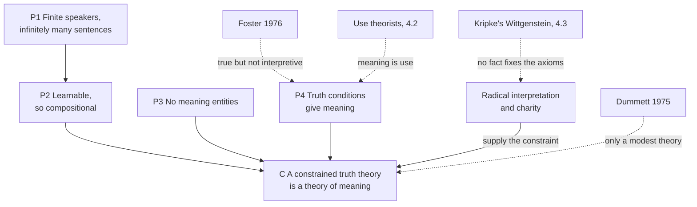

# Philosophy of Language and Logic · Lesson 4.1: Truth-conditional semantics and Davidson

> ⏱ ~15 min · Module 4: Meaning, use, and communication · Builds on: [3.4](03-04-indexicals-and-the-return-of-freges-puzzle.md), [`mathematical-logic` 2.2](../../mathematical-logic/lessons/02-02-structures-satisfaction.md) · Unlocks: [4.2](04-02-meaning-as-use.md), [5.1](05-01-tarskis-theory-as-philosophy.md)

## Why this matters

An Italian phrasebook lists a few hundred sentences; a speaker of Italian understands sentences nobody has ever said to her. In [`mathematical-logic` 2.2](../../mathematical-logic/lessons/02-02-structures-satisfaction.md) you defined truth in a structure by recursion without asking what the clauses were for. Donald Davidson's answer: such clauses, written for a natural language, state what a speaker knows, and are the best theory of meaning we can have. This lesson writes one for a scrap of Italian and asks what, beyond being true, makes it a theory of *meaning*.

## The idea

A theory of meaning has two jobs. It must be [compositional](../reference.md#compositionality): a sentence's meaning is built from the meanings of its parts and their mode of combination, and from nothing else, the rule [`programming-languages` 2.3](../../programming-languages/lessons/02-03-denotational-semantics-and-fixed-points.md) imposes on a program's denotation. And it must be finite, because we are. [Learnability](../reference.md#learnability) (Davidson, "Theories of Meaning and Learnable Languages", 1965): a language with infinitely many sentences can be learned only if finitely many words and rules settle the meaning of all of them. This is the linguistic cousin of the systematicity argument for a language of *thought* in [`philosophy-of-mind` 4.1](../../philosophy-of-mind/lessons/04-01-intentionality-and-folk-psychology.md).

What should the theory say about each sentence? Davidson ("Truth and Meaning", 1967): when it is true. You understand "Giulia aiuta Enzo" without knowing whether Giulia helps Enzo; you know it is true just in case she does. So the theorems are [T-sentences](../reference.md#t-sentence):

> "Giulia aiuta Enzo" is true iff Giulia helps Enzo.

The left side *mentions* a sentence of the [object language](../reference.md#object-language-and-metalanguage), Italian, by quoting it; the right side *uses* a sentence of the metalanguage, English. A phrasebook is a finite list of pairs. A [truth theory](../reference.md#truth-theory) is a dictionary plus a grammar: finitely many axioms from which a T-sentence for every sentence follows. That program is [truth-conditional semantics](../reference.md#truth-conditional-semantics). Its hard question is what makes the right side give the meaning of the left, rather than just something with the same truth value.

## The argument

**Davidson's case** (1965, 1967).

**P1.** Finite speakers master a language with infinitely many sentences. *In words:* you understand sentences you have never met.

**P2.** That is possible only if each sentence's meaning is fixed by finitely many features of its words and how they combine. *In words:* a learnable language is compositional.

**P3.** Assigning entities to words as their meanings explains nothing about how they combine; recursive rules do all the work. *In words:* drop meanings as objects, keep the recursion.

**P4.** To know a sentence's truth condition is to know the core of its meaning, and a Tarski-style theory derives one for every sentence from finitely many axioms. *In words:* truth conditions, built recursively, are what you grasp.

**∴ C.** A truth theory for a language, suitably constrained, can serve as its theory of meaning: knowing it would suffice to interpret every sentence. *In words:* semantics is a recursive statement of truth conditions.

**A theory for a scrap of Italian.** The object language $L$ has two names, "Giulia" and "Enzo"; the verb "aiuta" (helps); "non" before the verb; and "se $S_1$, allora $S_2$" (if $S_1$, then $S_2$), freely nested. Let $\alpha, \beta$ range over the names and $S_1, S_2$ over sentences of $L$. Six axioms:

- (R1) "Giulia" refers to Giulia. (R2) "Enzo" refers to Enzo.

- (S) A pair $\langle x, y\rangle$ satisfies "aiuta" iff $x$ helps $y$.

- (A) "$\alpha$ aiuta $\beta$" is true iff $\langle \mathrm{ref}(\alpha), \mathrm{ref}(\beta)\rangle$ satisfies "aiuta".

- (N) "$\alpha$ non aiuta $\beta$" is true iff $\langle \mathrm{ref}(\alpha), \mathrm{ref}(\beta)\rangle$ does not satisfy "aiuta".

- (C) "se $S_1$, allora $S_2$" is true iff, if $S_1$ is true, then $S_2$ is true.

*In words:* a dictionary for three words and a rule for each way of building a sentence. These are 2.2's satisfaction clauses read as meaning-giving; the "if" in (C) is the material conditional of [`mathematical-logic` 1.2](../../mathematical-logic/lessons/01-02-semantics-truth-tables.md), a convention for this toy. Six axioms reach infinitely many sentences: 8 with no "se", 72 with at most one level of nesting, 5,192 with at most two.

**[Convention T](../reference.md#convention-t) used in reverse.** Tarski ([5.1](05-01-tarskis-theory-as-philosophy.md)) took meaning as given: a definition of truth must entail, for every sentence of the object language, a T-sentence whose right side *translates* the left, and must entail that only its sentences are true. Davidson cannot assume translation, since meaning is what he wants. He takes truth as understood and, in "Radical Interpretation" (1973), asks only that the T-sentences be true. Meaning is then read off a theory that truth constrains.

**Radical interpretation.** What makes a theory correct for a speaker? Quine's [radical translation](../reference.md#radical-translation) (*Word and Object*, 1960, ch. 2) imagined a linguist with no dictionary, watching a native say "Gavagai" as a rabbit runs past. Her evidence is the speaker's dispositions to assent and dissent under patterns of sensory stimulation; her product is a translation manual. Davidson's [radical interpretation](../reference.md#radical-interpretation) (1973) changes both. The evidence is which sentences a speaker *holds true*, together with the objects and events in the shared world that prompt her; the product is a truth theory, since a manual could translate into a language the interpreter does not understand. But holding a sentence true reflects both its meaning and her beliefs, and neither is known first. Davidson's way in is the [principle of charity](../reference.md#principle-of-charity), as [`philosophy-of-mind` 2.3](../../philosophy-of-mind/lessons/02-03-anomalous-monism-and-supervenience.md) states it: interpret a person so as to make her largely consistent and right by the interpreter's lights. It is not the charity of [`philosophical-method` 1.3](../../philosophical-method/lessons/01-03-reconstruction-and-charity.md), a norm for reconstructing an argument whose words you already understand, bounded by what the author would sign; Davidson's is a precondition of understanding anyone at all, the premise he turns against untranslatable schemes in [`philosophy-of-science` 2.4](../../philosophy-of-science/lessons/02-04-kuhn-incommensurability-and-theory-choice.md). Both he and Quine grant that rival interpretations can fit all the evidence; Davidson thinks less is left open than Quine did.

**[Foster's problem](../reference.md#fosters-problem).** John Foster ("Meaning and Truth Theory", 1976) took the 1973 standard at its word. Replace (S) by this lesson's deviant axiom:

- (S′) $\langle x, y\rangle$ satisfies "aiuta" iff $x$ helps $y$ and Rome is the capital of Italy.

Rome is the capital, so (S′) is true, and so is every T-sentence it yields, such as "'Giulia aiuta Enzo' is true iff Giulia helps Enzo and Rome is the capital of Italy". The theory is extensionally adequate but not interpretive: its user would hear every Italian sentence as partly about Rome. Davidson had three answers. In 1967: every T-sentence comes from one finite base, so a bad axiom should show up somewhere. Next: an empirical theory's T-sentences must hold as laws, not by accident. And in his "Reply to Foster" (1976): what suffices for interpretation is knowing the T-sentences *together with* the fact that they are theorems of a theory meeting the formal and empirical constraints of radical interpretation.

**What Frege–Geach demands, supplied.** [`ethics` 6.2](../../ethics/lessons/06-02-expressivism.md) calls the [Frege–Geach problem](../reference.md#frege-geach-problem) a demand for a compositional semantics. Clause (C) shows what meeting it looks like. The conditional's truth condition is built from "$S_1$ is true", the very condition $S_1$ has standing alone. Whether anyone asserts $S_1$ appears in no clause, so an embedded sentence contributes what it does unembedded, and modus ponens is valid by (C) itself. An expressivist, for whom meaning is "fixed by the mental state it conventionally expresses" (ethics 6.2's premise 4), owes a clause of the same shape over attitudes: the state expressed by "if $S_1$, then $S_2$" as a function of its parts' states, making acceptance of $S_1$ and the conditional with rejection of $S_2$ a clash. Blackburn's higher-order attitudes and Gibbard's fact-norm worlds, assessed there, are attempts to write that clause.

**Context.** Sentences with [indexicals](../reference.md#indexical) ([3.4](03-04-indexicals-and-the-return-of-freges-puzzle.md)) are true only as spoken, so Davidson relativizes truth to speaker and time: "Io aiuto Enzo" is true as spoken by $x$ at $t$ iff $x$ helps Enzo at $t$.

**Where the argument is weakest.** P4, read as "knowing a true truth theory suffices for understanding". Foster's objection, generalized: truth is too coarse a filter. A theory that proves "…iff Giulia helps Enzo" also proves, by logic alone, "…iff it is not the case that Giulia does not help Enzo", and knowing an interpretive T-sentence does not tell you that it is the interpretive one. Larson and Segal (*Knowledge of Meaning*, 1995) call these the extension problem and the information problem. The strongest reply builds on 1976: the T-sentences that count are those reached by [canonical derivation](../reference.md#canonical-derivation) (Martin Davies, 1981), unpacking clauses and substituting as in Example 1, from a theory the interpreter knows to be confirmed by radical interpretation. Davidson concedes that true T-sentences were never enough and the weight falls on the theory's empirical standing; the critic, that a theory known to have that standing would serve. The dispute is whether the standing can be stated without already using "means".

## Argument map

Solid arrows are Davidson's case; dashed arrows are objections, labelled with what each presses.

## Worked examples

**Example 1 (clean case: a derivation).** Target: "se Giulia aiuta Enzo, allora Enzo non aiuta Giulia".

1. By (C): it is true iff, if "Giulia aiuta Enzo" is true, then "Enzo non aiuta Giulia" is true.

2. By (A), (R1), (R2): "Giulia aiuta Enzo" is true iff $\langle \text{Giulia}, \text{Enzo}\rangle$ satisfies "aiuta"; by (S), iff Giulia helps Enzo.

3. By (N), (R2), (R1), (S): "Enzo non aiuta Giulia" is true iff Enzo does not help Giulia.

4. Substituting 2 and 3 into 1: "se Giulia aiuta Enzo, allora Enzo non aiuta Giulia" is true iff, if Giulia helps Enzo, then Enzo does not help Giulia.

Each axiom entered exactly where its word occurs: compositionality made literal. A situation settles which of the four ordered pairs are helping pairs, so there are 16; the sentence is false in exactly 4, those where Giulia and Enzo help each other. No line asked whether anyone asserts the antecedent.

**Example 2 (hard case: Enzo's other name).** Suppose Enzo sets newspaper crosswords under the pen name "Quenby" (invented). Replace (R2) by (R2′): "Enzo" refers to Quenby. The new theory proves "'Giulia aiuta Enzo' is true iff Giulia helps Quenby". Davidson's tests:

- **Truth and structure.** Quenby is Enzo, so every T-sentence is true and nothing ramifies: for all 5,192 sentences up to two levels of nesting, in all 16 situations, the two theories agree.

- **Evidence.** The two theories never predict different truth values, so no pattern of holding-true over $L$ separates them.

**Where it stops.** One place remains: the beliefs the interpreter ascribes. A speaker who holds true "Giulia aiuta Enzo" may doubt that Giulia helps the setter Quenby, yet (R2′) has the interpreter ascribe her that belief. Belief reports seem to block substitution ([1.2](01-02-belief-reports-and-empty-names.md)). A Fregean ([1.1](01-01-freges-puzzle-sense-and-reference.md)) concludes that (R2′) fails charity's coherence, so an interpretive reference axiom must use a name that presents Enzo as the speaker's name does (John McDowell, 1977, defends such non-descriptive senses). A [Millian](../reference.md#millianism) ([3.4](03-04-indexicals-and-the-return-of-freges-puzzle.md)) replies that both theories state the same singular conditions, and that the speaker's doubt concerns a guise, not a content. The truth theory gives no verdict: Frege's puzzle has returned inside the metalanguage.

## Watch out

- **You might think** radical interpretation is Quine's radical translation renamed, **but actually** the evidence (holding true, tied to shared objects and events, not stimulus patterns) and the product (a usable truth theory, not a manual) both differ.

- **You might think** a T-sentence pairs a sentence with a meaning, **but actually** it links a mentioned object-language sentence to a used metalanguage sentence. No meaning-entity appears, and the biconditional is extensional, which is why Foster's problem arises.

- **You might think** clause (C) commits truth-conditional semantics to the material conditional, **but actually** that is this toy's convention. Any clause that builds the conditional's truth condition from its parts' truth conditions handles embedding the same way.

## One-liner

> Davidson's bet is that understanding a language is knowing a finite theory deriving when each sentence is true; Foster showed that truth alone cannot certify the theory, so everything rests on what radical interpretation adds.

## Problems

**P1 (🟢)** *(Formal model: Formal (a)–(b).)* Use the lesson's six axioms for $L$.

(a) Derive the T-sentence for "se Enzo non aiuta Giulia, allora se Giulia aiuta Enzo, allora Giulia aiuta Giulia", naming the axioms each line uses. Show the derivation.

(b) List every situation (which of the four ordered pairs are helping pairs) in which the sentence is false. One line.

**P2 (🟡)** *(Exegetical (a)–(b).)*

(a) Say whether each statement describes Quine's radical translation, Davidson's radical interpretation, both, or neither. One line each.

> (i) The data are the speaker's dispositions to assent to or dissent from a sentence when her sensory receptors are stimulated in a given pattern.
>
> (ii) The data are which sentences the speaker holds true, together with the objects and events in the shared surroundings that prompt her to hold them true.
>
> (iii) More than one overall interpretation of the speaker can fit all the evidence there could be.
>
> (iv) Among the readings a text permits, take the one on which its argument is strongest, but never one its author would disown.

(b) Radical translation ends with a translation manual. Why, on Davidson's view, is a manual not enough, and what does he put in its place? Two sentences.

**P3 (🔴)** *(Steelman and reply: Evaluative.)* A use theorist objects: write Davidson's theory for English in English and its theorems say that "Giulia helps Enzo" is true iff Giulia helps Enzo; whoever understands that already understands the sentence, and whoever does not cannot use it, so a truth theory says nothing about what understanding a language consists in. State the objection at its strongest, using Michael Dummett's distinction between [modest and full-blooded](../reference.md#modest-and-full-blooded-theories) theories of meaning ("What is a Theory of Meaning?", 1975). Then give the best Davidsonian reply, and say what each side concedes. Any verdict; 150 words or fewer.

Solutions

**P1** *(Formal (a)–(b).)*

(a) Write the sentence as "se $A$, allora $B$", with $A$ = "Enzo non aiuta Giulia" and $B$ = "se Giulia aiuta Enzo, allora Giulia aiuta Giulia". The second "se" can only begin the consequent, since "Enzo non aiuta Giulia, allora se Giulia aiuta Enzo" is not a sentence of $L$.

1. By (C): the sentence is true iff, if "Enzo non aiuta Giulia" is true, then $B$ is true.

2. By (N), (R2), (R1), (S): "Enzo non aiuta Giulia" is true iff Enzo does not help Giulia.

3. By (C): $B$ is true iff, if "Giulia aiuta Enzo" is true, then "Giulia aiuta Giulia" is true.

4. By (A), (R1), (R2), (S): "Giulia aiuta Enzo" is true iff Giulia helps Enzo.

5. By (A), (R1), (S): "Giulia aiuta Giulia" is true iff Giulia helps Giulia.

6. Substituting 4 and 5 into 3, then 2 and 3 into 1: the sentence is true iff, if Enzo does not help Giulia, then, if Giulia helps Enzo, Giulia helps Giulia.

(b) False exactly when Enzo does not help Giulia, Giulia helps Enzo, and Giulia does not help herself; whether Enzo helps himself is free, so there are two situations: helping pairs {Giulia→Enzo} and {Giulia→Enzo, Enzo→Enzo}.

**Must hit, strict:**

- (C) applied twice, outer conditional first, with the nested conditional as consequent.

- (N) for the antecedent, so its condition is "Enzo does not help Giulia".

- (A) with (R1), (R2) and (S) for each atomic sentence, then substitution of the derived biconditionals.

- (b): both situations, and no others.

**Wrong turns:** reading the sentence as "if (if Enzo does not help Giulia, then Giulia helps Enzo), then Giulia helps Giulia", which $L$'s grammar does not allow; dropping the "not" from (N); giving one situation and forgetting that Enzo's helping himself is idle; listing situations where Enzo helps Giulia, which make the antecedent false and the sentence true.

---

**P2** *(Exegetical (a)–(b).)*

**Must hit, strict (a):**

- (i) Quine: stimulus meaning, assent and dissent under sensory stimulation.

- (ii) Davidson: holding true, interpreted through the shared world's objects and events.

- (iii) Both. Quine's indeterminacy of translation; Davidson accepts an indeterminacy of interpretation but thinks it narrower.

- (iv) Neither: it is charity in reconstruction, [`philosophical-method` 1.3](../../philosophical-method/lessons/01-03-reconstruction-and-charity.md), a norm for reading an argument already understood, with an author-signature limit.

**Must hit, strict (b):** a manual only maps the speaker's sentences onto sentences of some language, possibly one its user does not understand, so knowing it does not tell you what anything means. Davidson replaces it with a truth theory stated in the interpreter's own language, whose T-sentences give truth conditions she can use, confirmed by radical interpretation.

**Wrong turns:** assigning (ii) to Quine, whose data stop at the sensory surfaces; assigning (iii) to Quine alone; assigning (iv) to Davidson, whose charity is about interpreting a speaker, not choosing among readings of a text whose words are already understood.

**Model answer:** (a) (i) Quine; (ii) Davidson; (iii) both; (iv) neither, it is reconstruction charity. (b) A manual pairs her sentences with sentences of some language, which may be one I do not understand, so knowing the pairing tells me nothing about what she says. Davidson puts in its place a truth theory in my own language, whose T-sentences state the conditions under which her sentences are true.

---

**P3** *(Evaluative.)*

**Must hit, any verdict:**

- The objection precisely: a modest theory gives the meanings of the object language only to someone who already has the concepts its metalanguage expresses; a full-blooded theory would say what having them, knowing the truth conditions, consists in, as abilities shown in use. Homophony makes the point vivid; it applies to the Italian theory too.

- The reply: a T-sentence is a theorem of an empirical theory about a speaker, false if her words meant something else and confirmed by her holding-true behaviour, so not trivial; the theory's content is its structure, finitely many axioms deriving every sentence's condition; and Davidson aims to state something whose knowledge would suffice for interpreting, not to explain concept possession from outside (McDowell, "In Defence of Modesty", 1987).

- Concessions on both sides, stated.

**Wrong turns:** calling the homophonic T-sentence a logical truth, when its left side mentions a sentence of a language as someone speaks it; answering with Foster's problem, which concerns true theories that are not interpretive, not trivial ones; declaring a winner instead of making the moves.

**Model answer, one of several:** Dummett's point is not that the theorem is false but that it is modest: it conveys the meaning of "Giulia helps Enzo" only to someone who already has the concepts of helping and of Giulia, so it never says what grasping those concepts consists in, and a full-blooded theory must, in terms of what speakers can do. The Davidsonian replies that the theorem is an empirical claim about a speaker, which radical interpretation could refute, and that the theory's real content is structural: how infinitely many truth conditions follow from six axioms. Its aim was always to state something whose knowledge would suffice for interpreting; asking it to build concepts from nothing asks what no theory supplies. The Davidsonian concedes that the theory presupposes the interpreter's own concepts, as charity's "by our lights" admits; the critic concedes that the theorem states a substantive fact about a speaker.

## Flashback

**From Lesson [3.3](03-03-the-necessary-a-posteriori-and-natural-kinds.md) (The necessary a posteriori and natural kinds):** *(Diagnose: Exegetical (a)–(c).)* From a geology club's newsletter (invented, written for this problem):

> "Quarrymen named 'wraystone' the stuff of the glittering seams at Brackmoor, and an assay has shown that the seams are compound Z. Since 'wraystone' is a rigid designator, the theory of reference alone proves that wraystone could not have been anything but Z. 'Doorstop' is rigid in the same sense: it picks out the same kind at every world."

(a) The middle sentence needs a premise that no theory of reference supplies. State it for wraystone, and name who pressed the point. One sentence.

(b) Grant the last sentence. Why does it tell against the middle one, and whose objection is this? Two sentences.

(c) Grant (a)'s premise. What does rigidity then explain, and what must the semanticist concede? Two sentences.

Solution

**Must hit, strict:**

- (a) An essentialist premise: being the same stuff as the Brackmoor samples is sharing their microstructure, so whatever is wraystone at any world is Z. Salmon ("How Not to Derive Essentialism from the Theory of Reference", 1979).

- (b) If designating the same kind at every world makes a general term rigid, every general term is rigid, "doorstop" included, though doorstops share no hidden nature; so rigidity cannot be what makes "wraystone is Z" necessary. Schwartz (2002).

- (c) Rigidity explains why the necessity was hidden from the armchair: reference was fixed by samples and their glitter, so which kind the term picks out took the assay, and given the premise "wraystone is Z" is [necessary a posteriori](../reference.md#necessary-a-posteriori). Conceded: the necessity's source is metaphysical, and chemistry supplies the premise.

**Wrong turns:** naming rigidity or the assay (the newsletter states both); saying 3.3's D1–D4 settles it, when the assay shows only what the seams are made of, and the step to an identity of kinds is the essentialist premise; denying that "doorstop" is rigid (on this reading it is: that is the trouble); swapping Salmon and Schwartz.

**Model answer:** (a) It needs the essentialist premise that being wraystone is sharing the Brackmoor samples' microstructure, which Salmon (1979) argued no theory of reference supplies. (b) If designating one kind everywhere makes a term rigid, "doorstop" is as rigid as "wraystone", though doorstops share no nature, so rigidity cannot be what makes "wraystone is Z" necessary: Schwartz's objection (2002). (c) Given the premise, rigidity explains why a necessary truth needed an assay: the term was fixed by samples and appearances, so which compound it picks out had to be found by looking. The semanticist concedes that the necessity comes from metaphysics and chemistry, not from the theory of reference.

## Connections

- **Backward:** indexicals from [3.4](03-04-indexicals-and-the-return-of-freges-puzzle.md) force truth relative to a speaker and a time. The clauses are [`mathematical-logic` 2.2](../../mathematical-logic/lessons/02-02-structures-satisfaction.md)'s satisfaction clauses and [1.2](../../mathematical-logic/lessons/01-02-semantics-truth-tables.md)'s truth tables, read as meaning-giving. Example 2 is the puzzle of [1.1](01-01-freges-puzzle-sense-and-reference.md) and the belief reports of [1.2](01-02-belief-reports-and-empty-names.md) returning inside a truth theory.

- **Forward:** [4.2](04-02-meaning-as-use.md) asks whether meaning is use rather than truth conditions, and [4.3](04-03-the-rule-following-paradox.md) whether any fact makes (S) correct rather than a rival axiom for "aiuta". [5.1](05-01-tarskis-theory-as-philosophy.md) reads Tarski's own theory as philosophy, and [5.2](05-02-deflationism.md) asks whether truth is substantial enough to carry meaning at all.

- **Sideways:** compositionality is [`programming-languages` 2.3](../../programming-languages/lessons/02-03-denotational-semantics-and-fixed-points.md)'s demand on denotations, and [`philosophy-of-mind` 4.1](../../philosophy-of-mind/lessons/04-01-intentionality-and-folk-psychology.md) runs the parallel argument for thought. Charity grounds the anomalism of the mental in [`philosophy-of-mind` 2.3](../../philosophy-of-mind/lessons/02-03-anomalous-monism-and-supervenience.md) and the case against conceptual schemes in [`philosophy-of-science` 2.4](../../philosophy-of-science/lessons/02-04-kuhn-incommensurability-and-theory-choice.md). Davidson's "Toward a Unified Theory of Meaning and Action" (1980) combines Bayesian decision theory with radical interpretation, interpreting meaning, belief and preference together: the interpretive reading of representation theorems is [`decision-theory` 1.4](../../decision-theory/lessons/01-04-what-a-representation-theorem-shows.md), and credence from preference is [2.2](../../decision-theory/lessons/02-02-probability-from-preference.md) there. [`ethics` 6.2](../../ethics/lessons/06-02-expressivism.md) states the Frege–Geach problem whose truth-conditional side this lesson supplies. Theological language is where a truth theory meets one predicate applied across categories: whether "wise" said of God and of Socrates needs one satisfaction axiom or two is the question behind Aquinas's two orders in [`thomistic-synthesis` 4.4](../../thomistic-synthesis/lessons/04-04-analogy.md) and Scotus's univocity in [`ancient-medieval-philosophy` 8.2](../../ancient-medieval-philosophy/lessons/08-02-scotus-the-univocity-of-being.md).
