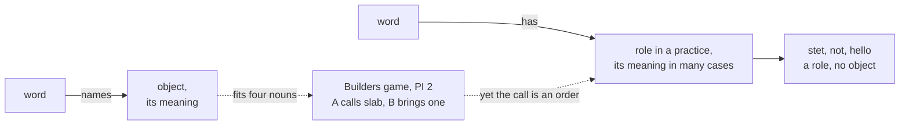

# Philosophy of Language and Logic · Lesson 4.2: Meaning as use

> ⏱ ~15 min · Module 4: Meaning, use, and communication · Builds on: [4.1](04-01-truth-conditional-semantics-and-davidson.md), [`philosophical-method` 3.1](../../philosophical-method/lessons/03-01-conceptual-analysis.md), [`mathematical-logic` 1.4](../../mathematical-logic/lessons/01-04-proof-system-completeness.md) · Unlocks: [4.3](04-03-the-rule-following-paradox.md)

## Why this matters

On the *Eskerby Courier*'s copy desk an editor writes "stet" beside a struck-out word, and the compositor puts the word back. No one there could say what object "stet" names, and no one needs to. [4.1](04-01-truth-conditional-semantics-and-davidson.md) gave each name a referent, each predicate an extension and each sentence a [truth condition](../reference.md#truth-conditional-semantics). The later Wittgenstein called that picture, taken as the essence of language, the root mistake: for many words, though not all, knowing the meaning is knowing the use.

## The idea

A chess king is not its shape: a bottle cap would do, if both players moved it as the king. Ludwig Wittgenstein's *Philosophical Investigations* (published posthumously in 1953) says many words are like that. A [language game](../reference.md#language-game) is a stretch of language with the activities it is woven into, and speaking is part of an activity, a [form of life](../reference.md#form-of-life) (§23). The first is the builders' (§2): a builder calls "block", "pillar", "slab" or "beam", and his assistant brings the stone he has learnt to bring at that call.

The target is the [Augustinian picture](../reference.md#augustinian-picture): every word names an object, the object is its meaning, and sentences combine names (§1). The young Wittgenstein held a version: "The name means the object. The object is its meaning." (*Tractatus* 3.203, tr. Ogden, 1922). His "To understand a proposition means to know what is the case, if it is true." (4.024) is 4.1's idea in one line. [Meaning as use](../reference.md#meaning-as-use) replaces the picture: say what a word means by describing what it does in its games.

New here: the challenge, the private language argument, and [inferentialism](../reference.md#inferentialism), the heir that makes "use" a theory. [`philosophy-of-debt` 1.3](../../philosophy-of-debt/lessons/01-03-promising-after-hume.md)'s promise, a move a practice's rules define, is a built cousin of a language game.

## Source

Augustine, *Confessions* I.8.13, tr. E. B. Pusey (1838), quoted in Latin at the head of the *Investigations*:

> When they named any thing, and as they spoke turned towards it, I saw and remembered that they called what they would point out by the name they uttered. And that they meant this thing and no other was plain from the motion of their body, the natural language, as it were, of all nations, expressed by the countenance, glances of the eye, gestures of the limbs, and tones of the voice, indicating the affections of the mind, as it pursues, possesses, rejects, or shuns. And thus by constantly hearing words, as they occurred in various sentences, I collected gradually for what they stood; and having broken in my mouth to these signs, I thereby gave utterance to my will.

**Reading.** Two steps: pointing (the elders "called what they would point out by the name they uttered"), then the yield (the boy "collected gradually for what they stood"). "Name" and "stood" pair each word with a thing. The label is Wittgenstein's; Augustine's own theory of signs, that words only prompt us to look (*On the Teacher*), is another matter ([`ancient-medieval-philosophy` 5.1](../../ancient-medieval-philosophy/lessons/05-01-augustine-certainty-and-illumination.md)).

## The argument

**The challenge to the Augustinian picture** (*Investigations* §§1–43, reconstructed; Wittgenstein numbers no premises and claims to describe, not to theorize).

**P1.** If the Augustinian picture gave the essence of language, every word's meaning would be an object it names, learned by having the object pointed out. *In words:* knowing a word would be knowing what it labels.

**P2.** Many words have a settled use and name nothing: numerals, "not", "hello", "stet". Words are as varied as a toolbox's tools (§11). *In words:* labels are one kind of tool.

**P3.** Pointing teaches a name only to someone who already knows what kind of move it makes: "this is the king" tells a learner a chessman's use only if its place is already prepared (§31), and Augustine describes the child as if it had come into a foreign country, able to think but not yet to speak (§32). *In words:* [ostensive definition](../reference.md#ostensive-definition) presupposes a practice, so it cannot found one.

**∴ C.** Naming is one move inside language games, not their foundation; for a large class of cases, though not all, to say what a word means is to describe how it is used (§43). *In words:* knowing a word is knowing your way about its uses.

**Family resemblance as a claim about meaning** (§§65–67). Asked what all language games share, Wittgenstein answers: nothing but overlapping, criss-crossing similarities. `philosophical-method` 3.1 uses [family resemblance](../reference.md#family-resemblance) as an exit from analysis; the semantic claim is that understanding a general term is not grasping a definition, and "language" itself is the case. [`philosophy-of-science` 2.6](../../philosophy-of-science/lessons/02-06-demarcation-after-popper.md) runs the thought against demarcating science.

**The [private language argument](../reference.md#private-language-argument)** (§§243–315, the main attack §§244–271; Wittgenstein never called it an argument). A private language's words would refer to what only the speaker can know, his private sensations (§243); a personal code, which others could crack, is not one.

**L1.** A sign has a meaning only if there is a standard of correct use apart from its user's impression of correctness. *In words:* following a rule differs from thinking you are.

**L2.** A diarist who writes "S" whenever a certain sensation recurs (§258) can set that standard only by attending to the sensation while writing the sign. *In words:* nothing public anchors "S".

**L3.** Nothing then separates using "S" correctly from using it as seems right to him, and a check that cannot fail is no check. *In words:* he cannot test a meaning against itself.

**∴ C2.** "S" has been given no meaning; a language intelligible in principle only to its user is impossible. *In words:* meaning needs public standards of correctness.

The companion image is the beetle in the box (§293): if each of us kept a "beetle" in a box no one else could open, the thing in the box would drop out of the word's use. Whether L3 is a doubt about memory is disputed (the orthodox reading says so, Anthony Kenny denies it), and Kripke (1982) reads the passage through [4.3](04-03-the-rule-following-paradox.md)'s rule-following paradox.

**Inferentialism** (Robert Brandom, *Making It Explicit*, 1994; *Articulating Reasons*, 2000; the term is his, Wilfrid Sellars the precursor).

**I1.** A sentence's content is its inferential role: what entitles you to assert it and what asserting it commits you to, including material inferences ("red, so coloured"), good in virtue of content, not form.

**I2.** Asserting undertakes a commitment to defend the claim and licenses hearers to rely on it; speakers keep score of one another's commitments and entitlements.

**∴ C3.** Truth comes after, as what good inferences preserve. *In words:* 4.1's order of explanation is reversed.

Paul Horwich's use theory (*Meaning*, 1998) is descriptive where Brandom's is normative. [`philosophy-of-mind` 4.2](../../philosophy-of-mind/lessons/04-02-naturalizing-content.md)'s inferential-role semantics is the cousin for thought, at the same price, holism.

**Where the argument is weakest.** C, the step from "naming is not the whole story" to "meaning is use". The strongest objection, from 4.1: grant P2 and P3, and use is only the *evidence* for meaning; truth conditions explain which uses are correct and how a speaker understands new sentences, while "use" explains nothing. The strongest reply is inferentialism's: use specified as inferential role composes and explains truth. The use theorist concedes that use must mean *correct* use and owes an account of correctness (4.3); the truth-conditional theorist concedes that grasp of truth conditions must show in use, which is why Davidson's evidence is what speakers hold true.

## Two pictures of meaning

The builders' game is the one language Augustine's picture fits, and even there the call works as an order.

## Worked examples

**Example 1 (clean case: the copy desk's game; invented).** At the *Courier* an editor marks proofs and the compositor acts. "Dele" beside a struck word: take it out. "Stet" beside a struck word: keep it. "TK" in a gap: copy is to come. Run the use account.

- *Moves.* "Dele" is an order about a word, "stet" an order about an order (it cancels a dele), "TK" a promise of copy.

- *Mistakes.* A compositor who removes a stetted word has erred, and the editor's correction shows the rule is in force.

- *Teaching.* Not by pointing: a trainee who knows what a proof and a strike are is corrected until he gets it. The place is prepared (§31).

Now the Augustinian picture. If "stet" named the word beside it, "stet" and "dele" beside one word would name the same object, yet they demand opposite actions. The use account's verdict: here meaning is role. A truth theorist can add compliance conditions for orders; whether that extends 4.1's program or concedes its limits is left open.

**Example 2 (hard case: tonk).** A. N. Prior ("The Runabout Inference-Ticket", 1960) defined a connective by an introduction like disjunction's and an elimination like conjunction's, in the format of [`mathematical-logic` 1.4](../../mathematical-logic/lessons/01-04-proof-system-completeness.md):

$$\frac{A}{A \;\mathrm{tonk}\; B}\;(\text{tonk-I}) \qquad\qquad \frac{A \;\mathrm{tonk}\; B}{B}\;(\text{tonk-E})$$

Chain them: from any $A$, infer $A \;\mathrm{tonk}\; B$, then $B$. If rules alone fix meanings, [tonk](../reference.md#tonk) has one, and every sentence follows from every other. Prior's targets were Popper and Kneale.

- *Truth first.* J. T. Stevenson ("Roundabout the Runabout Inference-Ticket", 1961): connectives get their meanings from truth-functional statements in a metalanguage, not from permissive rules. Of the 16 binary truth functions, 4 make tonk-I truth-preserving and 4 make tonk-E so, but none does both: tonk-I needs $A \;\mathrm{tonk}\; B$ true when $A$ is true and $B$ false, and tonk-E needs it false there. Lloyd Humberstone replies that lacking a truth function is no defect; tonk's defect is that only the all-true and all-false valuations respect both rules.

- *Conservativeness.* Nuel Belnap ("Tonk, Plonk and Plink", 1962): a new connective's rules must be a [conservative extension](../reference.md#conservative-extension) of the deducibility already in force, yielding nothing new among old sentences. Tonk yields $p \vdash q$ for tonk-free $p$ and $q$.

- *[Harmony](../reference.md#harmony).* Gerhard Gentzen (1934/35) treated introductions as definitions and eliminations as their consequences; Dag Prawitz's inversion principle (1965) and Michael Dummett's "harmony" (*Frege: Philosophy of Language*, 1973) make that a constraint: an elimination may draw out only what the introductions put in, so an introduction followed at once by an elimination is a removable detour. Tonk-I puts in $A$; tonk-E takes out $B$. Keeping tonk-I, the strongest justified elimination (Prawitz) goes to $A$.

*Where it strains.* Does harmony smuggle truth conditions back? Stevenson's heir says yes: eliminations must match introductions only because rules must preserve truth. The inferentialist says no: harmony relates rules, is checked by removing detours, and departs from classical truth tables (natural deduction reaches classical logic only through reductio, and most proof-theoretic semanticists are intuitionistic in spirit). Belnap's test presupposes a deducibility relation already fixed, so the old vocabulary's meaning comes from elsewhere. The case gives no verdict on whether harmony is part of meaning or a check imposed from outside.

## Watch out

- **You might think** "meaning is use" is Wittgenstein's theory of meaning, **but actually** §43 covers a large class of cases, not all, and he held that philosophy describes rather than explains (§§109, 126); Brandom's and Horwich's theories are heirs of disputed fidelity.

- **You might think** a private language is a code only you know, or any talk of sensations, **but actually** a code can be cracked and "pain" is public; the target is a language others *could not* understand, and what the argument rejects is not sensations but the object-and-name model of them.

- **You might think** a form of life is one practice, as [`philosophy-of-religion` 5.4](../../philosophy-of-religion/lessons/05-04-fideism.md) glosses it, **but actually** the phrase occurs five times in the *Investigations*, and readers divide between a culture's contingent way of living and behaviour all humans share (§206). Either way it is wider than one practice.

- **You might think** tonk refutes inferentialism, **but actually** it shows that not every set of rules fixes a meaning, not that none does; the dispute is over which constraint does the selecting.

## One-liner

> Wittgenstein holds that for a large class of words, knowing the meaning is knowing your way about a practice, not knowing what the word labels; inferentialism makes that a theory, and tonk shows the rules need a constraint, harmony or, critics say, truth.

## Problems

**P1 (🟢)** *(Close reading: Exegetical.)* Use the Source passage.

(a) Which words show that, on Augustine's account, the boy grasps what the elders intend before he knows any of their words? In one more line, say what §32, as paraphrased in this lesson, says such an account presupposes.

(b) Which clause describes learning words from their surroundings in speech rather than by pointing? Does it break the Augustinian picture or leave its core intact? Two sentences.

**P2 (🟡)** *(Formal (a)–(b) · Exegetical (c).)* Add to the natural deduction system of [`mathematical-logic` 1.4](../../mathematical-logic/lessons/01-04-proof-system-completeness.md), whose rules include ¬E (from $\varphi$ and $\neg\varphi$ infer $\bot$) and ⊥E (from $\bot$ infer any $\varphi$), a one-place connective $\dagger$ with two rules:

$$\frac{A}{\dagger A}\;(\dagger\text{I}) \qquad\qquad \frac{\dagger A}{\neg A}\;(\dagger\text{E})$$

(a) Show that any sentence $C$ is derivable from any sentence $A$. Show the derivation, naming the rule at each line.

(b) Show that no valuation in which $\neg$ is classical makes both $\dagger$-rules truth-preserving. Three lines.

(c) Name a step between $\dagger$-free sentences that Belnap's test condemns. Then say which rule fails the harmony constraint, and give one rule that could replace it to restore harmony. Two sentences.

**P3 (🔴)** *(Find the crux: Exegetical (a)–(b) · Evaluative (c).)* Invented, written for this problem: Tegwen, aged four, says "red" of fire engines, ripe tomatoes and her crayon. She calls a flamingo "red", accepts "No, pink" and stops. She fetches the red cup when asked, and asked whether her red ball is green, she says no.

(a) What does a Davidsonian (4.1) take Tegwen's understanding of "red" to be, and what does Brandom take it to be? One sentence each.

(b) Both can accept every fact in the case. State the single claim about the order of explanation that one side affirms and the other denies. Two sentences.

(c) What argument or finding would move each side? Any verdict; 150 words or fewer.

Solutions

**P1** *(Exegetical.)*

**Accept (b):** "it strains the picture", if the answer adds that the clause still reports the result as word-for-object pairing.

**Must hit, strict (a):**

- The words: "that they meant this thing and no other was plain from the motion of their body, the natural language, as it were, of all nations". The boy reads intention from gesture, face and tone before he has a word.

- §32: an account like this treats the child as if it already had a language, only not this one, or could already think but not yet speak. Augustine's own phrase "natural language" grants the boy exactly that.

**Must hit, strict (b):**

- The clause: "by constantly hearing words, as they occurred in various sentences, I collected gradually for what they stood" (Augustine's Latin says the words were set "in their places", *locis suis posita*).

- It changes the method (words learned from their places in sentences, by repetition) but not the core: what the boy collects is still, for each word, what it stood for.

**Wrong turns:** answering (a) with "I saw and remembered", which is memory, not the reading of intention; making §32 say Augustine's account is false, when it names a presupposition; reading the "various sentences" clause as making Augustine a use theorist.

**Model answer:** (a) "that they meant this thing and no other was plain from the motion of their body, the natural language, as it were, of all nations": the boy reads intentions from gesture before he knows a word. §32 says such an account treats the child as already having a language, or as able to think but not yet to speak, and Augustine even calls gesture a language, "as it were". (b) "by constantly hearing words, as they occurred in various sentences, I collected gradually for what they stood". It changes the method, from pointing to hearing words in their places in sentences, but what he collects is still what each word stood for, so the core, word paired with object, stands.

---

**P2** *(Formal (a)–(b) · Exegetical (c).)*

(a) 

1. $A$ (premise)

2. $\dagger A$ (†I, 1)

3. $\neg A$ (†E, 2)

4. $\bot$ (¬E, 1, 3)

5. $C$ (⊥E, 4)

(b) Suppose $v$, with $\neg$ classical, makes both rules truth-preserving. For an atom $p$, one of $p$ and $\neg p$ is true at $v$; call it $A$. Then $v(\dagger A) = T$ by †I, so $v(\neg A) = T$ by †E, so $v(A) = F$ since $\neg$ is classical, contradicting $v(A) = T$. (Equivalently, of the four one-place truth functions, †I needs $f(T) = T$ and †E needs $f(T) = F$.)

(c) Belnap: $p \vdash q$ for distinct atoms now holds by (a), though it did not before, since $p \not\models q$ and the system of `mathematical-logic` 1.4 is sound; the extension is not conservative. Harmony: †E draws out $\neg A$, which †I never put in (the only ground for $\dagger A$ is $A$), so replace †E by the rule from $\dagger A$ infer $A$, which †I justifies and which makes $\dagger A$ mean $A$.

**Accept (c):** any trivial $\dagger$-free step ($p \vdash q$, $p \vdash \neg p$). Replacing †I instead, by the rule from $\neg A$ infer $\dagger A$, which harmonizes with †E and makes $\dagger A$ mean $\neg A$, on a view of harmony that does not give introductions priority.

**Must hit, strict:** the five lines with their rules, with ⊥E as the step that turns the contradiction into any $C$; in (b), the contradiction at a sentence that is true, not merely "there is no truth table"; in (c), a new $\dagger$-free consequence, and the diagnosis that the elimination outruns the introduction.

**Wrong turns:** stopping at line 3, since $\neg A$ is not yet $C$; running (b) only for $p$ true, when the argument uses whichever of $p$ and $\neg p$ is true; calling (b) by itself the proof that the rules are meaningless, when a connective can lack a truth function and be fine (Humberstone's point): what fails here is that no valuation fits at all.

---

**P3** *(Exegetical (a)–(b) · Evaluative (c).)*

**Must hit, strict (a):**

- Davidsonian: her speech is interpretable by a truth theory with the axiom "$x$ satisfies 'red' iff $x$ is red"; knowing such a theory would suffice to understand her, and the evidence is which sentences she holds true in which observed conditions. Nothing requires that she explicitly knows the theory.

- Brandom: her understanding is mastery of the word's role in giving and asking for reasons: reliably answering red things with "that's red", drawing its consequences ("red, so not green"), and being answerable to correction ("No, pink").

**Must hit, strict (b):**

- The Davidsonian affirms, and Brandom denies, that what "red" is true of is prior and explains why her uses and inferences are correct.

- Brandom affirms, and the Davidsonian denies, that the correctness of her moves, as the practice assesses them, is prior, and that the truth condition is explained as what correct moves preserve.

**Must hit, any verdict (c):**

- A finding for the truth-conditional side to be moved by, such as a use-based account that yields the meanings of sentences she has never heard ("the flamingo is not red") from their parts as well as a recursive truth theory does, or uses whose correctness shifts with the occasion in a way no single satisfaction condition fits.

- A finding for the use side to be moved by, such as a case where the standard of correctness seems to be the colour itself rather than the practice (a whole community calls a pink thing "red" and is wrong), or a failure to show how inferential role fixes that "red" is about red things.

- Say that agreement on her behaviour leaves the crux open.

**Wrong turns:** saying the Davidsonian thinks a four-year-old consciously knows T-sentences; saying Brandom denies that "red" has truth conditions, when he explains them rather than denying them; treating "No, pink" as settling the crux, since both sides account for it; answering with 4.3's rule-following scepticism alone, which presses both sides and does not separate them.

**Model answer (a)–(b):** (a) The Davidsonian: Tegwen understands "red" in that her speech is interpreted by a truth theory whose axiom says that $x$ satisfies "red" iff $x$ is red, a theory whose evidence is what she holds true when. Brandom: she understands "red" in that she has mastered its role, reporting red things, inferring "not green", and taking correction. (b) The Davidsonian holds that what "red" is true of comes first and explains why her moves are correct; Brandom holds that the practice's assessment of her moves comes first and that the truth condition is explained as what good moves preserve.

**Model answer (c), one of several:** The truth-conditional theorist should be moved by productivity done without extensions. If an inferential account, built from Tegwen's moves with "red", "flamingo" and "not", delivers what "the flamingo is not red" means as systematically as a satisfaction axiom does, the axiom is a summary of her practice and not its ground. The inferentialist should be moved by error that is not the community's verdict. If everyone in her village called flamingos "red", we would still say they were wrong, and that judgment seems to answer to the colour, not to anyone's score-keeping. Brandom must show that his account of objectivity allows a whole community to misapply a word. Neither finding is settled by Tegwen, whose behaviour both explain.

## Flashback

**From Lesson [3.4](03-04-indexicals-and-the-return-of-freges-puzzle.md) (Indexicals and the return of Frege's puzzle):** *(Formal (a) · Exegetical (b).)* Invented, written for this problem. Eskerby's harbour fair is held on 6 May at $w_0$, 7 May at $w_1$, 5 May at $w_2$. Contexts: $c_1 = \langle \text{Ingrith}, \text{6 May}, \text{the quay}, w_0 \rangle$, $c_2 = \langle \text{Sabeline}, \text{7 May}, \text{the quay}, w_0 \rangle$.

(a) For S1 "The fair is today", S2 "The fair was yesterday" and S3 "The fair is on 6 May", give each [character](../reference.md#character-and-content) in one line, and each content at $c_1$ and $c_2$ as a row over $w_0, w_1, w_2$ with truth at the context. Which (sentence, context) pairs share a content? Show the table.

(b) Ingrith Lowther, who has lost track of the date and would not assent to S3, sincerely says S1 at $c_1$ and has no other belief about the fair's date. At $c_2$ Sabeline Corvo reports "Ingrith believed that the fair was …" with R1 "today", R2 "yesterday", R3 "on 6 May". Give each truth value by P1–P3, and the premise a [neo-Fregean](../reference.md#neo-fregeanism) denies to make R3 false. One line each.

Solution

(a) Characters: S1 says, at any context $c$, that the fair is held on $t_c$; S2, on the day before $t_c$; S3, on 6 May at every $c$ ("6 May" names the day, so its character is constant).

| content | $w_0$ | $w_1$ | $w_2$ | true at the context? |
|---|---|---|---|---|
| S1 at $c_1$: fair on 6 May | T | F | F | yes |
| S1 at $c_2$: fair on 7 May | F | T | F | no |
| S2 at $c_1$: fair on 5 May | F | F | T | no |
| S2 at $c_2$: fair on 6 May | T | F | F | yes |
| S3 at $c_1$ or $c_2$: fair on 6 May | T | F | F | yes |

Truth at a context is read at $w_0$, where both contexts lie. S1 at $c_1$, S2 at $c_2$ and S3 at either context share one content, that the fair is on 6 May: three characters, one content. S1 has one character, two contents.

(b) Read "believed" as P3's relation, held on 6 May: Ingrith's S1 at $c_1$ relates her to the content that the fair is on 6 May. R1 is false: P3 evaluates the clause at the report's context, and S1 at $c_2$ says the fair is on 7 May. R2 is true: S2 at $c_2$ is her content. R3 is true: S3 at $c_2$ has that content too, and C1 makes it agree with R2. The neo-Fregean denies P1: "6 May" and her "today" present the day differently, and the clause contributes its mode of presentation, so R3 is false.

**Must hit, strict:** the characters as rules over $t_c$, S3's constant; the five rows, truth read at $w_0$; the one-content triple; R1 false and R2 true because the clause takes $c_2$; R3 true by P1–P3; P1 denied.

**Wrong turns:** reading R1's "today" at Ingrith's context, which makes it true; counting S2 at $c_2$ and S3 as two contents because one says "yesterday" (they differ in character only); naming P3, which is the hidden-indexical theorist's denial; calling R3 false for the Millian because she would reject S3, when Salmon calls it true and its oddity pragmatic.

## Connections

- **Backward:** [4.1](04-01-truth-conditional-semantics-and-davidson.md) built the truth theory whose order of explanation inferentialism reverses, and its radical interpreter's evidence, what speakers hold true, is use under another name. [`philosophical-method` 3.1](../../philosophical-method/lessons/03-01-conceptual-analysis.md)'s family resemblance becomes here a claim about what understanding a word requires, and [`mathematical-logic` 1.4](../../mathematical-logic/lessons/01-04-proof-system-completeness.md)'s introduction and elimination rules are what tonk abuses.

- **Forward:** [4.3](04-03-the-rule-following-paradox.md) asks what makes a use correct, and reads the private language argument through Kripke's sceptical paradox. [4.4](04-04-speaker-meaning-and-implicature.md) treats saying as doing, with Grice's intentions and Austin's speech acts. [5.2](05-02-deflationism.md)'s deflationist is pressed for a theory of meaning that does not run through truth; Brandom's inferentialism and Horwich's use theory are the leading truth-free candidates.

- **Sideways:** [`philosophy-of-religion` 5.4](../../philosophy-of-religion/lessons/05-04-fideism.md) applies meaning as use to religious language (Wittgensteinian fideism) and meets the astrology objection. [`philosophy-of-mind` 4.2](../../philosophy-of-mind/lessons/04-02-naturalizing-content.md) owns inferential-role semantics for thought, and [`philosophy-of-mind` 6.3](../../philosophy-of-mind/lessons/06-03-do-language-models-understand.md) asks whether a language model trained on how words are used in text has their meaning; note only that Wittgenstein's "use" is use inside activities, builders fetching slabs, which is the gap its grounding objection presses. Under Curry–Howard ([`programming-languages` 4.2](../../programming-languages/lessons/04-02-type-checking-and-curry-howard.md)) the detour harmony removes, an introduction followed by an elimination, is a $\beta$-redex, and tonk's detour is one with no reduction. Peter Winch's claim (1958) that understanding an action is grasping the rules that make it a vote or a purchase is [`social-theory` 1.3](../../social-theory/lessons/01-03-understanding-webers-interpretive-method.md)'s, and the promise as a move in a practice is [`philosophy-of-debt` 1.3](../../philosophy-of-debt/lessons/01-03-promising-after-hume.md)'s.
