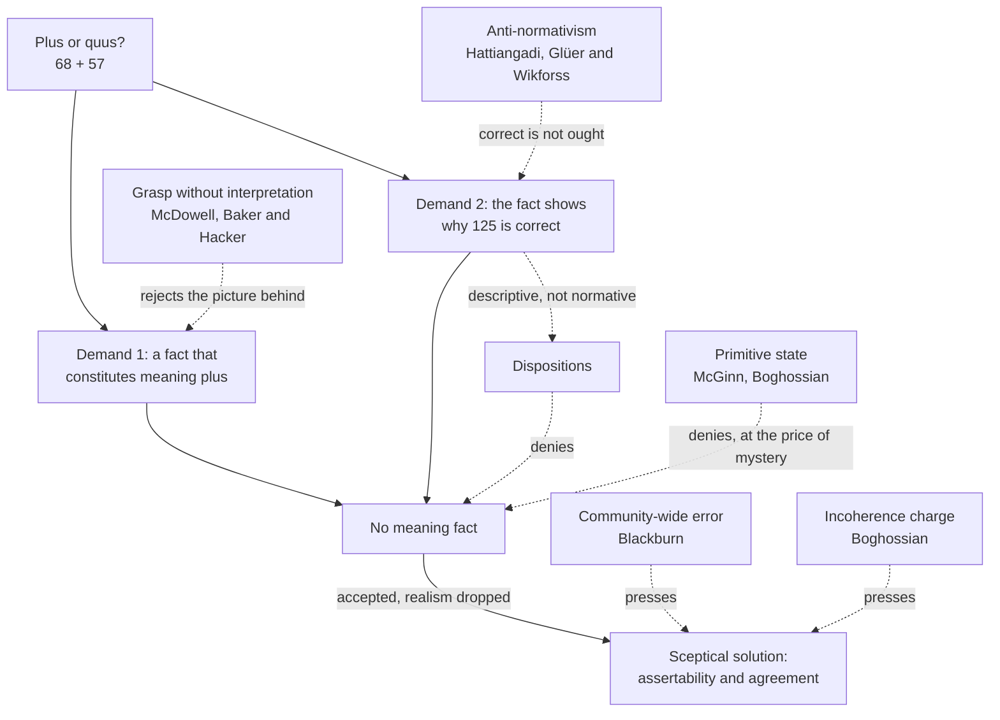

# Philosophy of Language and Logic · Lesson 4.3: The rule-following paradox

> ⏱ ~15 min · Module 4: Meaning, use, and communication · Builds on: [4.1](04-01-truth-conditional-semantics-and-davidson.md), [4.2](04-02-meaning-as-use.md), [`philosophy-of-mind` 5.2](../../philosophy-of-mind/lessons/05-02-is-the-intellect-a-bodily-power.md) · Unlocks: [4.4](04-04-speaker-meaning-and-implicature.md)

## Why this matters

Fit a network to every sum whose two terms are below 57 and it can be perfect on that data. Whatever it answers to 68 + 57, nothing in the data made that answer right: finitely many examples fit infinitely many functions, and an inductive bias picks one. You accept that about networks. Kripke's Wittgenstein says it of you, and asks something harder: not which answer you *will* give, but what fact about you makes 125 the answer you *ought* to give.

## The idea

Meaning something by a word is like following a rule: it settles correct uses in cases you have never met. Kripke's case, which [`philosophy-of-mind` 5.2](../../philosophy-of-mind/lessons/05-02-is-the-intellect-a-bodily-power.md) states with his numbers: [quus](../reference.md#quus), written $\oplus$, is $x \oplus y = x + y$ if $x, y < 57$, and $5$ otherwise. So $68 + 57 = 125$ but $68 \oplus 57 = 5$. Suppose every sum you have ever done had both terms below 57. A sceptic asks what shows that by "plus" you meant plus, not quus.

He grants you perfect memory and access to everything in your mind and behaviour. He wants one fact that does two jobs: it must *constitute* your meaning plus rather than quus, and it must *justify* 125, by settling what you ought to answer rather than predicting what you will. That pair is the [sceptical challenge](../reference.md#sceptical-challenge). `philosophy-of-mind` 5.2 used the first job alone: the sceptic finds no fact of any kind, mental included, that fixes plus. Here both jobs run, as a question about language.

If nothing does both, there is no fact of what anyone means. Kripke's Wittgenstein accepts that and still refuses the conclusion that nobody means anything. His [sceptical solution](../reference.md#sceptical-solution) takes its name from Hume's *Enquiry* §V, "Sceptical Solution of these Doubts" ([`modern-philosophy` 4.3](../../modern-philosophy/lessons/04-03-induction-and-the-sceptical-solution.md)): as Hume conceded the doubt about induction and explained the practice by custom, Kripke's Wittgenstein concedes the missing fact and explains meaning-talk by what it does in a community.

## The argument

**The sceptical argument** (Saul Kripke, *Wittgenstein on Rules and Private Language*, 1982, ch. 2). Kripke offers it as Wittgenstein's argument as it struck him, endorsing neither it nor the solution (1982: 5); hence [Kripke's Wittgenstein](../reference.md#kripkes-wittgenstein) for its author. Its target is the [rule-following paradox](../reference.md#rule-following-paradox) of *Philosophical Investigations* (1953) §201, paraphrased: if any way of going on can be made to fit a rule, any can be made to clash with it, so fitting and clashing lose their point and no rule fixes what to do.

- **K1. Constitution.** If I meant plus by "+", some fact about me constitutes my meaning plus rather than quus. *In words:* meaning must be made of something.
- **K2. Justification.** That fact must show how I am justified in answering 125, containing what I ought to do in each new case (1982: 11). *In words:* a meaning fact is a standard, not a forecast.
- **K3. Finite record.** Everything in my history (sums done, instructions, images) is finite and fits quus as well as plus; an instruction such as "count the two heaps together" only moves the question to "count". *In words:* any rule I consult can itself be read deviantly.
- **K4. Beyond the record.** What I would answer fails K2, being descriptive where the relation is "normative, not descriptive" (1982: 37); simplicity is at best evidence for a hypothesis; a primitive state of meaning is mysterious, and a finite state could be read quus-wise too (1982: 51–52). *In words:* nothing beyond the record does both jobs.
- **∴ C1.** No fact constitutes my meaning plus rather than quus.
- **K5.** If no fact settled what I meant, none settles what I mean now, by any word.
- **K6. [Classical realism](../reference.md#classical-realism-about-meaning).** "Jones means plus" is true only if a fact of K1's kind obtains (Kripke's label). *In words:* meaning ascriptions answer to meaning facts.
- **∴ C2.** No one means anything by any word: §201's paradox.

George Wilson calls C1 the basic and C2 the radical sceptical conclusion. The [dispositional reply](../reference.md#dispositionalism-about-meaning) with its finitude and error problems, and Lewis's naturalness reply, are run in [`philosophy-of-mind` 5.2](../../philosophy-of-mind/lessons/05-02-is-the-intellect-a-bodily-power.md) and not repeated here.

**The sceptical solution** (ch. 3) accepts C1 and denies K6. Instead of asking what must be the case for "Jones means plus" to be true, it asks when the words may be asserted and what role asserting them plays in our lives (1982: 73). The [assertability conditions](../reference.md#assertability-conditions): we may say Jones means plus when his answers agree with ours in enough cases, simple ones especially, and his mistakes resemble ours rather than "5" for "68 + 57" (1982: 92). The role: sorting out whom we can rely on, as when a grocer counts out five red apples (1982: 75–76). Take one person in isolation and her only standard is her own inclination, so "she follows the rule" has no substantive content (1982: 89). Hence no private language: Kripke reads the [private language argument](../reference.md#private-language-argument) of [4.2](04-02-meaning-as-use.md) as this corollary. Why we agree is not explained; agreement is a brute feature of our form of life. Most readers (Colin McGinn, Crispin Wright, Paul Boghossian) take the solution to be non-factualist: meaning ascriptions state no facts. Boghossian ("The Rule-Following Considerations", *Mind*, 1989) and others call that incoherent; in one version, giving a sentence a non-fact-stating job presupposes a fact about which correctness condition governs it.

**[Meaning primitivism](../reference.md#meaning-primitivism).** McGinn (*Wittgenstein on Meaning*, 1984) answers that understanding is an ability, and lacking a theory of it is no reason to doubt it exists. Boghossian (1989) says Kripke needed an argument that meaning properties are queer and gave none, though he places the irreducible facts in mental content, not linguistic meaning. Whether such a state escapes Kripke's search is the crux [`apologetics-foundations` 3.2](../../apologetics-foundations/lessons/03-02-reason.md) sets.

**The [normativity of meaning](../reference.md#normativity-of-meaning)** is K2's thesis. Boghossian's case: if "green" means green, it applies correctly only to green things, a normative truth about my use. Anandi Hattiangadi ("Is Meaning Normative?", 2006) and Kathrin Glüer and Åsa Wikforss ("Against Content Normativity", 2009) reply that "correct" may only sort uses into true and false: whoever calls a red apple green says something false without breaking any semantic ought, since she may mean to deceive. If they are right, K2 shrinks to K1's demand that the fact fix which uses are correct.

**Is it Wittgenstein?** Gordon Baker and P. M. S. Hacker (*Scepticism, Rules and Language*, 1984) answer that Wittgenstein found scepticism nonsensical and meant the paradox as an absurdity to dissolve. John McDowell ("Wittgenstein on Following a Rule", 1984) points to §201's next paragraph, where Wittgenstein says one can grasp a rule without interpreting it, the grasp showing in how one actually follows or breaks it. The paradox assumes understanding is interpreting; drop that and no sceptical solution is needed. "Kripkenstein" is commentators' shorthand, not Kripke's.

**Where the argument is weakest.** K3 and K4 assume that any candidate fact is an item that must be read to guide me, and so can be read deviantly. McDowell and the primitivists deny it: grasping plus is not holding an interpretation of anything. The strongest reply is that the sceptic needs no picture of interpretation. He asks only what makes "125" the correct use, and a grasp that is no interpretation says *that* a standard exists, not *what* it is, which is Kripke's charge of mystery. The anti-sceptic concedes that no reductive account of the grasp is on offer. Kripke's Wittgenstein concedes a primitive of his own: the brute fact of agreement.

## Argument map

Solid arrows run the sceptic's argument to the solution; dashed arrows are replies and objections, each aimed at the step it denies.

## Worked examples

**Example 1 (clean case: Wittgenstein's pupil).** In *Investigations* §185 a pupil trained on the series "+2" with examples below 1000 goes on past it as 1000, 1004, 1008, 1012 and, corrected, insists he went on in the same way. One rule his answers fit (the lesson's, not Wittgenstein's): $s(n) = n + 2$ for $n < 1000$ and $s(n) = n + 4$ for $n \ge 1000$. From 994:

| step | 1 | 2 | 3 | 4 | 5 | 6 |
|---|---|---|---|---|---|---|
| $+2$ | 996 | 998 | 1000 | 1002 | 1004 | 1006 |
| $s$ | 996 | 998 | 1000 | 1004 | 1008 | 1012 |

$s$ agrees with $+2$ on every input below 1000, so his whole training fits both. Run the challenge on the *teacher*. Every example she gave lies below 1000, and her instruction "do the same each time" leans on "same", which the pupil reads his way (K3). What she would have said at 1000 records what she would do, not what is right (K4).

Now the sceptical solution. We may not assert "he means +2 by '+2'": his answers part from ours at the first case past 1000, a simple one, and his slip is not like our slips. The ascription has done its job: do not rely on his series. What the solution does not say is that he broke a fact about "+2" laid down in advance. Correcting him is drawing him into our practice.

**Example 2 (hard case: a town that goes on by fours).** Invented: the pupil grows up and writes the only arithmetic primer in Eskerby, and a generation of its clerks continue every "+2" series past 1000 by fours, confidently and in agreement. Are they wrong?

By their agreement, which is unanimous for $s$, "they go on correctly" is assertable. By ours, we may say they do not mean what we mean, as with any grocer we cannot rely on. But the solution offers assertability in place of truth conditions, so nothing beyond each community's agreement settles which is mistaken; and if our whole community went on by fours tomorrow, nothing would make that a mistake. Here the account stops giving a verdict.

The communitarian says that is right: a standard beyond all agreement is the classical realist demand the sceptic refuted, and agreement is the framework of a practice, not a premise within it. Simon Blackburn ("The Individual Strikes Back", 1984) says the problem has only moved. A community's dispositions are as finite as one person's, so it fits a deviant rule as well as she does, and seeming right and being right now coincide for the group.

## Watch out

- **You might think the sceptic doubts whether you can *know* what you meant, but actually** he grants ideal memory and access (1982: 14) and claims there is nothing to know. The doubt is metaphysical, which is why Baker and Hacker call it nihilism, not scepticism.
- **You might think the sceptical solution defines "plus" as whatever the community answers, but actually** it replaces truth conditions for meaning ascriptions with assertability conditions. It never says "Jones means plus" is true *because* we agree, which is why Example 2's town is not right by definition.
- **You might think Kripke's Wittgenstein is Wittgenstein, but actually** Kripke disclaims the identification, and McDowell, Baker and Hacker, and McGinn read the *Investigations* as dissolving the paradox, not accepting it.
- **You might think the normativity condition and the error problem are one point, but actually** an anti-normativist grants that "green" has correct and incorrect uses, so error is possible, and denies only that an ought follows. The error problem does not turn on normativity.

## One-liner

> Kripke's sceptic asks for a fact that fixes what you mean and makes your answer the one you ought to give; finding none, Kripke's Wittgenstein keeps meaning-talk by trading truth conditions for assertability in a community, and each rival either names a fact the sceptic missed or denies one was needed.

## Problems

**P1 (🟢)** *(Formal.)* A clerk files folders whose labels are strings of lowercase letters (words, codes, abbreviations). Under dictionary order, label $u$ goes before label $v$ when $u$ comes first alphabetically. The rule $D$ agrees with dictionary order when both labels have at most six letters, and reverses it (the alphabetically later label goes first) when either label has seven or more.

(a) For each pair, say which label goes first under dictionary order and which under $D$: cedar, maple; hawthorn, larch; rowan, sycamore; alder, juniper. One line each.

(b) Give two different filing histories, each of three comparisons between distinct labels, that fit $D$ as well as dictionary order. One line each.

(c) Show that every finite filing history fits some rule that differs from dictionary order on some pair of labels. Two sentences.

**P2 (🟡)** *(Reconstruct. Exegetical (a)–(b).)*

(a) Reconstruct the sceptical solution of Kripke's Wittgenstein in numbered premises (P1 … ∴ C), from the concession it starts with to its conclusion about private language. Seven lines or fewer.

(b) Invented, written for this problem. A critic says: "A castaway raised alone from birth tallies his goats by cutting notches in a post, checks each morning's count against yesterday's notches, and now and then finds and corrects a slip. That is following a rule with no community." Name the premise of your reconstruction the critic denies, and say what a defender of the solution must say about the castaway's corrections. Two sentences.

**P3 (🔴)** *(Find the crux. Exegetical (a) · Evaluative (b).)* An invented exchange, written for this problem.

> **First reader:** The sceptical solution grants that there is no fact of my meaning plus. So "Jones means plus" states no fact; asserting it admits Jones to our arithmetic. What survives is a practice of ascribing meaning, not meaning facts.
>
> **Second reader:** It grants only that there is no fact of the kind classical realism wanted, something in Jones that fixes his answers in advance. When the assertability conditions are met, "Jones means plus" is true in the only sense "true" needs. Meaning facts survive, humbler than before.

(a) Name the claim on which the two readers divide, and say which reading most commentators have taken. Two sentences.

(b) Which reading leaves Kripke's Wittgenstein better placed? Say what each reading must answer and what it costs. 150 words or fewer in total; any verdict.

Solutions

**P1** *(Formal)*

(a) Letter counts: cedar 5, maple 5, hawthorn 8, larch 5, rowan 5, sycamore 8, alder 5, juniper 7.

- cedar, maple: cedar first under both (both have at most six letters).
- hawthorn, larch: dictionary order puts hawthorn first; $D$ puts larch first.
- rowan, sycamore: dictionary order puts rowan first; $D$ puts sycamore first.
- alder, juniper: dictionary order puts alder first; $D$ puts juniper first, since juniper has seven letters.

(b) **Accept:** any two histories in which every label has at most six letters and each comparison pairs distinct labels. For distinct labels, $D$ agrees with dictionary order exactly when both have at most six letters, so a comparison involving a label of seven or more letters fits one rule and not the other.

(c) Let $k$ be the length of the longest label in the history, and let $D_k$ follow dictionary order when both labels have at most $k$ letters and reverse it otherwise. Every recorded comparison has both labels of at most $k$ letters, so $D_k$ fits the history, and on any pair containing a label of $k + 1$ letters (labels may be any length) it reverses dictionary order. **Accept also:** "dictionary order on the recorded pairs, reversed on every other pair", with the same two checks.

**Must hit, strict:**

- (a) all four rows, with juniper counted as seven letters.
- (b) every label at most six letters, distinct labels in each comparison.
- (c) a rival built from the history itself, a check that it fits every recorded comparison, and a pair on which it differs.

**Also credit:** noting that (c) is K3 alone. It shows that no filing history fixes the rule, and says nothing about which rule the clerk ought to follow (K2).

**Wrong turns:** counting juniper as six letters; a (b) history containing "hawthorn" or any seven-letter label; answering (c) with one fixed rival such as $D$, which a history containing a seven-letter label rules out. The claim is that for every history some rival fits.

**Model answer:** (a) cedar and cedar; hawthorn and larch; rowan and sycamore; alder and juniper. (b) ash before oak, pine before yew, cedar before maple; alder before birch, larch before rowan, aspen before holly. (c) Take $k$, the longest label's length, and $D_k$ as above: it matches every recorded comparison, whose labels all have at most $k$ letters, and reverses dictionary order on any pair with a $(k+1)$-letter label.

---

**P2** *(Exegetical (a)–(b))*

**Must hit, strict (a):**

- The concession first: no fact about a speaker constitutes her meaning plus rather than quus (C1 accepted).
- Classical realism dropped: meaning ascriptions are not explained by truth conditions; ask instead when they may be asserted and what role asserting them plays.
- The assertability condition: "Jones means plus" may be asserted when his answers agree with ours in enough cases, simple ones especially, and his errors resemble ours.
- The role: sorting out whom we can rely on (the grocer).
- The isolation premise: for one person considered in isolation the only condition is that she does what she is inclined to do, so there is no difference between being right and seeming right.
- ∴ meaning ascriptions are legitimate though nothing constitutes meaning, and rule-following needs a community: no private language.

**Accept:** agreement as a brute feature of our form of life as an extra premise; any order that puts the concession first.

**Must hit, strict (b):**

- The isolation premise: that an individual considered alone has no standard but her own inclination.
- The defender must say the castaway's check against yesterday's notches is one more inclination, because reading the notches is itself applying a rule as he is now inclined to, so "corrected a slip" means only "changed his count". His tally counts as rule-following only if we treat him as one of us and apply our criteria to his answers.

**Wrong turns:** naming the assertability premise (the critic grants that, where there are others, ascriptions rest on agreement); naming the concession (the critic need not claim a meaning fact); answering with 4.2's argument about a private sensation diary, when the notches are public objects and the dispute is whether a standard needs more than one person.

**Model answer:** (a) P1. No fact constitutes anyone's meaning plus rather than quus. P2. So we stop asking what makes "Jones means plus" true and ask when it may be asserted and why we assert it. P3. It may be asserted when Jones's answers agree with ours in enough cases, especially simple ones, and his mistakes resemble ours. P4. Its point is to mark whom we can rely on, as with the grocer's apples. P5. For one person considered in isolation the only condition is that she does what she is inclined to do, so seeming right and being right cannot come apart. ∴ C. Meaning-talk is legitimate without meaning facts, and there is no private language. (b) The critic denies P5: the notches give the castaway a standard outside his present inclination. The defender must reply that consulting the notches is itself following a rule as he is inclined to, so his "corrections" are more inclinations, and he counts as a rule-follower only when we take him into our practice and judge him by it.

This is the individualist reply of Baker and Hacker, Blackburn and McGinn: a practice needs regular action over time, not many agents.

---

**P3** *(Exegetical (a) · Evaluative (b))*

**Accept:** any verdict that locates the divide in what "fact" or "true" requires, and charges each reading its cost.

**Must hit, strict (a):**

- The divide: whether a sentence states a fact only if something in the speaker makes it true independently of our practice of asserting it (a robust notion of fact and truth), or whether meeting its assertability conditions, with a minimal "true", is enough.
- Most commentators (McGinn, Wright, Boghossian) take the first reader's non-factualist reading. Credit, not required: the second is close to George Wilson's ("Kripke on Wittgenstein and Normativity", 1994), on which the sceptic refutes only classical realism's facts.

**Must hit, any verdict (b):**

- The first reader's cost, the incoherence charge: giving "Jones means plus" a non-fact-stating role presupposes a fact about which correctness condition governs that sentence, so semantic facts return (Boghossian 1989; Hattiangadi 2007). Say what the first reader can answer, and at what price.
- The second reader's cost: humble facts must differ from those the sceptic denied. If they constitute Jones's meaning and justify 125, C1 is withdrawn and the solution has become a straight answer; if they do neither, they are facts in name only and the first reader's practice returns.
- A verdict drawn from those two costs.

**Wrong turns:** answering whether the solution leaves truth-conditional semantics standing (Boss problem 4's question, not this one); treating community agreement as the fact that constitutes meaning, which is a communitarian straight solution the sceptical solution refuses; saying the first reader holds that no one means anything, which is C2, rejected by both.

**Model answer, one of several:** (a) They divide over whether stating a fact needs something that makes the sentence true independently of our assertion practice, or only that the practice's conditions be met, with "true" read minimally. Most commentators take the first reader's non-factualist reading. (b) The first reader faces Boghossian's charge: to say "Jones means plus" has some other job is to say which conditions make its use correct, and that is a semantic fact. The reply that those conditions are themselves only assertable starts a regress. The second reader escapes the charge but owes a difference: humble facts that neither constitute meaning nor justify 125 are what the first reader called a practice, and ones that do both undo C1. I think the second reading is better placed, since its debt is a definition, not a contradiction; but it keeps the solution sceptical only if it says what its facts cannot do.

## Flashback

**From Lesson [4.1](04-01-truth-conditional-semantics-and-davidson.md) (Truth-conditional semantics and Davidson):** *(Formal (a)–(b) · Exegetical (c).)* Use 4.1's six axioms for $L$, with the "if" of (C) read as the material conditional. Let $S$ be "se Enzo non aiuta Giulia, allora Giulia non aiuta Enzo" and $S'$ be "se Giulia aiuta Enzo, allora Enzo aiuta Giulia".

(a) Derive the T-sentence for $S$, naming the axioms each line uses. Show the derivation.

(b) Show that the theory also proves "$S$ is true iff, if Giulia helps Enzo, then Enzo helps Giulia", whose right side is that of $S'$'s T-sentence, and say in how many of the 16 situations $S$ and $S'$ differ in truth value. Show the step.

(c) Which weakness in Davidson's case does (b) illustrate, and what reply restricts which T-sentences count? Two sentences.

Solution

(a)

1. By (C): $S$ is true iff, if "Enzo non aiuta Giulia" is true, then "Giulia non aiuta Enzo" is true.

2. By (N), (R2), (R1), (S): "Enzo non aiuta Giulia" is true iff Enzo does not help Giulia.

3. By (N), (R1), (R2), (S): "Giulia non aiuta Enzo" is true iff Giulia does not help Enzo.

4. Substituting 2 and 3 into 1: $S$ is true iff, if Enzo does not help Giulia, then Giulia does not help Enzo.

(b) Contraposition, valid for the material "if": "if not $q$, then not $p$" is equivalent to "if $p$, then $q$". With $p$ as "Giulia helps Enzo" and $q$ as "Enzo helps Giulia", line 4 becomes the stated T-sentence, and (C), (A), (R1), (R2), (S) give $S'$ the same right side. Both are false in the same 4 situations (Giulia helps Enzo, Enzo does not help her), so they differ in none.

**Must hit, strict:** (a) (C), then (N) with (R1), (R2) and (S) for each part, then substitution; (b) contraposition, made in the metalanguage, and "none"; (c) Foster's objection generalized, and canonical derivation as the reply.

**Accept (c):** Larson and Segal's name for it, the extension problem: one theory proves more than one T-sentence for a sentence.

**Wrong turns:** using (A) for the "non" sentences; contraposing in Italian, which derives $S'$'s T-sentence rather than a second one for $S$; calling an axiom Foster-style, when every axiom is interpretive and logic alone does the work.

**Model answer (c):** Foster's objection generalized: truth is too coarse a filter, since a theory with only interpretive axioms still proves, by logic alone, a T-sentence giving $S$ the condition derived for $S'$, and its theorems do not say which one gives $S$'s meaning. The reply counts only T-sentences reached by [canonical derivation](../reference.md#canonical-derivation) (Martin Davies, 1981), unpacking axioms and substituting without further logic.

## Connections

- **Backward:** [4.1](04-01-truth-conditional-semantics-and-davidson.md) gave sentences [truth conditions](../reference.md#truth-conditional-semantics); the sceptical solution withdraws them from meaning ascriptions and puts assertability conditions in their place, and Boss problem 4 asks what that does to 4.1's truth theory. [4.2](04-02-meaning-as-use.md) taught [meaning as use](../reference.md#meaning-as-use) and the private language argument, which Kripke reads as a corollary of the solution.
- **Forward:** [4.4](04-04-speaker-meaning-and-implicature.md) analyses speaker meaning by intentions, and the sceptic's question reaches intentions as much as words (Boghossian: the argument cannot target linguistic meaning alone), so Grice's analysis inherits it. [5.2](05-02-deflationism.md)'s [deflationism](../reference.md#deflationism) supplies the minimal "true" P3's second reader relies on.
- **Sideways:** [`philosophy-of-mind` 5.2](../../philosophy-of-mind/lessons/05-02-is-the-intellect-a-bodily-power.md) runs plus and quus against materialism, with the dispositional and naturalness replies, and [`apologetics-foundations` 3.2](../../apologetics-foundations/lessons/03-02-reason.md) asks whether Kripke's search was exhaustive. The naturalizer's form of the problem is the disjunction problem of [`philosophy-of-mind` 4.2](../../philosophy-of-mind/lessons/04-02-naturalizing-content.md); Boghossian notes that the sceptic's target covers causal and conceptual-role theories alike. Goodman's grue ([`philosophy-of-science` 1.2](../../philosophy-of-science/lessons/01-02-the-new-riddle-of-induction.md)) is the inductive cousin, and a dispositionalist who adds "ideal conditions" needs the finks and masks of [`metaphysics` 4.3](../../metaphysics/lessons/04-03-powers-dispositions-and-laws.md). The opening network is [`statistical-learning` 1.4](../../statistical-learning/lessons/01-04-no-free-lunch-and-inductive-bias.md)'s point that no learner generalizes without an inductive bias; Kripke's question is what would make one extrapolation the correct one.
