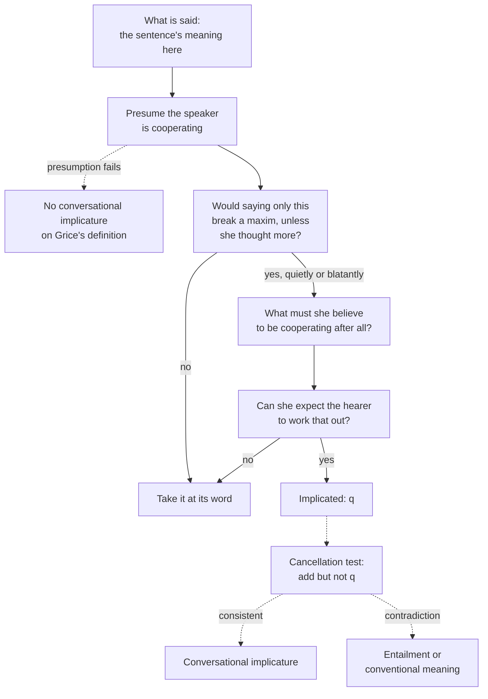

# Philosophy of Language and Logic · Lesson 4.4: Speaker meaning and implicature

> ⏱ ~15 min · Module 4: Meaning, use, and communication · Builds on: [1.4](01-04-strawson-donnellan-and-speaker-reference.md), [4.3](04-03-the-rule-following-paradox.md), [`philosophy-of-mind` 4.2](../../philosophy-of-mind/lessons/04-02-naturalizing-content.md) · Unlocks: [4.5](04-05-analyticity-and-two-dogmas.md)

## Why this matters

At a 1966 bankruptcy hearing a creditor's lawyer asked Samuel Bronston whether he had ever had an account in a Swiss bank. "The company had an account there for about six months, in Zurich." True; he had also kept a personal account in Geneva for nearly five years. In *Bronston v. United States* (1973) the Supreme Court reversed his perjury conviction: the answer was at most "misleading by negative implication", and the questioner should have pinned him down. Courts and moralists need a line between what a speaker says and what she gets across, and Grice drew it.

## The idea

[`philosophy-of-mind` 4.2](../../philosophy-of-mind/lessons/04-02-naturalizing-content.md) taught half of Grice's 1957 distinction: [natural meaning](../../philosophy-of-mind/reference.md#natural-meaning), the way spots mean measles, which cannot be false. This lesson takes the other half, what a *person* means. Grice's thought: meaning is an intention that works by being recognized. Plant a man's handkerchief at a crime scene and you hope the detective will *not* see your plan; say "he did it" and you succeed only if your hearer sees what you want her to believe.

What a speaker means can outrun what her words say. A reference letter that praises only a philosophy candidate's English and his attendance means that he is no good (Grice's own example), though no convention attaches "no good" to those words. The reader works it out by assuming the writer is cooperating and asking what he must think to write only that. That is [implicature](../reference.md#conversational-implicature).

Grice built the tool against Oxford colleagues who read every oddity of use as a fact about meaning.

## The argument

**D1. [Speaker meaning](../reference.md#speaker-meaning)** ([non-natural meaning](../reference.md#non-natural-meaning); H. P. Grice, "Meaning", 1957). Grice's formula, paraphrased: to mean something is to utter it intending to produce a belief through the hearer's recognition of that very intention. In the standard three clauses (P. F. Strawson's 1964 restatement), $S$ means that $p$ by uttering $x$ to audience $A$ iff $S$ utters $x$ intending

(i) $A$ to believe that $p$;

(ii) $A$ to recognize intention (i);

(iii) $A$'s recognition of (i) to be at least part of $A$'s reason for believing $p$.

*In words:* meaning something is getting it across by getting the hearer to see that you are trying. The planted handkerchief fails (ii). Herod showing Salome the Baptist's severed head fails (iii): her own eyes are reason enough. Strawson found a hidden-intention counterexample; Stephen Schiffer (1972) showed that each added clause invites another, and required instead that the intentions be mutually known.

**D2. [What is said and what is implicated](../reference.md#what-is-said-and-what-is-implicated).** What is said is what the sentence means in its context, with reference fixed; what is implicated is what the speaker means beyond it. A [conventional implicature](../reference.md#conventional-implicature) is fixed by word meaning: calling a man English and *therefore* brave (Grice's example) commits the speaker, unsaid, to bravery's following from Englishness, and "but" adds a contrast to the truth table of "and". A conversational implicature is worked out from the conversation. *In words:* some of what you convey rides on word meaning, some on your saying it here.

**D3. The [cooperative principle](../reference.md#cooperative-principle) and the [maxims](../reference.md#maxims-of-conversation)** ("Logic and Conversation", William James Lectures, Harvard, 1967; published 1975). Make your contribution what the accepted purpose of the exchange requires at the stage it occurs:

- **Quantity.** Be as informative as is required, and not more.
- **Quality.** Try to say only what is true: nothing you believe false, nothing you lack adequate evidence for.
- **Relation.** Be relevant.
- **Manner.** Be perspicuous: avoid obscurity and ambiguity, be brief, be orderly.

*In words:* rules any rational joint project follows.

**D4. Failing a maxim.** A speaker may quietly *violate* a maxim, and perhaps mislead; *opt out* openly; face a *clash* between two maxims; or [flout](../reference.md#flouting) one, failing so blatantly that the hearer must look for another meaning. The reference letter flouts Quantity.

**D5. Conversational implicature** (Grice 1975, as standardly reconstructed). $S$ conversationally implicates $q$ by saying $p$ iff (a) $S$ is presumed to observe the cooperative principle; (b) the supposition that $S$ thinks $q$ is needed to make her saying $p$ consistent with (a); (c) $S$ thinks, and expects the hearer to see she thinks, that the hearer can work out (b). Its marks: [calculability](../reference.md#calculability) (it can be worked out so) and [cancellability](../reference.md#cancellability) (adding "but not $q$" is no contradiction). An implicature is [generalized](../reference.md#generalized-and-particularized-implicature) when a form of words carries it unless something blocks it, *particularized* when it needs a special context. *In words:* it is what you must credit the speaker with believing to keep her cooperative, when she can count on you to see it.

**D6. [Scalar implicature](../reference.md#scalar-implicature)** (Laurence Horn, UCLA dissertation, 1972). Some words form a scale ordered by strength, $\langle$all, most, some$\rangle$. With $Jx$ for "$x$ is a jar of the batch" and $Sx$ for "$x$ is spoiled",

$$\forall x\,(Jx \to Sx),\ \exists x\,Jx \;\models\; \exists x\,(Jx \wedge Sx).$$

A well-informed speaker who says "some" implicates "not all" by Quantity: could she have said "all", she would have. In a [downward-entailing context](../reference.md#downward-entailing-context), such as negation, the entailments reverse and the implicature goes. *In words:* "some" means at least one; the "but not all" comes from her not saying more.

**D7. [Speech acts](../reference.md#speech-act)** (J. L. Austin, *How to Do Things with Words*, 1962, from his 1955 William James Lectures). A [performative utterance](../reference.md#performative-utterance) ("I bet you", naming a ship) does rather than describes, and fails without being false: it *misfires* (nothing is done: the namer lacks authority) or is an *abuse* (done insincerely, like a promise one means to break). Austin generalized: an utterance is a *locutionary* act (saying something with a meaning), an *illocutionary* act with an [illocutionary force](../reference.md#illocutionary-force) (warning, promising, ordering) and often a *perlocutionary* act (alarming, persuading). John Searle ("A Taxonomy of Illocutionary Acts", 1975) sorted illocutions into assertives, directives, commissives, expressives and declarations. Implicating is itself an indirect illocutionary act. *In words:* saying is doing, with its own ways to go wrong.

**Grice's razor applied.**

**P1.** Speakers who say "some" usually convey "not all", and the inference is calculable from Quantity, cancellable ("some, indeed all") and absent in downward-entailing contexts. *In words:* it behaves like an implicature.

**P2.** An inference with those marks is explained by implicature as well as by a second sense of the word. *In words:* the maxims already predict it.

**P3.** Other things equal, posit an implicature rather than a new sense (Grice's razor). *In words:* don't multiply meanings.

**∴ C.** "Some" means "at least one", and "not all" is a generalized conversational implicature.

**Lying and misleading.** On the Augustinian definition [`moral-theology` 6.4](../../moral-theology/lessons/06-04-truthfulness-and-the-lie.md) uses, a lie asserts against one's mind: a quiet violation of Quality in what is said. [Misleading](../reference.md#lying-and-misleading) says something true and implicates something false. Read this way, a [broad reservation](../../moral-theology/reference.md#mental-reservation) is a true what-is-said plus an uncancelled false implicature, while a strict reservation's private qualifier is neither said nor implicated, since no hearer could work it out. Whether misleading is better than lying is moral theology's dispute; *Bronston* shows US perjury law drawing the line.

**Where the argument is weakest.** P2, which rests on calculability. The objection is the [symmetry problem](../reference.md#symmetry-problem) (pressed since Anthony Kroch, 1972; Ernie Lepore and Matthew Stone, 2015, among others, use the name): the Quantity reasoning that takes "some" to "not all" runs just as well from "several" or "some regularly", yet nobody implicates "not several". The maxims do not predict which stronger claim gets denied; the derivation works because we knew the answer. Horn's neo-Gricean reply: only lexicalized scale-mates compete, a short, learnable list. The Gricean concedes that which alternatives compete is fixed by the lexicon, not by cooperation alone. The critic concedes that, once the scale is given, Quantity predicts the implicature, its cancellability and its disappearance under negation. Grammatical theories (Chierchia, Fox, Spector) compute them inside the sentence instead.

## How an implicature is worked out

The solid path is Grice's working-out schema; dashed branches mark where it stops, and Example 2 shows the cancellation test separating less than this suggests.

## Worked examples

**Example 1 (clean case: a [relevance implicature](../reference.md#relevance-implicature)).** Invented. Ingrith Lowther, wheezing on the quay at Eskerby, says to Bettany Lisle, "I've left my inhaler at home." Bettany replies, "There's a pharmacy behind the *Courier* office."

1. **Said:** there is a pharmacy at that spot; nothing about inhalers or opening hours.
2. **Presumption:** Bettany is cooperating, not opting out.
3. **Maxim:** as a reply to Ingrith's trouble, the remark is relevant only if the pharmacy can help her now: Relation, observed, not flouted.
4. **What she must think:** that it is, or may be, open and can supply what Ingrith needs, and that Ingrith, who knows what pharmacies sell, can see this.
5. **Implicature:** you can get help there now. It is particularized: answering "Where shall we meet?", the same sentence implicates nothing about inhalers.
6. **Cancellation:** "…though it may be shut by now" removes it without contradiction; "…but there's no pharmacy there" contradicts what was said.

This is the shape of Grice's stranded motorist told of a garage round the corner.

**Example 2 (hard case: one sentence, three inferences).** Invented: "Councillor Velmont managed to read most of the harbour report before the vote."

- (e) she read most of the report;
- (p) she tried, and it took effort (from "managed");
- (i) she did not read all of it (from $\langle$all, most$\rangle$).

| Test | (e) | (p) | (i) |
|---|---|---|---|
| Cancel unembedded ("…, but not so") | contradiction | odd | fine: "indeed, all of it" |
| Survives "Did she manage to read most of it?" | no | yes | no |
| Calculable from the maxims | it is said | a Manner story exists | yes, Quantity |
| Lost in "She read most of it" | no | yes | no |

The tests agree that (e) is entailed and (i) implicated. They split on (p). Calculability allows a conversational account (why the longer "managed to read", unless something was unusual?). Cancellability forbids it, and Grice made cancellability necessary. Projection says [presupposition](../reference.md#presupposition) ([1.4](01-04-strawson-donnellan-and-speaker-reference.md)), yet under negation (p) cancels after all: "She didn't manage to read it; she never even opened it." And no test tells a presupposition from a conventional implicature: both project and resist cancellation. Lauri Karttunen and Stanley Peters (1979) call inferences like (p) conventional implicatures; presupposition theorists count an effortless "managed" as presupposition failure; Kent Bach ("The Myth of Conventional Implicature", 1999) puts alleged conventional implicatures into what is said. What decides between them is whether, had she read it effortlessly, the sentence would be false or only out of place, and no test answers that.

## Watch out

- **You might think** any inference a speaker can withdraw is an implicature, **but actually** cancellability tests only unembedded triggers: under negation a presupposition cancels too (Example 2). An inductive conclusion that new evidence defeats was never implicated, and an entailment is neither cancellable nor defeasible.

- **You might think** a conventional implicature is a conversational one grown habitual, **but actually** Grice's ("but", "therefore") come from word meaning: not calculable, not cancellable, lost when you swap in "and". A generalized conversational implicature ("some", so not all) is habitual and still cancellable.

- **You might think** flouting a maxim is breaking it, **but actually** a flout is meant to be noticed, which keeps the presumption of cooperation alive. The violation nobody notices is how one misleads.

- **You might think** speaker meaning is a private act of will, **but actually** clauses (ii) and (iii) make it public by design. A qualifier the hearer could never recover is not meant in Grice's sense.

## One-liner

> What a speaker means outruns what she says, and on Grice's account the hearer recovers the rest by asking what a cooperative speaker must believe to have said just that: an inference she could have cancelled, which is what separates implicature from entailment.

## Problems

**P1 (🟢)** *(Diagnose: Exegetical.)* Each exchange is invented, written for this problem. For each, name the maxim the second speaker flouts and state what she or he implicates. One line each.

(a) Sabeline Corvo, chief sub-editor of the *Eskerby Courier*, hands back a reporter's story with a misspelling in every paragraph: "Flawless, as ever."

(b) At a council meeting Mr Caddick announces that the harbourmaster is obviously drunk on duty. The chair, Dr Hartigan, turns to the room: "Has everyone seen the new bunting for the regatta?"

(c) Wynne Merriwether, with her six-year-old at the table, says to her husband: "Shall we take him to the place with the S-W-I-N-G-S after lunch?"

(d) A reporter complains that the noon copy deadline is unfair to late stories. The editor, Ms Garroway, replies: "A deadline is a deadline."

**P2 (🟡)** *(Formal model: Formal (a) and (c) · Exegetical (b) and the last part of (c).)* A food inspector's report on batch 12, which has eight jars, says: "Some of the jars are spoiled." Write $Jx$ for "$x$ is a jar in batch 12", $Sx$ for "$x$ is spoiled", and $W$ for the sentence "batch 12 is withdrawn". Read "some" as "at least one".

(a) Translate "some of the jars are spoiled" and "all of the jars are spoiled". Give a model in which both are true, and say in one sentence what it shows about "some" and "not all". Show the model.

(b) Derive the "not all" implicature from Quantity in at most four steps, then give a continuation that cancels it and say why the cancelled text is consistent.

(c) The batch rule reads: "If some of the jars are spoiled, the batch is withdrawn." Show that, given there are jars, this rule entails "If all the jars are spoiled, the batch is withdrawn", and that the converse fails (show a model). Then say in two sentences why no "not all" implicature arises in the rule's antecedent.

**P3 (🔴)** *(Apply to a hard case: Exegetical (a) · Evaluative (b).)* A letter to the *Eskerby Courier*, invented, written for this problem, from Councillor Velmont's campaign manager: "Since Councillor Velmont took office, not one person has died on the harbour road." It is true. The road was closed to traffic for repairs for 20 of her 24 months in office, under a decision she voted against, and the writer knows this.

(a) What does the letter say, what does it implicate, and which maxim does the implicature rest on? Say whether any maxim is flouted or quietly violated. Two sentences.

(b) Is the writer responsible for the implicature? Give the Gricean answer, the strongest objection from a critic who denies that a campaign letter is a cooperative exchange, and the premise that divides them. Any verdict; 150 words or fewer. Do not argue whether misleading is better or worse than lying.

Solutions

**P1** *(Exegetical.)*

**Must hit, strict:**

- (a) Quality (do not say what you believe false), flouted by irony; she implicates that the copy is riddled with errors.

- (b) Relation, flouted by an abrupt change of subject; she implicates that Caddick's accusation is out of place and will not be taken up here.

- (c) Manner (avoid obscurity), flouted on purpose so that the child cannot follow; she implicates that the outing should not be mentioned in front of him yet.

- (d) Quantity (be as informative as required), flouted by a tautology, which is true and says nothing; she implicates that no exception will be made.

**Wrong turns:** calling (a) a lie, when a flout is meant to be seen through and nothing is put forward as her mind; Quality for (d), when a tautology is true (Grice classes tautologies as flouts of the first maxim of Quantity); Quantity for (b), when the remark is not too little on the topic but off it; treating (c) as a quiet violation, when it is blatant to its addressee, the husband.

**Model answer:** (a) Quality, irony: the story is full of mistakes. (b) Relation, change of subject: the accusation is out of order and will not be discussed. (c) Manner, deliberate obscurity: don't let him hear about it yet. (d) Quantity, tautology: the deadline stands, no exceptions.

---

**P2** *(Formal (a) and (c) · Exegetical (b) and the last part of (c).)*

(a) "Some": $\exists x\,(Jx \wedge Sx)$. "All": $\forall x\,(Jx \to Sx)$. Model: domain $D = \{j_1, \dots, j_8\}$ with $J = S = D$. Some $j_i$ is a spoiled jar, so "some" is true; every jar is spoiled, so "all" is true and "not all" is false. A model where "some" is true and "not all" false shows that "some" does not entail "not all".

(b) (1) She said "some", when "all" was available and more informative. (2) Presume she is cooperating and, as an inspector, knows the batch. (3) If she believed all eight were spoiled, saying only "some" would break Quantity. (4) So she believes not all are spoiled, and implicates it. Cancellation: "Some of the jars are spoiled; indeed, all eight are." The two sentences are true together in the model of (a), so the text is consistent: the cancelled inference was never entailed.

(c) Suppose (1) $\exists x\,(Jx \wedge Sx) \to W$, (2) $\exists x\,Jx$, and, for conditional proof, (3) $\forall x\,(Jx \to Sx)$. By (2) take a jar $a$; by (3) $Sa$; so $\exists x\,(Jx \wedge Sx)$; by (1) $W$. Discharging (3) gives $\forall x\,(Jx \to Sx) \to W$. The converse fails: eight jars, only $j_1$ spoiled, $W$ false. "All" is false, so "if all, then $W$" is true; "some" is true and $W$ false, so "if some, then $W$" is false. In the antecedent the entailment runs the other way, so the rule with "some" is the stronger rule and the speaker who chose it already said the most she could. Quantity gives no reason to deny the "all" version, and reading "some but not all" would exempt a batch in which every jar is spoiled, which no reader of the rule does.

**Must hit, strict:**

- (a) both translations, a model with every jar spoiled, and the conclusion that "some" does not entail "not all".

- (b) the stronger alternative "all", the assumption that the speaker knows the facts, Quantity named, and a cancelling continuation shown consistent.

- (c) the derivation, using $\exists x\,Jx$ where "all" yields a spoiled jar; a countermodel with some but not all jars spoiled and $W$ false; the reversal of strength in the antecedent as the reason the implicature lapses.

**Wrong turns:** proving "all" entails "some" without $\exists x\,Jx$ (with no jars "all" is vacuously true and "some" false); calling the cancellation a contradiction; a countermodel to the converse with $W$ true or with no jar spoiled, which makes both rules true; explaining (c) as the implicature being "cancelled", when it never arises.

---

**P3** *(Exegetical (a) · Evaluative (b).)*

**Must hit, strict (a):** said: no one has died on the harbour road since she took office (true). Implicated: the road became safer on her watch, to her credit. It rests on Relation (the fact is offered as relevant to her record), and Quantity is quietly violated, not flouted, since the closure is left out without the reader noticing.

**Must hit, any verdict (b):**

- The Gricean answer: implicating is meaning (D1, D5). If the writer intends readers to credit Velmont by recognizing that the fact is offered as relevant, she means it and answers for communicating it, though she has not said or asserted it; she could have cancelled it and did not.

- The critic at strength: D5 requires a presumption of cooperation, a campaign letter is partisan and readers know it, so Grice's theory predicts no implicature, yet readers draw it. Responsibility must then rest on something else, such as what a reasonable reader takes the text to convey.

- The dividing premise: whether the cooperation Grice needs is cooperation of interests, absent here, or only communicative cooperation, the wish to be understood, which the writer has. Or equivalently: whether what is communicated is fixed by the writer's intentions or by reasonable uptake.

**Accept (b):** a critic who argues instead that implicatures are deniable by design, so a writer answers only for what she said (the *Bronston* standard), if the dividing premise is stated.

**Wrong turns:** calling the letter a lie, when what it says is true; calling the omission a flout; assuming the critic must clear the writer (on a reasonable-reader view she may answer for more, not less); grading the morality of misleading.

**Model answer (b), one of several:** On Grice's account the writer means the credit she never states. She chose a true fact whose only relevance to a re-election letter is as evidence of Velmont's record, intended readers to see that, and left the inference uncancelled. So she has communicated the claim and answers for it, though she has asserted nothing false. The critic replies that Grice's derivation starts from a presumption of cooperation that partisan letters forfeit: readers expect selective facts, so on Grice's own definition no implicature arises, yet the false belief spreads. If she is responsible, it is for what a reasonable reader would take, whatever she intended. The crux is what cooperation the theory needs. If wanting to be understood is enough, the writer cooperates and implicates. If shared aims are required, the theory goes silent exactly where misleading matters most.

## Flashback

**From Lesson [4.2](04-02-meaning-as-use.md) (Meaning as use):** *(Close reading: Exegetical (a)–(b).)* Bertrand Russell, *The Analysis of Mind* (1921), Lecture X, "Words and Meaning" (Project Gutenberg #2529). The lecture asks what relation makes the word "Napoleon" mean a certain person. Later in it:

> Understanding words does not consist in knowing their dictionary definitions, or in being able to specify the objects to which they are appropriate. [...] the use of the word comes first, and the meaning is to be distilled out of it by observation and analysis. [...] A word is used "correctly" when the average hearer will be affected by it in the way intended.

(a) Which part of the [Augustinian picture](../reference.md#augustinian-picture) does Russell give up, and which does he keep? Is this [meaning as use](../reference.md#meaning-as-use) in the sense of §43? Quote the deciding words. Three sentences.

(b) Does Russell's "correctly" supply the standard that L1 of the [private language argument](../reference.md#private-language-argument) requires? Is it normative, like Brandom's account, or descriptive, like Horwich's? Two sentences.

Solution

**Accept (a):** "a use theory of understanding, not of meaning", if it quotes "distilled out of".

**Must hit, strict (a):**

- Given up: the picture's account of understanding, which is not "being able to specify the objects to which they are appropriate"; use "comes first".

- Kept: a word has a meaning it stands for ("Napoleon" means a person), something further, "to be distilled out of" the use.

- Not §43, where for a large class of cases the use is the meaning: for Russell use is the route to it, and the word–meaning relation is, a few lines on, "of the nature of a causal law governing our use of the word".

**Must hit, strict (b):**

- Yes: whether the average hearer is affected as intended is a fact about others, which the speaker can get wrong, so it is a standard apart from her impression.

- Descriptive: correctness is a regularity in hearers' responses ("a psychological, not a literary, definition", his next sentence), with no commitments or entitlements on score, so Horwich's side, not Brandom's. Whether a regularity can be a norm is [4.3](04-03-the-rule-following-paradox.md)'s question.

**Wrong turns:** making Russell a §43 use theorist because use "comes first", when the same sentence puts the meaning beyond the use; calling his standard normative because "correctly" sounds evaluative (he puts it in scare quotes and defines it psychologically); saying it fails L1 because it mentions the speaker's intention (her intention sets the target, the hearers decide whether she hits it).

**Model answer:** (a) Russell gives up the Augustinian account of understanding: it does not consist "in being able to specify the objects to which they are appropriate", since "the use of the word comes first". He keeps the other half: "Napoleon" still means a person, and the meaning is "to be distilled out of" the use. So use is the way to the meaning, not, as in §43, the meaning itself. (b) Yes: whether "the average hearer will be affected by it in the way intended" is a public fact the speaker can be wrong about. It is descriptive, a psychological regularity with no scorekeeping, so closer to Horwich than to Brandom.

## Connections

- **Backward:** Kripke's speaker's referent in [1.4](01-04-strawson-donnellan-and-speaker-reference.md) is the referential counterpart of speaker meaning: a Russellian keeps the semantics fixed and lets the referential use be what the speaker means, as this lesson lets "not all" be what the speaker means. [4.3](04-03-the-rule-following-paradox.md)'s sceptic asked for a fact that makes it the case I mean plus; Grice's analysis grounds meaning in intentions, so it inherits that question about intentions rather than escaping it. [3.4](03-04-indexicals-and-the-return-of-freges-puzzle.md)'s Millians (Nathan Salmon, Scott Soames) put implicature to work to explain why substituting co-referring names seems to change what a belief report says.

- **Forward:** Grice's other famous paper is "In Defense of a Dogma" (1956), written with P. F. Strawson against Quine, and it is [4.5](04-05-analyticity-and-two-dogmas.md)'s.

- **Sideways:** Lying, broad and strict mental reservation and silence are [`moral-theology` 6.4](../../moral-theology/lessons/06-04-truthfulness-and-the-lie.md)'s, and this lesson supplies only the line between saying and implicating that those classes rely on. [`epistemology` 3.4](../../epistemology/lessons/03-04-contextualism-and-its-rivals.md) applies implicature in the warranted assertability manoeuvre; its "conversationally imply" is this lesson's "implicate". What makes a promise bind is [`philosophy-of-debt` 1.2](../../philosophy-of-debt/lessons/01-02-hume-promises-as-artificial-obligation.md)–[1.3](../../philosophy-of-debt/lessons/01-03-promising-after-hume.md)'s (practice, assurance, authority), and [`philosophical-method` 3.1](../../philosophical-method/lessons/03-01-conceptual-analysis.md) analyses "promise" by counterexample. Words that make a sacramental act what it is, and an actor's non-serious use, are [`sacraments-and-liturgy` 1.2](../../sacraments-and-liturgy/lessons/01-02-matter-form-minister-intention.md)'s. The cooperative principle assumes aligned aims, and [`political-economy` 1.4](../../political-economy/lessons/01-04-persuasion-and-the-media.md) shows what happens to costless talk when interests diverge: cheap talk collapses to babbling. Constitutional interpretation by original public meaning ([`constitutional-law`](../../constitutional-law/syllabus.md) 8.1, not yet built) applies two of this lesson's distinctions: speaker meaning against sentence meaning (original intent against public meaning) and what is said against what is implicated. The general question, communicative content against legal effect, is [`philosophy-of-law`](../../philosophy-of-law/syllabus.md) 3.4's.
