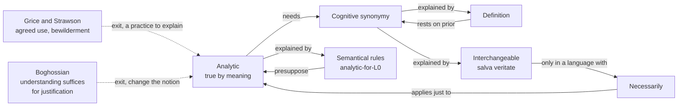

# Philosophy of Language and Logic · Lesson 4.5: Analyticity and "Two Dogmas"

> ⏱ ~15 min · Module 4: Meaning, use, and communication · Builds on: [4.1](04-01-truth-conditional-semantics-and-davidson.md), [`epistemology` 4.1](../../epistemology/lessons/04-01-a-priori-knowledge.md), [`modern-philosophy` 5.1](../../modern-philosophy/lessons/05-01-the-critical-question.md) · Unlocks: [5.1](05-01-tarskis-theory-as-philosophy.md)

## Why this matters

On 24 August 2006 the International Astronomical Union resolved that a planet must have cleared the neighbourhood of its orbit, and Pluto stopped being one. Did astronomers learn something about Pluto, or change what "planet" means? If those differ, some truths hold because of what words mean, others because of how the world is. In 1951 Quine argued that nobody had made that difference intelligible, and that empiricism should stop leaning on it.

## The idea

[`epistemology` 4.1](../../epistemology/lessons/04-01-a-priori-knowledge.md) separated three questions about a truth: how it is known, whether it could have been false, and what makes it true. On the third, a sentence is [analytic](../reference.md#analytic-and-synthetic) when it is true in virtue of meaning alone. That lesson used Quine against the a priori and stated Boghossian's two versions of the idea; this one asks whether [analyticity](../reference.md#analyticity), the semantic notion, is in good order.

Three explications differ. Kant's test is containment of the predicate in the subject concept ([`modern-philosophy` 5.1](../../modern-philosophy/lessons/05-01-the-critical-question.md) owns it, with Quine's complaint that containment never gets past metaphor). Frege's is provability from logic plus definitions. Carnap's is truth by the rules of a language. Frege saw a gap in Kant's: it needs a universal affirmative judgment with a subject concept, so it is silent on singular and existential judgments. And a fruitful definition contains its consequences, he wrote, "as the plant is in the seed, not as the beam is in the house" (*Grundlagen*, 1884, §88, lesson's translation).

Picture a proof assistant. Unfold the definition of "square" and "every square is a rectangle" closes by logic alone, while "Pluto has cleared its orbit" never will. The friend of analyticity calls that the difference between meaning and fact; Quine asks who wrote the definitions, and what makes them definitions rather than conjectures.

## Source

Frege, *Die Grundlagen der Arithmetik* (Breslau, 1884), §3 (lesson's translation from the German):

> On my view, these distinctions of a priori and a posteriori, synthetic and analytic, concern not the content of the judgment but the justification (*Berechtigung*) for making it. [...] The task, then, is to find the proof and to follow it back to the primitive truths (*Urwahrheiten*). If on this path one comes only upon the general logical laws and upon definitions, one has an analytic truth, provided that the propositions on which the admissibility of a definition may rest are also taken into account. If, however, the proof cannot be carried out without using truths that are not of a general logical nature but concern a particular domain of knowledge, the proposition is a synthetic one.

Three words decide the reading. ***Berechtigung***: analyticity is a property of a truth's deepest justification, not of its content, so Frege's notion is epistemic, nearer Boghossian's second version than "true by meaning". ***Definitionen***: the test inherits whatever a definition is, where Quine presses. ***allgemeinen logischen Gesetze***: analyticity is relative to what counts as logic, and Frege's own logic proved inconsistent ([`mathematical-logic` 3.1](../../mathematical-logic/lessons/03-01-russells-paradox.md)).

## The argument

**Carnap's model.** Let a language $L$ have atomic sentences $A_1, \dots, A_n$. A [state description](../reference.md#state-description) $s$ assigns T or F to each $A_i$; complex sentences get values from the truth tables, with $\forall x$ running over $L$'s individual names. Write $s \models S$ for "$S$ is true in $s$".

**C1** (Carnap, *Meaning and Necessity*, 1947). $S$ is L-true iff $s \models S$ for every state description $s$. *In words:* no distribution of truth values over the atoms makes it false.

**C2** (Carnap, "Meaning Postulates", 1952). Given a set $\mathcal{P}$ of [meaning postulates](../reference.md#meaning-postulate), $S$ is analytic in $L$ iff $s \models S$ for every $s$ with $s \models P$ for all $P \in \mathcal{P}$. *In words:* hold the postulates fixed, and no remaining distribution makes it false.

**Quine's circle** ("Two Dogmas of Empiricism", *Philosophical Review*, 1951; revised 1953). Logical truths, like "No unmarried man is married", are not the problem; his second class is: "No bachelor is married" becomes a logical truth only by putting synonyms for synonyms. These are the logical and conceptual rungs of [`metaphysics` 3.1](../../metaphysics/lessons/03-01-kinds-of-necessity.md). C1 misses the second class, Quine noted, since state descriptions treat atoms as independent; C2 was Carnap's later repair. Then the [circle of synonymy](../reference.md#circle-of-synonymy). (§2) Definition does not explain synonymy: a dictionary reports synonymies already in usage, and explication rests on prior ones; only introducing a new abbreviation creates synonymy outright. (§3) Interchangeability *salva veritate* yields synonymy only in a language containing "necessarily" in the sense that already means analytic; an extensional language gives only coextension, as with "creature with a heart" and "creature with a kidney". (§4) Semantical rules define "analytic-for-$L_0$", not "analytic for $L$" with $L$ variable. A rule is marked off from other truths only by the heading it is listed under, so C2 inherits the worry: what makes a postulate a *meaning* postulate? Quine calls the result a "closed curve in space". It becomes a reason to drop the notion only with a further premise about when a family of notions counts as intelligible.

**The [second dogma](../reference.md#two-dogmas) and the link** (§§5–6).

**P1.** The verification theory of meaning: two statements are synonymous iff they are alike in method of empirical confirmation, and an analytic statement is the limiting case, confirmed no matter what. *In words:* verificationism would give synonymy for free.

**P2.** That account needs reductionism, at least attenuated: each statement, taken alone, has its own range of confirming and disconfirming experiences. *In words:* every sentence carries its own test.

**P3.** Statements about the external world face experience not singly but as a "corporate body". *In words:* experience tests theories, not sentences.

**P4.** So any statement can be held true come what may, by adjustments elsewhere, and none is immune to revision, [logic included](../reference.md#revisability-of-logic). *In words:* Quine cites a proposal to revise excluded middle for quantum mechanics.

**∴ C.** Confirmation defines neither synonymy nor analyticity, and "confirmed come what may" marks off no class. *In words:* the two dogmas are, in Quine's phrase, "at root identical".

P1 is also the positivists' test for meaningless sentences, sometimes read back into Hume's fork ([`modern-philosophy` 4.1](../../modern-philosophy/lessons/04-01-impressions-ideas-and-the-fork.md) weighs the anachronism); holism removes its unit, the single sentence. Quine's images are a "man-made fabric" touching experience only at its edges and a "field of force"; "[web of belief](../reference.md#web-of-belief)" is the title of Quine and Ullian's 1970 book. P3–P4 about testing are [`philosophy-of-science` 2.2](../../philosophy-of-science/lessons/02-02-duhem-quine-and-underdetermination.md)'s; against the a priori, `epistemology` 4.1's.

**Replies.** Grice and Strawson ("In Defense of a Dogma", 1956): a distinction speakers apply with broad agreement to new cases is unlikely to be illusory, and a standard that condemned it would condemn "means the same" too. From outside the circle they contrast a surprising claim (a neighbour's three-year-old understands Russell's theory of types) with one whose meaning you cannot find (the child is an adult). Putnam ("The Analytic and the Synthetic", 1962) keeps a trivial distinction for one-criterion words like "bachelor", and denies it for [law-cluster terms](../reference.md#one-criterion-and-law-cluster-terms) like "energy", which no single law defines; Fodor later objected that "criterion" is no clearer than "meaning". Boghossian ("Analyticity Reconsidered", 1996) gives up [metaphysical analyticity](../reference.md#epistemic-and-metaphysical-analyticity): a sentence's meaning that $p$ cannot by itself make it true, since it must also be that $p$. He keeps the epistemic notion, which the circle threatens only if there are no facts about meaning at all, reached by synonym substitution or by [implicit definition](../reference.md#implicit-definition) (stipulating that "taller than" is transitive fixes part of its meaning). Harman replied (1996) that the epistemic story leans on the metaphysical one. Williamson (*The Philosophy of Philosophy*, 2007) attacks the epistemic notion's [understanding–assent links](../reference.md#understanding-assent-link): his Peter and Stephen, competent speakers who publish deviant theories of "every", understand "Every vixen is a vixen" and reject it.

**Where the argument is weakest.** The step from P4 to C. Grice and Strawson grant that nothing is immune to revision and deny that this erases the line: one can give a statement up by admitting it false, or by changing a concept. The strongest Quinean reply, later pressed by Harman, is that no empirical evidence separates a change of meaning from a change of belief, so the second kind of giving up is the dogma restated. The defender concedes that analyticity cannot underwrite unrevisability, or the a priori in the strong sense. The Quinean concedes that the difference between surprise and bewilderment is real data that holism must explain, and centrality fits it poorly: "there have been black dogs" is central and not analytic.

## The circle of synonymy

Solid arrows are Quine's §§1–4, each notion leading back to analyticity; dashed arrows are two exits, one denying that the circle shows emptiness, one changing the notion at stake.

## Worked examples

**Example 1 (clean case: "every mare is a horse").** A mare is an adult female horse. Kant: "horse" is part of what we think in "mare", so the judgment is analytic. Frege: put the definition for "mare" and you get "every adult female horse is a horse", a logical truth, so analytic (Quine's second class). Carnap: give $L$ predicates $M$ (mare), $H$ (horse), $F$ (female), two names $a, b$, and the postulate $\forall x\,(Mx \to (Hx \wedge Fx))$. Six atoms give $2^6 = 64$ state descriptions, and the postulate admits 25. $\forall x\,(Mx \to Hx)$ holds in 36 of the 64 and in all 25: analytic in $L$, not L-true. $\forall x\,((Hx \wedge Fx) \to Mx)$ fails in an admitted description where $a$ is a female horse but no mare, a filly: synthetic. The postulate, a conditional, fixes only part of a meaning. The three verdicts agree; Quine's question attaches to each at a different place: what containment is, who defined "mare", and why this postulate, rather than "every mare has four legs", counts as one.

**Example 2 (hard case: kinetic energy).** Classical mechanics treated "kinetic energy is $\tfrac12 mv^2$" as a definition. Special relativity gives $(\gamma - 1)mc^2$, with $\gamma = 1/\sqrt{1 - v^2/c^2}$ and $c$ the speed of light ([`relativity` 1.5](../../relativity/lessons/01-05-four-vectors-momentum.md)). At $v = 0.6c$, $\gamma = 1.25$, so the kinetic energy is $0.25\,mc^2$ where $\tfrac12 mv^2 = 0.18\,mc^2$. A Carnapian says that if $\tfrac12 mv^2$ was a meaning postulate, physics changed languages and the old sentence stays analytic in the old one. Grice and Strawson say it was one of their two kinds of giving up. Putnam says "energy" is a law-cluster term, so $\tfrac12 mv^2$ was one law among several, and revising it kept the subject. Quine says truth values were redistributed, and no fact decides which kind of change it was. **Where it stops:** physicists kept the word, kept conservation of energy, and recovered $\tfrac12 mv^2$ as the low-speed limit. Each side reads that record as support; whether "kinetic energy" in 1900 *meant* $\tfrac12 mv^2$ is what it leaves open, and the dispute is over what evidence could settle it.

## Watch out

- **You might think "analytic" always meant "true in virtue of meaning", but actually** Kant's test is containment, Frege's §3 concerns the proof that justifies, and Carnap's is truth by a language's rules. Each objection fits some of these better than others.

- **You might think "Two Dogmas" calls our beliefs a web, but actually** the 1951 images are a fabric and a field of force; "web of belief" is the 1970 book title.

- **You might think that showing a statement revisable shows it synthetic, but actually** Grice and Strawson allow that an analytic truth can be given up by changing a concept. Revisability tells against the a priori only on the strong notion [`epistemology` 4.1](../../epistemology/lessons/04-01-a-priori-knowledge.md) discusses.

- **You might think the circle is a fallacy of circular reasoning, but actually** it is a circle of explanation: each notion is defined by the others. Whether that is vicious turns on a contested premise about intelligibility.

## One-liner

> Quine argues that analyticity can be explained only by notions that presuppose it, and that holistic confirmation leaves no sentence true come what may; defenders reply that a distinction applied with agreement is real, or that what matters is whether understanding alone justifies.

## Problems

**P1 (🟢)** *(Exegetical.)* Classify each statement on Kant's containment test, as [`modern-philosophy` 5.1](../../modern-philosophy/lessons/05-01-the-critical-question.md) states it for affirmative subject–predicate judgments, and on Frege's §3 definition as Frege himself applied it in 1884: analytic, synthetic, or "the test does not apply". Take a square to be a four-sided figure with four equal sides and four right angles, and a rectangle a four-sided figure with four right angles. One line each.

(a) Every square is a rectangle.

(b) There is an even prime number.

(c) Through any two points there is exactly one straight line.

(d) Water expands when it freezes.

(e) Where do the two tests come apart, and which complaint in Frege's §88 explains it? Two sentences.

**P2 (🟡)** *(Counterexample: Exegetical (a) · Evaluative (b).)* Invented, written for this problem. Dr Hartigan, an epistemologist, has published papers arguing that the ordinary word "knows" is not factive: she takes reports such as "everyone knew the bridge would hold" at face value even when the bridge fell. She uses "know" in conversation exactly as her colleagues do, insists she means it in its ordinary English sense, and refuses to assent to

> (K) If someone knows that the ferry has sailed, then the ferry has sailed.

(a) State, as a necessity claim, the understanding–assent link the case tests, and say whether the case bears on Boghossian's metaphysical notion or his epistemic one. Two sentences.

(b) Is Dr Hartigan a counterexample to the claim that (K) is epistemically analytic? Give the defender's best reply and say what it costs. Any verdict; 150 words or fewer.

**P3 (🔴)** *(Find the crux: Exegetical (a) · Evaluative (b).)* The 2006 resolution says that a planet of the Solar System orbits the Sun, is massive enough to have pulled itself nearly round, and has cleared the neighbourhood around its orbit; Pluto fails the third clause and became a "dwarf planet". Two positions, invented, written for this problem. A Carnapian says: "The resolution laid down a meaning postulate for astronomers' language, so 'every planet has cleared its orbit' is now analytic in that language. No observation can tell against it; only a new decision about the language can." A Quinean replies: "The resolution is a legislated postulate. Once adopted, it is one more statement of astronomy, kept or dropped on the same grounds of simplicity and fit as any hypothesis."

(a) Name the single premise the Carnapian needs and the Quinean denies. Two sentences.

(b) Say what evidence about astronomers' later practice would move each side, and whether any evidence could settle the dispute. Any verdict; 150 words or fewer.

Solutions

**P1** *(Exegetical, strict.)*

**Must hit, strict:**

- (a) Kant: analytic, since "four right angles" is part of the concept of a square. Frege: analytic, since the definitions plus logic give it.

- (b) Kant: the test does not apply. "There is an even prime" has no subject concept for a predicate to be contained in. Frege: analytic, since on his view arithmetic truths are provable from logic and definitions (§87; he claims only to have made it probable, §90). The only even prime is 2.

- (c) Kant: synthetic: "Just as little is any principle of pure geometry analytical" (Introduction §V, Meiklejohn). Frege: synthetic, since geometrical axioms are independent of the laws of logic (§14).

- (d) Synthetic on both. Its proof needs physical truths, which belong to a particular domain of knowledge.

- (e) They come apart on (b). Frege's §88 complaint is that Kant's division assumes a universal affirmative judgment with a subject concept, so it is not exhaustive: it says nothing of judgments about a single object or of existential ones.

**Accept (b):** "Kant: synthetic" with a reason: either the judgment is recast as "some prime is even" and "even" is not contained in "prime", or Kant counts all arithmetic synthetic (Introduction §V). The tests still come apart on (b), and (e) is graded the same way.

**Wrong turns:** calling (c) analytic on Frege's test because geometry is a priori, which confuses Frege's two distinctions (he held geometry synthetic a priori). Calling (b) analytic on Kant's test because it is necessary, which runs the semantic axis into the modal one. In (e), naming the seed-and-beam image: that explains why fruitful consequences count as analytic for Frege, not why Kant's test is silent on (b).

**Model answer:** (a) analytic, analytic. (b) does not apply (no subject concept), analytic. (c) synthetic, synthetic. (d) synthetic, synthetic. (e) On (b): Kant's test needs a universal affirmative judgment with a subject concept, and §88 objects that the division therefore leaves out singular and existential judgments, which Frege's proof-based test still classifies.

---

**P2** *(Exegetical (a) · Evaluative (b).)*

**Must hit, strict (a):**

- The link: necessarily, anyone who understands (K) assents to it (or: is disposed to assent to it).

- It bears on the epistemic notion, on which understanding (K) suffices for being justified in believing it. Her refusal says nothing about what makes (K) true, so it does not touch the metaphysical notion.

**Must hit, any verdict (b):**

- Show that she understands by criteria that do not presuppose assent to (K): competent use, the intention to use the word in its public sense, and others' reporting her views with the same word. Say that a mistaken theory of a word's meaning does not by itself make one use it with a deviant meaning (Williamson's point about Peter and Stephen). So the assent link fails for (K).

- State the defender's best reply, and its cost. Either she means something else by "know": then competence depends on theory, and the link holds only for those who already accept (K), so it explains nothing. Or understanding gives her a justification that her theory defeats or that she fails to use: then the defender must say what in understanding confers it, since the bare property of understanding is one she has.

**Wrong turns:** "She does not understand 'know', because she denies (K)", which begs the question. Treating the case as about whether revisability refutes the a priori (that is [`epistemology` 4.1](../../epistemology/lessons/04-01-a-priori-knowledge.md)'s P2). Concluding that (K) is false: the case concerns understanding, not truth.

**Model answer (b), one of several:** She refutes the assent version. She understands (K) by every test we apply to anyone: she uses "know" fluently, means it in the public sense, and we report her view with the word itself ("she denies that knowledge entails truth"). A wrong theory of "know" no more changes her word than a wrong theory of gold changes "gold". The defender's best move is to retreat from assent to justification: understanding (K) entitles her to believe it, and her theory overrides an entitlement she has. That reply costs something. Justification by understanding becomes something one can have while rationally rejecting the sentence, and since she has the property of understanding, the defender must name what else in understanding justifies, which threatens the claim that understanding *alone* suffices.

---

**P3** *(Exegetical (a) · Evaluative (b).)*

**Must hit, strict (a):**

- The premise: a sentence adopted by stipulation keeps, after adoption, a status different in kind from the theory's hypotheses, so that it can be given up only by changing the language and not on evidence.

- The Carnapian affirms it, as the point of meaning postulates. The Quinean denies it: in "Carnap and Logical Truth" (1960), Quine holds that the artificiality of a legislated postulate's origin does not linger, and that which truths an expositor lists as postulates is a matter of exposition.

**Accept (a):** the premise put as "there is a fact distinguishing a change of meaning from a change of belief, and the stipulation fixes which kind any later revision of this sentence will be", provided it is tied to the stipulated sentence's lasting status.

**Must hit, any verdict (b):**

- Evidence for the Carnapian: later challenges are handled as proposals about a word (amendments, new terms such as "dwarf planet" kept alongside, pre-2006 texts read as using an older sense rather than as false).

- Evidence for the Quinean: the definition is later revised for the reasons hypotheses are revised (say, the clearing criterion fails to track a real dynamical division among exoplanets), and astronomers say the definition was wrong.

- Whether anything settles it: say what each side would make of the other's evidence. The Quinean says that describing a revision as "about the word" already presupposes the distinction. The Carnapian says that the procedure (a vote, a resolution, a new term) is itself the evidence.

**Wrong turns:** answering with §4's complaint that "analytic-for-$L_0$" does not explain "analytic for $L$"; that concerns defining "analytic" in general, not whether this stipulation keeps its status. Saying the Quinean denies that the IAU stipulated anything: he grants the stipulation and denies that its status persists. Making the crux a fact about Pluto: both sides accept every astronomical fact in the case.

**Model answer (b), one of several:** Watch what happens when the definition is challenged. If astronomers treat a challenge as a choice of terminology, keeping "planet" and "dwarf planet" as distinct words, amending by vote, and reading older texts as using an older sense rather than as false, the Carnapian's line is doing work. If they revise the clearing clause because it fails to sort exoplanets into a real dynamical division, and say the old definition was wrong, the stipulation has been treated like a hypothesis, as Quine predicts. I doubt either record settles it. The Quinean will say that "treated as terminology" describes the practice in the disputed vocabulary, and the Carnapian will say that the vote is that very vocabulary at work. What the record can do is show which description earns its keep.

## Flashback

**From Lesson [4.3](04-03-the-rule-following-paradox.md) (The rule-following paradox):** *(Exegetical (a)–(b).)* Invented, written for this problem. Morwen has graded dyed wool for thirty years, calling some batches "russet". Every batch she judged matched one of the 212 shades on the mill's colour card; today's, a reddish brown, matches none. A sceptic presses the [sceptical challenge](../reference.md#sceptical-challenge): what fact shows she meant russet, not *rosset* (the card shades she called "russet", and nothing off the card)? Replies:

(i) Her old notebook says: "russet: a reddish brown".

(ii) Shown today's batch, she would say "russet".

(iii) Russet is the simpler hypothesis about what she meant.

(a) Name the premise of 4.3's sceptical argument (K1–K6) that answers each reply, and say how. One sentence each.

(b) Grant the anti-normativists about the [normativity of meaning](../reference.md#normativity-of-meaning) (Hattiangadi; Glüer and Wikforss). Which objection to (ii) loses its force, and which still stands? Two sentences.

Solution

**Must hit, strict (a):**

- (i) K3: the note is an instruction in her finite record, and it only moves the question to "reddish" and "brown", which can be read deviantly in turn.

- (ii) K4, using K2: what she would say describes what she will do, not what she ought to, where the relation is "normative, not descriptive" (Kripke 1982: 37).

- (iii) K4: simplicity is at best evidence between hypotheses about which fact obtains, so it presupposes the fact the sceptic asks for instead of supplying it.

**Accept:** "K2" for (ii), if the answer says the disposition fails the demand to justify.

**Must hit, strict (b):**

- Loses its force: the objection that a disposition is descriptive where meaning is normative. If "correct" only sorts uses into true and false, K2 shrinks to K1's demand that the fact fix which uses are correct.

- Still stands: the error problem. She may be disposed to misgrade (under yellow lamps, say), so a disposition must still be shown to separate her correct uses from her slips, and that does not turn on normativity. Credit the finitude problem too ([`philosophy-of-mind` 5.2](../../philosophy-of-mind/lessons/05-02-is-the-intellect-a-bodily-power.md)).

**Wrong turns:** answering (iii) with Lewis's naturalness reply, which says naturalness *constitutes* meaning (`philosophy-of-mind` 5.2's ground); giving the error problem in (a)(ii); saying in (b) that anti-normativism rescues the dispositional reply outright.

**Model answer (b):** The objection that a disposition is descriptive where meaning is normative loses its force, since K2 shrinks to the demand that the fact fix which uses are correct. The error problem stands: Morwen's dispositions include slips, and nothing about oughts tells us which of her uses are the correct ones.

## Connections

- **Backward:** [4.1](04-01-truth-conditional-semantics-and-davidson.md)'s truth theory gives meaning without meanings or synonymy, and Davidson is thanked in "Two Dogmas" for criticism of its first draft. [4.3](04-03-the-rule-following-paradox.md)'s sceptic about meaning facts is the position Boghossian says the Quinean needs, and [4.4](04-04-speaker-meaning-and-implicature.md)'s Grice is the Grice of "In Defense of a Dogma". For what a definition is, see [`philosophical-method` 3.1](../../philosophical-method/lessons/03-01-conceptual-analysis.md).

- **Forward:** Quine separates the theory of meaning from the theory of reference (§1), and his attack is on the first. [5.1](05-01-tarskis-theory-as-philosophy.md) turns to truth, which belongs to the second, and [5.2](05-02-deflationism.md) asks whether truth needs a theory at all.

- **Sideways:** "Two Dogmas" opens with Kant, Hume's fork and Leibniz's truths of reason ([`modern-philosophy` 5.1](../../modern-philosophy/lessons/05-01-the-critical-question.md), [4.1](../../modern-philosophy/lessons/04-01-impressions-ideas-and-the-fork.md), [2.3](../../modern-philosophy/lessons/02-03-leibniz-sufficient-reason-and-monads.md)). Its last section says Carnap's internal/external split ([`metaphysics` 1.1](../../metaphysics/lessons/01-01-existence-and-ontological-commitment.md)) needs an absolute analytic/synthetic line. Meaning holism for theoretical terms is [`philosophy-of-science` 2.4](../../philosophy-of-science/lessons/02-04-kuhn-incommensurability-and-theory-choice.md). Whether "good" and "wise" mean the same of God and creatures is the theological next question, in [`thomistic-synthesis` 4.3](../../thomistic-synthesis/lessons/04-03-the-names-of-god.md)–[4.4](../../thomistic-synthesis/lessons/04-04-analogy.md).
