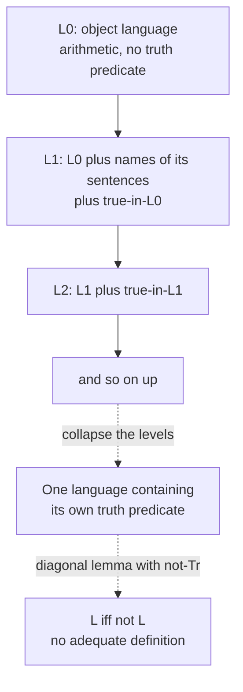

# Philosophy of Language and Logic · Lesson 5.1: Tarski's theory as philosophy

> ⏱ ~15 min · Module 5: Truth, paradox, and vagueness · Builds on: [4.1](04-01-truth-conditional-semantics-and-davidson.md), [`mathematical-logic` 2.2](../../mathematical-logic/lessons/02-02-structures-satisfaction.md), [`mathematical-logic` 5.1](../../mathematical-logic/lessons/05-01-incompleteness-first-theorem.md) · Unlocks: [5.2](05-02-deflationism.md), [5.3](05-03-the-liar-and-theories-of-truth.md)

## Why this matters

In [`mathematical-logic` 2.2](../../mathematical-logic/lessons/02-02-structures-satisfaction.md) you defined "$\mathcal M \models \sigma$" by a recursion credited to Tarski and never asked what truth is. Tarski claimed that recursion was a definition of truth itself, the classical notion Aristotle stated, and in the same monograph proved that no language able to do arithmetic can define truth for its own sentences. Philosophers have argued ever since about what the definition achieved: an analysis of truth, a correspondence theory without facts, or a well-made list that leaves the hard question untouched.

## The idea

A definition of "true" for a language has to be written in some language. Call the language whose sentences are being called true the [object language](../reference.md#object-language-and-metalanguage), and the language the definition is written in the metalanguage. When `mathematical-logic` 2.2 defined $\models$ for first-order formulas, English plus a little set theory was the metalanguage.

For his [theory of truth](../reference.md#tarskis-theory-of-truth), Alfred Tarski ("The Concept of Truth in Formalized Languages": Polish 1933, German 1935, English 1956) set two demands. First, [material adequacy](../reference.md#material-adequacy): whatever the definition says, it must yield every biconditional like

> "Gras ist grün" is true iff grass is green,

with a name of the sentence on the left and its translation into the metalanguage on the right. These biconditionals are the instances of the [T-schema](../reference.md#t-schema), and the demand, with a rider that nothing but the object language's sentences comes out true, is [Convention T](../reference.md#convention-t). Second, [formal correctness](../reference.md#formal-correctness): the definition must be explicit and must not use "true", "refers" or "means", so no paradox or circle can creep in.

Think of calibrating a thermometer. The T-sentences are the checkpoints: a definition that misses one is wrong, and one that provably passes them all has the right extension. Whether passing tells you what truth is, is the philosophical question.

Trouble comes when the object language names its own sentences and contains its own "true": it can then say "this sentence is not true", and that sentence's checkpoint cannot be passed. Tarski's moral: truth for a language is defined in a richer metalanguage.

## The argument

**D1. [Object language and metalanguage](../reference.md#object-language-and-metalanguage).** The metalanguage $M$ contains a translation of the object language $L$, names for $L$'s sentences and a theory of their syntax, and logic with some set theory. *In words:* the language you talk in must say everything $L$ says, and talk about $L$'s sentences.

**D2. [Convention T](../reference.md#convention-t).** A definition of a predicate $\mathrm{Tr}$ in $M$ is materially adequate iff $M$'s axioms, with the definition, prove (α) every instance of
$$\mathrm{Tr}(\ulcorner S\urcorner) \leftrightarrow S^{*},$$
where $\ulcorner S\urcorner$ names a sentence $S$ of $L$ (by quotation, or in arithmetic by its Gödel numeral) and $S^{*}$ is its translation into $M$; and (β) $\forall x\,(\mathrm{Tr}(x) \to x \text{ is a sentence of } L)$. *In words:* the definition must deliver every T-sentence and count nothing but sentences true.

**D3. [Formal correctness](../reference.md#formal-correctness).** The definition has the form $\forall x\,(\mathrm{Tr}(x) \leftrightarrow \delta(x))$, with $\mathrm{Tr}$ absent from $\delta$, and $\delta$ built from syntax, logic, set theory and translations of $L$'s own words. *In words:* no circle, and no semantic word left unexplained.

**D4. [Satisfaction](../reference.md#satisfaction), then truth.** Open formulas are neither true nor false, so Tarski defines satisfaction of a formula by an assignment recursively (the clauses of [`mathematical-logic` 2.2](../../mathematical-logic/lessons/02-02-structures-satisfaction.md), read now as a definition stated in the metalanguage), and then: a sentence is true iff every assignment satisfies it. The recursion bottoms out in base clauses for names and predicates. *In words:* truth for complex sentences is computed from what the simple words apply to.

**T1. [Undefinability of truth](../reference.md#undefinability-of-truth)** (Tarski 1933; general form in the 1935 postscript). Let $\mathcal N$ be the standard model of arithmetic and $\mathcal L_A$ its language. No formula $\mathrm{Tr}(x)$ of $\mathcal L_A$ satisfies $\mathcal N \models \mathrm{Tr}(\ulcorner\varphi\urcorner) \leftrightarrow \varphi$ for every sentence $\varphi$ of $\mathcal L_A$. Suppose one did.

1. The [diagonal lemma](../../mathematical-logic/lessons/05-01-incompleteness-first-theorem.md), applied to $\psi(x) := \neg\mathrm{Tr}(x)$, gives a sentence $L$ with $\mathsf{PA} \vdash L \leftrightarrow \neg\mathrm{Tr}(\ulcorner L\urcorner)$. *Uses:* the language codes its own syntax, and $\psi$ has a free variable. `mathematical-logic` 5.1 P3 refused the shortcut "$L \leftrightarrow \neg L$" because $\neg L$ has none; the truth predicate supplies one.
2. $\mathcal N \models L \leftrightarrow \neg\mathrm{Tr}(\ulcorner L\urcorner)$. *Uses:* the axioms of $\mathsf{PA}$ are true in $\mathcal N$, so its theorems are.
3. $\mathcal N \models \mathrm{Tr}(\ulcorner L\urcorner) \leftrightarrow L$. *Uses:* the supposed definition, applied to a sentence that itself contains $\mathrm{Tr}$. This is [semantic closure](../reference.md#semantic-closure): the language's truth predicate covers the language's own sentences.
4. So $\mathcal N \models L \leftrightarrow \neg L$, which no structure satisfies: by the negation clause, $\mathcal N$ satisfies exactly one of $L$ and $\neg L$. *Uses:* classical, two-valued satisfaction.

∴ No such $\mathrm{Tr}$. *In words:* once arithmetic can say "true" of its own sentences, it can say "this sentence is not true", so it cannot say "true" of its own sentences. Truth for $\mathcal L_A$ is definable, but only in a stronger metalanguage; set theory's truth cannot be defined in set theory either.

**The philosophical claim.** Tarski presented his definition as capturing the "classical Aristotelian conception" (his phrase in 1933 and 1944; SEP, "Alfred Tarski", §2):

**P1.** Convention T captures the classical conception: "To say of what is that it is not, or of what is not that it is, is false, while to say of what is that it is, and of what is not that it is not, is true" ([Aristotle's formula](../reference.md#aristotles-formula), *Metaphysics* Γ 7, 1011b26–27, tr. W. D. Ross, 1908). *In words:* each T-sentence says a sentence is true just when things are as it says.

**P2.** Tarski's definition is formally correct and provably meets Convention T. *In words:* the theorem part; nobody disputes it.

**P3.** A formally correct definition that provably meets Convention T says what truth in $L$ is. *In words:* right extension, provably, from non-semantic materials, is an analysis.

**∴ C.** Truth in $L$ has been explained in non-semantic terms, in the classical sense.

Carnap and Popper defended the theory (IEP, "Semantic Theory of Truth"); Davidson (1969) and Hartry Field (1972) took it as the core of a [correspondence theory](../reference.md#correspondence-theory) without facts; Putnam (1985–86) judged it a complete failure as philosophy (SEP, "Truth", §3.1). **[Field's objection](../reference.md#fields-objection)** ("Tarski's Theory of Truth", *Journal of Philosophy*, 1972) is the sharpest. Tarski reduced truth to what Field calls [primitive denotation](../reference.md#primitive-denotation), the base clauses for names, predicates and function symbols, and stated those as lists: a name denotes an object iff it is "$r$" and the object is the Rhine, or it is "$e$" and the object is the Elbe. A chemist who "defined" valence by listing each element with its number would get the extension right and explain nothing; physicalism wanted valence explained by atomic structure, and Field wanted denotation explained physically, say by a [causal theory](../reference.md#causal-historical-theory) of reference ([3.2](03-02-rigid-designation-and-the-causal-picture.md)).

**Where the argument is weakest.** P3. Field's objection: provable coextension is not explanation, as the valence list shows, so C claims a reduction that the base clauses only postpone. The strongest reply denies that a theory of truth owes more. The [deflationist](../reference.md#deflationism) ([5.2](05-02-deflationism.md)) says the list, or the T-schema it delivers, is all there is to truth, and Field himself later defended a disquotational view (1994). Davidson (1977) doubted that a truth theory needs Field's word-world relations at all: reference earns its place only through the whole theory's fit with what speakers hold true ([4.1](04-01-truth-conditional-semantics-and-davidson.md)). Each side concedes something: Field's that the recursive clauses for connectives and quantifiers are a genuine compositional achievement, Tarski's defenders that the base clauses say nothing about why "$r$" denotes the Rhine rather than the Elbe.

## The hierarchy

Each level defines truth for the level below, and T1 is the reason the levels cannot be merged into one ([Tarski's hierarchy](../reference.md#tarskis-hierarchy), costed in [5.3](05-03-the-liar-and-theories-of-truth.md)).

## Worked examples

**Example 1 (clean case: a list, then satisfaction).** Take an object language with two sentences, $Kr$ ("the Rhine flows through Cologne") and $Ke$ ("the Elbe flows through Cologne"). A finite language can be defined case by case:
$$\mathrm{Tr}(x) \leftrightarrow \big(x = \ulcorner Kr\urcorner \wedge \text{the Rhine flows through Cologne}\big) \vee \big(x = \ulcorner Ke\urcorner \wedge \text{the Elbe flows through Cologne}\big).$$
Since the two names name different sentences, logic alone yields both T-sentences however the rivers run. The bare list of the sentences that happen to be true, $\mathrm{Tr}(x) \leftrightarrow x = \ulcorner Kr\urcorner$, has the right extension, but of the four ways the two facts could go it matches both T-sentences in only one; the case form, in all four. Convention T asks for proof, not luck. Field's complaint is one step further: even the case form says nothing about why "$r$" names the Rhine.

Now add $\neg$, $\vee$, a variable $x$ and $\exists x$, with domain $D$ = {the Rhine, the Elbe, the Danube}. There are infinitely many sentences, so no list will do; satisfaction takes over. Base clauses: $r$ denotes the Rhine, $e$ the Elbe; an assignment $s$ satisfies $Kt$ iff the object $t$ picks out under $s$ flows through Cologne. Then
$$\mathrm{Tr}(\ulcorner \exists x\,\neg Kx\urcorner) \iff \text{for any } s, \text{ some } d \in D \text{ has } s[x\mapsto d] \text{ satisfying } \neg Kx \iff \text{some } d \in D \text{ does not flow through Cologne},$$
the translation of $\exists x\,\neg Kx$, and true (the Elbe and the Danube are witnesses). The verify script checks the T-sentence of every sentence nested at most three deep (23,621 of them) against all eight ways the facts about the three rivers could go: all hold.

**Example 2 (hard case: "true" in English).** English names its own sentences by quotation, and its "true" applies to them. Tarski called such a language [semantically closed](../reference.md#semantic-closure) and, in 1933, suggested that everyday language with ordinary logic is inconsistent (SEP, "Liar Paradox"); in 1944 he spoke more mildly of languages with a "specified structure" (IEP, "Semantic Theory of Truth"). Run T1 on English: step 1 needs only self-reference (a sign reading "the only sentence on this sign is not true"), step 3 is what speakers seem to accept for every sentence, and step 4 is ordinary logic. **Where it stops.** T1 says the four ingredients cannot all hold; it does not say which one English lacks. Herzberger (1967) argued that a language cannot be inconsistent; Matti Eklund (2002) and Kevin Scharp (2013) take inconsistency seriously, Scharp proposing consistent replacements for "true". Others keep one "true" and drop a premise: a hierarchy hidden in context, or the full T-schema, or classical logic ([5.3](05-03-the-liar-and-theories-of-truth.md)). Davidson's program ([4.1](04-01-truth-conditional-semantics-and-davidson.md)) needs a truth theory for English and must take one of these exits.

## Watch out

- **You might think** a T-sentence is trivially circular, **but actually** its left side mentions an object-language sentence and its right side uses the metalanguage. "'Gras ist grün' is true iff grass is green" informs someone without German; the homophonic case only looks empty.
- **You might think** Convention T is a definition of truth, **but actually** it is a test a definition must pass. For an infinite language the T-sentences are infinitely many, and Tarski (1944) declined to treat their infinite conjunction as a definition (SEP, "Deflationism About Truth").
- **You might think** T1 says truth is undefinable, or repeats incompleteness, **but actually** truth for $\mathcal L_A$ is definable in a stronger metalanguage, and T1 concerns what a language can express, not what a theory can prove. Gödel's $G$ exists, true and unprovable; T1's $L$ never exists, because the $\mathrm{Tr}$ it needs does not. And $L$ is a "fixed point" only in the diagonal lemma's sense, not in Kripke's ([5.3](05-03-the-liar-and-theories-of-truth.md)).
- **You might think** meeting Convention T makes a theory a correspondence theory, **but actually** the condition is neutral: an anti-realist can accept every T-sentence too (SEP, "Truth", §4.2). Whether there is correspondence depends on what the base clauses are taken to report.

## One-liner

> Tarski showed how to define truth for a language, provably right on every T-sentence, in a stronger metalanguage and never in the language itself; whether a definition that bottoms out in lists of what words denote says what truth is remains the dispute.

## Problems

**P1 (🟢)** *(Diagnose: Exegetical.)* The object language is a fragment of French, $F$; the metalanguage is English. Four statements, invented, written for this problem:

(a) "La Seine traverse Paris" is true-in-$F$ iff the Seine flows through Paris.

(b) An assignment $s$ satisfies $\exists x\,\varphi$ iff some assignment that differs from $s$ at most at $x$ satisfies $\varphi$.

(c) A definition of "true-in-$F$" is adequate only if it implies every sentence of the form "$X$ is true-in-$F$ iff $p$", with $X$ replaced by a name of a sentence of $F$ and $p$ by that sentence's English translation, and implies that only sentences of $F$ are true-in-$F$.

(d) "La Seine traverse Paris" is true-in-$F$ iff Paris is in France.

Say which is an instance of the T-schema, which states Convention T, which is a satisfaction clause, and which is none of these. One line each.

**P2 (🟡)** *(Formal model: Formal (a)–(b).)* Let $T$ be a theory that extends $\mathsf{PA}$, in the language of arithmetic plus a predicate $\mathrm{Tr}$, and suppose $T$ proves $\mathrm{Tr}(\ulcorner\varphi\urcorner) \leftrightarrow \varphi$ for every sentence $\varphi$ of its own language, $\mathrm{Tr}$ included. The diagonal lemma, applied to $\psi(x) := \mathrm{Tr}(x) \to 0 = 1$, gives a sentence $C$ ("if I am true, then $0 = 1$") with
$$T \vdash C \leftrightarrow \big(\mathrm{Tr}(\ulcorner C\urcorner) \to 0 = 1\big).$$

(a) Show that $T \vdash 0 = 1$ in at most six numbered lines, naming at each line the assumption or rule it uses. Show the derivation.

(b) Replace $0 = 1$ by an arbitrary sentence $B$. What does the same derivation prove, and which rules does it never use that the liar version (with $\psi(x) := \neg\mathrm{Tr}(x)$) would need to get from $L \leftrightarrow \neg L$ to an arbitrary sentence? Two sentences.

**P3 (🔴)** *(Find the crux: Exegetical (a) · Evaluative (b).)*

(a) State Field's objection to Tarski, using the valence analogy, and say which part of Tarski's definition it targets and which part it leaves standing. Two sentences.

(b) Is a list-like base clause a defect in a theory of truth, or only in a reduction of semantics to physics? Name what each answer must hold about the job of a theory of truth, and what would move each side. Any verdict; 150 words or fewer.

Solutions

**P1** *(Exegetical.)*

**Must hit, strict:**

- (a) An instance of the T-schema for $F$ (a T-sentence): a name of a sentence of $F$ on the left, its English translation on the right.

- (b) A satisfaction clause, the recursive clause for $\exists$.

- (c) Convention T, Tarski's criterion of material adequacy: both conditions, every T-sentence and only sentences of $F$. It is a test for definitions, not a definition.

- (d) None: a true biconditional, since both sides are true, but its right side is not a translation of the named sentence, so it is no instance of the schema and Convention T does not require it.

**Wrong turns:** calling (d) an instance because it is true (the schema is defined by translation, not by truth value); calling (c) a definition of truth; calling (b) a T-sentence because it contains "iff".

**Model answer:** (a) a T-schema instance; (b) the satisfaction clause for $\exists$; (c) Convention T, the adequacy condition; (d) none: true, but its right side does not translate the sentence named.

---

**P2** *(Formal (a)–(b).)*

(a)

1. $T \vdash C \leftrightarrow (\mathrm{Tr}(\ulcorner C\urcorner) \to 0 = 1)$. Diagonal lemma (given): $T$ extends $\mathsf{PA}$, so it codes its syntax, and $\psi$ has a free variable.

2. $T \vdash \mathrm{Tr}(\ulcorner C\urcorner) \leftrightarrow C$. The T-biconditional for $C$, a sentence containing $\mathrm{Tr}$: semantic closure.

3. $T \vdash C \leftrightarrow (C \to 0 = 1)$. From 1 and 2, replacing $\mathrm{Tr}(\ulcorner C\urcorner)$ by its provable equivalent.

4. $T \vdash C \to 0 = 1$. Assume $C$; by 3, $C \to 0 = 1$; modus ponens with $C$ again gives $0 = 1$; discharge $C$ (conditional proof). The assumption $C$ is used twice (contraction).

5. $T \vdash C$. From 4 and 3 (right to left), modus ponens.

6. $T \vdash 0 = 1$. From 4 and 5, modus ponens. Since $\mathsf{PA} \vdash \neg(0 = 1)$, $T$ is inconsistent.

(b) The derivation proves $B$ for every sentence $B$, so $T$ is trivial outright. It uses no rule for negation and never uses explosion (from a contradiction infer anything), both of which the liar version needs to reach an arbitrary sentence; it uses only the biconditional, modus ponens and conditional proof with an assumption used twice.

**Must hit, strict:** line 2 named as the T-biconditional for a sentence containing $\mathrm{Tr}$; line 3 as substitution of provable equivalents; line 4's conditional proof, with $C$ used twice; lines 5–6 as modus ponens; (b) "proves every sentence" and "no negation or explosion".

**Accept:** any order of the same rules that derives $C \to 0 = 1$ before $C$; citing contraction or "pseudo modus ponens" for line 4.

**Wrong turns:** deriving $C \leftrightarrow \neg C$ (there is no negation in $C$); taking line 2 from the diagonal lemma (it comes from the T-biconditionals); in (b), saying the derivation needs excluded middle (no case split occurs).

This is Curry's paradox for truth ([Curry's paradox](../reference.md#curry-paradox); SEP, "Liar Paradox", §1.4): any treatment that blocks the liar only by dropping explosion must block this derivation elsewhere ([5.3](05-03-the-liar-and-theories-of-truth.md)). The verify script checks each line as a classical consequence of the lines it cites, and that lines 1–2 force $B$.

---

**P3** *(Exegetical (a) · Evaluative (b).)*

**Must hit, strict (a):**

- Tarski reduced truth to primitive denotation (what names denote, what predicates apply to) but stated it by lists, which fix the extension and explain nothing, like defining valence by listing each element's number.

- It targets the base clauses (and with them the claim to have explained truth in non-semantic terms); it leaves standing the recursive clauses that compute truth for complex sentences from primitive denotation.

**Must hit, any verdict (b):**

- State the two jobs: fixing which sentences are true, compositionally and provably (a list suffices), and explaining what makes words apply to things (a list does not).

- Say what the verdict assumes truth needs: a "defect in a theory of truth" verdict needs truth to be a substantive word-world relation that physicalism must explain; an "only a reduction" verdict needs truth to be exhausted by the T-schema or by the recursion (deflationary, or Davidsonian).

- Say what would move each side: for Field's side, a successful deflationary account of what truth explains (meaning, the success of action); for the other, a role for truth that a list cannot play, or a working causal theory of denotation that makes the lists redundant.

**Wrong turns:** saying Field rejects the recursion; saying Field shows the definition gets the extension wrong; treating Field 1972 as a deflationist (he became one later); reading Convention T as itself requiring physicalism.

**Model answer (b), one of several:** Only a defect in a reduction, on one view of the job. If a theory of truth must fix which sentences of a language are true, compositionally and provably, the list-like base clauses do that, and the recursion shows how complex truths depend on them. Field's demand is a further one: a physicalist account of why "$r$" denotes the Rhine. That is a debt of the theory of reference ([3.2](03-02-rigid-designation-and-the-causal-picture.md)), not of truth, and a deflationist denies the debt exists. The opposite verdict is open to anyone who thinks truth is a substantive relation that explains something, such as why true beliefs guide action well: then a theory that stops at lists has not said what the relation is. What would move me: an explanatory role for truth that needs more than the T-sentences.

## Flashback

**From Lesson [4.4](04-04-speaker-meaning-and-implicature.md) (Speaker meaning and implicature):** *(Exegetical (a) and (b).)* Invented, written for this problem: an engineer's note reads, "The pruned model is a tenth the size of the full model, but it usually stays within a point of its accuracy." Two things readers take from it, unsaid:

(i) its small size is some reason to expect it to fall further behind;

(ii) it does not always stay within a point.

(a) On Grice's classification, which is a [conventional implicature](../reference.md#conventional-implicature) and which a conversational one? For each, say why it is not entailed and give the test that tells the two kinds apart. One line each.

(b) Now readers know she has seen only 12 of the evaluation's 20 runs. Which two maxims bear on her "usually", and what may they infer instead of (ii)? Two sentences.

Solution

**Must hit, strict (a):**

- (i) Conventional, carried by "but". Not entailed: "but" has the truth table of "and" (4.4, D2), so swapping in "and" drops (i) and keeps the truth conditions. Not conversational: it is not worked out from the maxims and cannot be [cancelled](../reference.md#cancellability).

- (ii) Conversational: a generalized [scalar implicature](../reference.md#scalar-implicature) on $\langle$always, usually$\rangle$, calculable from Quantity. Not entailed: the note is true if every run stays within a point, which is why "usually, indeed always" cancels (ii) without contradiction.

**Must hit, strict (b):**

- Quantity (be as informative as required) and Quality (nothing you lack adequate evidence for) clash (4.4, D4): with eight runs unseen she cannot back "always". Reading "usually" as "on more than half the runs", if all twelve she saw stayed within a point, "usually" holds on all 256 ways the unseen eight could go, "always" on one.

- Deriving (ii) needed a well-informed speaker (4.4, D6). Without that premise, readers may infer only that she cannot say "always", not that any run fell short. Compare Grice's own clash: naming only the region where someone lives implicates not knowing the town.

**Accept (b):** saying the context blocks or cancels (ii), if the missing premise is the reason.

**Wrong turns:** (i) as conversational because hearers infer it; (ii) as entailed; in (b), keeping (ii) or inferring a failed run; calling "usually" a flout.

**Model answer:** (a) (i) Conventional: carried by "but", lost when "and" replaces it though the truth conditions stay, and not cancellable. (ii) Conversational, scalar: from Quantity, and cancellable, since "indeed, always" is consistent with the note. (b) Quantity calls for "always", but Quality forbids it without adequate evidence, which eight unseen runs deny her. So readers may infer only that she does not know that it always stays within a point.

## Connections

- **Backward:** the satisfaction clauses are [`mathematical-logic` 2.2](../../mathematical-logic/lessons/02-02-structures-satisfaction.md)'s and the diagonal lemma is [`mathematical-logic` 5.1](../../mathematical-logic/lessons/05-01-incompleteness-first-theorem.md)'s, whose P3 shows why the step needs a predicate; [4.1](04-01-truth-conditional-semantics-and-davidson.md) ran Convention T backwards, taking truth as known and reading meaning off the T-sentences.

- **Forward:** [5.2](05-02-deflationism.md) asks whether the T-schema is all there is to truth, as Field's later view holds; [5.3](05-03-the-liar-and-theories-of-truth.md) takes the exits from T1 that keep one truth predicate in one language: gaps, fixed points, gluts.

- **Sideways:** T1 is the diagonal argument of [`theory-of-computation` 4.1](../../theory-of-computation/lessons/04-01-diagonalization-and-the-halting-problem.md) with "true" in place of "accepts", and this lesson is the library's only statement of it. Field's demand for a physical account of denotation is the linguistic side of [`philosophy-of-mind` 4.2](../../philosophy-of-mind/lessons/04-02-naturalizing-content.md)'s project. Aquinas's truth as the conformity of intellect and thing ([`thomistic-synthesis` 2.4](../../thomistic-synthesis/lessons/02-04-the-transcendentals.md)) is an older correspondence-style account; Aristotle's formula is read closely in [Boss 5(a)](../syllabus.md).
