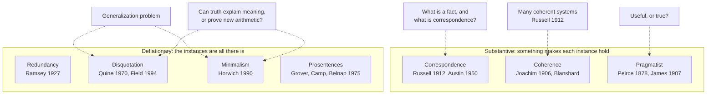

# Philosophy of Language and Logic · Lesson 5.2: Deflationism

> ⏱ ~15 min · Module 5: Truth, paradox, and vagueness · Builds on: [5.1](05-01-tarskis-theory-as-philosophy.md), [4.1](04-01-truth-conditional-semantics-and-davidson.md), [`ethics` 6.2](../../ethics/lessons/06-02-expressivism.md) · Unlocks: [5.3](05-03-the-liar-and-theories-of-truth.md)

## Why this matters

A sale contract says that every statement in Schedule B is true and accurate. Schedule B runs to forty pages nobody in the room has read aloud. Strike "true" and you must copy out all forty pages, and the clause no longer covers a page added tomorrow. [5.1](05-01-tarskis-theory-as-philosophy.md) defined truth for a formal language; the deflationist says that this job, endorsing what you cannot list, is all the word ever does.

## The idea

Some words carry information and some carry structure. "And" names nothing; it joins claims. The deflationist puts "true" in the second family. "It is true that the ferry left at noon" says, on this view, no more than "the ferry left at noon". But "true" cannot be dropped from "every statement in Schedule B is true": there it lets one finite sentence do the work of a conjunction you cannot write out.

So the whole theory, on this view, is one schema:

$$\text{it is true that } p \quad\text{if and only if}\quad p.$$

The rivals accept every instance too. The [correspondence theorist](../reference.md#correspondence-theory) adds that each instance holds *because* a belief matches a fact; the coherence theorist, because it fits a system; the pragmatist, because inquiry would settle on it. [Deflationism](../reference.md#deflationism) says there is no "because" to find. "Is on my shopping list" is a perfectly good property, but the items on the list are there for unrelated reasons, and nobody writes the science of being on it. Truth, says the deflationist, is like that: [Convention T](../reference.md#convention-t) ([5.1](05-01-tarskis-theory-as-philosophy.md)) let a definition go beyond the schema, and there is nothing beyond.

## Source

F. P. Ramsey, "Facts and Propositions", *Proceedings of the Aristotelian Society, Supplementary Volume* 7 (1927), pp. 157–158, read from the page images:

> … it is evident that "it is true that Cæsar was murdered" means no more than that Cæsar was murdered, and "it is false that Cæsar was murdered" means that Cæsar was not murdered. … In the second case in which the proposition is described and not given explicitly, we have perhaps more of a problem, for we get statements from which we cannot in ordinary language eliminate the words "true" and "false." Thus if I say "he is always right" I mean that the propositions he asserts are always true, and there does not seem to be any way of expressing this without using the word "true." But suppose we put it thus "For all *p*, if he asserts *p*, *p* is true," then we see that the propositional function *p* is true is simply the same as *p* …

Two cases. When the proposition is *given*, "means no more than" makes "true" idle. When it is *described*, the word cannot be dropped "in ordinary language", and Ramsey's repair is a quantifier into sentence position, "For all *p*". English lacks one, so, he says, it adds "is true" only to supply a verb. Whether that quantifier is legitimate is the [generalization problem](../reference.md#generalization-problem). "Redundancy theory" is a later label; Ramsey never uses the word. Frege remarked in "Der Gedanke" (1918) that prefixing "it is true that" to a report of smelling violets seems to add nothing to the thought; whether that makes him a deflationist is disputed.

## The argument

**Four deflationary theories.** Each accepts the schema and reads it differently.

**D1. [Redundancy](../reference.md#redundancy-theory)** (Ramsey 1927). "It is true that $p$" means the same as "$p$"; described propositions need a quantifier into sentence position. *In words:* "true" adds no content anywhere.

**D2. [Disquotationalism](../reference.md#disquotationalism)** (Quine, *Philosophy of Logic*, 1970; Field, "Deflationist Views of Meaning and Content", 1994). For each sentence $\varphi$ of one's own language, $\mathrm{Tr}(\ulcorner\varphi\urcorner) \leftrightarrow \varphi$, where $\ulcorner\varphi\urcorner$ names $\varphi$ and $\mathrm{Tr}$ is the truth predicate (Quine restricts this to "eternal" sentences, Field to sentences as the speaker understands them). *In words:* calling a sentence true cancels its quotation marks (Quine's "device of disquotation").

**D3. [Minimalism](../reference.md#minimalism-about-truth)** (Horwich, *Truth*, 1990; 2nd ed. 1998). The theory is every instance of $\langle p\rangle$ is true iff $p$, where $\langle p\rangle$ is "the proposition that $p$": infinitely many axioms, each necessary and a priori, minus those that would generate the [liar](../reference.md#liar-paradox). Truth is a "logical" property with no underlying nature. *In words:* the list is the theory.

**D4. [Prosententialism](../reference.md#prosententialism)** (Grover, Camp and Belnap, "A Prosentential Theory of Truth", 1975). "That is true" is a prosentence: like a pronoun, it inherits its content from an antecedent, so in logical form "true" is not a predicate at all. *In words:* "that's true" works like "he".

**The shared case** (the lesson's reconstruction):

**P1.** Every instance of the [equivalence schema](../reference.md#equivalence-schema) holds, its sides equivalent in a strong sense (same meaning, or necessarily and a priori). *In words:* "it is true that $p$" and "$p$" stand or fall together, not by accident.

**P2.** Beyond those transparent uses, "true" does one job: it lets a finite sentence express an infinite conjunction or disjunction ("everything she said is true"). *In words:* the word exists to generalize.

**P3.** Every explanation in which truth figures runs through the instances or uses "true" to generalize. *In words:* truth explains nothing the facts do not.

**P4.** A property whose instances hold for unrelated reasons has no nature for a theory to find. *In words:* the shopping-list point.

**∴ C.** Nothing needs saying about truth beyond the instances and the generalizing role. *In words:* the theory of truth is the schema.

**The rivals deny P3 and P4.** Russell (*The Problems of Philosophy*, 1912, ch. XII): "a belief is true when there is a corresponding fact, and is false when there is no corresponding fact." Austin ("Truth", 1950) and Aquinas's conformity of intellect and thing ([`thomistic-synthesis` 2.4](../../thomistic-synthesis/lessons/02-04-the-transcendentals.md)) belong to the same family. The [coherence theory](../reference.md#coherence-theory-of-truth) (Joachim, 1906; later Blanshard) makes truth membership in one comprehensive coherent system; Russell replied in the same chapter that "coherence as the definition of truth fails because there is no proof that there can be only one coherent system". Coherence of *justification* ([`epistemology` 2.3](../../epistemology/lessons/02-03-coherentism.md)) does not need that claim. The [pragmatist](../reference.md#pragmatist-theory-of-truth) ties truth to inquiry: "The opinion which is fated to be ultimately agreed to by all who investigate, is what we mean by the truth" (Peirce, "How to Make Our Ideas Clear", 1878), or, for James (*Pragmatism*, 1907), to what proves useful in the long run. Of the 1,643 target faculty who answered the 2020 PhilPapers Survey's question, 51.37% accepted or leaned towards correspondence, 24.53% deflationism.

**Truth and meaning.** Davidson ([4.1](04-01-truth-conditional-semantics-and-davidson.md)) reads meanings off [T-sentences](../reference.md#t-sentence). Dummett ("Truth", 1959) argued that T-sentences cannot both say what sentences mean and explain "true": in Horwich's image, one equation, two unknowns. The deflationist fixes truth by the schema and takes meaning from [use](../reference.md#meaning-as-use) ([4.2](04-02-meaning-as-use.md); Horwich, *Meaning*, 1998). Davidson ("The Structure and Content of Truth", 1990; "The Folly of Trying to Define Truth", 1996) rejects both definition and deflation: truth is a basic concept, understood through its place in interpretation.

**Where the argument is weakest.** P2. Tarski observed in 1935 that the instances, taken together, prove each instance of "every sentence of the form 'if $p$ then $p$' is true" but not that generalization: the set is ω-incomplete. The strongest objection (Gupta, 1993): anyone who has the concept accepts such generalizations a priori, so a theory of the concept that cannot derive them is not a theory of the concept. The strongest reply: what is missing is a principle of generality, not a fact about truth; Field's rules for reasoning with schemas, or Horwich's rule that seeing every instance to be provable licenses the generalization, supply it. The deflationist concedes that the theory is more than its instances; the critic concedes that the added principle posits no nature. Open: whether such a rule is itself thin.

## Map of positions

Every position accepts every instance of the schema; dashed arrows mark the objection each must survive (the two on the right press all four deflationary views).

## Worked examples

**Example 1 (clean case: a blind ascription).** A judge tells the jury: "If everything the second witness said is true, the van was at the quarry by nine." Nobody can list what she said.

- **Redundancy:** for all $p$, if she asserted that $p$, then $p$ (Ramsey's own form).

- **Disquotation:** for every sentence $x$, if she uttered $x$ then $\mathrm{Tr}(x)$; by D2, one conjunct per sentence of our language ("if she uttered 'the van was blue', then the van was blue").

- **Minimalism:** for every proposition $x$, if she asserted $x$ then $x$ is true; each instance of D3 cashes one case.

- **Prosentences:** for anything one can say, if she said it, then it is true, where the second "it is true" is a prosentence bound by the quantifier.

All four give the same truth conditions: if she said exactly $S_1$, $S_2$ and $S_3$, the antecedent comes to $S_1 \wedge S_2 \wedge S_3$. They differ on what the quantifier ranges over and on its logic: Ramsey's "for all $p$" is not first-order; the other three borrow ordinary quantifiers and let the schema do the rest.

**Example 2 (hard case: conservativeness).** Add a truth predicate $\mathrm{Tr}$ for arithmetic sentences to Peano arithmetic, $\mathsf{PA}$ ([`mathematical-logic` 5.1](../../mathematical-logic/lessons/05-01-incompleteness-first-theorem.md)). Three theories:

- **The schema alone** ($\mathrm{Tr}(\ulcorner\varphi\urcorner) \leftrightarrow \varphi$ for each arithmetic $\varphi$) is conservative over $\mathsf{PA}$: it proves no new arithmetic sentence, even with induction extended to formulas containing $\mathrm{Tr}$. Compactness shows it.

- **Tarski's clauses as axioms** (a conjunction is true iff both conjuncts are, and so on), with induction only for $\mathrm{Tr}$-free formulas: still conservative (Kotlarski, Krajewski and Lachlan, 1981; Enayat and Visser, and Leigh, 2015).

- **Clauses plus induction for formulas containing $\mathrm{Tr}$:** now induction on the length of proofs shows that every theorem of $\mathsf{PA}$ is true, $\forall x\,(\operatorname{Prov}_{\mathsf{PA}}(x) \to \mathrm{Tr}(x))$. Since $\mathrm{Tr}(\ulcorner 0 = 1\urcorner) \leftrightarrow 0 = 1$ and $0 \neq 1$, $\mathsf{PA}$ does not prove $0 = 1$: the theory proves $\operatorname{Con}(\mathsf{PA})$, which $\mathsf{PA}$ cannot ([`mathematical-logic` 5.2](../../mathematical-logic/lessons/05-02-second-theorem-undecidability.md)).

**Where it strains.** The [conservativeness argument](../reference.md#conservativeness-argument) (Shapiro, "Proof and Truth: Through Thick and Thin", 1998; Ketland, "Deflationism and Tarski's Paradise", 1999): a notion that teaches us new facts about the numbers is not thin, and the deflationist needs the third theory to prove the generalizations P2 promises. Field ("Deflating the Conservativeness Argument", 1999) replies that a use of "true" that comes only from its generalizing role is acceptable, and "every theorem of $\mathsf{PA}$ is true" is exactly such a generalization. The theorems locate the extra strength exactly, in clauses plus induction for "true". They do not say whether that induction is a commitment about numbers or about truth, nor define "substantive".

## Watch out

- **You might think** deflationists deny that anything is true, or that truth matters, **but actually** they assert every instance and call many claims true. They deny only that truth has a nature, and call the concept indispensable for endorsing what you cannot list.

- **You might think** accepting the T-schema makes you a deflationist, **but actually** every theory here accepts it. Tarski made it an adequacy condition and allowed a definition to say more ([5.1](05-01-tarskis-theory-as-philosophy.md)); correspondence theorists say why each instance holds. Deflationism is the claim that the instances exhaust truth.

- **You might think** the deflationary theories are one theory, **but actually** they differ on what is true: sentences (Quine, Field), propositions (Horwich), nothing named (prosententialists). Horwich's minimalism is one species; the "minimal truth" of [`ethics` 6.2](../../ethics/lessons/06-02-expressivism.md) needs only the shared core.

- **You might think** the generalization problem shows some instance is false, **but actually** every instance of the generalization is provable; what fails is the step to "all". The fix adds a principle, not a correction.

## One-liner

> For the deflationist the instances of "it is true that $p$ iff $p$" are the whole theory of truth and "true" exists to generalize; the price is a principle for generalizations, a theory of meaning without truth, and a reason why a truth theory proving new arithmetic is still thin.

## Problems

**P1 (🟢)** *(Exegetical.)* Four statements (invented, written for this problem):

> (i) When you report the score and I reply "that's true", I make no claim about your sentence. "That's true" borrows its whole content from what you said, the way "he" borrows its referent from a name already used.
>
> (ii) "True" applies to sentences, and only to sentences I understand: calling "the ferry left at noon" true comes to saying that the ferry left at noon. Its only point is to let me endorse sentences I cannot list.
>
> (iii) Any adequate definition of truth for a language must imply, for each of its sentences, a biconditional "$X$ is true if and only if $p$", with a name of the sentence for $X$ and its translation for $p$; a definition may say more than this.
>
> (iv) A belief is true if investigation, carried on long enough by whoever cared to, would end in agreement on it; there is nothing more to truth than that destined agreement.

Say which theory each expresses (redundancy, disquotational, minimalist, prosentential, correspondence, coherence, pragmatist), or that it expresses none of them. One line each.

**P2 (🟡)** *(Formal model: Formal (a)–(b).)* Let $L$ be a propositional language with atoms $q_1, q_2, q_3, \dots$ and connectives $\neg$, $\wedge$, $\to$. Work in a classical first-order metalanguage whose variables range over the sentences of $L$. It contains $L$'s atoms as sentence letters, a name $\ulcorner\varphi\urcorner$ for each sentence $\varphi$, a function symbol $\mathrm{cond}$ with $\mathrm{cond}(\ulcorner\varphi\urcorner, \ulcorner\psi\urcorner) = \ulcorner\varphi \to \psi\urcorner$, and a predicate $\mathrm{Tr}$. Let $\mathsf{DS}$ be those syntax identities plus every instance $\mathrm{Tr}(\ulcorner\varphi\urcorner) \leftrightarrow \varphi$ for $\varphi$ in $L$, and let $G$ be $\forall y\,\mathrm{Tr}(\mathrm{cond}(y, y))$.

(a) Show that $\mathsf{DS}$ proves each instance $\mathrm{Tr}(\mathrm{cond}(\ulcorner\varphi\urcorner, \ulcorner\varphi\urcorner))$ but does not prove $G$. Show the model, and name the facts about proof the argument uses.

(b) Name one principle which, added to $\mathsf{DS}$, proves $G$, and give the derivation in at most two lines.

**P3 (🔴)** *(Find the crux: Exegetical (a) · Evaluative (b).)* A minimalist in Horwich's line and a Davidsonian disagree about whether truth can explain meaning. The Davidsonian reads a speaker's meanings off an interpretive truth theory tested by [radical interpretation](../reference.md#radical-interpretation), whose evidence is which sentences the speaker holds true in which conditions ([4.1](04-01-truth-conditional-semantics-and-davidson.md)). The minimalist says the instances of the equivalence schema exhaust truth and that meaning comes from use.

(a) Name the single premise about the concept of truth that one side affirms and the other denies, and say who denies it and why. Two sentences.

(b) What argument or finding would move each side? Any verdict; 150 words or fewer.

Solutions

**P1** *(Exegetical.)*

**Must hit, strict:**

- (i) Prosentential: "that's true" inherits its content anaphorically, as a pronoun does, and is not a claim about a sentence (Grover, Camp and Belnap).

- (ii) Disquotational: the bearers are sentences, restricted to those the speaker understands, and the point is generalization (Field's pure disquotational truth; Quine).

- (iii) None: it is the first clause of Tarski's adequacy condition, Convention T (the second requires that only sentences of the language come out true, [5.1](05-01-tarskis-theory-as-philosophy.md)), which every listed theory can accept; "may say more" is what keeps it from being deflationism.

- (iv) Pragmatist: truth is the agreement inquiry would reach in the long run (Peirce's "fated to be ultimately agreed to").

**Wrong turns:** calling (iii) deflationism because it states the schema; calling (ii) minimalism, which takes propositions as bearers; calling (i) redundancy, which says "it is true that $p$" means $p$ but makes no pronoun claim; calling (iv) coherence, which is agreement among beliefs now, not the end of inquiry.

**Model answer:** (i) prosentential. (ii) disquotational. (iii) none: Convention T, an adequacy condition all of them accept. (iv) pragmatist.

---

**P2** *(Formal (a)–(b).)*

(a) *Each instance.* For a sentence $\varphi$: the syntax identity gives $\mathrm{cond}(\ulcorner\varphi\urcorner, \ulcorner\varphi\urcorner) = \ulcorner\varphi \to \varphi\urcorner$; the instance for $\varphi \to \varphi$ gives $\mathrm{Tr}(\ulcorner\varphi \to \varphi\urcorner) \leftrightarrow (\varphi \to \varphi)$; and $\varphi \to \varphi$ is a logical truth. So $\mathsf{DS} \vdash \mathrm{Tr}(\mathrm{cond}(\ulcorner\varphi\urcorner, \ulcorner\varphi\urcorner))$.

*Not $G$.* Suppose $\mathsf{DS} \vdash G$.

1. A derivation is finite, so it uses finitely many premises: syntax identities and the instances for some $\varphi_1, \dots, \varphi_n$.

2. Pick $k$ larger than the index of every atom in $\varphi_1, \dots, \varphi_n$. Let $\mathcal M$ have as domain the sentences of $L$, the real names and $\mathrm{cond}$, every atom true (any valuation will do), and $\mathrm{Tr}^{\mathcal M} = \{\varphi_j : \varphi_j \text{ is true}\}$.

3. In $\mathcal M$ every syntax identity holds and each used instance holds, since $\mathrm{Tr}(\ulcorner\varphi_j\urcorner)$ holds exactly when $\varphi_j$ is true. But $q_k \to q_k$ contains $q_k$, so it is none of the $\varphi_j$ and is not in $\mathrm{Tr}^{\mathcal M}$: $G$ fails at $y = q_k$.

4. By soundness ([`mathematical-logic` 2.4](../../mathematical-logic/lessons/02-04-soundness-completeness-fol.md)) the finitely many premises do not prove $G$. Contradiction: $\mathsf{DS} \nvdash G$.

(b) Tarski's clause for the conditional, as an axiom: $\forall x\,\forall y\,(\mathrm{Tr}(\mathrm{cond}(x, y)) \leftrightarrow (\mathrm{Tr}(x) \to \mathrm{Tr}(y)))$. Put $x := y$: $\mathrm{Tr}(\mathrm{cond}(y, y)) \leftrightarrow (\mathrm{Tr}(y) \to \mathrm{Tr}(y))$. The right side is a logical truth, so $\mathrm{Tr}(\mathrm{cond}(y, y))$ for arbitrary $y$, and $G$ follows by generalization.

**Accept (b):** any principle that is a universally quantified statement or a rule going beyond every finite set of instances, with a derivation: a rule that infers $\forall y\,\psi(y)$ when every $\psi(\ulcorner\varphi\urcorner)$ is provable (Horwich's informal rule, an ω-rule); Field's rule for reasoning with schemas; or a substitutional generalization of the schema, $\forall x\,(\mathrm{Tr}(x) \leftrightarrow \Sigma p\,(x = \ulcorner p\urcorner \wedge p))$ with $\Sigma$ quantifying into sentence position.

**Must hit, strict:** the instance derivation uses the syntax identity, the schema instance for $\varphi \to \varphi$, and the logical truth of $\varphi \to \varphi$; a proof uses only finitely many instances; a model of those finitely many in which $G$ fails, with a witness outside them; soundness to conclude. In (b), a principle that is not one more instance.

**Wrong turns:** "the intended model satisfies $G$, so $\mathsf{DS}$ proves $G$" (models where every instance holds can still be non-intended; the argument needs only a model of the finitely many used); a countermodel that falsifies one of the used instances; making $\mathrm{Tr}^{\mathcal M}$ empty, which fails the instances for true $\varphi_j$; offering one more instance of the schema in (b).

---

**P3** *(Exegetical (a) · Evaluative (b).)*

**Must hit, strict (a):**

- The premise: grasp of "true" as applied to a sentence requires already understanding that sentence, because the concept is exhausted by a schema whose instances use the sentence (or the proposition it expresses) on the right-hand side.

- The minimalist affirms it. The Davidsonian denies it: the interpreter must recognize that a speaker holds a sentence true before knowing what it means, so truth is a basic concept graspable apart from particular meanings, whose content comes from its role linking belief, meaning and evidence.

**Accept (a):** the premise stated as "the schema exhausts the concept of truth", provided the answer says why that blocks the Davidsonian's use of hold-true attitudes.

**Must hit, any verdict (b):**

- What would move the minimalist: an argument that use cannot fix meanings without truth conditions, for instance that the acceptance dispositions Horwich appeals to can be individuated only by what they are true of, or that radical interpretation cannot run on disquotation of the interpreter's own sentences.

- What would move the Davidsonian: a use theory that delivers compositional meanings without truth, or an argument that the "content" of the basic concept adds nothing to the schema plus generalization.

- The cost each side pays: the minimalist owes a theory of meaning from use; the Davidsonian owes an account of a concept of truth he will neither define nor deflate.

**Wrong turns:** naming Dummett's point (T-sentences cannot both give meanings and explain truth) as the crux, when both sides accept it and solve it in opposite directions; Dummett's modesty objection, which is [4.1](04-01-truth-conditional-semantics-and-davidson.md)'s question; turning (b) into a verdict on the liar, which is [5.3](05-03-the-liar-and-theories-of-truth.md)'s.

**Model answer (a):** The crux is whether applying "true" to a sentence presupposes understanding it, as it must if the schema is the whole concept. Horwich affirms this; Davidson denies it, since radical interpretation starts from hold-true attitudes identified before any meaning is known.

**Model answer (b), one of several:** The minimalist should be moved by showing that radical interpretation is the only workable account of how meanings are fixed: then a concept of truth that applies to sentences not yet understood is indispensable, and the schema is not the whole of it. Horwich's use theory is the test. If acceptance dispositions can be individuated without saying what the accepted sentences are true of, meaning comes from use and truth stays thin. The Davidsonian should be moved by such a theory, or by an argument that the role he gives truth in interpretation is only generalization: "she holds true what she says when it rains" ranges over sentences without needing a nature. Each side's cost is its open account: of meaning from use, or of a basic concept of truth.

## Flashback

**From Lesson [4.5](04-05-analyticity-and-two-dogmas.md) (Analyticity and "Two Dogmas"):** *(Formal (a) · Exegetical (b).)* A language $L$ has predicates $S$ (is a sloop), $K$ (is a ketch) and $B$ (is a sailing boat), two names $a$ and $b$, and three [meaning postulates](../reference.md#meaning-postulate): $\forall x\,(Sx \to Bx)$, $\forall x\,(Kx \to Bx)$ and $\forall x\,\neg(Sx \wedge Kx)$.

(a) How many [state descriptions](../reference.md#state-description) has $L$, and how many make every postulate true? Classify each sentence as L-true, analytic in $L$ but not L-true, or synthetic in $L$, with a count or a witness.

(i) $\neg\exists x\,(Bx \wedge \neg Sx \wedge Sx)$

(ii) $\forall x\,(Sx \to (Bx \wedge \neg Kx))$

(iii) $\forall x\,(Bx \to (Sx \vee Kx))$

(b) Taken as an account of analyticity, which of (i)–(iii) does C1 miss, and what feature of state descriptions did Quine (1951) blame? Two sentences.

Solution

(a) Six atoms give $2^6 = 64$ state descriptions. The quantifiers run over $a$ and $b$, so a description picks a row $(S, K, B)$ for each name independently, and each count is a per-name count squared. The postulates admit 4 rows, $(1,0,1)$, $(0,1,1)$, $(0,0,1)$ and $(0,0,0)$, so $4^2 = 16$ descriptions.

| | rows true (of 8) | admitted rows true (of 4) | descriptions (of 64) | admitted (of 16) | verdict |
|---|---|---|---|---|---|
| (i) | 8 | 4 | 64 | 16 | L-true |
| (ii) | 5 | 4 | 25 | 16 | analytic in $L$, not L-true |
| (iii) | 7 | 3 | 49 | 9 | synthetic in $L$ |

(ii) fails where $a$ is a sloop and not a sailing boat, which the first postulate excludes; the first and third postulates secure it. (iii) fails in an admitted description where $a$ is a sailing boat that is neither: the postulates fix only part of what "sailing boat" means.

**Must hit, strict:** 64 and 16; the three verdicts, each with a count or witness, the witness for (iii) admitted.

**Must hit, strict (b):**

- (ii): true in all 16 admitted descriptions but not in all 64, so C1 misses it.

- Quine: the criterion needs mutually independent atomic sentences, and "$a$ is a sloop" and "$a$ is a sailing boat" are not, so it reconstructs at best logical truth, his first class.

**Wrong turns:** counting 4 admitted descriptions (one name); calling (iii) false rather than synthetic; in (b), the circle of synonymy, which is not this point.

**Model answer (b):** C1 misses (ii), true in every admitted description but false where $a$ is a sloop and not a sailing boat. Quine blamed the free assignment of values to atoms that are not independent: such a test captures only logical truths, and C2's postulates (1952) were Carnap's later repair.

## Connections

- **Backward:** [5.1](05-01-tarskis-theory-as-philosophy.md) made the schema an adequacy condition on a definition; deflationism keeps the schema and drops the claim that a definition says more. [4.5](04-05-analyticity-and-two-dogmas.md) returns twice: the strongest deflationist readings call the instances analytic, which Quine, the founding disquotationalist, could not say; and the dispute over truth and meaning has to choose between [4.1](04-01-truth-conditional-semantics-and-davidson.md) and [4.2](04-02-meaning-as-use.md).

- **Forward:** [5.3](05-03-the-liar-and-theories-of-truth.md) puts the schema under the liar. A deflationist who accepts every instance meets "this sentence is not true", which is why Horwich restricts the schema; Boss 5(d) asks whether that leaves the deflationist better or worse placed than the gap theorist.

- **Sideways:** quasi-realism in [`ethics` 6.2](../../ethics/lessons/06-02-expressivism.md) is deflationism put to work: minimal truth lets the expressivist call moral claims true, and whether that collapses into realism is 6.2's live worry. The no-miracles argument in [`philosophy-of-science` 5.1](../../philosophy-of-science/lessons/05-01-realism-and-the-no-miracles-argument.md) explains success by approximate truth; deflationists (Williams 1986, Fine 1984) read "true" there as a device of generalization. Coherence as a theory of justification is [`epistemology` 2.3](../../epistemology/lessons/02-03-coherentism.md), Aquinas's conformity of intellect and thing is [`thomistic-synthesis` 2.4](../../thomistic-synthesis/lessons/02-04-the-transcendentals.md), and the second incompleteness theorem Example 2 meets is [`mathematical-logic` 5.2](../../mathematical-logic/lessons/05-02-second-theorem-undecidability.md).
