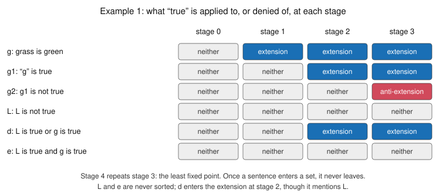

# Philosophy of Language and Logic · Lesson 5.3: The liar and theories of truth

> ⏱ ~15 min · Module 5: Truth, paradox, and vagueness · Builds on: [5.1](05-01-tarskis-theory-as-philosophy.md), [5.2](05-02-deflationism.md), [`mathematical-logic` 3.1](../../mathematical-logic/lessons/03-01-russells-paradox.md), [`programming-languages` 2.3](../../programming-languages/lessons/02-03-denotational-semantics-and-fixed-points.md) · Unlocks: [5.4](05-04-the-sorites-and-degrees-of-truth.md), [5.5](05-05-supervaluationism-and-epistemicism.md)

## Why this matters

Cicero, for the Academic sceptics, needles the Stoic logicians: "it is the foundation of dialectics, that whatever is enunciated ... is either true or false", yet "if you say that you are speaking falsely, and that that is true, you are speaking falsely and telling the truth at the same time" (*Lucullus* §95, tr. C. D. Yonge, 1853; Reid's 1874 Latin text has a question here, *mentiris an verum dicis?*). [5.1](05-01-tarskis-theory-as-philosophy.md) proved that classical arithmetic cannot define its own truth, yet English seems to contain its own "true". Each theory of the [liar](../reference.md#liar-paradox) here keeps English's "true" at a price: a single "true", bivalence, or consistency.

## The idea

"This sentence is not true." If it is true, things are as it says, so it is not true; if it is not true, that is just what it says, so it is true. [`mathematical-logic` 3.1](../../mathematical-logic/lessons/03-01-russells-paradox.md) showed the shape: the liar is $Q \leftrightarrow \neg Q$, Russell's set in a linguistic coat, and its P2 set the twin $Q \leftrightarrow Q$, the shape of the [truth-teller](../reference.md#truth-teller) ("this sentence is true"), undetermined but not explosive. This lesson asks what a theory of *truth* should do about them.

Think of a spreadsheet. Cells that trace back to typed-in data get computed; a cell defined as NOT itself, or as itself, sits in a loop with no data underneath and never gets a value. Saul Kripke (1975) proposed that "true" works this way. You call "grass is green" true by looking at grass, then '"grass is green" is true' true, and so on. Sentences that eventually get a value are [grounded](../reference.md#groundedness); the liar never does.

Three responses each give up a different premise below: [Tarski's hierarchy](../reference.md#tarskis-hierarchy) gives up a single "true", Kripke's gaps give up bivalence, and Graham Priest's [dialetheism](../reference.md#dialetheism) gives up the rule that a contradiction implies everything. The [strengthened liar](../reference.md#strengthened-liar) then tests each.

## The argument

Write $\mathrm{Tr}$ for a truth predicate and $\ulcorner \varphi \urcorner$ for a name of the sentence $\varphi$, as in 5.1.

**P1 (self-reference).** There is a sentence $L$ that is $\neg\mathrm{Tr}(\ulcorner L\urcorner)$. *In words:* $L$ says of itself that it is not true. A sign can manage this; in arithmetic the diagonal lemma does ([5.1](05-01-tarskis-theory-as-philosophy.md), T1 step 1).

**P2 ([T-schema](../reference.md#t-schema)).** $\mathrm{Tr}(\ulcorner \varphi\urcorner) \leftrightarrow \varphi$ for every sentence $\varphi$, including those containing $\mathrm{Tr}$. *In words:* calling a sentence true is equivalent to asserting it.

**P3 (classical logic).** $\varphi \vee \neg\varphi$ for every $\varphi$, with the classical rules for $\neg$ and $\leftrightarrow$. *In words:* every sentence is true or not, and the usual inferences hold.

**C1.** $\mathrm{Tr}(\ulcorner L\urcorner) \wedge \neg\mathrm{Tr}(\ulcorner L\urcorner)$. By P1 and P2, $\mathrm{Tr}(\ulcorner L\urcorner) \leftrightarrow \neg\mathrm{Tr}(\ulcorner L\urcorner)$; by P3, either case yields both. *In words:* the liar is true and not true.

**P4 (explosion).** From $\varphi$ and $\neg\varphi$ infer any $\psi$ ([`mathematical-logic` 1.4](../../mathematical-logic/lessons/01-04-proof-system-completeness.md)'s ex falso). *In words:* a contradiction proves everything.

**∴ C2.** Every sentence follows. *In words:* a classical, self-applicable "true" trivializes the language.

P1 is safe: Gödel's construction, Kripke noted, puts self-reference beyond doubt. Each theory denies one of P2–P4.

**The hierarchy restricts P2.** "True" becomes a family, true-in-$L_0$, true-in-$L_1$, …, each applying only to lower levels ([5.1](05-01-tarskis-theory-as-philosophy.md)'s figure), so $L$ cannot be written. Kripke's objection: ordinary truth talk carries no levels. Dean says that all of Nixon's utterances about Watergate are false; Nixon says that everything Dean says about Watergate is false. Each means to include the other's remark, which fixed levels forbid, though we can often tell which remark is true. And paradox can depend on the facts. Kripke's first paragraph turns to Titus 1:12: "One of themselves, even a prophet of their own, said, The Cretians are alway liars" (KJV). Read as "no Cretan utterance is true", said by a Cretan, it cannot be true, so it is simply false if some other Cretan utterance is true; only if every other is false is it a liar. Truth talk, Kripke concluded, is "risky": no syntactic sieve removes the paradoxes in advance.

**The gap theory denies P3.** [Strong Kleene](../reference.md#strong-kleene) logic has values 1, $\tfrac12$ and 0, with $\tfrac12$ marking a gap, no value. $\neg$ swaps 1 and 0 and leaves $\tfrac12$; $\varphi \wedge \psi$ takes the minimum, $\varphi \vee \psi$ the maximum, and $\varphi \to \psi$ abbreviates $\neg\varphi \vee \psi$. These are the AND/OR/NOT tables [`databases` 1.3](../../databases/lessons/01-03-sql-select-from-where.md) used for SQL's NULL; Kripke took them from Kleene's *Introduction to Metamathematics* (1952, §64), not to be confused with Kleene's fixed-point theorem. Order the values by [information](../reference.md#information-order): $\tfrac12 \sqsubseteq 0$ and $\tfrac12 \sqsubseteq 1$. Every Strong Kleene connective is monotone: filling in a gap never changes a value already settled.

**D1.** An interpretation of $\mathrm{Tr}$ is a pair $(\mathcal E, \mathcal A)$ of disjoint sets of sentences, its extension and anti-extension. $\mathrm{Tr}(\ulcorner\varphi\urcorner)$ gets 1 if $\varphi \in \mathcal E$, 0 if $\varphi \in \mathcal A$, $\tfrac12$ otherwise. *In words:* a current opinion: true, false, or undecided.

**D2 ([jump](../reference.md#kripke-jump)).** $J(\mathcal E, \mathcal A)$ is the pair (sentences valued 1 under $(\mathcal E, \mathcal A)$, sentences valued 0). *In words:* re-evaluate everything using your current opinion of "true", and adopt the result.

**T2 ([Kripke's fixed point](../reference.md#kripkes-fixed-point); Kripke 1975, and independently Martin and Woodruff 1975).** $J$ is monotone. Iterate it from $(\varnothing, \varnothing)$, taking unions at limit stages: the stages grow until they reach the least fixed point, in [`programming-languages` 2.3](../../programming-languages/lessons/02-03-denotational-semantics-and-fixed-points.md)'s sense (iterate from total ignorance in the information order), reached by transfinite iteration in general ([`mathematical-logic` 4.2](../../mathematical-logic/lessons/04-02-ordinals-transfinite-induction.md)) and in finitely many stages for this lesson's finite languages. Its existence comes from monotonicity, not from 2.3's continuity hypothesis. At every fixed point, $\varphi$ and $\mathrm{Tr}(\ulcorner\varphi\urcorner)$ have the same value. *In words:* "true" can apply to its own language and be transparent, once some sentences may lack a value.

**D3.** A sentence is grounded if it has a value in the least fixed point, and [paradoxical](../reference.md#paradoxical-sentence) if it has a value in no fixed point (Kripke's definitions). *In words:* grounded sentences take their value from the facts; paradoxical ones can take none.

The liar is $\tfrac12$ at every fixed point. Two-valued, `mathematical-logic` 3.1 was right that it has "no fixed point to land on"; Kripke's jump gives it exactly one, the gap. The truth-teller is ungrounded but not paradoxical: $\tfrac12$ in the least fixed point, while putting it in $\mathcal E$, or in $\mathcal A$, yields further fixed points, as every function is a fixed point of `while true do skip` in [`programming-languages` 2.3](../../programming-languages/lessons/02-03-denotational-semantics-and-fixed-points.md) P3 and only the least asserts nothing unforced. P2 survives as transparency, though the biconditional $\mathrm{Tr}(\ulcorner L\urcorner) \leftrightarrow L$ itself gets $\tfrac12$.

**Dialetheism denies P4.** Priest's [logic of paradox](../reference.md#logic-of-paradox), LP ("The Logic of Paradox", *Journal of Philosophical Logic*, 1979), keeps the same tables but reads $\tfrac12$ as "both true and false" and designates it: an argument is valid if, whenever every premise gets 1 or $\tfrac12$, so does the conclusion. The liar's equation $v = 1 - v$ has one solution, $\tfrac12$, in both logics; the dispute is what $\tfrac12$ is. For Priest the liar is a dialetheia, a true contradiction: C1 is designated, and accepted, but explosion fails ($p$ at $\tfrac12$, $q$ at 0), so C2 never arrives. LP keeps excluded middle and $\neg(\varphi \wedge \neg\varphi)$. Priest's wider case, the inclosure schema (*Beyond the Limits of Thought*, 1995; 2nd ed. 2002), holds that the set-theoretic and semantic paradoxes share one structure and deserve one solution (SEP, "Dialetheism"). With the material conditional, 5.1's [Curry sentence](../reference.md#curry-paradox) also takes $\tfrac12$ in both logics; a conditional with modus ponens and conditional proof revives it (5.1 P2), so each camp drops one.

**Where the argument is weakest.** P3, for sentences whose value depends only on talk of truth. The strongest objection is groundedness: nothing outside the liar fixes its value, so the gap is the absence of a value, not a third one (Kripke insisted that "undefined" names no extra truth value). The strongest reply is that the gap theorist's own verdict restores P3 one level up: "$L$ is not true" is asserted by the theorist and not by the object language (Example 2), and Kripke granted that "grounded" and "paradoxical" belong to a classical metalanguage. The gap theorist concedes that a classical vocabulary survives outside the theory; the classical theorist, that a transparent, self-applicable "true" is consistent, which Tarski's theorem seemed to forbid.

## The construction

Example 1's stages, from the verify script: sentences only ever join a set, and two never do.

## Worked examples

**Example 1 (clean case).** Six sentences: $g$, "grass is green"; $g_1 := \mathrm{Tr}(\ulcorner g\urcorner)$; $g_2 := \neg\mathrm{Tr}(\ulcorner g_1\urcorner)$; the liar $L := \neg\mathrm{Tr}(\ulcorner L\urcorner)$; $d := \mathrm{Tr}(\ulcorner L\urcorner) \vee \mathrm{Tr}(\ulcorner g\urcorner)$; $e := \mathrm{Tr}(\ulcorner L\urcorner) \wedge \mathrm{Tr}(\ulcorner g\urcorner)$.

- Stage 0: $(\varnothing, \varnothing)$; every $\mathrm{Tr}$-sentence is $\tfrac12$, but $g$ is true by the grass.
- Stage 1: $(\{g\}, \varnothing)$. Now $g_1 = 1$ and $d = \max(\tfrac12, 1) = 1$.
- Stage 2: $(\{g, g_1, d\}, \varnothing)$. Now $g_2 = \neg 1 = 0$.
- Stage 3: $(\{g, g_1, d\}, \{g_2\})$. Applying $J$ again changes nothing: the least fixed point.

$L$ and $e = \min(\tfrac12, 1) = \tfrac12$ never get a value. Of all $3^6 = 729$ ways of sorting the six sentences into $\mathcal E$, $\mathcal A$ or neither, stage 3 is the only fixed point, so $L$ and $e$ are paradoxical. So $d$ mentions the liar yet is grounded true (Kripke's own footnote makes this point), while $e$ is paradoxical with no self-reference of its own. On this construction, paradox lies in what a sentence's value depends on, not in its form.

**Example 2 (hard case: the strengthened liar).** In every fixed point $L \notin \mathcal E$, so the theory says that $L$ is not true, which is what $L$ says. In the object language, "$L$ is not true" is $\neg\mathrm{Tr}(\ulcorner L\urcorner)$, which is $L$ itself, valued $\tfrac12$: the language's "not true" means "false", and the verdict is not among its truths. The verdict uses exclusion negation: "not true" as "false or gappy", sending $\tfrac12$ to 1. Add it to the object language and $L^{*}$, "$L^{*}$ is not true" in the exclusion sense, has no value at all (1 goes to 0, 0 to 1, $\tfrac12$ to 1); nor can the construction run, since exclusion negation is not monotone ($\tfrac12 \mapsto 1$ but $1 \mapsto 0$). **Where it stops.** Kripke conceded that the verdict belongs to a classical metalanguage, so the "ghost of the Tarski hierarchy" remains (1975, p. 714). Hartry Field (*Saving Truth from Paradox*, 2008) adds a new conditional and "determinately" operators, and the [revenge problem](../reference.md#revenge-problem) moves to "not determinately true" (SEP, "Liar Paradox"). Priest can say inside LP that $L$ is true and false, so the strengthened liar is one more dialetheia; his critics ask whether he can say that a sentence is *only* false (SEP, "Dialetheism"). Each theory meets a liar built from its own notion; whether that refutes it stays open.

## Watch out

- **You might think** the gap is a third truth value, **but actually** it is the absence of one. SQL's "unknown" ([`databases` 1.3](../../databases/lessons/01-03-sql-select-from-where.md)) shares the tables, and its name suggests ignorance of a determinate value; the liar has no hidden value. In LP the middle value is a status of its own, both true and false.
- **You might think** "this sentence is false" and "this sentence is not true" are one paradox, **but actually** they come apart once gaps are allowed. `mathematical-logic` 3.1 wrote the ordinary liar with "false"; in Strong Kleene $\neg\mathrm{Tr}$ expresses only "false", and the strengthened liar uses the exclusion "not true" that includes gaps.
- **You might think** self-reference makes a sentence paradoxical, **but actually** the truth-teller is self-referential and not paradoxical, $e$ is paradoxical without self-reference, and Epimenides' line is paradoxical only if every other Cretan utterance is false.
- **You might think** "fixed point" means the same in 5.1 and here, **but actually** the diagonal lemma's fixed point is a sentence, while Kripke's is an interpretation of $\mathrm{Tr}$ that the jump leaves unchanged.

## One-liner

> A self-applicable "true", the T-schema and classical logic cannot all stand: the hierarchy splits "true", Kripke leaves the liar in a gap, Priest calls it true and false, and each then meets a liar built from its own vocabulary.

## Problems

**P1 (🟢)** *(Diagnose: Exegetical.)* The *Eskerby Courier* prints a puzzle box (invented, written for this problem). Take as fact that the *Courier* goes to press on Thursday, not on Monday. The box reads:

(a) "Either sentence (a) is not true or the *Courier* goes to press on Monday."

(b) "Either sentence (a) is true or the *Courier* goes to press on Thursday."

(c) "Sentence (c) is true and the *Courier* goes to press on Thursday."

(d) "Sentence (b) is not true."

Read "not", "and" and "or" by Strong Kleene and "true" by Kripke's construction. Classify each sentence as liar-like (paradoxical), truth-teller-like (ungrounded but not paradoxical), grounded true or grounded false, with the reason. One line each.

**P2 (🟡)** *(Formal model: Formal (a)–(b).)* A language has exactly three sentences: $s_1 := \mathrm{Tr}(\ulcorner s_2\urcorner)$ ("$s_2$ is true"), $s_2 := \neg\mathrm{Tr}(\ulcorner s_1\urcorner)$ ("$s_1$ is not true"), and $s_3 := \mathrm{Tr}(\ulcorner s_3\urcorner) \vee \mathrm{Tr}(\ulcorner s_1\urcorner)$ ("$s_3$ is true or $s_1$ is true"). Connectives are Strong Kleene; fixed points have disjoint extension and anti-extension.

(a) Compute the stages of Kripke's construction from $(\varnothing, \varnothing)$ to the least fixed point, and say which sentences are grounded.

(b) Find every fixed point. Prove that $s_1$ and $s_2$ are paradoxical, and say whether $s_3$ is paradoxical and whether it can be true, or false, at some fixed point. Show the computation.

**P3 (🔴)** *(Formal model: Formal (a) · Steelman and reply: Evaluative (b).)* LP has values 1, $\tfrac12$, 0, the Strong Kleene tables, and designated values 1 and $\tfrac12$.

(a) Find every valuation of $p$ and $q$ on which $p$ and $\neg p$ are designated and $q$ is not. Use it to show that explosion ($p, \neg p \models q$) and disjunctive syllogism ($p \vee q, \neg p \models q$) both fail in LP. Show the values.

(b) A critic says: "If you can accept both $\varphi$ and $\neg\varphi$, then asserting $\neg\varphi$ rules nothing out, and you cannot even disagree with me." State the objection at full strength, give Priest's best reply, and say what each side must concede. Any verdict; 100 words or fewer.

Solutions

**P1** *(Exegetical.)*

**Must hit, strict:**

- (a) Liar-like. Monday is false, so (a)'s value is that of $\neg\mathrm{Tr}(\ulcorner a\urcorner)$: it says only that it is not true, and is $\tfrac12$ at every fixed point.

- (b) Grounded true. Its second disjunct is a true non-semantic sentence, so the disjunction is 1 from the first stage on, whatever (a) is; it enters the extension at stage 1.

- (c) Truth-teller-like. With its true conjunct its value is that of $\mathrm{Tr}(\ulcorner c\urcorner)$: $\tfrac12$ in the least fixed point, true in one fixed point and false in another.

- (d) Grounded false. (b) is in the extension from stage 1, so $\neg\mathrm{Tr}(\ulcorner b\urcorner)$ gets 0 and enters the anti-extension at stage 2.

**Wrong turns:** calling (b) paradoxical because it mentions (a) (a true disjunct settles a Strong Kleene disjunction); calling (c) paradoxical because it refers to itself; calling (a) grounded false because Monday is false (a false disjunct leaves the other disjunct's value standing); calling (d) liar-like because it contains "not true".

**Model answer:** (a) liar-like: it reduces to "(a) is not true"; (b) grounded true: the Thursday disjunct makes it true at stage 1; (c) truth-teller-like: it reduces to "(c) is true", ungrounded but consistently true or false; (d) grounded false: (b) is grounded true. The verify script checks all 81 ways of sorting the four sentences: exactly 3 fixed points, (a) in no set at any, (c) in the extension of one and the anti-extension of another.

---

**P2** *(Formal (a)–(b).)*

(a) At stage 0 every $\mathrm{Tr}$-sentence is $\tfrac12$: $s_1 = \tfrac12$, $s_2 = \neg\tfrac12 = \tfrac12$, $s_3 = \max(\tfrac12, \tfrac12) = \tfrac12$. So $J(\varnothing, \varnothing) = (\varnothing, \varnothing)$: stage 0 is already the least fixed point, and nothing is grounded. The language has no non-semantic sentence, so the construction has nothing to start from.

(b) Let $(\mathcal E, \mathcal A)$ be any fixed point. Then $s_1 \in \mathcal E$ iff $\mathrm{Tr}(\ulcorner s_2\urcorner) = 1$ iff $s_2 \in \mathcal E$; and $s_2 \in \mathcal E$ iff $\mathrm{Tr}(\ulcorner s_1\urcorner) = 0$ iff $s_1 \in \mathcal A$. So $s_1 \in \mathcal E$ iff $s_1 \in \mathcal A$, and since the two sets are disjoint, $s_1$ is in neither; hence $s_2 \notin \mathcal E$. Also $s_2 \in \mathcal A$ iff $\mathrm{Tr}(\ulcorner s_1\urcorner) = 1$ iff $s_1 \in \mathcal E$, which is false; so $s_2 \notin \mathcal A$. Both are $\tfrac12$ at every fixed point: paradoxical, a liar spread over two sentences.

Then $s_3$'s value is $\max(\mathrm{Tr}(\ulcorner s_3\urcorner), \tfrac12)$:

- $s_3 \in \mathcal E$: $\max(1, \tfrac12) = 1$, consistent.

- $s_3 \in \mathcal A$: $\max(0, \tfrac12) = \tfrac12 \neq 0$, not a fixed point.

- $s_3$ in neither: $\max(\tfrac12, \tfrac12) = \tfrac12$, consistent.

Exactly two fixed points: $(\varnothing, \varnothing)$ and $(\{s_3\}, \varnothing)$. $s_3$ is ungrounded but not paradoxical; it can be true at a fixed point and can never be false.

**Must hit, strict:** stage 0 is a fixed point, so nothing is grounded; the two biconditionals linking $s_1$ and $s_2$ and the use of disjointness; $s_3$'s three cases with the false case failing because $\max(0, \tfrac12) = \tfrac12$; the two fixed points listed.

**Accept:** a systematic check of all $3^3 = 27$ ways of sorting the sentences, if every case is shown or grouped with a reason.

**Wrong turns:** "$s_3$ is a truth-teller, so it can be true or false" (its second disjunct blocks falsity); "$s_1$ is grounded because it contains no negation"; "there is no fixed point" (that is the two-valued verdict; Kripke's fixed points allow gaps); treating $s_2$'s "not true" as exclusion negation.

The verify script checks every stage and all 27 candidates, and that the jump is monotone on this language.

---

**P3** *(Formal (a) · Evaluative (b).)*

(a) $p$ and $\neg p$ designated means $p \ge \tfrac12$ and $1 - p \ge \tfrac12$, so $p = \tfrac12$; $q$ undesignated means $q = 0$. The only such valuation is $p = \tfrac12$, $q = 0$. Then $p = \tfrac12$ and $\neg p = \tfrac12$ are designated and $q = 0$ is not: explosion fails. And $p \vee q = \max(\tfrac12, 0) = \tfrac12$ and $\neg p = \tfrac12$ are designated while $q$ is not: disjunctive syllogism fails. (Since $p \to q$ is $\neg p \vee q$, modus ponens fails on the same valuation.)

**Must hit, strict (a):** the derivation that $p$ must be $\tfrac12$ and $q$ must be 0; each premise's value computed and compared with "designated"; both failures stated.

**Must hit, any verdict (b):**

- The objection at full strength: if $\varphi$ and $\neg\varphi$ can both be true, asserting $\neg\varphi$ does not exclude $\varphi$, so the dialetheist seems unable to reject a view, express disagreement, or say a sentence is *only* false.

- Priest's reply: denial (a speech act) and rejection (a mental state) are distinct from asserting a negation; exclusion is expressed by denying or rejecting, taken as primitive, not by a sentence's content.

- What each side concedes: the dialetheist, that exclusion lives in the speech act and is not captured by any LP sentence; the critic, that classical logic is no guarantee against accepting contradictions either, and that equating denial with asserting a negation is itself a disputed thesis.

**Wrong turns:** saying LP rejects non-contradiction (every instance of $\neg(\varphi \wedge \neg\varphi)$ is valid in LP); answering with the strengthened liar rather than the exclusion objection; treating "both true and false" as "neither".

**Model answer (b), one of several:** The critic: a sentence means something only if it rules something out; if $\neg\varphi$ is compatible with $\varphi$, the dialetheist's "no" excludes nothing, so she cannot disagree. Priest replies that disagreement is done by denial, a speech act distinct from asserting a negation, expressing rejection, a primitive attitude: she can deny $\varphi$, as she denies trivialism. He concedes that no LP sentence carries exclusion by its content. The critic concedes that classical logic does not stop anyone accepting contradictions, and that Frege's identification of denial with asserting a negation is a thesis, not a datum. The dispute turns on it.

## Flashback

**From Lesson [5.1](05-01-tarskis-theory-as-philosophy.md) (Tarski's theory as philosophy):** *(Formal (a) · Exegetical (b).)* Climb one rung of [Tarski's hierarchy](../reference.md#tarskis-hierarchy). Let $\mathcal L_1$ be $\mathcal L_A$ plus a one-place predicate $\mathrm{Tr}_0$, and let $\mathcal N_1$ be $\mathcal N$ with $\mathrm{Tr}_0$ true of exactly the Gödel numbers of the true sentences of $\mathcal L_A$, so that both clauses of [Convention T](../reference.md#convention-t) for $\mathcal L_A$ hold in $\mathcal N_1$. In $\mathsf{PA}_1$, $\mathsf{PA}$ with its language extended to $\mathcal L_1$, the diagonal lemma applied to $\psi(x) := \neg\mathrm{Tr}_0(x)$ gives a sentence $\lambda$ with $\mathsf{PA}_1 \vdash \lambda \leftrightarrow \neg\mathrm{Tr}_0(\ulcorner\lambda\urcorner)$.

(a) Show that $\mathcal N_1 \models \lambda$ in at most four numbered lines, naming what each line uses.

(b) At which step does 5.1's T1 ([undefinability of truth](../reference.md#undefinability-of-truth)) break down when run with $\mathrm{Tr}_0$, and which clause of Convention T does (a) use that T1's supposition never mentions? Two sentences.

Solution

(a)

1. $\mathcal N_1 \models \lambda \leftrightarrow \neg\mathrm{Tr}_0(\ulcorner\lambda\urcorner)$. Diagonal lemma; $\mathsf{PA}_1$'s axioms are true in $\mathcal N_1$, so its theorems are.

2. $\lambda$ is not a sentence of $\mathcal L_A$: built from $\psi$, it contains $\mathrm{Tr}_0$. It must: were it in $\mathcal L_A$, clause (α) and line 1 would give $\lambda \leftrightarrow \neg\lambda$.

3. $\mathcal N_1 \models \neg\mathrm{Tr}_0(\ulcorner\lambda\urcorner)$. From 2, by clause (β): $\mathrm{Tr}_0$ is true only of sentences of $\mathcal L_A$.

4. $\mathcal N_1 \models \lambda$. From 1 and 3.

So $\lambda$, "I am not a true sentence of $\mathcal L_A$", is true, while $\mathrm{Tr}_0(\ulcorner\lambda\urcorner) \leftrightarrow \lambda$ is false: $\lambda$'s truth is recorded one rung up, by $\mathrm{Tr}_1$. The verify script checks a finite two-level model: line 1 alone leaves $\lambda$ open, line 3 settles it, and no base-level sentence satisfies line 1.

**Must hit, strict (a):** line 1 from the diagonal lemma and the truth of $\mathsf{PA}_1$'s axioms in $\mathcal N_1$; $\lambda$ contains $\mathrm{Tr}_0$; clause (β) at line 3.

**Must hit, strict (b):**

- Step 3, [semantic closure](../reference.md#semantic-closure): $\mathrm{Tr}_0$'s T-biconditionals cover only $\mathcal L_A$, and $\lambda$ is not in it.

- Clause (β); T1 supposed only T-biconditionals.

**Wrong turns:** calling $\lambda$ a liar (it denies only that it is true-in-$\mathcal L_A$, correctly); saying the diagonal lemma fails ($\psi$ has a free variable); getting line 3 from $\lambda$'s own T-biconditional, which is false; calling $\lambda$ neither true nor false in the classical $\mathcal N_1$.

**Model answer (b):** At step 3: $\mathrm{Tr}_0$'s T-biconditionals cover only sentences of $\mathcal L_A$, and $\lambda$ contains $\mathrm{Tr}_0$, so $\mathcal L_1$ is not semantically closed and $\mathrm{Tr}_0(\ulcorner\lambda\urcorner) \leftrightarrow \lambda$ is false. Line 3 uses clause (β), that only sentences of the object language are true, which T1, supposing only the T-biconditionals, never mentions.

## Connections

- **Backward:** [5.1](05-01-tarskis-theory-as-philosophy.md) proved that classical arithmetic cannot define its own truth and drew the hierarchy; [5.2](05-02-deflationism.md)'s deflationist wants the transparency that Kripke's fixed points deliver, and they deliver it only without classical logic. The liar's shape and the truth-teller's are [`mathematical-logic` 3.1](../../mathematical-logic/lessons/03-01-russells-paradox.md)'s; the least fixed point is [`programming-languages` 2.3](../../programming-languages/lessons/02-03-denotational-semantics-and-fixed-points.md)'s, and ex falso, which LP drops, is [`mathematical-logic` 1.4](../../mathematical-logic/lessons/01-04-proof-system-completeness.md)'s.

- **Forward:** gaps return in [5.4](05-04-the-sorites-and-degrees-of-truth.md), where Strong Kleene is one treatment of borderline cases of vague predicates, and in [5.5](05-05-supervaluationism-and-epistemicism.md), where supervaluation gives another way to fill gaps (Kripke's construction can also run on a supervaluation scheme).

- **Sideways:** Kripke also showed, by Zorn's lemma, that every fixed point extends to a maximal one; with a truth-teller there is no greatest, unlike the greatest fixed points of the must-analyses in [`programming-languages` 7.3](../../programming-languages/lessons/07-03-dataflow-analysis-as-a-fixed-point.md). The cross-coupled latch of [`digital-logic` 3.1](../../digital-logic/lessons/03-01-latches-storage-of-one-bit.md), stable at 0 or at 1, is the truth-teller in hardware, and a latch fed its own complement, which oscillates, is the liar. Priest's single treatment of the semantic and set-theoretic paradoxes takes Russell's set ([`mathematical-logic` 3.1](../../mathematical-logic/lessons/03-01-russells-paradox.md)) to be a member of itself and not, and the diagonal argument behind 5.1 is [`theory-of-computation` 4.1](../../theory-of-computation/lessons/04-01-diagonalization-and-the-halting-problem.md)'s.
