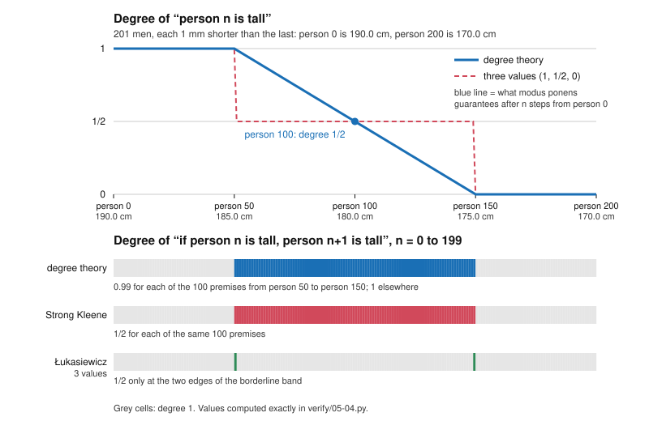

# Philosophy of Language and Logic · Lesson 5.4: The sorites and degrees of truth

> ⏱ ~15 min · Module 5: Truth, paradox, and vagueness · Builds on: [5.3](05-03-the-liar-and-theories-of-truth.md), [`mathematical-logic` 1.2](../../mathematical-logic/lessons/01-02-semantics-truth-tables.md), [`metaphysics` 2.3](../../metaphysics/lessons/02-03-hylomorphism-and-composition.md) · Unlocks: [5.5](05-05-supervaluationism-and-epistemicism.md)

## Why this matters

A man 190 cm tall is tall, and a millimetre less leaves him tall: surely nobody's tallness turns on a millimetre. Two hundred millimetres later, the same reasoning makes a man of 170 cm tall. Every word for a stretch of a continuum ("heap", "bald", "red", "adult") runs this argument, the [sorites](../reference.md#sorites-paradox), and after the liar of [5.3](05-03-the-liar-and-theories-of-truth.md) it is the second paradox that makes a theory of truth say whether every sentence is true or false.

## The idea

"Tall" seems [tolerant](../reference.md#tolerance-principle): a change of one millimetre cannot take it from applying to not applying. And it has [borderline cases](../reference.md#borderline-case), men it neither clearly fits nor clearly fails to fit (the term [`metaphysics` 2.3](../../metaphysics/lessons/02-03-hylomorphism-and-composition.md) uses for a chair assembled fibre by fibre). Peirce's definition: "A proposition is vague when there are possible states of things concerning which it is intrinsically uncertain whether, had they been contemplated by the speaker, he would have regarded them as excluded or allowed by the proposition" ("Vague", Baldwin's *Dictionary*, vol. II, 1902, p. 748). Intrinsically: from the speaker's indeterminate habits of language, not the interpreter's ignorance.

Tolerance walks you from a clear case through the borderline cases to a clear non-case. Something must give: the first premise, a step, the logic that chains the steps, or the conclusion. Classical logic gives an awkward answer: if not every millimetre preserves tallness, some millimetre destroys it, and there is a last tall man.

The [degree theory](../reference.md#degree-theory) says truth comes in degrees, as tallness does: "he is tall" is fully true at 190 cm, fully false at 170 cm, half true between. Each step "if this man is tall, so is the next" is fully or nearly true, and a nearly true step can leak a little truth each time it is used, as each photocopy of a photocopy is almost as good as the last and the two-hundredth is blank.

## Source

Diogenes Laertius credits Eubulides of Miletus (fourth century BC) with arguments including "the Sorites; the Horned one; the Bald one" (*Lives* II.108, tr. C. D. Yonge, 1853). Cicero's *Lucullus* (*Academica* II, §93; tr. C. D. Yonge, Bohn 1853, Bell printing 1875) reports the Stoic defence:

> For Chrysippus's plan is, when he is interrogated step by step (by way of giving an instance), whether there are three, or few, or many, to rest a little before he comes to the "many;" … Rest and welcome, says Carneades; you may even snore, for all I care. But what good does he do? For one follows who will waken you from sleep, and question you in the same manner … for you admit this, that you cannot in your answers fix the last number which can be classed as "few," nor the first, which amounts to "many."

Chrysippus denies no premise; he falls silent (Greek *hēsychazein*) while the answers are still clear. Carneades' point is that silence settles nothing: the questioner adds one and asks again. The deciding words are "you cannot in your answers fix the last number". Cicero takes them as a confession, and in §94 presses that whoever stops "where the case is still clear" withholds assent from the clear. If every statement is true or false, which §95 calls "the foundation of dialectics", the silence is ignorance of a line that exists, and the SEP's sorites entry lists Chrysippus among the [epistemicists](../reference.md#epistemicism) ([5.5](05-05-supervaluationism-and-epistemicism.md)). Read as a policy of not assenting where one cannot be sure, it commits him to no line.

## The argument

A line of 201 men: person $n$ ($n = 0, \dots, 200$) is 190.0 cm minus $n$ millimetres, so person 200 is 170.0 cm. $T_n$ says "person $n$ is tall".

**P1.** $T_0$. *In words:* a man of 190 cm is tall.

**P2.** $T_n \to T_{n+1}$, for each $n = 0, \dots, 199$: two hundred premises. *In words:* one millimetre never turns a tall man into one who is not.

**∴ C.** $T_{200}$, by 200 applications of modus ponens. *In words:* a man of 170 cm is tall.

That is the conditional sorites (the heap runs the same way, negated). The quantified sorites replaces them by one [tolerance principle](../reference.md#tolerance-principle), $\forall n\,(T_n \to T_{n+1})$ (the name follows Crispin Wright, 1975), and reaches $\forall n\,T_n$ by induction.

**"A millimetre makes a small difference" is not a solution.** Classically, denying tolerance asserts $\exists n\,(T_n \wedge \neg T_{n+1})$, a last tall man. If the difference is in whether he is tall, that is the sharp line, and whoever says so owes us where it lies or why no one can know ([5.5](05-05-supervaluationism-and-epistemicism.md)). If it is a difference in height, it denies nothing, unless truth itself can shrink a little: the degree theory.

**Three values.** Give the borderline men, persons 51 to 149, the value $\tfrac12$ under the [Strong Kleene](../reference.md#strong-kleene) tables of [5.3](05-03-the-liar-and-theories-of-truth.md), whose conditional is $\max(1 - a, b)$. (SQL's "unknown" in [`databases` 1.3](../../databases/lessons/01-03-sql-select-from-where.md) obeys these tables, though its name is epistemic, which $\tfrac12$ here is not.) With only 1 designated, modus ponens is valid, and the 100 conditionals from person 50 to person 150 get $\tfrac12$: valid and unsound (Körner 1959; Tye 1994). Russell's moral: "The law of excluded middle is true when precise symbols are employed, but it is not true when symbols are vague, as, in fact, all symbols are" ("Vagueness", 1923). The costs: "if person 100 is tall, person 100 is tall" gets $\tfrac12$ too, and one sharp line has become two.

**Degrees.** Following Goguen (1969) and Zadeh's [fuzzy logic](../reference.md#fuzzy-logic), values run over $[0,1]$: $v(\neg A) = 1 - v(A)$, $\wedge$ is minimum, $\vee$ maximum, $\forall$ the minimum over instances, and the conditional is [Łukasiewicz's](../reference.md#lukasiewicz-conditional):
$$v(A \to B) = \min\big(1,\ 1 - v(A) + v(B)\big).$$
*In words:* a conditional is fully true when its consequent is at least as true as its antecedent, and otherwise falls short of 1 by exactly the drop; $A \to A$ always gets 1. On the line, $v(T_n)$ is 1 for $n \le 50$ (185.0 cm and over), $(150 - n)/100$ for $50 \le n \le 150$, and 0 beyond. The 100 conditionals from person 50 to person 150 have degree 0.99, the rest 1, and the tolerance principle, their minimum, 0.99.

**T1 (modus ponens degree bound).** $v(B) \ge v(A) + v(A \to B) - 1$. *Proof:* if $v(A \to B) = 1$, then $1 - v(A) + v(B) \ge 1$, so $v(B) \ge v(A)$; otherwise $v(A \to B) = 1 - v(A) + v(B)$, which rearranges to equality. *In words:* the conclusion loses at most what the conditional falls short of full truth.

**Corollary.** If $v(A_0) = 1$ and each $v(A_{i-1} \to A_i) \ge 1 - \delta$, then $v(A_k) \ge \max(0,\ 1 - k\delta)$, by induction on $k$ with T1. *In words:* shortfalls add up; at $\delta = 0.01$, a hundred steps can spend all the truth there was.

**∴ The diagnosis.** Call an argument valid if it preserves degree 1. By T1 modus ponens is, so the sorites is valid and unsound: its tolerance premises are at least nearly true, which is why they seem true. Kenton Machina ("Truth, Belief and Vagueness", 1976) calls an argument valid when its conclusion can never be less true than its least true premise; then modus ponens fails ($v(A) = v(A \to B) = 0.9$, $v(B) = 0.8$), and the sorites breaks at the inference. Dorothy Edgington ("Vagueness by Degrees", 1996) reads degrees as [verities](../reference.md#verities), closeness to clear truth, which are formally probabilities: not truth-functional, classical logic kept, and an argument valid when its conclusion's unverity ($1 -$ verity) can never exceed the sum of its premises' unverities. T1 is that sum rule for modus ponens: $1 - v(B) \le (1 - v(A)) + (1 - v(A \to B))$.

**Where the argument is weakest.** The step from "borderline" to a real number. The [artificial-precision](../reference.md#artificial-precision) objection (Keefe, *Theories of Vagueness*, 2000, ch. 4; Sainsbury): nothing in our use of "tall" makes person 100 tall to degree 0.5 rather than 0.49, and the theory draws a new sharp line between the last man tall to degree 1 and the next ([higher-order vagueness](../reference.md#higher-order-vagueness), 5.5). The strongest reply treats the numbers as a model, not a measurement (Roy Cook, "Vagueness and Mathematical Precision", 2002): only some features, such as the ordering and the gradual descent, represent anything, as a polygon can model a circle that has no corners. The objector concedes that degrees capture a gradualness classical logic misses; the defender, that "0.99" is no fact about "tall".

## The picture

Three values make 100 premises half true and draw two sharp lines; degrees make them 0.99 true, and the blue line is both the degree of "tall" and what modus ponens guarantees at each step.

## Worked examples

**Example 1 (clean case: the chain).** Run the sorites from person 0. Steps 1 to 50 use conditionals of degree 1, so T1 guarantees $v(T_{50}) = 1$. Steps 51 to 150 each use a premise of degree 0.99, so the guarantee falls by 0.01 a step: $\tfrac12$ after step 100, the actual degree of $T_{100}$, and 0 after step 150. The bound is attained at every step. All 201 premises have degree at least 0.99, none is false, the argument is valid in the degree-1 sense, and $T_{200}$ has degree 0.

**Example 2 (hard case: penumbral connections).** Person 100 is 180.0 cm and $v(T_{100}) = \tfrac12$. "Person 100 is tall and not tall" gets $\min(\tfrac12, \tfrac12) = \tfrac12$, and "tall or not tall" gets $\tfrac12$. Many hold that the first is fully false and the second fully true: [penumbral connections](../reference.md#penumbral-connection), truths that hold however a borderline case is settled. Worse, classically equivalent claims come apart. "Not every millimetre preserves tallness", $\neg\forall n\,(T_n \to T_{n+1})$, gets $1 - 0.99 = 0.01$; "some man is tall and the next is not", $\exists n\,(T_n \wedge \neg T_{n+1})$, gets $\tfrac12$ (at $n = 99$ and $100$), because a negated Łukasiewicz conditional has degree $\max(0, v(A) - v(B))$, not $\min(v(A), 1 - v(B))$. "And" has two degree-theoretic readings, and the line-drawing sorites turns on which is English's.

**Where it stops.** Edgington's verities obey the probability rules, so the contradiction gets verity 0 and excluded middle 1; and since classical logic is kept, "some man is tall and the next is not" follows from $T_0$ and $\neg T_{200}$ and gets verity 1. (One such assignment puts equal weight on each cutoff from person 50 to person 149; it gives the same atomic degrees.) The price is truth-functionality: the verity of "tall and not tall" is no longer computed from that of "tall". Whether to pay it divides the truth-functional degree theorist from Edgington; the [supervaluationist](../reference.md#supervaluationism) of [5.5](05-05-supervaluationism-and-epistemicism.md) reaches the same verdicts without numbers.

## Watch out

- **You might think** a degree of truth is a probability, **but actually** person 100's $\tfrac12$ survives knowing his height to the micron. A Gaussian mixture's responsibility ([`machine-learning` 3.5](../../machine-learning/lessons/03-05-gaussian-mixture-models.md)) is a probability about which component produced a point, a fact one can be unsure of; Edgington's verities share probability's arithmetic, not its epistemic reading.
- **You might think** the three-valued $\tfrac12$ and the degree $\tfrac12$ are one thing, **but actually** the first marks neither true nor false (a [truth-value gap](../reference.md#truth-value-gap), or a third value read as "indeterminate"), the second a point on a scale where "tall" is exactly as true as "not tall". They split on the conditional between two neighbouring borderline men: $\tfrac12$ in Strong Kleene, 0.99 or 1 in Łukasiewicz.
- **You might think** vagueness is ambiguity or context-sensitivity, **but actually** fixing the sense and the standard leaves the borderline cases. "Tall" is gradable, its standard shifting with the conversation (the model [`epistemology` 3.4](../../epistemology/lessons/03-04-contextualism-and-its-rivals.md) borrows for "knows"), yet "tall for an adult man" is no sharper than "tall".
- **You might think** the sorites is a [slippery slope](../../philosophical-method/lessons/02-03-informal-fallacies-and-when-they-arent.md), **but actually** a slippery slope asserts a causal chain whole, while the sorites is a classically valid argument whose every step seems true.

## One-liner

> The sorites chains seemingly true steps into a false conclusion; the degree theorist lets truth come in degrees, so modus ponens may spend each premise's tiny shortfall, at the price of numbers that nothing in the use of "tall" fixes.

## Problems

**P1 (🟢)** *(Find the crux: Exegetical.)* Four responses to the sorites. For each, say what it rejects: the first premise, the conditional or tolerance premises (as false, or as less than fully true), the validity of chained modus ponens, the applicability of classical logic to vague words, or nothing (it accepts the conclusion). One line each.

(a) Peter Unger, "There Are No Ordinary Things" (1979): classical logic applies, the heap sorites ("one grain is not a heap; if $n$ grains are not a heap, $n + 1$ are not; so a million grains are not") is sound, and "heap" applies to nothing.

(b) A Łukasiewicz degree theorist who counts an argument valid when it preserves degree 1, run on this lesson's line of 201 men.

(c) Machina (1976), who counts an argument valid when its conclusion can never be less true than its least true premise, run on the same line.

(d) Russell, "Vagueness" (1923), on the man who went bald one hair at a time, and the inference that some one hair made him bald.

**P2 (🟡)** *(Formal model: Formal (a)–(c).)* A paint strip has 31 chips, chip 0 clearly red and chip 30 clearly orange. A degree theorist assigns "chip $n$ is red" the degree $r_n = 1$ for $n \le 5$, $r_n = (25 - n)/20$ for $5 \le n \le 25$, and $r_n = 0$ for $n \ge 25$, and uses the Łukasiewicz connectives of this lesson ($\wedge$ as minimum).

(a) Compute the degree of "if chip 12 is red, chip 13 is red" and of its converse, "if chip 13 is red, chip 12 is red". Show the computation.

(b) Compute the degree of "chip 17 is red and chip 17 is not red", and of its negation (an instance of the law of non-contradiction). Show the computation.

(c) Which chips are borderline cases of "red" on this assignment, and which premises of the conditional sorites "chip 0 is red; if chip $n$ is red, chip $n + 1$ is red" are less than fully true? One line.

**P3 (🔴)** *(Steelman and reply: Evaluative (a)–(b).)* On P2's strip, chip 5 is red to degree 1, chip 6 to degree 0.95, and chip 15 to degree 0.5. 150 words or fewer in all.

(a) State the artificial-precision objection to the degree theory at full strength, in both its forms, using these numbers.

(b) Give the degree theorist's best reply, and say what the reply concedes.

Solutions

**P1** *(Exegetical.)*

**Must hit, strict:**

- (a) Unger rejects nothing in the heap sorites: he accepts its conclusion (no number of grains is a heap) and keeps classical logic and every premise. What he rejects is the first premise of the positive sorites run the other way, "a million grains make a heap".

- (b) The degree theorist rejects the conditional premises as less than fully true, not as false: the 100 from person 50 to person 150 have degree 0.99, none has degree 0, and the argument is valid (modus ponens preserves degree 1).

- (c) Machina rejects the validity of chained modus ponens: a conclusion can be less true than its least true premise (premises 0.9, conclusion 0.8), so the premises can all be nearly true and the argument fail as an inference.

- (d) Russell rejects the applicability of classical logic to vague words: excluded middle is not true for vague symbols, so the step to "some one hair made the difference" fails. (Russell is the SEP's example of the view that logic does not apply to vague language.)

**Wrong turns:** saying the degree theorist calls a tolerance premise false (none has degree 0); saying Unger denies a conditional premise; reading Machina as rejecting premises; making Russell an epistemicist (he denies there must be a last hair).

**Model answer:** (a) nothing: he accepts the conclusion, and denies the positive sorites' first premise; (b) the conditional premises, as less than fully true (0.99), with modus ponens valid; (c) the inference: modus ponens is invalid on his definition; (d) classical logic's reach: excluded middle fails for vague symbols, so there need be no last hair.

---

**P2** *(Formal (a)–(c).)*

(a) $r_{12} = (25 - 12)/20 = 0.65$ and $r_{13} = 12/20 = 0.6$. Forward: $\min(1,\ 1 - 0.65 + 0.6) = \min(1,\ 0.95) = 0.95$. Converse: $\min(1,\ 1 - 0.6 + 0.65) = \min(1,\ 1.05) = 1$.

(b) $r_{17} = 8/20 = 0.4$, so "not red" has $1 - 0.4 = 0.6$. The contradiction: $\min(0.4,\ 0.6) = 0.4$. Its negation: $1 - 0.4 = 0.6$.

(c) Borderline (degree strictly between 0 and 1): chips 6 to 24, nineteen chips. Less than fully true: the twenty premises "if chip $n$ is red, chip $n + 1$ is red" for $n = 5$ to $24$, each of degree 0.95; the other ten conditionals and the first premise have degree 1.

**Must hit, strict:** the Łukasiewicz clause applied with the right antecedent (0.95 forward, 1 backward, since the consequent is now the redder chip); the contradiction computed as a minimum (0.4) and its negation as $1 - 0.4$; the borderline range 6–24, with chip 5 at degree 1 and chip 25 at 0; the twenty conditionals $n = 5, \dots, 24$.

**Accept:** fractions ($\tfrac{19}{20}$, $\tfrac25$, $\tfrac35$); "a contradiction 40 per cent true and non-contradiction 60 per cent true" stated in words.

**Wrong turns:** using the Strong Kleene conditional $\max(1 - a, b)$, which gives $\max(0.35, 0.6) = 0.6$ for the forward conditional; giving the converse 0.95 (it is fully true: the redder chip's redness is at least the less red chip's); counting chip 5 or chip 25 as borderline. The verify script checks every value.

---

**P3** *(Evaluative.)*

**Must hit, any verdict:**

- (a) Form one, uniqueness: nothing in speakers' use of "red" fixes chip 15 at 0.5 rather than 0.49, or chip 6 at 0.95 rather than 0.94; a theory that assigns one number claims a precision the word lacks.

- (a) Form two, the new sharp line: chip 5 is red to degree 1 and chip 6 is not, so the theory has a last fully red chip, exactly the kind of sharp boundary vagueness was supposed to lack (higher-order vagueness).

- (b) A reply that targets the step from model to fact: the numbers are a model (Cook) in which only the ordering and the gradual descent represent, or many degree functions are acceptable and claims hold if they hold on all (Smith's fuzzy plurivaluationism). Either way, say how the reply handles form two, not only form one.

- (b) The concession: the exact degrees, and the sorites diagnosis stated in them, are no longer facts about "red"; the claim must become "every tolerance premise is true or very nearly true on every acceptable model", and which models are acceptable may itself be vague.

**Wrong turns:** answering only form one; replying that degrees are credences (that changes the subject; see Watch out); treating the objection as a refutation of all many-valued logic rather than of a unique assignment; giving a verdict without the concession.

**Model answer, one of several:** (a) Nothing in our use of "red" makes chip 15 red to degree 0.5 rather than 0.49; the theory pins a real number on what our practice leaves open. Worse, chip 5 is fully red and chip 6 is not: the degree theory has a last fully red chip, the sharp line it was built to avoid, now between 1 and less than 1. (b) The numbers are a model, not a report. Only comparisons ("chip 12 is redder than chip 13") and the smooth descent represent anything; the exact values and the edge of the plateau are artefacts, as a polygon's corners are artefacts of modelling a circle. Or admit a family of acceptable assignments with different plateau edges. Concession: "0.95" says nothing about "red", and "acceptable" may itself be vague.

## Flashback

**From Lesson [5.2](05-02-deflationism.md) (Deflationism):** *(Close reading: Exegetical (a)–(b).)* Bertrand Russell, *The Problems of Philosophy* (Home University Library, 1912), ch. XII, "Truth and Falsehood" (Project Gutenberg #5827), lists three requisites any theory of truth must meet. The third:

> … the truth or falsehood of a belief always depends upon something which lies outside the belief itself. If I believe that Charles I died on the scaffold, I believe truly, not because of any intrinsic quality of my belief, which could be discovered by merely examining the belief, but because of an historical event which happened two and a half centuries ago. … Hence, although truth and falsehood are properties of beliefs, they are properties dependent upon the relations of the beliefs to other things, not upon any internal quality of the beliefs.

(a) Russell's truth-bearers are beliefs. What are they for Horwich's [minimalism](../reference.md#minimalism-about-truth) (D3), and does Horwich accept what the passage says about the Charles I belief? Answer with a D3 instance. Two sentences.

(b) Russell next says this requisite leads to the view "that truth consists in some form of correspondence between belief and fact". Which premises of 5.2's shared case does that [correspondence](../reference.md#correspondence-theory) view deny, and what does a deflationist make of the passage's "relations of the beliefs to other things"? Two sentences.

Solution

**Must hit, strict (a):**

- Propositions, not beliefs or sentences (sentences are D2's); a belief is true when the proposition believed is.

- Yes: "$\langle\text{Charles I died on the scaffold}\rangle$ is true iff Charles I died on the scaffold" puts the execution of 1649, no feature of the proposition or the belief, on the right. Horwich grants that truths are true owing to how the world is, typically something outside them, and needs no correspondence relation for it (*Truth*, 2nd ed., 1998; SEP, "Deflationism About Truth", §4.5); Wright (1992) and Liggins (2016) contest this.

**Must hit, strict (b):**

- Correspondence denies P4 (truth has a nature: one relation of belief to fact) and P3 (that relation explains why each instance holds), and keeps P1.

- The deflationist takes the "relations to other things" one instance at a time (an execution here, a tide or a number elsewhere), with nothing common to theorize (P4, the shopping list).

**Accept (b):** P4 alone, if the answer says correspondence is offered to explain why the instances hold.

**Wrong turns:** making the deflationist reject the passage (5.2's first Watch out); counting Russell a deflationist because his theory yields every instance (its second); giving D3 sentences or beliefs as bearers.

**Model answer:** (a) For D3 the bearers are propositions; a belief is true when the proposition believed is. Horwich says yes: the instance puts the execution of 1649, outside the belief, on the right. (b) Correspondence denies P4, that truth has no nature, and P3, that truth explains nothing beyond the instances. For the deflationist the "relations to other things" are just the instances, a different thing on the right each time, and Russell's "always" generalizes across them, the job P2 gives "true".

## Connections

- **Backward:** [5.3](05-03-the-liar-and-theories-of-truth.md)'s Strong Kleene tables give the three-valued response, with $\tfrac12$ now a borderline case rather than a sentence the construction never valued; [`mathematical-logic` 1.2](../../mathematical-logic/lessons/01-02-semantics-truth-tables.md)'s tables are the 0 and 1 corners of these. For [5.2](05-02-deflationism.md): if "'person 100 is tall' is true" means "true to degree 1", it has degree 0, and its T-biconditional only $\tfrac12$; a [deflationist](../reference.md#deflationism) who wants every instance of the [T-schema](../reference.md#t-schema) fully true must let "true" take degrees too.

- **Forward:** [5.5](05-05-supervaluationism-and-epistemicism.md) keeps excluded middle without numbers ([supervaluationism](../reference.md#supervaluationism)), turns to [epistemicism](../reference.md#epistemicism), on which Chrysippus's silence is ignorance of a real line, takes up higher-order vagueness, and addresses [`metaphysics` 2.3](../../metaphysics/lessons/02-03-hylomorphism-and-composition.md)'s question whether vagueness can be in the world rather than in words (with Evans's 1978 argument against vague identity), on which Lewis and Sider's argument from vagueness for unrestricted composition there (its P4) turns.

- **Sideways:** the sorites form recurs across the library: the Ship of Theseus plank by plank ([`metaphysics` 5.3](../../metaphysics/lessons/05-03-coincidence-and-the-ship-of-theseus.md)); Maxwell's continuum from windowpane to microscope, where van Fraassen's reply, that a vague predicate is usable if it has clear cases and clear non-cases, is a condition on using a vague word, not a theory of vagueness ([`philosophy-of-science` 5.4](../../philosophy-of-science/lessons/05-04-constructive-empiricism-and-entity-realism.md)); Wilkinson's continuum argument for fanaticism ([`decision-theory` 6.2](../../decision-theory/lessons/06-02-fanaticism-and-tiny-probabilities.md)); threshold deontology's 1,000 against 1,001 lives ([`ethics` 2.4](../../ethics/lessons/02-04-constraints-and-options.md)); gradual evolution against sharp kinds ([`apologetics-foundations` 4.2](../../apologetics-foundations/lessons/04-02-evolution-design-and-the-human-person.md)). Cicero's report belongs to the Academic sceptics' campaign against the Stoics ([`ancient-medieval-philosophy` 4.3](../../ancient-medieval-philosophy/lessons/04-03-the-skeptics.md)). Vague statutes are [`philosophy-of-law`](../../philosophy-of-law/syllabus.md)'s, which cites this lesson for borderline cases; calibration ([`machine-learning` 4.2](../../machine-learning/lessons/04-02-classification-metrics.md)) is a fact about probabilities, never about degrees of truth.
