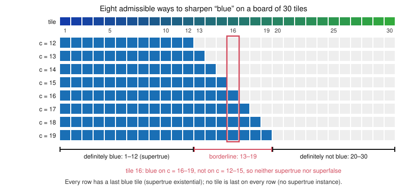

# Philosophy of Language and Logic · Lesson 5.5: Supervaluationism and epistemicism

> ⏱ ~15 min · Module 5: Truth, paradox, and vagueness · Builds on: [5.4](05-04-the-sorites-and-degrees-of-truth.md), [5.3](05-03-the-liar-and-theories-of-truth.md), [`epistemology` 1.3](../../epistemology/lessons/01-03-why-knowledge.md) · Unlocks: Boss problem 5 ([syllabus](../syllabus.md))

## Why this matters

A tile shop's sample board runs thirty tiles from deep blue to green. Nobody can say which tile is the last blue one, yet classical logic proves there is one: tile 1 is blue, tile 30 is not, so somewhere a blue tile sits next to one that is not. [5.4](05-04-the-sorites-and-degrees-of-truth.md) escaped by trading classical logic for degrees of truth. This lesson keeps every classical law and pays elsewhere: either "true" means less than you thought, or there are facts about meaning that nobody can know.

## The idea

There are two ways to keep classical logic while admitting that "blue" has [borderline cases](../reference.md#borderline-case).

The **supervaluationist** treats a vague word as an unfinished decision. Usage permits many sharp lines for "blue" (after tile 12, after tile 13, …, after tile 19) and has chosen none; David Lewis called this semantic indecision. Think of a committee that has shortlisted eight places to draw a line and picked none: whatever holds on every shortlisted line is already settled. "Tile 16 is blue or it is not" holds on every line, so it is true. "Tile 16 is blue" holds on some lines and fails on others, so it is neither true nor false. This is the truth-value gap of [1.4](01-04-strawson-donnellan-and-speaker-reference.md) and [5.3](05-03-the-liar-and-theories-of-truth.md), with one difference: excluded middle survives it.

The **epistemicist** says there is exactly one line and it is sharp. We cannot find it because the whole community's pattern of use fixes it, which nobody can survey, and because knowledge needs a margin: you cannot know a tile is blue if a tile you cannot tell from it is not. The borderline is a zone of ignorance, not of indeterminacy.

## The argument

**D1. [Precisification](../reference.md#precisification)** (Kit Fine, "Vagueness, Truth and Logic", *Synthese*, 1975, adapting the supervaluations Bas van Fraassen built for empty names in 1966). A precisification makes every vague predicate sharp. It is *admissible* iff it keeps the clear cases and clear non-cases and respects [penumbral connections](../reference.md#penumbral-connection), the logical ties among borderline cases: if tile 16 is blue, so is the bluer tile 14. *In words:* one way of finishing the meaning that usage allows.

**D2. [Supertruth](../reference.md#supertruth).** A sentence is supertrue iff it is true on every admissible precisification, superfalse iff it is false on every one, and neither otherwise. [Supervaluationism](../reference.md#supervaluationism) identifies truth with supertruth. *In words:* true means true however the decision is finished.

**D3. [Definitely](../reference.md#definitely-operator).** $D\varphi$ is true on a precisification iff $\varphi$ is true on every admissible precisification. So $D$ is a box ([2.1](02-01-kripke-semantics-and-the-system-k.md)) whose worlds are the precisifications, each seeing all. *In words:* "definitely" means on every sharpening.

**T1 (settled).** Each precisification is a classical model. So every classical tautology is supertrue, and every classically valid argument takes supertrue premises to a supertrue conclusion. *In words:* every classical law survives, excluded middle $\varphi \vee \neg\varphi$ included.

**T2 (settled).** Bivalence fails, because a borderline "$Fa$" is neither supertrue nor superfalse. So a disjunction can be supertrue with neither disjunct supertrue, and an existential with no supertrue instance. *In words:* excluded middle is a law about formulas and holds; bivalence is a claim about truth values and fails.

**T3 (settled).** For a series $a_1, \dots, a_k$ with $Fa_1$ supertrue, $Fa_k$ superfalse and a borderline case between, the tolerance premise $\forall n\,(Fa_n \to Fa_{n+1})$ is superfalse and its negation, "there is a last $F$", is supertrue; each conditional premise $Fa_n \to Fa_{n+1}$ is supertrue or neither, never superfalse. *In words:* the sorites is valid and unsound, but no one premise can be pointed to as the false one.

The costs lie in what this shows.

- **Logic with "definitely".** $\varphi$ entails $D\varphi$ (if $\varphi$ is supertrue, so is $D\varphi$), yet at a borderline case $\varphi \to D\varphi$ is not supertrue, and $\neg D\varphi$ is supertrue while $\neg\varphi$ is not. With $D$ in the language, conditional proof, contraposition and reductio fail (Timothy Williamson, *Vagueness*, 1994): the classical laws survive, some classical rules do not.
- **[Higher-order vagueness](../reference.md#higher-order-vagueness).** Each model has a sharp band: tile 12 is definitely blue, tile 13 is not. But "admissible" is itself vague, so "definitely blue" should have borderline cases; with every precisification seeing every other, $D$ obeys S5 ($DD\varphi \leftrightarrow D\varphi$, [2.2](02-02-axioms-and-frames-t-s4-s5.md)) and leaves no room for them. Williamson argues that accommodating them leaves supertruth without properties truth has; Rosanna Keefe (*Theories of Vagueness*, 2000) replies.

**[Epistemicism](../reference.md#epistemicism)** (Williamson, *Vagueness*, 1994; Roy Sorensen, *Blindspots*, 1988), on which Chrysippus's silence ([5.4](05-04-the-sorites-and-degrees-of-truth.md)) was ignorance of a real line:

**E1.** Classical logic and bivalence hold for vague language. *In words:* "tile 16 is blue" is true or false.

**E2.** So the tolerance premise is false, and exactly one conditional premise is false. *In words:* there is a last blue tile.

**E3.** Meaning supervenes on use: no difference in where the line falls without a difference in the community's dispositions to apply the word, though no function from use to line can be stated or computed. *In words:* use fixes the line without anyone being able to read it off.

**E4. [Margin-for-error principle](../reference.md#margin-for-error-principle)** ([`epistemology` 1.3](../../epistemology/lessons/01-03-why-knowledge.md), where it is safety applied to discrimination). If $x$ and $y$ differ by an increment on the deciding dimension and you know that $x$ is $F$, then $y$ is $F$. *In words:* you cannot know a case that sits right next to one where you would be wrong.

**∴ C.** The line exists and cannot be known; a borderline case is one too close to it to know. *In words:* vagueness is ignorance. Higher-order vagueness is then ignorance of ignorance: knowing that you know needs a double margin, `epistemology` 1.3's KK failure applied to "definitely". Sorensen traces the ignorance instead to there being no truthmaker that controls a borderline statement's truth value (*Vagueness and Contradiction*, 2001).

**Worldly vagueness.** [`metaphysics` 2.3](../../metaphysics/lessons/02-03-hylomorphism-and-composition.md)'s argument from vagueness assumes that existence and identity are never vague (its P4) and hands this course the question whether vagueness can be in the world. Both theories here say no, placing it in unfinished meanings or in our knowledge, so P4 is their shared verdict, assumed. Gareth Evans argued for its identity half ("Can There Be Vague Objects?", *Analysis*, 1978). If it is indeterminate whether $a = b$, then $b$ has a property $a$ lacks, being indeterminately identical to $a$, for $a$ is determinately identical to itself; so by [Leibniz's law](../reference.md#leibnizs-law) $a \neq b$, which Evans took to contradict the supposition. He allowed vague identity statements with vague terms, as Kripke allowed contingent identities with non-rigid ones: the vagueness is then in the language. Terence Parsons (*Indeterminate Identity*, 2000) challenges the inferences. Of target faculty in the PhilPapers 2020 survey, 52.13% accepted or leaned towards a semantic view of vagueness, 24.18% epistemic, 20.82% metaphysical.

**Where the argument is weakest.** For supervaluationism, D2. Williamson objects that truth is disquotational and supertruth is not: "'tile 16 is blue' is supertrue iff tile 16 is blue" is itself neither supertrue nor superfalse, and the existential without a true instance and the failed inferences are symptoms. Keefe replies that these anomalies are the price of the best overall theory, and that "'$p$' is true" and "$p$" still entail each other. For epistemicism, E3: use treats tiles 15 and 16 alike, so nothing could break the tie, and a rough word drawing a one-tile line would be a miracle. Williamson replies that falsity is the default where nothing makes a sentence true, that much meaning is acquired passively rather than stipulated, and that no theory can compute meaning from use. The supervaluationist concedes a truth that does not disquote; the epistemicist, facts its own defenders call hard to believe.

## The picture

Each row is one admissible precisification of "blue", and a sentence is supertrue iff it is true on every row.

## Worked examples

**Example 1 (clean case: supervaluating the tile board).** Thirty tiles, tile 1 deepest blue, tile 30 green. An admissible precisification of "blue" is a cutoff $c$ with $12 \le c \le 19$, inclusive, eight in all. On precisification $c$, tiles $1, \dots, c$ are blue and the rest are not. Write $b_n$ for "tile $n$ is blue".

| Sentence | True on cutoffs | Status |
|---|---|---|
| $b_{16}$ | 16–19 | neither |
| $b_{16} \vee \neg b_{16}$ | all 8 | supertrue |
| $b_{16} \wedge \neg b_{16}$ | none | superfalse |
| $b_{16} \to b_{14}$ | all 8 | supertrue |
| $\exists n \le 29\,(b_n \wedge \neg b_{n+1})$ | all 8 (witness $n = c$) | supertrue |
| $\forall n \le 29\,(b_n \to b_{n+1})$ | none (fails at $n = c$) | superfalse |

Tiles 1–12 are definitely blue, 13–19 borderline, 20–30 definitely not blue. Each instance $b_n \wedge \neg b_{n+1}$ with $12 \le n \le 19$ is true on exactly one cutoff, so neither; the rest are superfalse. Of the 29 conditional premises, 21 are supertrue and 8 ($n = 12, \dots, 19$) neither. Strong Kleene ([5.3](05-03-the-liar-and-theories-of-truth.md)) gives tile 16 the value $\tfrac12$, and with it both $b_{16} \vee \neg b_{16}$ and $b_{16} \wedge \neg b_{16}$; 5.4's min/max degrees do the same at a midpoint. Of the three, only supervaluation respects the penumbral connection that nothing is both blue and not blue.

**Example 2 (hard case: an oracle names the line).** Now the epistemicist's view. Suppose the line actually falls after tile 15, and a slightly different pattern of use would have moved it by up to two tiles, so the close cases are cutoffs 13–17. Model knowledge as a box over close cases, on the reflexive, symmetric, non-transitive margin frame of [2.3](02-03-which-logic-for-which-modality.md), stipulating that you know a claim iff it holds in every close case (E4 itself gives only the "only if"). Then you know "tile $n$ is blue" iff $n \le 13$, and "tile $n$ is not blue" iff $n \ge 18$. Tiles 14–17 are unknowable by E4 alone, though 14 and 15 are blue. This is `epistemology` 1.3's buoy, with the cutoff $c$ in place of the true distance and the tile $n$ in place of the threshold: knowledge iff $n \le c - m$, here with $c = 15$ and $m = 2$.

An oracle announces "tile 15 is the last blue tile." If it tracks the line (had use put it after 14, it would have said 14), a belief formed by trusting it is true in all five close cases. It is safe, so E4 does not forbid knowledge: our ignorance concerns our means, not the line. If it says 15 whatever happens, the belief is true only at 15: true, but no more knowledge than a stopped clock's right time. Here the account runs out. E4 explains why *we* cannot find a line, given that there is one; it cannot say what the tracking oracle registers. The supervaluationist calls the announcement a decision dressed as a report, true on one admissible precisification of eight. And if, with Sorensen, no truthmaker controls a borderline truth value, it is unclear what any oracle could track.

## Watch out

- **You might think** "true", "supertrue" and "known" are rivals for one job, **but actually** they come apart on tile 16: both theories assert excluded middle and "there is a last blue tile", but the supervaluationist calls "tile 16 is blue" neither and the epistemicist calls it true or false, unknowably.
- **You might think** excluded middle and bivalence are one principle, **but actually** excluded middle is a schema in the object language and bivalence a metalanguage claim about truth values. Supervaluation keeps the first and drops the second; Strong Kleene drops both; epistemicism keeps both.
- **You might think** vagueness is ambiguity with many readings, **but actually** an ambiguous word can take two readings in one sentence ("he walked along the bank to the bank"), while a precisification sharpens "blue" the same way throughout, which is what makes "blue and not blue" superfalse (SEP, "Vagueness", §5).

## One-liner

> Supervaluationism keeps every classical law by counting as true only what holds on every admissible sharpening, so excluded middle and "there is a last blue tile" come out true while bivalence fails; epistemicism keeps bivalence as well, puts the line at one unknowable place, and explains the ignorance by margins for error.

## Problems

**P1 (🟢)** *(Formal model: Formal.)* Fifty piles of sand are ordered from smallest (pile 1) to largest (pile 50). An admissible precisification of "heap" picks a threshold $t$ with $18 \le t \le 26$, inclusive, and counts pile $n$ as a heap iff $n \ge t$; $D$ is "definitely", as in D3. Classify each sentence as supertrue, superfalse or neither, and name the thresholds on which it is true. One line each.

(a) If pile 24 is not a heap, then pile 20 is not a heap.

(b) If pile 22 is not a heap, then pile 25 is a heap.

(c) $D(\text{pile 22 is a heap}) \vee D(\text{pile 22 is not a heap})$.

**P2 (🟡)** *(Exegetical.)* Take the sorites on this lesson's tile board. For each of (A) the truth-functional degree theory of [5.4](05-04-the-sorites-and-degrees-of-truth.md), with Łukasiewicz connectives, (B) supervaluationism and (C) Williamson's epistemicism, say what the view holds about (i) the individual conditional premises "if tile $n$ is blue, tile $n + 1$ is blue", (ii) the law of excluded middle and (iii) the principle of bivalence. One line each, nine lines in all.

**P3 (🔴)** *(Find the crux: Evaluative.)* The supervaluationist and the epistemicist both assert "there is a tile that is blue and whose successor is not". The epistemicist says that anyone who asserts it is committed to a fact about where the line is; the supervaluationist denies this. Locate the crux. Name the principle about truth and the existential quantifier that the commitment needs, say which side accepts it, give one cost each side pays, and say what would move each side. No verdict is needed; 150 words or fewer.

Solutions

**P1** *(Formal.)*

(a) **Supertrue.** "Pile 24 is not a heap" is true only on $t = 25, 26$, and on both of those $20 < t$, so pile 20 is not a heap either. On $t = 18$–$24$ the antecedent is false. The sentence is true on all nine thresholds, a penumbral connection: a smaller pile is a heap only if a larger one is.

(b) **Neither.** The antecedent is true on $t = 23$–$26$ and the consequent on $t = 18$–$25$. The conditional fails only on $t = 26$, where pile 22 is not a heap and pile 25 is not one either, and it is true on $t = 18$–$25$.

(c) **Superfalse.** Pile 22 is a heap on $t = 18$–$22$ and not on $t = 23$–$26$, so neither $D$-disjunct holds; a $D$-sentence has the same value on every precisification, so the disjunction is false on all nine. Yet "pile 22 is a heap or pile 22 is not a heap" is supertrue: (c) says in the object language that pile 22 is borderline.

**Must hit, strict:**

- Each sentence evaluated threshold by threshold, the conditional read materially, with the true (or false) thresholds named.

- (c): $D$ evaluated across all precisifications, not at one; the result contrasted with excluded middle.

**Accept:** naming the falsifying thresholds instead of the verifying ones; any equivalent statement of (a) as "if pile 20 is a heap, so is pile 24".

**Wrong turns:** calling (a) "neither" because both its parts are borderline (a penumbral connection can be supertrue between two borderline sentences); computing (c) truth-functionally from "pile 22 is a heap" being neither; reversing the direction of $n \ge t$.

---

**P2** *(Exegetical.)*

**Must hit, strict:**

- (A)(i) A conditional premise between two clear cases (both tiles definitely blue, or both definitely not) is fully true; one where the degree drops, at or inside the borderline, falls short of 1 by exactly the drop (nearly true when the steps are small), and none is false. Chained modus ponens loses degree. (A)(ii) Excluded middle is fully true only at clear cases: $p \vee \neg p$ has degree $\max(a, 1 - a)$, below 1 at every borderline case and $\tfrac12$ at a midpoint. (A)(iii) Bivalence fails: borderline sentences take intermediate degrees.

- (B)(i) Each conditional premise is supertrue or neither, and none is superfalse, though the universal premise is superfalse and "some conditional premise is false" is supertrue. (B)(ii) Every instance is supertrue. (B)(iii) Bivalence fails: borderline sentences are neither supertrue nor superfalse.

- (C)(i) All are true except exactly one, which is false, and nobody can know which. (C)(ii) Excluded middle holds; classical logic is untouched. (C)(iii) Bivalence holds: every borderline sentence is true or false.

**Wrong turns:** saying the degree theory makes every conditional premise less than fully true (those between clear cases have degree 1); saying supervaluationism rejects excluded middle; saying epistemicism gives borderline sentences no truth value; answering for (A) with Edgington's degree view, which keeps bivalence and is not the view asked about; saying the supervaluationist can name a false conditional premise.

**Model answer:** (A) fully true between clear cases, nearly but not fully true where the degree drops, none false; excluded middle as low as $\tfrac12$; bivalence fails. (B) supertrue or neither, none superfalse; excluded middle supertrue; bivalence fails. (C) all true but one, which is false, and nobody can know which; excluded middle holds; bivalence holds.

---

**P3** *(Evaluative.)*

**Must hit, any verdict:**

- Both sides accept the existential: classical logic yields it from "tile 1 is blue" and "tile 30 is not".

- The bridging principle: an existential is true only if some instance is true (a witness for truth), which follows from the T-schema plus classical reasoning in the metalanguage. The epistemicist accepts it, so some tile is the last blue one. The supervaluationist denies it, since a supertrue existential has no supertrue instance.

- One cost each. Supervaluationist: truth is not disquotational (the T-schema for supertruth fails at a borderline case), and asserting "there is a last blue tile" while denying any sharp line strikes critics as double-talk. Epistemicist: an unknowable line that use fixes despite symmetric use across neighbouring tiles.

- What would move each side. Supervaluationist: a compelling argument that truth must be disquotational or existentials witnessed. Epistemicist: an argument that use cannot fix a sharp line, or a non-bivalent semantics that keeps everything classical logic is wanted for.

**Wrong turns:** saying the supervaluationist denies the existential; making the dispute about which tile is last; treating supertruth as knowability.

**Model answer, one of several:** The crux is the witness principle for truth: if "there is a last blue tile" is true, then for some tile $n$, "$n$ is the last blue tile" is true. It follows from the T-schema, which the epistemicist accepts along with bivalence, so asserting the existential commits him to a fact about where the line is, one nobody can know. The supervaluationist identifies truth with supertruth, and supertruth fails the principle: the existential holds on every sharpening, but each instance holds on at most one. The supervaluationist pays with a truth predicate that does not disquote; the epistemicist, with a sharp line drawn by use that treats neighbouring tiles alike. The supervaluationist would be moved by a proof that any serviceable truth predicate must satisfy the T-schema; the epistemicist, by a demonstration that symmetric use cannot select a unique line.

## Flashback

**From Lesson [5.3](05-03-the-liar-and-theories-of-truth.md) (The liar and theories of truth):** *(Formal (a) · Exegetical (b).)* At a harbour meeting (invented, written for this problem), Mrs Hambly says $h_1$, "the Sunday ferry was cancelled", and $h_2$, "something Mr Rendle said tonight is not true"; Mr Rendle says $r_1$, "harbour dues rose in May", and $r_2$, "something Mrs Hambly said tonight is not true". So $h_2 := \neg\mathrm{Tr}(\ulcorner r_1\urcorner) \vee \neg\mathrm{Tr}(\ulcorner r_2\urcorner)$, and $r_2$ likewise with $h_1$ and $h_2$, read by [Strong Kleene](../reference.md#strong-kleene).

(a) Setting (i): the ferry was cancelled and dues did not rise. Setting (ii): both plain remarks are true. In each, compute Kripke's stages to the least fixed point; in (ii), find every fixed point and classify $h_2$ and $r_2$ as [grounded](../reference.md#groundedness), ungrounded but not paradoxical, or [paradoxical](../reference.md#paradoxical-sentence). Show the stages and fixed points.

(b) Which objection of Kripke's to [Tarski's hierarchy](../reference.md#tarskis-hierarchy) does (i) illustrate, and what do (i) and (ii) together show about sorting truth talk by its form? Two sentences.

Solution

(a) Setting (i): $h_1 = 1$, $r_1 = 0$.

- Stage 0: $(\varnothing, \varnothing)$; $h_2 = r_2 = \tfrac12$.
- Stage 1: $(\{h_1\}, \{r_1\})$; now $h_2 = \max(\neg 0, \neg\tfrac12) = 1$, but $r_2 = \max(\neg 1, \neg\tfrac12) = \tfrac12$.
- Stage 2: $(\{h_1, h_2\}, \{r_1\})$; now $r_2 = \max(\neg 1, \neg 1) = 0$.
- Stage 3: $(\{h_1, h_2\}, \{r_1, r_2\})$, the least fixed point. All four are grounded: Mrs Hambly's charge is true, Mr Rendle's false.

Setting (ii): stage 1, $(\{h_1, r_1\}, \varnothing)$, is the least fixed point, since $h_2 = \max(\neg 1, \neg\tfrac12) = \tfrac12$, and likewise $r_2$: both ungrounded. At every fixed point $h_1, r_1 \in \mathcal E$, so $h_2$ takes the value of $\neg\mathrm{Tr}(\ulcorner r_2\urcorner)$ and $r_2$ that of $\neg\mathrm{Tr}(\ulcorner h_2\urcorner)$: $h_2 \in \mathcal E$ iff $r_2 \in \mathcal A$, and $h_2 \in \mathcal A$ iff $r_2 \in \mathcal E$. Three fixed points: both gappy, $h_2$ true and $r_2$ false, or the reverse. Each has a value at some fixed point, so neither is paradoxical. The verify script checks all $3^4 = 81$ interpretations: one fixed point in (i), three in (ii).

**Must hit, strict (a):** $r_2$ settled at stage 3, after $h_2$; (ii)'s least fixed point at stage 1; the two biconditionals; the three fixed points; "not paradoxical" because each has a value at some fixed point.

**Must hit, strict (b):**

- Kripke's Dean–Nixon objection: levels would put $h_2$ above $r_2$ and $r_2$ above $h_2$, yet in (i) the verdict is plain, and the construction gives it without levels.

- Same sentences, different non-semantic facts, different status: groundedness cannot be read off form (Kripke's "risky", here for groundedness rather than paradox).

**Wrong turns:** calling (ii)'s pair paradoxical, or a liar cycle (it has two negations, not one); settling $r_2$ at stage 2; reading "not true" as exclusion negation.

**Model answer (b):** Setting (i) is Kripke's Dean–Nixon objection: each remark is about the other's, so no Tarskian levels exist, yet the facts plainly make Mrs Hambly right, and the construction says so. Since the same sentences get values in (i) and lack them in (ii)'s least fixed point, whether truth talk is grounded depends on the facts, not on its form.

## Connections

- **Backward:** [5.3](05-03-the-liar-and-theories-of-truth.md) gave the liar a Strong Kleene gap, in which excluded middle fails; supervaluation is the other gap theory, the one that keeps it. [5.4](05-04-the-sorites-and-degrees-of-truth.md) set up the sorites and degree theory, whose min/max verdict of $\tfrac12$ for "tall and not tall" at the midpoint supervaluation replaces with superfalsity. [2.3](02-03-which-logic-for-which-modality.md) read a margin for error as a reflexive, symmetric, non-transitive frame, the frame Example 2 uses.

- **Forward:** none in this course: Boss 5(c) ([syllabus](../syllabus.md)) supervaluates its own series. Vague statutes and Hart's open texture belong to [`philosophy-of-law`](../../philosophy-of-law/syllabus.md) 3.1 (syllabus only); gap-filling by precisification has been offered as a model of judicial discretion (Timothy Endicott, *Vagueness in the Law*, 2000).

- **Sideways:** E4 is [`epistemology` 1.3](../../epistemology/lessons/01-03-why-knowledge.md)'s margin-for-error principle, applied to meaning rather than perception. The Evans paragraph takes up the question [`metaphysics` 2.3](../../metaphysics/lessons/02-03-hylomorphism-and-composition.md) hands here about worldly vagueness. [`apologetics-foundations` 4.2](../../apologetics-foundations/lessons/04-02-evolution-design-and-the-human-person.md) defends a sharp line of kinds over a smooth series of bodies; that is the shape epistemicism gives every vague predicate, a sharp line that cannot be observed.

## Closing the course

The course began with Frege's puzzle ([1.1](01-01-freges-puzzle-sense-and-reference.md)): a true "$a = b$" can be news when "$a = a$" never is, so either a name contributes a mode of presentation besides its referent, or the news lies elsewhere, in descriptions for Russell ([1.3](01-03-russells-theory-of-descriptions.md)) or in guises and pragmatics for the Millian. Module 2 built modal logic as a tool you can compute with, and showed that choosing among K, T, S4 and S5 is choosing a shape for "possible from here" ([2.2](02-02-axioms-and-frames-t-s4-s5.md)). Module 3 put it to work on Kripke's case that names are rigid ([3.2](03-02-rigid-designation-and-the-causal-picture.md)): if they are, a true identity between two names is necessary however it was discovered, which yields the necessary a posteriori ([3.3](03-03-the-necessary-a-posteriori-and-natural-kinds.md)), and Frege's puzzle returned in "I" and in Pierre's beliefs, with no names swapped ([3.4](03-04-indexicals-and-the-return-of-freges-puzzle.md)). Module 4 asked what a theory of meaning must deliver, truth conditions or a practice, whether any fact fixes what we mean, whether any sentence is true by meaning alone, and how much of what a speaker communicates goes unsaid ([4.4](04-04-speaker-meaning-and-implicature.md)). Module 5 found Tarski's definition of truth formally correct and its philosophy disputed, asked whether there is more to truth than the instances of its schema ([5.2](05-02-deflationism.md)), and met two paradoxes that force a theory of truth to say what happens at its edges: the liar pushes towards hierarchies, gaps or gluts ([5.3](05-03-the-liar-and-theories-of-truth.md)), and the sorites towards degrees, supertruth or lines nobody can know. Left open on purpose: whether names have senses and whether they are rigid, whether metaphysical modality is S5, whether meaning is truth conditions or use and whether any fact fixes it, whether anything is analytic, whether truth is substantive, and which treatment of the liar and the sorites is right. They stay open because each side's best defenders still have replies. What you can now do is find the premise a dispute turns on and work out exactly what giving it up costs.
