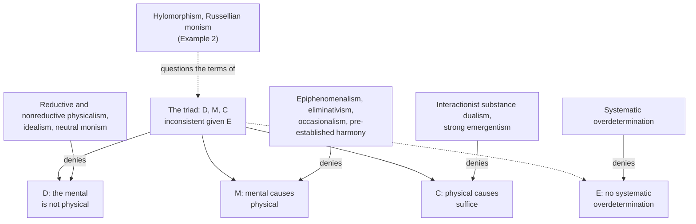

# Philosophy of Mind · Lesson 1.1: The mind-body problem

> ⏱ ~15 min · Module 1: The problem, and the case for dualism · Builds on: [`metaphysics` 6.5](../../metaphysics/lessons/06-05-what-a-person-is.md), [`modern-philosophy` 2.4](../../modern-philosophy/lessons/02-04-interaction-and-causation.md) · Unlocks: [1.2](01-02-substance-dualism-today.md), [1.3](01-03-the-knowledge-argument.md), [2.4](02-04-mental-causation-and-the-exclusion-problem.md)

## Why this matters

In a seminar a question occurs to you, and your hand goes up. A neurologist can trace the movement back through muscle, spinal motor neurons and motor cortex without once mentioning the question; you would say you wanted to ask. Both stories look true and complete, and they seem to be about different things. This lesson turns that unease into four claims that cannot all be true, and shows that every theory of mind is a decision about which one to give up.

## The idea

Three features make the mental look unlike anything else in nature. They are the course's [marks of the mental](../reference.md#marks-of-the-mental), and each gets its own module.

- **Intentionality.** A thought is *about* something: you want an answer, fear a dog, think of Atlantis. A rock's shape is about nothing, and ink means something only because readers take it to. Worse, aboutness survives the absence of its object: Atlantis does not exist and you think of it anyway, whereas a physical relation such as being taller than needs both its terms. Franz Brentano made this the mark of the mental in 1874. [`phenomenology-and-personalism` 1.1](../../phenomenology-and-personalism/lessons/01-01-intentionality-from-brentano-to-husserl.md)–[1.2](../../phenomenology-and-personalism/lessons/01-02-the-anatomy-of-an-experience.md) describes it from the inside; Module 4 asks whether it can be explained physically.

- **Phenomenal consciousness.** There is [something it is like](../reference.md#what-it-is-like) to taste lemon or feel a cramp (the phrase Thomas Nagel made famous in 1974). A complete physical description of your brain seems to say which neurons fire and leave out how it feels (Module 3).

- **First-person access.** You know that you are in pain, or what you are now thinking, without evidence or inference, and others defer to your say-so. Anyone can study your brain on equal terms; nobody else knows your pain as you do. This is [privileged access](../reference.md#first-person-access), not infallibility: people routinely misreport what caused their own choices (Nisbett and Wilson, 1977).

The marks come apart. Your standing belief that Paris is in France is about Paris and available on demand, but while you sleep there is nothing it is like to have it.

Three puzzling features make a puzzle, not yet a problem. The problem comes from what minds seem to *do*. Suppose your wanting to ask is something over and above anything physical; suppose it moves your arm; and suppose the arm's motion already had a complete physical cause. Then, unless every action is caused twice over, the wanting has nothing left to do: you can hold any two of those claims, not all three.

What *we* are is [`metaphysics` 6.5](../../metaphysics/lessons/06-05-what-a-person-is.md)'s question; this course asks what our thinking is. The four seventeenth-century answers to how mind moves body are read in [`modern-philosophy` 2.4](../../modern-philosophy/lessons/02-04-interaction-and-causation.md).

## The argument

The [inconsistent triad](../reference.md#inconsistent-triad), plus the principle that makes it inconsistent.

**D. Distinctness.** The mental is not physical: mental properties (and, on some views, the things that have them) are neither identical with physical properties nor fixed by them. *In words:* a complete physical inventory of the world would leave something mental out.

**M. Mental causation.** Some mental events cause physical events. *In words:* your wanting to ask is part of why your hand went up.

**C. Causal closure.** Every physical event that has a cause has a sufficient physical cause. *In words:* trace any bodily movement back and you never have to leave physics. The wording is [`apologetics-foundations` 4.4](../../apologetics-foundations/lessons/04-04-divine-action-miracles-and-quantum-indeterminacy.md)'s, and [3.1](../../apologetics-foundations/lessons/03-01-naturalism-at-its-best.md) there tells how [closure](../reference.md#causal-closure) was earned.

**E. No overdetermination.** No physical event regularly has, besides its sufficient physical cause, a distinct further cause, as a prisoner shot by two marksmen at once has. *In words:* mental causation cannot be a coincidence repeated every time anyone acts.

Given E, any two of D, M and C entail the denial of the third.

- **D and M, so not C.** A non-physical wanting raises the arm. A sufficient physical cause as well would give every action two distinct causes, which E forbids.
- **D and C, so not M.** The rising has a sufficient physical cause, so by E no distinct, non-physical wanting also causes it.
- **M and C, so not D.** The wanting causes a rising that has a sufficient physical cause, so by E it is that cause or is fixed by it: it is physical.

A theory of mind is, first, a choice of exit.

**Deny D: the monisms.** [Reductive physicalism](../reference.md#reductive-physicalism): each type of mental state is a type of brain state (U. T. Place, 1956; J. J. C. Smart, 1959; [2.1](02-01-behaviourism-and-the-identity-theory.md)). [Nonreductive physicalism](../reference.md#nonreductive-physicalism): mental properties are identical with no single physical type, since unlike brains could share them, but they are fixed by the physical, as in physicalist functionalism ([2.2](02-02-functionalism.md)) and Donald Davidson's anomalous monism (1970; [2.3](02-03-anomalous-monism-and-supervenience.md)). Both pass [physicalism](../reference.md#physicalism)'s informal test: any world physically like ours, with nothing further, is like ours in every respect. [Idealism](../reference.md#idealism) denies D from the other side: physical things are constructions out of minds and their experiences, so there are not two kinds to interact (Berkeley's version is [`modern-philosophy` 3.4](../../modern-philosophy/lessons/03-04-berkeley-immaterialism.md); John Foster's, *The Case for Idealism*, 1982). [Neutral monism](../reference.md#neutral-monism) makes both derivative: Russell, following William James, took the stuff of the world to be "neither mental nor material, but a 'neutral stuff,' out of which both are constructed" (*The Analysis of Mind*, 1921, Preface).

**Deny M.** [Epiphenomenalism](../reference.md#epiphenomenalism): mental properties are caused by brain events and cause nothing physical. Frank Jackson's "Epiphenomenal Qualia" (1982) pairs it with [property dualism](../reference.md#property-dualism): the things that think are physical, but some of their properties, the felt ones, are not. [Eliminative materialism](../reference.md#eliminative-materialism) (Paul Churchland, 1981) empties M at the root: folk psychology is a false theory, so there are no beliefs or desires to cause anything. Occasionalism and pre-established harmony deny that finite minds truly act on bodies ([`modern-philosophy` 2.4](../../modern-philosophy/lessons/02-04-interaction-and-causation.md)).

**Deny C.** Interactionist [substance dualism](../reference.md#substance-dualism): you are, or have, a non-physical subject whose choices make a difference no physical cause accounts for (Richard Swinburne, William Hasker; [1.2](01-02-substance-dualism-today.md)). Strong emergentists, positing new high-level forces ([`philosophy-of-science` 4.5](../../philosophy-of-science/lessons/04-05-reduction-and-emergence.md)), deny C too.

**Deny E.** Eugene Mills (1996) defends [systematic overdetermination](../reference.md#systematic-overdetermination): the wanting and the brain state each suffice.

The families cut across the exits: dualists split between M, C and E, while physicalists, idealists and neutral monists deny D. [Hylomorphism](../reference.md#hylomorphism) sits on no line cleanly (Example 2).

**Where the profession sits.** In the 2020 PhilPapers Survey's target group, 51.9 percent of the 1,733 philosophers who answered accepted or leaned towards physicalism about the mind, 32.1 percent towards non-physicalism, and 16.6 percent gave other answers.

**Where the argument is weakest.** The derivation is valid; the premise under most pressure is the unstated one, that "physical" means the same in D and in C. [Hempel's dilemma](../reference.md#hempels-dilemma) ([`apologetics-foundations` 3.1](../../apologetics-foundations/lessons/03-01-naturalism-at-its-best.md)) bites here. If "physical" means what current physics describes, C is probably false, since that physics is incomplete. If it means whatever a completed physics will describe, a mind that moved bodies would belong to it, and D would fail by definition. The strongest reply is the [via negativa](../reference.md#via-negativa): "physical" means not fundamentally mental (Barbara Montero and David Papineau, 2005; Jessica Wilson, 2006), so C says, substantively, that no fundamentally mental cause is needed for any bodily event. The critic concedes that on this reading the argument really bites. The defender concedes that it classifies by definition the views on which the fundamental physical is itself experiential: Example 2. E is the other pressure point, and [2.4](02-04-mental-causation-and-the-exclusion-problem.md) is its place.

## Map of positions

Each family is fixed by the premise it gives up; dashed edges mark the hidden fourth premise and two views that dispute the triad's terms.

## Worked examples

**Example 1 (clean case: the raised hand).** Call the wanting W, the rising R, and N the motor-cortex activity that drives the corticospinal tract and the spinal motor neurons ([`neuroscience` 3.4](../../neuroscience/lessons/03-04-motor-systems.md)). N is R's sufficient physical cause. Run each exit.

- **Identity theorist (denies D).** W is N: one cause under two names. Price: the wanting must be a brain-state type that a differently built creature could lack.
- **Nonreductive physicalist (denies D).** W is realized by N and nothing over and above it, so no second cause. Price: [2.4](02-04-mental-causation-and-the-exclusion-problem.md)'s question, whether W then does anything N does not.
- **Epiphenomenalist (denies M).** N raised the hand and also produced W. Price: "I raised it because I wanted to" is false.
- **Eliminativist (denies M).** There was no W; "she wanted to ask" is a false theory's description of N's antecedents. Price: your explanation fails again, now because "wanting" refers to nothing.
- **Interactionist dualist (denies C).** N was not sufficient; your choice made the difference. Price: a gap in brain physics where physiology has found none ([1.2](01-02-substance-dualism-today.md)).
- **Overdeterminationist (denies E).** W and N each sufficed. Price: every action is a coincidence of two sufficient causes, unless something explains their constant partnership.

Each view pays in one premise.

**Example 2 (hard case: Russellian monism and hylomorphism).**

[Russellian monism](../reference.md#russellian-monism) ([3.5](03-05-panpsychism-and-russellian-monism.md)) holds that physics describes only structure and dispositions, and that the intrinsic natures underlying mass and charge are experiential or proto-experiential. M is kept: W is built from the natures that ground N's powers. C is kept: N still suffices for R. E is not broken, since W is not a second cause beside N but part of what N's powers are powers of. D gets no verdict: if "physical" means what physics describes, D is true and the view is a dualism or a panpsychism; if it includes the natures physics leaves out, D is false, and defenders call it Russellian physicalism. Here the map stops. Critics add that if a different nature could have grounded the same dispositions, the natures make no difference, so M is kept in name only (Robert Howell, 2015).

[Hylomorphism](../reference.md#hylomorphism) (Module 5) takes the soul to be the form of a living body, the principle by which this matter is one animal with its powers; the human being thinks, through the soul ([5.1](05-01-the-soul-as-the-form-of-the-body.md)). On D, the hylomorphist denies that there are two things, yet denies that the form is fixed by what physics describes. On M, it is the woman who raises her hand. On the formal-cause reply, her soul is the organization that makes N a wanting to ask, not an efficient cause pushing beside N, so C and E, which presuppose one more push competing with N, do not engage. But Aquinas's soul also moves the body, by its motive power (ST I q.76 a.4 ad 2), so his text allows closure kept or denied. Add his claim that intellect acts through no bodily organ (ST I q.75 a.2; [5.2](05-02-is-the-intellect-a-bodily-power.md)), and the *Stanford Encyclopedia*'s "Dualism" calls the view "hylomorphic dualism", while William Jaworski (2016) argues that it solves the mind-body problem. The physicalist replies that once the form's work is stated as a difference to what happens, it either adds a push (deny C) or adds nothing (deny M). [5.3](05-03-hylomorphism-tested.md) asks which.

## Watch out

- **You might think property dualism and epiphenomenalism are the same view, but actually** one is about what there is and the other about what causes what. A property dualist can deny M, as Jackson did in 1982, or deny C instead.

- **You might think nonreductive physicalists accept D because they deny identity, but actually** they deny [type identity, not token identity](../reference.md#type-and-token-identity). Each particular wanting is a physical event, and the kind is fixed by the physical; D says the mental is something more.

- **You might think eliminative materialism says that nothing is mental, but actually** Churchland's target is beliefs and desires; denying phenomenal properties is illusionism ([3.4](03-04-illusionism.md)). C. D. Broad argued that the strongest claim, that mentality is a "delusive characteristic", refutes itself, since a delusion is already mental (1925, ch. XIV).

## One-liner

> That the mind is not physical, that it moves the body, that bodily motions have sufficient physical causes, and that they are not systematically overdetermined cannot all be true; every theory of mind gives one up, unless, like hylomorphism, it disputes their terms.

## Problems

**P1 (🟢)** *(Exegetical.)* For each position, name the claim of the triad (D, M or C) it denies. If it denies none of them, say what it denies instead. One line each.

(a) A pain just is a certain type of brain process, as lightning just is an electrical discharge.

(b) The felt quality of my fear is real and not physical. My brain produces it, and it produces nothing in turn.

(c) My soul's choice settled what my motor neurons did, and nothing physical was enough to settle it.

(d) Believing that it will rain is a role that unlike brains can fill. Each believing is a physical state, and having the role is nothing over and above having one of its fillers.

(e) My decision is not physical, and it and my brain state were each, by itself, enough to raise my hand, as two marksmen can each be enough to kill.

**P2 (🟡)** *(Diagnose. Exegetical (a)–(c).)* From an op-ed by the neuroscientist Dr. Oriel Vantongeren in *The Penwarden Review* (invented, written for this problem):

> For three centuries philosophers have asked how the mind is related to the body. Neuroscience has answered. In every study my laboratory has run, each thought, from recalling a phone number to deciding to lift a finger, has a neural correlate: a pattern of activity that occurs when, and only when, the thought does. Where there is perfect correlation, there is one thing, not two. The thought is the pattern. The mind-body problem is solved.

(a) Which sentence carries the philosophical weight, and which claim of the triad does it deny? Two sentences.

(b) Name two positions from the map that accept every correlation the author reports and reject the conclusion. For each, say in one sentence what the correlation is on that view.

(c) "The thought is the pattern" claims more than a nonreductive physicalist needs. Say what more, and what finding about other creatures would count against it. Two sentences.

**P3 (🔴)** *(Find the crux. Exegetical (a)–(b) · Evaluative (c).)* A property dualist and a nonreductive physicalist both reject immaterial souls, and both accept every neural correlation P2's author reports.

(a) State two further theses they share. One line each.

(b) Name the single claim one affirms and the other denies, and state the crux as a conditional each would sign. Two sentences.

(c) Could more neuroscience settle the crux? Say what kind of argument would move each side, and what each must say about the raised hand of Example 1. Any verdict; 150 words or fewer.

Solutions

**P1** *(Exegetical.)*

**Must hit, strict:**

- (a) D. Reductive physicalism: the mental type is a physical type.

- (b) M. Epiphenomenalism, here in property-dualist form: it affirms D ("not physical") and denies that the fear causes anything physical.

- (c) C. Interactionist substance dualism: the movement had no sufficient physical cause.

- (d) D. Nonreductive physicalism in its functionalist form: there is no type identity, but the role is nothing over and above its fillers, so the mental is fixed by the physical.

- (e) None of the three. It affirms D, M and C and denies E, accepting systematic overdetermination (Mills's view).

**Wrong turns:** saying (d) affirms D because the role is identical with no single brain state; that is denying type identity, not affirming distinctness. Putting (e) under C because the decision is enough on its own: (e) says the brain state was enough too, which is C. Putting (b) under D because it mentions the physical.

**Model answer:** (a) D. (b) M, as a property-dualist epiphenomenalism. (c) C. (d) D, as nonreductive physicalism: no type identity, but nothing over and above the fillers. (e) None of the three; it denies E, the no-overdetermination principle.

---

**P2** *(Exegetical (a)–(c).)*

**Must hit, strict (a):**

- "Where there is perfect correlation, there is one thing, not two." It is a philosophical premise, that correlation entails identity, presented as if it were part of the finding.

- It denies D. Nothing in the op-ed touches M or C.

**Must hit, strict (b):** any two of the following, each with what the correlation is.

- Interactionist substance dualism: the subject acts on the brain and is acted on by it, so its states covary with neural states as causes and effects do.

- Epiphenomenalism: brain events cause the mental properties, so the correlation is effect tracking cause.

- Property dualism with psychophysical laws: a contingent law of nature pairs each neural pattern with a non-physical mental property.

- Occasionalism or pre-established harmony: God orders the two series so that they correspond.

**Accept (b):** a nonreductive physicalist, if the answer says that what he rejects is the type identity in "the thought is the pattern", not the claim that the mental is physical.

**Must hit, strict (c):**

- What more: type identity. The thought-type is that pattern-type, so nothing could have the thought without the pattern, whereas the nonreductive physicalist needs only that each thought be realized by some physical state.

- The finding: a creature, or a reorganized human brain, that has the thought (recalls the number, decides to move) with a different neural pattern. That would be multiple realization ([2.2](02-02-functionalism.md)), and "when, and only when" in one laboratory's human subjects cannot rule it out.

**Wrong turns:** saying the op-ed denies M or C. Disputing the correlations, which the diagnosis grants. Saying correlation counts against dualism, when every dualist view in (b) predicts it.

**Model answer:** (a) "Where there is perfect correlation, there is one thing, not two" does the work: it is a premise, not a finding, and it denies D. (b) An interactionist substance dualist expects the correlation, since the subject and the brain act on each other. An epiphenomenalist expects it too, since brain events cause the mental properties that accompany them. (c) It asserts type identity, so that nothing could think the thought without that pattern, while the nonreductive physicalist needs only some physical realizer for each thought. A creature or a reorganized brain that recalls numbers with a different pattern would count against it.

---

**P3** *(Exegetical (a)–(b) · Evaluative (c).)*

**Accept:** any wording of the crux that isolates necessitation: whether the physical properties fix the mental ones, whether a world physically like ours with nothing added could differ mentally, whether the mental is "nothing over and above" the physical. A student who raises necessitation dualism (mental properties distinct from physical ones yet necessitated by them; *Stanford Encyclopedia*, "Physicalism", §2.1) may say the crux then becomes whether necessitation is enough for "nothing over and above"; credit it.

**Must hit, strict (a):** any two of:

- Mental properties are real (neither is an eliminativist).

- Mental properties are not identical with physical types (both deny type identity).

- In our world the mental covaries with the physical by law: no mental difference without a physical one.

**Must hit, strict (b):**

- The claim is the "not fixed by" clause of D: whether the physical properties necessitate the mental ones. The nonreductive physicalist affirms necessitation and so denies D. The property dualist denies it and so affirms D, taking the link to be a contingent law of nature.

- The conditional: "If a world physically just like ours, and containing nothing further, could differ from ours mentally, then the mental is something over and above the physical; if no such world is possible, it is not."

**Must hit, any verdict (c):**

- Face the shared prediction: both views predict the same correlations. A "no" says the crux is about what is possible, not about what covaries; a "yes" must name a finding that is not one more correlation (for instance, a neuroscience-based derivation of the mental facts from the physical ones).

- Name what would move each side: an argument from conceivability or from complete physical knowledge to the possibility of a physical duplicate that differs mentally ([1.3](01-03-the-knowledge-argument.md), [1.4](01-04-zombies-conceivability-and-kripke.md)) moves the physicalist; a derivation of mental truths from physical ones, or an account of why the duplicate only seems possible, moves the dualist.

- Say what each owes on the raised hand: the property dualist affirms D and so must deny M or C or accept overdetermination; the nonreductive physicalist keeps M and C but owes an answer to whether W adds anything to N ([2.4](02-04-mental-causation-and-the-exclusion-problem.md)).

**Wrong turns:** naming the crux as "whether the mind is physical", which is the verdict, not the premise. Naming type identity, which both deny. Saying the nonreductive physicalist has no problem about mental causation.

**Model answer (a), (b):** (a) Mental properties are real; they are not identical with physical types. (b) They split on whether the physical properties necessitate the mental ones, the "not fixed by" clause of D. Both would sign: "If a world physically just like ours, with nothing added, could differ mentally, the mental is something over and above the physical; if not, it is not."

**Model answer (c), one of several:** No. Every finding of the form "this pattern occurs when, and only when, that thought does" is predicted by both, so the crux is modal, about whether a physical duplicate with nothing added could differ mentally. Arguments that such a duplicate is coherent, from Mary or from zombies, move the physicalist. A derivation of the mental facts from the physical ones, or a good explanation of why the duplicate merely seems coherent, moves the dualist. The crux also prices the raised hand. The property dualist, having affirmed D, must make W idle, put a gap in N, or accept overdetermination. The nonreductive physicalist keeps W causal by denying D, but must then show that W does something N does not, which is the exclusion problem.

## Connections

- **Backward:** What we are, as opposed to what our thinking is, is [`metaphysics` 6.5](../../metaphysics/lessons/06-05-what-a-person-is.md), whose hylomorphic line (one substance, not a soul plus a body) Example 2 used. The four seventeenth-century answers are [`modern-philosophy` 2.4](../../modern-philosophy/lessons/02-04-interaction-and-causation.md), and three of the four deny M. Reductive and nonreductive physicalists agree about what exists and split over what explains, the two questions [`philosophy-of-science` 4.5](../../philosophy-of-science/lessons/04-05-reduction-and-emergence.md) separated. Naming the premise two views split on is [`philosophical-method` 4.3](../../philosophical-method/lessons/04-03-finding-the-crux.md).

- **Forward:** [1.2](01-02-substance-dualism-today.md) makes the case for the dualist who denies C, and states the argument from closure to physicalism. [1.3](01-03-the-knowledge-argument.md) and [1.4](01-04-zombies-conceivability-and-kripke.md) are the main arguments for D. Module 2 builds the programmes that deny D, and [2.4](02-04-mental-causation-and-the-exclusion-problem.md) shows the triad returning for the nonreductive physicalist at the level of properties. [3.4](03-04-illusionism.md) and [3.5](03-05-panpsychism-and-russellian-monism.md) are the radical answers, and Module 5 tests hylomorphism against closure.

- **Sideways:** Closure is the premise of the naturalist's dilemma against special divine action in [`apologetics-foundations` 4.4](../../apologetics-foundations/lessons/04-04-divine-action-miracles-and-quantum-indeterminacy.md): the same premise does the same work against a different candidate cause. Elisabeth's question to Descartes ([`modern-philosophy` 1.4](../../modern-philosophy/lessons/01-04-the-real-distinction-and-the-interaction-problem.md)) is an ancestor of the triad with the premise changed: she asked how something unextended can push, and closure asks what is left to push once physics suffices. Russellian monism's claim that physics gives only structure is the metaphysical twin of structural realism in [`philosophy-of-science` 5.3](../../philosophy-of-science/lessons/05-03-structural-realism.md).
