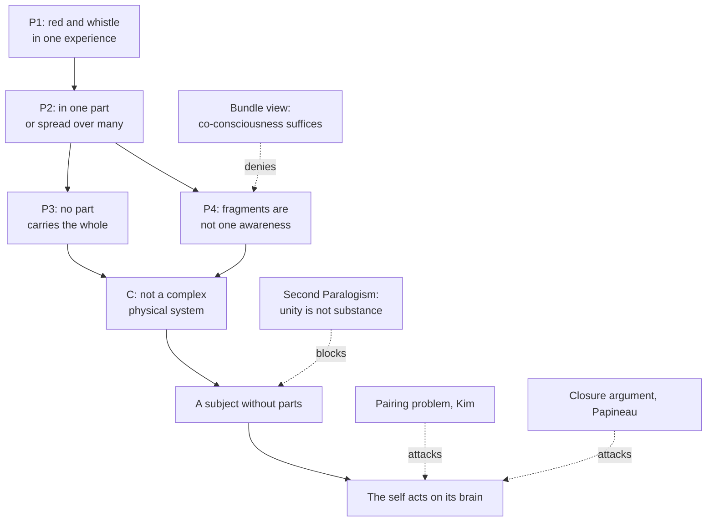

# Philosophy of Mind · Lesson 1.2: Substance dualism today

> ⏱ ~15 min · Module 1: The problem, and the case for dualism · Builds on: [1.1](01-01-the-mind-body-problem.md), [`modern-philosophy` 1.4](../../modern-philosophy/lessons/01-04-the-real-distinction-and-the-interaction-problem.md), [`metaphysics` 6.5](../../metaphysics/lessons/06-05-what-a-person-is.md) · Unlocks: [1.3](01-03-the-knowledge-argument.md), [2.4](02-04-mental-causation-and-the-exclusion-problem.md), [5.3](05-03-hylomorphism-tested.md)

## Why this matters

You are looking at a red tomato when the kettle starts to whistle. The red is processed in one stretch of your cortex and the pitch in another, and no single cell holds the whole scene. Yet one of you sees the red while hearing the whistle. A minority of philosophers argue that this fact, not Descartes's God, is the best reason to think the subject of experience is not made of parts; three objections, closure, conservation and pairing, keep it a minority view.

## The idea

Descartes's two arguments (mind and body can be clearly conceived apart; body is divisible and mind is not) are reconstructed in [`modern-philosophy` 1.4](../../modern-philosophy/lessons/01-04-the-real-distinction-and-the-interaction-problem.md) and not run again here. Their medieval ancestor, Avicenna's flying man, who affirms his own existence while aware of no body, is read in [`ancient-medieval-philosophy` 6.2](../../ancient-medieval-philosophy/lessons/06-02-avicenna-essence-existence-and-the-necessary-existent.md); conceiving yourself without a body returns in [1.4](01-04-zombies-conceivability-and-kripke.md).

Contemporary [substance dualists](../reference.md#substance-dualism) mostly start from the *subject*. Picture a stadium card stunt: ten thousand fans each hold up one coloured card, and together they make a portrait. Nobody in the stands sees the portrait; it is seen only from across the field, by someone who takes in every card at once. If your experience of tomato and whistle were built from many neurons' states, each carrying a fragment, who, the dualist asks, is across the field? That question is the [unity argument](../reference.md#unity-argument).

Two modern positions answer it with a subject that is not a heap of parts, and neither is Descartes's.

- **[Non-Cartesian dualism](../reference.md#non-cartesian-dualism)** (E. J. Lowe, *Subjects of Experience*, 1996; "Non-Cartesian Substance Dualism and the Problem of Mental Causation", 2006). You are a substance distinct from your body and from every part of it, but not a purely mental one: you have physical characteristics through your body, including a location.

- **[Emergent dualism](../reference.md#emergent-dualism)** (William Hasker, *The Emergent Self*, 1999). A brain organized the right way generates a new individual, as a magnet generates its field. Once generated, the self has a causality of its own, including on the brain.

Richard Swinburne (*The Evolution of the Soul*, 1986, revised 1997; *Are We Bodies or Souls?*, 2019) argues from identity over time.

The rival every such argument must answer is the [bundle view](../reference.md#bundle-view): no subject over and above the experiences, only experiences related to one another. Hume's version is read in [`modern-philosophy` 4.4](../../modern-philosophy/lessons/04-04-the-self-belief-and-the-passions.md), and Parfit's reductionism, on which a person's existence consists in a brain, a body and a series of interrelated events, in [`metaphysics` 6.6](../../metaphysics/lessons/06-06-personal-identity-over-time.md). [`metaphysics` 6.5](../../metaphysics/lessons/06-05-what-a-person-is.md) placed dualism among the answers to "what are we?"; this lesson asks whether it is true.

## The argument

**The unity argument** (Hasker, *The Emergent Self*, 1999; reconstructed here).

**P1.** I have experiences whose contents are unified: in one experience I see red and hear a whistle, and can notice that they are simultaneous. *In words:* the two are had together, by one subject, not merely side by side.

**P2.** If I were a complex physical system, such as a brain, each experience of mine would belong to one part of it or consist of states of many parts, each carrying part of its content. *In words:* a physical experience has only those two places to be.

**P3.** No one part of the brain carries the whole content of such an experience. *In words:* there is no master neuron.

**P4.** States of many parts, each carrying a fragment, do not by themselves amount to one awareness of the whole. *In words:* ten thousand cards are not one viewer.

**∴ C.** I am not a complex physical system. *In words:* the subject of experience is something else.

Hasker adds that this subject is the emergent self, and that it brings about brain events the neurons alone would not, so he denies [causal closure](../reference.md#causal-closure). The argument's ancestors are Leibniz's mill (this course's Boss 1) and the inference from the unity of the "I" to a simple substance that Kant attacked in the Second Paralogism ([`modern-philosophy` 6.2](../../modern-philosophy/lessons/06-02-the-soul-and-the-antinomies.md)). Swinburne asks you to imagine your brain's hemispheres transplanted into two bodies. However much is known about bodies and memories, which survivor, if either, is you still seems a real question, so there must be a further fact, a soul. That is the [simple view](../reference.md#simple-view) of personal identity, the denial of Parfit's reductionism.

**Closure.** David Papineau's causal argument ("The Rise of Physicalism", 2001; *Thinking about Consciousness*, 2002) runs on three claims. Conscious states have physical effects: your decision to ask a question raises your arm. Every physical event that has a cause has a sufficient physical cause: closure in the wording of [`apologetics-foundations` 4.4](../../apologetics-foundations/lessons/04-04-divine-action-miracles-and-quantum-indeterminacy.md), the same claim as 3.1's "every physical effect has a fully physical cause". And those effects are not, as a rule, overdetermined by a second, independent sufficient cause. So conscious states are physical states. His evidence for closure is historical: conservation of energy left room for non-physical forces that conserve energy, and physiology's failure to find any made closure orthodox ([`apologetics-foundations` 3.1](../../apologetics-foundations/lessons/03-01-naturalism-at-its-best.md) tells it). This is the [causal-closure argument](../reference.md#causal-closure-argument); [2.4](02-04-mental-causation-and-the-exclusion-problem.md) turns its machinery on nonreductive physicalism. Dualists reply that closure is confirmed only where physiologists have looked, or deny it where physics is indeterministic: if the laws fix only probabilities, a mind could settle what they leave open (Karl Popper and John Eccles, *The Self and Its Brain*, 1977).

**Conservation.** The older [conservation objection](../reference.md#conservation-objection): a soul that moved the brain would add energy to it. Two replies. Conservation holds for causally isolated systems, and a brain acted on by a soul is not one (Robert Larmer, 1986), which turns the objection into the empirical question of closure. And C. D. Broad (*The Mind and Its Place in Nature*, 1925, pp. 103–109) denied that causing requires passing energy: a pendulum's string changes the weight's direction without changing its total energy, and a mind might act likewise. The objection, he wrote, had borrowed "a spurious authority from the august name of the Conservation of Energy." A critic answers that redirecting motion changes momentum, also conserved; Leibniz pressed "the conservation of the same total direction in matter" against the view he ascribed to Descartes (*Monadology* §80, Latta, 1898).

**Pairing.** Jaegwon Kim's [pairing problem](../reference.md#pairing-problem) ("Lonely Souls", 2001; *Physicalism, or Something Near Enough*, 2005, crediting John Foster, 1991): causes are paired with effects by spatial relations, which souls outside space lack. Example 2 runs it.

**Where the argument is weakest.** P4. The physicalist says one awareness of the whole is not a further receiver but the integration of the parts' states, bound together and made jointly available for comparison, report and action. P4 looks true only if everything must arrive at a single place, the viewer the stadium image smuggles in. The dualist replies that integration explains how information is combined and used, a fact about access, while P1 reports that one subject *has* both. The physicalist concedes that "integration" names a job without yet showing why doing it yields one subject rather than a well-coordinated crowd. The dualist concedes that a subject without parts restates the unity rather than explaining it, since how one simple thing holds a complex content is itself unexplained. Whether unity can fail, as split brains suggest, is [3.3](03-03-global-workspace-and-the-science-of-consciousness.md)'s question.

## Argument map

Solid arrows are the unity argument (Hasker's or Lowe's self at the bottom); dashed edges are attacks, two on the argument and two on the interaction it commits the dualist to.

## Worked examples

**Example 1 (clean case: the tomato and the kettle).** Run the argument.

- P1: you notice that the whistle began just as you looked. Noticing simultaneity is comparing, and comparing needs both items before one comparer.

- P2 and P3: colour is processed in visual cortex, pitch in auditory cortex; no cell carries "red tomato, whistling kettle, now".

- P4 and C: if the comparing were only the coupled states of two regions, by P4 nobody would compare; somebody does, so you are not those regions.

Now the rival. Hume found only perceptions; modern Humeans (Parfit; Barry Dainton, *The Phenomenal Self*, 2008) add a relation, co-consciousness, between the seeing and the hearing. P1 is then fully described by saying the two experiences are co-conscious, and no further subject is needed: they deny P4. Lowe answers that the seeing cannot be identified except as someone's seeing; take the subject away and nothing makes it this experience rather than an exactly similar one, so the bundle view gets the order of dependence backwards (1996). The bundle theorist replies that an experience may be individuated by its place in a network of co-conscious states. The whole dispute sits on P4.

**Example 2 (hard case: the pairing problem).** Kim's physical case: two guns fire at the same instant, and Adam and Bob die. What makes gun A's firing the cause of Adam's death rather than Bob's? A spatial path, this bullet's trajectory. Now take souls S1 and S2, exactly alike, each willing at the same instant that an arm rise, and bodies B1 and B2. If souls are nowhere, no trajectory links S1 to B1 rather than B2, and since the souls are intrinsically alike, nothing intrinsic does either. The question is what pairs them, not how we could know.

- **Individualistic powers** (Foster, 1991; Peter Unger, 2006). S1 has a power to move B1 and no other body, as a key might open this lock and no identical one. The cost: ordinary powers are general, and it is unclear that a power could be tied to one particular.

- **A located self.** Lowe's self has its body's physical characteristics, so it is where B1 is, and location pairs it as it pairs gun and victim. Kim's rejoinders (2005): if two exactly similar souls could share a place, location pairs nothing without an impenetrability principle for souls; and a located, extended soul looks like a strange material thing. Andrew Bailey, Joshua Rasmussen and Luke Van Horn ("No Pairing Problem", 2011) reply that a soul is not material, wherever it is, because its fundamental properties are mental.

Where it strains: the argument needs the premise that all causing holds partly in virtue of a spatial relation. Kim draws it from physical cases; the dualist says that generalizes from the only cases we can survey, and Bailey and co-authors note it would also rule out any cause of the Big Bang singularity. Nothing in the two-souls case settles whether the premise is a truth about causation or only about bodies, and there the account stops giving a verdict. Kim says that without spatial pairing, "this soul caused this" has nothing to make it true; the dualist says the demand assumes the model of physical causation, which is the point at issue.

## Watch out

- **You might think** substance dualism today is Descartes's, **but actually** Lowe's self has physical characteristics and a location, and Hasker's is generated by a brain.

- **You might think** the unity argument is Descartes's divisibility argument restated, **but actually** Descartes reads "no parts" off introspection, the step Kant's Second Paralogism attacks. The unity argument argues instead, at P4, that no assembly of fragments is one awareness, so the Paralogism objection has to be re-aimed at P4.

- **You might think** every dualism posits a soul, **but actually** [property dualists](../reference.md#property-dualism) posit non-physical properties of a physical subject ([1.3](01-03-the-knowledge-argument.md)), interactionist or [epiphenomenalist](../reference.md#epiphenomenalism). Papineau's argument hits any dualism whose mental states have physical effects, soul or no soul.

- **You might think** the conservation objection is Princess Elisabeth's of 1643, **but actually** "energy" is a nineteenth-century concept; she asked how something unextended could push ([`modern-philosophy` 1.4](../../modern-philosophy/lessons/01-04-the-real-distinction-and-the-interaction-problem.md)).

## One-liner

> Today's dualists argue from the subject, not from God: one experience of red-while-whistling seems to need one bearer that no assembly of neural fragments supplies, and the price is a self acting on a brain physics may already fully cause.

## Problems

**P1 (🟢)** *(Reconstruct: Exegetical.)*

(a) Put Papineau's causal argument, as stated in The argument, into numbered premises and a conclusion, and mark the premise that rests on empirical evidence.

(b) The argument covers only some mental states. Which ones does it leave untouched, and which of your premises must a view that keeps those states non-physical reject? One sentence each.

**P2 (🟡)** *(Exegetical.)* Three replies a dualist might give:

> (i) A soul need not add energy to the brain. Like the string of a pendulum, it could change the direction in which particles move, and how energy is divided among them, while leaving the total unchanged.
>
> (ii) When I will to raise my arm, my volition is about this arm and no other. That directedness is what makes my soul, and not an exactly similar one, the cause of this arm's rising.
>
> (iii) Where a neural event is quantum-indeterministic, the laws fix only probabilities, and the mind selects which permitted outcome occurs.

(a) Which objection, conservation, pairing or closure, does each reply answer? One line each.

(b) Reply (i) is sometimes offered against the closure argument too. Does it answer it? Two sentences.

**P3 (🔴)** *(Steelman and reply: Evaluative.)* Hasker's answer to the pairing problem is not Lowe's. His self is generated by one particular brain, is located where that brain is, and acts back on it as a magnet's field acts on the magnet.

(a) Steelman the pairing problem against this answer: give the strongest objection Kim could press, and name the part of Hasker's answer it targets.

(b) Reply as Hasker would, and say what the reply costs.

150 words or fewer in all.

Solutions

**P1** *(Exegetical.)*

**Accept:** any wording that keeps the three premises distinct; "physical" may be glossed as "non-mental" in the premises.

**Must hit, strict (a):**

- P1: Conscious mental states have physical effects.

- P2: Every physical event that has a cause has a sufficient physical cause (closure). *This is the empirical premise*, supported by the record of physiology finding no special mental or vital forces.

- P3: The physical effects of conscious states are not, as a rule, overdetermined by a second, distinct sufficient cause.

- ∴ C: Conscious mental states are physical states (identical with them, or with parts of them).

**Must hit, strict (b):**

- Untouched: mental states with no physical effects, such as Jackson's epiphenomenal qualia in their 1982 form ([1.3](01-03-the-knowledge-argument.md)).

- A view that keeps them non-physical rejects P1 for those states: it accepts [epiphenomenalism](../reference.md#epiphenomenalism) about them.

**Wrong turns:** marking P1 as the empirical premise because "we see arms rise" (it is common sense; the contested evidence is for closure); citing conservation of energy as P2's support (on Papineau's history, conservation alone left room for non-physical forces); answering (b) with "substance dualists reject P2", which names a different route and does not say which states escape.

**Model answer:** (a) P1. Conscious states have physical effects. P2. Every physical event that has a cause has a sufficient physical cause (empirical, from physiology's record). P3. Those effects are not as a rule overdetermined. ∴ C. Conscious states are physical. (b) Mental states with no physical effects escape it. A view that keeps them non-physical rejects P1 for them and so is epiphenomenalist about them.

---

**P2** *(Exegetical.)*

**Must hit, strict (a):**

- (i) Conservation: it is Broad's 1925 reply, denying that causing requires adding or removing energy.

- (ii) Pairing: it offers a non-spatial relation, the volition's being about this arm, to fix which soul causes which body's motion.

- (iii) Closure: it denies that every such neural event has a sufficient physical cause, while keeping the laws intact.

**Must hit, strict (b):**

- No. A change of direction is a physical event, and on reply (i) the soul is what makes the difference, so that event lacks a sufficient physical cause. The reply therefore contradicts closure (P2 of the causal argument) rather than answering the argument; it answers only the energy objection.

**Accept (b):** a further point that redirecting motion changes momentum, which is also conserved (Leibniz's "same total direction", *Monadology* §80), so (i) does not fully answer conservation either. Welcome, not required.

**Wrong turns:** calling (iii) a conservation reply because it "adds no energy"; its work is to make room for a cause physics does not supply. Calling (ii) a closure reply because it is about willing. Saying in (b) that (i) answers closure "because no law is broken": closure is not a law of motion but a claim that physical causes suffice.

**Model answer:** (a) (i) conservation; (ii) pairing; (iii) closure. (b) No. If the soul redirects particles, that redirection is a physical event without a sufficient physical cause, which is what closure denies; so (i) presupposes that closure is false and answers only the conservation objection.

---

**P3** *(Evaluative.)*

**Accept:** any one of the objections below, or another that targets a stated part of Hasker's answer; any verdict.

**Must hit, any verdict:**

- State Hasker's answer accurately: the self is paired with its brain by origin (that brain generates it) and by location (it is where that brain is).

- An objection aimed at one of those, at full strength. (1) *Generation is causal*: pairing the self with its brain by generation uses brain-to-self causation, which needs a pairing relation of its own, so the problem is moved, not solved. (2) *Location*: if an exactly similar self could occupy the same region, location pairs nothing without an impenetrability principle for selves. (3) *Physicality*: a self that is located, extended and produced by matter looks like a strange physical object, and then the closure argument applies to it.

- A reply that answers the objection chosen, and a stated cost.

**Wrong turns:** treating the pairing problem as epistemic (how we could tell which soul goes with which body); running Kim's objection against non-spatial Cartesian souls, which Hasker's answer has already set aside; calling emergent dualism property dualism, when Hasker posits a new individual, not only new properties.

**Model answer, one of several:** (a) Kim's strongest move targets generation. Hasker pairs self and brain because the brain produces the self. But production is causation, and brain-to-self causation needs its own pairing: what makes this brain the producer of this self and not of an exactly similar one? The answer presupposes the relation it was meant to supply. (b) Hasker replies that emergent selves are not antecedent candidates waiting to be matched. A self is individuated by its origin: it is the field this brain generates, as a magnetic field is that magnet's field. So there is no rival self for the pairing to exclude, and once generated, the self acts where its brain is. The cost is a brute law of emergence, one brain generating one self, and a located, matter-produced self that Hasker must still argue is not physical.

## Connections

- **Backward:** the causal-closure argument is [1.1](01-01-the-mind-body-problem.md)'s inconsistent triad turned into an argument: grant mental causation and closure, add no systematic overdetermination, and distinctness goes. Descartes's two arguments and Elisabeth's question are [`modern-philosophy` 1.4](../../modern-philosophy/lessons/01-04-the-real-distinction-and-the-interaction-problem.md), the flying man [`ancient-medieval-philosophy` 6.2](../../ancient-medieval-philosophy/lessons/06-02-avicenna-essence-existence-and-the-necessary-existent.md), and dualism's place among views of what we are [`metaphysics` 6.5](../../metaphysics/lessons/06-05-what-a-person-is.md).

- **Forward:** [1.3](01-03-the-knowledge-argument.md) and [1.4](01-04-zombies-conceivability-and-kripke.md) argue for non-physical properties, which need no soul. [2.4](02-04-mental-causation-and-the-exclusion-problem.md) turns closure and the overdetermination ban on nonreductive physicalism. [5.3](05-03-hylomorphism-tested.md) asks whether emergent dualism and hylomorphism really differ, and [5.1](05-01-the-soul-as-the-form-of-the-body.md) says why a form is not a Cartesian soul.

- **Sideways:** conservation laws follow from symmetries of a closed system ([`analytical-mechanics` 2.2](../../analytical-mechanics/lessons/02-02-noethers-theorem.md)): energy from time translation, momentum from space translation. So the conditionality reply says a soul makes the brain an open system, and Leibniz's "same total direction" is momentum. Quantum indeterminacy as a gap for a non-physical cause has a twin in divine action ([`apologetics-foundations` 4.4](../../apologetics-foundations/lessons/04-04-divine-action-miracles-and-quantum-indeterminacy.md)), and Swinburne's soul reappears in an argument for God ([`apologetics-foundations` 3.3](../../apologetics-foundations/lessons/03-03-consciousness.md)). The bundle view against a further fact is the reductionism dispute of [`metaphysics` 6.6](../../metaphysics/lessons/06-06-personal-identity-over-time.md).
