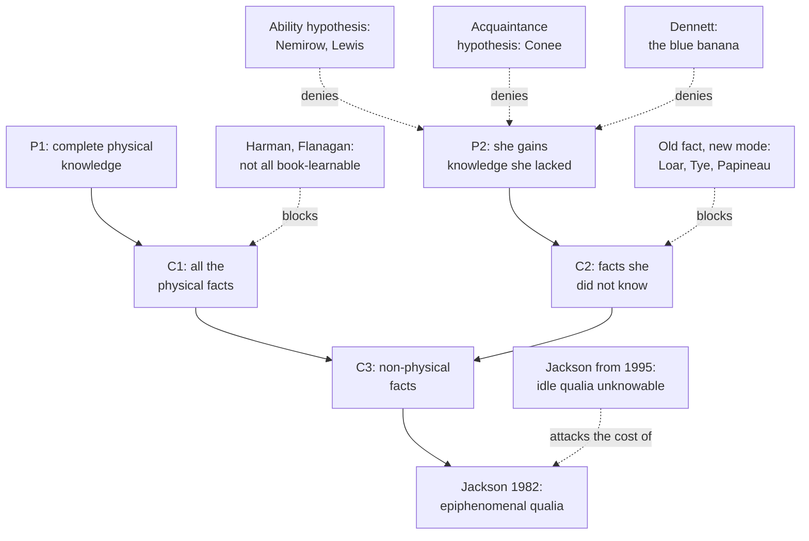

# Philosophy of Mind · Lesson 1.3: The knowledge argument

> ⏱ ~15 min · Module 1: The problem, and the case for dualism · Builds on: [1.1](01-01-the-mind-body-problem.md), [`philosophical-method` 3.3](../../philosophical-method/lessons/03-03-thought-experiments.md) · Unlocks: [1.4](01-04-zombies-conceivability-and-kripke.md), [3.1](03-01-the-hard-problem.md)

## Why this matters

Knut Nordby studied colour vision for a living and was himself totally colour-blind, a complete achromat; Oliver Sacks wrote about him in *The Island of the Colorblind* (1996). Could someone know everything science says about colour and still not know what red looks like? Frank Jackson made that question the most discussed argument against [physicalism](../reference.md#physicalism): if such a scientist learns something on first seeing red, the physical facts were not all the facts.

## The idea

English marks three ways of knowing by grammar ([knowing that, knowing how, and acquaintance](../reference.md#knowing-that-knowing-how-and-acquaintance)):

- **Knowing that** takes a fact, true or false, which telling can pass on: *she knows that ripe tomatoes reflect mostly long-wavelength light*.

- **Knowing how** takes an ability: *she knows how to pick a ripe tomato at a glance*.

- **Knowing by acquaintance** takes a thing or quality, as you know a city you have lived in: *she knows the smell of ammonia*.

Jackson's Mary ("Epiphenomenal Qualia", 1982) is a brilliant neuroscientist who has lived all her life in a black-and-white room and learned, from black-and-white books and monitors, all the physical information about colour vision, from wavelengths to the words "the sky is blue". Released, she sees a ripe tomato. Does she learn anything? Almost everyone says yes; in one survey of non-philosophers, 82 percent said Mary in the room would not know what it is like to see red (Gregory, Hendrickx and Turner, 2022).

If what she learns is a fact, and she had every physical fact, the new fact is not physical. That is the [knowledge argument](../reference.md#knowledge-argument). Every reply says which link breaks: she gains an ability, not a fact; or acquaintance; or a new way of knowing an old fact, as when you have known all morning that your train leaves at 15:04 and at 15:04 learn that it is leaving *now*.

The features at issue are [qualia](../reference.md#qualia): the felt qualities of experience, [what it is like](../reference.md#what-it-is-like) to have it. In that broad sense almost no one denies them; Jackson's claim is that no physical information includes them. [1.1](01-01-the-mind-body-problem.md) put [property dualism](../reference.md#property-dualism) on the map; this is the first of its two main arguments, and [1.4](01-04-zombies-conceivability-and-kripke.md) the second. The intuition-pump warning of [`philosophical-method` 3.3](../../philosophical-method/lessons/03-03-thought-experiments.md) applies: which details is the verdict tracking?

## Source

Hume, *An Enquiry Concerning Human Understanding*, §II, ¶15 (Selby-Bigge, 2nd ed., 1902; Project Gutenberg text), four sentences omitted. It is the second argument for the copy principle of [`modern-philosophy` 4.1](../../modern-philosophy/lessons/04-01-impressions-ideas-and-the-fork.md), which reads ¶¶16–17.

> If it happen, from a defect of the organ, that a man is not susceptible of any species of sensation, we always find that he is as little susceptible of the correspondent ideas. A blind man can form no notion of colours; a deaf man of sounds. Restore either of them that sense in which he is deficient; by opening this new inlet for his sensations, you also open an inlet for the ideas; and he finds no difficulty in conceiving these objects. [...] It is readily allowed, that other beings may possess many senses of which we can have no conception; because the ideas of them have never been introduced to us in the only manner by which an idea can have access to the mind, to wit, by the actual feeling and sensation.

This is Mary's release, two and a half centuries early, but look at what arrives. The deciding words are all about ideas: "notion", "ideas", "conceiving", "conception". The restored man gains a new idea, a way of conceiving colours, and Hume says nothing of a new fact. The last sentence reaches senses we could never have, and still what we lack is a *conception*. So the passage gives the knowledge argument its P2 in Hume's currency and leaves C2 open. The old-fact physicalist reads it as the whole story: experience supplies a concept. The dualist must add that the concept is of something no physical description reaches. The argument lives in the gap between Hume's idea and Jackson's fact.

## The argument

Jackson's argument (1982; "What Mary Didn't Know", 1986), in the explicit form of the *Stanford Encyclopedia of Philosophy* entry "Qualia: The Knowledge Argument":

**P1.** Before her release, Mary has complete physical knowledge about human colour vision. *In words:* functional and psychological facts count, as long as they are stated without phenomenal terms.

**C1.** So she knows all the physical facts about human colour vision. *In words:* a complete physical education leaves no physical fact out.

**P2.** There is some knowledge concerning facts about human colour vision that she lacks before her release. *In words:* the tomato teaches her something.

**C2.** So there are facts about human colour vision that she does not know before her release. *In words:* new knowledge means a new fact known.

**∴ C3.** There are non-physical facts about human colour vision (from C1 and C2). *In words:* not every fact is physical.

C3 is about facts. A weaker version, that some knowledge is not physical knowledge, is compatible with physicalism; Jackson meant the stronger.

**Jackson's conclusion (1982).** The extra facts concern qualia, so experiences have non-physical properties: property dualism. He added [epiphenomenalism](../reference.md#epiphenomenalism), the word in his title and a further claim, about causation: physical events cause qualia, and qualia cause nothing physical.

**Replies, by the step attacked.**

- **P1 to C1** (a minority: Gilbert Harman, 1990; Owen Flanagan, 1992): some physical facts cannot be learned from books, at the cost of leaving "physical fact" unclear.

- **P2: an ability.** The [ability hypothesis](../reference.md#ability-hypothesis) (Laurence Nemirow, 1980, 1990; David Lewis, "What Experience Teaches", 1988): knowing what an experience is like just is having the abilities to remember, imagine and recognize it. Lewis argues that its only rival, the [hypothesis of phenomenal information](../reference.md#hypothesis-of-phenomenal-information) (the experience rules out possibilities the physical information left open), contradicts physicalism and, by his own Vegemite case, makes the information idle, while abilities explain everything it explains. Pressure: Earl Conee (1994) and Michael Tye (2000) argue the abilities are neither necessary nor sufficient, and Jason Stanley and Timothy Williamson (2001) that knowing how is a kind of knowing that.

- **P2: acquaintance.** The [acquaintance hypothesis](../reference.md#acquaintance-hypothesis) (Conee, "Phenomenal Knowledge", 1994): a third kind of knowledge, direct familiarity with a quality, had only by experiencing it. Mary gains it, but no new fact. Tye adopted it in *Consciousness Revisited* (2009). This is not the acquaintance of [`epistemology` 2.2](../../epistemology/lessons/02-02-foundationalism.md), error-proof awareness that justifies beliefs; Conee's is knowledge neither factual nor practical.

- **P2, outright.** Daniel Dennett (*Consciousness Explained*, 1991): a Mary who knew everything physical could work out what red looks like, and would see through the [blue banana trick](../reference.md#blue-banana-trick) at once; the contrary verdict comes from failing to imagine "everything".

- **P2 to C2: [old fact, new mode](../reference.md#old-fact-new-mode)** (Terence Horgan, 1984; Brian Loar, 1990; Tye, 1995; John Perry, 2001; David Papineau, 2002). Mary gains propositional knowledge under a new, phenomenal concept of a physical fact she knew under a physical concept. No a priori reasoning links the two concepts, which is why it looked like a new fact. Generalized, this is the [phenomenal-concept strategy](../reference.md#phenomenal-concept-strategy), developed in [1.4](01-04-zombies-conceivability-and-kripke.md).

**[Jackson's recantation](../reference.md#jacksons-recantation).** By 1995 ("Postscript on 'What Mary Didn't Know'") Jackson argued that epiphenomenal qualia could not cause our beliefs about them, so no one could know them; the argument must fail somewhere. In "Mind and Illusion" (2003) and a 2007 paper Jackson blamed a false picture of experience and adopted strong representationalism: to be in a phenomenal state is to represent the world as some way, and that has a physical account ([first-order representationalism](../reference.md#first-order-representationalism), [3.2](03-02-representationalism-and-higher-order-theories.md)).

**Where the argument is weakest.** The step from P2 to C2, where most physicalists fight. The strongest objection: knowledge is finer-grained than facts, as the train leaving now shows, and two concepts no a priori reasoning links predict exactly the look of a new fact. The strongest reply is the [reference-fixing objection](../reference.md#reference-fixing-objection) (Chalmers, 1996 and 2002; Stephen White, 2007). Ordinarily two modes of presentation reach one thing through two properties ("now" picks out 15:04 as the present moment). If the phenomenal mode works that way, its reference-fixing property is phenomenal, and the dualist's property returns one level up. Loar answers that phenomenal concepts refer directly, with no property between. The physicalist concedes that Mary learns something propositional and owes a theory of concepts that refer unmediated. The dualist concedes that new knowledge alone does not entail a new fact, so the argument needs a further premise, which Philip Goff (2017) defends: that a phenomenal concept reveals the nature of what it picks out.

## Argument map

All replies but two attack P2 or the step out of it; Jackson's own exit starts from the price of his conclusion.

## Worked examples

**Example 1 (clean case: Mary and the tomato).**

- **P1** is stipulated. A monochrome room would not block all colour experience, so make Mary colour-blind from birth and restored by surgery.

- **C1** holds if every physical fact can be stated in physical vocabulary.

- **P2** is the verdict: seeing the tomato, she thinks *so this is what seeing red is like*.

- **C2** needs a premise the story does not supply: that whatever she now knows is a fact she did not know. **C3** follows.

Everything rests on that thought. It must be news (Dennett denies it), knowing that (Lewis and Nemirow deny it), knowledge of a fact (Conee denies it), and of a fact not already known (Loar denies it). Jackson in 1982 affirmed all four.

**Example 2 (hard case: a first durian).** Zofia, a food writer, has read every tasting note on durian (custard, almonds, onion). She eats one. Afterwards she can (i) recognize, imagine and remember it; (ii) judge that it tastes more like custard than onion, though she had read both words; (iii) wonder whether it tastes to her brother the way it tastes to her, a question she could not frame before.

The ability hypothesis says (i) is all there is to knowing what durian tastes like. Item (ii) is knowing that, but a proposition testimony could have given her; tasting added only the ability to check it (Tye, 2000, against Janet Levin). Item (iii) strains. Wondering whether her brother's durian tastes *like this* entertains something true or false, which looks like a new thought, not a new skill, and it embeds in conditionals: *if the sorbet tastes like this, there is durian in it* (Loar's point). The ability theorist must say an imaginative ability supplies "like this", with nothing new to be right or wrong about. The old-fact theorist says it is a new concept, so a new thought with a physical truth-maker; the dualist, a new concept of a non-physical quality.

Here the account stops giving a verdict: Zofia gained something that occurs in questions and conditionals, but whether it is an ability or a concept is the point at issue. The ability theorist's best line (Yuri Cath, 2009) grants a new state of propositional knowledge, an old proposition under a practical mode, which the SEP entry notes puts the view under old fact, new mode.

## Watch out

- **You might think** the argument concludes that Mary's knowledge was incomplete, **but actually** every physicalist grants that; it concludes that there are non-physical facts, and Hume's restored blind man shows only the first.

- **You might think** the ability hypothesis says Mary learns nothing, **but actually** it grants her knowledge, knowing how, and denies only knowing that. Dennett is the one who says nothing new happens.

- **You might think** Jackson's recantation refuted the argument, **but actually** an argument does not fail because its author leaves it; David Chalmers (*The Conscious Mind*, 1996) and others still defend it.

## One-liner

> Mary's release shows at most that some knowledge comes only from experience; whether there are non-physical facts turns on whether that knowledge is of a fact, and of a new one.

## Problems

**P1 (🟢)** *(Exegetical.)* Classify each sentence as knowing that, knowing how, or knowing by acquaintance. For (iv), give the classification that each of Jackson (1982), Lewis and Conee would assign. One line each.

(i) Before her release, Mary knows that the sky looks blue to people with normal vision.

(ii) A month after her release, Mary knows how to tell a ripe tomato from an unripe one at a glance.

(iii) After one afternoon in the laboratory, the chemistry student knows the smell of ammonia.

(iv) Mary, just released, knows what it is like to see red.

**P2 (🟡)** *(Counterexample: Evaluative (a)–(b).)* The ability hypothesis says that knowing what an experience is like *just is* having the abilities to remember, imagine and recognize it.

(a) Build a case, not Zofia's, in which someone has the experience without the abilities, or the abilities without the experience. State the stipulations that block the obvious escape, say which half of "just is" (necessity or sufficiency) your case attacks, and name one other reply from this lesson that it leaves standing. Four sentences or fewer.

(b) Give the ability theorist's best repair and say what it costs. Any verdict; 100 words or fewer.

**P3 (🔴)** *(Find the crux: Exegetical (a)–(b) · Exegetical, then Evaluative (c).)* Jackson in 1982 and Lewis in 1988 disagree about whether Mary's case refutes physicalism.

(a) State two claims they agree on. One line each.

(b) Name the single claim one affirms and the other denies, and state the crux as a conditional each would sign. Two sentences.

(c) Jackson later gave up the argument. Say what moved him and which side of your (b) conditional it bears on. Then say what finding about Mary's new state would move Lewis, and what he would then have to concede. Any verdict for the second half; 150 words or fewer.

Solutions

**P1** *(Exegetical.)*

**Must hit, strict:**

- (i) Knowing that. She was told it, and telling passes on facts. It does not contradict P2, which concerns knowledge she can get only by seeing colours: on the old-fact view the same fact under a phenomenal concept, on Jackson's view a further fact.

- (ii) Knowing how: an ability, marked by "knows how to" with a verb.

- (iii) Acquaintance: "knows" with a noun phrase, a familiarity with a quality got by smelling it.

- (iv) Jackson: knowing that, of a fact about qualia that is not physical. Lewis: knowing how, the abilities to remember, imagine and recognize. Conee: acquaintance with the quality, with no new fact.

**Accept:** for (ii), a note that Stanley and Williamson would reclassify it as knowing, under a practical mode, that some way is a way to tell. For (iv), the old-fact view's verdict as well: knowing that, under a phenomenal concept, of a physical fact she already knew.

**Wrong turns:** treating (i) as impossible before release, as if the argument said she knows nothing about how things look to others. Classing (iii) as knowing that because one could also say "ammonia smells pungent", which is a different sentence. Giving one answer for (iv), which has three.

**Model answer:** (i) That. (ii) How. (iii) Acquaintance. (iv) Jackson: that, a non-physical fact. Lewis: how, abilities to remember, imagine and recognize. Conee: acquaintance, and no new fact.

---

**P2** *(Evaluative (a)–(b).)*

**Accept:** any case that meets the stem. The published ones are Tye's (2000) fine-grained shade of red, known while one stares at a rose and never recognizable or imaginable afterwards; the person with no visual imagery (Conee, 1994; Torin Alter, 1998), who knows what green is like while looking at it; and Conee's Martha, who could imagine cherry red from the shades on either side of it but has not done so. A case of recognition without the experience may also note that it presses Loar, whose phenomenal concepts are recognitional and are supposed to need the experience.

**Must hit, any verdict (a):**

- The dissociation is secured. For experience without abilities, the subject attends to the experience, or a defender will say she never knew what it was like. For abilities without experience, the ability is genuine and unexercised, or a defender will say that exercising it is having the experience.

- The right half. Experience without abilities attacks necessity; abilities without experience attack sufficiency.

- A reply left standing. A necessity case leaves the acquaintance hypothesis (she is acquainted with the quality while she looks) and old fact, new mode (she can apply a "this" concept while she attends). A sufficiency case leaves the acquaintance hypothesis (she has never been acquainted with the quality).

**Must hit, any verdict (b):**

- A named repair: Tye's disjunctive account (either the abilities, or knowledge that this is how the experience is, got by introspecting it now); requiring the abilities to have been exercised; or denying the verdict in the case.

- Its cost, stated. The disjunctive account's second disjunct is knowing that, so the view no longer says Mary gains no propositional knowledge. Requiring exercise brings the experience back into the analysis. Denying the verdict gives up the case-verdicts the view was built to respect.

**Wrong turns:** a case in which the subject both has the experience and gains the abilities, like Zofia's or Mary's own. Calling an experience-without-abilities case an attack on sufficiency. Aiming the case at the knowledge argument instead of at the ability hypothesis's analysis.

**Model answer, one of several:**

(a) Someone with no visual imagery stares, attending closely, at a field of a fine-grained green. While she looks she knows what that green is like, yet she cannot imagine it and, the shade being so fine, cannot later recognize or recall it exactly. That attacks necessity: knowing what it is like without the abilities. It leaves the acquaintance hypothesis standing, since she is acquainted with the shade while she looks.

(b) Tye's repair: knowing what it is like is either having the abilities or knowing, by introspection, that this is how the experience is. The cost is that the second disjunct is knowing that. The view now concedes that someone attending to a new experience gains propositional knowledge, which is the old-fact view's claim, not the ability hypothesis's.

---

**P3** *(Exegetical (a)–(b) · Exegetical, then Evaluative (c).)*

**Accept:** any statement of the crux that isolates whether Mary's new state rules out possibilities, including stating it as whether epiphenomenal qualia are a price worth paying, provided the answer says why the two come to the same thing here.

**Must hit, strict (a):** any two of:

- Mary has all the physical information before release.

- Mary gains something on release that she could not have had in the room.

- If what she gains is information that rules out possibilities her physical information left open, physicalism is false. This is Lewis's second premise, and Jackson's argument assumes it.

- Such information would concern properties that make no physical difference. Jackson accepted this of qualia, and Lewis argued, from the taste of Vegemite, that the hypothesis of phenomenal information leads there.

**Must hit, strict (b):**

- The claim: what Mary gains is information that rules out possibilities her physical information left open, the hypothesis of phenomenal information. Jackson affirms it; Lewis denies it and puts abilities in its place.

- A conditional each would sign: "If Mary's new knowledge rules out possibilities that all the physical information left open, physicalism is false; if it is only new abilities, the case leaves physicalism standing."

**Must hit, strict (c), Jackson:**

- What moved him: epiphenomenal qualia could not cause our beliefs about them, so they could not be known (his 1995 postscript; pressed by Watkins in 1989).

- Where it bears: on the price side of the shared commitments, the claim that phenomenal information would concern idle properties, not on the verdict that Mary learns something. With that price now unpayable, the conditional runs Lewis's way for him.

- He did not take up Lewis's abilities. His diagnosis (2003, 2007) was a false picture of experience, with representationalism in its place.

**Must hit, any verdict (c), Lewis:**

- A finding that Mary's new state rules out possibilities: it can be mistaken in a way abilities cannot, or it embeds in questions and conditionals (Loar). Martine Nida-Rümelin's Marianna is the standard case. She has seen colours only on abstract paintings, so she has the abilities, yet she can still be wrong about which of four slides looks the way the sky looks to others.

- What Lewis would then concede: that knowing what it is like includes information, so the physicalist must take the old-fact route instead of the ability route.

**Wrong turns:** naming physicalism itself as the crux, when it is what each concludes, not the claim beneath. Saying Lewis denies that Mary gains anything, when he grants her know-how. Saying Jackson recanted by accepting the ability hypothesis.

**Model answer, one of several:**

(a) Mary has all the physical information before release; and if she gains phenomenal information, physicalism is false.

(b) Jackson affirms, and Lewis denies, that what Mary gains rules out possibilities her physical information left open. Both sign: "If her new knowledge rules out possibilities all the physical information left open, physicalism is false; if it is only new abilities, physicalism survives the case."

(c) Jackson came to think that epiphenomenal qualia could not cause beliefs about them and so could not be known. That hits the price of phenomenal information, not the verdict that she learns, and once he would not pay it the conditional ran Lewis's way, though he blamed a false picture of experience rather than adopting abilities. Lewis would move if Mary's new state could be wrong in a way an ability cannot. Marianna, with the abilities but unsure which slide matches others' sky, is such a case if her uncertainty is genuine. Lewis would then have to grant information and defend physicalism by the old-fact route instead.

## Flashback

**From Lesson [1.1](01-01-the-mind-body-problem.md) (The mind-body problem):** *(Exegetical (a)–(b).)* Invented, written for this problem. A goalkeeper decides to dive left (W), and she dives (R). A seminar member offers two rewordings of the premises behind the [inconsistent triad](../reference.md#inconsistent-triad), each tried alone, with the others as 1.1 states them:

> **C′.** Every physical event that has a cause has some physical cause among its causes.
>
> **E′.** No physical event has two distinct causes.

(a) With C′ in place of C, are D, M, C′ and E still inconsistent? Say what view of the dive shows it, and which family on 1.1's map holds that view. Two sentences.

(b) With E′ in place of E, the four claims are still inconsistent. Give a purely physical case E′ gets wrong, and name the two qualifications in E that E′ drops. Two sentences.

Solution

**Must hit, strict (a):**

- No. Let N be the motor-cortex activity behind the dive. An interactionist says N was a physical cause of R but not a sufficient one, and W supplied the rest: D, M and C′ hold, and E, which bans a distinct cause only *besides a sufficient physical cause*, is untouched.

- The family is interactionist [substance dualism](../reference.md#substance-dualism), which denies C. So "sufficient" is the word in C that forces the choice.

**Accept (a):** strong emergentism, which 1.1 also files under the denial of C.

**Must hit, strict (b):**

- A purely physical event with two distinct causes: a match that lights because it was struck and because oxygen was present, or the prisoner shot by two marksmen, whom 1.1 itself allows.

- The qualifications dropped: "besides its sufficient physical cause" (E bans only a further cause beside one that already suffices) and "regularly" (E forbids only systematic overdetermination, not the occasional case).

**Wrong turns:** answering (a) "still inconsistent", when jointly sufficient causes are what E permits. Naming the overdeterminationist in (a), who keeps C and denies E. Calling E′ harmless in (b) because it only strengthens E: a premise false of ordinary causation lets anyone keep D, M and C by rejecting it.

**Model answer:** (a) No: the interactionist's motor-cortex activity was a physical cause of the dive but not enough by itself, so D, M, C′ and E all hold. That is interactionist substance dualism, which denies C, so "sufficient" does the work there. (b) A match lit because it was struck and because there was oxygen has two distinct causes. E′ drops "besides its sufficient physical cause" and "regularly", so it bans joint and occasional double causation, where E bans only systematic overdetermination.

## Connections

- **Backward:** [1.1](01-01-the-mind-body-problem.md) set up the triad, and Jackson's epiphenomenalism keeps distinctness and causal closure and gives up mental causation. Hume's copy principle ([`modern-philosophy` 4.1](../../modern-philosophy/lessons/04-01-impressions-ideas-and-the-fork.md)) supplies the Source; C. D. Broad's "mathematical archangel" (1925), who could not predict the smell of ammonia, is the twentieth-century precursor, read in [1.4](01-04-zombies-conceivability-and-kripke.md) and cited in [3.1](03-01-the-hard-problem.md). Locke's gap between corpuscular texture and the idea of red is in [`modern-philosophy` 3.2](../../modern-philosophy/lessons/03-02-locke-qualities-substance-and-essence.md).

- **Forward:** [1.4](01-04-zombies-conceivability-and-kripke.md) runs the zombie argument and develops the phenomenal-concept strategy into a reply to both. [2.4](02-04-mental-causation-and-the-exclusion-problem.md) meets epiphenomenalism again as the fallback from the exclusion problem. [3.1](03-01-the-hard-problem.md) states the hard problem that Mary dramatizes, [3.2](03-02-representationalism-and-higher-order-theories.md) the representationalism Jackson adopted, and [3.4](03-04-illusionism.md) the illusionism that Dennett's denial anticipates.

- **Sideways:** Moore's open question argument in [`ethics` 6.1](../../ethics/lessons/06-01-moral-realism.md) has the same shape, from a gap between concepts to a gap between properties, and Cornell realism's synthetic identities answer it as the old-fact view answers Jackson: two concepts, one property. Chalmers counts consciousness as the one clear case of strong emergence ([`philosophy-of-science` 4.5](../../philosophy-of-science/lessons/04-05-reduction-and-emergence.md)), which is what C3 would make it, and the "now" that carries the indexical model belongs to [`philosophy-of-language-and-logic`](../../philosophy-of-language-and-logic/syllabus.md).
