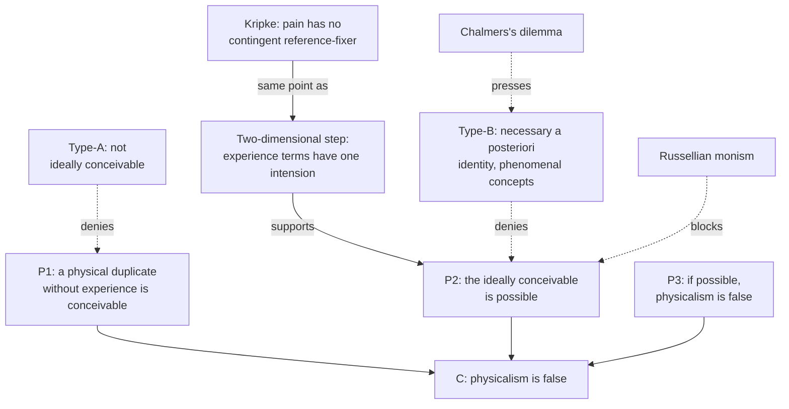

# Philosophy of Mind · Lesson 1.4: Zombies, conceivability, and Kripke

> ⏱ ~15 min · Module 1: The problem, and the case for dualism · Builds on: [1.3](01-03-the-knowledge-argument.md), [`metaphysics` 3.1](../../metaphysics/lessons/03-01-kinds-of-necessity.md) · Unlocks: [2.1](02-01-behaviourism-and-the-identity-theory.md), [3.1](03-01-the-hard-problem.md)

## Why this matters

Picture a creature that is you, particle for particle, in a world like ours law for law. It winces at a stubbed toe and argues that consciousness is what physics leaves out. It feels nothing at all. If such a [zombie](../reference.md#zombie-argument) is possible, physicalism is false. The case starts from the claim that you can conceive one; the fight is over what conceiving shows.

## The idea

Saul Kripke put the issue as a story about creation (*Naming and Necessity*, 1972/1980). Once God has fixed every physical fact, does he have more to do to make the creatures conscious? The [physicalist](../reference.md#physicalism) says no: fix the physics and the mind comes along, as a sculpture's shape comes with the arrangement of its marble. A zombie world is one where God stopped early. If it is possible, consciousness is a further fact.

The argument has two steps: you can conceive the zombie world, and what you can conceive is possible. [`metaphysics` 3.1](../../metaphysics/lessons/03-01-kinds-of-necessity.md) showed why the second is risky: "water is not H2O" seems conceivable and is impossible. Its checklist for [conceivability arguments](../reference.md#conceivability-and-possibility) is the tool used here. The physicalist says the zombie is like water. David Chalmers, with two-dimensional semantics, and Kripke, arguing about pain in 1972, say the analogy fails. Some physicalists then deny that zombies are conceivable at all; others grant it and blame our concepts of experience, the idea you met in [1.3](01-03-the-knowledge-argument.md) as [old fact, new mode of presentation](../reference.md#old-fact-new-mode).

## The argument

**The [zombie argument](../reference.md#zombie-argument)** (Chalmers, *The Conscious Mind*, 1996, after Robert Kirk, 1974; refined in "Does Conceivability Entail Possibility?", 2002, and "The Two-Dimensional Argument against Materialism", 2010). Let $P$ be the complete physical truth, every microphysical fact and law, and $Q$ any truth about experience, such as that someone feels pain.

**P1.** $P \wedge \neg Q$ is conceivable. *In words:* nothing a priori rules out a physical duplicate of our world with no experience in it.

**P2.** If $P \wedge \neg Q$ is conceivable, it is metaphysically possible. *In words:* this conceiving reliably shows what could have been.

**P3.** If $P \wedge \neg Q$ is metaphysically possible, physicalism is false. *In words:* physicalism says the physical facts necessitate all the facts.

**∴ C.** Physicalism is false. *In words:* consciousness is a further fact, so some form of [property dualism](../reference.md#property-dualism) is true.

P3 needs metaphysical possibility, not physical. "Conceivable" must be strong too. Chalmers (2002) separates prima facie from *ideal* conceivability (surviving ideal reflection), negative from *positive* (imagining a situation that verifies the claim), and *primary* (conceivable as how the actual world is) from secondary. The argument needs ideal, positive, primary conceivability. "Ideal" makes precise Arnauld's demand, against Descartes, that the conception be complete ([`modern-philosophy` 1.4](../../modern-philosophy/lessons/01-04-the-real-distinction-and-the-interaction-problem.md)).

**The two-dimensional step.** Why doesn't water refute P2? On [two-dimensional semantics](../reference.md#two-dimensional-semantics), a term has a *primary* intension (what it would pick out at a world, if that world turned out to be actual) and a *secondary* one (what, given its actual referent, it picks out at a world considered as a counterfactual).

| "water" at | Earth (H2O in the lakes) | Twin Earth (XYZ in the lakes) |
|---|---|---|
| primary intension | H2O | XYZ |
| secondary intension | H2O | H2O |

"Water is H2O" holds at both worlds on the secondary row, so it is necessary; it fails at Twin Earth on the primary row, so it is not a priori. Conceiving water without H2O is conceiving Twin Earth, a real primary possibility misdescribed: 3.1's misdescription move given a formal home. Chalmers argues that the move needs a gap between a term's intensions, and terms for experience have none, since whatever would feel like pain at a world is pain there. So for the zombie, primary possibility carries over to secondary possibility, unless [Russellian monism](../reference.md#russellian-monism) is true: if physics' own terms pick out roles whose intrinsic occupants it never describes, a world could copy the roles without them ([3.5](03-05-panpsychism-and-russellian-monism.md)). Frank Jackson (1998) built the same machinery; its semantics belongs to [`philosophy-of-language-and-logic`](../../philosophy-of-language-and-logic/syllabus.md) (syllabus only).

**[Kripke's argument](../reference.md#kripkes-argument)** (*Naming and Necessity*, Lecture III). U. T. Place (1956) and J. J. C. Smart (1959) had called "sensations are brain processes" a contingent identity, discovered as lightning's being electrical discharge was. Kripke replied that a [rigid designator](../reference.md#rigid-designation) picks out the same thing at every world where it exists, and a true identity between rigid designators is necessary. "Pain" and "C-fibre stimulation" are rigid, so if the identity holds, the felt possibility of pain without C-fibres is an [illusion of contingency](../reference.md#illusion-of-contingency).

For heat the illusion can be explained. "Heat" is rigid, but its reference is fixed by a contingent property, producing a certain sensation in us; imagining heat without molecular motion is really imagining that sensation produced otherwise, or motion felt by no one, and both are possible. "Pain" is fixed by how pain feels, and whatever feels like pain is pain, so there is no stand-in to have mistaken for pain without C-fibres. The identity theorist needs another explanation, and Kripke doubted one would be found. It runs on tokens too: this pain, this brain state. Kripke's point and Chalmers's are one: experience has no gap between how it appears and what it is.

**Two physicalist replies.** Chalmers's labels (1997; "Consciousness and its Place in Nature", 2002) sort physicalists by what they deny. [Type-A](../reference.md#type-a-and-type-b-physicalism) physicalists deny P1: whoever thinks they conceive a zombie has conceived less than a full physical duplicate (Daniel Dennett, "The Unimagined Preposterousness of Zombies", 1995). Type-B physicalists grant P1 and deny P2: experience is identical with a physical state, necessarily and a posteriori (Brian Loar, 1990; Christopher Hill, 1997; Ned Block and Robert Stalnaker, 1999; David Papineau, 2002). Chalmers replies that this needs a *strong* necessity, which no world considered as actual violates and no a priori reasoning reveals, unlike water's. In the 2020 PhilPapers survey, 16.4 percent accepted or leaned towards "inconceivable" for zombies, 36.5 percent "conceivable but not metaphysically possible", 24.4 percent "metaphysically possible" (N = 1,610).

The [phenomenal concept strategy](../reference.md#phenomenal-concept-strategy) (Daniel Stoljar's name, 2005) is the type-B explanation of the appearance. The concepts you use in thinking of a pain as *this* are recognitional and directly referring (Loar), or quotational, using a sample of the experience (Papineau, 2002). They have no a priori ties to physical concepts, so one can be conceived without the other though both pick out one state, and an identity needs no explanation. Chalmers replies with a dilemma (2007). Let $C$ be the features the strategy ascribes to these concepts. If $P \wedge \neg C$ is conceivable, $C$ is as physically inexplicable as experience, and the gap has moved. If not, zombies have $C$ too yet lack our epistemic situation, which includes knowing our experiences, so $C$ cannot explain it.

**Where the argument is weakest.** P2. The strongest objection is type-B: conceivability is a fact about concepts, possibility about the world, and Kripke himself showed they come apart. The strongest reply is two-dimensional: every known case of their coming apart traces to a term with two intensions, experience terms have one, so the physicalist needs a necessity found nowhere else and concepts that survive the dilemma. The dualist concedes that P2 rests on a semantic thesis, that experience terms have one intension, which imagining cannot prove. The type-B physicalist concedes a real epistemic gap, and either accepts a unique necessity or argues, with Block and Stalnaker, that scientific identities are no more derivable a priori, since their terms lack conceptual analyses too.

## Argument map

Dashed edges mark where each physicalist presses; P2 rests on the claim Kripke and Chalmers share, that experience has nothing it could be confused with.

## Worked examples

**Example 1 (clean case: the checklist run on a zombie).** Run [`metaphysics` 3.1](../../metaphysics/lessons/03-01-kinds-of-necessity.md)'s five steps.

- *State the scenario.* Our particles, fields and laws, every brain event as here, no experience anywhere; the zombie's reports of experience occur but report nothing. A world you take to verify $P \wedge \neg Q$, not merely a sentence free of contradiction.

- *What the conclusion needs.* Metaphysical possibility. All sides deny physical possibility, and narrow logical possibility is too cheap; the 1996 book's "logically possible" is meant in a broad sense.

- *Misdescription test.* For water, a nearby possibility was mistaken for the target: Twin Earth. Kripke and Chalmers say nothing could be mistaken for the absence of experience but its absence. The type-B candidate: you imagine a brain from outside, perform no act of imagining the feeling, and misdescribe that missing act as missing feeling (Hill and McLaughlin, 1999, blame distinct cognitive faculties).

- *Ideal reflection.* Dennett: the conceiving is prima facie, since nobody has imagined every physical fact and its consequences. The dualist: adding physical detail never adds the feeling.

- *Symmetry.* Keith Frankish ("The Anti-Zombie Argument", 2007) conceives an [anti-zombie](../reference.md#anti-zombie-argument) world: our physical duplicate, nothing non-physical added, conscious. If it is possible, zombies are not. Chalmers denies that anti-zombies are ideally positively conceivable, since we cannot positively conceive physics sufficing for experience.

The checklist settles nothing alone; it locates the work in steps three and four.

**Example 2 (hard case: Broad's archangel).** C. D. Broad (*The Mind and Its Place in Nature*, 1925, ch. II) imagined a "mathematical archangel" who sees the structure of atoms and calculates without limit. Given ammonia's microphysics, and if chemistry is mechanistic, he could deduce that it is a gas readily soluble in water, but not its smell:

> He would know exactly what the microscopic structure of ammonia must be; but he would be totally unable to predict that a substance with this structure must smell as ammonia does when it gets into the human nose. (p. 71)

"Readily soluble" has a primary intension that is a dispositional profile, and dissolving is a pattern of motion that $P$ fixes. An ideal reasoner deduces it, so an insoluble duplicate of ammonia is not ideally conceivable.

The smell is where the account stops giving a verdict. The archangel predicts only changes in membrane and nerve. The dualist reads the zombie argument in 1925 form: $P$ does not a priori entail the smell, so a duplicate without it is primarily, hence secondarily, possible. The type-B physicalist grants the failure and explains it: even after smelling ammonia, a route Broad allows, the archangel's new concept has no a priori ties to his structural ones, so he still cannot deduce which structure smells so. Two concepts, one property. The type-A physicalist: an archangel given every fact about discrimination, memory and report has deduced all there is to the smell. The machinery takes the meaning of "smells like ammonia" as input; whether its primary intension is a functional profile, like "soluble", or a felt quality is what the three dispute.

## Watch out

- **You might think** a zombie is anything that behaves like us, such as a convincing robot, **but actually** it duplicates every physical fact about you. A machine that only acts like us raises [6.4](06-04-could-a-machine-be-conscious.md)'s question, and functional duplicates without experience are [2.2](02-02-functionalism.md)'s [absent qualia](../reference.md#absent-qualia).

- **You might think** "the laws of nature rule zombies out" defends physicalism, **but actually** dualists agree: Chalmers posits fundamental psychophysical laws. Physicalism needs metaphysical necessity, P3's word.

- **You might think** accepting the zombie argument makes you an [epiphenomenalist](../reference.md#epiphenomenalism), **but actually** its conclusion is property dualism. Whether the further fact causes anything is [2.4](02-04-mental-causation-and-the-exclusion-problem.md)'s question, and a friend of zombies can be an interactionist who denies closure, or a Russellian monist.

- **You might think** type-A and type-B are versions of [type and token identity](../reference.md#type-and-token-identity), **but actually** the letters label stances on the epistemic gap. Chalmers counts type identity theorists (Hill, Papineau) and representationalists (Tye, Lycan) alike as type-B.

## One-liner

> The zombie argument runs from conceiving a physical duplicate without experience to its possibility; type-A physicalists deny the conceiving, and type-B physicalists deny the step and must explain why experience still seems separable from the brain.

## Problems

**P1 (🟢)** *(Exegetical.)* Four replies are offered on behalf of physicalism. For each, say whether it is type-A, type-B or neither, and which premise of the zombie argument (P1, P2 or P3, as numbered in The argument) it denies, if any. One line each.

(a) Whoever says they have imagined a zombie has imagined a body going through its motions and left out all the brain's discriminating, remembering and reporting. Imagine every physical fact and its consequences, and there is nothing left to subtract.

(b) Grant that nothing a priori rules out my brain doing all it does while I feel nothing. Pain is still a brain state, necessarily, as heat is molecular motion; our concept of pain simply has no a priori link to our concepts of neurons.

(c) Zombies cannot exist, because the laws of nature guarantee that any brain like mine is conscious.

(d) Physics describes only what matter does. What does it are intrinsic natures physics leaves out, which are proto-experiential and belong to the physical world. A creature copying only physics' structure could lack experience; a full physical duplicate could not.

**P2 (🟡)** *(Reconstruct: Exegetical (a)–(c).)*

(a) Reconstruct Kripke's argument that pain is not C-fibre stimulation in five to seven numbered premises and a conclusion, making explicit where rigid designation and the comparison with heat do their work.

(b) Name the premise a type-B physicalist denies, and say in two sentences what the type-B physicalist puts in its place.

(c) Which of your premises is the counterpart of the two-dimensional claim about terms for experience? One line.

**P3 (🔴)** *(Steelman and reply: Evaluative.)* A phenomenal-concept theorist says the strategy explains the epistemic gap; Chalmers says it only relocates it. State Chalmers's dilemma at full strength, give the theorist's best reply, and say what that reply costs. Any verdict; 150 words or fewer.

Solutions

**P1** *(Exegetical.)*

**Must hit, strict:**

- (a) Type-A; denies P1. The zombie is at most prima facie conceivable, Dennett's line.

- (b) Type-B; grants P1 and denies P2. The identity is necessary and a posteriori, and the gap is located in our concepts: the phenomenal concept strategy.

- (c) Neither, and it denies no premise. It is about physical possibility, while P3 concerns metaphysical possibility; a dualist who posits psychophysical laws, Chalmers among them, says the same, so it is not a physicalist reply at all.

- (d) Neither type-A nor type-B. It grants that a duplicate of physics' structure without experience is conceivable and possible, and denies that this is a full physical duplicate, since "physical" includes the intrinsic natures. With $P$ read as the complete physical truth, natures included, that denies P2: $P \wedge \neg Q$ is conceivable but not possible. This is the Russellian disjunct of Chalmers's two-dimensional version, which blocks the step from primary to secondary possibility (his type-F; [3.5](03-05-panpsychism-and-russellian-monism.md)).

**Accept (d):** P3, if the answer reads $P$ as physics' structural description only, so that $P \wedge \neg Q$ is possible but does not falsify a physicalism that counts the natures as physical.

**Wrong turns:** calling (c) type-B because it denies that zombies could exist; calling (b) type-A because it says pain is necessarily a brain state, when type-B accepts the necessity and denies only that it is knowable a priori; calling (d) dualism, when it places experience's basis inside the physical world; calling (d) type-B because it denies P2, when its necessity comes from physical terms whose referents physics does not describe, not from an identity of experience with a structural state.

**Model answer:** (a) type-A, P1. (b) type-B, P2. (c) neither, no premise: nomological, which dualists grant. (d) neither, P2 (or P3, if $P$ is only physics' structure): the Russellian exit.

---

**P2** *(Exegetical (a)–(c).)*

**Accept:** any order or wording that keeps five things: the rigidity premise, the necessity of identity, the appearance of contingency, the heat model of explaining such appearances away, and the claim that pain has no contingent reference-fixer.

**Must hit, strict (a):**

- K1. "Pain" and "C-fibre stimulation" are rigid designators.

- K2. A true identity between rigid designators is necessary.

- K3. So if pain is C-fibre stimulation, necessarily pain is C-fibre stimulation.

- K4. It seems possible that there be pain without C-fibre stimulation, or C-fibre stimulation without pain.

- K5. An appearance that a necessary identity could have failed is explained away only as heat's is: one term's reference is fixed by a contingent property, and what is really possible is the referent without that property (molecular motion felt by no one), or the property without the referent.

- K6. "Pain" has its reference fixed by how pain feels, which is essential to it: whatever feels like pain is pain. So the heat explanation has nothing to work on.

- K7. So the appearance in K4 is not an illusion: pain without C-fibre stimulation is possible.

- ∴ C. Pain is not C-fibre stimulation (from K3 and K7).

**Must hit, strict (b):** the type-B physicalist denies K5. An appearance of contingency can be explained another way, by the concepts involved: phenomenal concepts have no a priori ties to physical ones, so the identity seems contingent while being necessary. They usually grant K1, K2 and even K6, since Loar agrees that "pain" picks out its referent directly, with no contingent mode of presentation.

**Must hit, strict (c):** K6. That "pain" is fixed by its feel is the claim that terms for experience have the same primary and secondary intension.

**Accept also, as a reply but not a type-B one:** denying K1 or K6 by making "pain" mean "whatever occupies the pain role". That makes the pain facts follow a priori from the physical ones, so it is the analytic functionalist's route, type-A in Chalmers's terms.

**Wrong turns:** saying the type-B physicalist denies K2 and holds the identity contingent, which is Place and Smart's view before Kripke; leaving out K5, so that the argument jumps from "it seems possible" to "it is possible", which is the step Kripke worked to earn; naming K4 as the premise denied, when type-B physicalists grant the appearance and dispute what it shows.

**Model answer:** (a) as above. (b) K5. The type-B physicalist explains the appearance by the structure of our concepts rather than by a contingent reference-fixer: a recognitional or quotational concept of pain and a neural concept are a priori independent, so we can conceive one without the other though both pick out one state. (c) K6.

---

**P3** *(Evaluative.)*

**Must hit, any verdict:**

- State the dilemma with $C$ defined: the features the strategy ascribes to phenomenal concepts, such as their conceptual isolation. If $P \wedge \neg C$ is conceivable, $C$ is not physically explicable and the gap is relocated; if not, zombies share $C$ but not our epistemic situation, so $C$ does not explain it.

- Give a reply that takes a horn. Usually the second: characterize $C$ physically, so that zombies share it, and argue that what $C$ must explain is the gap itself (no a priori route from physical to phenomenal truths), which zombies share too. What they lack is a referent, a difference in the world rather than in the explanation.

- Name the cost of the reply given. For the second-horn reply: the features that explain our sense of a gap would be present with no experience at all, so the explanation never appeals to experience. The explanandum has become our judgments about the gap, close to what [3.4](03-04-illusionism.md) calls the meta-problem, and the dualist calls that explaining the gap away.

**Wrong turns:** arguing about whether zombies are possible instead of what $C$ explains; treating "relocated" as a refutation by itself, when the type-B physicalist always held that the gap is conceptual; confusing the strategy with [1.3](01-03-the-knowledge-argument.md)'s ability hypothesis, which denies that Mary gains factual knowledge at all.

**Model answer, one of several:** Let $C$ be the features the strategy ascribes to phenomenal concepts. If a physical duplicate lacking $C$ is conceivable, $C$ is as hard to explain physically as experience, and the gap has only moved. If not, zombies have $C$ too, but they do not know their experiences, so $C$ cannot explain our epistemic situation. The best reply takes the second horn. What $C$ must explain is the gap, the absence of an a priori route from physics to experience, and zombies share it; that they lack a referent is a fact about the world, not a hole in the explanation. An identity needs no explanation, so nothing is left over. The cost is that our sense of a gap would be the same with no experience at all. The dualist calls that explaining the gap away, and the theorist must accept the description.

## Flashback

**From Lesson [1.2](01-02-substance-dualism-today.md) (Substance dualism today):** *(Exegetical (a)–(b).)* Invented, written for this problem. A cook sees the milk reach the rim of the pan just as she hears the timer beep, and notices that the two happen at once. Three replies to the [unity argument](../reference.md#unity-argument), with premises numbered as in 1.2:

> (i) A patch of prefrontal cortex receives both streams and represents "milk at the rim, timer beeping, now" in a single pattern of activity.
>
> (ii) No region holds both. The visual and auditory regions fire in synchrony, which binds their states and makes both jointly available for comparison, report and action.
>
> (iii) The experience belongs to no one part and is not made up of the parts' states: it is a state of the brain as a whole.

(a) Which premise, P1 to P4, does each reply deny? One line each.

(b) Give the dualist's answer to (ii), and what each side then concedes. Three sentences.

Solution

**Must hit, strict (a):**

- (i) P3: it says one part does carry the whole content.

- (ii) P4: on it, states of many parts, bound and jointly available, are one awareness of the whole.

- (iii) P2: it gives the experience a third place, neither one part nor an assembly of fragments.

**Accept (a):** for (i), a note that the patch is itself many cells, so P2 applies again inside it.

**Must hit, strict (b):**

- The dualist: integration explains how information is combined and used, which is a fact about access, while P1 reports that one subject *has* both.

- The physicalist concedes that "integration" names a job without yet showing why doing it yields one subject rather than a well-coordinated crowd.

- The dualist concedes that a subject without parts restates the unity rather than explaining it, since how one simple thing holds a complex content is itself unexplained.

**Wrong turns:** putting (iii) under P4, when it denies that the experience is made of fragment-carrying states at all. Putting any reply under P1, which all three explain rather than deny. Answering (b) with the pairing or closure objection, which attacks the self's action on the brain, not the argument for the self.

**Model answer:** (a) (i) P3. (ii) P4. (iii) P2. (b) Synchrony explains how the contents are combined and made available, which is access, whereas P1 reports that one subject has both. The physicalist concedes that "integration" names the job without showing why doing it yields one subject rather than a coordinated crowd. The dualist concedes that a partless subject restates the unity rather than explaining it.

## Connections

- **Backward:** [1.3](01-03-the-knowledge-argument.md)'s knowledge argument moves from a gap in what Mary knows to a gap in the facts; the zombie argument makes the same move through conceivability, and the phenomenal concept strategy answers both, which is why Boss 1 in the [syllabus](../syllabus.md) asks whether they stand or fall together. [`metaphysics` 3.1](../../metaphysics/lessons/03-01-kinds-of-necessity.md) supplied the ladder of necessities and the checklist, and [`epistemology` 4.1](../../epistemology/lessons/04-01-a-priori-knowledge.md) the point that a priori is a property of a route. The real distinction and Arnauld's objection are [`modern-philosophy` 1.4](../../modern-philosophy/lessons/01-04-the-real-distinction-and-the-interaction-problem.md), and Dennett's warning about intuition pumps is [`philosophical-method` 3.3](../../philosophical-method/lessons/03-03-thought-experiments.md).

- **Forward:** [2.1](02-01-behaviourism-and-the-identity-theory.md) meets Place and Smart's contingent identity, Kripke's target; [2.2](02-02-functionalism.md)'s absent qualia are the functionalist's cousin of the zombie; [2.4](02-04-mental-causation-and-the-exclusion-problem.md) asks what a further fact could cause. [3.1](03-01-the-hard-problem.md) names the explanatory gap and cites Broad's archangel for the split between easy and hard problems, [3.4](03-04-illusionism.md) tries to explain our judgments about it, and [3.5](03-05-panpsychism-and-russellian-monism.md) takes the Russellian exit.

- **Sideways:** two-dimensional semantics and rigid designation belong to [`philosophy-of-language-and-logic`](../../philosophy-of-language-and-logic/syllabus.md) (syllabus only), which hands Kripke against the identity theory here. Chalmers counts consciousness as the one clear case of strong emergence, and Broad's emergentism is placed, in [`philosophy-of-science` 4.5](../../philosophy-of-science/lessons/04-05-reduction-and-emergence.md). [`apologetics-foundations` 3.3](../../apologetics-foundations/lessons/03-03-consciousness.md) takes the non-entailment of phenomenal by physical facts as a premise of an argument to God; whether it is true is this lesson's question. A machine that talks as we do is no zombie in this sense, since it is not our physical duplicate; [6.4](06-04-could-a-machine-be-conscious.md) asks the machine question.
