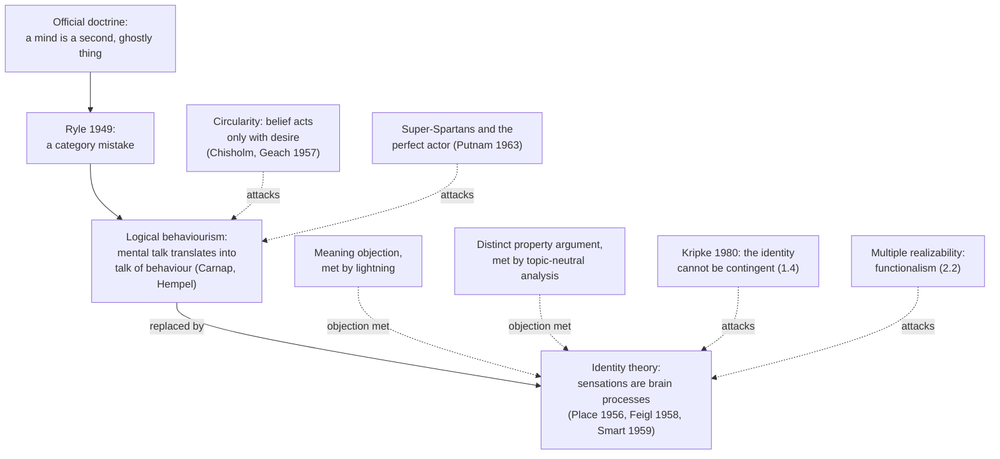

# Philosophy of Mind · Lesson 2.1: Behaviourism and the identity theory

> ⏱ ~15 min · Module 2: Physicalism and mental causation · Builds on: [1.1](01-01-the-mind-body-problem.md), [1.4](01-04-zombies-conceivability-and-kripke.md), [`philosophy-of-science` 4.5](../../philosophy-of-science/lessons/04-05-reduction-and-emergence.md) · Unlocks: [2.2](02-02-functionalism.md), [2.3](02-03-anomalous-monism-and-supervenience.md)

## Why this matters

The dentist's drill slips. You grip the armrest and keep your face still, because a frightened child is waiting in the next chair. Something happened in you that nothing you did showed. The first two physicalist programmes of the twentieth century split over that moment. The behaviourist said talk of pain is talk of behaviour and dispositions to behave. The identity theorist said the pain was a real inner event that caused the grip, and a process in your brain.

## The idea

Gilbert Ryle (*The Concept of Mind*, 1949) imagined a visitor shown the colleges, libraries, playing fields and offices of a university, who then asks where the University is. He has made a [category mistake](../reference.md#category-mistake): he takes the university for one more item of the same kind as the buildings, when it is the way they are organized. Ryle charged the Cartesian picture, which he called the official doctrine and, with deliberate abusiveness, the dogma of "the Ghost in the Machine", with the same mistake about minds. It treats a mind as a second, invisible thing behind the body's doings. To call someone clever, vain or careful is to say how they act and would act, not to report a hidden episode.

[Logical behaviourism](../reference.md#logical-behaviourism) hardened this into a translation thesis: every meaningful statement about a mind can be rewritten, with no loss of meaning, as a statement about behaviour and dispositions to behave. Two things broke it. A belief shows up in behaviour only together with desires, so the translations never shake off mental words. And the dentist's chair: pain with no behaviour, and, in an actor, the behaviour with no pain.

The [identity theory](../reference.md#identity-theory) kept the inner episode and said what it is. Lightning was never a second thing behind an electric discharge. It turned out to be the discharge, and nobody had to change what "lightning" means to find that out. Sensations, said U. T. Place and J. J. C. Smart, are brain processes in the same way.

A [type identity](../reference.md#type-and-token-identity) identifies a kind with a kind: pain is C-fibre firing, the philosophers' placeholder for whatever neural process turns up. A token identity says only that each particular pain is some physical event or other. The telegram "love and love and love" has two type words and five tokens. [`philosophy-of-science` 4.5](../../philosophy-of-science/lessons/04-05-reduction-and-emergence.md) taught bridge laws and token physicalism in general; a type identity is the strongest bridge a reduction can have, and this lesson does the mental case.

## The argument

**Logical behaviourism** (Rudolf Carnap, "Psychologie in physikalischer Sprache", 1932/33; Carl Hempel, "The Logical Analysis of Psychology", English version 1949). Its root is verificationism: what would verify a claim about another mind is behaviour. Ryle is usually filed here, though the Stanford Encyclopedia's entry on him (revised 2026) argues that he held none of the doctrine's main tenets: his dispositional statements were licences to infer, not analyses. The case against it comes from Roderick Chisholm (*Perceiving*, 1957), Peter Geach (*Mental Acts*, 1957) and Hilary Putnam ("Brains and Behavior", 1963, published 1965).

**P1.** If logical behaviourism is true, each mental predicate M has an analysis of the form: x is M if and only if x would do B in circumstances C, with B and C described in non-mental terms. *In words:* the translation must be complete and purely behavioural.

**P2.** A belief issues in behaviour only given desires, and a desire only given beliefs. *In words:* every analysis smuggles in another mental state, the [circularity objection](../reference.md#circularity-of-behavioural-analyses).

**P3.** Someone can be in pain and lack every disposition to pain behaviour. *In words:* the condition is not necessary.

**P4.** Someone can have every such disposition and not be in pain. *In words:* nor is it sufficient.

**∴ C1.** No mental predicate has a purely behavioural analysis.

P3 is Putnam's [super-Spartans](../reference.md#super-spartans): adults trained to suppress every involuntary sign of pain, with no wince, groan or flinch, who if asked will admit in a level voice that it hurts. He then imagines descendants who no longer even say so. If they are in pain, the pain is what causes pain behaviour when there is any, and a cause is not built out of its effects. P4 is his perfect actor. Hempel himself had abandoned the programme by 1966.

**The identity theory.** Place, "Is Consciousness a Brain Process?" (*British Journal of Psychology*, 1956), came out of arguments at Adelaide with C. B. Martin and with Smart, then a Rylean, whom it converted. Herbert Feigl, "The 'Mental' and the 'Physical'" (1958), and Smart, "Sensations and Brain Processes" (*Philosophical Review*, 1959), followed. The thesis concerns sensations and consciousness, offered as a contingent, discovered identity, like lightning's. Place kept Ryle's dispositions for belief and desire; D. M. Armstrong (*A Materialist Theory of the Mind*, 1968) identified those with brain states too. Smart's [argument from simplicity](../reference.md#argument-from-simplicity):

**P5.** Each kind of sensation is correlated with a kind of brain process. *In words:* an empirical bet that neuroscience was expected to win.

**P6.** If a sensation is not the process, each correlation is a fundamental law tying a complex neural process to something simple and non-physical, what Feigl called a "nomological dangler". *In words:* the dualist's laws dangle from the net of science and connect to nothing else in it.

**P7.** Everywhere else, science increasingly shows organisms to be physicochemical mechanisms. *In words:* sensations would be the lone exception.

**P8.** Of two hypotheses that fit the same evidence, prefer the one with fewer fundamental entities and laws. *In words:* Ockham's razor, which Smart invoked and Place did not.

**∴ C2.** Each kind of sensation is a kind of brain process. *In words:* the correlation holds because there is only one thing.

**Where the argument is weakest.** P5. Putnam's 1967 argument from [multiple realizability](../reference.md#multiple-realizability) ([2.2](02-02-functionalism.md)) says that pain occurs in creatures whose nervous systems share no kind of process with ours, so there is no one brain kind to identify it with. The strongest reply restricts the identities: human pain is one neural kind and another species' pain another, the local reductions Kim defends in [`philosophy-of-science` 4.5](../../philosophy-of-science/lessons/04-05-reduction-and-emergence.md) and the restricted types Smart himself allowed. Present defenders add that real realizers are less unlike than advertised, since neuroscience types brain states coarsely (Thomas Polger and Lawrence Shapiro, *The Multiple Realization Book*, 2016). The identity theorist concedes that "pain" then names no single physical kind across species. The functionalist concedes that every actual pain may still be a neural process of a kind shared within its species, and that unlike realizers have to be shown, not merely imagined.

## The timeline

Solid arrows give the order in which the views arrived; dashed arrows are objections, two of which the identity theory answered in 1959 and two of which it still faces.

## Worked examples

**Example 1 (clean case: a belief analysed).** Isolde believes the lake ice is too thin to bear her. Draft: she is disposed to stay off the ice, to warn others off it, and to say yes when asked whether it is thin. Run the net of [`philosophical-method` 3.1](../../philosophical-method/lessons/03-01-conceptual-analysis.md). Her dog goes through the ice and she walks out after it, believing all the while that it is thin: a believer who fails the condition, so it is not necessary. Repair: "unless she wants something more than she wants to stay dry." The repair names a desire. Analyse it in turn: wanting to stay dry is being disposed to avoid what will soak her, unless she believes the soaking is worth it, or does not believe the thing will soak her. That is a belief again.

Each analysis of a belief needs a desire, and each desire a belief: P2, run on a case. The circle is not vicious in itself. Belief and desire can be given behavioural content together, as two unknowns in one system of equations, which is the move [2.2](02-02-functionalism.md) makes. What it rules out is a term-by-term translation that leaves the mental vocabulary behind. If you have tried to read an agent's reward off its trajectories, you have met it: one trajectory fits many pairs of goal and world model. Daniel Hausman finds the same circle in revealed preference ([`philosophy-of-economics` 2.1](../../philosophy-of-economics/lessons/02-01-preference-and-revealed-preference.md)).

**Example 2 (hard case: the meaning objection).** The objection: people who know nothing of neurons talk perfectly well about their pains, so "pain" cannot mean "C-fibre firing", and the identity is false. Place's reply, which Smart restated in terms of meaning and reference, grants the premise and denies the inference. "Lightning" never meant "electric discharge"; people used the word for millennia and found out by theory and experiment that lightning is discharge. Two expressions can differ in meaning and pick out one thing, and the identity theory is a claim about what is picked out.

**Where it strains.** Max Black pressed a follow-up, which Smart reported in the same paper: the [distinct property argument](../reference.md#distinct-property-argument). "Lightning" picks out the discharge by a property of its own, a bright flash. By what property does "pain" pick out the brain process? If by an irreducibly mental one, P6's danglers come back as properties, and the view becomes a [property dualism](../reference.md#property-dualism) about an event that is physical. Smart's answer was the [topic-neutral analysis](../reference.md#topic-neutral-analysis), a term adapted from Ryle. A report of a yellowish-orange after-image says only that something is going on in me like what goes on when I am awake, eyes open, with an orange in good light before me. "Something going on" is neutral between brain process and ghostly episode, so the report ascribes no mental property, and science says what the something is. David Chalmers (*The Conscious Mind*, 1996) answers with a dilemma: read broadly, the phrase fits countless processes that are no experience; narrowed to experiences, it is no longer neutral. Smart replied that "typically" does the narrowing.

Here the lightning analogy stops giving a verdict. Whether the topic-neutral paraphrase says everything "pain" says is a question about our concept, and the analogy assumed the answer. The identity theorist says nothing is left over. The property dualist says the felt quality is exactly what is left, the question of [1.3](01-03-the-knowledge-argument.md) and [3.1](03-01-the-hard-problem.md). Kripke adds that the analogy breaks where it matters: the impression that lightning might not have been discharge is explained by something else that could look like lightning, but whatever feels like pain is pain ([1.4](01-04-zombies-conceivability-and-kripke.md)).

## Watch out

- **You might think** token identity is a weaker type identity, **but actually** it makes no claim about kinds at all. Type identity entails token identity, not conversely, so functionalists ([2.2](02-02-functionalism.md)) and Davidson ([2.3](02-03-anomalous-monism-and-supervenience.md)) can accept token identities and deny type identities.

- **You might think** Place and Smart offered a necessary truth, **but actually** they called the identity contingent, discovered as lightning's was. A true identity between rigid terms is necessary ([`metaphysics` 3.1](../../metaphysics/lessons/03-01-kinds-of-necessity.md)), so if both terms are rigid the claim must be "necessary, known a posteriori", and [Kripke's argument](../reference.md#kripkes-argument) presses on exactly that.

- **You might think** the identity theory abolishes pain, **but actually** it says what pain is and keeps it, as kinetic theory kept temperature ([`philosophy-of-science` 4.5](../../philosophy-of-science/lessons/04-05-reduction-and-emergence.md)). Dropping the mental vocabulary is [eliminative materialism](../reference.md#eliminative-materialism), another place on [1.1](01-01-the-mind-body-problem.md)'s map.

- **You might think** C1 refutes behaviourism, **but actually** it targets the logical kind, a thesis about meaning. John Watson's methodological rule (psychology studies behaviour) and B. F. Skinner's psychological behaviourism are untouched. Revealed preference has both readings: defining "preference" by choice is logical behaviourism about one word, and the rule that economics models choices, not minds, is methodological ([`philosophy-of-economics` 2.1](../../philosophy-of-economics/lessons/02-01-preference-and-revealed-preference.md)).

## One-liner

> Behaviourism could not translate a belief without a desire or a pain without its expression; the identity theory kept the inner episode and, for simplicity's sake, identified it kind for kind with a brain process, and owes an account of what "pain" picks that process out by.

## Problems

**P1 (🟢) *(Exegetical.)*** (a) For each claim, say whether it asserts a type identity, only a token identity, or no identity. One line each.

> (i) Fear is activity in one kind of neural circuit, the same kind in every creature that is ever afraid.
>
> (ii) Each pain anyone has ever had was some neural event or other, but nothing physical is common to all pains and to nothing else.
>
> (iii) Pain in humans is one kind of neural process and pain in dogs another; within each species, being in pain is being in that species' process.
>
> (iv) Every pain is accompanied by a brain process of a single kind, which causes it, but the pain is a further event over and above that process.

(b) Which of the two kinds of identity entails the other? One sentence.

**P2 (🟡) *(Counterexample: Evaluative (a)–(b) · Exegetical (c).)*** A behaviourist proposes:

> x hears a ringing in her ears if and only if x is disposed (1) to say, when asked, that she hears a ringing; (2) to switch on a fan or a radio in quiet rooms; and (3) to ask people near her whether they hear it too.

(a) Build a case of your own in the manner of Putnam's super-Spartans: someone who hears the ringing and has none of the three dispositions. Say what keeps the dispositions away. Two sentences.

(b) Build a case of the reverse kind: all three dispositions and no ringing. Two sentences.

(c) The behaviourist repairs the analysis with "unless she wants to conceal the ringing". Say what the repair does to the behaviourist programme, and why the problem recurs if "wants to conceal" is itself analysed behaviourally. Two sentences.

**P3 (🔴) *(Find the crux: Exegetical (a)–(b) · Evaluative (c).)*** Until Place's arguments converted him in the 1950s, Smart was a Rylean: he read first-person reports of sensations as avowals, expressions on a par with a wince, and the rest of mental talk as hypothetical statements about behaviour. Take the report "I have a yellowish-orange after-image" and set the Rylean Smart against the Smart of 1959.

(a) State two things the two agree on. One line each.

(b) Name the single premise one affirms and the other denies, and state the crux as a conditional both would sign. Two sentences.

(c) What argument or evidence would move each side? Any verdict; 150 words or fewer.

Solutions

**P1** *(Exegetical.)*

**Must hit, strict (a):**

- (i) Type identity: a kind, fear, is identified with a kind of neural activity, the same in every creature that has it.

- (ii) Token identity only: each particular pain is a physical event, and the claim denies any physical kind common and peculiar to pains, so it denies type identity. This is the shape of Davidson's view in [2.3](02-03-anomalous-monism-and-supervenience.md) and of most functionalists'.

- (iii) Type identity, restricted: kinds are still identified with kinds, one neural kind per species. It is a local or species-relative type identity, not a token-only view.

- (iv) No identity: the pain is "over and above" the process. This is a type-for-type correlation with the identity denied, a dualist reading of exactly the evidence Smart's P5 cites.

**Must hit, strict (b):** type identity entails token identity, since if pain is C-fibre firing, each pain is a C-fibre firing. The converse fails, as (ii) shows.

**Wrong turns:** calling (iii) token identity because it gives up one kind across species, when it still identifies kinds within each. Calling (iv) a type identity because the correlation is exact and type-for-type: a correlation, however exact, is what the identity hypothesis is offered to explain, not the identity. Reading token identity as a weaker type identity.

**Model answer:** (a) (i) type; (ii) token only; (iii) type, restricted to a species; (iv) no identity, only correlation. (b) Type identity entails token identity, not conversely.

---

**P2** *(Evaluative (a)–(b) · Exegetical (c).)*

**Accept:** any case that meets or fails the stated condition in the required direction, provided a behaviourist would classify it the same way before the theory is in view. A case in which the absence of the dispositions does not depend on a desire is welcome in (a), since it escapes the repair in (c).

**Must hit, any verdict (a):** a person who hears the ringing and lacks all three dispositions, not just one, with the reason stated: a strong motive and trained suppression, or never having taken the sound to be anything worth reporting.

**Must hit, any verdict (b):** a person with all three dispositions who hears no ringing, with the reason stated (pretence, rehearsal, a claim made for gain).

**Must hit, strict (c):**

- The repair puts a mental term, a desire, into the analysis, so the right-hand side is no longer purely behavioural: it abandons P1's requirement instead of meeting it.

- A behavioural analysis of "wants to conceal" needs beliefs (that she is being watched, that concealing will work, that the matter is important), so P2's circle recurs: each mental term's analysis calls on another.

**Wrong turns:** an (a) case that removes only the verbal disposition while she still switches on the fan. Offering two cases that both refute sufficiency, when (a) must show the condition is not necessary. Calling the repair harmless because wanting can be read off behaviour, which is the point in dispute.

**Model answer, one of several:** (a) A pilot applicant has heard the ringing for months and, knowing it would end her career, has trained herself never to mention it, never to mask it with noise and never to ask about it. What keeps the dispositions away is a desire and a practised skill, so she is a super-Spartan: the state without the behaviour. A stronger case: someone who has heard the ringing since birth and takes it for what silence sounds like has no motive to hide it and none of the dispositions. (b) A man claiming compensation for a factory injury hears nothing unusual, but says whenever asked that he hears ringing, runs a fan in quiet rooms and asks colleagues whether they hear it too. (c) The repair imports a desire, so the analysis now uses a mental term and is no longer a translation into behaviour. Analysed behaviourally, "wants to conceal" becomes dispositions to hide that depend on what she believes about being watched and what hiding achieves, so P2's circle returns.

---

**P3** *(Exegetical (a)–(b) · Evaluative (c).)*

**Accept:** a crux stated as avowal versus report, occurrence versus disposition, or cause versus manifestation, if it isolates whether the after-image report describes an inner episode.

**Must hit, strict (a):** any two of the following. There is no immaterial mind or ghostly substance. "After-image" does not mean the same as any neurophysiological expression. There is no orange object, in the mind or in the brain, that the report describes. Science, not introspection, says what exists.

**Must hit, strict (b):**

- The premise: a sensation report describes an inner occurrence, something going on in the person that causes what she says and does. The Smart of 1959 affirms it, and the topic-neutral analysis is his account of what the report describes. The Rylean denies it: the report is an avowal, itself a piece of behaviour, and what remains is dispositional, with nothing occurring for the report to be about.

- A conditional both would sign: "If after-image reports describe inner occurrences, there is something whose nature science can discover and the identity hypothesis has a subject; if they are avowals plus dispositions, there is nothing for an identity to be about."

**Must hit, any verdict (c):**

- For the Rylean, name an argument that there is an occurrence the report is about: the super-Spartans (an occurrence without its expression), Putnam's point that the episode causes the report, or Place's explanation of first-person authority as the authority of a low claim, which removes one reason to treat reports as avowals.

- For Smart, name what would show that "something is going on" adds nothing: an argument that sensation words are learned and applied wholly by public criteria, or the failure of the topic-neutral paraphrase.

- Say whether neural evidence could settle it.

**Wrong turns:** naming the crux as whether physicalism is true, when neither posits a ghost. Saying the Rylean denies that people have after-images, when he denies that having one is having an inner object. Making the crux whether "after-image" means "brain process", which both deny.

**Model answer (c), one of several:** The Rylean would be moved by a case where the episode and its expression come apart, together with an argument that the episode, not the disposition, explains the report. The super-Spartans supply the case: if an unexpressed pain is still a pain, something occurred that no behaviour or disposition captures. Putnam supplies the argument: the pain is why the pain behaviour happens, and a cause is not built out of its effects. Smart would be moved by an argument that "something is going on" carries no content beyond the public criteria for using sensation words, which would make his topic-neutral analysis Rylean behaviourism in other words. Neuroscience alone cannot decide between them. A process that predicts every report suits Smart, but the Rylean can grant it as a cause of the avowal and deny that the avowal is about it, so the crux is conceptual.

## Flashback

**From Lesson [1.3](01-03-the-knowledge-argument.md) (The knowledge argument):** *(Exegetical (a)–(b).)* Bertrand Russell, *The Problems of Philosophy* (Home University Library, 1912), ch. V, on a shade of colour he sees:

> But such statements, though they make me know truths about the colour, do not make me know the colour itself any better than I did before: so far as concerns knowledge of the colour itself, as opposed to knowledge of truths about it, I know the colour perfectly and completely when I see it, and no further knowledge of it itself is even theoretically possible.

(a) Which of the [three ways of knowing](../reference.md#knowing-that-knowing-how-and-acquaintance) does Russell claim of the colour, and which reply to Mary shares his contrast? Does that reply give Mary a new fact? Two sentences.

(b) Applied to Mary, which clause supplies the further premise 1.3 says the dualist needs between P2 and C2, and which physicalist reply does it contradict? Two sentences.

Solution

**Must hit, strict (a):**

- Acquaintance, "know the colour itself", set against knowing that, "knowledge of truths about it"; no truths improve it.

- Conee's [acquaintance hypothesis](../reference.md#acquaintance-hypothesis): a third kind of knowledge of a quality, had only by experiencing it. Mary gains acquaintance and no new fact.

**Must hit, strict (b):**

- The final clause, from "I know the colour perfectly and completely": at full strength, seeing reveals the whole nature of what is seen, the premise Goff defends, that a phenomenal concept reveals the nature of what it picks out.

- It contradicts [old fact, new mode](../reference.md#old-fact-new-mode), whose new concept picks out a physical state without revealing its nature, which is why no a priori reasoning links Mary's two concepts.

**Credit, not required:** a note that the clause troubles a physicalist reading of the acquaintance hypothesis too, so the passage serves both sides.

**Wrong turns:** reading "no further knowledge" as "nothing more can be known about the colour": Russell grants further truths and denies only that they improve knowledge of the colour itself. Matching the passage to the ability hypothesis. Treating Russell as arguing against physicalism: his colour is a sense-datum, his topic kinds of knowledge.

**Model answer:** (a) Acquaintance, knowledge of the colour itself, which no truths about it improve; that is Conee's acquaintance hypothesis, on which Mary gains acquaintance with red and no new fact. (b) The clause "I know the colour perfectly and completely when I see it" makes seeing reveal the whole nature of what is seen, the premise that a phenomenal concept reveals the nature of what it picks out. It contradicts old fact, new mode, whose new concept picks out a physical state without revealing its nature.

## Connections

- **Backward:** [1.1](01-01-the-mind-body-problem.md) put the identity theory on the map as the founding [reductive physicalism](../reference.md#reductive-physicalism); this lesson gives its case. [`philosophy-of-science` 4.5](../../philosophy-of-science/lessons/04-05-reduction-and-emergence.md) supplied bridge laws and local reduction, and a type identity is a bridge law read as an identity. [`metaphysics` 3.1](../../metaphysics/lessons/03-01-kinds-of-necessity.md) showed that identities between rigid terms are necessary, which [1.4](01-04-zombies-conceivability-and-kripke.md) turns against a "contingent" identity.

- **Forward:** [2.2](02-02-functionalism.md) keeps behaviourism's tie between a state and what it does and the identity theory's inner causes, and drops the single physical kind; David Lewis's "An Argument for the Identity Theory" (1966) and Armstrong's causal analysis are the bridge. [2.3](02-03-anomalous-monism-and-supervenience.md) takes token identity without type identity. [3.1](03-01-the-hard-problem.md) is the distinct property argument grown into the explanatory gap.

- **Sideways:** Revealed preference is behaviourism in economics, and Hausman's reply to it is P2 again ([`philosophy-of-economics` 2.1](../../philosophy-of-economics/lessons/02-01-preference-and-revealed-preference.md)). A network judged only by its input-output behaviour is being treated as the behaviourist treats a mind, and probing its internal states is the identity theorist's move; [6.3](06-03-do-language-models-understand.md) takes that up with the Othello-GPT study. [`neuroscience` 4.5](../../neuroscience/lessons/04-05-methods-a-taste.md) shows the instruments P5's correlations would have to be measured with, and what each cannot see.
