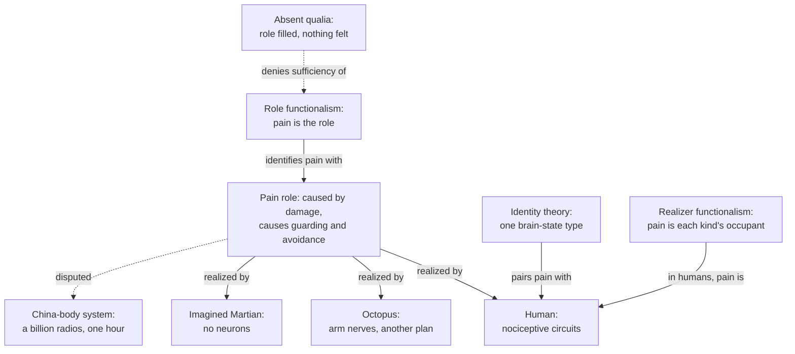

# Philosophy of Mind · Lesson 2.2: Functionalism

> ⏱ ~15 min · Module 2: Physicalism and mental causation · Builds on: [2.1](02-01-behaviourism-and-the-identity-theory.md), [`philosophy-of-science` 4.5](../../philosophy-of-science/lessons/04-05-reduction-and-emergence.md) · Unlocks: [2.3](02-03-anomalous-monism-and-supervenience.md), [2.4](02-04-mental-causation-and-the-exclusion-problem.md), [3.2](03-02-representationalism-and-higher-order-theories.md)

## Why this matters

A small octopus, *Octopus bocki*, gets an injection of dilute acetic acid in one arm. It grooms the spot, avoids the chamber where it was hurt, and comes to prefer one where a local anaesthetic relieved it; the anaesthetic also silences the arm's nerves (Robyn Crook, *iScience*, 2021). Its nervous system is built on a different plan from ours, with much of the control in the arms. If pain is a type of human brain state, as [2.1](02-01-behaviourism-and-the-identity-theory.md)'s [identity theory](../reference.md#identity-theory) says, this animal cannot be in pain. Functionalism says a state is pain because of what it does, not what it is made of.

## The idea

You know the move from training networks. Permute the $m$ hidden units of a one-hidden-layer network, carrying each unit's weights with it, and nothing changes but the labels: every activation is still computed, by a different unit, and the output is the same. That is $m!$ weight settings for one computation. With ReLU units you can also multiply a unit's incoming weights and bias by any $\alpha > 0$ and its outgoing weight by $1/\alpha$, since $\max(0, \alpha z) = \alpha \max(0, z)$ for any pre-activation $z$. The pattern of inputs, internal states and outputs is a *role*; a weight setting is one *realizer* of it. (That some wide enough network approximates any continuous function is the theorem of [`deep-learning` 1.2](../../deep-learning/lessons/01-02-universal-approximation.md); the many-settings point is this lesson's gloss.)

[Functionalism](../reference.md#functionalism) says mental states are like that. Pain is whatever state plays the pain role: caused by damage, causing guarding, avoidance and the wish that it stop. Beliefs and desires are defined the same way, by their relations to perception, behaviour and each other. The internal relations are what separate this from behaviourism. [`philosophy-of-science` 4.5](../../philosophy-of-science/lessons/04-05-reduction-and-emergence.md) taught [multiple realizability](../reference.md#multiple-realizability) in general, one higher-level kind with many physically unlike ways of being it; this lesson runs it on the mind.

Two worries follow. Draw the role loosely and too many things qualify; draw it tightly and too few do. And a role is a pattern of relations, so does filling one guarantee that anything is felt? ("Functionalism" here is not Durkheim's functional explanation, [`social-theory` 1.2](../../social-theory/lessons/01-02-functional-explanation-and-its-critics.md), or proper functionalism, [`epistemology` 2.4](../../epistemology/lessons/02-04-reliabilism.md).)

## The argument

**Putnam's argument** ("Psychological Predicates", 1967; reprinted as "The Nature of Mental States"), against the identity theory taken as an empirical hypothesis.

**P1.** Creatures with very different nervous systems can be in pain: mammals, birds, reptiles, and molluscs, among which, he remarks, octopuses certainly feel pain. *In words:* pain is spread across the tree of life.

**P2.** If pain is a type of brain state, there is one physical-chemical state that every creature in pain is in. *In words:* the identity theory needs a single physical partner for pain.

**P3.** There is probably no such state, and one psychological state realized differently in two kinds of creature would sink the hypothesis. *In words:* the partner is unlikely, and one counterexample suffices.

**∴ C.** Pain is not a type of brain state. *In words:* look for what pain-havers share at another level.

Putnam's candidate level was the computer's. Model the organism as a probabilistic automaton, a [Turing machine](../../theory-of-computation/lessons/03-01-turing-machines.md) with stochastic transitions, and identify pain with a state in its machine table, defined by how it takes inputs and the current state to outputs and the next state: [machine functionalism](../reference.md#machine-functionalism). Ned Block and Jerry Fodor ("What Psychological States Are Not", 1972) objected that finitely many machine states cannot match the open-ended range of thoughts, so later functionalists define each state by its place in a whole theory.

**Two sources for the roles.** [Analytic functionalism](../reference.md#analytic-functionalism) (David Armstrong, *A Materialist Theory of the Mind*, 1968; David Lewis, "Psychophysical and Theoretical Identifications", 1972) takes them from the platitudes of everyday psychology. Conjoin the platitudes, replace each mental term with a variable and quantify: the theory's Ramsey sentence ([`philosophy-of-science` 5.3](../../philosophy-of-science/lessons/05-03-structural-realism.md)), which solves for belief and desire together, the two unknowns of 2.1's circle:

$$\exists x\,\exists y\,\big[\,\text{damage causes } x \;\wedge\; x \text{ causes } y \;\wedge\; x \text{ causes wincing}\,\big],$$

with $x$ in pain's place and $y$ in the place of the desire that it stop. A creature is in pain when it is in the state that fills the $x$-place in its realization of the whole sentence. *In words:* the mental terms are defined all at once, by the pattern, with no mental word left over. [Psychofunctionalism](../reference.md#psychofunctionalism) (Fodor, *Psychological Explanation*, 1968; Block and Fodor 1972) takes the roles from empirical cognitive psychology instead, so they can be finer than common sense.

**Role or realizer.** Is pain the property of being in some state or other that fills the role, or the state that fills it? [Role functionalists](../reference.md#role-and-realizer) say the first, so an octopus and you share one property. Lewis (1966) and Armstrong said the second, and Lewis (1969, reviewing the volume in which Putnam's paper appeared) made the identities relative to a kind, the restricted identities 2.1 met: pain in humans is one neural state, pain in molluscs another. Realizer functionalism is an identity theory reached by a functional route. Individuation by role is also what Sydney Shoemaker's answer to the too-many-thinkers puzzle relies on: if a belief's role includes persistence conditions, the human animal, whose persistence conditions are biological, has no beliefs of its own. Whether that works is [`metaphysics` 6.5](../../metaphysics/lessons/06-05-what-a-person-is.md)'s verdict.

**Block's dilemma** ("Troubles with Functionalism", 1978). A theory of mind can be too liberal, counting things that lack minds as having them, or too chauvinist, denying minds to things that have them: [liberalism and chauvinism](../reference.md#liberalism-and-chauvinism). The identity theory is chauvinist about the octopus. Functionalism, Block argued, overshoots: platitude roles might be filled by the economy of Bolivia, while psychofunctional roles drawn at the grain of human psychology shut out creatures only roughly like us.

His sharpest case is the [China brain](../reference.md#china-brain). Give each of a billion people (he chose China because it had a billion inhabitants) a two-way radio linking them to one another and to an artificial body, display the current machine state on satellites, and let each person do the job of one entry in a machine table that describes you. For an hour, the system is functionally equivalent to you.

**A1.** The China-body system realizes a machine table that describes you, so it fills the roles you fill. *In words:* by functionalism's own standard, it is your functional twin.

**A2.** There is doubt whether it has any qualitative states, any [qualia](../reference.md#qualia), at all, and no independent reason to think it does. *In words:* it is not obvious that there is anything it is like to be it.

**A3.** If functionalism is true, whatever fills your roles has your qualitative states. *In words:* filling the role is enough.

**∴ C.** Unless the doubt in A2 can be explained away, we should not accept functionalism about qualitative states. *In words:* the burden is on the functionalist.

This is Block's [absent qualia](../reference.md#absent-qualia) argument, at his own strength: a principle about burdens, not a proof that the system feels nothing.

**Where the argument is weakest.** A2, which rests on an intuition. The strongest objection calls it prejudice against systems of unfamiliar size, speed or spread (Daniel Dennett, *Brainstorms*, 1978; William Lycan, "Form, Function, and Feel", 1981). Block grants that no mechanism, a brain least of all, looks like a seat of feeling, then draws two contrasts: we know brain-based systems can have qualia, because we are such systems; and the China brain was designed to mimic us, so its winces are best explained by the design. The strongest functionalist reply leaves intuition behind. Shoemaker ("Functionalism and Qualia", 1975) argued that a functional duplicate lacking qualia would believe everything you believe about yours, so your qualia would do nothing to make those beliefs true, and you could not know you have any. Since you can, he concluded, absent qualia are impossible. He allowed that *which* qualia duplicates have might differ, the inverted spectrum of [3.2](03-02-representationalism-and-higher-order-theories.md). The functionalist concedes that nothing in the case gives positive reason to credit the China brain with feeling. Block concedes that his argument is partly empirical and falls to any explanation that dissolves the doubt.

## Map of positions

One role, many occupants: the identity theory ties pain to one occupant, the functionalisms to the role or to each kind's occupant, and Block asks whether the role is enough.

## Worked examples

**Example 1 (clean case: pain in a human and an octopus).** Specify the role: a state caused by tissue damage that causes attention to the injured part, learned avoidance of where it happened, and a drive for relief. Find the occupants. In a human it is not one thing called "C-fibre firing", the philosophers' placeholder, but nociceptors, fast Aδ and slow C fibres, gating in the dorsal horn and descending control from the brainstem ([`neuroscience` 3.3](../../neuroscience/lessons/03-03-audition-somatosensation.md)). In Crook's octopuses something fills the same role: wound-directed grooming, avoidance of the place, preference for relief, arm-nerve activity an anaesthetic silences.

Run the views. The role functionalist says both animals have one property, pain. Lewis says both are in pain, with "pain" naming a different state in each kind. The identity theorist must find a shared physical kind or deny that the octopus is in pain. Then apply Lawrence Shapiro's test from [`philosophy-of-science` 4.5](../../philosophy-of-science/lessons/04-05-reduction-and-emergence.md): realizers are genuinely different only if they differ in properties that do the job. The octopus passes, since its control is distributed through the arms. But if that design makes its state do a somewhat different job, the claim that it fills the *same* role weakens: the dilemma's other horn. The case is clean because the role was specified coarsely.

**Example 2 (hard case: the China brain).** Machine functionalism: the system realizes your machine table, so it is in pain whenever it is in the pain state. Analytic functionalism: it satisfies the Ramsey sentence of the platitudes, so again yes, Block's liberalism charge at its plainest. Psychofunctionalism: it depends on the grain. If the roles include the fine timing and chemistry of human pain processing, the China system may fail them. But a grain fine enough to exclude it threatens to exclude the octopus too, whose psychology differs from ours in detail, and chauvinism returns.

Here the account stops giving a verdict. Functionalism says what to look for, a role, but not at what grain it must be matched, and the grain is exactly what the sides dispute. The functionalist says the best psychology, not an intuition, should fix the grain. Block says the theory has nothing in its favour that outweighs the doubt. Neither has a test for qualitative states that does not presuppose an answer, which is where [3.1](03-01-the-hard-problem.md) begins.

## Watch out

- **You might think** the absent-qualia argument is the zombie argument, **but actually** a zombie ([1.4](01-04-zombies-conceivability-and-kripke.md)) is a *physical* duplicate, while the China brain is a *functional* duplicate with very different physics. Block's target was functionalism, not physicalism.

- **You might think** functionalism denies that pains are physical, **but actually** it denies [type identity](../reference.md#type-and-token-identity) and keeps token physicalism, as Putnam and Fodor do. It is even officially neutral, since an immaterial state could fill a role; physicalists adopt it because they expect only physical states do.

- **You might think** realizer functionalism is a halfway house, **but actually** it is an identity theory with a functional recipe for finding the identities. Only role functionalism lets the octopus share your mental property.

- **You might think** Aristotle was the first functionalist, **but actually** that is disputed ([`ancient-medieval-philosophy` 3.5](../../ancient-medieval-philosophy/lessons/03-05-soul-and-intellect.md): Nussbaum and Putnam against Burnyeat), and [5.1](05-01-the-soul-as-the-form-of-the-body.md) asks whether hylomorphism is functionalism renamed.

## One-liner

> Functionalism defines a mental state by the role it plays, which lets an octopus be in pain; the price is a dilemma about how finely to draw the role, and the China brain asks whether filling any role is enough for anything to be felt.

## Problems

**P1 (🟢) *(Exegetical.)*** For each description, say whether it specifies a role or a realizer. One line each.

(a) Being in some state or other that is caused by tissue damage and causes guarding of the damaged part.

(b) Activity in an octopus's arm nerves after an acid injection.

(c) The pattern by which a network's inputs fix its hidden activations and those fix its output, whichever units carry it.

(d) What "pain" names, on Lewis's view, when said of a human.

(e) Which one of (a)–(d) does a role functionalist say an octopus and a human literally share? One sentence.

**P2 (🟡) *(Apply to a hard case: Exegetical (a) · Evaluative (b).)*** Take this functional definition:

> **D.** x is in pain if and only if x is in some state that is caused by damage to x's body and that causes x to withdraw from the source of the damage and to act to end the state.

Treat the ordinary verdicts on these cases as given: (i) not in pain; (ii) in pain; (iii) in pain.

(i) A city water network. When a main bursts, pressure sensors trigger valves that seal off the burst section, and the control room sends a crew to repair it.

(ii) A woman with a migraine. Stipulate that no tissue is damaged and there is nothing to withdraw from; her head throbs.

(iii) A creature from another planet with no neurons, in which a hydraulic state is caused by damage to its body and causes it to withdraw and to tend the wound.

(a) For each case, does D count it as in pain, and does that verdict invite the liberalism charge, the chauvinism charge, or neither? One line each.

(b) Amend D to remove one of the errors in (a). Test the amendment on all three cases and say what it costs. Any amendment; 100 words or fewer.

**P3 (🔴) *(Steelman and reply. Evaluative.)*** The best-known functionalist answer to the China brain says the intuition behind A2 is prejudice against a system of unfamiliar size, speed and spread.

(a) Steelman the absent-qualia objection so that it relies on no feature of the China brain that this answer could call prejudice. Numbered premises and a conclusion, at most four lines.

(b) Reply for the functionalist with a different answer, and say what your reply costs.

150 words or fewer in all.

Solutions

**P1** *(Exegetical.)*

**Must hit, strict:**

- (a) Role. It quantifies over occupants ("some state or other") and says only what the state is caused by and what it causes.

- (b) Realizer, or part of one: a particular physical state that may fill the pain role in that animal.

- (c) Role, relative to the weights: "whichever units carry it" quantifies over realizers, and many weight settings carry the same pattern.

- (d) Realizer. For Lewis, "pain" said of a human names the neural state that occupies the pain role in humans, so it names different states in different kinds.

- (e) (a): the second-order property of having some state that fills the role.

**Wrong turns:** calling (d) a role because Lewis is a functionalist, when his functionalism is the recipe for finding the realizer; answering (e) with (b) and (d) together, as if octopus and human shared the occupant; calling (c) a realizer because it belongs to a physical network.

**Model answer:** (a) role; (b) realizer; (c) role; (d) realizer, the state that fills the pain role in humans; (e) (a), the property of being in some state that fills the role.

---

**P2** *(Exegetical (a) · Evaluative (b))*

**Must hit, strict (a):**

- (i) D counts it in pain: a burst is damage to the network's body, sealing the section is withdrawal from the source, and the repair acts to end the state. The ordinary verdict is no, so this invites the liberalism charge.

- (ii) D does not count her in pain: nothing is damaged, so the first clause fails, and there is nothing to withdraw from. The ordinary verdict is yes, so this invites the chauvinism charge.

- (iii) D counts it in pain, and so does the ordinary verdict: neither charge. The physical difference is exactly what functionalism was built to ignore.

**Must hit, any verdict (b):**

- State the amendment exactly.

- Run it on (i), (ii) and (iii), and say whether it fixes the target error without creating the other.

- Name the cost. A clause adding a further mental state ("and causes the belief that something is wrong") moves the question to whether the network can have beliefs, since the definition now leans on another mental state. A clause naming a material ("in a nervous system") wrongly excludes (iii) and gives up functionalism. Loosening "caused by damage" to "of a kind normally caused by damage" can admit (ii) only by appeal to what is normal for a kind, which is Lewis's population move.

**Wrong turns:** treating (iii) as a liberalism case because the creature is unfamiliar, when the stem fixes the ordinary verdict; repairing (ii) by deleting the cause clause alone, which still fails her on the withdrawal clause; thinking any amendment is free.

**Model answer (b), one of several:** Make D a claim about types: x is in pain iff x is in a state of a type that, in creatures of x's kind, is normally caused by bodily damage and normally causes withdrawal and efforts to end it. Her migraine state is of the type injury normally produces, so (ii) now counts, and (iii) still does. But (i) is untouched: bursts normally cause the network's state, which normally causes sealing and repair. So it removes the chauvinism, not the liberalism. Cost: the verdict depends on what is normal for x's kind, so a one-of-a-kind creature gets none.

---

**P3** *(Evaluative)*

**Accept (a):** either (1) the relational version below, or (2) a version built on Block's contrasts: we know that brain-based systems have qualia only because we are such systems; a system designed to mimic us has its behaviour explained by the design; so its functional equivalence gives no reason to credit it with qualia. Both survive the prejudice answer, since neither appeals to size, speed or spread.

**Must hit, any verdict:**

- (a) Premises that do not mention the case's oddity, ending in the conclusion that filling a functional role does not guarantee qualitative character.

- (b) A reply other than the prejudice reply, aimed at a named premise of (a): Shoemaker's argument that absent qualia would make one's qualia unknowable; denying that qualitative character is intrinsic; or the [phenomenal concept strategy](../reference.md#phenomenal-concept-strategy) of [1.4](01-04-zombies-conceivability-and-kripke.md).

- (b) The cost, stated: what the reply must concede or assume.

**Wrong turns:** steelmanning with a premise that the China brain is too slow or too big, which is what the prejudice answer attacks; replying "the China brain does feel pain" with no reason, which restates functionalism; treating Shoemaker as denying inverted qualia, when he allowed them.

**Model answer, one of several:**

(a) P1. A functional definition specifies a state only by its relations to inputs, outputs and other states. P2. Qualitative character is intrinsic to a state, not a matter of its relations. P3. Relations alone do not fix an intrinsic property. ∴ C. Filling any functional role, in any system, does not guarantee qualitative character.

(b) Shoemaker attacks the conclusion. If C were true, a duplicate lacking qualia would believe exactly what I believe about mine, so my qualia would do nothing to make those beliefs true, and I could not know I have any. I can, so C is false. The cost: the reply assumes that knowing my qualia must run through their role. A property dualist says I know them by acquaintance, so my duplicate's belief lacks my evidence. And Shoemaker must still allow that functional duplicates can differ in *which* qualia they have.

## Flashback

**From Lesson [1.4](01-04-zombies-conceivability-and-kripke.md) (Zombies, conceivability, and Kripke):** *(Exegetical (a)–(b).)* Take "sound" and "compression waves" as rigid designators, the reference of "sound" fixed by a contingent property: producing auditory sensations in us. Acoustics finds that sound is compression waves in a medium, so on [Kripke's argument](../reference.md#kripkes-argument) the identity is necessary. Yet it seems there could have been sound without compression waves, and compression waves without sound.

(a) Explain away each seeming as 1.4 explains away heat's: say what is really being imagined, and whether it is possible. One sentence each.

(b) A physicalist argues: "Sound shows that what is conceivable can be impossible, so the zombie's conceivability shows nothing." Which premise of the [zombie argument](../reference.md#zombie-argument) does this attack, and what is Chalmers's two-dimensional reply? Two sentences.

Solution

**Must hit, strict (a):**

- Sound without compression waves: auditory sensations like ours produced by something else. Possible, but it is the reference-fixing property without the referent, so it is not sound.

- Compression waves without sound: compression waves that produce no auditory sensation, because no one is there to hear them. Possible, and it is sound itself without its reference-fixing property.

- Each seeming is an [illusion of contingency](../reference.md#illusion-of-contingency): a nearby possibility misdescribed.

**Must hit, strict (b):**

- P2, the step from conceivability to metaphysical possibility: the type-B physicalist's objection.

- Chalmers: the primary intension of "sound" picks out whatever produces our auditory sensations at a world considered as actual, so "sound without compression waves" is a primary possibility misdescribed as a secondary one. Terms for experience have no such gap, since whatever would feel like pain at a world is pain there, so the zombie world's primary possibility carries over to metaphysical possibility (unless [Russellian monism](../reference.md#russellian-monism) is true).

**Accept (b):** Kripke's form: "pain" has no contingent reference-fixer, so nothing could be mistaken for pain without C-fibre stimulation; 1.4 calls it the same point.

**Wrong turns:** in (a), calling sound without compression waves genuinely possible because "sound" can mean the sensation, when the stem fixes it as a rigid designator of the waves. Answering (b) with P1, the type-A denial, or with P3.

**Model answer:** (a) The first is auditory sensations like ours produced by something else: possible, but not sound. The second is compression waves no one hears: possible, and still sound, lacking only its reference-fixer. (b) It attacks P2. Chalmers replies that the sound case is a primary possibility misdescribed, while terms for experience have one intension, so a conceived zombie world leaves no nearby possibility to have mistaken for it.

## Connections

- **Backward:** [2.1](02-01-behaviourism-and-the-identity-theory.md)'s identity theory is the position Putnam's argument targets, and its distinction between type and token identity is what lets functionalists keep token physicalism. Multiple realizability in general, Fodor's argument and Shapiro's test are [`philosophy-of-science` 4.5](../../philosophy-of-science/lessons/04-05-reduction-and-emergence.md), and the Ramsey sentence is its [5.3](../../philosophy-of-science/lessons/05-03-structural-realism.md). [`metaphysics` 6.5](../../metaphysics/lessons/06-05-what-a-person-is.md) holds the verdict on Shoemaker's use of functional individuation for the too-many-thinkers puzzle.

- **Forward:** If pain is a role property, does the role or its realizer cause the wince? [2.3](02-03-anomalous-monism-and-supervenience.md) and [2.4](02-04-mental-causation-and-the-exclusion-problem.md) take that up as supervenience and exclusion. [3.2](03-02-representationalism-and-higher-order-theories.md) runs the inverted spectrum, the qualia objection Shoemaker conceded, and [3.4](03-04-illusionism.md) denies that qualitative character is intrinsic. [5.1](05-01-the-soul-as-the-form-of-the-body.md) asks whether hylomorphism is functionalism renamed. [6.1](06-01-computationalism-and-the-turing-test.md) separates machine functionalism from the computational theory of mind, and the room of [6.2](06-02-the-chinese-room.md) is the China brain's cousin, asked about understanding instead of feeling.

- **Sideways:** In [`deep-learning` 1.2](../../deep-learning/lessons/01-02-universal-approximation.md)'s networks, many weight settings realize one computation. By Shapiro's test, though, a permutation is not a genuinely different realization: it does the job the same way with the labels moved, like his steel and aluminium corkscrews. The probabilistic automaton is a cousin of the Turing machine of [`theory-of-computation` 3.1](../../theory-of-computation/lessons/03-01-turing-machines.md), and the human realizer of pain is [`neuroscience` 3.3](../../neuroscience/lessons/03-03-audition-somatosensation.md). Functional explanation in [`social-theory` 1.2](../../social-theory/lessons/01-02-functional-explanation-and-its-critics.md) and proper functionalism in [`epistemology` 2.4](../../epistemology/lessons/02-04-reliabilism.md) share the name and not the thesis.
