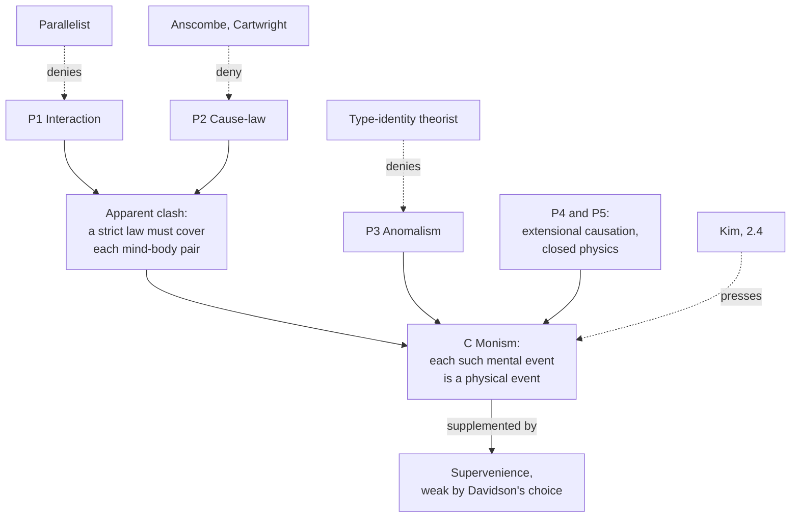

# Philosophy of Mind · Lesson 2.3: Anomalous monism and supervenience

> ⏱ ~15 min · Module 2: Physicalism and mental causation · Builds on: [2.1](02-01-behaviourism-and-the-identity-theory.md), [2.2](02-02-functionalism.md), [`metaphysics` 3.2](../../metaphysics/lessons/03-02-what-possible-worlds-are.md) · Unlocks: [2.4](02-04-mental-causation-and-the-exclusion-problem.md), [4.3](04-03-externalism-narrow-content-and-the-extended-mind.md)

## Why this matters

You see dark clouds, come to believe rain is coming, and open your umbrella. Three things seem true at once: your belief moved your arm; every causal transaction falls under some exceptionless law; and no psychologist will ever write an exceptionless law about people who believe rain is coming. Donald Davidson argued in 1970 that these three claims, far from clashing, prove that every such belief is a physical event. Saying how much the physical then fixes needs a precise tool, supervenience.

## The idea

One event can be described in many ways. The bursting of a balloon at a party is also the event that woke the baby, but only the first description appears in a law of gas pressure. Davidson's key premise: causation relates events however described, laws only under descriptions. So your belief can cause your arm to move under a covering law written in physical vocabulary. The result is [token identity without type identity](../reference.md#type-and-token-identity), the distinction [2.1](02-01-behaviourism-and-the-identity-theory.md) drew: each mental event is some physical event, though mental kinds need not match physical kinds. That is [anomalous monism](../reference.md#anomalous-monism): one kind of event, with the mental escaping strict law. It is not [multiple realizability](../reference.md#multiple-realizability) ([2.2](02-02-functionalism.md)), though both deny type identity: Putnam's reason is that one role has many realizers, Davidson's that the mental answers to standards of rationality nothing physical answers to.

The second tool is a slogan: no mental difference without a physical difference. David Lewis compared a dot-matrix picture, whose symmetry is nothing but the pattern of dots, so no two pictures alike dot for dot differ in symmetry. [Supervenience](../reference.md#supervenience) makes the mental the symmetry and the physical the dots. The slogan hides a choice: do we compare things within one world, across [possible worlds](../../metaphysics/lessons/03-02-what-possible-worlds-are.md), or as whole worlds? Each answer is a different thesis; only one can state [physicalism](../reference.md#physicalism).

## The argument

**Davidson, "Mental Events" (1970)**, about propositional attitudes (believing, wanting, intending), not pains. These are [Davidson's three principles](../reference.md#davidsons-three-principles):

**P1. Causal interaction.** Some mental events cause, or are caused by, physical events. *In words:* the rain causes your belief, and your decision moves your arm.

**P2. The nomological character of causality.** Events related as cause and effect fall under [strict laws](../reference.md#strict-law), exceptionless laws whose antecedents include everything that could prevent the effect. *In words:* wherever there is causing, a law with no escape clause covers it.

**P3. The anomalism of the mental.** There are no strict laws on the basis of which mental events can be predicted or explained. *In words:* generalizations about believers hold only other things being equal, and the other things cannot be listed.

P1 and P2 seem to demand strict psychophysical laws, which P3 forbids. Two further premises resolve the tension.

**P4. Causation is extensional.** It holds between events however described; laws hold of events only as described. *In words:* the law covering a cause may use a description you never thought of.

**P5.** Only physical vocabulary promises a closed system of strict laws. *In words:* if the covering law is not mental, it is physical.

**∴ C. Monism.** Every causally interacting mental event has a physical description under which it falls under strict law, so it is a physical event. *In words:* the law that covers your belief and your arm describes the belief physically.

Davidson grounds P3 in charity: we interpret a person so as to make her largely consistent and right by our lights, revising any attribution in the light of all the rest. No physical predicate answers to that standard.

**[Reasons as causes](../reference.md#reasons-as-causes)** (Davidson, "Actions, Reasons, and Causes", 1963). You expect rain, and you also want to hide your face from a neighbour. Either reason would make opening the umbrella intelligible, yet you may have acted on only one, and what makes it *the* reason is that it caused the action. So rationalizing is causal explanation under a mental description: the classic yes to the question [`social-theory` 1.3](../../social-theory/lessons/01-03-understanding-webers-interpretive-method.md) and [`philosophy-of-science` 4.2](../../philosophy-of-science/lessons/04-02-causal-explanation.md) send here. It makes reasons causes of actions, not yet of the bodily movements P1 needs.

**Supervenience, written over worlds.** Davidson added that no two events could be alike physically yet differ mentally; Jaegwon Kim ("Concepts of Supervenience", 1984) separated the readings. Let $w, w'$ range over possible worlds and $x, y$ over individuals; $M$ is a family of mental properties and $P$ of physical (base) properties. Write $x_w \sim_P y_{w'}$ ("$x$ in $w$ is $P$-indiscernible from $y$ in $w'$") when for every $F$ in $P$, $x$ has $F$ in $w$ if and only if $y$ has $F$ in $w'$; likewise $\sim_M$.

**[Weak supervenience](../reference.md#weak-supervenience).** $\forall w\;\forall x, y \in w\;(x_w \sim_P y_w \rightarrow x_w \sim_M y_w)$. *In words:* inside any one world, physical twins are mental twins.

**[Strong supervenience](../reference.md#strong-supervenience).** $\forall w, w'\;\forall x \in w\;\forall y \in w'\;(x_w \sim_P y_{w'} \rightarrow x_w \sim_M y_{w'})$. *In words:* physical twins anywhere in modal space are mental twins.

**Theorem: strong implies weak.** Setting $w' = w$ in strong gives weak. *In words:* a ban on mismatches anywhere includes a ban on mismatches at home. The converse fails (Example 2).

Kim's 1984 point against Davidson: over a base closed under Boolean operations (negation, and infinite conjunction and disjunction), strong supervenience makes each mental property anything has necessitated by some physical property, a one-way psychophysical law strict enough to break P3. Davidson answered that his supervenience was only weak (1985; "Thinking Causes", 1993).

**[Global supervenience](../reference.md#global-supervenience)** compares whole worlds. An isomorphism $f$ from $w$ to $w'$ is a one-to-one correspondence between their individuals; it is $P$-preserving if $x_w \sim_P f(x)_{w'}$ for every $x$ in $w$. *Strong global:* every $P$-preserving isomorphism is $M$-preserving. *Intermediate:* if some isomorphism is $P$-preserving, some preserves both families. *Weak global:* if some is $P$-preserving, some is $M$-preserving. *In words:* physically matching worlds match mentally under the same pairing always (strong), at least once (intermediate), or under some pairing or other (weak). "Global" in this course means strong global. Strong individual entails strong global, which entails the other two (Boss 2 asks why). The converse holds when both families are intrinsic (Shagrir 2002; Bennett 2004) or the base is closed under Boolean and quantificational operations (Stalnaker 1996), and fails for an extrinsic mental property over an intrinsic base (Paull and Sider 1992).

**What physicalism needs.** *Metaphysical* necessity: a dualist with fundamental psychophysical laws accepts nomological supervenience, and strong emergence about the mind can be stated as supervenience with only nomological force (Chalmers 2006; the general notions are [`philosophy-of-science` 4.5](../../philosophy-of-science/lessons/04-05-reduction-and-emergence.md)). *Global* comparison: if [content externalism](../reference.md#content-externalism) is right ([4.3](04-03-externalism-narrow-content-and-the-extended-mind.md)), belief fails to supervene on a person's intrinsic physical properties, harmlessly for physicalism. The *strong* global variant, since the weaker ones let physical twins swap mental lives. And a *restriction*, since most physicalists think ghosts possible but not actual: Frank Jackson (*From Metaphysics to Ethics*, 1998) requires only that any world copying our physical facts and adding nothing be a duplicate of ours outright.

Kim called mind-body supervenience [minimal physicalism](../reference.md#minimal-physicalism) (*Mind in a Physical World*, 1998): what every physicalist shares, not a theory of mind. It reports covariation, not why it holds (why modal patterns underdetermine "in virtue of" is [`metaphysics` 2.4](../../metaphysics/lessons/02-04-essence-and-grounding.md)), and a dualist who holds mental properties distinct but necessitated accepts it too: necessary for physicalism, not sufficient. [Hempel's dilemma](../reference.md#hempels-dilemma) ([`apologetics-foundations` 3.1](../../apologetics-foundations/lessons/03-01-naturalism-at-its-best.md)) asks what "physical" means; replies tie it to physical theory or to paradigm physical objects (Stoljar), or define it negatively, as not fundamentally mental (Montero and Papineau 2005).

**Where the argument is weakest.** P2. Elizabeth Anscombe (*Causality and Determination*, 1971) and Nancy Cartwright (*How the Laws of Physics Lie*, 1983) deny that singular causation needs strict laws, and nobody can state one. If other-things-equal laws suffice, mental generalizations can cover mental causes, and nothing forces a physical description. Davidson's strongest reply ("Laws and Cause", 1995): only predicates figuring in laws mark genuine changes, so causing presupposes law, and strict laws need only exist, not be known. The critic concedes that something general must back singular causal claims; Davidson concedes that we know no strict law, and that in 1970 he assumed P2 without argument.

## Argument map

Solid arrows are Davidson's derivation; dashed arrows are rivals leaving at different premises, while Kim ([2.4](02-04-mental-causation-and-the-exclusion-problem.md)) grants the conclusion and asks what the mental then does.

## Worked examples

**Example 1 (clean case: the umbrella).** Let $m$ be your coming to believe that rain is coming and $p$ your arm's movement.

- P1: $m$ causes $p$.

- P2: some strict law covers the pair.

- P3: not under "believes rain is coming". Believers open umbrellas unless they want to get wet, or think the umbrella broken: each exception is another attitude, answerable to all the rest, so the list never closes.

- P4 and P5: the covering law describes $m$ physically, as some $D$, and links $D$-events to arm movements. By C, $m$ is a physical event.

No type identity follows: your neighbour's coming to believe rain is coming may be physically unlike yours. Two explanations meet in one event: "she believed rain was coming" makes the action intelligible and names its cause, while $D$ fits the same event into strict law. Monism came a priori; type theorists ([2.1](02-01-behaviourism-and-the-identity-theory.md)) awaited correlations.

**Example 2 (hard case: weak without strong).** Let $P = \{N\}$, being in brain-state type $N$, and $M = \{R\}$, believing that it is raining.

| World | Individual | $N$ | $R$ |
|---|---|---|---|
| $w_1$ | $x$ | yes | yes |
| $w_1$ | $y$ | yes | yes |
| $w_1$ | $u$ | no | no |
| $w_2$ | $z$ | yes | no |
| $w_2$ | $z'$ | yes | no |
| $w_2$ | $v$ | no | no |

- **Weak holds.** Within $w_1$ the $N$-twins $x$ and $y$ both believe; within $w_2$, $z$ and $z'$ both do not.

- **Strong fails.** $x$ in $w_1$ and $z$ in $w_2$ are $N$-twins differing in $R$, and so are the other cross-world $N$-pairs.

- **Physicalism fails too.** The map $x \mapsto z$, $y \mapsto z'$, $u \mapsto v$ is $N$-preserving, so $w_2$ is a physical duplicate of $w_1$ in which nobody believes it is raining. Weak supervenience permits that, so it cannot state physicalism.

**Where it strains.** Weak without strong owes an explanation: if the pairing of $N$ with $R$ can differ between worlds, what forbids one world containing both an $x$ and a $z$? Simon Blackburn pressed this demand to explain the [ban on mixed worlds](../reference.md#ban-on-mixed-worlds) against moral realism. A [property dualist](../reference.md#property-dualism) can answer it: contingent psychophysical laws, uniform within each world and varying across worlds, yield exactly this pattern. Davidson cannot, since P3 denies such laws; his own line ("Thinking Causes") is a dependence holding only other things being equal, a ceteris paribus supervenience little examined since. The model gives no verdict on $w_2$: the dualist calls it a world with different bridging laws, the Davidsonian says nothing physical makes $w_1$'s pairing necessary, and the physicalist must call it impossible, which takes strong supervenience and invites Kim's laws.

## Watch out

- **You might think** anomalous monism denies psychophysical regularities, **but actually** it denies only strict laws; believers in rain usually reach for umbrellas, other things being equal.

- **You might think** token identity without type identity makes mental events less than physical, **but actually** each one *is* a physical event. Only kinds fail to line up: type identity entails token identity, not the reverse.

- **You might think** supervenience is dependence or reduction, **but actually** it is covariation, which a dualist with necessary psychophysical connections accepts, and an emergentist too if the necessity is nomological.

- **You might think** "no mental difference without a physical difference" is one thesis, **but actually** it is at least five. Davidson's is the weakest individual one; physicalism needs strong global.

## One-liner

> Davidson derives token identity from interaction, strict covering laws and the lawlessness of the mental; supervenience says how tightly the physical fixes the mental, and only its strong global, metaphysically necessary form can state physicalism, though not explain it.

## Problems

**P1 (🟢)** *(Apply: Exegetical (a)–(b).)* Consider four claims.

> (i) My thoughts and my body's motions run in parallel, set in step at creation; neither ever acts on the other.
>
> (ii) The short circuit caused the fire, and the two events need fall under no exceptionless law in any vocabulary.
>
> (iii) Careful enough brain imaging will find, for each belief, a neural pattern present exactly when someone holds that belief, without exception.
>
> (iv) No two events could be alike in every physical respect and differ in some mental respect.

(a) Which of Davidson's three principles does each claim deny, if any? One line each.

(b) Claim (iv) can be read as weak or as strong supervenience. Which reading did Davidson adopt, and why would the other reading threaten one of his principles? Two sentences.

**P2 (🟡)** *(Formal model: Formal (a)–(c).)* Take $P = \{F, G\}$ as the physical family and $M = \{H\}$ as the mental family, in this model.

| World | Individual | $F$ | $G$ | $H$ |
|---|---|---|---|---|
| $w_1$ | $a$ | yes | yes | yes |
| $w_1$ | $b$ | yes | yes | yes |
| $w_1$ | $c$ | yes | no | no |
| $w_1$ | $d$ | no | no | yes |
| $w_2$ | $e$ | yes | yes | no |
| $w_2$ | $f$ | no | yes | yes |
| $w_2$ | $g$ | no | no | yes |

(a) Does weak supervenience of $M$ on $P$ hold? Show the check world by world.

(b) Does strong supervenience hold? Give a violating pair, or show there is none.

(c) Which of these holds at every world of the model: (i) everything that is $F$ and $G$ is $H$; (ii) everything that is neither $F$ nor $G$ is $H$? Then say in one sentence why weak supervenience alone could not have told you.

**P3 (🔴)** *(Find the crux: Exegetical (a)–(b) · Evaluative (c).)* A type-identity theorist holds that each kind of mental state, beliefs included, is a kind of brain state, with the identities to be found empirically, as lightning was found to be electrical discharge ([2.1](02-01-behaviourism-and-the-identity-theory.md)). Davidson grants that every mental event is a physical event.

(a) Name the one principle of Davidson's that the type theorist must reject, and say why the theorist's identities fall under its ban. Two sentences.

(b) Each side has a reason that is not an observation. Give Davidson's reason for his principle and the type theorist's reason for preferring identities to mere correlations. One line each.

(c) What finding or argument would move each side? Any verdict; 150 words or fewer.

Solutions

**P1** *(Exegetical (a)–(b).)*

**Must hit, strict (a):**

- (i) P1, causal interaction. This is Leibniz's pre-established harmony ([`modern-philosophy` 2.4](../../modern-philosophy/lessons/02-04-interaction-and-causation.md)): there is no mind-body causation at all.

- (ii) P2, the nomological character of causality. It grants a cause and denies that any strict law covers it, as Anscombe does.

- (iii) P3, the anomalism of the mental. An exceptionless biconditional between a belief and a neural pattern is a strict psychophysical law.

- (iv) None. It is the supervenience thesis Davidson himself adds in 1970.

**Must hit, strict (b):** weak, which Davidson adopted in 1985 and in "Thinking Causes" (1993). On the strong reading, with a base closed under Boolean operations, each mental property is necessitated by some physical property, and that one-way strict law is what P3 forbids (Kim 1984).

**Wrong turns:** saying (ii) denies P1, when it affirms a cause; saying (iii) denies monism, when a type identity entails token identity; saying (iv) denies P3, which holds only on the strong reading and was not Davidson's; locating the threat in P1 or P2.

**Model answer:** (a) (i) P1; (ii) P2; (iii) P3; (iv) none, it is Davidson's own added thesis. (b) Davidson took (iv) as weak supervenience. Read strongly over a Boolean-closed base, it makes some physical property necessitate each mental property, a strict psychophysical law that P3 forbids.

---

**P2** *(Formal (a)–(c).)*

(a) Weak supervenience compares individuals within one world, so group each world's individuals by their $P$-profile, the pair of values for $F$ and $G$.

- $w_1$: $(F, G)$ holds of $a$ and $b$, and both are $H$. $(F, \neg G)$ holds of $c$ alone, and $(\neg F, \neg G)$ of $d$ alone.

- $w_2$: the three profiles $(F, G)$, $(\neg F, G)$ and $(\neg F, \neg G)$ belong to $e$, $f$ and $g$ respectively, so no two individuals there are $P$-twins.

No pair of $P$-twins in either world differs in $H$, so weak supervenience holds.

(b) Strong supervenience compares across worlds. The profile $(F, G)$ occurs in both worlds: $a$ in $w_1$ is $H$, while $e$ in $w_2$ is not. So $a_{w_1} \sim_P e_{w_2}$ but not $a_{w_1} \sim_M e_{w_2}$, and strong supervenience fails. The pair $b$ and $e$ violates it too. Those are the only violations: $d$ and $g$ share $(\neg F, \neg G)$ and are both $H$, and the profiles of $c$ and $f$ occur in one world each. This is consistent with the theorem, which runs only from strong to weak.

(c) Only (ii): $d$ and $g$ are its only instances, and both are $H$. (i) is true at $w_1$ ($a$, $b$) and false at $w_2$ ($e$). Weak supervenience never compares an individual in one world with one in another, so it is silent on whether a pairing found in $w_1$ recurs in $w_2$; that (ii) holds at both is a fact about these particular worlds.

**Accept:** noting that changing $e$ alone to $H$ would make strong supervenience hold. The verification script confirms this is the only single change that does.

**Wrong turns:** comparing $a$ with $e$ when checking weak supervenience; concluding that strong holds because each world is consistent inside; counting $f$ as a violation, though its profile occurs in only one world; saying weak supervenience guarantees (ii).

---

**P3** *(Exegetical (a)–(b) · Evaluative (c).)*

**Must hit, strict (a):**

- P3, the anomalism of the mental.

- A type identity entails an exceptionless biconditional (whatever believes that $p$ is in brain-state type $N$, and conversely), which is a strict psychophysical law. Both sides accept token identity, so the dispute is over laws, not over what exists.

**Must hit, strict (b):**

- Davidson: attributing attitudes is governed by charity and rationality and is answerable to all the person's other attitudes, while physical predicates answer to no such standard.

- Type theorist: simplicity. Identities explain the correlations, whereas fundamental psychophysical correlation laws would dangle loose from the network of scientific law (J. J. C. Smart, 1959, after Herbert Feigl).

**Must hit, any verdict (c):**

- Say that Davidson holds his principle a priori, so by his lights piling up correlations does not refute it: any correlation found holds only other things being equal.

- Name what would bear on the crux for Davidson: a way of fixing what someone believes without the holistic, normative constraint, such as a successful naturalized theory of content ([4.2](04-02-naturalizing-content.md)).

- Name what would bear on it for the type theorist: a belief type tracked by one neural type across subjects and across revisions of the rest of what they believe.

**Wrong turns:** naming the crux as whether mental events are physical, which both accept; saying multiple realizability ([2.2](02-02-functionalism.md)) settles it for Davidson, when it pushes towards functionalism, a third view; forgetting that Davidson's anomalism concerns attitudes, so pains, Smart's paradigm, lie outside the dispute.

**Model answer (c), one of several:** Neither side can be moved by correlations alone. The type theorist offers each new reliable correlation as evidence of an identity, and Davidson reads each as an other-things-equal generalization whose exceptions are further attitudes. So the crux is the status of charity. If a theory of content could fix what a creature believes from its causal history and functions, without interpreting it as rational, Davidson's ground for P3 would collapse, and the type theorist could then look for neural kinds that track contents. If instead every attempt to fix content smuggles in rationality constraints, the type theorist must explain how a norm-governed predicate could share its extension, necessarily, with a neural one. Note the scope: about pains, which are not attitudes, Davidson's argument says nothing; there the identity theory meets the arguments of [1.4](01-04-zombies-conceivability-and-kripke.md) and 2.2 instead.

## Flashback

**From Lesson [2.1](02-01-behaviourism-and-the-identity-theory.md) (Behaviourism and the identity theory):** *(Apply: Exegetical (a)–(c).)* On a night walk a hiker says, "I'm getting a smell of woodsmoke," though nothing is burning for miles: the smell is a phantom (invented, written for this problem). An identity theorist holds that what the hiker reports is a brain process.

(a) Give the [topic-neutral](../reference.md#topic-neutral-analysis) paraphrase Smart would offer of the report. One sentence.

(b) Name the objection the paraphrase is built to answer and who pressed it, and say what the identity theory becomes if the objection stands. Two sentences.

(c) Run Chalmers's dilemma on your paraphrase, with a process of your own for the broad horn, and give Smart's reply. Two sentences.

Solution

**Must hit, strict (a):** no mental property ascribed. "Something is going on" is neutral between brain process and ghostly episode, the something is fixed by its likeness to the standard case (awake, woodsmoke really near), and science is left to say what it is.

**Must hit, strict (b):**

- Max Black's [distinct property argument](../reference.md#distinct-property-argument), reported in Smart's 1959 paper: "lightning" picks out the discharge by the flash, so by what property does the report pick out the brain process?

- If by an irreducibly mental one, Feigl's danglers return as properties: a [property dualism](../reference.md#property-dualism) about an event that is physical.

**Must hit, strict (c):**

- Broad horn: processes that are no experience also satisfy it, such as the irritation woodsmoke causes in the nasal lining.

- Narrow horn: confined to experiences, it is no longer neutral (Chalmers, *The Conscious Mind*, 1996).

- Smart's reply: "typically" does the narrowing.

**Wrong turns:** a paraphrase using "experience", "seems" or "sensation", which puts the mental property back. Naming the meaning objection in (b): lightning answers that one, and Black grants that "smell" need not mean "brain process". Treating the dilemma as Kripke's argument.

**Model answer (a), (c):** (a) "Something is going on in me like what goes on when I am awake and woodsmoke is near my nose, that is, when I really smell woodsmoke." (c) Read broadly, the paraphrase is made true by an irritation of the nasal lining like the one woodsmoke causes, which is no experience; narrowed to experiences, it is no longer topic-neutral. Smart replied that "typically" does the narrowing.

## Connections

- **Backward:** [2.1](02-01-behaviourism-and-the-identity-theory.md) supplied type and token identity, and [2.2](02-02-functionalism.md) a different route to denying type identity. The zombie argument of [1.4](01-04-zombies-conceivability-and-kripke.md) is an attack on the metaphysical supervenience of the phenomenal on the physical, the form physicalism needs. Worlds are the tool of [`metaphysics` 3.2](../../metaphysics/lessons/03-02-what-possible-worlds-are.md), and weak and strong emergence in general are [`philosophy-of-science` 4.5](../../philosophy-of-science/lessons/04-05-reduction-and-emergence.md).

- **Forward:** [2.4](02-04-mental-causation-and-the-exclusion-problem.md) puts supervenience into the premises of Kim's exclusion argument and presses the charge that anomalous monism leaves mental properties idle. [4.3](04-03-externalism-narrow-content-and-the-extended-mind.md) supplies the externalism that pushes physicalists from individual to global supervenience.

- **Sideways:** Reasons as causes is the fault line under Weber's two adequacies in [`social-theory` 1.3](../../social-theory/lessons/01-03-understanding-webers-interpretive-method.md), and the question [`philosophy-of-science` 4.2](../../philosophy-of-science/lessons/04-02-causal-explanation.md) leaves open for interventionist causes. Supervenience does work across the library: mentalism makes justification supervene on mental states ([`epistemology` 1.4](../../epistemology/lessons/01-04-internalism-and-externalism.md)), Lewis's Humean supervenience makes laws supervene on the mosaic ([`metaphysics` 4.1](../../metaphysics/lessons/04-01-humes-challenge-and-the-regularity-theory.md)), and the statue and its lump ([`metaphysics` 5.3](../../metaphysics/lessons/05-03-coincidence-and-the-ship-of-theseus.md)) are where the weaker global variants were put to use. Physicalism's informal statement and Hempel's dilemma are in [`apologetics-foundations` 3.1](../../apologetics-foundations/lessons/03-01-naturalism-at-its-best.md).
