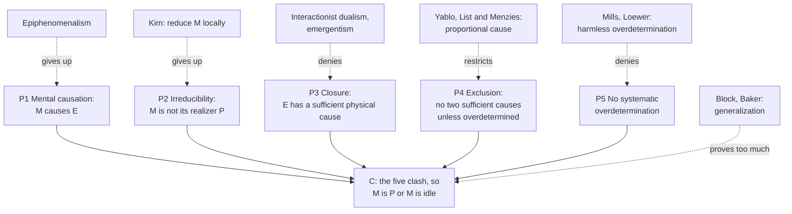

# Philosophy of Mind · Lesson 2.4: Mental causation and the exclusion problem

> ⏱ ~15 min · Module 2: Physicalism and mental causation · Builds on: [2.3](02-03-anomalous-monism-and-supervenience.md), [2.2](02-02-functionalism.md), [`metaphysics` 4.2](../../metaphysics/lessons/04-02-counterfactual-causation.md) · Unlocks: [3.1](03-01-the-hard-problem.md), [5.3](05-03-hylomorphism-tested.md)

## Why this matters

You are thirsty, you decide to drink, and your hand closes on the glass. A neuroscientist with perfect instruments traces the movement back through muscle, motor neurons and cortex, and at every step finds a sufficient physical cause. She never writes "decision" in her log. If the physical story is complete, what did the decision add? Every nonreductive physicalism in this module inherits that question.

## The idea

A trained network labels a photo "cat", and the matrix arithmetic is enough to produce the label. Did "detecting a cat" cause it, or is that our name for what the arithmetic did? Most people want to say both.

Four claims put minds in the same squeeze:

- Your decision caused the reach.
- The decision is not the neural state that realizes it, since a differently built brain could make it ([multiple realizability](../reference.md#multiple-realizability), [2.2](02-02-functionalism.md)).
- The reach has a sufficient physical cause ([causal closure](../reference.md#causal-closure), as [1.2](01-02-substance-dualism-today.md) states it).
- An effect does not get two sufficient causes unless it is a coincidence, like a firing squad's two bullets.

Hold all four and the decision has nothing left to do. That is Jaegwon Kim's [exclusion argument](../reference.md#exclusion-argument). A [reductive physicalist](../reference.md#reductive-physicalism) drops the second claim; a [nonreductive physicalist](../reference.md#nonreductive-physicalism) must say which other one fails.

The argument has two ancestors. [2.3](02-03-anomalous-monism-and-supervenience.md) taught Davidson's [anomalous monism](../reference.md#anomalous-monism): every mental event is physical, and only physical descriptions enter strict laws. Critics (Stoutland, Honderich, Sosa) replied that mental events then cause only *as* physical events. Terence Horgan named what is missing "quausation" ("Mental Quausation", 1989), causing *qua* mental, and Davidson answered ("Thinking Causes", 1993) that causation relates events however described. That is the [quausation charge](../reference.md#quausation). Kim's argument is the charge without the strict laws: it needs only supervenience, closure and exclusion, so it reaches every nonreductive view. The older ancestor is Elisabeth's objection to Descartes ([`modern-philosophy` 1.4](../../modern-philosophy/lessons/01-04-the-real-distinction-and-the-interaction-problem.md)), with the premise changed: she asked how something unextended could push a body, and Kim asks what is left for the mind to do once the physical is sufficient. Overdetermination in single cases is [`metaphysics` 4.2](../../metaphysics/lessons/04-02-counterfactual-causation.md)'s; here the question is whether it could be systematic.

## The argument

Kim's exclusion argument (*Mind in a Physical World*, 1998; *Physicalism, or Something Near Enough*, 2005), refining Norman Malcolm's "The Conceivability of Mechanism" (1968). Let *M* be a mental property, *P* the physical property realizing it on this occasion, and *E* a physical effect, such as the reach.

**P1. Mental causation.** An instance of *M* causes *E*. *In words:* the decision moved the hand.

**P2. Irreducibility.** *M* supervenes on physical properties and is realized here by *P*, but is identical to no physical property. *In words:* the decision is something the neural state amounts to, not the neural state itself.

**P3. Closure.** Every physical event that has a cause at a time has a sufficient physical cause at that time. Here that cause is *P*. *In words:* the physical story has no gaps.

**P4. Exclusion.** No event has two distinct sufficient causes at one time unless it is a genuine case of overdetermination. *In words:* one complete cause per effect, barring coincidence.

**P5. No systematic overdetermination.** Mental and physical causes of behaviour are not such cases. *In words:* actions are not caused twice over, every time.

**∴ C.** P1 to P5 cannot all be true, so either *M* is *P* (give up P2) or *M* causes nothing (give up P1). *In words:* reduce the mind, or idle it.

Kim's fullest version, the *supervenience argument*, starts from one thought causing another. A mental property can bring about a second one only by bringing about that property's physical base, so mental-to-mental causation becomes mental-to-physical, and the argument above takes over.

**Reduce (Kim's own exit).** Define *M* by its causal role, find what plays the role in a kind of creature, and identify *M*-in-that-kind with the occupant. By the causal inheritance principle ([`philosophy-of-science` 4.5](../../philosophy-of-science/lessons/04-05-reduction-and-emergence.md)), an instance of *M* then has exactly its realizer's powers. This is [functional reduction](../reference.md#functional-reduction); its price is that "decision" names different properties in differently built creatures. Kim held that qualia resist it, leaving an irreducible, causally idle residue: physicalism "near enough".

**Give up P1: [epiphenomenalism](../reference.md#epiphenomenalism).** The fallback for a property dualist who accepts closure and exclusion. T. H. Huxley's 1874 image is the steam-whistle that accompanies a locomotive's work without influencing its machinery (Boss 2 reads the passage). The price is self-stultification: if judgments never affect speech, your "I decided" is not produced by the decision. Epiphenomenalists reply that knowing a state need not be caused by it.

**Deny P3.** An interactionist dualist ([1.2](01-02-substance-dualism-today.md)) or an emergentist treats closure as an empirical generalization that may fail in brains.

**Deny P5: accept [systematic overdetermination](../reference.md#systematic-overdetermination).** Eugene Mills ("Interactionism and Overdetermination", 1996) lets a dualist say that mind and brain each suffice: had either occurred without the other, the action would still have occurred. Barry Loewer (2002), a physicalist, calls such overdetermination widespread and harmless. The price is the coincidence charge, two complete causes at every action; the physicalist answers that the two are not independent.

**Restrict P4: [proportionality](../reference.md#proportionality).** Stephen Yablo ("Mental Causation", 1992) holds that a cause should be proportional to its effect: specific enough, and no more. Mental properties stand to their realizers as determinables to determinates, as red stands to scarlet, and a determinable does not compete with its determinates. Christian List and Peter Menzies ("Nonreductive Physicalism and the Limits of the Exclusion Principle", 2009) recast this as difference-making: *F* makes a difference to *G* when relevantly similar situations with *F* have *G* and those without *F* lack it. On that test exclusion is neither true nor false a priori. When the effect would survive a change of realizer ([realization-insensitivity](../reference.md#realization-insensitivity)), the mental property is the difference-maker and the realizer is not: exclusion runs downward. When the effect hinges on the exact realizer, both make a difference.

**The [generalization objection](../reference.md#generalization-objection).** Ned Block ("Do Causal Powers Drain Away?", 2003), with Lynne Rudder Baker (1993) before him, denies no premise. The objection is that the argument proves too much. If it works, it idles every multiply realized property of chemistry, biology and geology in favour of the level below, and if there is no bottom level, causation drains away altogether. So something in it is wrong, though the objection does not say what. Kim (1998, pp. 77-87) replies with [levels and orders](../reference.md#levels-and-orders). Exclusion pits a *second-order* property (having some property that plays a role) against its realizer, both had by one thing at one level. A table's mass of 10 kilograms is not second-order: it is a property of the whole, built from its parts' masses, with powers no part has, so nothing drains through it. What stays threatened is every functional property, mental or not, and Kim's cure for all of them is local reduction.

Two families decline the framing: a Russellian monist ([3.5](03-05-panpsychism-and-russellian-monism.md)) makes mental properties the grounds of physical dispositions, and a hylomorphist ([5.3](05-03-hylomorphism-tested.md)) denies that form competes with matter as an efficient cause.

**Where the argument is weakest.** P4. The strongest objection is proportionality made precise: a sufficient cause need not be a difference-maker, so sufficiency excludes nothing by itself. The strongest reply is Kim's (2005): exclusion concerns causation as production, a stronger relation than counterfactual dependence, and dependence alone cannot tell a cause from something that rides along. List and Menzies answer that production has never been explicated. The proportionalist concedes that the realizer physically produces the movement; Kim concedes that mental properties can satisfy the counterfactuals, and rests everything on dependence not being the relation at issue.

## Argument map

Each dashed edge is an exit and the premise it targets; only the generalization objection attacks the whole set.

## Worked examples

**Example 1 (clean case: the glass of water).** Let *D* be your decision to drink, *N* the pattern of cortical activity realizing it, and *R* the reach.

1. P1: *D* caused *R*, as any psychologist would say.
2. P2: *D* is not *N*. A slightly different pattern, or a differently wired brain, could realize the same decision, so the functionalist of [2.2](02-02-functionalism.md) identifies *D* with a role.
3. P3: *R* has a sufficient physical cause when *D* occurs, and the candidate is *N*, via motor cortex and spinal cord.
4. P4 and P5: *R* has not two sufficient causes, *D* and *N*, unless overdetermined, and no coincidence brings both about, since *N* is what makes *D* present.

So *N* takes the credit, and *D* keeps it only if *D* just is *N*, which is Kim's route: in creatures built like you, deciding to drink is the occupant of the deciding role. Note where the weight falls. P3 is an empirical bet about brains; P4 is a claim about what causation is, and that is where the nonreductive physicalist pushes.

**Example 2 (hard case: Yablo's pigeon).** Yablo's pigeon, Sophie, is trained to peck at red things and at nothing else. Shown a scarlet patch, she pecks. Was its being scarlet the cause, or its being red?

Run the difference-making test. Had the patch been crimson, she would still have pecked; had it not been red, she would not have. Redness passes both halves and scarletness fails the second, so redness is the proportional cause. Scarletness is sufficient but too specific: citing it suggests that Sophie would ignore crimson. Yablo maps it onto the mind: the decision is redness, its exact neural realizer is scarletness, and the realizer is excluded, not the decision.

Now the strain. Train a pigeon to peck at one shade only, a variant List and Menzies discuss, and the verdict flips: the determinate is the difference-maker and the determinable is not. So proportionality does not guarantee mental causation. It makes the question empirical: does behaviour survive small changes in which neurons realize the decision? Critics (Ehring 1996, Worley 1997, Funkhouser 2006) add that mental properties are not determinables of neural ones at all: red and scarlet share a space of colours, and a belief and a firing pattern share none.

Here the account stops. The proportionalist says the pigeon shows what causes are: difference-makers at the right grain. Kim says it shows only which description is best to cite, while the light from the patch into Sophie's eye did the producing. Nothing in the case decides between those pictures of causation.

## Watch out

- **You might think** the exclusion argument says that mental events cause nothing, **but actually** a token physicalist grants that the event that is your decision causes the reach. The question is whether it does so *in virtue of* being a decision, which token identity cannot answer; Kim's exit needs type identities, if only local ones ([type and token identity](../reference.md#type-and-token-identity)).

- **You might think** proportionality makes the mental property and its realizer both causes, **but actually** on List and Menzies's test, when the effect is realization-insensitive the realizer is not a difference-maker: exclusion runs downward. Both are causes only when the effect hinges on the exact realizer.

- **You might think** the generalization objection denies one of the premises, **but actually** it is a reductio on the whole set: if the argument is sound, chemistry and biology are idle too, so something is wrong. It does not say what, and Kim's reply targets the step from his argument to their case.

- **You might think** P5 bans overdetermination, **but actually** it bans *systematic* overdetermination. A firing squad is a one-off coincidence; mind and brain would both suffice at every action, and whether that is a coincidence depends on whether the two causes are independent.

## One-liner

> If the physical is closed and effects are not caused twice over, a mental property distinct from its realizer looks idle: reduce it, idle it, deny closure, accept overdetermination, or argue that a sufficient cause does not exclude a proportional one.

## Problems

**P1 (🟢) *(Reconstruct. Exegetical.)*** A chess player notices that her queen is attacked, and this causes her to decide to move the queen. Both are mental events.

(a) Reconstruct Kim's supervenience argument against the claim that the noticing caused the deciding, in at most seven numbered lines, ending in his dilemma. Use *M* (noticing), *M\** (deciding), and *P* and *P\** for their physical bases.

(b) Name the step that turns mental-to-mental causation into mental-to-physical causation, and the premise that licenses it. One sentence.

**P2 (🟡) *(Apply to a hard case. Exegetical (a) · Evaluative (b)–(c).)*** A line judge at a tennis match judges that the ball landed out and calls "Out!" Three replies to the exclusion argument as run on this case (written for this problem):

> (i) Had she made the same judgment with her brain in any of the slightly different states that also amount to it, she would still have called it; had she not judged the ball out, she would have stayed silent. The precise neural state made no difference that the judgment did not already make.
>
> (ii) The judgment is a non-physical state of her mind. It and the neural state each sufficed for the call: had either occurred without the other, she would still have called it.
>
> (iii) The judgment is real and her brain causes it, but it causes nothing. The call is the brain's work alone, and the judgment rides along.

(a) Name the exit each reply takes. One line each.

(b) For (i): what must be true of the case for the reply to show that the neural state is *not* a cause, rather than that both are? One sentence.

(c) For (ii): which of its two counterfactuals does closure guarantee, which has never been observed, and what does that cost the reply? Two sentences.

**P3 (🔴) *(Steelman and reply. Evaluative.)*** The heating comes on because the thermostat registered that the room had fallen below 20 degrees. In one house that property is realized by a bending bimetal strip, in another by a thermistor and a chip. Take Kim's reply as given: exclusion pits a second-order property against its realizer at one level, so a macroproperty like the strip's mass keeps its own powers, while a second-order property like registering-below-20 is efficacious only by local reduction to each realizer, exactly as a decision is.

State the generalization objection at its strongest as a defence of nonreductive physicalism, run Kim's reply on the thermostat, and say whether the objection saves nonreductive physicalism or only spreads the problem. Any verdict; 150 words or fewer.

Solutions

**P1** *(Exegetical (a)–(b))*

**Accept:** any wording that keeps the structure below, in up to seven lines.

**Must hit, strict (a):**

- *M* causes *M\**.

- *M\** supervenes on *P\**: given *P\**, *M\** is present whatever came before.

- So *M* causes *M\** only by causing *P\**.

- *M* is realized by *P*, and *P* is a sufficient physical cause of *P\** (closure).

- *M* is not *P* (irreducibility).

- *P\** has no two distinct sufficient causes unless overdetermined, and this is not overdetermination (exclusion, no systematic overdetermination).

- ∴ *M* does not cause *P\**, and so does not cause *M\**, unless *M* is *P*: reduce or idle.

**Must hit, strict (b):** the step "*M* causes *M\** only by causing *P\**", licensed by the supervenience of *M\** on *P\**. Once the base is present, the mental effect is present whatever else happened, so the only way to bring it about is to bring about its base.

**Wrong turns:** leaving out the supervenience of *M\**, which makes the argument look as if it concerned only behaviour. Letting closure act on *M\** directly, since closure covers physical effects only, which is why the argument has to go through *P\**. Concluding "the noticing does not exist" rather than "it causes nothing unless reduced".

**Model answer:** (a) 1. *M* causes *M\**. 2. *M\** supervenes on *P\**. 3. So *M* causes *M\** only by causing *P\**. 4. *M* supervenes on *P*, and *P* is a sufficient physical cause of *P\** (closure). 5. *M* is not *P* (irreducibility). 6. No event has two distinct sufficient causes unless overdetermined, and this is not overdetermination. ∴ 7. *M* causes neither *P\** nor *M\**, unless *M* is *P*. (b) Line 3, licensed by line 2: to produce a supervenient property you must produce its base.

---

**P2** *(Exegetical (a) · Evaluative (b)–(c))*

**Must hit, strict (a):**

- (i) proportionality, as difference-making (Yablo; List and Menzies).

- (ii) overdetermination accepted, in Mills's dualist form.

- (iii) epiphenomenalism: the reply gives up mental causation.

**Must hit, any verdict (b):** realization-insensitivity. In the nearest situations where she makes the same judgment with a different neural realizer, she still calls it. If the call hinged on that exact realizer, the neural state would be a difference-maker too and exclusion would fail. Credit a reply that adds Kim's rejoinder, that difference-making is not production.

**Must hit, any verdict (c):**

- "Had the neural state occurred without the judgment, she would still have called it" is guaranteed by closure, since the neural state suffices by itself.

- "Had the judgment occurred without the neural state, she would still have called it" describes something never observed, because the two always occur together. Its truth rests on the dualist's theory, not on evidence.

- The cost: every action has two independent complete causes, the coincidence charge, unless the reply adds a lawful link between them that explains why they always co-occur.

**Wrong turns:** calling (i) reduction because it mentions neural states, when it denies that the realizer is the cause. Calling (ii) a denial of closure, when it grants the physical cause. Calling (iii) property dualism, which is the doctrine (iii) is one exit from.

**Model answer:** (a) (i) proportionality; (ii) systematic overdetermination; (iii) epiphenomenalism. (b) The call must be realization-insensitive: in the nearest cases where the same judgment has a different realizer, she still calls it, so only the judgment passes both counterfactuals. (c) Closure guarantees that the neural state alone would have produced the call, but nobody has seen the judgment act without its neural partner, so that counterfactual is a posit. The reply then owes an account of why two independent sufficient causes coincide at every action.

---

**P3** *(Evaluative)*

**Must hit, any verdict:**

- State the objection as a reductio on the premise set, not as a denial of any one premise. At its strongest: we are more sure that special-science properties like this one cause things than we are of the exclusion premise, so the premises are what should go.

- Classify the case on Kim's scheme: registering-below-20 is second-order, a role filled by unlike realizers, so it is in the decision's position, while the strip's mass is not.

- Say what the objection shows after the reply: mental and functional special-science properties stand or fall together. That rescues nonreductive physicalism only with an added diagnosis of which premise fails, or an argument that special-science causation is more secure than the premises.

- Name the cost of the verdict. "Saves" owes the diagnosis. "Spreads" accepts that the thermostat's registering is causal only as locally reduced, which Kim accepts and a nonreductive physicalist calls the reductio.

**Wrong turns:** treating Block as denying closure. Making the strip's mass second-order. Declaring mental causation vindicated by the thermostat without saying which premise fails. Treating "the problem spreads" as itself refuting nonreductive physicalism.

**Model answer, one of several:** At its strongest, the objection says no argument whose premises idle the thermostat can be sounder than our confidence that the heating came on because the room got cold. Kim's reply narrows the target without removing it. Mass is a macroproperty with its own powers, but registering-below-20 is second-order, filled by a strip in one house and a chip in another, so it sits exactly where the decision sits. The objection therefore spreads the problem to every functional property. That is a rescue only if the nonreductive physicalist adds what the spread reveals: the culprit premise, most plausibly exclusion read as a claim about production. Without that, Kim can accept the spread at no cost, since his local reductions make the thermostat's registering causal in each house. So the objection relocates the burden rather than discharging it.

## Flashback

**From Lesson [2.2](02-02-functionalism.md) (Functionalism):** *(Reconstruct: Exegetical (a)–(c).)* A miniature folk theory of hunger, written for this problem:

> (1) Going without food causes hunger. (2) Seeing food causes the belief that food is at hand. (3) Hunger and the belief that food is at hand jointly cause eating. (4) Eating ends hunger.

(a) Write the theory's Ramsey sentence as an [analytic functionalist](../reference.md#analytic-functionalism) would, and say when a creature is hungry on that definition.

(b) Which terms does the sentence define, and why does it escape the circle that sank logical behaviourism in [2.1](02-01-behaviourism-and-the-identity-theory.md)? Two sentences.

(c) A [psychofunctionalist](../reference.md#psychofunctionalism) takes the hunger role from somewhere else. From where, and which charge of Block's dilemma does that answer and which does it invite? Two sentences.

Solution

**Must hit, strict (a):**

- Only the mental terms become variables; "food", "seeing" and "eating" stay; all four platitudes sit inside one pair of quantifiers:

$$\exists x\,\exists y\,\big[\,\text{going without food causes } x \;\wedge\; \text{seeing food causes } y \;\wedge\; x \text{ and } y \text{ jointly cause eating} \;\wedge\; \text{eating ends } x\,\big].$$

- A creature is hungry when it is in the state that fills the $x$-place in its realization of the whole sentence.

**Must hit, strict (b):** hunger and the belief are defined together, by their places in one pattern, with no mental word left over. 2.1's circle (a belief's analysis needs a desire, a desire's needs a belief) becomes one system with two unknowns, solved at once rather than term by term.

**Must hit, strict (c):** from empirical cognitive psychology (Fodor, 1968; Block and Fodor, 1972), so the role can be finer than the platitudes. That answers the liberalism charge, since fewer odd systems fill it, and invites the chauvinism charge, since creatures only roughly like us fail it ([liberalism and chauvinism](../reference.md#liberalism-and-chauvinism)).

**Wrong turns:** turning "food" or "eating" into variables. Giving each platitude its own quantifiers, so that nothing requires one state to fill all three of hunger's places. Reading the sentence as behaviourism, when $x$ and $y$ are inner states defined partly by their relations to each other. Saying psychofunctionalism escapes both charges.

**Model answer (b), (c):** (b) It defines hunger and the belief that food is at hand together, by their places in one pattern, so no mental word is left over; behaviourism's circle becomes one system with two unknowns. (c) From empirical cognitive psychology, which can draw the role more finely than common sense; that answers the liberalism charge and invites the chauvinism charge.

## Connections

- **Backward:** [2.3](02-03-anomalous-monism-and-supervenience.md) supplied anomalous monism and supervenience, and the quausation charge is the problem it left. [2.2](02-02-functionalism.md) supplied the role-and-realizer picture that exclusion attacks. [`metaphysics` 4.2](../../metaphysics/lessons/04-02-counterfactual-causation.md) owns overdetermination and preemption in single cases, and [1.2](01-02-substance-dualism-today.md) owns closure and the dualist's case against it.

- **Forward:** [3.1](03-01-the-hard-problem.md) takes up the qualia that Kim's own exit leaves unreduced, and [3.4](03-04-illusionism.md) and [3.5](03-05-panpsychism-and-russellian-monism.md) answer them in opposite ways. [5.3](05-03-hylomorphism-tested.md) asks whether formal causation escapes Kim's framing. Boss 2 sets the octopus against the proportionality reading and Kim's species-specific reduction.

- **Sideways:** The argument descends from Elisabeth's question to Descartes, with the premise changed ([`modern-philosophy` 1.4](../../modern-philosophy/lessons/01-04-the-real-distinction-and-the-interaction-problem.md)). [`apologetics-foundations` 3.2](../../apologetics-foundations/lessons/03-02-reason.md) runs exclusion on reasons: the argument from reason asks whether a belief can be caused by being seen to follow, and its nonreductive reply is this lesson's proportionality move. Difference-making and interventions as accounts of explanation are [`philosophy-of-science` 4.2](../../philosophy-of-science/lessons/04-02-causal-explanation.md), and causal inheritance and the special sciences are [`philosophy-of-science` 4.5](../../philosophy-of-science/lessons/04-05-reduction-and-emergence.md), where the generalization objection finds its examples.
