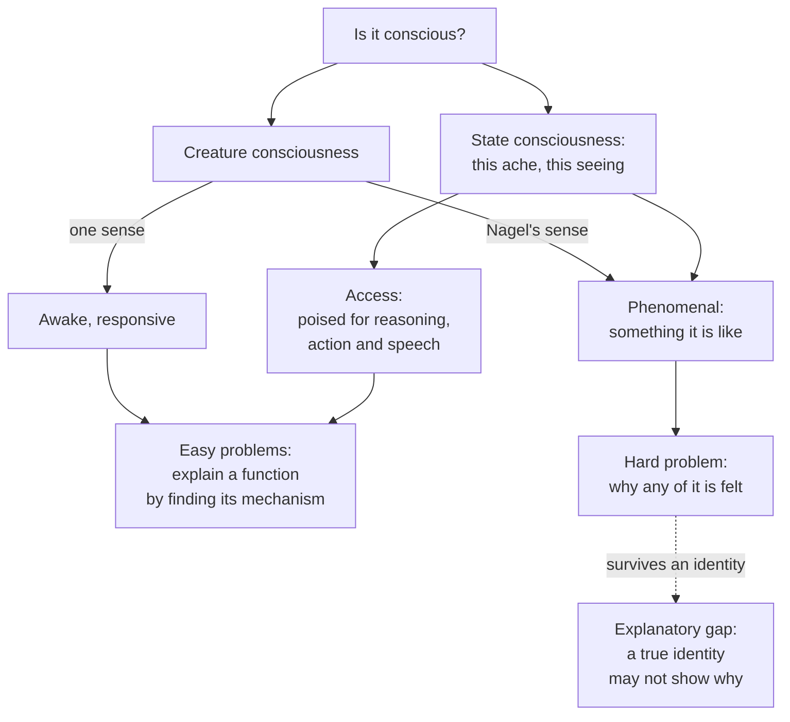

# Philosophy of Mind · Lesson 3.1: The hard problem

> ⏱ ~15 min · Module 3: Consciousness · Builds on: [1.4](01-04-zombies-conceivability-and-kripke.md), [2.2](02-02-functionalism.md), [`philosophy-of-science` 4.5](../../philosophy-of-science/lessons/04-05-reduction-and-emergence.md) · Unlocks: [3.2](03-02-representationalism-and-higher-order-theories.md), [3.3](03-03-global-workspace-and-the-science-of-consciousness.md), [3.4](03-04-illusionism.md)

## Why this matters

You can train a small network to sort strawberries by ripeness. It takes in pixels, separates red from green and prints "ripe". When you look at a strawberry you do all of that too, and one thing more: the red looks some way to you. Every job the network does is explained by describing its weights. Could any description of that kind, of the network or of your visual cortex, explain how the red looks? In the 2020 PhilPapers survey about 62 percent of respondents accepted or leaned towards yes when asked whether there is a hard problem of consciousness, and about 30 percent towards no. This lesson says what they disagree about.

## The idea

"Conscious" is said of creatures and of states. A creature is conscious when it is awake and responsive, or when it is a subject at all. A state, this ache or that seeing, is conscious when its owner is conscious *of* it. A state can be conscious in two different ways. Its information can be available: you can report it, reason with it, act on it. Or there can be something it is like to be in it, the throb of the ache. The first is a job the state does. The second does not look like a job at all.

C. D. Broad saw the split in 1925, with the mathematical archangel of [1.4](01-04-zombies-conceivability-and-kripke.md) (Example 2): from ammonia's microstructure he could deduce that it dissolves in water and what it does to the nerves of the nose, but not that it smells, let alone how. Everything he can deduce is a matter of what things do, and explaining what a thing does means finding the mechanism that does it: hard work, but work of a known kind. The smell is the odd item out. The [hard problem](../reference.md#hard-problem) is the claim that it is odd in principle, not merely unfinished. The [explanatory gap](../reference.md#explanatory-gap) is a further worry that survives even if you learn that the smell *is* some neural event: being told what a thing is need not show you why it is like that.

[1.3](01-03-the-knowledge-argument.md) and [1.4](01-04-zombies-conceivability-and-kripke.md) argued from this gap to metaphysics. This lesson stays a step earlier, at the question, and gives Chalmers's reason for the strong emergence [`philosophy-of-science` 4.5](../../philosophy-of-science/lessons/04-05-reduction-and-emergence.md) reported.

## The argument

**The target.** Thomas Nagel ("What Is It Like to Be a Bat?", *Philosophical Review*, 1974) proposed that an organism has conscious states just when there is [something it is like](../reference.md#what-it-is-like) to be it, for it. We can imagine behaving like an echolocating bat, Nagel argued, but not what it is like for the bat. Science gains objectivity by moving away from any point of view, and with experience, moving away leaves the fact behind. His conclusion was not that physicalism is false but that we have no conception of how it could be true. The bat question was older: B. A. Farrell had raised it in "Experience" (*Mind*, 1950), drawing a deflationary moral, and T. L. S. Sprigge used the what-it-is-like test in 1971.

**The sorting.** Ned Block ("On a Confusion about a Function of Consciousness", *Behavioral and Brain Sciences*, 1995) called consciousness a "mongrel concept" and split it. A state is [access-conscious](../reference.md#phenomenal-and-access-consciousness) when its content is poised for use as a premise in reasoning and for the rational control of action and of speech. It is phenomenally conscious when there is something it is like to be in it. The confusion of his title is inferring a function of phenomenal consciousness from facts about access: blindsight patients ([`neuroscience` 3.2](../../neuroscience/lessons/03-02-vision.md)) lack both for the blind field, he argued, so their deficit shows a function of access. His case of phenomenal without access: a pneumatic drill outside, heard all along and noticed at noon. David Rosenthal ("Two Concepts of Consciousness", 1986) had drawn the other line, between [creature and state consciousness](../reference.md#creature-and-state-consciousness).

**The hard problem** (David Chalmers, "Facing Up to the Problem of Consciousness", *Journal of Consciousness Studies*, 1995).

**P1.** To explain a phenomenon [reductively](../reference.md#reductive-explanation) is to analyse it as the performance of a function and to find the mechanism that performs it. *In words:* the gene is whatever carries hereditary information, and stretches of DNA turn out to carry it.

**P2.** The [easy problems](../reference.md#easy-problems) are problems about functions: discriminating, categorizing and reacting to stimuli; integrating information; reporting mental states; access to one's own states; focusing attention; deliberate control of behaviour; the difference between waking and sleep. *In words:* each may take decades, but we know what an answer looks like.

**P3.** After every such function is explained, it remains an intelligible question why their performance is accompanied by experience. *In words:* no list of jobs done includes "and it felt like something".

**∴ C.** Phenomenal consciousness cannot be explained by P1's method, so its explanation needs something beyond mechanisms. *In words:* more of the same science will not reach it.

His own answer takes experience as fundamental, tied to physical processes by psychophysical laws.

**The gap** (Joseph Levine, "Materialism and Qualia: The Explanatory Gap", *Pacific Philosophical Quarterly*, 1983). Levine recast Kripke's modal argument of [1.4](01-04-zombies-conceivability-and-kripke.md) as a claim about explanation.

**L1.** "Heat is the motion of molecules" is fully explanatory. Our concept of heat was a causal role, and physics shows how molecular motion plays it. *In words:* once you see the mechanism, nothing about heat is left over.

**L2.** "Pain is C-fibre firing" explains pain's causal role but not why pain feels as it does. Nothing about the firing fits that feel rather than another. *In words:* the feel is left as a brute fact.

**L3.** Materialism requires that every phenomenon above the fundamental level be intelligible in terms of the mechanisms beneath it. *In words:* brute facts belong in physics, not in psychology.

**∴ C.** A psychophysical identity, even if true, leaves an [explanatory gap](../reference.md#explanatory-gap), which is a problem for materialism but, Levine said, no proof that it is false.

**Explaining is not identifying.** [Type-B physicalists](../reference.md#type-a-and-type-b-physicalism) such as David Papineau, and Ned Block with Robert Stalnaker (1999), reply that identities are never explained: once Mark Twain is Sam Clemens, "why is he Clemens?" has no answer, so a gap is no evidence of two things. Levine (*Purple Haze*, 2001) and Chalmers with Frank Jackson (2001) answer that the scientific identities were explained: heat was identified with molecular motion *because* molecular motion was shown to play heat's role. An [identity can be true without being explanatory](../reference.md#explaining-and-identifying), and the gap claim is that a psychophysical one would be such a case.

**Where the argument is weakest.** P3. The strongest objection is the type-A physicalist's, pressed by Daniel Dennett in reply to Chalmers: once every function is explained, including our disposition to insist that something is left over, nothing is left, as with "life" once its functions were explained. The strongest reply is Chalmers's (1995, and "Moving Forward on the Problem of Consciousness", 1997, where he names the type-A and type-B positions). The vitalists doubted that mechanisms could perform life's functions, and their doubt died when mechanisms were found. Experience is not a posited explainer like vital spirit but the thing to be explained. Chalmers concedes that P3 rests on a first-person datum that no third-person argument can force on someone who denies it. The type-A physicalist concedes that a nearly universal appearance is mistaken, and owes an account of why it persists ([3.4](03-04-illusionism.md)).

## Map of the questions

Every reading of "conscious" but one routes to a function and so to a mechanism; the phenomenal branch routes to the hard problem, and the dashed edge is Levine's gap.

## Worked examples

**Example 1 (clean case: a whiff of ammonia).** You uncap a bottle of household ammonia. Sort what happens.

- *Creature.* You are awake and alert. Waking versus sleep is on Chalmers's list of easy problems.

- *State, access side.* The information "ammonia, strong" is poised for reasoning (open a window), for action (you recap the bottle) and for speech ("that's strong"). Each is an easy problem: discrimination, categorization, capture of attention, report, deliberate control.

- *State, phenomenal side.* The sharp, stinging pungency, what it is like. This is what Broad's archangel could not deduce.

Now run P3: explain every item on the access list and ask whether the pungency was among them. Chalmers says it is not. The type-A physicalist says the pungency just is that cluster of discriminations and reactions, together with your readiness to judge that it is pungent. The sorting is neutral: both sides draw the same three rows and disagree only about whether the third names a further item.

**Example 2 (hard case: heat).** Levine's success story. Before kinetic theory the question was open: chemists treated heat as a fluid, caloric, into the nineteenth century ([`philosophy-of-science` 5.2](../../philosophy-of-science/lessons/05-02-the-pessimistic-induction-and-selective-realism.md)). Our concept of heat, Levine says, was a role: whatever we feel as warmth, expands the mercury in thermometers, makes some gases rise. Kinetic theory showed how molecular motion plays that role, and the gap closed. (Strictly, radiant heat is not molecular motion; [`philosophy-of-science` 4.5](../../philosophy-of-science/lessons/04-05-reduction-and-emergence.md) Ex 1 restricts temperature likewise.)

Here it strains. The role began "whatever we feel as warmth". Kinetic theory explains why molecular motion *causes* that feeling, not why the feeling feels as it does, and Levine grants that an objection on that score is just the problem about consciousness again. So the gap closed for heat by moving the felt warmth out of the fire and into the perceiver, Locke's move with secondary qualities ([`modern-philosophy` 3.2](../../modern-philosophy/lessons/03-02-locke-qualities-substance-and-essence.md)), to which Levine traced his own point. What was left over is the case in hand.

The type-A physicalist takes heat as the model: "pain" and "the smell of ammonia" will prove to be role concepts too, and their gap will close like heat's. Chalmers (1997) replies that heat, life and light were functions all along, so the analogy works only if experience is one, which is the question. The type-B physicalist adds that an identity can be true without being explanatory. The heat case gives no verdict on the point that decides it: whether our concept of experience is exhausted by a causal role.

## Watch out

- **You might think phenomenal and access consciousness come apart all the time, but actually** Block's distinction is conceptual. In ordinary cases they go together, and whether they ever separate is disputed. He doubted that his own example of access without phenomenality, "superblindsight", exists, and the overflow debate of [3.3](03-03-global-workspace-and-the-science-of-consciousness.md) is about the other direction.

- **You might think the hard problem says consciousness is non-physical, but actually** it is a claim about explanation. Levine did not conclude that materialism is false, type-B physicalists accept the gap and keep physicalism, and illusionists ([3.4](03-04-illusionism.md)) deny the explanandum is what it seems. That is "explained away", which is not the same as "explained".

- **You might think the easy problems are easy, but actually** Chalmers means only that we know what kind of answer would solve them, a mechanism that performs the function. One of them can fill a career.

- **You might think finding the neural correlate of an experience, or proving an identity, would close the gap, but actually** a correlation is a regularity and an identity a claim that there is one thing. Neither by itself shows why the state is like that.

## One-liner

> Most of what "conscious" means names a function, and functions are explained by finding mechanisms; the hard problem is the claim that there being something it is like is not a function, and the gap is the worry that even a true identity would leave it unexplained.

## Problems

**P1 (🟢)** *(Exegetical.)* In Block's sense, say whether each claim asserts access consciousness, phenomenal consciousness, or one without the other. For (iv), also name the evidence the claim rests on and which kind of consciousness that evidence shows. One line each.

(i) She could tell you the light had turned green, and she pulled away at once.

(ii) The green of the light looked a particular way to her, quite unlike the green of the leaves beside it.

(iii) When the fridge clicked off, he realized he had been hearing its hum for an hour, though until then it had played no part in his thinking or his speech.

(iv) Since he reported seeing the flash, there was something it was like for him to see it.

**P2 (🟡)** *(Diagnose. Exegetical (a)–(b).)* An invented press release, written for this problem:

> **Talvik Systems launches LucidIndex.** LucidIndex is the first device that truly measures consciousness. Its scalp sensors return a score from 0 to 100. In trials with surgical patients, scores fell below 20 under general anaesthesia and rose above 70 once patients woke and could follow spoken commands. Because the score tracks consciousness so precisely, the family of a patient who cannot move or speak will now know not just whether their loved one is conscious but how vividly she is experiencing the room: a score of 90 means a richer inner life than a score of 75.

(a) The trials validated the score against one thing. In this lesson's terms, which sense of "conscious" is that, and what kind of evidence did the validation use? Two sentences.

(b) The last sentence makes two further claims. Name the move each makes, in the lesson's terms, and say what would have to be shown to license it. 150 words or fewer.

**P3 (🔴)** *(Find the crux. Exegetical (a)–(b) · Evaluative (c).)* Chalmers (1995) holds that once every function in the vicinity of experience is explained, a further question remains. A type-A physicalist, such as Dennett as Chalmers classifies him (1997), holds that once the functions are explained, nothing is left to explain.

(a) Name two things they agree on. One line each.

(b) Name the single premise one affirms and the other denies, and state the crux as a conditional both would sign. Two sentences.

(c) What argument or finding would move each side? Any verdict; 150 words or fewer.

Solutions

**P1** *(Exegetical.)*

**Must hit, strict:**

- (i) Access. The content is used in report and in the rational control of action. Nothing is said about how the light looked.

- (ii) Phenomenal. It describes how the green looked, and contrasts two phenomenal characters.

- (iii) Phenomenal without access. It asserts that he heard the hum all along and denies that the hum's content was poised for thought or speech until the click. This is the shape of Block's drill case.

- (iv) It asserts phenomenal consciousness, resting on a report. A report shows access, so the claim infers phenomenal from access, which needs a bridging premise. Block's distinction exists to make that step visible.

**Wrong turns:** calling (i) "both" because she saw the light, when "saw" there is used in the access sense and no phenomenal claim is made; calling (iii) access because he later reports the hum, when the claim is about the hour before; calling (iv) access because a report is mentioned, when what it asserts is that there was something it was like.

**Model answer:** (i) access; (ii) phenomenal; (iii) phenomenal without access, for the hour before the click; (iv) phenomenal, inferred from a report, which is evidence of access only.

---

**P2** *(Exegetical (a)–(b).)*

**Accept (a):** "access consciousness" as the sense validated, if the answer says the score separates awake from anaesthetized patients and that command-following was the test. The strict answer is below.

**Must hit, strict (a):**

- The score was validated against creature consciousness in the wakefulness sense: anaesthetized against awake.

- The evidence was access-type behaviour: following a command shows that its content was poised to guide action. No measure of what anything was like for anyone was taken.

**Must hit, strict (b):**

- First move: from creature to state consciousness, from *whether* the patient is conscious to *what* she is conscious of and how ("experiencing the room", "vividly"). A single score calibrated on waking and sleep says nothing about which states are conscious or about their character. To license it, the score would need validating against contents and their richness, and in reporting subjects that can only be done through their reports.

- Second move: from a measure calibrated against access to phenomenal claims about a patient with no access-type output at all. To license it, the release needs the bridging premise that the physiology which goes with access also suffices for phenomenal consciousness, and still does when the output systems are cut off. That is the step Block's distinction questions.

**Wrong turns:** saying the device cannot measure anything because of the hard problem, when the diagnosis needs no claim about the hard problem and goes through even if physicalism is true; saying the trial measured phenomenal consciousness because patients said they were awake; treating "richer inner life" as a third move about creature consciousness, when it is the first move with a number attached.

**Model answer:** (a) The trials validated the score against creature consciousness in the wakefulness sense, anaesthetized against awake. The evidence was command-following, which is access-type behaviour, so no phenomenal measure entered the validation. (b) "How vividly she is experiencing the room" moves from creature to state consciousness, from whether she is conscious to what she is conscious of and with what character. One number fitted to waking and sleep cannot show that; it would need validating against contents and richness, which in reporting patients means reports. Applying it to a patient who cannot move or speak then moves from an access-calibrated signal to phenomenal claims where access is absent. That needs the premise that the physiology of access suffices for phenomenal consciousness even when the systems that act and speak are offline, and the trials never tested it.

---

**P3** *(Exegetical (a)–(b) · Evaluative (c).)*

**Accept:** any statement of the crux that isolates whether our concept of experience is exhausted by a functional role, including stating it as whether phenomenal truths follow a priori from the physical and functional truths.

**Must hit, strict (a):** any two of: that reductive explanation analyses a phenomenon as a function and finds its mechanism (P1); that the easy problems are problems about functions and will yield to that method (P2); that we judge and report that there is something it is like, so that judgment needs explaining; that physics and neuroscience are not about to be overturned. Physicalism is **not** shared: Chalmers rejects it.

**Must hit, strict (b):**

- The premise is P3: after every function is explained, an intelligible further question remains. Chalmers affirms it; the type-A physicalist denies it.

- A conditional each would sign: "If our concept of experience is exhausted by a causal role, as our concept of heat was, then explaining the functions explains experience; if it is not, the functions can all be explained and experience left over."

**Must hit, any verdict (c):**

- Say what would move Chalmers: a functional account that, once grasped, made the further question as idle as "but why is the motion of molecules heat?", or an argument that his conviction of a further question would arise whether or not there were one.

- Say what would move the type-A physicalist: an argument that the concept of experience contains an element no role captures, one that survives the charge of being only the persistent appearance the view predicts.

- Say why the dispute is hard to settle by data: it is largely about a concept, so new findings bear on it only through what they show about how that concept behaves.

**Wrong turns:** naming the crux as whether physicalism is true, when a type-B physicalist affirms P3 and keeps physicalism; treating the vitalism analogy as settling the crux either way, when Chalmers's reply is that life was a function all along; saying the type-A physicalist denies that people have experiences, when the view denies only that experience is something over and above the functions.

**Model answer (c), one of several:** Little empirical would move either side, because the dispute is over what our concept of experience contains. Chalmers would be moved by a functional theory that, once understood, left "but why is it felt?" as idle as asking why molecular motion is heat, which is how Levine's success story went. He might also be moved by a mechanism that predicts his very conviction of a further question, though he would then ask whether it explains the conviction or the experience. The type-A physicalist would be moved by an argument that some element of the concept outruns every role, and that survives the reply that its persistence is just what a well-built brain would report. Neither side yet has that argument, so the crux stays where P3 put it.

## Flashback

**From Lesson [2.3](02-03-anomalous-monism-and-supervenience.md) (Anomalous monism and supervenience):** *(Formal model: Formal (a)–(b) · Exegetical (c).)* Take $P = \{K, L\}$ as the physical family and $M = \{Q\}$, with $Q$ a phenomenal property. The worlds below are all the possible worlds: $w_1$ is actual, $w_2$ obeys all of $w_1$'s laws of nature, and $w_3$ obeys only its physical laws.

| World | Individual | $K$ | $L$ | $Q$ |
|---|---|---|---|---|
| $w_1$ | $a$ | yes | yes | yes |
| $w_1$ | $b$ | yes | yes | yes |
| $w_1$ | $c$ | no | yes | no |
| $w_2$ | $d$ | yes | yes | yes |
| $w_3$ | $e$ | yes | yes | no |
| $w_3$ | $f$ | yes | yes | no |
| $w_3$ | $g$ | no | yes | no |

(a) Does [strong supervenience](../reference.md#strong-supervenience) of $M$ on $P$ hold over $w_1$ and $w_2$ alone, the worlds with the actual laws? Check by $P$-profile.

(b) Does it hold over all three worlds? List every violating pair, and say whether [weak supervenience](../reference.md#weak-supervenience) holds.

(c) Is the model consistent with physicalism, and which kind of dualist accepts the result of (a)? Two sentences.

Solution

(a) Strong supervenience compares across the worlds in play, so group everyone in $w_1$ and $w_2$ by $P$-profile. $(K, L)$: $a$, $b$, $d$, all $Q$. $(\neg K, L)$: $c$ alone. No two $P$-twins differ in $Q$, so it holds.

(b) With $w_3$ added, $(K, L)$ also covers $e$ and $f$, which lack $Q$. Strong supervenience fails, with $3 \times 2 = 6$ violating pairs: each of $a$, $b$, $d$ with each of $e$, $f$. The profile $(\neg K, L)$ gives none, since $c$ and $g$ both lack $Q$. Weak supervenience holds: the only twins within one world are $a$ and $b$ (both $Q$) and $e$ and $f$ (neither), which the theorem allows, since it runs only from strong to weak.

**Must hit, strict (c):**

- No. Physicalism needs supervenience with metaphysical necessity, over every possible world. The map $a \mapsto e$, $b \mapsto f$, $c \mapsto g$ preserves $P$, so $w_3$ is a physical duplicate of the actual world, adding nothing, that differs phenomenally; a physicalist must deny that $w_3$ is possible.

- The result of (a) has only nomological force, which a dualist with fundamental psychophysical laws accepts, reading $w_3$ as a world with different bridging laws: the shape of Chalmers's own answer in this lesson.

**Wrong turns:** comparing only within worlds in (b) and concluding that strong holds. Counting $c$ and $g$ as a violation. Taking (a) as evidence for physicalism, when the dualist predicts it too. Inferring that weak fails because strong does.

**Model answer (c):** No: physicalism needs supervenience over all possible worlds, and $w_3$ duplicates the actual world physically but not phenomenally. The result of (a) has only nomological force, which a dualist with psychophysical laws, such as Chalmers, accepts.

## Connections

- **Backward:** [1.3](01-03-the-knowledge-argument.md) and [1.4](01-04-zombies-conceivability-and-kripke.md) argue from this gap to metaphysical conclusions, and 1.4 owns the type-A and type-B taxonomy and Kripke's treatment of heat. The identities in Levine's argument are the identity theory of [2.1](02-01-behaviourism-and-the-identity-theory.md), and his functional statement is [2.2](02-02-functionalism.md)'s. [`philosophy-of-science` 4.5](../../philosophy-of-science/lessons/04-05-reduction-and-emergence.md) defined the strong emergence that Chalmers thinks consciousness needs, and Locke's gap between texture and the idea of red in [`modern-philosophy` 3.2](../../modern-philosophy/lessons/03-02-locke-qualities-substance-and-essence.md) is the one Levine says he is restating.

- **Forward:** [3.2](03-02-representationalism-and-higher-order-theories.md) asks what makes a state conscious; [3.3](03-03-global-workspace-and-the-science-of-consciousness.md) asks what the science of correlates can test, with access as its evidence; [3.4](03-04-illusionism.md) and [3.5](03-05-panpsychism-and-russellian-monism.md) are the two radical answers to the hard problem; [6.4](06-04-could-a-machine-be-conscious.md) asks what evidence of phenomenal consciousness a machine could give.

- **Sideways:** Levine says the D-N model of [`philosophy-of-science` 4.1](../../philosophy-of-science/lessons/04-01-the-deductive-nomological-model.md) is too weak for his sense of "explain", since his identities would support deductions; his demand for intelligibility belongs with [4.3](../../philosophy-of-science/lessons/04-03-unification-and-the-pragmatics-of-explanation.md) there. [`neuroscience` 4.3](../../neuroscience/lessons/04-03-attention-decision-making.md) draws the easy-hard line on itself: evidence accumulation explains commitment, not awareness of committing. [`apologetics-foundations` 3.3](../../apologetics-foundations/lessons/03-03-consciousness.md) takes as a premise that phenomenal facts are not entailed by physical facts as physics states them. Read as a priori entailment, type-B physicalists grant it; read as necessitation, they deny it; type-A physicalists deny both readings.
