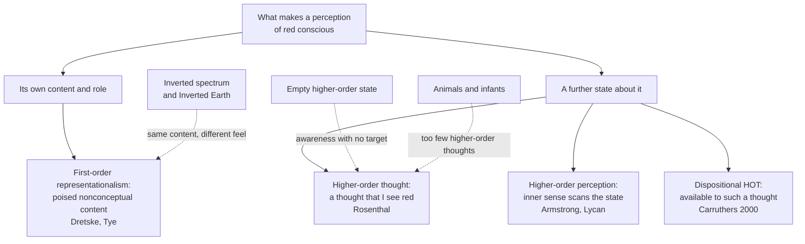

# Philosophy of Mind · Lesson 3.2: Representationalism and higher-order theories

> ⏱ ~15 min · Module 3: Consciousness · Builds on: [3.1](03-01-the-hard-problem.md), [2.2](02-02-functionalism.md), [`phenomenology-and-personalism` 1.1](../../phenomenology-and-personalism/lessons/01-01-intentionality-from-brentano-to-husserl.md) · Unlocks: [3.3](03-03-global-workspace-and-the-science-of-consciousness.md), [3.4](03-04-illusionism.md), [4.5](04-05-intentionalism-naive-realism-and-disjunctivism.md)

## Why this matters

You drive home deep in conversation and "come to" at your door with no memory of the last three junctions. You stopped at every red light, so you saw them. Were those seeings conscious? D. M. Armstrong (*A Materialist Theory of the Mind*, 1968) used the case to argue that perceiving and being aware of perceiving come apart. The two theories here try to say what the difference is, each with something a physicalist already has: representation.

## The idea

Look at a ripe tomato and try to attend to your *seeing* rather than to the tomato. Most people find only more tomato: its redness, its shine, its place over there. That is the [transparency of experience](../reference.md#transparency-of-experience). Gilbert Harman ("The Intrinsic Quality of Experience", 1990) made it an argument: if attending to an experience turns up only what it presents, then what it is like to have it is fixed by what it presents. That is [first-order representationalism](../reference.md#first-order-representationalism): phenomenal character is content of the right kind, and nothing more.

The second idea starts from another datum. Some states are plainly mental and plainly unconscious: the driver's seeings, the guesses of a [blindsight](../reference.md#blindsight) patient who points to lights he insists he cannot see ([`neuroscience` 3.2](../../neuroscience/lessons/03-02-vision.md)). What the conscious ones have, on the higher-order view, is that you are aware of them. A conscious state is one you represent yourself as being in, by an inner perception or by a thought.

[3.1](03-01-the-hard-problem.md) separated [phenomenal from access consciousness](../reference.md#phenomenal-and-access-consciousness) and [creature from state consciousness](../reference.md#creature-and-state-consciousness). Both theories here concern state consciousness and aim at the phenomenal kind.

## Source

G. E. Moore, "The Refutation of Idealism" (*Mind*, 1903, pp. 446 and 450), in the wording of its reprint in *Philosophical Studies* (1922):

> that which makes the sensation of blue a mental fact seems to escape us: it seems, if I may use a metaphor, to be transparent—we look through it and see nothing but the blue [...] When we try to introspect the sensation of blue, all we can see is the blue: the other element is as if it were diaphanous. Yet it *can* be distinguished if we look attentively enough, and if we know that there is something to look for.

Transparency is traced to this passage ("look through it", "nothing but the blue", "diaphanous"), but it ends by reversing direction. Moore's "other element" is the awareness itself, which his paper needs: he argues that blue and the awareness of blue are distinct. His claim is that it is hard to find, not that it is absent, and the deciding words are "as if" and the italic *can*. Harman's thesis, that the most careful attention finds nothing intrinsic to the experience, is the one Moore rejected.

## The argument

**The transparency argument**, with the two premises it needs.

**P1 (transparency).** Introspective attention to a perceptual experience finds no feature of it beyond the features it presents its objects as having. *In words:* look inward and you find only the tomato, as it looks from here.

**P2.** If an experience had phenomenal features beyond its content, attention could find them. *In words:* nothing in how it feels is hidden from the one who feels it.

**∴ C.** Phenomenal character supervenes on representational content: no difference in what it is like without a difference in what is represented. *In words:* fix the content and you have fixed the feel.

Representing is cheap (the word "red" feels like nothing), so each theory says which representing counts. For Fred Dretske (*Naturalizing the Mind*, 1995) it is sensory states whose evolved function is to indicate; conscious states are states we are conscious *with*, not *of*. For Michael Tye (*Ten Problems of Consciousness*, 1995) it is PANIC: poised, abstract, nonconceptual intentional content. *Poised* means ready to make a direct difference to belief and desire; *abstract*, that no particular object enters it, so a hallucination can share it; *nonconceptual*, finer-grained than your concepts, since you can tell apart more reds than you can name. Tye and Lycan extend this to pain, which represents a disorder at a place in the body. Here they side with Brentano, who held pain intentional, against Reid, for whom a pain has no object beyond itself ([`phenomenology-and-personalism` 1.1](../../phenomenology-and-personalism/lessons/01-01-intentionality-from-brentano-to-husserl.md); [`modern-philosophy` 4.5](../../modern-philosophy/lessons/04-05-reid-common-sense-against-the-way-of-ideas.md)).

**Two cases aimed at C.** Locke (*Essay* II.xxxii.15) supposed a violet might give one man the idea a marigold gives another, undetectably. Turned on representationalism, the [inverted spectrum](../reference.md#inverted-spectrum) runs: Invert, inverted from birth, sorts colours as well as anyone and shares the community's colour words, so the tomato looks *red* to her too. Same content, different character. Ned Block's [Inverted Earth](../reference.md#inverted-earth) ("Inverted Earth", 1990) runs the other way. Fitted with colour-inverting lenses, you are moved to a planet where the sky is yellow and the locals' "blue" means yellow, and notice nothing. After long enough, Block argues, your contents shift to match theirs while what it is like stays put: same character, different content.

The replies. To inversion: one of the two misperceives after all (Tye), or the case is conceivable but impossible (Lycan). To Inverted Earth: character is as wide as content, so molecular duplicates can differ in it (the "phenomenal externalism" of Dretske, Tye and Lycan). Or, on Dretske's teleology, your visual states keep the content evolution gave them and you misperceive indefinitely, at the price that Swampman, with no evolutionary history, has no experiences ([4.2](04-02-naturalizing-content.md)).

**The higher-order argument.**

**P3.** Mental states of every kind, perceptions included, occur both consciously and unconsciously. *In words:* the driver did see the lights.

**P4 (the [transitivity principle](../reference.md#transitivity-principle)).** A state is conscious only if its subject is in some way aware of being in it. *In words:* a state you are wholly unaware of is not a conscious one.

**∴ C′.** A state is conscious when its subject has a suitable higher-order representation of it. *In words:* consciousness is a relation between a state and a representation of that state.

[Higher-order perception](../reference.md#higher-order-perception) (Armstrong; William Lycan, *Consciousness and Experience*, 1996) makes it an inner sense scanning first-order states, a descendant of Locke's reflection ([`modern-philosophy` 3.1](../../modern-philosophy/lessons/03-01-locke-against-innate-ideas.md)). Critics object that inner sensing should then feel like something, and nothing does; Lycan later gave it up (Sauret and Lycan, 2014). [Higher-order thought](../reference.md#higher-order-thought) (David Rosenthal, "Two Concepts of Consciousness", 1986; *Consciousness and Mind*, 2005) makes it a thought, assertoric and not reached by conscious inference, that one is in the state. That thought is normally unconscious, which stops a regress. In Peter Carruthers's dispositional version (*Phenomenal Consciousness*, 2000) the state need only be *available* to such a thought.

**Two cases aimed at C′.** The [empty higher-order state](../reference.md#empty-higher-order-state) (Alex Byrne, 1997; Karen Neander, 1998; Block, 2011): a higher-order state can occur without its target. Is the subject then conscious of seeing red with no seeing? Dispositional theories escape: availability needs something available. The [animal and infant objection](../reference.md#animal-and-infant-objection) (Jamieson and Bekoff, 1992; Dretske, 1995; Tye, 1995): cats and newborns probably cannot think about their own experiences, so on HOT theory they would have none. Carruthers was not its author but the theorist who accepted the consequence ("Brute Experience", 1989; 2000), later arguing (2005) that it matters little for how animals are treated. Rocco Gennaro replies that the higher-order states needed are simpler than those psychologists test for.

**Where the argument is weakest.** P1. The strongest objection is Block's: some introspectible features belong to the representing, not to what is represented. Take off your glasses and you notice blur, though nothing looks blurry; free-floating anxiety represents little and feels like a great deal. Block calls such qualities "mental paint". The strongest reply is that each case hides a content difference: blurry seeing represents less, failing to represent sharp edges (Tye), and anxiety represents that something bad is coming. The representationalist concedes that P1 must be redeemed case by case, and one clear counterexample sinks C. The critic concedes that ordinary vision is overwhelmingly transparent (Brian Loar, a critic, grants it) and that paint shows only under unusual attention, as Moore said.

## Map of positions

The theories split on whether consciousness lies in a state's own role or in its relation to a second state, and each objection attacks one branch.

## Worked examples

**Example 1 (clean case: the red light, twice).** At one junction the driver stops at a red light while talking; at the next she is attending, and sees it. Both states represent the same red at the same place.

- **First-order representationalism.** Same content, so what separates them is how it is held: for Tye, poise. If the autopilot state only steered her foot, it was not phenomenally conscious. If it was ready to inform belief (asked, she could have said "red"), it was conscious, but unattended and at once forgotten.

- **Higher-order thought.** The first seeing came with no thought that she was seeing red, so it was unconscious; the second came with one. Higher-order perception agrees, with an inner scan for the thought.

Both agree that content does not separate the seeings; they disagree about what does: the state's own role, or a further state about it.

**Example 2 (hard case: the dentist's chair).** Rosenthal (2005) cites dental patients who report pain while the drill works on a tooth whose nerves are dead, and who, once told, report only noise and vibration. Suppose fear produced a non-inferential thought that one is in pain, with no first-order pain. What is it like?

- **Rosenthal:** a conscious pain. Consciousness is how one's mental life appears to one, and here it appears to contain pain.

- **Gennaro (2012):** nothing is conscious: the theory was meant to say what makes a first-order state conscious, and there is none.

- **Block (2011):** the case shows the "ambitious" higher-order theory, which claims to explain phenomenal consciousness, to be incoherent: there is something it is like, yet no state is the target of a higher-order thought. And a mere thought of pain has no reason to inherit pain's awfulness.

Here the account stops, because the verdict depends on what the patient had. Fear may have caused a real first-order pain from the top down, or a vivid imagining of one, and then nothing was empty. Nothing said from the chair tells these apart: each yields the same sincere "it hurt". The HOT theorist calls this harmless, since seeming was all consciousness ever was. The critic presses what Neander called the division of phenomenal labour: if the higher-order state can do the work alone, what does the first-order state ever contribute?

## Watch out

- **You might think transparency is Moore's thesis, but actually** Moore supplied the image and denied the strong thesis: the awareness "*can* be distinguished if we look attentively enough". Harman's claim is that it cannot.

- **You might think a higher-order thought is an act of introspection, but actually** it is normally unconscious. Introspection is the rarer case where a third-order thought makes it conscious; the theory never says the driver was thinking about her seeing.

- **You might think an inverted subject is one to whom tomatoes look green, but actually** that is a difference in content, which the representationalist welcomes. The case against C needs the tomato to look red to both, with what it is like differing.

- **You might think a theory of how we become aware of our states is thereby a theory of what it is like, but actually** that is the phenomenal/access conflation in higher-order dress. Block separates a "modest" higher-order theory of state consciousness from the "ambitious" one that explains phenomenal consciousness, and aims his 2011 objection only at the second.

## One-liner

> First-order representationalism says what it is like is what an experience represents, poised for use; higher-order theories say a state is conscious when you represent yourself as being in it; inversion tests the first, and a higher-order state with no target the second.

## Problems

**P1 (🟢)** *(Exegetical.)* Each claim below is a paraphrase written for this problem. Say whether it belongs to first-order representationalism, higher-order thought, higher-order perception, or none of these, and name one defender. One line each.

(a) A perception is conscious when an internal monitor scans it and produces a representation of it as an experience.

(b) Conscious states are not states we are aware of; they are states we are aware with.

(c) Two experiences of the same ripe tomato can represent exactly the same colour and still differ in what it is like to have them.

(d) If, without conscious inference, you think you are in pain, you are in a conscious pain, even when there is no pain state for the thought to be about.

**P2 (🟡)** *(Counterexample: Evaluative (a)–(b).)* Conclusion C of the transparency argument says there is no difference in what it is like without a difference in what is represented.

(a) Build an inversion case against C, using neither Locke's flowers nor Inverted Earth. In at most four sentences, say what the two subjects' experiences represent, what fixes that, and how their experiences differ.

(b) Give the representationalist's strongest reply to your case and say what it costs. Any verdict; 150 words or fewer.

**P3 (🔴)** *(Find the crux: Exegetical (a) · Evaluative (b).)* Rosenthal holds that a state is conscious when one has a suitable higher-order thought about it, and that such a thought suffices for a conscious pain even with no pain present. Block holds that phenomenal consciousness can occur without access (1995), and that the empty higher-order state shows the ambitious higher-order theory incoherent (2011).

(a) Name the single premise Rosenthal affirms and Block denies, and state the crux as a conditional both would sign. Two sentences.

(b) Rosenthal (2005) also argues that a wine-tasting course changes how a wine tastes by giving you new concepts, and takes this as evidence that higher-order states shape what it is like. A first-order theorist replies that "oaky" and "tannic" are concepts of the wine, not of your experience of it. Does the case bear on your crux? Say what finding would move each side. Any verdict; 150 words or fewer.

Solutions

**P1** *(Exegetical.)*

**Must hit, strict:**

- (a) Higher-order perception: Armstrong (1968) or Lycan (1996). The monitor is an inner sense, and its output is perception-like, not a thought.

- (b) First-order representationalism: Dretske (1995). Being conscious *with* a state means using it to be aware of the world, with no awareness of the state required.

- (c) None of these: Block, as a critic of representationalism (1990; 2003). It denies C, which first-order theories assert, and it says nothing about higher-order awareness.

- (d) Higher-order thought, in Rosenthal's actualist form (2005). "Think" makes it a thought; accepting a targetless case makes it actualist.

**Accept (c):** higher-order thought, Rosenthal, if the answer says why: on that view what it is like follows the higher-order thought, so two states with the same first-order content can differ in it when the thoughts about them differ.

**Wrong turns:** classing (b) as higher-order because it mentions awareness, when it denies that consciousness needs awareness *of* the state. Classing (c) as first-order because it mentions content. Assigning (d) to Carruthers's dispositional theory, on which a higher-order state cannot occur without a target, since availability needs something available.

**Model answer:** (a) Higher-order perception, Lycan. (b) First-order representationalism, Dretske. (c) None: Block. (d) Higher-order thought, Rosenthal.

---

**P2** *(Evaluative (a)–(b).)*

**Accept (a):** any case with the structure below, including achromatic or alien colour vision, which avoids the asymmetries of human colour space.

**Must hit, any verdict (a):**

- Same content, secured by the facts the content theory cares about: inverted from birth, equally reliable discrimination, and the same colour words used the same way. So the tomato looks *red* to both.

- Different character, stipulated: what it is like for one to see the tomato is what it is like for the other to see something green.

- No claim that the tomato looks green to one of them, which would be a content difference.

**Must hit, any verdict (b):**

- Name the claim of the case the reply attacks: the sameness of content, or the possibility of the case.

- Give its cost. If one subject misperceives, nothing in the case says which, and the verdict looks arbitrary. If the case is impossible, the representationalist owes an account of why a conceivable case is impossible, the burden a type-B physicalist carries in [1.4](01-04-zombies-conceivability-and-kripke.md). If the reply says the two represent different appearance properties (Shoemaker, 1994), the represented properties become dispositions to produce experiences, and the reduction of character to worldly content is lost.

**Wrong turns:** a case where the subjects disagree about which things are red, which is a content difference. Insisting the case be behaviourally undetectable: it need only keep content fixed. Replying that inversion is merely imaginable without saying why it is impossible.

**Model answer (a), one of several:** Two siblings have seen only in shades of grey since birth, and their brightness experiences are inverted relative to each other. Both call snow "white", sort objects by lightness equally well, and their visual states covary with the same reflectances, so both represent snow as white. Yet what it is like for one to see snow is what it is like for the other to see coal.

**Model answer (b), one of several:** The strongest reply denies sameness of content: since their visual systems differ, one of them misrepresents snow's lightness. This keeps C, but it needs a fact that makes one sibling the misperceiver, and the case was built so that discrimination, history and language give none. Calling one of them wrong then looks like a decision taken to save C. The alternative reply, that the case is conceivable but impossible, avoids the arbitrariness. Its cost is that the representationalist must explain away the conceivability, as the type-B physicalist does for zombies, and that only works if C is a necessary a posteriori truth with some independent support. Either way the case moves the burden onto the representationalist, though it does not refute C.

---

**P3** *(Exegetical (a) · Evaluative (b).)*

**Accept (a):** the crux stated through Block's distinction between modest and ambitious higher-order theories, or as the claim that what it is like is constituted by higher-order appearance.

**Must hit, strict (a):**

- The premise: there is something it is like to be in a state only if, and only as, the subject represents herself as being in it, that is, the transitivity principle read as an account of phenomenal consciousness. Rosenthal affirms it. Block denies it: phenomenal character belongs to first-order states and can occur without access or higher-order awareness.

- A conditional both would sign: "If what it is like is how one's mental life appears to one, an empty higher-order thought about pain yields a conscious pain; if phenomenal character belongs to first-order states whether or not one is aware of them, it yields at most a false thought that one is in pain."

**Must hit, any verdict (b):**

- Say what the case needs in order to bear on the crux: that the concepts changing the taste are concepts of experiences. If they are concepts of the wine, a first-order theorist explains the change as a change in what the experience represents, which C predicts.

- Name a finding for each side. For Rosenthal: changes in phenomenology that track acquiring concepts of one's experiences while first-order discrimination is held fixed. For Block: phenomenology that survives where higher-order representation is disrupted or absent.

**Wrong turns:** stating the crux as whether unconscious mental states exist, or whether an empty higher-order state can occur, since both accept these. Treating the wine case as an empty higher-order state. Claiming that introspective reports alone could settle it, when reports issue from higher-order states, the very thing in dispute.

**Model answer (b), one of several:** Only weakly. The wine course hands the taster new concepts, but "oaky" and "tannic" pick out properties of the wine. A first-order theorist reads the change as perceptual learning: the experience now represents more of the wine, so on C it feels different. That is no evidence for higher-order constitution. The case would bear on the crux if the concepts learned were concepts of the experience itself and first-order discrimination were held fixed while phenomenology changed. Reports could not show this alone, since a report expresses a higher-order state. Block's side would be supported instead by experience that survives disruption of whatever implements higher-order representation. As it stands, the wine case shows that concepts shape experience, which both sides already accept.

## Flashback

**From Lesson [2.4](02-04-mental-causation-and-the-exclusion-problem.md) (Mental causation and the exclusion problem):** *(Diagnose: Exegetical (a)–(b).)* From a study guide (invented, written for this problem):

> Davidson settled mental causation. Your belief that the train is leaving is a neural event, and that event moves your legs, so your belief moves your legs. Every nonreductive physicalist grants that each mental event is a physical event, so each can say the same, and Kim's exclusion argument has no target.

(a) Grant the second sentence. What does it leave unshown, what is the charge that presses this called, and how did Davidson answer it? Two sentences.

(b) Why does Kim's argument still have a target, and why does it reach nonreductive physicalists who reject Davidson's strict laws? Two sentences.

Solution

**Must hit, strict (a):**

- Unshown: that the event moves your legs *in virtue of* being a belief, rather than only as a physical event. Token identity cannot answer that.

- The [quausation](../reference.md#quausation) charge, pressed by Stoutland, Honderich and Sosa and named by Terence Horgan ("Mental Quausation", 1989).

- Davidson's answer ("Thinking Causes", 1993): causation relates events however they are described.

**Must hit, strict (b):**

- Kim's target is the mental property. The nonreductive physicalist holds that the belief property is realized by a neural property and identical to none, and the [exclusion argument](../reference.md#exclusion-argument) asks what it adds once the realizer is a sufficient physical cause.

- It is the quausation charge without the strict laws. It needs supervenience and closure, with exclusion and no systematic overdetermination, so it reaches every nonreductive view, functionalism included, and leaves two exits: local type identity or idleness.

**Wrong turns:** calling the second sentence false, when Kim grants it. Answering (a) with the exclusion argument, when the charge aimed at Davidson rested on his strict laws. Saying Davidson replied by denying that mental events cause. Saying Kim's argument targets token identity, which it leaves standing.

**Model answer:** (a) It leaves unshown that your belief moves your legs *as* a belief, and not only as the neural event it also is: the quausation charge, named by Horgan, to which Davidson replied that causation relates events however described. (b) Kim asks whether a mental property, realized by but not identical to a neural one, adds anything once the realizer suffices, which token identity leaves open. His argument needs no strict laws, only supervenience, closure, exclusion and no systematic overdetermination, so it reaches every nonreductive physicalist.

## Connections

- **Backward:** [3.1](03-01-the-hard-problem.md) supplied the distinctions both theories presuppose, and both offer reductive answers to the [hard problem](../reference.md#hard-problem) stated there. The inverted spectrum and Inverted Earth were first aimed at [functionalism](../reference.md#functionalism) ([2.2](02-02-functionalism.md)), as [absent qualia](../reference.md#absent-qualia) were. Higher-order perception descends from Locke's reflection ([`modern-philosophy` 3.1](../../modern-philosophy/lessons/03-01-locke-against-innate-ideas.md)), and the dispute over whether a pain represents anything is Reid against Brentano ([`modern-philosophy` 4.5](../../modern-philosophy/lessons/04-05-reid-common-sense-against-the-way-of-ideas.md)).

- **Forward:** [3.3](03-03-global-workspace-and-the-science-of-consciousness.md) asks how such theories are tested, where the dispute over the prefrontal cortex divides higher-order and workspace theorists from those who place consciousness in sensory areas. [3.4](03-04-illusionism.md) makes introspective representation the source of an illusion: what it represents as phenomenal, the illusionist says, is not. [4.2](04-02-naturalizing-content.md) supplies the [teleosemantics](../reference.md#teleosemantics) behind Dretske's and Tye's contents, [4.3](04-03-externalism-narrow-content-and-the-extended-mind.md) the [content externalism](../reference.md#content-externalism) that drives Inverted Earth, and [4.5](04-05-intentionalism-naive-realism-and-disjunctivism.md) turns first-order representationalism into intentionalism about perception. [6.4](06-04-could-a-machine-be-conscious.md) uses higher-order theories as one source of indicators for machine consciousness.

- **Sideways:** Husserl's remark that he sees coloured things, not colour-sensations, is transparency's phenomenological cousin ([`phenomenology-and-personalism` 1.1](../../phenomenology-and-personalism/lessons/01-01-intentionality-from-brentano-to-husserl.md)). Butlin, Long and co-authors (2023) derive two indicators from computational higher-order theories: perception that can be noisy or generated from the top down, and a metacognitive monitor that tells reliable perceptual states from noise. They report Hakwan Lau's suggestion (2022) that generative adversarial networks ([`deep-learning` 4.3](../../deep-learning/lessons/04-03-generative-adversarial-networks.md)), in which a discriminator learns to tell real data from generated, may have both.
