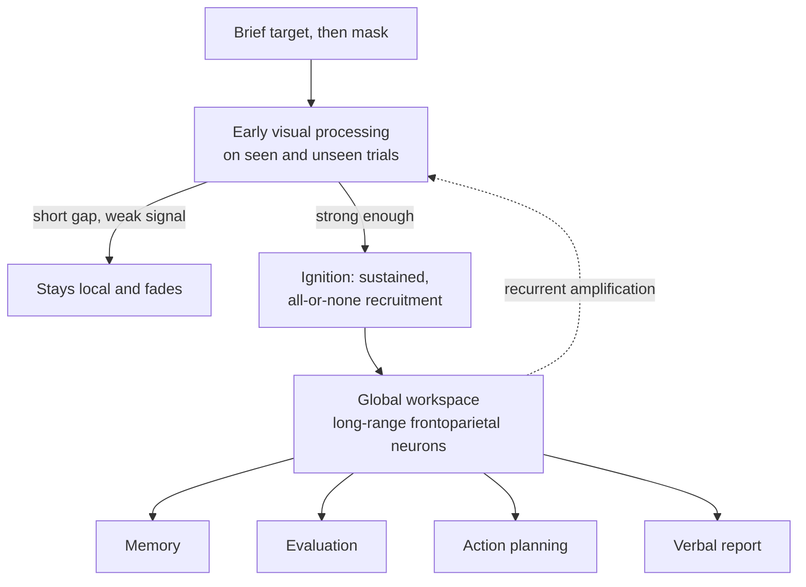

# Philosophy of Mind · Lesson 3.3: Global workspace and the science of consciousness

> ⏱ ~15 min · Module 3: Consciousness · Builds on: [3.1](03-01-the-hard-problem.md), [3.2](03-02-representationalism-and-higher-order-theories.md), [`neuroscience` 3.2](../../neuroscience/lessons/03-02-vision.md), [`neuroscience` 4.3](../../neuroscience/lessons/04-03-attention-decision-making.md) · Unlocks: [3.4](03-04-illusionism.md), [6.4](06-04-could-a-machine-be-conscious.md)

## Why this matters

In April 2025 *Nature* published a direct test of two leading theories of consciousness. Their proponents had preregistered what would count against each, theory-neutral teams ran it on 256 people, and both theories failed tests they had agreed would matter. To read that result you need what the theories claim, and why every way of measuring experience seems to run through the subject's ability to report it.

## The idea

Most of what your brain does with this page never reaches you. A science of consciousness exploits that: keep the stimulus fixed, arrange for it to be seen on some trials and missed on others, and look for what differs in the brain. That is the [contrastive method](../reference.md#contrastive-method), and what it finds are [neural correlates of consciousness](../reference.md#neural-correlates-of-consciousness).

The leading answer to "what differs" is a newsroom. Specialist desks work in parallel, unseen; a few stories make the front page, which every desk reads at once. The [global workspace theory](../reference.md#global-workspace-theory) says a content is conscious when it makes the front page: when it is broadcast to memory, planning, evaluation and speech together.

The catch is the one [3.1](03-01-the-hard-problem.md) prepared. [Phenomenal and access consciousness](../reference.md#phenomenal-and-access-consciousness) come apart in concept: what an experience is like, against its availability for reasoning, report and action. But the experimenter learns that a stimulus was seen because the subject says so, so every contrast is at least a contrast in access. Is the front page experience, or only how experience gets announced? [`neuroscience` 4.3](../../neuroscience/lessons/04-03-attention-decision-making.md) stopped deliberately short of consciousness; this lesson starts there.

## The argument

**Masking and correlates.** In [masking](../reference.md#masking), a target flashed for a few tens of milliseconds is followed by a second pattern, the mask. Short gaps hide the target, and near threshold the same display is seen on some trials and missed on others. [Blindsight](../reference.md#blindsight) is the lesion version: patients with damaged primary visual cortex guess the location of stimuli they deny seeing ([`neuroscience` 3.2](../../neuroscience/lessons/03-02-vision.md)). David Chalmers (2000) defines a neural correlate as a *minimal* system whose states suffice, under background conditions, for the matching conscious states, since bare correlation also catches causes, effects and enabling conditions.

**The workspace.** Bernard Baars proposed the global workspace as a cognitive model (*A Cognitive Theory of Consciousness*, 1988): specialist processors compete for a limited-capacity stage whose contents are broadcast to the rest. Stanislas Dehaene, Jean-Pierre Changeux and colleagues gave it neural form from 1998: long-range prefrontal and parietal neurons, which a strong enough sensory representation recruits into sustained, recurrent activity. The recruitment is [ignition](../reference.md#ignition), sudden and nonlinear rather than graded. Dehaene and co-authors (2006) sort processing three ways: [subliminal](../reference.md#subliminal-preconscious-and-conscious) (too weak to be accessed), *preconscious* (strong enough to be accessible but not accessed, typically for want of attention) and *conscious* (accessed and broadcast). The case is an inference to the best explanation:

**P1.** Seen and unseen trials share early sensory processing and differ chiefly in a late, widespread, all-or-none frontoparietal event. *In words:* the difference comes late and fires as a unit.

**P2.** That event is what recruitment into a global broadcast system would look like. *In words:* ignition is the signature the architecture predicts.

**P3.** What conscious contents can do and unconscious ones cannot (be reported, reasoned with, remembered, used flexibly) is what global availability provides. *In words:* broadcast explains the work consciousness does.

**P4.** Whatever marks the difference between conscious and unconscious states and explains what conscious states do is what consciousness consists in. *In words:* find the difference-maker and you have found the thing.

**∴ C.** A state is conscious just when its content is broadcast in the global workspace. *In words:* conscious means on the front page.

**Rivals.** [Integrated information theory](../reference.md#integrated-information-theory) (Giulio Tononi, from 2004) takes properties of experience as self-evident axioms (it exists for itself, is specific, is unified) and identifies consciousness with maximally irreducible integrated information, $\Phi$: roughly, how far a system's causal structure as a whole exceeds what its parts carry separately. It places the human maximum in a posterior "hot zone", and denies consciousness to any purely feedforward system, however well it behaves. [Recurrent processing theory](../reference.md#recurrent-processing-theory) (Victor Lamme) says recurrent activity within sensory areas suffices; higher-order theories ([3.2](03-02-representationalism-and-higher-order-theories.md)) look to prefrontal self-representation.

**Report and no-report.** P1's trials are sorted by report, so the late event might be the reporting: deciding, introspecting, pressing a key. [No-report paradigms](../reference.md#no-report-paradigms) drop the overt task and track what is seen by reflexive signs such as eye movements or pupil size. But the proxy must be validated against report in each setting, and seeing something still prompts thought that missing it does not (a point Block pressed in 2019).

**Overflow.** In George Sperling's 1960 experiments, subjects shown a brief array of twelve letters reported only three or four, though they said they saw more; yet a tone just after the array vanished let them report most of whichever row it cued. Block ("Consciousness, Accessibility, and the Mesh between Psychology and Neuroscience", 2007) read this as experience of all the letters with access to a few: the [overflow](../reference.md#overflow-debate) thesis. Michael Cohen and Daniel Dennett (2011) replied that experiments detect consciousness only through something it does, so a phenomenal state with no access is untestable.

**The test.** The Cogitate Consortium (*Nature*, 2025) ran an [adversarial collaboration](../reference.md#adversarial-collaboration) of IIT and the global neuronal workspace: proponents preregistered divergent predictions with pass and fail criteria, and theory-neutral teams tested them with fMRI, MEG and intracranial EEG. Departing from the contrastive method, it showed clearly visible pictures for 0.5 to 1.5 seconds and asked where and how their contents were held. For IIT, the predicted sustained synchronization within posterior cortex was missing. For the workspace, there was generally no ignition when the stimulus disappeared, and prefrontal cortex carried little information about some dimensions of the experience, such as identity. The results, the authors say, bear out some predictions of each theory and seriously challenge central claims of both. Since each theory's mathematical or computational core is hard to test directly, they tested the biological implementations, which a theorist could revise while keeping the core, in Lakatos's terms ([`philosophy-of-science` 2.5](../../philosophy-of-science/lessons/02-05-lakatos-and-feyerabend.md)). Workspace proponents replied in *Neuroscience of Consciousness* (2025).

In September 2023, three months after Cogitate's first results appeared as a preprint, a PsyArXiv paper signed "IIT-Concerned", with Stephen Fleming, Hakwan Lau and many others, called IIT pseudoscience. Its published version (*Nature Neuroscience*, 2025) argues that IIT is unscientific because its core claims are untestable even in principle. Keith Frankish replied, asking in his title whether IIT is pseudoscience or "appropriately anomalous science": the demarcation problem of [`philosophy-of-science` 2.6](../../philosophy-of-science/lessons/02-06-demarcation-after-popper.md).

**Timing.** Benjamin Libet and colleagues (*Brain*, 1983) had subjects flex a wrist when they chose and judge, from a moving clock spot, when they first felt the urge. In acts with no reported preplanning, the [readiness potential](../reference.md#libet-experiments) began about 350 ms on average before that reported moment. On its popular free-will reading, the brain starts the act before you decide, so conscious will does not initiate it; free will itself is [`metaphysics` Module 6](../../metaphysics/lessons/06-01-determinism-and-the-consequence-argument.md). Aaron Schurger and co-authors (*PNAS*, 2012) modelled the potential as noise drifting to a threshold, which averaging over movement-locked trials turns into a slow rise. The sense of agency, felt authorship of one's acts, leans on report the same way.

**Where the argument is weakest.** P4. Block's objection: the data mark the difference between reported and unreported states, so C earns at most a theory of access, and recurrent processing fits P1 as well if the late event is the cost of reporting an experience already had. The strongest reply, Cohen and Dennett's, is that consciousness with no functional footprint is beyond any test, so P4 is the only criterion a science can use. The workspace theorist concedes that identifying access with experience is a thesis, not a measurement, which a realist about the [hard problem](../reference.md#hard-problem) will not grant. The overflow theorist concedes that her evidence arrives through access: Sperling's subjects *said* they saw more. Cogitate's missing offset ignition now presses P1 too.

## The picture

Processing before ignition runs on seen and missed trials alike; the experimenter learns which branch was taken from the report box.

## Worked examples

**Example 1 (clean case: a masked digit).** Antoine Del Cul, Sylvain Baillet and Dehaene (*PLoS Biology*, 2007) flashed a digit for 16 ms and then, after a delay of 16 to 100 ms, a mask of letters around its location. Subjects compared it with 5 and rated its visibility, which rose sharply between delays of 33 and 66 ms (average threshold near 44 ms). On scalp recordings the earliest responses did not change with the delay and intermediate ones grew gradually. Only a late wave, splitting seen from unseen trials from about 270 to 300 ms, rose as steeply as the ratings, from a distributed fronto-parieto-temporal network.

What it licenses: the digit was processed for a quarter of a second whether or not it was reported; and the late wave is, in the authors' words, a correlate of "conscious reportability", which the workspace theory reads as ignition (P1, P2). What it does not license: that the late wave is the experience rather than its access or consequences. A recurrent-processing theorist can say the digit was experienced once intermediate activity turned recurrent, and the late wave is the cost of reporting it. The experiment ranks candidates; it does not choose among them.

**Example 2 (hard case: the split brain).** Callosotomy cuts the corpus callosum, the main fibre bridge between the hemispheres, to stop severe seizures spreading. Each hemisphere sees the opposite half of the visual field, and speech is usually the left's. Flash KEY left of fixation and RING right of it (an illustration): the patient says "ring", while his left hand, run by the right hemisphere, picks a key from a bag by touch. Outside the lab such patients act as one person. The [unity of consciousness](../reference.md#unity-of-consciousness) asks whether a subject's experiences at a time are all experienced together.

Run the models. *Two streams*: one per hemisphere. *Switch* (Tim Bayne): one stream that moves between hemispheres with attention. *Partial unity*: each side's experiences are unified with a shared third, an emotion say, but not with each other, so co-experiencing is not transitive. Thomas Nagel ("Brain Bisection and the Unity of Consciousness", 1971) tried hypotheses of this kind (one mind in the left hemisphere, two minds, one poorly integrated mind, one that splits under testing) and concluded that none fits: there is no answer to how many minds these patients have.

Where it strains: the evidence is access disunity, the question phenomenal disunity. The workspace theory counts broadcasts, so two isolated workspaces give two streams in the lab. An overflow theorist can reply that access split while experience stayed whole, which the workspace theorist calls untestable. "How many subjects?" is the unity question, left open here. How many *persons*, and whether you survive the fission [`metaphysics` 6.6](../../metaphysics/lessons/06-06-personal-identity-over-time.md) builds on commissurotomy, belong to [`metaphysics` 6.5](../../metaphysics/lessons/06-05-what-a-person-is.md). The demand that one subject hold all its representations together is Kant's unity of apperception ([`modern-philosophy` 5.4](../../modern-philosophy/lessons/05-04-the-transcendental-deduction.md)), a claim about any possible experience, not about brains.

## Watch out

- **You might think** the workspace theory has been shown to explain experience because its data come from conscious trials, **but actually** the trials are sorted by report, so the data fix the basis of access. That access *is* experience is P4, a thesis.

- **You might think** Cogitate refuted both theories, **but actually** it challenged preregistered predictions about where and when, its authors gave no verdict, and each core can survive a revised implementation.

- **You might think** Libet showed that the brain decides before you do, **but actually** he compared a reported moment with a trial-averaged potential; the free-will reading needs further premises, and Schurger's model explains the average another way.

## One-liner

> The global workspace theory says a content is conscious when it is broadcast across the brain; the experiments for and against it sort trials by report, so they show what underlies access and leave open whether access is experience.

## Problems

**P1 (🟢) *(Apply to a hard case. Exegetical (a)–(c).)*** Take this design, described schematically. Each eye is shown a different picture, a face to one and a house to the other, so that what is seen alternates between them (binocular rivalry). In condition R, subjects press a key at every switch. In condition N they do nothing; which picture is seen is read off reflexive eye movements, a measure checked against key presses in an earlier session. Suppose occipital activity tracks the switches in both conditions, while frontal activity that tracks them in R is much weaker in N.

(a) What does condition N control for, and so what is the comparison of R with N meant to separate? One sentence.

(b) Name two things N does not control for. One line each.

(c) Which theory does the frontal result press, the global workspace theory or recurrent processing theory, and what reply is open to its defender? Two sentences.

**P2 (🟡) *(Apply to a hard case. Exegetical (a)–(b) · Evaluative (c).)*** In Daniel Simons and Christopher Chabris's 1999 study of [inattentional blindness](../reference.md#inattentional-blindness), observers counting passes between basketball players often failed to notice a person in a gorilla suit walking through the scene. Take one such observer and stipulate: the gorilla was large and high-contrast, it drove her visual cortex as strongly as the players did, she was not attending to it, and seconds later she sincerely denies having seen anything unusual.

(a) Classify her representation of the gorilla on Dehaene's three-way taxonomy, and give the global workspace theory's verdict on whether she consciously saw it. Two sentences.

(b) State the overflow theorist's rival description of the case, using the terms of [3.1](03-01-the-hard-problem.md). One sentence.

(c) Is the overflow reading more than a bare possibility here? Say what its defender must point to beyond her report, and what the workspace theorist says about that evidence. Any verdict; 100 words or fewer.

**P3 (🔴) *(Steelman and reply. Exegetical (a) · Evaluative (b).)***

(a) By the Cogitate authors' own account, did their preregistered tests target each theory's mathematical or computational core, or its biological implementation? What does the 2025 *Nature Neuroscience* paper charge IIT with? One sentence each.

(b) Steelman the claim that no experiment of Cogitate's kind could test a theory's answer to the hard problem, then give the strongest reply. Any verdict; 150 words or fewer in total.

Solutions

**P1** *(Exegetical (a)–(c))*

**Must hit, strict (a):** N removes the overt report and what it recruits (deciding to report, introspecting, preparing and making the key press, attending to the task), so the comparison separates activity that tracks the experienced switch from activity that tracks reporting it.

**Must hit, strict (b):** any two of:

- The proxy was validated by report, so N still leans on report, and only for this setting: the reflex could track something other than experience outside the context where it was checked.

- Post-perceptual cognition: seeing the face may still prompt thought, recognition or evaluation that seeing the house does not, and N leaves those differences unmatched.

- A common cause: the reflex and the occipital activity could both track a representation that is not itself conscious.

**Must hit, strict (c):** the global workspace theory, which predicts frontoparietal broadcast for every conscious content; recurrent processing theory, which says sensory recurrence suffices, fits the result. Reply: weaker detected activity is not absent activity (imaging limits, underpowered prefrontal studies), or the residual frontal activity in N is the workspace and what vanished was report-related.

**Accept (c):** noting that higher-order theories, which also look to prefrontal cortex, are pressed too.

**Wrong turns:** saying N shows subjects were not conscious of the switches, when the eye movements show the alternation continued. Naming recurrent processing theory as the theory pressed. Treating "no report" as "no access" (the reflex is itself a use of the content).

**Model answer:** (a) N removes the overt report and the deciding, introspecting and responding that go with it, so the comparison separates activity tracking the experienced switch from activity tracking the report of it. (b) The eye-movement measure was itself validated by report, and only for this setting; and post-perceptual thinking about a face rather than a house is left unmatched. (c) It presses the global workspace theory, which predicts frontal broadcast for every conscious content. Its defender can say that weaker detected activity is not absent activity, or that what remains in N is the workspace and what vanished was the reporting.

---

**P2** *(Exegetical (a)–(b) · Evaluative (c))*

**Must hit, strict (a):** preconscious, since by stipulation the representation was strong enough to be accessible but was not accessed, for want of attention. Not broadcast, so not conscious: on this theory she did not see the gorilla in any sense, because it recognizes no phenomenal consciousness without access.

**Must hit, strict (b):** she had a phenomenally conscious experience of the gorilla that was not access conscious, so her sincere denial reports her access, not her experience.

**Accept (b):** "she experienced it and forgot it at once", if the answer says the report fails to track the experience.

**Must hit, any verdict (c):**

- Name evidence beyond report the overflow theorist needs: for instance, recurrent activity for the gorilla in visual areas resembling that on seen trials (Lamme; Block's "mesh" argument), or a no-report proxy that registers it.

- Give the workspace reply: such sensory recurrence is preconscious, perhaps necessary but not sufficient, and any proxy was calibrated on report.

- Say what the verdict turns on: whether access is what consciousness consists in or only the evidence for it (P4).

**Wrong turns:** calling the gorilla subliminal, against the stipulation. Taking her denial to settle the matter either way. Applying Sperling directly: his subjects said they saw more, and she says nothing of the kind.

**Model answer (c), one of several:** Only if something besides her report favours it. The overflow theorist must show that her visual areas treated the gorilla as they treat seen objects, with recurrent, organized activity and not a brief feedforward sweep, and argue that this is what experience consists in. The workspace theorist grants the activity and calls it preconscious: necessary, perhaps, but not sufficient, since nothing was broadcast. Each reading fits the same recordings. So the overflow reading is a live hypothesis rather than a bare possibility, but the case cannot decide between the two readings. It turns on P4, whether access constitutes consciousness or only reveals it.

---

**P3** *(Exegetical (a) · Evaluative (b))*

**Must hit, strict (a):**

- The biological implementations (posterior cortex for IIT, prefrontal cortex for the workspace theory), because the cores are hard to test directly; a theorist could revise the implementation and keep the core.

- That IIT is unscientific because its core claims are untestable even in principle.

**Must hit, any verdict (b):**

- Steelman: every experiment correlates physical states with a marker of consciousness (report, or a proxy validated by report). A theory's answer to the hard problem is its bridge: IIT's identity of experience with integrated causal structure, or the workspace theory's identification of experience with broadcast. Rival bridges, including the same structure with no experience at all, fit every datum. Cogitate itself shows implementations can be revised while cores stand.

- Reply, one of: theories are tested as wholes through what they predict, so a core that keeps yielding risky predictions that succeed gains support by inference to the best explanation, as the identity of heat with molecular motion did ([3.1](03-01-the-hard-problem.md)); or, if the type-A physicalist or the illusionist ([3.4](03-04-illusionism.md)) is right, nothing beyond function is left to test, so "untestable" marks no defect in the science.

- Say what each side concedes. The reply concedes that support for an identity does not by itself explain why it holds, so the explanatory gap may stay open. The steelman concedes that the science can still rank theories of which processes underlie consciousness.

**Wrong turns:** treating Cogitate's challenges to implementations as refutations of either core. Treating the 2025 paper's charge as settled; it has published replies. Saying IIT's axioms prove its identity claim, when the axioms are claimed self-evident and the step to physical postulates is defended as abduction.

**Model answer (b), one of several:** Steelman: an experiment can only correlate brain states with some marker of experience, ultimately report. A theory's answer to the hard problem is a bridge, IIT's identity of experience with integrated causal structure or the workspace's identification of it with broadcast, and a rival bridge, even "this structure, no experience", fits every datum. Cogitate shows the point in practice: what failed were implementations, and cores survive. Reply: theories meet evidence as wholes. A core that keeps generating risky predictions that come true earns belief by the best-explanation route that made heat molecular motion, and on the type-B view no further why is owed. The reply concedes that support for an identity does not show why it holds; the steelman concedes that the science can still rank theories of which processes underlie consciousness. Whether that ranking answers the hard problem is the question 3.1 left open.

## Flashback

**From Lesson [3.1](03-01-the-hard-problem.md) (The hard problem):** *(Exegetical (a)–(b).)* C. D. Broad, *The Mind and Its Place in Nature* (London: Kegan Paul, 1925), ch. II, p. 80. Having argued that we could not form the concept of a shade such as sky-blue without perceiving it, he goes on:

> It follows that, even when we know that a certain kind of secondary quality (e.g., colour) pervades or seems to pervade a region when and only when such and such a kind of microscopic event (e.g., vibrations) is going on within the region, we still could not possibly predict that such and such a determinate event of the kind (e.g., a circular movement of a certain period) would be connected with such and such a determinate shade of colour (e.g., sky-blue).

(a) What does Broad grant, and what does he deny? Quote the words that mark each. Two sentences.

(b) Suppose the correlation he grants were an identity. Would his point survive on Levine's view, and on a [type-B physicalist](../reference.md#type-a-and-type-b-physicalism)'s? Two sentences.

Solution

**Must hit, strict (a):**

- The grant: a correlation of kinds, "when and only when", which "even when we know" allows may be known.

- The denial: "we still could not possibly predict" which determinate event goes with which shade, since the shade's concept comes only from seeing it.

**Must hit, strict (b):**

- Levine: it survives. A true identity would still leave unexplained why that movement is like sky-blue rather than another shade, as "pain is C-fibre firing" leaves the feel brute. That is the [explanatory gap](../reference.md#explanatory-gap), a problem for materialism but no proof that it is false.

- Type-B: the failure to predict survives, since an a posteriori identity cannot be deduced in advance, but nothing is left over, because [identities are never explained](../reference.md#explaining-and-identifying). Both grant Broad's claim and differ on whether it leaves something unexplained.

**Wrong turns:** reading "pervades or seems to pervade" as putting colour in objects, so that the passage is not about how things look: "seems to pervade" covers the appearance. Reading Broad as denying that the correlation can be known, when "even when we know" grants it.

**Model answer:** (a) Broad grants that a correlation of kinds may be known, colour "when and only when" a kind of microscopic event occurs, and denies that the determinate pairing can be foreseen: "we still could not possibly predict" that a given movement goes with sky-blue. (b) For Levine it survives, since even a true identity would leave unexplained why that movement is like sky-blue. A type-B physicalist grants that the pairing is unpredictable, as any a posteriori identity is, but denies that anything is left unexplained, since identities are never explained.

## Connections

- **Backward:** [3.1](03-01-the-hard-problem.md) supplied phenomenal and access consciousness and the hard problem, and every experiment here sorts its trials by access. [3.2](03-02-representationalism-and-higher-order-theories.md) supplied the higher-order theories, which share the workspace theory's prefrontal predictions. Blindsight is [`neuroscience` 3.2](../../neuroscience/lessons/03-02-vision.md), and [`neuroscience` 4.3](../../neuroscience/lessons/04-03-attention-decision-making.md) supplied attention as competition and the warning that a trial average can have a shape no single trial had, which is Schurger's point about the readiness potential.

- **Forward:** [3.4](03-04-illusionism.md) takes the workspace story and asks whether anything beyond it needs explaining; [3.5](03-05-panpsychism-and-russellian-monism.md) meets IIT again, since its defenders discuss its kinship with panpsychism. [6.4](06-04-could-a-machine-be-conscious.md) turns the theories into indicators for artificial systems, where IIT's verdict on feedforward systems and the workspace theory's verdict on broadcast pull apart.

- **Sideways:** Cogitate's design is Lakatos's research-programme method put to work ([`philosophy-of-science` 2.5](../../philosophy-of-science/lessons/02-05-lakatos-and-feyerabend.md)), and the pseudoscience charge is a live demarcation case ([`philosophy-of-science` 2.6](../../philosophy-of-science/lessons/02-06-demarcation-after-popper.md)). [`philosophy-of-religion` 3.4](../../philosophy-of-religion/lessons/03-04-the-argument-from-religious-experience.md) shows that a neural correlate does not by itself debunk an experience. The "attention" of [`deep-learning` 3.4](../../deep-learning/lessons/03-04-self-attention-queries-keys-values.md) is key-query weighting, and Butlin, Long and co-authors (2023) warn that it is not the attention of neuroscience, a warning that matters before reading a transformer as a workspace.
