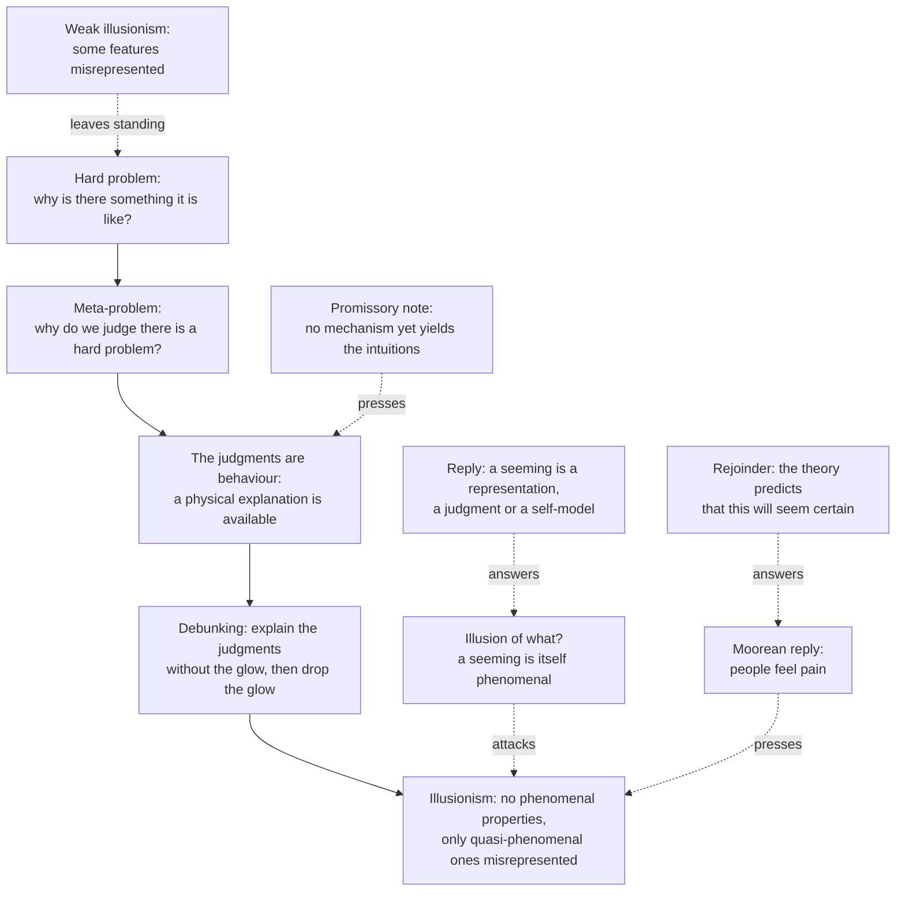

# Philosophy of Mind · Lesson 3.4: Illusionism

> ⏱ ~15 min · Module 3: Consciousness · Builds on: [3.1](03-01-the-hard-problem.md), [`neuroscience` 3.2](../../neuroscience/lessons/03-02-vision.md) · Unlocks: [3.5](03-05-panpsychism-and-russellian-monism.md)

## Why this matters

Pinch the back of your hand. Receptors fired, your cortex registered a location and an intensity, and you flinched. The illusionist accepts every bit of that and denies one thing more: that the pinch also had the private, inner, felt quality introspection says it had. David Chalmers, who named the hard problem, has written that if he were a materialist he would be an illusionist, and he thinks the view false. Both reactions are reasonable, which is why it has to be stated at full strength.

## The idea

A computer desktop shows a folder. Open the case and there is no folder, only stored bits; the icon is a simplification that lets you use the machine without knowing how it works. Daniel Dennett (1942–2024) called consciousness a [user illusion](../reference.md#user-illusion) in this sense.

[Illusionism](../reference.md#illusionism) applies the point to introspection, the brain's monitoring of its own states. Introspection represents your sensory states as having a special inner quality, the redness of the red or the hurt of the pinch, that is private, ineffable, intrinsic and known directly. On this view the states are real, the representing is real, and so are the reports and the behaviour. The quality is not. Nothing in you has it, just as nothing in the computer is a folder.

That changes the question. The [hard problem](../reference.md#hard-problem) asks how the brain produces the quality. The illusionist says it produces only a representation of one, and the real task is to explain why the brain represents itself that way and why the representation is so hard to disbelieve. That is a question about mechanisms and reports, one of the [easy problems](../reference.md#easy-problems).

Already taught: [3.1](03-01-the-hard-problem.md) separated [phenomenal from access consciousness](../reference.md#phenomenal-and-access-consciousness) and stated the hard problem, and [`neuroscience` 3.2](../../neuroscience/lessons/03-02-vision.md) showed an edge filter making you see stripes that are in no light. This lesson uses both. [`apologetics-foundations` 3.3](../../apologetics-foundations/lessons/03-03-consciousness.md) states the view in a paragraph as a premise; here it is argued.

## The argument

**Dennett's eliminativism.** "Quining Qualia" (in Marcel and Bisiach, eds., *Consciousness in Contemporary Science*, 1988) takes its verb from a joke lexicon: to quine is to deny resolutely that something real or significant exists. Dennett listed four marks that [qualia](../reference.md#qualia) are supposed to have: ineffable, intrinsic, private, and directly apprehensible in consciousness ([quining qualia](../reference.md#quining-qualia)). Fifteen intuition pumps follow, the device [`philosophical-method` 3.3](../../philosophical-method/lessons/03-03-thought-experiments.md) warns about, here used on purpose. In one, two coffee tasters, Chase and Sanborn, have both stopped liking the coffee they once liked. Chase says the taste is unchanged and his standards moved; Sanborn says his standards are unchanged and the taste moved. Dennett argued that neither man's introspection can tell which story is true of him. A quality that cannot be told apart from a change in reaction is not directly apprehensible, so the marks pull apart. His conclusion was that there are no qualia at all: [eliminativism](../reference.md#eliminative-materialism) about them, on the ground that the concept is confused.

**Heterophenomenology.** Dennett's method (*Consciousness Explained*, 1991; "Who's on First? Heterophenomenology Explained", 2003) treats what subjects say about their experience as data about how things seem to them, and stays neutral on whether the seemings are accurate ([heterophenomenology](../reference.md#heterophenomenology)), much as an anthropologist records a community's beliefs about a forest god without deciding whether the god exists.

**Frankish's illusionism.** Keith Frankish ("Illusionism as a Theory of Consciousness", *Journal of Consciousness Studies*, 2016) kept the verdict and moved the diagnosis. Phenomenal properties do not exist, so the view is eliminativist about them. But where Dennett stressed confusion in the concept, Frankish stresses error in the representing: introspection presents properties that are not there, as perception sometimes does. Experiences are real; what they have are [quasi-phenomenal properties](../reference.md#quasi-phenomenal-properties), physical or functional properties that introspection detects and misrepresents as phenomenal. Explaining the misrepresentation is the illusion problem. [Weak illusionism](../reference.md#strong-and-weak-illusionism) keeps phenomenal consciousness and calls only some of its apparent features illusory. Frankish argues that only the strong form dissolves the hard problem, and Chalmers agrees (2018, §6): the hard problem needs only that there is [something it is like](../reference.md#what-it-is-like) to be us.

**The engine.** Chalmers ("The Meta-Problem of Consciousness", *JCS*, 2018) named the neutral version of that task: explain why we think there is a hard problem ([meta-problem](../reference.md#meta-problem)). Its data are [problem intuitions](../reference.md#problem-intuitions), our dispositions to judge that consciousness cannot be explained physically, that it is non-physical, that Mary learns something new, that zombies are conceivable. Judgments and reports are behaviour, so the meta-problem is, strictly, an easy problem. Chalmers counts debunking arguments built on it as the best case for illusionism. The view remains a minority one: in the 2020 PhilPapers survey, 4.5 percent of respondents accepted or leaned towards eliminativism about consciousness, the option nearest to it, and 62 percent said there is a hard problem.

Assembled:

- **P1.** Introspection represents our experiences as having phenomenal properties: intrinsic, private, ineffable qualities, known directly. *In words:* it seems to each of us that experience glows.
- **P2.** If such properties existed, no physical or functional account could explain them. *In words:* the glow, taken at face value, is the hard problem.
- **P3.** A physical, functional explanation of why introspection represents our states this way is available, at least in principle. *In words:* the seeming can be explained without the glow.
- **P4.** When a seeming can be explained without supposing that what seems so is so, and what seems so would be anomalous, the better-supported view is that the seeming is an illusion. *In words:* explain the mirage by optics, not by water.
- **∴ C.** Experiences have no phenomenal properties, only quasi-phenomenal ones that introspection misrepresents. *In words:* the experiences are real; the glow is not.

Chalmers sharpens P3 and P4 into a [debunking argument](../reference.md#debunking-argument) (§5): there is a correct explanation of our beliefs about consciousness that is independent of consciousness; if there is, those beliefs are not justified; so they are not. Everything turns on what "independent" means.

**Where the argument is weakest.** P3. The strongest objection is that no such explanation exists yet, and the obvious candidate fails: a self-model alone cannot be the source, since we model our own beliefs too and nobody finds a hard problem of belief (Chalmers, §2). The strongest reply is that P3 needs only an explanation in principle, which anyone who thinks all behaviour physically explicable already grants, Chalmers included, and that candidates exist: Derk Pereboom's thesis that introspection attributes primitive qualities to experience as colour vision does to surfaces (2011), and Michael Graziano's attention schema, on which awareness is the brain's simplified model of its own attention (2013). The realist concedes that problem reports have a physical explanation, and so owes an account of how consciousness figures in it: Chalmers's meta-problem challenge. The illusionist concedes that the mechanism is not in hand, and that it must also explain why the illusion is so hard to shake, which François Kammerer argues neither candidate does ("Can You Believe It?", 2018).

## Argument map

The case runs down the solid edges; each dashed edge is a pressure or a reply, and weak illusionism never touches the hard problem at all.

## Worked examples

**Example 1 (clean case: Mach bands).** Look at a row of uniform grey bars stepping from dark to light. At every edge you see a thin bright stripe on the light side and a dark one on the dark side. A photometer finds none. [`neuroscience` 3.2](../../neuroscience/lessons/03-02-vision.md) explains them as the centre-surround filter's response to an edge: the illusion is the filter's design made visible.

Run the analogy. Four things are meant to carry over. (i) A representation can present a property nothing has: the stripe is in no light. (ii) Knowing that changes nothing: you still see the stripes, so a true theory can be unbelievable from the inside, and illusionism predicts its own incredibility. (iii) The explanation targets the representer and its use (edge enhancement helps vision), and posits no new property of light. (iv) The tempting inference, no stripe in the light so there must be a stripe in the mind, is the one Dennett refused: there is a signal that represents a stripe, not a stripe-coloured inner item.

The analogy is supposed to stop at one point. For the stripes, a photometer checks the light independently of vision. For the glow, nothing checks the experience independently of introspection. The illusionist says third-person science plays the photometer's part and finds states and mechanisms, no glow. The realist answers that no photometer could find a glow, which is the hard problem again.

**Example 2 (hard case: the illusion of what?).** The [illusion-of-what objection](../reference.md#illusion-of-what-objection) at full strength:

- **O1.** An illusion is a case in which something seems to be F and is not.
- **O2.** When my experience seems to me to glow, that seeming is itself something it is like to undergo.
- **∴ O3.** So if the glow is an illusion, the illusion has phenomenal character, and phenomenal consciousness exists after all.

John Searle gave it its sharpest form (*The Mystery of Consciousness*, 1997): for consciousness there is no gap between seeming and being. The illusionist denies O2. A seeming can be a representation: a judgment, an intuition, a disposition to report, a self-model saying that this state has quality Q. Representing Q does not require having it; the Mach-band signal is not bright. Chalmers grants the point (2018, §7): strong illusionism is coherent. His illustration is the seemingly detailed visual field, which he takes to be an illusion that need be no extra experience, only a false judgment; strong illusionism extends that to all experience.

So the objection regroups as a Moorean argument (§7): people feel pain; if strong illusionism is true, no one does; so it is false. The illusionist replies that the theory predicts the first premise will seem undeniable, so its seeming undeniable is no independent evidence. The realist replies that the datum is the pain, not its seeming obvious.

Here the account stops. The dispute is over what the datum is: "I feel pain", or "it seems to me that I feel pain". Heterophenomenology records only the second, by design, and introspection cannot settle it, since its reliability is the question. The realist says the illusionist has changed the subject; the illusionist says the realist cites the illusion as evidence against itself. The realist concedes coherence; the illusionist, that the view denies something more certain-seeming than any premise for it.

## Watch out

- **You might think a solution to the meta-problem would prove illusionism, but actually** the meta-problem is neutral, and realists owe a solution too: whatever a theory says underlies consciousness should help produce our judgments about it. Explaining why we believe something explains it away only with a further premise, P4.
- **You might think illusionism is "Quining Qualia" renamed, but actually** they share the verdict and differ on the diagnosis. Dennett argued the concept of qualia is confused; Frankish argues that introspection misrepresents, and makes the stubborn appearance the explanandum.
- **You might think evidence of introspective error supports illusionism, but actually** it supports weak illusionism, which realists accept. People are confidently wrong about features of their current experience (Eric Schwitzgebel, "The Unreliability of Naive Introspection", 2008), and Chalmers grants that the visual field's apparent detail is an illusion. A misdescribed experience can still be phenomenal.
- **You might think heterophenomenology is illusionism, but actually** it is a method that leaves the seemings' accuracy open, though realists object that recording every seeming as a belief is not neutral.

## One-liner

> Illusionism keeps the experiences, the representations and the reports and denies the glow, trading the hard problem for the problem of why the glow seems undeniable; its critics answer that here the seeming is the glow.

## Problems

**P1 (🟢) *(Exegetical.)*** Classify each claim as **eliminativist** (the concept of qualia is confused, so nothing answers to it, as in "Quining Qualia"), **illusionist** (introspection misrepresents our states as phenomenal; nothing is phenomenal; explaining the misrepresentation is the task), or **realist** (experiences have phenomenal properties, physical or not). One line each, naming the words that decide it.

(i) Chase and Sanborn cannot tell, by any test they can run on themselves, whether their tastes or their standards changed; a quality supposed to be intrinsic and directly known that cannot be told apart from a change in reaction is one our concept fails to pick out.

(ii) There is something it is like to taste bitterness, and that property is a neural property; we conceive it under a concept that does not reveal this, which is why zombies seem conceivable.

(iii) Our self-monitoring represents certain states as having private inner qualities; nothing has them, but the representation is real and stubborn, and why it is so stubborn is what a theory of consciousness must explain.

(iv) The richness of peripheral vision is an illusion: introspection exaggerates how sharp and coloured the edge of the field is, but the experience it misdescribes is still one there is something it is like to have.

**P2 (🟡) *(Diagnose. Exegetical (a)–(b).)*** An op-ed in *Lumenhal Weekly* (invented, written for this problem, as is the study it reports):

> "For centuries we trusted the inner eye. We shouldn't have. In a new study, volunteers in headsets failed to notice when most of the colour was drained from the edges of their view, though every one of them insisted they saw a vivid, coloured world. Science has now shown that consciousness is an illusion. Nobody has ever really been in pain or seen red; those are just words the brain uses. And since we can now explain why people believe in an inner light, the philosophers' hard problem is officially closed."

(a) Name three distinct errors, quoting the words that carry each, and correct each in one sentence.

(b) One sentence: what does the study, as reported, support?

150 words or fewer in all.

**P3 (🔴) *(Steelman and reply. Evaluative.)*** Chalmers's debunking argument: (1) there is a correct explanation of our beliefs about consciousness that is independent of consciousness; (2) if there is, those beliefs are not justified; so (3) they are not. A realist replies: *Brain science can explain my belief that there is a table here without ever mentioning tables, and the belief is fine. So premise 2 is false.*

Steelman the argument so that it survives the table reply. Then give the realist's strongest answer to your improved version, and say what that answer costs. Any verdict; 150 words or fewer.

Solutions

**P1** *(Exegetical)*

**Must hit, strict:**

- (i) **Eliminativist.** "Our concept fails to pick out": the charge is that the concept's marks (intrinsic, directly known) come apart, which is Dennett's Chase and Sanborn argument.

- (ii) **Realist.** "That property is a neural property": phenomenal properties exist and are identified with physical ones. This is type-B physicalism with the [phenomenal concept strategy](../reference.md#phenomenal-concept-strategy) of [1.4](01-04-zombies-conceivability-and-kripke.md), not illusionism.

- (iii) **Illusionist.** "Represents ... nothing has them, but the representation is real and stubborn": misrepresentation, not confusion, with the illusion problem as the task.

- (iv) **Realist.** "Still one there is something it is like to have": this is weak illusionism, which keeps phenomenal consciousness and calls one feature of it illusory.

**Wrong turns:** calling (ii) illusionist or eliminativist because it is physicalist; a physicalist can be a realist about phenomenal properties ([type-A and type-B physicalism](../reference.md#type-a-and-type-b-physicalism)). Calling (iv) illusionist because it says "illusion". Calling (i) illusionist because Dennett later called himself one: the classification is of the claim, not the author.

**Model answer:** (i) Eliminativist: the concept "fails to pick out" anything, because its marks pull apart. (ii) Realist: "that property is a neural property" affirms phenomenal properties and identifies them. (iii) Illusionist: the representation is real, the qualities are had by nothing, and the stubbornness is the explanandum. (iv) Realist: the misdescribed experience is still one "there is something it is like to have", so this is weak illusionism.

---

**P2** *(Exegetical (a)–(b))*

**Accept:** any three of the four errors below, each tied to its words.

**Must hit, strict (a):**

- **Local to global.** "Science has now shown that consciousness is an illusion." The finding shows introspection errs about one feature of experience, which is weak illusionism; the step to strong illusionism is a theoretical argument, not a result.

- **Misstating the view.** "Nobody has ever really been in pain or seen red; those are just words." Illusionism affirms pain states and seeing; it denies only that they have phenomenal properties in the philosophers' sense, and pain is a real state with quasi-phenomenal properties, not a word.

- **Explained versus explained away.** "Since we can now explain why people believe in an inner light ... officially closed." Nobody can yet: the study explains one misjudgment, not the problem intuitions. And an explanation of a belief debunks it only with a further premise, which realists contest.

- **"Science has shown" a philosophical thesis.** No study by itself settles strong illusionism; the case rests on P1–P4, to which data contribute.

**Must hit, strict (b):** the study supports the claim that introspective judgments about peripheral colour are unreliable, which realists and illusionists alike accept.

**Wrong turns:** answering that an illusion is itself an experience, so the op-ed refutes itself. That is the debater's sentence from [`apologetics-foundations` 3.3](../../apologetics-foundations/lessons/03-03-consciousness.md) P2, and it is not one of the op-ed's errors. Treating the study as about phenomenal consciousness rather than reports: it measures what volunteers noticed and said, an [access](../reference.md#phenomenal-and-access-consciousness) question.

**Model answer:** (a) "Science has now shown that consciousness is an illusion" leaps from one introspective error, weak illusionism, to strong illusionism, which is a theory, not a result. "Nobody has ever really been in pain or seen red" misstates illusionism, which affirms pain states and seeing and denies only phenomenal properties. "Since we can now explain why people believe ... officially closed" overclaims twice: no one has explained the problem intuitions, and explaining a belief is not explaining it away without a debunking premise. (b) Introspective reports about peripheral colour are unreliable, which realists already grant.

---

**P3** *(Evaluative)*

**Must hit, any verdict:**

- Say what the table reply shows: an explanation that merely does not mention X (descriptive independence) debunks nothing, because tables cause the belief-forming processes.

- Steelman by tightening "independent" to causal and constitutive independence: consciousness neither causes nor constitutes the processes that produce our beliefs about it. Say where that comes from: any realist who grants that a [zombie](../reference.md#zombie-argument) twin would form the same beliefs by the same process has supplied it. A fallback is the coincidence form: if the explanation is independent, the beliefs' being true is luck.

- Give one realist answer and its cost. Either consciousness realizes or causes the belief-forming processes, which costs zombie-style independence or meets the [exclusion argument](../reference.md#exclusion-argument) of [2.4](02-04-mental-causation-and-the-exclusion-problem.md). Or the beliefs are justified by acquaintance, not by their causes, which concedes that they would be formed the same way without consciousness.

- Draw the verdict from those moves.

**Wrong turns:** reading the conclusion as "consciousness does not exist"; it concerns justification, and illusionism is a further step. Answering only by denying premise 1 because no meta-problem solution exists, which Chalmers himself declines to rest on, since problem reports are behaviour. Treating the table reply as decisive without asking what "independent" means.

**Model answer, one of several:** The table reply works against descriptive independence: tables cause my table beliefs, so an explanation that never names them is no threat. The steelman needs causal and constitutive independence, and many realists supply it themselves: if my zombie twin believes all I believe by the same process, consciousness does no work in forming the belief. Then its truth looks like luck. The realist's best answer is that consciousness realizes the belief-forming processes, so there is no independence. The cost is real: the realist must let phenomenal properties do causal work, which means giving up the zombie's possibility or facing exclusion. The acquaintance answer avoids that cost but concedes the coincidence. So the argument survives against dualists who accept zombies and fails against realizationists, whose burden is to show the realization.

## Flashback

**From Lesson [3.2](03-02-representationalism-and-higher-order-theories.md) (Representationalism and higher-order theories):** *(Exegetical (a)–(b).)* A dog treads on a thistle, yelps, lifts the paw and licks it (invented, written for this problem). Suppose it has no thoughts at all about its own mental states.

(a) Is its pain conscious on Tye's [first-order representationalism](../reference.md#first-order-representationalism), on Rosenthal's [higher-order thought](../reference.md#higher-order-thought) theory, and on Carruthers's dispositional version (2000)? One line each, naming the deciding feature.

(b) Suppose the evidence offered is that the dog fails the tests psychologists use for thinking about one's own mind. Who resists that evidence, and on what ground? Who instead accepts the consequence? Two sentences.

Solution

**Must hit, strict (a):**

- Tye: conscious, if its content is poised. It represents a disorder at a place in the paw, ready to make a direct difference to what the dog believes and wants, and no higher-order state is required.

- Rosenthal: not conscious. A state is conscious only when its subject has a suitable thought, assertoric and not reached by conscious inference, that it is in the state, and the dog has none: an unconscious pain.

- Carruthers (2000): not conscious. A state need only be available to a higher-order thought, but with no capacity for such thoughts there is nothing to be available to.

**Must hit, strict (b):**

- Rocco Gennaro resists it: the higher-order states needed are simpler than those psychologists test for, so failing the tests does not show the dog lacks them.

- Carruthers accepts the consequence ("Brute Experience", 1989; 2000), and later argued (2005) that it matters little for how animals are treated.

**Wrong turns:** requiring the dog to think consciously about its pain, when the higher-order thought is normally unconscious. Treating the yelp as settling it: all three grant a pain state that drives the behaviour. Naming Carruthers as the author of the [animal and infant objection](../reference.md#animal-and-infant-objection): it is Jamieson and Bekoff's, Dretske's and Tye's, and he accepted its consequence.

**Model answer:** (a) Tye: conscious, since the pain represents a disorder in the paw, poised to affect what the dog believes and wants. Rosenthal: an unconscious pain, since no higher-order thought accompanies it. Carruthers: not conscious, since nothing is there for the pain to be available to. (b) Gennaro resists the evidence: the higher-order states needed are simpler than those the tests look for. Carruthers accepts the consequence, and later argued that it matters little for how animals are treated.

## Connections

- **Backward:** [3.1](03-01-the-hard-problem.md) gave the hard problem and the easy problems the illusionist trades between. [1.4](01-04-zombies-conceivability-and-kripke.md) sorted physicalists into type A and type B; Chalmers places the distinctive illusionist among the type-A, with no epistemic gap, only the appearance of one (2018, §6). [`neuroscience` 3.2](../../neuroscience/lessons/03-02-vision.md) supplied the Mach bands, and [`philosophical-method` 3.3](../../philosophical-method/lessons/03-03-thought-experiments.md) the intuition pump. [1.1](01-01-the-mind-body-problem.md) cites C. D. Broad's 1925 argument that a theory calling mentality itself delusive contradicts itself, since misperceiving and misjudging are mental; the illusion-of-what objection needs O2 to carry that argument from mentality in general to phenomenal properties.
- **Forward:** [3.5](03-05-panpsychism-and-russellian-monism.md) takes the opposite exit: it keeps the glow and spreads it through nature. [6.4](06-04-could-a-machine-be-conscious.md) asks what a machine's reports of experience could show; Chalmers notes that a very simple program can mimic some of our puzzled reports, which is why self-report is confounded. [4.1](04-01-intentionality-and-folk-psychology.md) meets eliminativism again, about belief.
- **Sideways:** the normalization and evidence-accumulation models of [`neuroscience` 4.3](../../neuroscience/lessons/04-03-attention-decision-making.md) explain selection without a chooser; the illusionist generalizes this to experience without an inner viewer, Dennett's [Cartesian Theater](../reference.md#cartesian-theater). Mackie's [error theory](../../ethics/lessons/06-03-error-theory.md) has the same shape for morality: a systematic error plus an explanation of why we make it. Hume looked for a self and found only perceptions ([`modern-philosophy` 4.4](../../modern-philosophy/lessons/04-04-the-self-belief-and-the-passions.md)). [`apologetics-foundations` 3.3](../../apologetics-foundations/lessons/03-03-consciousness.md) uses the view as a premise, and the Flashback of its [4.1](../../apologetics-foundations/lessons/04-01-the-conflict-thesis-tested-in-both-directions.md) already ran an invented mechanism predicting every judgment about experience.
