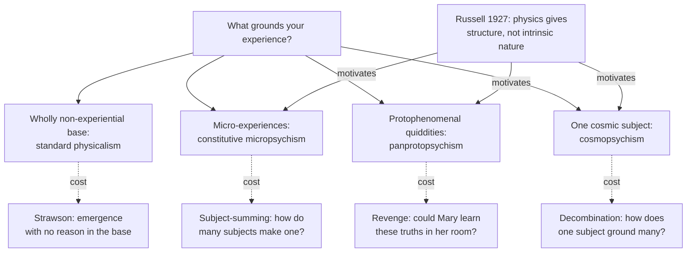

# Philosophy of Mind · Lesson 3.5: Panpsychism and Russellian monism

> ⏱ ~15 min · Module 3: Consciousness · Builds on: [3.1](03-01-the-hard-problem.md), [3.4](03-04-illusionism.md), [`philosophy-of-science` 5.3](../../philosophy-of-science/lessons/05-03-structural-realism.md), [`metaphysics` 4.3](../../metaphysics/lessons/04-03-powers-dispositions-and-laws.md) · Unlocks: [4.1](04-01-intentionality-and-folk-psychology.md)

## Why this matters

Look up the electron's charge in any physics text and you get a number and a law: how strongly charged things push and pull one another. Ask what charge is, as opposed to what it makes things do, and the book goes quiet. Bertrand Russell argued in 1927 that the silence is built into physics, and that we meet what lies behind the equations from the inside in one place only: our own experience. If he was right, the [hard problem](../reference.md#hard-problem) of [3.1](03-01-the-hard-problem.md) changes shape. Consciousness may not be a late arrival squeezed out of matter, but part of what matter was all along.

## The idea

The rules of chess define the bishop completely by how it may move, and they are silent on whether yours is boxwood, plastic or pixels. Still, something has to do the moving. [Structuralism about physics](../reference.md#structuralism-about-physics) says physics is the rulebook: it describes structure and dispositions, what things do to one another, and not the intrinsic natures, often called [quiddities](../reference.md#quiddity), that do it. [Russellian monism](../reference.md#russellian-monism) adds that those natures are what consciousness is made of. Your brain is the one piece of matter you meet from the inside, and there you meet experience. So perhaps experience, or something just short of it, is the nature of matter everywhere.

Taken all the way, that is [panpsychism](../reference.md#panpsychism): mentality, meaning the simplest experience and not thought, is fundamental and ubiquitous. Nobody says electrons believe anything, and a stone need not be a subject even if its particles are.

A second route comes from below: Galen Strawson argues that experience cannot arise from something wholly without it, so it must be there at the bottom. Both routes meet what friends and critics agree is the hardest problem: how tiny experiences, each with its own subject, could add up to your single point of view. That is the [combination problem](../reference.md#combination-problem), pressed by William James (*The Principles of Psychology*, 1890, ch. VI) and named by William Seager (1995).

[3.4](03-04-illusionism.md) denied the hard problem's datum; this lesson keeps it and spreads it. Structural realism and Newman's objection are [`philosophy-of-science` 5.3](../../philosophy-of-science/lessons/05-03-structural-realism.md), categorical and dispositional properties [`metaphysics` 4.3](../../metaphysics/lessons/04-03-powers-dispositions-and-laws.md), weak and strong emergence [`philosophy-of-science` 4.5](../../philosophy-of-science/lessons/04-05-reduction-and-emergence.md); [`apologetics-foundations` 3.3](../../apologetics-foundations/lessons/03-03-consciousness.md) uses the view as a premise. In the 2020 PhilPapers survey, 7.55 percent of the 1,020 respondents to the consciousness question accepted or leaned towards panpsychism.

## The argument

**Russellian monism.** In Russell's *The Analysis of Matter* (1927), matter is a structure of events whose causal laws and spatio-temporal relations "are more or less known, but their intrinsic character is not known" (ch. XXXVII, p. 384). Arthur Eddington agreed: "The physical atom is, like everything else in physics, a schedule of pointer readings" (*The Nature of the Physical World*, 1928, ch. XII, p. 259). Why not, he asked, attach the schedule to "something of spiritual nature of which a prominent characteristic is thought"? David Chalmers named the view in 1997; the Stanford Encyclopedia gives it three theses.

**R1. Structuralism about physics.** Physics characterizes the world only by its spatio-temporal structure and dynamics. *In words:* physics says what mass and charge do, not what they are.

**R2. Realism about quiddities.** Properties underlie that structure and categorically ground the basic dispositions physics describes. *In words:* the rulebook is about real pieces.

**R3. Quidditism about consciousness.** Those properties wholly or partly constitute consciousness. *In words:* the pieces are what experience is made of.

The varieties split on R3. On **Russellian panpsychism** the quiddities are experiences, usually micro-experiences unlike any we know. On [panprotopsychism](../reference.md#panprotopsychism) (Chalmers, "Panpsychism and Panprotopsychism", 2013) there is nothing it is like to have one, yet together they constitute experience, and Chalmers stipulates that truths about them entail truths about experience a priori. Without that clause every physicalist would qualify, as Daniel Stoljar pointed out. If structure and quiddities are both mental, the view is [idealism](../reference.md#idealism) (Berkeley's is [`modern-philosophy` 3.4](../../modern-philosophy/lessons/03-04-berkeley-immaterialism.md)); if both are neutral, [neutral monism](../reference.md#neutral-monism); if both are physical, Russellian physicalism. It says the [zombie](../reference.md#zombie-argument) of [1.4](01-04-zombies-conceivability-and-kripke.md) and Mary's books in [1.3](01-03-the-knowledge-argument.md) capture only our structure, and that since consciousness is the categorical side of physical causes, the [exclusion argument](../reference.md#exclusion-argument) of [2.4](02-04-mental-causation-and-the-exclusion-problem.md) has nothing to exclude. Robert Howell (2015) replies that quiddities then ride along without doing causal work.

[Constitutive panpsychism](../reference.md#constitutive-and-emergentist-panpsychism) grounds your experience in micro-experiences: it consists in them as a party consists in people dancing (grounding is [`metaphysics` 2.4](../../metaphysics/lessons/02-04-essence-and-grounding.md)). Emergentist panpsychism has micro-subjects cause a new fundamental subject not grounded in them (Gregg Rosenberg, 2004; Godehard Brüntrup, 2016). [Cosmopsychism](../reference.md#cosmopsychism) reverses the direction: with Jonathan Schaffer's priority monism, the universe is the one fundamental subject and yours is grounded in it (Philip Goff, *Consciousness and Fundamental Reality*, 2017).

**Strawson's [anti-emergence argument](../reference.md#anti-emergence-argument)** ("Realistic Monism: Why Physicalism Entails Panpsychism", *Journal of Consciousness Studies*, 2006).

**P1. Realism.** Experience is concretely real. *In words:* the illusionist of 3.4 is set aside, not answered.

**P2. Physicalism.** Every real concrete phenomenon is physical. *In words:* Strawson is a physicalist, in a sense that does not assume the physical is non-experiential.

**P3. No brute emergence.** If Y emerges from X, there is something about X, and X alone, in virtue of which Y emerges and which suffices for it. *In words:* emergence always has a reason in the nature of the base.

**P4. Homogeneity.** Intelligible emergence runs within one family of concepts. Liquidity emerges from molecules sliding past one another, a story told wholly in terms of shape, size, mass, charge and motion. *In words:* the emergent and its base must be describable in kindred terms.

**P5. Heterogeneity.** No family of concepts spans both the experiential and the wholly non-experiential. *In words:* there is no shape-and-motion story in which feeling is a later chapter.

**∴ C.** Experience does not emerge from the wholly non-experiential, so the ultimate constituents of the physical are themselves experiential. *In words:* physicalism, taken realistically, entails panpsychism.

Thomas Nagel's "Panpsychism" (1979) had concluded only that basic matter has properties, perhaps not experiential, that imply mind; the panprotopsychist holds that P5 is true only of our present concepts.

**Where the argument is weakest.** P3. The strongest objection: every theory bottoms out in brute laws, so a fundamental law by which some non-experiential configurations yield experience is no worse than any other. That is C. D. Broad's emergentism (1925) and Chalmers's naturalistic dualism (*The Conscious Mind*, 1996), and Strawson's demand that emergence never be unintelligible "even to God" looks like a rationalist preference. The strongest reply is that such a law is not something about X in virtue of which Y emerges but a new fundamental fact about experience, so whoever posits it has given up P2's monism. Strawson's side concedes that the argument binds only physicalists who refuse brute psychophysical laws. The emergentist concedes that the view adds such laws, which is property dualism, or [strong emergence](../../philosophy-of-science/lessons/04-05-reduction-and-emergence.md), under another name.

## Map of positions

The Russellian answers put consciousness, or its makings, where physics is silent, and each pays at the join between those natures and your one point of view.

## Worked examples

**Example 1 (clean case: the [intrinsic nature argument](../reference.md#intrinsic-nature-argument) run on charge).**

**P1.** Everything physics says about negative charge is relational or dispositional: how a charged body is pushed by a field, how it pushes others, that it is conserved. *In words:* charge is a role in the equations.

**P2.** A disposition is had in virtue of something that is not merely a further disposition. *In words:* powers need a bearer with a nature.

**P3.** So charge has a categorical nature physics does not state, its quiddity.

**P4.** Assuming dualism false, the one categorical nature anyone knows without inference is the character of their own experience, which is the nature of some events in their brain. *In words:* Eddington's single inside view.

**P5.** Absent a reason to think otherwise, the simplest hypothesis is that the rest of matter has a nature of the same general kind (Goff's simplicity argument, 2017, ch. 7).

**∴ C.** The quiddity of charge is experiential or proto-experiential.

Russell's slogan fits P2, though he wrote it about turning things into laws about other things: "Obviously there must be a limit to this process, or else all the things in the world will merely be each other's washing" (ch. XXXI, p. 325). The exits: a dispositional essentialist such as Alexander Bird denies P2, since at bottom attracting is what charge is ([`metaphysics` 4.3](../../metaphysics/lessons/04-03-powers-dispositions-and-laws.md)). An ontic structural realist denies that anything stands behind the relations, so P3 has no subject. Rae Langton's Kantian humility grants P3 but blocks C, since we cannot know the natures ([`modern-philosophy` 6.1](../../modern-philosophy/lessons/06-01-transcendental-idealism-and-the-thing-in-itself.md)). Newman's objection presses P1: pure structure says little beyond how many things there are, so the Russellian must mean a definite causal structure ([`philosophy-of-science` 5.3](../../philosophy-of-science/lessons/05-03-structural-realism.md)). The dualist denies P4 because experience is not the inside of brain matter, the illusionist because introspection misrepresents the brain.

**Example 2 (hard case: the [subject-summing problem](../reference.md#subject-summing-problem)).** You are looking at this page. On constitutive micropsychism your visual experience consists wholly in experiences of the particles in your visual system, each of them a subject. Chalmers ("The Combination Problem for Panpsychism", 2016) splits the trouble into subjects (how many points of view become one), qualities (how a few basic qualities yield smell, colour and pain) and structure (why smooth experience sits on a grainy brain). Goff (2009; 2017) turns the hardest, subjects, into an argument:

- For any subjects with any experiences, it is conceivable that they exist and no further subject does.
- So a micro-experiential zombie is conceivable: your physical duplicate, every particle experiencing, nothing experiencing at the scale of the whole.
- If conceivability implies possibility, the micro-facts do not necessitate yours, so they do not ground it, and constitutive micropsychism is false.

Here the account stops. The third step is the one panpsychists used against physicalism in [1.4](01-04-zombies-conceivability-and-kripke.md). Grant it, and constitutive panpsychism falls to its own weapon; deny it, and the physicalist asks why the zombie argument still worked. Defenders take one of three routes: a bonding relation, unknown to us in its nature, that makes micro-subjects compose a further subject (Goff, 2016); fusion, in which micro-subjects cease to exist as they form a mind (Seager; Hedda Hassel Mørch); or cosmopsychism, which grounds the parts in the whole and trades combination for decombination. Sam Coleman (2014) calls subject-summing incoherent, since a point of view partly consists in excluding every other. The critic says panpsychism inherits the gap it was called in to close. The defender says an unsolved problem is not a refutation, and Example 1 never claimed to say how experiences combine.

## Watch out

- **You might think Russell was a panpsychist, but actually** *The Analysis of Matter* defends neutral monism (ch. XXXVII), his view from 1918. Reading his unknown natures as experiences came later (Grover Maxwell, 1978; Michael Lockwood, 1989).

- **You might think panprotopsychism is a milder panpsychism, but actually** it denies that there is anything it is like to have a protophenomenal property. What separates it from type-B physicalism ([1.4](01-04-zombies-conceivability-and-kripke.md)) is the a priori entailment clause, not the claim that something non-experiential constitutes experience.

- **You might think panpsychism is anti-physicalist, but actually** that depends on what "physical" means, and Strawson calls his view physicalism. What every panpsychist denies is that the physical is wholly non-experiential.

- **You might think the combination problem refutes panpsychism, but actually** its mild form is a debt most panpsychists accept, and only its strong form, an argument that subjects cannot sum, claims a refutation. It aims at constitutive views; emergentist panpsychism dodges some of it by positing new fundamental subjects.

## One-liner

> Physics says what matter does and not what it is; Russellian monists put consciousness, or its makings, in that silence, Strawson argues it must be there unless experience arose from what has none, and the bill comes due as the combination problem.

## Problems

**P1 (🟢) *(Close reading. Exegetical.)*** Russell, *The Analysis of Matter* (London: Kegan Paul, 1927), ch. XXV, p. 264. A "percept" is a perceptual experience, which Russell places among the events in the perceiver's head.

> The gulf between percepts and physics is not a gulf as regards intrinsic quality, for we know nothing of the intrinsic quality of the physical world, and therefore do not know whether it is, or is not, very different from that of percepts. The gulf is as to what we know about the two realms. [...] We know the laws of the physical world, in so far as these are mathematical, pretty well, but we know nothing else about it. If there is any intellectual difficulty in supposing that the physical world is intrinsically quite unlike that of percepts, this is a reason for supposing that there is not this complete unlikeness. And there is a certain ground for such a view, in the fact that percepts are part of the physical world, and are the only part that we can know without the help of rather elaborate and difficult inferences.

(a) Is Russell's "gulf" a difference between two kinds of thing or a difference in our knowledge? Quote the words that decide it. One sentence.

(b) Which sentence states structuralism about physics, and which words in it limit the claim? One sentence.

(c) What do the last two sentences conclude, how strongly, and on what ground? Is the conclusion panpsychism? Two sentences.

**P2 (🟡) *(Exegetical.)*** Classify each claim as constitutive micropsychism, panprotopsychism, cosmopsychism, or none of these. One line each, naming the feature that decides it.

(i) Every quark has an extremely simple experience, and your experience of this page consists wholly in how the experiences of the quarks in your brain are arranged.

(ii) The properties underlying mass and charge are not experiences, and there is nothing it is like to have one; but arranged as they are in brains, they make it a priori transparent why experience exists.

(iii) Experience is identical to certain brain processes whose ultimate constituents are wholly non-experiential, although no amount of physical knowledge would let you deduce what undergoing them is like.

(iv) The universe as a whole is the one fundamental conscious subject, and facts about your experience obtain in virtue of facts about it.

**P3 (🔴) *(Find the crux. Exegetical (a)–(b) · Evaluative (c).)*** Take a weak emergentist about consciousness, in the sense of [`philosophy-of-science` 4.5](../../philosophy-of-science/lessons/04-05-reduction-and-emergence.md): experience arises from neural activity whose ultimate constituents are wholly non-experiential, and every truth about experience follows a priori from the truths about that activity, although nobody could have expected it. Strawson rejects the view.

(a) Name two premises of Strawson's argument that the weak emergentist accepts. One line each.

(b) Name the single premise one side affirms and the other denies, and state the crux as a conditional both would sign. Two sentences.

(c) What argument or finding would move each side? Any verdict; 150 words or fewer.

Solutions

**P1** *(Exegetical)*

**Must hit, strict (a):** a difference in our knowledge, not in the things. The deciding words are "The gulf is as to what we know about the two realms", backed by "do not know whether it is, or is not, very different".

**Must hit, strict (b):** the sentence "We know the laws of the physical world, in so far as these are mathematical, pretty well, but we know nothing else about it". The limits are "in so far as these are mathematical", which restricts what physics knows to its mathematical laws, and "nothing else", which denies it any knowledge of intrinsic quality.

**Accept (b):** also citing "we know nothing of the intrinsic quality of the physical world" from the first sentence, or noting "pretty well" as a hedge on how well the laws are known.

**Must hit, strict (c):**

- The conclusion is only that the physical world is not *completely* unlike percepts in intrinsic quality: "not this complete unlikeness".

- The strength is defeasible, "a reason for supposing" and "a certain ground", not a proof. The ground is that percepts are part of the physical world and the only part known without elaborate inference.

- It is not panpsychism. Partial likeness of quality fits a protophenomenal or neutral nature, Russell's own being neutral monism, and nothing is said about matter outside brains having experiences.

**Wrong turns:** reading the first sentence as asserting that physical events are like percepts, when it asserts only ignorance. Reading "we know nothing else about it" as "there is nothing else", which is the ontic structural realist's thesis; the passage presupposes an intrinsic quality we do not know. Taking "percepts are part of the physical world" to reduce experience to physics as physics describes it; for Russell it means percepts are physical events whose quality, unusually, we know.

**Model answer:** (a) A difference in knowledge, not in the things: "The gulf is as to what we know about the two realms", since we "do not know whether it is, or is not, very different". (b) "We know the laws of the physical world, in so far as these are mathematical, pretty well, but we know nothing else about it": "in so far as these are mathematical" confines physics to mathematical laws, and "nothing else" denies it any knowledge of quality. (c) The last two sentences offer a defeasible reason, not a proof, for one modest conclusion: the physical world is not completely unlike percepts, since percepts are part of it and the only part known without elaborate inference. That is not panpsychism, since partial likeness fits a protophenomenal or neutral nature, which was Russell's own view, and nothing is said about experience outside brains.

---

**P2** *(Exegetical)*

**Must hit, strict:**

- (i) Constitutive micropsychism: experience at the micro level, and "consists wholly in" is grounding, not causation.

- (ii) Panprotopsychism: non-experiential quiddities that constitute experience with a priori transparency, which is Chalmers's clause.

- (iii) None of these: it is type-B (a posteriori) physicalism. Its base is non-experiential, as panprotopsychism's is, but it denies the a priori entailment, and that clause is what separates the two.

- (iv) Cosmopsychism: the one fundamental subject is the universe, and grounding runs from the whole to the part.

**Accept:** "constitutive cosmopsychism" for (iv); "constitutive Russellian panpsychism" for (i); "a posteriori physicalism" or "the phenomenal concept strategy" for (iii).

**Wrong turns:** calling (iii) panprotopsychism because something non-experiential constitutes experience, which is Stoljar's trap. Calling (ii) panpsychism because the properties lie behind mass and charge. Reading (iv) as pantheism, when it gives the universe experience, not thought or divinity. Calling (i) emergentist because the experiences are "arranged".

**Model answer:** (i) Constitutive micropsychism: micro-experiences, and your experience consists wholly in them. (ii) Panprotopsychism: no experience in the base, but a priori transparent constitution. (iii) None: type-B physicalism, which lacks the a priori entailment. (iv) Cosmopsychism: the cosmos is the fundamental subject and grounds yours.

---

**P3** *(Exegetical (a)–(b) · Evaluative (c))*

**Must hit, strict (a):** any two of P1 (experience is real: she says it arises), P2 (everything concrete is physical) and P3 (no brute emergence: a priori derivability is exactly something about the base that suffices for experience).

**Accept (a):** P4, if the answer adds that she takes the concepts of experience to belong to the base's family, for example as causal-role concepts.

**Must hit, strict (b):**

- The premise is P5. Strawson affirms that no family of concepts spans the experiential and the wholly non-experiential. The weak emergentist denies it, since an a priori derivation from non-experiential truths to experiential ones would be exactly such a span.

- A conditional both would sign: "If no truth about the wholly non-experiential entails a truth about experience, experience cannot emerge weakly from such a base and must be present in it; if some such entailment holds, it can, and panpsychism is not forced."

**Must hit, any verdict (c):**

- Name what would move Strawson: an actual derivation of some experiential truth from non-experiential ones, or an analysis of experiential concepts as role concepts that survives Mary and the zombie ([1.3](01-03-the-knowledge-argument.md), [1.4](01-04-zombies-conceivability-and-kripke.md)).

- Name what would move the emergentist: a reason to think zombies are ideally conceivable, or Strawson's dilemma that any base concept rich enough to entail experience is already experiential.

- Say how the record of liquidity and life bears on it: the emergentist reads it as heterogeneity overcome, and Strawson reads those bridges as built within structure and dynamics, the very feature experience seems to lack.

**Wrong turns:** naming P3 as the crux, when the weak emergentist rejects brute emergence as firmly as Strawson does. Treating her as a strong emergentist or property dualist with new fundamental laws, which the stem rules out. Making the crux whether physicalism is true, which both accept.

**Model answer (c), one of several:** The weak emergentist is the type-A physicalist of 1.4 in emergence vocabulary, so the crux is the one the zombie argument turns on. Strawson would move if someone derived even one truth about what an experience is like from truths about mass, charge and motion, or showed that "pain" is a role concept in a way that leaves Mary nothing to learn. The emergentist would move if she could not rule out a zombie by a priori reasoning, since that is just the failure of entailment P5 asserts. She will cite liquidity and life, where heterogeneity seemed unbridgeable and was bridged. Strawson answers that those bridges ran from structure to structure, and experience is the case where the target is not structure. Until a derivation appears, the history supports hope, not entailment.

## Flashback

**From Lesson [3.3](03-03-global-workspace-and-the-science-of-consciousness.md) (Global workspace and the science of consciousness):** *(Formal (a) · Exegetical (b).)* A partial-report study (invented, written for this problem) flashes 20 letters in 4 rows of 5. Asked for all of them, subjects average 5 letters. On other trials a tone just after the array vanishes cues one row, chosen at random, and subjects average 3.5 of its 5 letters.

(a) If only 5 letters were available when the array vanished, what would the cued row score on average? How many letters does the observed 3.5 imply were available? State the assumption the estimate needs.

(b) Does the estimate count letters experienced or letters accessible? Say what Block (2007) and Cohen and Dennett (2011) each make of it, and where [Dehaene's three-way taxonomy](../reference.md#subliminal-preconscious-and-conscious) puts the uncued letters. Three sentences.

Solution

(a) Let $N$ be the number of letters available when the array vanishes. Each lies in the cued row with probability $\tfrac14$, so the cued row's expected score is $N/4$, however the $N$ are spread. If only the 5 reportable letters were available,

$$\frac{N}{4} = \frac{5}{4} = 1.25 \text{ letters.}$$

The observed score gives

$$\frac{N}{4} = 3.5 \quad\Longrightarrow\quad N = 4 \times 3.5 = 14 \text{ of the } 20,$$

which is $14/5 = 2.8$ times what whole report yields. The assumption: the row is chosen at random and cued only after the array is gone, so subjects cannot favour it, and it is a fair sample of what was available in all four.

**Must hit, strict (b):**

- Accessible. The 14 are letters that could be reported if cued, so the estimate measures availability for report, which every side accepts.

- Block (2007): [overflow](../reference.md#overflow-debate). Subjects experienced all the letters and could access only a few.

- Cohen and Dennett (2011): experiments detect consciousness only through something it does, and the extra letters show up only through cued report, so experience of them without access is untestable.

- Dehaene: the uncued letters were strong enough to be accessible but not accessed, so preconscious, and on the workspace theory not conscious.

**Wrong turns:** calling the 14 letters seen, which is Block's conclusion, not the measurement. Calling the uncued letters subliminal, when any row could be reported once cued. Treating subjects' remark that they saw more as evidence apart from access: it is itself a report.

**Model answer (b):** It counts letters accessible, being built from what cued report retrieves. Block reads it as overflow, all the letters experienced though few are accessed; Cohen and Dennett reply that experience without access could never be detected, so the number cannot show it. For Dehaene the uncued letters were preconscious: accessible, not accessed, so not conscious.

## Connections

- **Backward:** The datum is [3.1](03-01-the-hard-problem.md)'s hard problem, which [3.4](03-04-illusionism.md) denied and this lesson spreads into matter. Russellian physicalism answers Mary ([1.3](01-03-the-knowledge-argument.md)) and the zombie ([1.4](01-04-zombies-conceivability-and-kripke.md)) by saying both imagine only structure, and its claim that consciousness is the categorical side of physical causes is its reply to [2.4](02-04-mental-causation-and-the-exclusion-problem.md). On the map of [1.1](01-01-the-mind-body-problem.md) the view strains the categories, which is why it can be physicalist, idealist or neutral.

- **Forward:** [4.1](04-01-intentionality-and-folk-psychology.md) turns from what experience is to what thought is about, where panpsychism, which puts experience and not thought at the base, has least to say. [`apologetics-foundations` 3.3](../../apologetics-foundations/lessons/03-03-consciousness.md) argues that a Thomist, who also denies that matter is bare structure, stands nearer the Russellian monist than Descartes; [5.1](05-01-the-soul-as-the-form-of-the-body.md) states the hylomorphic view against which to test that claim.

- **Sideways:** Structural realism ([`philosophy-of-science` 5.3](../../philosophy-of-science/lessons/05-03-structural-realism.md)) reads R1 for the philosophy of science: the epistemic structural realist holds R1 and R2 without R3, and the ontic structural realist denies R2. Leibniz is sometimes read as the first Russellian monist, of the idealist kind ([`modern-philosophy` 2.3](../../modern-philosophy/lessons/02-03-leibniz-sufficient-reason-and-monads.md) has the monads). Whether R2 is needed at all is the powers debate of [`metaphysics` 4.3](../../metaphysics/lessons/04-03-powers-dispositions-and-laws.md). [Integrated information theory](../reference.md#integrated-information-theory), named in [3.3](03-03-global-workspace-and-the-science-of-consciousness.md), is construed by Chalmers (2016) as a form of emergent panpsychism, though it denies consciousness to rocks, whose particles integrate no information. What physics itself says about charge and fields belongs to [`philosophy-of-physics`](../../philosophy-of-physics/syllabus.md).
