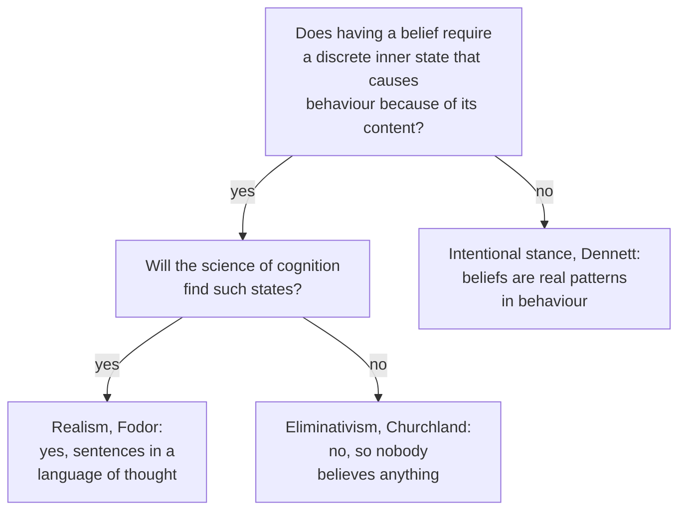

# Philosophy of Mind · Lesson 4.1: Intentionality and folk psychology

> ⏱ ~15 min · Module 4: Intentionality and perception · Builds on: [1.1](01-01-the-mind-body-problem.md), [2.2](02-02-functionalism.md), [`phenomenology-and-personalism` 1.1](../../phenomenology-and-personalism/lessons/01-01-intentionality-from-brentano-to-husserl.md), [`deep-learning` 1.1](../../deep-learning/lessons/01-01-from-linear-models-to-the-mlp.md) · Unlocks: [4.2](04-02-naturalizing-content.md), [6.1](06-01-computationalism-and-the-turing-test.md), [6.3](06-03-do-language-models-understand.md)

## Why this matters

In 1977 Daniel Dennett reported a chess programmer's complaint about a rival program: it "thinks" it should bring its queen out early. The remark predicts well, since you can count on chasing that queen around the board, yet nothing in the program mentions queens. You do the same to people all day: she took the umbrella because she believes it will rain and wants to stay dry. What makes a state *about* rain, and are the beliefs that predict so well real inner states, the posits of a false theory, or something in between?

## The idea

A belief, a fear or a hope is about something, and it can be about what does not exist: you can fear a storm that never comes. That is [intentionality](../reference.md#intentionality). Brentano's 1874 text, its readings and Husserl's revision are read in [`phenomenology-and-personalism` 1.1](../../phenomenology-and-personalism/lessons/01-01-intentionality-from-brentano-to-husserl.md); this lesson asks whether his thesis is true. [Brentano's thesis](../reference.md#brentanos-thesis), as the live debate states it, has two halves: *every* mental state is intentional, and *only* mental states are. Pains and moods test the first half; fuel gauges and sentences test the second.

The thesis fits best the [propositional attitudes](../reference.md#propositional-attitudes): believing *that* it will rain, wanting *that* you stay dry, each an attitude toward a content that can be true or false. [Folk psychology](../reference.md#folk-psychology) explains and predicts with them, roughly: if someone wants X and believes that doing Y is the best way to get X, then, other things equal, she will tend to do Y.

Are its beliefs real? Old sciences posited three kinds of thing. Mendel's factors were later found in DNA. Phlogiston turned out not to exist. A centre of gravity is real and predicts well, but no particle sits there. Jerry Fodor's [intentional realism](../reference.md#intentional-realism) says beliefs are like genes: inner states to be found. Paul Churchland's [eliminative materialism](../reference.md#eliminative-materialism) says they are like phlogiston. Dennett's [intentional stance](../reference.md#intentional-stance) says they are like centres of gravity.

Fodor adds that thoughts are sentences in an inner code. The rival is [connectionism](../reference.md#connectionism): thinking as activation spreading through networks of simple units, with knowledge stored in the weights, the ancestor of the networks in [`deep-learning` 1.1](../../deep-learning/lessons/01-01-from-linear-models-to-the-mlp.md). A flag: there and in [4.1](../../deep-learning/lessons/04-01-autoencoders-and-representation-learning.md), a "representation" is a learned feature vector, judged by what a probe can read from it, not by accuracy conditions; whether such vectors are about anything in this lesson's sense is the question of [4.2](04-02-naturalizing-content.md) and [6.3](06-03-do-language-models-understand.md).

## Source

Brentano, *Psychologie vom empirischen Standpunkte*, vol. I (Leipzig: Duncker & Humblot, 1874), Book II ch. I §5, pp. 115–16 (lesson's translation, from the 1874 German):

> What positive mark [*Merkmal*] shall we now be able to give? Or is there perhaps no positive determination at all that holds in common of all mental phenomena? A. Bain in fact thinks there is none. … This intentional inexistence is exclusively peculiar [*ausschliesslich eigenthümlich*] to mental phenomena. No physical phenomenon shows anything similar. And so we can define mental phenomena by saying that they are such phenomena as contain an object intentionally within themselves. … And it is Hamilton in particular who denies the stated peculiarity for a whole wide class of mental appearances, namely for all those he calls feelings, for pleasure and pain in their most manifold kinds and degrees.

Read the shape. Brentano wants a mark that holds of *all* mental phenomena, against Bain, and the exclusivity sentence adds *only*. A definition needs both halves, which is why "and so" can follow. The first dispute is aimed at "all": Hamilton's feelings (his answer is in `phenomenology-and-personalism` 1.1). A "physical phenomenon" is a sensed colour or tone, not a physical object, so his "only" contrasts acts with what they present, not minds with thermostats.

## The argument

**Brentano's thesis**, as Roderick Chisholm revived it (*Perceiving*, 1957):

**B1. Every mental state is intentional.** *In words:* nothing in the mind is about nothing.

**B2. Only mental states are originally intentional; anything else that is about something borrows its aboutness from a mind.** *In words:* the fuel gauge means "low" because drivers read it that way.

The qualifier is the modern repair: words and gauges have derived intentionality, minds original (John Searle, John Haugeland, Fodor), a line Dennett denies is sharp. W. V. Quine (*Word and Object*, 1960) made the thesis a dilemma: if intentional idioms resist physical paraphrase, give up physicalism or count the idioms baseless. The three stances are three ways through.

**Fodor's realism** (*The Language of Thought*, 1975; *Psychosemantics*, 1987), with $p$ standing for any declarative sentence:

**R1. To believe that $p$ is to stand in a distinctive functional relation to a mental representation that means that $p$; likewise for the other attitudes.** *In words:* a belief is a sentence in the "belief box", and the box is a role, as in [2.2](02-02-functionalism.md). This is the [representational theory of mind](../reference.md#representational-theory-of-mind).

**R2. Thinking is a causal sequence of such representations, which have words and a syntax that the processes respond to.** *In words:* we think in a [language of thought](../reference.md#language-of-thought).

Fodor and Zenon Pylyshyn's argument for R2 ("Connectionism and Cognitive Architecture", 1988), as the SEP reconstructs it:

**S1. Thought is [systematic](../reference.md#systematicity) by psychological law: whoever can think that the dog chases the cat can think that the cat chases the dog.** *In words:* thinkable thoughts come in families.

**S2. A theory of cognition must explain why this holds by law, not by luck.** *In words:* a model that happens to be systematic explains nothing.

**S3. Only representations built from reusable constituents, processed by operations sensitive to that structure, explain it.** *In words:* the same parts recombine.

**∴ C. A connectionist network either has such representations, and so implements a language of thought, or lacks them, and so fails S2.** *In words:* connectionism is at best a theory of how the language of thought is wired.

**Churchland's argument** ("Eliminative Materialism and the Propositional Attitudes", 1981):

**E1. Folk psychology is an empirical theory, whose generalizations link beliefs, desires, perceptions and actions as laws link posits.** *In words:* we explain each other with a theory, the theory-theory Wilfrid Sellars proposed in 1956.

**E2. A theory that leaves much of its domain unexplained, has not developed in millennia and fits none of the sciences around it is probably false, deeply enough to be replaced rather than reduced.** *In words:* alchemy and phlogiston went this way.

**E3. Folk psychology is such a theory: silent on sleep, mental illness and learning, little changed since antiquity, with no counterpart in neuroscience.** *In words:* it fails E2's tests.

**∴ C. Beliefs and desires probably do not exist.** *In words:* belief goes the way of phlogiston.

**Dennett's stance** ("Intentional Systems", 1971; "True Believers", 1981; *The Intentional Stance*, 1987):

**D1. The intentional strategy: treat a system as a rational agent, credit it with the beliefs and desires it ought to have, and predict that it will act on them.** *In words:* ask what a sensible agent in its place would do.

**D2. A system has beliefs just in case this strategy predicts its behaviour reliably and in detail, whatever is inside it.** *In words:* to believe is to be predictable in this way.

Beliefs are then "real patterns" (Dennett, 1991): there in the behaviour, like a centre of gravity, not written inside.

**Where the argument is weakest.** In Churchland's argument, E1. Simulation theorists (Robert Gordon, 1986; Jane Heal, 1986; Alvin Goldman, 1989) deny that we predict others with a theory: we run our own decision-making offline on pretend beliefs and desires, so there may be no folk theory to be false, and E2's tests have no target ([theory-theory and simulation](../reference.md#theory-theory-and-simulation)). The strongest reply (SEP, "Eliminative Materialism") is that elimination needs only that our concept of belief sets conditions (a discrete inner state causing behaviour by virtue of its content) that nothing meets. Ramsey, Stich and Garon (1990) argued that if distributed networks model memory correctly, nothing does. The eliminativist concedes that stagnation and explanatory failure then weigh little, so the case rests on what cognitive science finds. The simulation theorist concedes that simulation alone protects beliefs from nothing.

## Map of positions

Each stance answers a conceptual question and, if yes, an empirical one.

## Worked examples

**Example 1 (clean case: the chess program).** Dennett's "Intentional Systems" (1971) gives three ways to predict a chess-playing computer. From the *physical stance* you compute its move from its circuitry: possible in principle, hopeless in practice. From the *design stance* you trace its program. From the *intentional stance* you assume it wants to win and believes what a good player in its position would believe. Your bishop attacks its undefended queen, which has one safe square. The stance predicts the queen goes there, without the code, and by D2 that success is what having the belief consists in.

Now ask the realist's question. The program holds explicit data structures for the board, so, for the realist, R1 is literally true of its belief that its queen is attacked. The queen-out-early tendency is stated nowhere in the code. Fodor's answer (*Psychosemantics*, 1987, p. 25) separates representations from the rules that govern them: a rule the machine merely conforms to need not be written down. Both accounts say it believes its queen is attacked, and disagree about what makes that true.

**Example 2 (hard case: systematicity in a trained network).** A network learns to turn commands into actions: "walk twice" gives two steps, "look around right" four right turns, each with a look. Commands joining "jump" to "around right" are held out, then tested. By S1, a thinker with "jump" and "around right" gets "jump around right" free. The SEP's connectionism entry reports that recurrent networks tested this way (Loula, Baroni and Lake, 2018) passed that test but failed on commands longer than any in training.

Run C. Where the network fails, the classicist scores. Where it succeeds, the dilemma bites: either it learned representations with reusable parts, and so implements a language of thought, or its systematicity is an artefact of training, which could as easily have produced a network that fails "jump around right" (Fodor and McLaughlin, 1990). In 2023 Brenden Lake and Marco Baroni (*Nature*) reported that a standard network, trained by meta-learning on many small compositional tasks, generalized as systematically as people in their instruction-learning experiment, and presented it as answering Fodor and Pylyshyn.

**Where it strains.** The classicist reads "trained for compositional skill" as a concession: systematicity was put in, not explained by the architecture. The connectionist replies that a classical system can also be programmed to accept "John loves Mary" and refuse "Mary loves John", so S2 may demand a lawfulness no architecture supplies, and that human systematicity is itself partial (Kent Johnson, 2004). Then the argument stops giving a verdict. If a network encodes constituents in vectors that let them be recovered without being literal parts (Paul Smolensky's tensor products), Fodor and McLaughlin say this cannot do the classical causal work, and Murat Aydede says it is a language of thought in another format. That turns on whether "classical" names a format or a structure, which no test on the network settles.

## Watch out

- **You might think intentional realism is the language-of-thought hypothesis, but actually** realism says only that beliefs exist and cause behaviour by virtue of their content. LOT adds a claim about format; many cognitive scientists posit representations without sentence-like structure (Nicholas Shea, 2018).

- **You might think Dennett is an eliminativist or a behaviourist, but actually** he counts beliefs as real patterns, and his test is a rationality-based strategy's success, not a behavioural definition of each belief ([2.1](02-01-behaviourism-and-the-identity-theory.md)). The live charge is that he explains beliefs away rather than explaining them.

- **You might think a thermostat refutes Brentano, but actually** his "physical phenomena" are sensed qualities, so the thermostat tests only the modern B2, whose defender answers with derived intentionality.

## One-liner

> Brentano made aboutness the mark of the mental; the live dispute is whether the beliefs we predict each other with are inner sentences (Fodor), a false theory's posits (Churchland), or real patterns (Dennett).

## Problems

**P1 (🟢) *(Exegetical.)*** (a) Say whether each claim belongs to an intentional realist, an eliminativist or the intentional stance, and name the deciding words. Each claim was written for this problem. One line each.

> (i) "No particle sits at a centre of gravity and no sentence sits behind a belief; both are real because the predictions built on them succeed."
>
> (ii) "In two thousand years belief-desire psychology has taught us nothing about sleep, madness or learning; expect beliefs to go the way of phlogiston."
>
> (iii) "Your belief that the train is late and your belief that the late train is crowded share a part, a mental symbol for the late train, and that part does causal work in both."
>
> (iv) "Beliefs are real brain states that cause what we do, but they are patterns of activation across many neurons, not sentences."

(b) Which claim would Fodor reject, and does rejecting it make the claim's author less of a realist? One sentence.

**P2 (🟡) *(Apply to a hard case: Exegetical (a)–(b) · Evaluative (c).)*** After a night without sleep you wake irritable. Nothing in particular has annoyed you, but within the hour the irritability has settled on the kettle, then an email, then the weather. Take two views. *Representationalism about moods* (Michael Tye, William Lycan): every mental state is intentional, and a mood represents one's surroundings, or things in general, as being some way. *The dual view* (Ned Block): some mental states have phenomenal character and no intentional content.

(a) On each view, is the morning irritability intentional, and if so, what is it about? One line each.

(b) On each view, what are the later episodes of irritation at the kettle and the email? One line each.

(c) Does the drift from one target to the next favour either view? Any verdict; 100 words or fewer.

**P3 (🔴) *(Find the crux: Exegetical (a)–(b) · Evaluative (c).)*** Fodor and Churchland disagree about whether anyone has beliefs.

(a) Beyond physicalism, state two things they agree on. One line each.

(b) Name the single premise one affirms and the other denies, and state a conditional both would sign. Two sentences.

(c) Suppose a lab trains a network on a few thousand facts about an imaginary town. For each fact, a linear probe can read it off one direction in the network's activations, and shifting that direction changes the answers that depend on that fact and no others. Does this bear on the crux? Say what it would show, what it would not, and what further finding would move each side. Any verdict; 150 words or fewer.

Solutions

**P1** *(Exegetical.)*

**Must hit, strict (a):**

- (i) Intentional stance: "no sentence sits behind a belief" with "real because the predictions built on them succeed" is Dennett's centre-of-gravity comparison and D2.

- (ii) Eliminativist: stagnation and explanatory failure (E2–E3), and "go the way of phlogiston", a posit that turned out not to exist.

- (iii) Realist, of Fodor's kind: a shared constituent that "does causal work in both" is R2's structured representation and the systematicity explanation.

- (iv) Realist: beliefs are "real brain states that cause what we do". Rejecting the sentence format does not make it eliminativist.

**Must hit, strict (b):** Fodor rejects (iv)'s format claim, or reads its patterns as implementing sentences, but its author is no less a realist, since realism concerns the existence and causal role of beliefs and LOT is a further hypothesis about their format.

**Wrong turns:** calling (i) realist because it says beliefs are "real"; Dennett's real patterns are not inner states. Calling (iv) eliminativist because it speaks of activation patterns, Churchland's vocabulary; the claim says beliefs exist. Treating (ii) as the stance because it mentions prediction; it predicts the theory's demise, not anyone's behaviour.

**Model answer:** (a) (i) Stance: real because predictions succeed, with no inner sentence. (ii) Eliminativist: stagnation, and beliefs going the way of phlogiston. (iii) Realist, LOT: a shared symbol doing causal work. (iv) Realist, not LOT: real causal brain states that are not sentences. (b) Fodor rejects (iv), since unstructured patterns would not explain systematicity, but (iv) is still realism, because LOT adds a claim about format to realism's claim about existence.

---

**P2** *(Exegetical (a)–(b) · Evaluative (c).)*

**Accept (a):** for the representationalist, any general or indeterminate content that presents things as irksome ("everything is annoying", "the world is frustrating"), provided it has no single object.

**Must hit, strict (a):**

- Representationalism: intentional; it represents one's surroundings, or things in general, as irksome or frustrating. Its content is general, not about any one object.

- Dual view: not intentional; a state with phenomenal character, a way of feeling, and no content.

**Must hit, strict (b):**

- Representationalism: each is the mood's general content made specific, or a new emotion whose content the mood colours: the kettle is represented as irksome.

- Dual view: each is a separate intentional state, an emotion with an object, caused or coloured by the contentless mood.

**Must hit, any verdict (c):**

- Say what the drift is evidence of on each view: a general content applied to whatever comes into view, or a contentless state that borrows objects from the emotions it causes.

- Name the premise each must add, or a test that would separate them. For example, the representationalist needs the mood's felt character to vary with what it represents. The dual view needs the mood to feel the same before any target appears.

**Wrong turns:** saying that because the kettle is an object the mood is about the kettle, which runs the mood together with the emotions it causes. Saying the dual view denies that the irritation at the kettle is intentional. Treating the case as a refutation of Brentano's thesis outright; that is Hamilton's challenge, which the representationalist answers with general content.

**Model answer (c), one of several:** The drift fits both views and decides neither. The representationalist reads it as general content: the mood presents things as irksome, so each new thing is seen that way. The dual view reads it as showing that the mood has no object of its own: it borrows objects from the emotions it causes, easily, because nothing in it was ever about anything. A test would be whether the morning's irritability, before any target appears, already presents things as irksome. Introspection gives conflicting reports here, which is why the dispute persists.

---

**P3** *(Exegetical (a)–(b) · Evaluative (c).)*

**Accept (b):** any phrasing that isolates whether the causes of behaviour include discrete, content-bearing states, including Ramsey, Stich and Garon's propositional modularity, or the question whether cognitive science will vindicate folk psychology's posits.

**Must hit, strict (a):** any two of:

- Folk psychology is an empirical theory, or at least a body of concepts, answerable to cognitive science (E1, or the concept route).

- If there are no inner states of the kind it describes, there are no beliefs; both reject Dennett's D2, on which belief is fixed by predictive success alone.

- The question is open to empirical evidence, not settled by introspection or analysis.

**Must hit, strict (b):**

- The premise: the causes of intelligent behaviour include discrete inner states that cause it by virtue of contents of the kind folk psychology assigns. Fodor affirms it, and adds that the states are Mentalese sentences; Churchland denies it.

- A conditional both would sign: "If cognitive science finds no discrete, content-bearing states that cause behaviour, folk psychology is false and there are no beliefs; if it finds them, folk psychology is vindicated."

**Must hit, any verdict (c):**

- Relate the finding to the premise: a probe-readable direction whose shift changes exactly the dependent answers looks like a discrete, causally specific state for each fact, the thing Ramsey, Stich and Garon said distributed networks lack.

- Say what it does not show: readability shows information, not content that could be false (4.2); it shows no reusable constituents, so whatever it does for realism, it does nothing for LOT; and it concerns a trained network, not a brain.

- Name a finding for each side. The same separability in neural recordings would move Churchland. Networks that match human performance with no separable states, where every edit spreads, would move Fodor.

**Wrong turns:** naming the crux as whether physicalism is true, which both accept. Saying the finding vindicates the language of thought; nothing shows constituent structure. Taking a probe's accuracy to show that the direction means the fact.

**Model answer (c), one of several:** It bears on the crux only partly. Ramsey, Stich and Garon's case for elimination was that distributed networks have no discrete, semantically evaluable, causally active state for each thing stored. A direction that a probe reads and whose shift changes just the dependent answers is a good candidate for such a state, so the finding weakens that conditional's antecedent for systems like this one. It does not show content: a probe shows the information is there, and whether the direction can misrepresent is a further question. It shows no reusable parts, so Fodor's LOT gains nothing. And the network is not a brain. The same separability found in neural recordings would move Churchland; networks matching human competence with only entangled states would move Fodor.

## Flashback

**From Lesson [3.4](03-04-illusionism.md) (Illusionism):** *(Exegetical (a)–(b).)* William James, *The Principles of Psychology*, vol. I (New York: Holt, 1890), ch. VII, pp. 191–92, where "feelings" means mental states of every kind:

> However it may be with such strong feelings as doubt or anger, about weaker feelings, and about the *relations to each other* of all feelings, we find ourselves in continual error and uncertainty so soon as we are called on to name and class, and not merely to feel. ... Something is before us; we do our best to tell what it is, but in spite of our good will we may go astray, and give a description more applicable to some other sort of thing.

(a) Is this the error [weak illusionism](../reference.md#strong-and-weak-illusionism) claims, or the one strong illusionism claims? Quote the deciding words. Two sentences.

(b) Dennett's Chase and Sanborn face an uncertainty of this kind. What did Dennett conclude from it, and what does James's last sentence assume that blocks the step? Two sentences.

Solution

**Must hit, strict (a):**

- Weak. The error is confined to weaker feelings and to relations, arising "so soon as we are called on to name and class, and not merely to feel", with "such strong feelings as doubt or anger" set aside. A real experience is misdescribed, which realists accept.

- Strong illusionism puts the error everywhere: introspection represents phenomenal properties that nothing has, in anger as much as in any faint feeling.

**Must hit, strict (b):**

- Dennett ("Quining Qualia", 1988): a quality that cannot be told apart from a change in reaction is not directly apprehensible, so the marks of [qualia](../reference.md#qualia) pull apart, the concept is confused, and there are no qualia.

- James's "Something is before us" makes introspection observation of an item there to be described: the feeling is had, and only the telling of what it is goes astray, as with any observed thing. The uncertainty then empties the concept only if a real quality must be directly apprehensible, the mark Dennett's argument tests and James's picture does not require.

**Wrong turns:** reading "a description more applicable to some other sort of thing" as Frankish's thesis: the form fits misrepresentation, but James confines it to naming and classing. Taking any admitted introspective error as support for strong illusionism. Saying James refutes Dennett: he assumes that a feeling with a definite character is before us, which is what Dennett denies.

**Model answer:** (a) Weak: the errors arise "so soon as we are called on to name and class, and not merely to feel", about weaker feelings and relations, with doubt and anger set aside. Strong illusionism says every experience is represented as having phenomenal properties nothing has. (b) Dennett concluded that such a quality is not directly apprehensible, so the concept of qualia is confused and there are none. James's "Something is before us" makes the uncertainty the fallibility of observing a real item, which empties the concept only if feelings had to be apprehended without error.

## Connections

- **Backward:** intentionality was one of the [marks of the mental](../reference.md#marks-of-the-mental) in [1.1](01-01-the-mind-body-problem.md), and the eliminativist is the physicalist there who denies that some mental states exist at all. R1's attitude relations are functional roles from [2.2](02-02-functionalism.md). Representationalism about pains and moods is [3.2](03-02-representationalism-and-higher-order-theories.md)'s first-order representationalism asked about intentionality rather than phenomenal character, and Dennett's account of consciousness is one source of the illusionism of [3.4](03-04-illusionism.md). Brentano's text and Husserl's revision are [`phenomenology-and-personalism` 1.1](../../phenomenology-and-personalism/lessons/01-01-intentionality-from-brentano-to-husserl.md).

- **Forward:** [4.2](04-02-naturalizing-content.md) takes up the realist's answer to Quine, how a physical state can have content, and [4.3](04-03-externalism-narrow-content-and-the-extended-mind.md) asks whether that content is in the head. [6.1](06-01-computationalism-and-the-turing-test.md) adds computation to the representational theory of mind. Connectionism against the language of thought is the old form of the question [6.3](06-03-do-language-models-understand.md) asks about transformers.

- **Sideways:** the same Fodor argued for the autonomy of the special sciences in [`philosophy-of-science` 4.5](../../philosophy-of-science/lessons/04-05-reduction-and-emergence.md), and the same Paul Churchland attacks the observable line in [5.4](../../philosophy-of-science/lessons/05-04-constructive-empiricism-and-entity-realism.md) there. Churchland's induction over failed folk theories has the shape of the pessimistic induction in [5.2](../../philosophy-of-science/lessons/05-02-the-pessimistic-induction-and-selective-realism.md). George Molnar's "physical intentionality" of powers ([`metaphysics` 4.3](../../metaphysics/lessons/04-03-powers-dispositions-and-laws.md)) would refute B2 if it were intentionality proper; that lesson treats it as a borrowed analogy. Ockham's mental language ([`ancient-medieval-philosophy` 8.4](../../ancient-medieval-philosophy/lessons/08-04-ockham-nominalism-and-the-razor.md)) resembles Mentalese, a resemblance rather than a lineage, since Fodor's revival came from computing. Fodor also argued that concepts are acquired but never learned, since testing a hypothesis about what a concept applies to already requires the concept, so in his sense they are innate (1975; restated 2008). That continues the dispute of [`modern-philosophy` 3.1](../../modern-philosophy/lessons/03-01-locke-against-innate-ideas.md); whether developmental science vindicates it is a question for cognitive science. Simulation theory is the analytic counterpart of the question about empathy in [`phenomenology-and-personalism` 4.3](../../phenomenology-and-personalism/lessons/04-03-stein-empathy.md). The Humean theory of motivation, which uses belief-desire psychology, is read in [`modern-philosophy` 4.4](../../modern-philosophy/lessons/04-04-the-self-belief-and-the-passions.md), and Dennett's real patterns reappear as Everettian branches in [`philosophy-of-physics`](../../philosophy-of-physics/syllabus.md).
