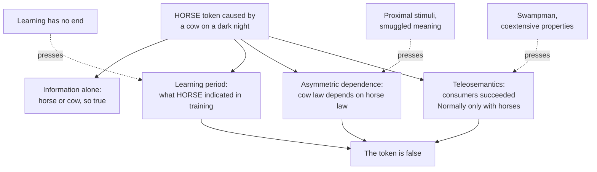

# Philosophy of Mind · Lesson 4.2: Naturalizing content

> ⏱ ~15 min · Module 4: Intentionality and perception · Builds on: [4.1](04-01-intentionality-and-folk-psychology.md), [`philosophy-of-science` 4.2](../../philosophy-of-science/lessons/04-02-causal-explanation.md), [`epistemology` 2.4](../../epistemology/lessons/02-04-reliabilism.md) · Unlocks: [4.3](04-03-externalism-narrow-content-and-the-extended-mind.md), [6.3](06-03-do-language-models-understand.md)

## Why this matters

Some ocean bacteria carry chains of tiny magnets that steer them along the Earth's field, down into the oxygen-poor sediment they need. Hold a bar magnet above them, turned against the Earth's field, and they swim up to their death. Fred Dretske ("Misrepresentation", 1986) asked whether that is nature making a mistake, or the bacteria correctly tracking the magnetic field. If no physical fact settles that for bacteria, it is not obvious what settles it for your beliefs.

## The idea

[4.1](04-01-intentionality-and-folk-psychology.md) left the [representational theory of mind](../reference.md#representational-theory-of-mind) with a debt: if thinking is the manipulation of inner symbols, what makes a symbol mean *horse* rather than *cow*, or nothing? [Naturalizing content](../reference.md#naturalizing-content) means paying the debt in terms that mention no meaning, intention or mind: only causes, laws, probabilities and biology.

Smoke means fire; twelve rings mean the tree was twelve years old. H. P. Grice called this [natural meaning](../reference.md#natural-meaning) ("Meaning", 1957), and it has one feature thoughts lack: it cannot be false. If those spots mean measles in the natural sense, the child has measles. The doctor's belief that she has measles can be false. Natural meaning is information, and a theory of content must turn information into something that can be wrong.

Each candidate adds one ingredient to information:

- a **learning period** that fixes what a state was trained to signal (Dretske);
- a **dependence among laws**: the wrong causes work only because the right one does (Jerry Fodor);
- a **biological function**: what the state is for, as selection made it (Ruth Millikan, David Papineau);
- or, by a different route, a state's **role in inference**.

The function is the selected-effect function of [`philosophy-of-science` 4.2](../../philosophy-of-science/lessons/04-02-causal-explanation.md): what earlier tokens did that got the trait selected. The test every candidate faces is misrepresentation. A theory on which every token is true has explained a thermometer, not a belief.

Most physicalists want one to succeed. Defenders of Brentano's thesis ([4.1](04-01-intentionality-and-folk-psychology.md)), phenomenal-intentionality theorists ([4.3](04-03-externalism-narrow-content-and-the-extended-mind.md)) and hylomorphists (Module 5) expect it to fail somewhere, and [5.2](05-02-is-the-intellect-a-bodily-power.md)'s determinacy argument says where.

## The argument

**The [disjunction problem](../reference.md#disjunction-problem)** (Fodor, "Semantics, Wisconsin Style", 1984; the horse version is usually told after his *Psychosemantics*, 1987). Take [informational semantics](../reference.md#informational-semantics) in its simplest form, using Dretske's indication relation (*Knowledge and the Flow of Information*, 1981).

**P1.** A state type $R$ represents that $C$ just when $R$ indicates $C$: given the channel conditions (the stable background it depends on), $\Pr(C \mid R) = 1$. *In words:* a state means what it reliably signals.

**P2.** HORSE, the inner symbol, is tokened by horses and also by cows glimpsed on a dark night. *In words:* there are mistakes.

**P3.** If cows on dark nights cause HORSE within the channel conditions, then given HORSE the probability of a horse is below 1, and of a horse-or-cow-on-a-dark-night it is 1. *In words:* every actual cause is folded into what the state signals.

**∴ C1.** HORSE represents *horse or cow-on-a-dark-night*, and the cow-caused token is true.

**P4.** A state none of whose tokens can be false is not a belief or a perception. *In words:* to represent is to be able to misrepresent.

**∴ C2.** Information alone does not give mental content.

Indication entails truth: it cannot misfire.

**Learning.** Dretske (1981): a state means what it indicated while the creature was learning to token it, so later cow-caused tokens are false. Fodor (1984): learning has no principled end, and a cow seen during training would have caused HORSE then too. Dretske then made content what a state has the *function* to indicate (1986; *Explaining Behavior*, 1988), and met his bacteria: their magnets indicate magnetic north and oxygen-poor water at once. Which is the function? That is the problem of [distal content](../reference.md#distal-content).

**[Asymmetric dependence](../reference.md#asymmetric-dependence)** (Fodor, *Psychosemantics*, 1987; "A Theory of Content", 1990). HORSE means horse if:

**A1.** It is a law that horses cause HORSE tokens. *In words:* the content is a cause.

**A2.** Whatever else causes HORSE (cows on dark nights, the question "what pulls a hansom cab?") does so only because horses do, and not the other way round. *In words:* cows trigger HORSE by looking like horses, and better lighting breaks only the cow link.

**A3.** The dependence holds among the laws now, not in their history. *In words:* how the symbol was acquired is irrelevant.

The objections: drugs or microelectrodes could trigger any brain state without depending on horses; where perception runs through a single sensory channel, every link depends on the one from the proximal stimulus, so content comes out proximal; and only meaning seems to explain the asymmetries (Seager, 1993; Adams and Aizawa, 1994).

**[Teleosemantics](../reference.md#teleosemantics)**, in Millikan's version (*Language, Thought, and Other Biological Categories*, 1984; "Biosemantics", 1989):

**B1.** A representation sits between a [producer](../reference.md#producer-and-consumer) that makes it and consumers that act on it, designed by selection or learning to work together. *In words:* a signal is a message inside a system.

**B2.** Its content is the condition that must hold for the consumers to perform their proper functions in the Normal way, the way that historically explained their selection. *In words:* a state means what the world must be like for its users to succeed as they were selected to.

Her stock case is the frog. The visual system produces, the prey-catching system consumes, and the content is *frog food here now*, since food is what ancestral snapping succeeded by. Papineau ("Representation and Explanation", 1984; *Philosophical Naturalism*, 1993) starts from desires, whose content is the effect they were selected to produce, and derives belief content from them. Karen Neander (*A Mark of the Mental*, 2017) keeps selection and moves content to the input side: what the producer was selected to respond to.

Fodor (1990) pressed that selection cannot tell locally coextensive properties apart. If rabbits that freeze at dogs survived, so did rabbits that freeze at dog-lookalikes, so one history fits both descriptions: [functional indeterminacy](../reference.md#functional-indeterminacy). Millikan (1991) and Neander (1995) answer that dogs, not lookalikes, eat rabbits, so only one description explains the success.

**[Inferential-role semantics](../reference.md#inferential-role-semantics)** is the different route. A symbol's content is its role in reasoning: an inner "&" means *and* because believing P&Q leads to believing P and believing Q, and believing both leads back. Gilbert Harman ("(Nonsolipsistic) Conceptual Role Semantics", 1987) lets the roles reach out to perception and action. Ned Block ("Advertisement for a Semantics for Psychology", 1986) discusses two-factor theories, pairing an inner role with a referential factor that a tracking theory must supply. The objections: holism, since if every inference counts, any change of belief changes every meaning (Fodor and Lepore, *Holism: A Shopper's Guide*, 1992); and roles alone fix no truth conditions. It fits *and* better than *horse*. Inferentialism about linguistic meaning is [`philosophy-of-language-and-logic`](../../philosophy-of-language-and-logic/syllabus.md) 4.2's.

**Where the argument is weakest.** C2 is common ground; the pressure falls on what every repair assumes, that its ingredient can be stated without already using meaning. The strongest objection is that each smuggles meaning in: learning is determinate only if a teacher meant HORSE for horses (Fodor, 1984), the asymmetries seem explicable only by what the symbols mean, and "selected for detecting dogs" wins only because we know what the rabbit is after. The strongest reply is teleosemantic: selection-for is causal, settled by which property explains the success, and biologists use it with no semantic help. The naturalist concedes that no theory yet shows how a thought about democracy or quarks gets its content. The critic concedes that for simple signals, such as a bee's dance, selected function assigns content with no visible circularity.

## Map of answers

Three repairs condemn the cow token through different facts (training, present laws, selection history), and each objection aims at that fact.

## Worked examples

**Example 1 (clean case: a smoke detector).** An ionization smoke detector closes its alarm circuit when particles entering a chamber cut a small current. Call the alarm state A.

- **Information.** With the circuit working (the channel conditions), A indicates particles in the chamber. In a house where only fire puts particles in the air, A also indicates fire. In a kitchen where steaks get seared, the probability of fire given A is below 1, so A carries no information that there is a fire, even on the night there is one. It still raises the probability of fire, which [mutual information](../../information-theory/lessons/01-03-mutual-information.md) measures; indication is all-or-nothing.

- **Misrepresentation.** On information alone, the steak alarm is no error: there were particles.

- **Function.** We call it a false alarm because the detector is *for* fire: real function and real error, but borrowed from its designers' intentions. The naturalist needs a function that borrows nothing, and selection is the candidate.

- **Asymmetric dependence.** Fire and steak reach A only through particles. Break the fire link (fires that give off no particles) and the steak link survives; both depend on the particle link. If A means anything on this theory, it means particles.

So the device has a clean answer to what it carries information about, and none, without its designers, to what it is about.

**Example 2 (hard case: [Swampman](../reference.md#swampman)).** Donald Davidson ("Knowing One's Own Mind", 1987) imagined lightning in a swamp reducing him to his elements and, by coincidence, turning a nearby dead tree into his exact physical replica, which goes on as he would have. Davidson denied that the replica has thoughts or that its words mean anything, since it lacks the causal history meaning requires. [`epistemology` 2.4](../../epistemology/lessons/02-04-reliabilism.md) used the case on warrant; the prior question here is whether he has beliefs at all.

- **On teleosemantics.** His parts have no selection history, so no proper functions, so his states have no content. His "there's my friend" is neither true nor false.

- **On informational semantics.** Indication is a present relation, so his states indicate what Davidson's did from the first instant, but that version cannot make him wrong. Dretske's repaired theory recruits indicators by learning, so on it Swampman's beliefs arrive as he learns. Fodor's dependences are synchronic, so on asymmetric dependence Swampman has content, and makes mistakes, from the start.

**Where it strains.** The case gives no verdict until you say what a theory of content is a theory of. Millikan ("On Swampkinds", 1996) and Neander (1996) offer a real-nature theory: content is a historical kind, like being a species, and the intuition that Swampman believes is like the old conviction that water could fail to be H2O, natural and false. Papineau (2001; 2016) grants that the intuition may be true and calls it irrelevant, since teleosemantics is a claim about actual believers. The critic replies that an account of what content is must cover possible believers, and that a conscious Swampman has at least the content of how things look to him: [phenomenal intentionality](../reference.md#phenomenal-intentionality), taken up in [4.3](04-03-externalism-narrow-content-and-the-extended-mind.md). Nothing in the case settles whether the intuition is evidence.

## Watch out

- **You might think** the information here is Shannon's, **but actually** Dretske's indication requires probability 1, while mutual information is graded and symmetric: smoke tells you about fire exactly as much as fire tells you about smoke, and aboutness runs one way.

- **You might think** teleosemantics says that evolution favours true beliefs, **but actually** it is a theory of what fixes content. [`apologetics-foundations` 3.2](../../apologetics-foundations/lessons/03-02-reason.md) uses it against Plantinga, and the link to truth is a consequence drawn there.

- **You might think** Swampman is a case against physicalism, **but actually** he is a physical duplicate; the case divides historical from synchronic physicalist theories of content.

- **You might think** teleosemantic externalism is the extended mind, **but actually** it puts the content-fixing facts in the past and the environment while the representation stays in the head. [4.3](04-03-externalism-narrow-content-and-the-extended-mind.md) keeps [content externalism](../reference.md#content-externalism) and the extended mind apart.

## One-liner

> Information never errs; each naturalistic theory adds one ingredient (training, a dependence among laws, a selection history, an inferential role) to make room for error, and each is pressed on whether it smuggles meaning back in.

## Problems

**P1 (🟢)** *(Exegetical.)* A songbird's feeding system is triggered by a state G, which its visual system produces when a wide, brightly lined gape appears in the nest. Through the species' history such gapes were almost always the bird's own chicks, and feeding them is what the feeding system was selected for. Today cuckoo chicks sit in some nests, and G fires for them too. Four claims:

> (1) G means *a gape in the nest, chick or cuckoo*, so feeding the cuckoo is no error.
>
> (2) G means *my chick, here, now*, because only that condition let ancestral feeding succeed in the way that got it selected; feeding the cuckoo is an error.
>
> (3) G means *chick here*, provided that cuckoos trigger G only because chicks do and not the other way round; whether feeding the cuckoo is an error turns on that dependence as it holds today.
>
> (4) G means *a wide, bright gape here*, because that is what the visual system was selected to respond to; feeding the cuckoo is no error.

(a) Which theory makes each claim? One line each.

(b) A molecule-for-molecule duplicate of the bird forms by chance and has no history. Which of the four claims can no longer be made of its G, and why? One sentence.

**P2 (🟡)** *(Counterexample: Evaluative (a) · Exegetical (b).)* Take informational semantics as P1 of the argument states it, with one clarification: a token carries information only if the channel conditions hold on its occasion, and a token that carries no information represents nothing.

(a) Build a fresh case, using no frogs, smoke detectors, bacteria, horses or songbirds, in which a state ought to count as misrepresenting. Give the state, what normally causes it, and the error. Three sentences or fewer.

(b) Show that the theory does not call your error false, whether the channel conditions are drawn to include the circumstances of the error or to exclude them. One sentence for each.

**P3 (🔴)** *(Find the crux: Exegetical (a)–(b) · Evaluative (c).)* Many night-flying moths have ears tuned to the ultrasonic calls bats make when hunting, and a loud call triggers an erratic, evasive dive. Call the triggering state D. A loudspeaker playing recorded bat calls triggers D with no bat nearby. Two verdicts:

> Millikan: the dive succeeds in the way that got it selected only when a hunting bat is near, so D means *bat closing in*, and the speaker-caused D is false.
>
> Asymmetric dependence, as the single-channel objection applies it: the bat–D law and the speaker–D law both depend on the law linking bat-band ultrasound to D, which depends on neither, so D means *bat-band ultrasound*, and the speaker-caused D is true.

(a) State two things the two theories agree on. One line each.

(b) Name the single premise one theory affirms and the other denies, and say why it decides the speaker case. Two sentences.

(c) What finding or argument would move each side off its answer to (b)? Any verdict; 150 words or fewer.

Solutions

**P1** *(Exegetical.)*

**Must hit, strict (a):**

- (1) Informational semantics in its simplest form: with cuckoos inside the channel conditions, G indicates only the disjunction, so no token is false.

- (2) Millikan's biosemantics: content is the condition the consumer, the feeding system, needs in order to succeed in the Normal way.

- (3) Fodor's asymmetric dependence: content is the cause the others depend on, and the dependence is synchronic.

- (4) Neander's causal-informational teleosemantics: content is what the producer, the visual system, was selected to respond to.

**Must hit, strict (b):** (2) and (4). Both fix content by selection history, which the duplicate lacks, so on them its G has no content. (1) and (3) rest on present probabilities or laws, which the duplicate shares.

**Wrong turns:** giving (4) to Millikan, whose content sits on the consumer side and so is about what feeding needs, not what the eye responds to; giving (3) to teleosemantics because it mentions dependence, when A3 makes the dependence a present fact and not a history; giving (1) to Dretske's later theory, which adds a function to indicate.

**Model answer:** (a) (1) simplest informational semantics; (2) Millikan; (3) Fodor's asymmetric dependence; (4) Neander. (b) (2) and (4), because both take content from a selection history the duplicate does not have, while (1) and (3) need only what holds now.

---

**P2** *(Evaluative (a) · Exegetical (b).)*

**Accept (a):** any state reliably caused by one thing, C, also tokened by something else, D, where the token is intuitively a mistake about C and not a correct report of something else. A decoy, a lookalike, a lesion or a drug will all do.

**Must hit, any verdict (a):**

- The state, its normal cause C and the deviant cause D are each named.

- The case says why the D-caused token is an error: the creature or system acts as if C were present, and the act fails or is wasted.

**Must hit, strict (b):**

- *Included:* if D's circumstances fall inside the channel conditions, then since D sometimes causes the state, the probability of C given the state is below 1. So the state indicates C-or-D, and the D-caused token is true.

- *Excluded:* if they fall outside, the D-caused token occurs where the channel conditions fail, so it carries no information and, on this theory, represents nothing. A token that represents nothing is not false.

**Also credit:** noticing that on the first horn even the C-caused tokens no longer indicate C, so the theory loses the true contents as well as the error.

**Wrong turns:** saying the D-caused token is false "because C usually causes the state", which is a frequency claim and not indication; answering (b) with a repair such as learning or function, which is not the theory stated; running both horns as one, so that the token is both true and contentless.

**Model answer, one of several:** (a) A ground-nesting bird has a crouch state S, caused when a hawk passes overhead, that makes it freeze. A child flies a hawk-shaped kite over the field, S is tokened, and the bird freezes and stops feeding though no hawk is there. That freeze is a mistake about a hawk. (b) If kites fall inside the channel conditions, the probability of a hawk given S is below 1, so S indicates *hawk or hawk-shaped thing* and the kite token is true. If kites fall outside them, the kite token carries no information, so it represents nothing and is not false either.

---

**P3** *(Exegetical (a)–(b) · Evaluative (c).)*

**Must hit, strict (a):** any two of:

- Content must be stated in non-semantic terms: neither theory may use meaning or intention in its analysis.

- A theory of content must leave room for misrepresentation, so both reject the simplest informational semantics.

- Content depends on facts outside the moth (its environment, or the laws relating it to things there): both are externalist.

- The facts of the case: D is caused by ultrasound, and the dive spread because it evades bats.

**Must hit, strict (b):**

- The premise: which of a state's causes or conditions fixes its content is settled by history, by what the state's consumers (or producers) were selected for. Millikan affirms it; Fodor denies it, since his A3 makes the content-fixing dependence a present fact.

- Why it decides the case: in the present laws the ultrasound link is the one everything else runs through, so a synchronic theory ranks it first, and only the selection history, in which ultrasound mattered because bats did, makes the bat the content.

**Accept (b):** the crux stated as whether content must be the cause the other causes depend on (Fodor's A1 and A2) or can be whatever the consumers need, provided the answer says that what makes the bat, not the sound, the condition the dive needs is the selection history.

**Must hit, any verdict (c):**

- For each side, a finding or argument that bears on the premise in (b), not merely on the moth's verdict.

- For each side, what it would have to give up if it moved.

**Wrong turns:** making the crux whether the moth is wrong, which is the verdict, not the premise; saying Fodor's theory is historical because laws arise over time, which A3 rules out; treating the objection's reading of asymmetric dependence as Fodor's own considered verdict, rather than the objection he must answer.

**Model answer (c), one of several:** Millikan would move if the Swampman intuition were shown to be evidence, a datum her theory must fit rather than a habit of thought, since a duplicate moth with no history would dive at the speaker just as this one does. She would also move if selection proved unable to separate "bat" from "source of bat-band ultrasound", which were coextensive in the moth's history; then history could not do the ranking (b) needs. Moving costs her the theory's historical core. Fodor would move if it were shown that no present structure of laws ever ranks a distal cause above the proximal stimulus for a perceiver with a single channel, so that only history could deliver distal content. Moving costs him Swampman, whose content he can now grant, and invites the indeterminacy charge he pressed against teleosemantics.

## Flashback

**From Lesson [3.5](03-05-panpsychism-and-russellian-monism.md) (Panpsychism and Russellian monism):** *(Exegetical.)* Diagnose this paragraph, invented and written for this problem:

> Physics tells us only what matter does, so there is nothing more to matter than what it does. From this Russell concluded, in *The Analysis of Matter* (1927), that matter is made of experience. So panpsychism is an anti-physicalist view, which is why physicalists such as Galen Strawson reject it.

(a) The first sentence states one thesis of [Russellian monism](../reference.md#russellian-monism) and denies another. Name both, and say why the denial leaves the panpsychist nowhere to put consciousness. Two sentences.

(b) What is wrong with the second sentence? One sentence.

(c) What is wrong with the third? One sentence.

Solution

**Must hit, strict (a):**

- "Physics tells us only what matter does" is R1, [structuralism about physics](../reference.md#structuralism-about-physics). "So there is nothing more to matter than what it does" denies R2, realism about [quiddities](../reference.md#quiddity): the "so" slides from what physics says to what there is.

- Without categorical natures, R3 has no properties left to constitute consciousness. The Russellian argues instead that dispositions need a bearer with a nature (Example 1's P2).

**Accept (a):** calling the denial the ontic structural realist's thesis or the dispositional essentialist's (Bird); each denies R2.

**Must hit, strict (b):** *The Analysis of Matter* defends [neutral monism](../reference.md#neutral-monism) (ch. XXXVII), Russell's view since 1918, on which matter's intrinsic character is unknown, not absent. Reading it as experience came later (Grover Maxwell, 1978; Michael Lockwood, 1989).

**Must hit, strict (c):** Strawson calls his view physicalism and argues ("Realistic Monism: Why Physicalism Entails Panpsychism", 2006) that physicalism, taken realistically, entails panpsychism. Panpsychists deny only that the physical is wholly non-experiential.

**Wrong turns:** calling the first clause false, when R1 is common ground and the error is the "so"; faulting only the date or title in (b); saying in (c) that a panpsychist cannot be a physicalist, which repeats the paragraph's assumption.

**Model answer:** (a) The first clause is R1; the second denies R2 by sliding from what physics says to what there is, which leaves R3 no properties to constitute consciousness, whereas the Russellian argues that dispositions need a categorical ground. (b) Russell's 1927 view is neutral monism, on which matter's intrinsic character is unknown; the panpsychist reading came later. (c) Strawson is a physicalist who argues that physicalism entails panpsychism; he denies only that the physical is wholly non-experiential.

## Connections

- **Backward:** [4.1](04-01-intentionality-and-folk-psychology.md) left the representational theory of mind needing a semantics for its symbols, and asymmetric dependence is the one Fodor offered it. Selected-effect function is [`philosophy-of-science` 4.2](../../philosophy-of-science/lessons/04-02-causal-explanation.md)'s, and its brand-new mutation, with a Cummins function and no selected one, is Swampman's problem in a single organ. [`epistemology` 2.4](../../epistemology/lessons/02-04-reliabilism.md) set Swampman against proper functionalism about warrant.

- **Forward:** [4.3](04-03-externalism-narrow-content-and-the-extended-mind.md) asks whether content is fixed outside the head at all, and whether phenomenal intentionality gives Swampman content no history supplies. The intentionalist of [4.5](04-05-intentionalism-naive-realism-and-disjunctivism.md) needs accuracy conditions for experience, which these theories try to supply. [5.2](05-02-is-the-intellect-a-bodily-power.md) presses indeterminacy as far as it goes: Ross argues that no physical fact fixes some contents at all. [6.3](06-03-do-language-models-understand.md) runs the tracking and inferential-role theories on a language model, where they come apart most sharply.

- **Sideways:** [`apologetics-foundations` 3.2](../../apologetics-foundations/lessons/03-02-reason.md) uses teleosemantics as the naturalist's reply to Plantinga's argument and sets that reply as its P2. A linear probe in [`deep-learning` 4.1](../../deep-learning/lessons/04-01-autoencoders-and-representation-learning.md) asks what a layer carries information about, which is Dretske's question and not yet Millikan's, and [`information-theory` 1.3](../../information-theory/lessons/01-03-mutual-information.md) measures how much information there is, not what it is about.
