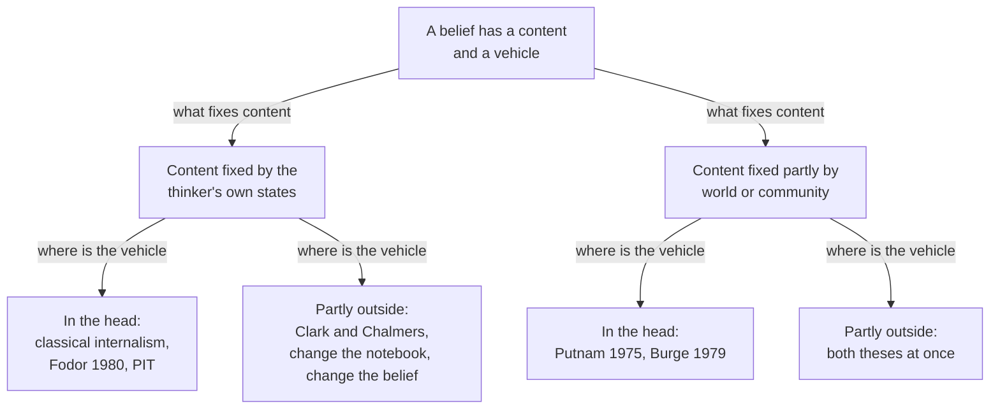

# Philosophy of Mind · Lesson 4.3: Externalism, narrow content, and the extended mind

> ⏱ ~15 min · Module 4: Intentionality and perception · Builds on: [4.1](04-01-intentionality-and-folk-psychology.md), [4.2](04-02-naturalizing-content.md) · Unlocks: [4.5](04-05-intentionalism-naive-realism-and-disjunctivism.md), [6.3](06-03-do-language-models-understand.md)

## Why this matters

On a planet exactly like Earth except for the liquid in its rivers, your molecule-for-molecule twin is thinking, as you are, that water is wet. Are you thinking the same thing? Meanwhile a man whose memory is failing finds a museum's address in the notebook he always carries. Does he *remember* it, or only read it? Both questions ask whether the mind stops at the skin, but about different things, and running them together is this corner's commonest error.

## The idea

[4.1](04-01-intentionality-and-folk-psychology.md) treated beliefs as [propositional attitudes](../reference.md#propositional-attitudes): states with a content, the way they represent the world as being. [4.2](04-02-naturalizing-content.md) asked which natural relation gives a state its content. This lesson asks two questions; the skill is keeping them apart.

**What fixes the content?** Must two people identical inside, atom for atom, believe the same things? The content internalist says yes. The [content externalist](../reference.md#content-externalism) says no, because what a belief is about depends partly on the world or the community around the believer.

**Where is the bearer?** A content needs something that carries it, a *vehicle*, such as a brain state. The [extended mind](../reference.md#extended-mind) thesis says some vehicles lie partly outside the body.

Donald Davidson (1987) supplies the analogy. A burn is a sunburn only if the sun caused it, so it is *individuated* by something outside the skin, yet it is *located* on the skin. Content externalism says beliefs are like sunburns. The extended mind says some beliefs are like a long division done half on paper, partly located outside.

Twin Earth, which [`philosophy-of-language-and-logic`](../../philosophy-of-language-and-logic/syllabus.md) 3.3 (syllabus only) uses for the meaning of kind terms, is run here on belief. In the 2020 PhilPapers survey, 58 percent of the target group accepted or leaned towards content externalism, 26 percent towards internalism (N = 1,514).

## The argument

**The Twin Earth argument, run on belief.** Hilary Putnam ("The Meaning of 'Meaning'", 1975) drew it for word meaning. Colin McGinn (1977) and Tyler Burge (1979) carried it to thought, and Burge, unlike Putnam, endorsed the extension outright.

**P1.** In 1750, before chemistry could tell the liquids apart, Oscar on Earth and Twin Oscar on [Twin Earth](../reference.md#twin-earth) are intrinsic duplicates. The watery stuff is H2O on Earth and a look-alike, XYZ, on Twin Earth. *In words:* same inside, different liquid outside, and nobody can yet tell.

**P2.** "Water" refers to whatever shares the hidden nature of the samples the speaker's community calls water, so Oscar's word picks out H2O and Twin Oscar's picks out XYZ. *In words:* a natural-kind word points at the stuff around you, not at how it looks.

**P3.** The that-clause that reports a belief gives its content, and beliefs with different truth conditions are different beliefs. *In words:* if the reporting sentences differ in what makes them true, so do the beliefs.

**∴ C.** Oscar believes that water is wet and Twin Oscar does not, so a person's intrinsic states do not fix what she believes. *In words:* two people identical inside can think different thoughts.

**Burge's [arthritis case](../reference.md#arthritis-case)** ("Individualism and the Mental", 1979) makes the environment social. A patient with many true beliefs about arthritis tells his doctor he has it in his thigh. Arthritis is an inflammation of the joints, so the belief is false, but it is an arthritis-belief, because he would accept the doctor's correction. Give him the same intrinsic history in a community whose doctors apply "arthritis" to rheumatoid ailments generally, thighs included, and his belief is true and not about arthritis. Burge ran the pattern on sofas and contracts too, so his *anti-individualism* reaches any concept a thinker can understand incompletely.

**Narrow content.** Extreme internalists (Tim Crane, 1991; Gabriel Segal, 2000) deny the verdicts: the patient never had the experts' concept, only one that covers thighs. Moderates grant [wide content](../reference.md#narrow-and-wide-content) and add a narrow content that duplicates share. Jerry Fodor (*Psychosemantics*, 1987) made it a function from contexts to wide contents, yielding "water is wet" on Earth and "XYZ is wet" on Twin Earth. Robert Stalnaker (1989) and Ned Block (1991) objected that a function with no truth conditions of its own is not content at all. [Inferential role](../reference.md#inferential-role-semantics) (4.2) and [two-dimensional](../reference.md#two-dimensional-semantics) content (1.4) are rival candidates.

**Self-knowledge.** Burge (1988) introduced [slow switching](../reference.md#slow-switching): someone moved unawares to Twin Earth thinks about water at first, but after years among XYZ her "water" thoughts are about XYZ, and nothing she could notice has changed. Paul Boghossian (1989) built a [memory argument](../reference.md#boghossians-memory-argument) on it: she has forgotten nothing, yet later cannot know what an old thought was about, so she never knew, even before the switch. Burge replies that [self-verifying judgments](../reference.md#self-verifying-judgments) ("I am thinking, with this very thought, that water is wet") come out true whatever the content; switching removes only the ability to tell two contents apart.

**[Phenomenal intentionality](../reference.md#phenomenal-intentionality)** is the internalist's newest resource (Terence Horgan and John Tienson, 2002; Brian Loar, 2003; Uriah Kriegel, 2011, 2013):

**H1.** There is pervasive intentional content that depends constitutively on phenomenal character alone. *In words:* how a state feels fixes, by itself, much of what it is about.

**H2.** Phenomenal character depends only on narrow factors. *In words:* intrinsic duplicates feel alike.

**∴ H3.** There is pervasive narrow content. *In words:* duplicates share much of what they think.

The support is a brain-in-a-vat duplicate (Horgan, Tienson and George Graham, 2004), which seems to share your experiences and so to believe, falsely, that it lies on a beach; a false belief needs a content. *Derivativists* (Loar; Horgan and Tienson) build wide content from narrow content plus the environment. *Eliminativists* (Kriegel, 2007; Katalin Farkas, 2008) give the twins one content and let context do the rest. Phenomenal externalists (Fred Dretske, 1996; William Lycan, 1996) deny H2.

**The extended mind** (Andy Clark and David Chalmers, "The Extended Mind", 1998). Inga recalls that the Museum of Modern Art is on 53rd Street and walks there. Otto, who has Alzheimer's disease, looks it up in his notebook and walks there.

**E1.** Before recalling it, Inga already believed the museum was on 53rd Street, as a standing belief in memory. *In words:* you believe many things you are not now thinking.

**E2.** Otto's entry plays the same role for Otto, provided the notebook is a constant in his life, its contents are directly available, he endorses what he reads automatically, and he consciously endorsed it when he wrote it. *In words:* the notebook does for Otto what memory does for Inga.

**E3.** If a part of the world functions in a task as a process that we would count as cognitive were it done in the head, it is part of the cognitive process (later called the [parity principle](../reference.md#parity-principle)). *In words:* location alone does not disqualify.

**∴ C2.** Otto believed the museum was on 53rd Street before he looked, and the notebook is part of the belief's vehicle. *In words:* some beliefs are partly on paper.

Clark and Chalmers call this [active externalism](../reference.md#active-and-passive-externalism): Putnam's and Burge's external factors are passive, distal and idle in what the twins now do, while their twin Otto, identical from the skin in but with a notebook saying 51st Street, walks somewhere else. Fred Adams and Ken Aizawa (2001, 2008) and Robert Rupert (2004) press the [coupling-constitution objection](../reference.md#coupling-constitution-objection): being causally coupled to a process does not make a thing part of it, so the notebook is embedded, not extended; and its marks have only [derived intentionality](../reference.md#original-and-derived-intentionality). Beside it sits [embodied cognition](../reference.md#embodied-cognition), on which the body's make-up and its traffic with the world constitute or contribute to cognition.

**Where the argument is weakest.** P3 of the Twin Earth argument, the step from words to thoughts, which Putnam himself did not endorse. The strongest objection is Fodor's: content explains behaviour, causal powers are intrinsic, and the twins act alike, so psychology needs a shared content. The strongest reply is Burge's (1986, 1989): working psychology, such as Marr's theory of vision, individuates states by their normal environment. The externalist concedes that something shared explains why the twins act alike, and owes an account of why it is not content. The internalist concedes that the shared item fixes no truth conditions until a context is added, as Stalnaker and Block press.

## Map of positions

The questions cross: a view's answer to one fixes nothing about its answer to the other, so the extended mind is not a stronger content externalism.

## Worked examples

**Example 1 (clean case: Burge's pattern with "sciatica").** Bastien has many true beliefs he expresses with "sciatica": it is a nerve pain, and it flares after long drives. Then he says his sciatica has spread to his shoulder.

- **Actual community.** Sciatica is pain along the sciatic nerve, from the lower back down the leg, so his belief is false. It is a sciatica-belief all the same: told by his physiotherapist that shoulder pain cannot be sciatica, he would accept the correction. Deference is the hinge.

- **Counterfactual community.** Same body, same history described without mentioning his surroundings, same words; but here doctors apply "sciatica" to any shooting nerve pain, wherever it runs.

- **Burge's verdict.** There his belief is true and not about sciatica. Only the community changed, so content depends on the community.

Burge counts two beliefs, one false. Segal's extreme internalist says Bastien never had the experts' concept, so in both worlds his belief concerns his own wider category and is true; the cost is that the ordinary report "Bastien thinks his sciatica has spread" comes out false, and his readiness to defer becomes readiness to change concepts. The moderate gives both Bastiens one narrow content and two wide ones.

**Example 2 (hard case: a phone as Otto's notebook).** Femi, whose memory is fine, keeps door codes and addresses in a notes app on the phone he always carries. Run the conditions:

- **Constant:** he rarely acts on such matters without checking. Met.

- **Directly available:** a second to unlock. Met while the battery lasts, as Inga's memory stays hers while she sleeps.

- **Automatically endorsed:** met for his own notes, not for a web search, whose results he weighs.

- **Consciously endorsed when entered:** he typed the notes himself. Met, except for a shared list his flatmate edits.

So, on Clark and Chalmers's conditions, Femi believes the door code before he looks. **Where it strains.** The fourth condition keeps the flatmate's entries out, and Clark and Chalmers call it arguable. Drop it and the mind bloats to whatever one trusts. Keep it and belief becomes partly historical, as their own footnote notes. The account stops at which differences between Inga and Femi matter: the defender counts only functional role; the critic counts that Femi must *see* the screen, whose marks mean anything only because he wrote them. None of this touches what the code's content is: wide or narrow, it is settled the same way in neurons or in flash memory.

## Watch out

- **You might think** the extended mind is content externalism pushed further, **but actually** they are independent theses: one says what fixes a belief's content, the other where its vehicle is.

- **You might think** content externalism puts thoughts outside the head, **but actually** it concerns individuation, not location, as with the sunburn.

- **You might think** content internalism is the internalism of [`epistemology` 1.4](../../epistemology/lessons/01-04-internalism-and-externalism.md), **but actually** that one is about justification. A reliabilist about justification can be an internalist about content.

- **You might think** a phenomenal-intentionality theorist must deny that Oscar's thought is about H2O, **but actually** derivativists grant the wide content and build it from the shared narrow content; only eliminativists deny it.

## One-liner

> Twin Earth and the arthritis case say that people identical inside can believe different things, narrow-content theorists look for what they still share, and the extended mind asks a different question: not what fixes a belief's content, but where its vehicle is.

## Problems

**P1 (🟢)** *(Exegetical.)* For each claim, say whether it expresses content externalism, the extended mind (vehicle externalism), or neither, with the reason. One line each.

(a) A blind man's cane is part of the system that does his perceiving, not merely a tool that his perceiving uses.

(b) Since the liquid in your lakes fixes what your "water" thoughts are about, those thoughts are partly located in the lakes.

(c) Whether your belief that the bridge is safe is justified depends on whether the process that produced it is reliable, a fact you may be unable to check.

(d) Which colour a perceptual state represents depends on which surface property normally caused states of that type in the perceiver's environment, so an intrinsic duplicate raised among different surfaces could represent a different colour.

**P2 (🟡)** *(Apply to a hard case: Exegetical (a)–(b) · Evaluative (c).)* Halima grows up on Earth. One night, asleep and unaware, she is moved to Twin Earth, where she lives for twenty years among XYZ without noticing anything. In her twentieth year she recalls a thought she had at sixteen, beside a lake on Earth: that the water was too cold to swim in.

(a) On the standard externalist telling of slow switching, what are her "water" thoughts about on her first morning on Twin Earth, and in her twentieth year? Can she detect the change from the inside? Two sentences.

(b) Reconstruct Boghossian's memory argument as it applies to Halima's lake thought, in numbered premises and a conclusion, saying what t1 and t2 are.

(c) Choose the premise you would deny and say what the denial costs. Any verdict; 120 words or fewer.

**P3 (🔴)** *(Find the crux: Exegetical (a)–(b) · Evaluative (c).)* Two people are intrinsic duplicates over their whole lives, one on Earth and one on Twin Earth, and each thinks a thought she would express as "water is wet". An externalist in Burge's line grants, for the argument, that their phenomenal lives are exactly alike, and holds that their beliefs differ in content and that what they share is not a content. A phenomenal-intentionality theorist in Horgan and Tienson's line holds that they share a content.

(a) State two things the two theorists agree on. One line each.

(b) Name the premise of Horgan and Tienson's argument that one affirms and the other denies, and state the crux as a conditional each would sign. Two sentences.

(c) Say what argument or finding would move each side. Any verdict; 150 words or fewer.

Solutions

**P1** *(Exegetical.)*

**Must hit, strict:**

- (a) The extended mind: it says a vehicle of perceiving is partly outside the body, and says nothing about what the perceptual states represent. Credit noting that a coupling-constitution critic would call the cane coupled, not part.

- (b) Content externalism in its first clause, since what the thoughts are about depends on the liquid. The second clause does not follow: external individuation is not external location, as with Davidson's sunburn. It is not the extended mind.

- (c) Neither. It is externalism about justification, the thesis of [`epistemology` 1.4](../../epistemology/lessons/01-04-internalism-and-externalism.md), about what makes a belief justified, not about what fixes its content or where its vehicle is.

- (d) Content externalism, with a natural and historical environment: duplicates differ in what they represent because of what caused their states, while the states stay in the head. Burge (2010) defends this anti-individualism about perception, and the teleosemantics of [4.2](04-02-naturalizing-content.md) delivers it too.

**Wrong turns:** calling (b) the extended mind because it says "located"; calling (c) content externalism because of the word "externalism"; calling (a) content externalism because the cane touches the world.

**Model answer:** (a) Extended mind: a vehicle of perceiving partly outside the body. (b) Content externalism, but the location claim does not follow from it. (c) Neither: externalism about justification. (d) Content externalism: the environment fixes what the states represent.

---

**P2** *(Exegetical (a)–(b) · Evaluative (c).)*

**Must hit, strict (a):**

- First morning: still about water (H2O). Her concept was formed among H2O, and a night's move changes nothing, so when she calls the XYZ in her glass water she misidentifies it. By her twentieth year, after long embedding among XYZ and its speakers, her new "water" thoughts are about XYZ. No sharp date is fixed for the change.

- She cannot detect it. Nothing introspectible differs, and what she lacks is the ability to tell a water content from an XYZ content.

**Must hit, strict (b):**

- t1 is age sixteen, on Earth, when she thinks that the water is too cold to swim in. t2 is her twentieth year on Twin Earth, when she recalls it.

- P1. If Halima forgets nothing between t1 and t2, then what she knew at t1 she knows at t2.

- P2. She forgets nothing.

- P3. At t2 she does not know that at t1 she thought that *water* was too cold, rather than XYZ.

- ∴ C. At t1 she did not know that she thought the water was too cold. Even before any switch, she lacked privileged knowledge of her thought's content, and nothing about t1 marks her out from anyone else.

**Accept (c):** any premise, if the cost is stated. The main routes:

- Deny P3, as Burge (1998) does with preservative memory: memory keeps the content it received, so at t2 she still knows her old thought was about water. Cost: she knows without being able to tell water thoughts from XYZ thoughts, so knowledge of content must not require discrimination.

- Deny P1, as Anthony Brueckner (1997) does: knowledge can be lost without forgetting, for instance when a defeater arrives. A relevant-alternatives theorist can take this route: the switch was no relevant alternative at t1 and is one at t2. Cost: switching really does erode self-knowledge, though not backwards in time.

- Deny P2: the shift in her memory is itself a kind of forgetting. Cost: she forgets without any loss she could notice, which stretches "forget".

**Must hit, any verdict (c):** name the premise, say what makes it look true, and say what the denial commits you to about knowledge, memory or discrimination.

**Wrong turns:** saying the move switches her concepts overnight; saying externalism lets her sense the change; denying P2 because she cannot recall the lake, when the stem says she does; treating C as the claim that she did not have the thought at t1.

**Model answer (c), one of several:** Deny P3. Her memory is preservative: it retains the content the lake thought had when she formed it, as a diary keeps what was written in it, so at t2 she still knows that she thought the water was too cold. The argument's force comes from her inability to tell a water memory from an XYZ memory. The price is to accept that she can know a content without being able to discriminate it from a look-alike. That is not exotic: you can know that the coin in your hand is genuine without being able to tell it from a perfect forgery you have never met. The compatibilist must still say why the possibility of a switch, once real, does not defeat that knowledge.

---

**P3** *(Exegetical (a)–(b) · Evaluative (c).)*

**Accept:** any phrasing of the crux that isolates whether phenomenal character alone fixes a truth-evaluable content. Also accept an externalist who grants phenomenal content in perception but denies that thought has a phenomenology that fixes what it is about: that is still a denial of H1, whose "pervasive" covers thought.

**Must hit, strict (a):** any two of:

- Their phenomenal lives are the same (stipulated), so H2 is not in dispute here.

- Their wide, referential truth conditions differ: one thought is true iff H2O is wet, the other iff XYZ is wet. A derivativist in Horgan and Tienson's line grants this.

- They reason and act alike, and something they share explains that.

**Must hit, strict (b):**

- The premise is H1: that there is intentional content depending constitutively on phenomenal character alone. The phenomenal-intentionality theorist affirms it; this externalist denies it, holding that what the twins share has no accuracy conditions of its own.

- A conditional each would sign: "If phenomenal character alone fixes a content with accuracy conditions, the twins share a content and their wide contents are at most derived from it; if it fixes none, what they share is not content, and their content is wide."

**Must hit, any verdict (c):**

- A finding or argument that would move the phenomenal-intentionality theorist: for instance, cases showing that what duplicates share gets accuracy conditions only relative to a context. Then the shared item behaves like Fodor's function, open to the Stalnaker and Block charge.

- A finding or argument that would move the externalist: for instance, cases where accuracy seems to come from phenomenal character alone, such as the vat duplicate's beliefs, which seem false and so contentful, or the determinacy of content (rabbit, not undetached rabbit part), which the PIT theorist says only phenomenal character settles.

**Wrong turns:** naming the crux as whether Twin Oscar's word refers to XYZ, which both can grant; making the externalist deny H2, which the stem rules out; treating the phenomenal-intentionality theorist as denying wide content altogether.

**Model answer (c), one of several:** The externalist's best evidence is the shape of the internalist's own repairs. When Kriegel and Farkas make the twins' shared content true at different worlds, they add a context parameter. A content that needs a context to be true or false looks like Fodor's function, and on Stalnaker's view a function from contexts to truth conditions is not itself content. If every proposed shared content needs such a parameter, H1 loses its support. The PIT theorist's best evidence runs the other way: a vat duplicate's experience seems to present a beach, and to present it inaccurately, with no world-relation to supply the accuracy condition. If that judgment survives scrutiny, phenomenal character alone fixes something assessable. The case each side needs is one where intuitions about accuracy can be checked without already assuming the theory.

## Flashback

**From Lesson [4.1](04-01-intentionality-and-folk-psychology.md) (Intentionality and folk psychology):** *(Exegetical.)* Russell, *The Analysis of Mind* (London: George Allen & Unwin, 1921), Lecture I (Project Gutenberg #2529), a few paragraphs after quoting Brentano's definition of the mental:

> The reference of thoughts to objects is not, I believe, the simple direct essential thing that Brentano and Meinong represent it as being. It seems to me to be derivative, and to consist largely in *beliefs* [...]. But in pure imagination you can get very similar thoughts without these accompanying beliefs; and in this case your thoughts do not have objects or seem to have them.

(a) Which half of [Brentano's thesis](../reference.md#brentanos-thesis) does the last sentence deny? Quote the deciding words, and say why they mean more than that the object does not exist. Two sentences.

(b) Is Russell's "derivative" the derived intentionality of 4.1's B2, and does deriving reference from beliefs show that aboutness is not ultimate? Two sentences.

Solution

**Must hit, strict (a):**

- B1, that every mental state is intentional: thoughts of "pure imagination" are mental states without objects.

- The deciding words are "do not have objects or seem to have them". Brentano's thesis allows objects that do not exist (you can fear a storm that never comes); "or seem to have them" denies even directedness.

**Must hit, strict (b):**

- No. B2's derived intentionality is aboutness that a gauge or a word borrows from an interpreting mind; Russell derives a thought's reference from the same thinker's beliefs.

- Not by itself. Beliefs are attitudes with contents, so aboutness moves from thought to belief, and an account of belief's reference is still owed. Lectures X and XI give one, making what a word or mental content means a matter of its causal connections, the route [4.2](04-02-naturalizing-content.md) follows.

**Wrong turns:** answering B2 because of the word "derivative"; reading "do not have objects" as "have objects that do not exist"; taking Russell to deny all reference, when he grants it where the accompanying beliefs are present and denies only that it is simple and essential.

**Model answer:** (a) B1: imaginative thoughts "do not have objects or seem to have them", and "or seem to have them" rules out the weaker reading, which Brentano allows, that their objects merely fail to exist. (b) No: derived intentionality is borrowed from an interpreting mind, while Russell derives reference from the thinker's own beliefs. Nor is aboutness shown not to be ultimate, since beliefs are about things too; it has been moved, and its analysis is still owed.

## Connections

- **Backward:** content and propositional attitudes are [4.1](04-01-intentionality-and-folk-psychology.md)'s, and the representational theory's symbols are vehicles in this lesson's sense. The informational and teleological theories of [4.2](04-02-naturalizing-content.md) are externalist by construction, since content comes from causes or selection history, and its [Swampman](../reference.md#swampman) is a historical twin case. If H1 and H2 hold, Swampman, your intrinsic duplicate, has whatever phenomenal contents you have, with no history to supply them. Its inferential-role semantics and the two-dimensional semantics of [1.4](01-04-zombies-conceivability-and-kripke.md) are both offered as narrow content.

- **Forward:** in [4.4](04-04-the-problem-of-perception.md) and [4.5](04-05-intentionalism-naive-realism-and-disjunctivism.md), naive realism and disjunctivism are externalism about experience itself, and phenomenal externalism (Dretske, Lycan) is the intentionalist's version of denying H2. [6.3](06-03-do-language-models-understand.md) asks whether a language model's words have content of their own or only derived content, and whether training on a community's text could give it the kind of deference Burge's patient shows.

- **Sideways:** Twin Earth for kind terms, the division of linguistic labour and two-dimensional semantics are [`philosophy-of-language-and-logic`](../../philosophy-of-language-and-logic/syllabus.md) 3.3 (syllabus only), and the necessity of water's being H2O is [`metaphysics` 3.1](../../metaphysics/lessons/03-01-kinds-of-necessity.md). Horgan and Timmons's moral twin earth in [`ethics` 6.1](../../ethics/lessons/06-01-moral-realism.md) runs the same test on moral terms. The brain in a vat is [`epistemology` 3.1](../../epistemology/lessons/03-01-the-closure-argument.md)'s skeptical case, Putnam's semantic reply to it belongs to the language course, and Wright's transmission failure ([`epistemology` 3.3](../../epistemology/lessons/03-03-moore-and-the-dogmatist.md)) is his diagnosis of McKinsey-style arguments. Heidegger's equipment and Dreyfus's critique of symbolic AI ([`phenomenology-and-personalism` 2.2](../../phenomenology-and-personalism/lessons/02-02-heidegger-dasein-and-being-in-the-world.md)) are the continental cousin of the extended mind.
